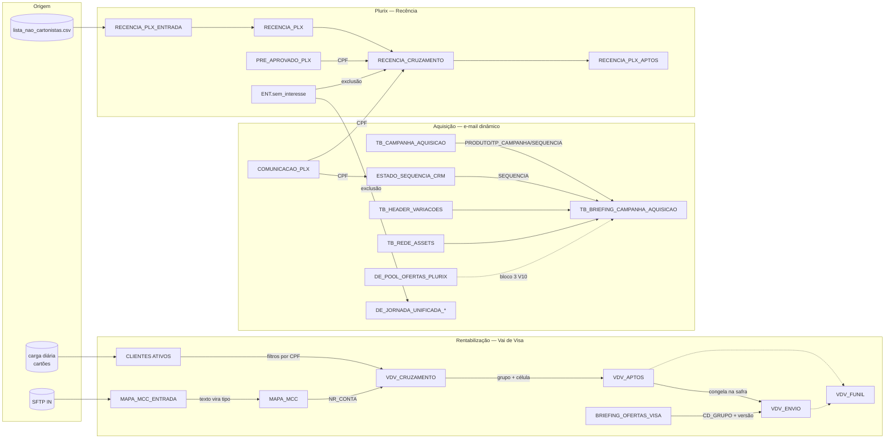

# Dados: entidades do Supabase, produtos e performance (dados.md)

<!-- gerado por scripts/bundle_vault.py: não editar à mão -->

> Compilado do vault em 2026-11-03. 60 notas. Quando carregar: Tarefa que lê ou escreve tabela, cruza métrica, cita produto ou usa snapshot de performance.
> Arquivo derivado: a fonte canônica é a nota no vault. Mapa completo em [INDEX.md](INDEX.md).

## 📌 Notas neste arquivo

- [Amostras-Comunicacoes-Reais](#amostras-comunicacoes-reais)
- [02-Entidades-Dados/Amostras-Comunicacoes-Reais/README](#02-entidades-dadosamostras-comunicacoes-reaisreadme)
- [Beneficios-e-Vigencia](#beneficios-e-vigencia)
- [Cartao-Afinz-Visa](#cartao-afinz-visa)
- [Cartao-Amigo-Afinz-Visa](#cartao-amigo-afinz-visa)
- [Cartao-Bem-Mais-Afinz-Visa](#cartao-bem-mais-afinz-visa)
- [Cartao-Dia-Afinz-Visa](#cartao-dia-afinz-visa)
- [Dicionario-de-Produtos](#dicionario-de-produtos)
- [Pode-Dizer-Nao-Pode-Dizer](#pode-dizer-nao-pode-dizer)
- [Dimensao-Canonica-de-Parceiro](#dimensao-canonica-de-parceiro)
- [Falha-Sincronizacao-Meta-Supabase-4Dias-Ago26](#falha-sincronizacao-meta-supabase-4dias-ago26)
- [Quebra-de-Medicao-Aquisicao-B2C-Jun26](#quebra-de-medicao-aquisicao-b2c-jun26)
- [DE-BRIEFING_OFERTAS_VISA](#de-briefing_ofertas_visa)
- [DE-CLIENTES_ATIVOS](#de-clientes_ativos)
- [DE-MAPA_MCC](#de-mapa_mcc)
- [DE-VDV_APTOS](#de-vdv_aptos)
- [DE-VDV_CRUZAMENTO](#de-vdv_cruzamento)
- [DE-VDV_ENVIO](#de-vdv_envio)
- [DE-VDV_FUNIL](#de-vdv_funil)
- [MOC-SFMC-DEs-e-Automations](#moc-sfmc-des-e-automations)
- [Supabase-Schema](#supabase-schema)
- [Supabase-Visão-Geral](#supabase-visão-geral)
- [02-Entidades-Dados/Templates-Vibe-Revisao-2026/README](#02-entidades-dadostemplates-vibe-revisao-2026readme)
- [Templates-Vibe-Revisao-2026](#templates-vibe-revisao-2026)
- [Views-Performance](#views-performance)
- [activities](#activities)
- [ad_creatives](#ad_creatives)
- [appsflyer_template_daily](#appsflyer_template_daily)
- [b2c_daily_metrics](#b2c_daily_metrics)
- [campaign_budgets](#campaign_budgets)
- [campaign_context](#campaign_context)
- [collection_execution_logs](#collection_execution_logs)
- [collection_queue](#collection_queue)
- [communication_slots](#communication_slots)
- [communication_templates](#communication_templates)
- [copa_lp_daily](#copa_lp_daily)
- [copa_visa_daily](#copa_visa_daily)
- [dispatch_descriptions](#dispatch_descriptions)
- [gaas_dinamica_bi_metrics](#gaas_dinamica_bi_metrics)
- [gaas_update_runs](#gaas_update_runs)
- [goals](#goals)
- [paid_media_budgets](#paid_media_budgets)
- [paid_media_campaign_mappings](#paid_media_campaign_mappings)
- [paid_media_insights](#paid_media_insights)
- [paid_media_metrics](#paid_media_metrics)
- [paid_media_objectives](#paid_media_objectives)
- [paid_media_targets](#paid_media_targets)
- [profiles](#profiles)
- [rentabilizacao_activities](#rentabilizacao_activities)
- [CAC-por-Canal](#cac-por-canal)
- [CPA-por-Plataforma](#cpa-por-plataforma)
- [Eficiência-de-Criativo](#eficiência-de-criativo)
- [Evolução-Temporal](#evolução-temporal)
- [Funil-de-Aquisição](#funil-de-aquisição)
- [KPIs-Núcleo](#kpis-núcleo)
- [Mapa-de-Oportunidades](#mapa-de-oportunidades)
- [Metas-e-CAC](#metas-e-cac)
- [Performance-por-Segmento](#performance-por-segmento)
- [Serie-Historica-Aquisicao-Mar-Ago-2026](#serie-historica-aquisicao-mar-ago-2026)
- [Spend-e-Tendência](#spend-e-tendência)

---

## Amostras-Comunicacoes-Reais

> **tags:** `dados, comunicacoes, amostras, llm-extraction` | **tipo:** `dados-brutos` | **camada:** `dados` | **atualizado:** `2026-08-17` | **status:** `confirmado` | **fonte:** `analise-manual-llm`

# Amostras de Comunicações Reais — dataset extraído por LLM vision

**Definição:** dataset bruto de 73 disparos reais (WhatsApp, Push, E-mail, SMS) de aquisição de cartão Afinz, extraído por leitura visual (LLM) dos prints armazenados nas pastas pessoais do Pablo `WHATSAPP AQUISIÇÃO COPA` e `COMUNICAÇÕES` (fora do vault, no OneDrive). Informação bruta — sem curadoria adicional além da extração em si.

## Arquivos

- `dataset_completo.json` — os 73 registros, um por imagem, campo a campo.
- `afinz_briefing_dataset.csv` — mesmo dataset em formato tabular.

## Como foi extraído

Snapshot em 2026-08-12. 8 subagentes rodaram em paralelo, cada um lendo um lote de imagens e devolvendo JSON estruturado com um prompt padronizado (mesmo schema, mesmas instruções, para todos os lotes). Nenhuma curadoria humana foi feita sobre o conteúdo extraído — é leitura direta do que está escrito/desenhado em cada print.

## Campos por registro

`caminho_arquivo` · `bu` · `segmento_etapa` · `sub_jornada` · `variante_publico` (Institucional/Serasa) · `canal_pasta` (o que a estrutura de pasta original sugeria) · `canal_detectado` (o que a imagem realmente mostra ser) · `produto_nome` · `texto_completo` · `oferta` · `promocional` · `cta_principal` · `cta_secundario` · `elementos_visuais` · `tom` · `campos_personalizacao_visiveis` · `indicio_teste_qa` · `campanha_provavel` · `confianca_extracao`.

## Cobertura e limites — ler antes de usar

- **Cobre as 73 imagens que existiam nas duas pastas em 2026-08-12.** Se novas imagens foram adicionadas às pastas originais desde então, elas **não** estão neste dataset — isto é um snapshot pontual, não uma sincronização contínua.
- **73% (53/73) foram flagadas `indicio_teste_qa = true`** — nomes tipo "Pablo"/"Pietra"/"pablooooo" e limites de crédito com cara de placeholder (ex. R$32423). Isso sugere que boa parte do lote `WHATSAPP AQUISIÇÃO COPA` são prints de validação/QA, não confirmadamente disparos reais para a base de clientes. Tratar `indicio_teste_qa=true` como "não confirmado como envio real", não como "confirmado como teste".
- **6 imagens têm `canal_pasta` divergente de `canal_detectado`** — todas em `B2C/CARRINHO/DIÁRIO`, marcadas como WhatsApp pela pasta mas com conteúdo visual de push notification. Não confiar no caminho da pasta como fonte de verdade de canal.
- Nenhum registro deste dataset foi vinculado a um `template_id` real da tabela `communication_templates` — essa tabela usa `template_id` como chave primária (`NOT NULL`, com validação de formato), então não é possível promover estas linhas para lá sem antes atribuir um `template_id` de verdade vindo da planilha de governança (`gaas-governanca-comunicacoes`). Ver decisão aberta em [Galeria-de-Templates](evolucao.md#galeria-de-templates).

## Relacionado

- [communication_templates](#communication_templates) · [communication_slots](#communication_slots) · [Galeria-de-Templates](evolucao.md#galeria-de-templates) · [Decisões-Abertas](evolucao.md#decisões-abertas) · skill `afinz-copy-aquisicao` (`references/exemplos_reais.md` resume os padrões encontrados aqui em prosa)


---

## 02-Entidades-Dados/Amostras-Comunicacoes-Reais/README

> **tags:** `dados, comunicacoes, amostras, llm-extraction` | **tipo:** `dados-brutos` | **camada:** `dados` | **atualizado:** `2026-08-17` | **status:** `confirmado` | **fonte:** `analise-manual-llm`

# Amostras de Comunicações Reais — dataset extraído por LLM vision

**Definição:** dataset bruto de 73 disparos reais (WhatsApp, Push, E-mail, SMS) de aquisição de cartão Afinz, extraído por leitura visual (LLM) dos prints armazenados nas pastas pessoais do Pablo `WHATSAPP AQUISIÇÃO COPA` e `COMUNICAÇÕES` (fora do vault, no OneDrive). Informação bruta — sem curadoria adicional além da extração em si.

## Arquivos

- `dataset_completo.json` — os 73 registros, um por imagem, campo a campo.
- `afinz_briefing_dataset.csv` — mesmo dataset em formato tabular.

## Como foi extraído

Snapshot em 2026-08-12. 8 subagentes rodaram em paralelo, cada um lendo um lote de imagens e devolvendo JSON estruturado com um prompt padronizado (mesmo schema, mesmas instruções, para todos os lotes). Nenhuma curadoria humana foi feita sobre o conteúdo extraído — é leitura direta do que está escrito/desenhado em cada print.

## Campos por registro

`caminho_arquivo` · `bu` · `segmento_etapa` · `sub_jornada` · `variante_publico` (Institucional/Serasa) · `canal_pasta` (o que a estrutura de pasta original sugeria) · `canal_detectado` (o que a imagem realmente mostra ser) · `produto_nome` · `texto_completo` · `oferta` · `promocional` · `cta_principal` · `cta_secundario` · `elementos_visuais` · `tom` · `campos_personalizacao_visiveis` · `indicio_teste_qa` · `campanha_provavel` · `confianca_extracao`.

## Cobertura e limites — ler antes de usar

- **Cobre as 73 imagens que existiam nas duas pastas em 2026-08-12.** Se novas imagens foram adicionadas às pastas originais desde então, elas **não** estão neste dataset — isto é um snapshot pontual, não uma sincronização contínua.
- **73% (53/73) foram flagadas `indicio_teste_qa = true`** — nomes tipo "Pablo"/"Pietra"/"pablooooo" e limites de crédito com cara de placeholder (ex. R$32423). Isso sugere que boa parte do lote `WHATSAPP AQUISIÇÃO COPA` são prints de validação/QA, não confirmadamente disparos reais para a base de clientes. Tratar `indicio_teste_qa=true` como "não confirmado como envio real", não como "confirmado como teste".
- **6 imagens têm `canal_pasta` divergente de `canal_detectado`** — todas em `B2C/CARRINHO/DIÁRIO`, marcadas como WhatsApp pela pasta mas com conteúdo visual de push notification. Não confiar no caminho da pasta como fonte de verdade de canal.
- Nenhum registro deste dataset foi vinculado a um `template_id` real da tabela `communication_templates` — essa tabela usa `template_id` como chave primária (`NOT NULL`, com validação de formato), então não é possível promover estas linhas para lá sem antes atribuir um `template_id` de verdade vindo da planilha de governança (`gaas-governanca-comunicacoes`). Ver decisão aberta em [Galeria-de-Templates](evolucao.md#galeria-de-templates).

## Relacionado

- [communication_templates](#communication_templates) · [communication_slots](#communication_slots) · [Galeria-de-Templates](evolucao.md#galeria-de-templates) · [Decisões-Abertas](evolucao.md#decisões-abertas) · skill `afinz-copy-aquisicao` (`references/exemplos_reais.md` resume os padrões encontrados aqui em prosa)


---

## Beneficios-e-Vigencia

> **tags:** `entidade,produto,beneficio,vigencia,guardrail,copy` | **tipo:** `entidade` | **camada:** `dados` | **atualizado:** `2026-10-02` | **status:** `confirmado` | **fonte:** `pesquisa-externa`

# Benefícios e Vigência

**Definição:** o registro de todo benefício citável em copy, com valor exato, **janela de vigência**, fonte, dono da confirmação e permissão de uso. É o guardrail que impede a IA de prometer benefício morto.

## Por que esta nota existe

Em 20/08/2026 quase escrevemos uma régua do `+amigo` prometendo o programa de pontos. Ele **encerrou em 01/07/2026** e o prazo de resgate **expirou em 31/07/2026**. Nada na nossa base sabia — porque nenhum benefício tinha campo de validade.

**O que faltava não era o dado. Era o campo `vigente_ate`.**

## A regra

> Nenhum benefício entra na copy se não tiver linha aqui com **`STATUS = VIGENTE`** (ou `SEM DATA FIM`) **e `PODE CITAR = Sim`**. Sem linha, não existe.

## Esquema da tabela

| Coluna | Para que serve |
|---|---|
| `PRODUTO` | qual dos quatro cartões |
| `CATEGORIA` | Desconto · Prazo · Saúde · Vibe · Cartão virtual · Sorteio · Pontos… |
| `BENEFÍCIO` | a frase do benefício |
| `VALOR EXATO` | o número, literal como a fonte publica |
| `VIGENTE DE` / `VIGENTE ATÉ` | janela. **Vazio em `VIGENTE ATÉ` = sem data de fim conhecida** |
| `STATUS` | **fórmula** — compara `VIGENTE ATÉ` com `=TODAY()`. Vira `EXPIRADO` sozinho |
| `PODE CITAR?` | `Sim` · `NÃO` · `Cuidado` · `Checar` |
| `TIPO FONTE` | OFICIAL · TERCEIRA · INTERNO |
| `DONO DA CONFIRMAÇÃO` | quem revalida essa linha |
| `FONTE (URL)` | rastro |
| `OBSERVAÇÃO` | condição, ressalva, conflito |

A planilha `Dicionario_Produtos_Afinz_v3.xlsx`, aba **`Beneficios`**, é a versão viva. 34+ linhas.

## O que torna isso um guardrail e não uma lista

A coluna `STATUS` é **fórmula**, não texto:

```
=IF(VIGENTE_ATE="","SEM DATA FIM",IF(VIGENTE_ATE<HOJE,"EXPIRADO","VIGENTE"))
```

Ninguém precisa lembrar de revisar. Abriu a planilha, a linha de pontos do +amigo já está vermelha e marcada `EXPIRADO`. **Benefício de campanha nasce com `VIGENTE ATÉ` preenchido** — sem isso ele nunca expira sozinho e vira informação morta.

## Estado atual por produto (resumo)

### 🔴 Bloqueados
| Produto | Benefício | Motivo |
|---|---|---|
| +amigo | Programa de pontos (1 pt / R$10) | **EXPIRADO** — encerrou 01/07/2026, resgate até 31/07/2026 |
| +amigo | Créditos Vibe | Plurix é o único dos quatro que não usa Vibe |
| Bem Mais | % de desconto nas lojas | não existe percentual publicado |

### ⚠️ Cuidado / Checar
| Produto | Benefício | Ressalva |
|---|---|---|
| Afinz Visa | Cartão virtual | **validade de 1h e só online** — não é o virtual dos co-branded |
| Afinz Visa | Farmácia até 70% | blog da própria Afinz diz "até 35%" |
| Afinz Visa | Educação a partir de 40% | Bem Barato diz "até 80%" no mesmo programa |
| Afinz Visa | Sorteio R$100 mil | app Vibe diz "até R$10.000"; regulamento expirado |
| Bem Mais | R$30/mês Vibe | condicional a **fatura paga + anuidade ativa** |
| Bem Mais | Educação até 80% | conflita com a Afinz |
| +amigo | Frete grátis | exige compra mínima e lojas participantes |
| +amigo | Sorteios | citados **sem valor** — nunca inventar número |
| DIA | **todos os 7 benefícios de loja** | release de nov/2024, não reconfirmado |
| Todos os produtos | "Até 40 dias para pagar" | **BLOQUEADO** — fonte oficial vigente e URL rastreável não recuperadas |

### ✅ Liberados sem ressalva
Cartão virtual pleno (+amigo, Bem Mais) · Você Bem até 70% saúde · aceitação Visa · adicionais · Vibe missões 1 e 2 (B2C, Bem Mais, DIA) · desconto "a partir de 5% em produtos selecionados" (+amigo, com a ressalva de categoria).

## Manutenção

Cada linha tem **dono**. Quem é dono revalida. Donos atuais: Produto/Afinz · Plurix · Bem Barato · DIA · Jurídico · Vertem · Visa.

As linhas com dono **Jurídico** são as que têm duas fontes oficiais em conflito — ver [Conflitos-de-Fonte-Produtos-2026-08](evolucao.md#conflitos-de-fonte-produtos-2026-08). Nenhuma delas deveria ir ao ar antes de alguém escolher o número canônico.

## Relacionado

- [Dicionario-de-Produtos](#dicionario-de-produtos) · [Pode-Dizer-Nao-Pode-Dizer](#pode-dizer-nao-pode-dizer) · [Conflitos-de-Fonte-Produtos-2026-08](evolucao.md#conflitos-de-fonte-produtos-2026-08)
- [Motor-de-Briefing-Automatico](core.md#motor-de-briefing-automatico) — esta nota é a **camada 2** do motor
- [Vibe](core.md#vibe) · [Ofertas](legado.md#ofertas)

## Aplicação operacional — revisão editorial 02/10/2026

### Validade não é sinônimo de autorização

Um benefício sem fim conhecido não é permanente. Data aberta apenas descreve o que a fonte informa. Para comunicar, precisam coincidir produto/rede/praça, condição, vigência e permissão; a evidência também precisa ser adequada. A fórmula da planilha sinaliza expiração conhecida, mas não detecta mudança contratual não registrada.

### Procedimento de revisão

1. Recuperar a fonte aplicável e registrar a data da consulta.
2. Transcrever o valor exato e suas condições, sem generalizar entre redes.
3. Classificar como permitido, condicional, bloqueado ou a conferir.
4. Confrontar guardrails ativos no GaaS e registrar divergência.
5. Identificar o dono de validação e atualizar a evidência antes de liberar o claim.

### Mapeamento para o GaaS

`value_exact` preserva o número literal; `valid_from`/`valid_to` preservam janela; `citation_status` descreve citação; `allowed_status` indica gate; `evidence`/`source_url` registram suporte; `applies_to` limita escopo. `source='gaas'` identifica edição operacional. Campo existente não demonstra sincronização automática da planilha.

Na leitura de 02/10, os sete guardrails ativos de +amigo não tinham URL. Cobertura familiar do Você Bem estava `allowed` com origem em peça antiga, e o percentual/cobertura possuía revisão obrigatória. Tratar a suficiência da evidência como pendência, sem reescrever autorização operacional nesta revisão do vault. Ver [Ficha-de-Produto-Guia](operacao.md#ficha-de-produto-guia) e [Fontes-e-Proveniencia-Growth](core.md#fontes-e-proveniencia-growth).


---

## Cartao-Afinz-Visa

> **tags:** `entidade,produto,b2c,afinz-visa,copy` | **tipo:** `entidade` | **camada:** `dados` | **atualizado:** `2026-11-03` | **status:** `confirmado` | **fonte:** `pesquisa-externa`

# Cartão Afinz Visa

**Definição:** o cartão proprietário da Afinz, sem parceiro de varejo — a única marca da família onde a Afinz é o sujeito da comunicação.

## Identificação

| Campo | Valor |
|---|---|
| **Nome na copy** | `cartão Afinz Visa` |
| **Nome oficial** | Cartão Afinz Visa / Cartão Afinz Visa Internacional |
| **BU** | B2C |
| **Emissor** | Afinz (ex-Sorocred) — Sorocred CFI S/A |
| **Praça** | Nacional e internacional — rede Visa, 200+ países |
| **App** | Afinz (`br.com.sorocred.sorocredapp`) · 1 mi+ downloads · 3,47 Play / 3,3 App Store |
| **OneLink** | `cartao-afinz.onelink.me/9ODN` |
| **Prefixo de template** | `b2c_` na taxonomia, `afz_` nas peças reais — ver [Conflitos-de-Fonte-Produtos-2026-08](evolucao.md#conflitos-de-fonte-produtos-2026-08) |

## Proposta de valor

Crédito próprio, sem amarra de varejo. O diferencial **não é desconto de gôndola** — é o pacote de vida em três camadas:

1. **[Vibe](core.md#vibe)** — crédito que volta a cada fatura paga, resgatável em 250+ marcas. É a **âncora e o diferencial da proposta de valor do produto**, não um benefício secundário: lock-up `afinz + ViBE`, headline *"Um cartão para você fazer mais"*.
2. **Programa Você Bem** — saúde e educação a preço acessível.
3. **Aceitação universal Visa** — nacional e internacional.

## Público

Consumidor final sem vínculo com rede parceira. Chega por funil próprio, Serasa, Ecred, Bom pra Crédito. É o único produto da família cuja audiência **conhece a marca Afinz** — nos co-branded o cliente conhece a loja.

## Benefícios confirmados

| Benefício | Valor | Fonte |
|---|---|---|
| Adicionais gratuitos | até 9 | [OFICIAL] landing |
| Parcelamento | até 18x sem juros | [OFICIAL] landing |
| Você Bem Saúde | consultas a partir de R$50, exames a partir de R$10 | [OFICIAL] página Você Bem |
| Vibe missão 1 | R$100 na ativação do cartão | [INTERNO] Treinamento Comercial 08/08/2026 |
| Vibe missão 2 | R$30 por fatura paga em dia | [INTERNO] idem |
| Vibe resgate | 250+ marcas — delivery, cinema, shows, viagens, moda, beleza, pets | [INTERNO] idem |
| Vai de Visa | vantagens da bandeira; catálogo de ofertas usado no [Pool de Ofertas - Vai de Visa](resultados-2.md#iniciativa-pool-de-ofertas-vai-de-visa) (out/2026: 71 ofertas, cupom e link de afiliado) | [OFICIAL] landing; catálogo Visa out/2026 |

Detalhe de todas as linhas, com vigência e dono, em [Beneficios-e-Vigencia](#beneficios-e-vigencia).

## ⚠️ O cartão virtual daqui não é o dos co-branded

Este é o ponto mais perigoso do produto para quem escreve copy.

- **No Afinz Visa proprietário:** o virtual é gerado no app, retorna número/validade/CVV, tem **validade de 1 hora** e é **exclusivo para transações online**. Fonte: blog oficial da Afinz.
- **Nos co-branded (+amigo, Bem Mais):** é o virtual **pleno**, usado enquanto o cartão físico não chega (7 a 10 dias úteis).

Nossa copy B2C diz *"Cartão virtual para usar na hora"*. Se o cliente B2C recebe o de 1 hora, a frase induz a erro. **Pendência: confirmar com produto qual dos dois o cliente B2C recebe.**

## Tom e voz

| Dimensão | Como é | Evidência |
|---|---|---|
| Emoji | **Usa com frequência** — 🎉 🎁 💳 💙 | 11 peças reais de Carrinho B2C, todas com emoji |
| Abertura | Vocativo com nome: `Oi, {{1}}!` / `Olá, {{1}}!` | peças reais |
| Voz institucional | *"Fácil de pedir, fácil de usar e crédito na hora!"* · *"Afinidade é ter benefícios que cuidam de você!"* · *"Aqui, somos 100% a fim de te ver bem"* | [OFICIAL] landing |
| Eixo | Benefício de vida (saúde, educação, Vibe) + praticidade | landing + Você Bem |

Contraste importante: o **+amigo é zero emoji**. As duas marcas não falam igual, e isso não está escrito em nenhum guia — só na evidência das peças.

## Riscos

- **Anuidade de R$155,88 a R$360** por 365 dias, e a Tabela de Tarifas oficial **não tem data de vigência**. Não afirmar que esses valores valem hoje sem uma versão datada.
- Rotativo até **21,99% a.m., CET 22,62% a.m.** — qualquer menção a taxa exige CET.
- O FAQ oficial diz que *"os nossos cartões possuem anuidade"*. **Nunca dizer "anuidade grátis"** — afiliados divulgam isso e está errado.
- **Não usar "até 40 dias para pagar".** A alegação foi removida dos benefícios confirmados em 20/08/2026 porque a URL oficial vigente não foi recuperada. Só reabilitar após validação documental rastreável.

## Relacionado

- [Dicionario-de-Produtos](#dicionario-de-produtos) · [Beneficios-e-Vigencia](#beneficios-e-vigencia) · [Pode-Dizer-Nao-Pode-Dizer](#pode-dizer-nao-pode-dizer)
- [Vibe](core.md#vibe) · [Regua-Vibe-Ativacao](core.md#regua-vibe-ativacao) · [BUs](legado.md#bus) · [Segmentos](legado.md#segmentos)
- [Cartao-Amigo-Afinz-Visa](#cartao-amigo-afinz-visa) · [Cartao-Bem-Mais-Afinz-Visa](#cartao-bem-mais-afinz-visa) · [Cartao-Dia-Afinz-Visa](#cartao-dia-afinz-visa)

## Aplicação operacional — revisão editorial 02/10/2026

### Como usar a ficha

Identificar primeiro o estágio de aquisição e o tier aplicável. O contexto B2C proprietário não deve herdar condições de co-branded. Vibe pode ser o argumento central conforme a estratégia documentada, mas valor, condição de participação e validade precisam acompanhar a fonte da campanha.

### Procedimento para briefing

1. Confirmar produto, tier, público e ação pretendida.
2. Selecionar benefícios em [Beneficios-e-Vigencia](#beneficios-e-vigencia), conferindo condição e fonte.
3. Resolver a pendência de cartão virtual antes de prometer uso imediato ou modalidade.
4. Validar tabela de tarifa datada antes de citar custo, gratuidade ou parcelamento.
5. Definir hipótese, supressões e destino por estágio em [Briefing-e-Regua-de-Aquisicao](core.md#briefing-e-regua-de-aquisicao).

### Lacunas e fronteira com o GaaS

Na consulta de 02/10, não havia contexto ativo deste produto em `dynamic_email_product_contexts`; havia apenas +amigo. Esta ficha existe no vault e não demonstra um cadastro operacional equivalente na Fábrica. Permanecem a confirmar a modalidade atual de cartão virtual, tarifas e condições comerciais vigentes. Números de benefícios e avaliações de app acima são da pesquisa histórica, não nova verificação.

### Critério de conclusão e medição

Uma peça pode seguir para produção quando claims, público, legal e destino estão validados, sem pendências que afetem promessa. Medir proposta, aprovação, ativação e compra conforme objetivo/janela; clique é diagnóstico. [Servico-Emails-Dinamicos](operacao.md#servico-emails-dinamicos) descreve a certificação técnica, e [Fontes-e-Proveniencia-Growth](core.md#fontes-e-proveniencia-growth) distingue cadastro, pesquisa e execução.


---

## Cartao-Amigo-Afinz-Visa

> **tags:** `entidade,produto,plurix,amigo,copy` | **tipo:** `entidade` | **camada:** `dados` | **atualizado:** `2026-10-02` | **status:** `confirmado` | **fonte:** `pesquisa-externa`

# Cartão +amigo Afinz Visa

**Definição:** o cartão co-branded do Grupo Amigão / Plurix — o único dos quatro que **não usa [Vibe](core.md#vibe)**, e o único onde a Afinz é deliberadamente discreta na comunicação.

## Identificação

| Campo | Valor |
|---|---|
| **Nome na copy** | `cartão +amigo Afinz Visa` (curto: `cartão +amigo`) |
| **Nome oficial** | Cartão +amigo · nas bandeiras: "Cartão Clube +amigo Visa" |
| **BU** | Plurix |
| **Parceiro** | Plurix / Grupo Amigão |
| **Emissor** | Afinz — **mas o site oficial do produto não cita a Afinz como emissor** (a única menção é no benefício "Você Bem (Afinz)"). O rodapé diz *"+amigo é uma marca da Plurix"*. |
| **Praça** | SP, PR e MS |
| **App** | Cartão +amigo (`br.com.plurix.maisamigoapp`) · 100 mil+ · 3,6 Play / 2,3 App Store |
| **OneLink** | `mais-amigo.onelink.me` — shortcodes `YU3C` e `OfSm` observados |
| **Prefixo de template** | `plu_` (histórico), `plx_` (planilhas novas), `plurix_` (esperado pela governança) — três grafias, ver [Conflitos-de-Fonte-Produtos-2026-08](evolucao.md#conflitos-de-fonte-produtos-2026-08) |

## Proposta de valor

**Desconto extra dentro do supermercado que a pessoa já frequenta.** O "+" é literal: soma sobre a oferta do Clube. Ancora em *compra do mês*, não em crédito.

Vocabulário validado pelo Pablo em 20/08/2026: dizer **"supermercado"**, não "rede parceira". O cliente pensa "minha compra", não "meu varejista".

## Público

Frequentador das lojas do grupo — **conhece a LOJA, não conhece a Afinz**.

> ⚠️ **Correção de 20/08/2026:** estar no Clube +amigo **não é requisito para PEDIR o cartão**. É condição para o desconto ser aplicado (exige o CPF do Clube no caixa). O Clube tem 5 mi+ cadastrados e é gratuito, mas o público endereçável de aquisição **não se limita a ele**.
>
> A ponta oposta também importa: quem pede o cartão sem estar no Clube vira cliente **com cartão e sem benefício**. O passo "entre no clube" pertence à régua de **ativação** (pós-aprovação), não como pré-requisito da aquisição. Hoje esse passo não existe em régua nenhuma.

> **Régua de topo de funil (02/10/2026):** o público da régua de topo Plurix é **exclusivamente membro do Clube +amigo**. Copy trata o Clube como algo que a pessoa já tem. Ver [Topo-de-Funil](core.md#topo-de-funil).

## Bandeiras — o desconto NÃO é uniforme

Este é o achado que mais muda a copy. Cada bandeira publica categorias e percentuais próprios:

| Bandeira | Desconto publicado | Restrição |
|---|---|---|
| **Dom Olívio** | Vinhos 20% · Destilados 20% · Carnes bovinas 10% · Queijos 10% | **Cartão restrito a Campinas, Jundiaí e Sorocaba (SP)** |
| **Compre Mais** | 5% em açougue · 5% em arroz, feijão e leite | — |
| **Superpão** | +5% em carnes e aves frescas · +5% em frutas, verduras, legumes e ovos | — |
| **Avenida** | 5% em arroz, feijão, leite e carnes frescas | — |
| **Boa Supermercados** | 5% em açougue, frutas, legumes, verduras e ovos | Clube Cliente Boa migrou para Clube +amigo em abr/2025 |
| **Amigão** | 5% — categorias não legíveis (post truncado) | **LACUNA** |
| **Clube Paraná / Paraná Atacadista** | não encontrado | **LACUNA** |
| **Mega / Mega Atacadista** | não encontrado | **LACUNA** |

**Consequência:** copy que diz "5% de desconto" sem `em produtos selecionados` está errada em pelo menos uma bandeira. O texto oficial é *"a partir de +5% off em produtos selecionados"* — o 5% é **piso**, não teto.

> 📊 A nota [Bandeiras-Plurix](core.md#bandeiras-plurix) lista 6 redes (Amigão, Boa, Avenida, Compre Mais, Paraná, Superpão). A lista oficial do Clube em 20/08/2026 tem **8**: as 6 + **Mega** + **Dom Olívio**. Dom Olívio é justamente a que quebra o padrão de 5%. Vale reconciliar as duas notas.

## Benefícios confirmados

| Benefício | Valor | Fonte |
|---|---|---|
| Desconto | a partir de +5% off em produtos selecionados | [OFICIAL] Clube +amigo |
| Cartão virtual | no app, uso imediato; físico em até 10 dias úteis | [OFICIAL] |
| Você Bem | até 70% em consultas, exames e medicamentos | [OFICIAL] |
| Aceitação | todos os estabelecimentos Visa, nacional e internacional | [OFICIAL] |
| Frete grátis | compras online — **exige compra mínima e lojas participantes** | [OFICIAL] |
| Sorteios | citados **sem valor** | [OFICIAL] |
| Selos em dobro | campanha "+Amigo coleciona Potes", 03/08 a 06/12/2026 | [OFICIAL] SAC Familhão |

## 🔴 Programa de pontos — ENCERRADO

> **Encerrou em 01/07/2026. Resgate expirou em 31/07/2026.** Comunicado oficial no site do Clube: *"Após essa data, os pontos eventualmente não utilizados perderão a validade e não poderão ser resgatados."*

A regra extinta era *"Ganhe 1 ponto a cada R$10 em compras"*, trocáveis por vale-compras.

**Armadilha ativa:** em 20/08/2026 as páginas de **Compre Mais** e **Superpão** ainda anunciavam o programa, incluindo "Pontos que viram Vale Compras". O passo 4 do onboarding no site do Clube também ainda diz *"acumular pontos"*. **Quem copiar dessas páginas escreve peça sobre programa morto.**

**Bloquear o termo "pontos" na copy +amigo.** Pedir à Plurix a atualização das páginas de bandeira.

## 🔴 Não tem Vibe

Confirmado pelo Pablo em 20/08/2026: **o Plurix é o único dos quatro produtos que não usa [Vibe](core.md#vibe)**. Não é dúvida em aberto, é definição. Zero menção em todas as fontes oficiais e ausente do material de treinamento comercial. **Nunca importar o gancho Vibe para copy +amigo.**

## Tom e voz

| Dimensão | Como é | Evidência |
|---|---|---|
| Emoji | 🔴 **ZERO emoji.** Ênfase feita com CAIXA ALTA | 0 emoji em 11/11 peças reais |
| Abertura | Vocativo com nome, tom de vizinhança | 11/11 peças reais |
| Voz institucional | *"Mais vantagens, mais descontos!"* · *"O programa de fidelização que mais economiza"* · *"As melhores vantagens do mercado na palma da sua mão"* | [OFICIAL] site |
| Voz da marca | Simplesmente eficiente · Afetuoso, de coração · Vizinho engajado | Guia de marca +amigo |
| CTA canônico | "Pedir meu Cartão +amigo" · "Peça já o seu" · saída "Não tenho interesse agora" | site + 11/11 peças |
| Eixo | Compra do mês e supermercado — vocabulário concreto de gôndola | guia de marca + Pablo 20/08/2026 |

**Regra de co-branding (guia de marca, literal):** a bandeira entra no **storytelling em texto**, com o logo +amigo assinando. **Nunca anexar o nome da loja ao logo.** Frases-modelo aprovadas: *"Peça seu cartão +amigo e ganhe descontos exclusivos"*, *"Faça parte do +amigo, o clube de benefícios do [Loja]"*, *"vantagens para sair de carrinho cheio"*.

Como o site do produto sequer identifica a Afinz, a copy mantém **"cartão +amigo" como sujeito** e "Afinz Visa" apenas como qualificador — nunca a Afinz na frente.

## Riscos

- **Não usar "até 40 dias para pagar".** A alegação foi retirada em 20/08/2026 por falta de fonte oficial vigente e rastreável.

- **Reclame Aqui 0,72/10** · 63 reclamações · **0% de resposta** · 5,6% de solução. Risco reputacional real numa régua de volume.
- **Mensalidade variável por rede e não publicada.** FAQ oficial: *"a mensalidade é variável de acordo com a rede de supermercado"*. Nenhuma bandeira publica o valor.
- Desconto *"sujeito à alteração sem prévio aviso"* — literal no site.
- Existe um **"Cartão Amigão Visa"** anterior e distinto (conta digital, junho/2024). Não confundir.

## Relacionado

- [Dicionario-de-Produtos](#dicionario-de-produtos) · [Beneficios-e-Vigencia](#beneficios-e-vigencia) · [Pode-Dizer-Nao-Pode-Dizer](#pode-dizer-nao-pode-dizer)
- [Bandeiras-Plurix](core.md#bandeiras-plurix) · [Emails-Dinamicos-Plurix](operacao.md#emails-dinamicos-plurix) · [Vibe](core.md#vibe)
- [Conflitos-de-Fonte-Produtos-2026-08](evolucao.md#conflitos-de-fonte-produtos-2026-08) · [Formatacao-WhatsApp-Variaveis-e-Espacamento](operacao.md#formatacao-whatsapp-variaveis-e-espacamento)

## Aplicação operacional — revisão editorial 02/10/2026

### Como transformar a ficha em comunicação

O público de topo registrado no GaaS em 02/10 é membro do Clube +amigo. A comunicação deve mostrar o valor incremental do cartão sobre o relacionamento existente com a loja. Não tratar o Clube como novidade nem inferir limite, aprovação ou desconto universal. Estar no Clube é regra desta audiência; solicitar o cartão é uma questão de elegibilidade distinta.

O contexto ativo traz a tese “Um cartão Visa que faz o supermercado render mais e vale fora dele também”. É uma proposta de valor operacional, não um slogan obrigatório. Percentuais, custos e condições continuam dependentes de fonte por rede e vigência.

### Assinatura e marca

O guardrail ativo do GaaS bloqueia citar Compre Mais e Superpão em assunto, pré-cabeçalho, copy, arte ou rodapé da régua. Nessas duas assinaturas, comunicar como +amigo até definição de nova marca. Amigão, Boa, Paraná e Avenida conservam o próprio nome no escopo documentado. Os nomes históricos nas tabelas acima servem a identificação/rastreabilidade, não autorizam sua reprodução em peças novas.

As oito redes comerciais citadas na pesquisa e as seis assinaturas operacionais não são a mesma lista. Não criar automaticamente briefing, ativo ou identidade para Mega/Dom Olívio a partir da presença comercial.

### Objeções e validação

| Objeção | O que a peça precisa explicar | Evidência necessária |
|---|---|---|
| Já tenho Clube | benefício adicional condicionado ao cartão | oferta da rede e mecanismo de aplicação |
| Compensa o custo? | mensalidade aplicável e economia sem promessa universal | tabela/contrato vigente e simulação rotulada |
| Posso usar fora da loja? | utilidade Visa sem confundir benefício específico da rede | condição de aceitação do produto |
| Tenho limite aprovado? | solicitação e análise, sem valor inventado | dado real de limite e estágio; ausente no topo documentado |
| Saúde vale para minha família? | cobertura e elegibilidade precisas | certificação da oferta, duração e cobrança |

### Lacunas e fonte atual

Consulta ao Supabase em 02/10 confirmou um contexto ativo e sete guardrails para +amigo. As regras não possuem URL preenchida. Você Bem até 70% exige revisão; cobertura familiar está cadastrada como permitida, mas a evidência é peça antiga. Não apresentar essa configuração como validação comercial completa. Prazo de até 40 dias diverge entre referência da skill e regra ampla do motor de briefing: reconciliar escopo/fonte antes de usar. A pesquisa comercial desta ficha não foi refeita nesta revisão editorial.

Próximo passo: [Briefing-e-Regua-de-Aquisicao](core.md#briefing-e-regua-de-aquisicao) → [Servico-Emails-Dinamicos](operacao.md#servico-emails-dinamicos). Ver [Ficha-de-Produto-Guia](operacao.md#ficha-de-produto-guia) e [Fontes-e-Proveniencia-Growth](core.md#fontes-e-proveniencia-growth).


---

## Cartao-Bem-Mais-Afinz-Visa

> **tags:** `entidade,produto,b2b2c,bem-barato,bem-mais,copy` | **tipo:** `entidade` | **camada:** `dados` | **atualizado:** `2026-10-02` | **status:** `confirmado` | **fonte:** `pesquisa-externa`

# Cartão Bem Mais Afinz Visa

**Definição:** o cartão co-branded do Grupo Bem Barato — ganha [Vibe](core.md#vibe) igual ao B2C, mas é o único que **não tem a jornada Vibe embarcada no app**, porque seu app é whitelabel.

## Identificação

| Campo | Valor |
|---|---|
| **Nome na copy** | `cartão Bem Mais Afinz Visa` |
| **Nome oficial** | Cartão Bem Mais / Cartão Bem Mais Afinz Visa |
| **BU** | B2B2C |
| **Parceiro** | Grupo Bem Barato |
| **Emissor** | Afinz (Sorocred CFI S/A) — publisher do app |
| **Praça** | Supermercados, farmácias e restaurantes do Grupo Bem Barato + toda rede Visa |
| **App** | Cartão Bem Mais Afinz (`br.com.bemmais.app`) · 50 mil+ · 2,8 Play / 3,7 App Store |
| **OneLink** | `cartao-bem-mais.onelink.me/dJ0j` (visto nos links de WhatsApp das jornadas NGD/ANC/carrinho Bem Barato, pacote SFMC de 07/10/2026; ver [Auditoria-Jornadas-SFMC-2026-10](evolucao.md#auditoria-jornadas-sfmc-2026-10)) |
| **Prefixo de template** | `bb_` no e-mail, `bbt_` no WhatsApp |

## Proposta de valor

Mesmo pacote [Vibe](core.md#vibe) do B2C e do Dia (**R$100 na ativação + R$30 por fatura paga**) dentro do ecossistema Bem Barato — supermercado, farmácia e restaurante. O gancho é **crédito que volta todo mês**, não desconto de gôndola.

## Público

Frequentador do Grupo Bem Barato. Estar no Clube Bem Mais **não é requisito** para pedir o cartão.

> **Régua de topo de funil (02/10/2026):** o público da régua de topo Bem Barato é **exclusivamente membro do Clube Bem Mais**. Copy trata o Clube como algo que a pessoa já tem. Ver [Topo-de-Funil](core.md#topo-de-funil).

## 🔴 O app é whitelabel — e isso quebra a régua Vibe

> **O cliente GANHA os créditos Vibe, mas não tem opt-in, saldo nem extrato no app.** O app do Bem Mais não é o app Afinz.

Toda a régua Vibe desenhada no material comercial de 08/08/2026 pressupõe o app Afinz:

- opt-in por **deeplink levando ao app Afinz** → não existe aqui
- *"saldo e extrato no app"* (Fase 2) → não existe aqui
- push de "crédito recebido" a partir do app → não existe aqui

**Consequência prática:** para Bem Mais, a copy **nunca** pode dizer "adira pelo app", "veja seu saldo no app" ou "confira seu extrato". Ele precisa de uma **régua Vibe própria, fora do app** — como adere, onde vê saldo, como resgata. **Hoje isso não existe desenhado.** Registrado como risco #17 na planilha.

## Benefícios confirmados

| Benefício | Valor | Fonte |
|---|---|---|
| Vibe missão 1 | R$100 na ativação do cartão | [OFICIAL] Bem Barato + Pablo 20/08/2026 |
| Vibe missão 2 | R$30 por fatura paga em dia | [OFICIAL] Bem Barato |
| Você Bem Saúde | até 70% em consultas, exames e medicamentos | [OFICIAL] |
| Você Bem Educação | até 80% em cursos profissionalizantes | [OFICIAL] — ⚠️ conflita com a Afinz, que diz "a partir de 40%" |
| Aceitação | aceito em toda rede Visa | [OFICIAL] |
| Adicional | 1 cartão adicional gratuito | [OFICIAL] |
| Cartão virtual | pelo app, uso imediato; físico em até 7 dias úteis | [OFICIAL] |

## ⚠️ "R$30 todo mês" é condicional

A página oficial do parceiro anuncia **"R$30 todo mês"** sem dizer a condição. A condição real é **por fatura paga em dia, com anuidade ativa**.

Copiar da página do parceiro **propaga a omissão**. Nossa copy sempre inclui a condição.

## 🔴 Não existe percentual de desconto publicado

A página oficial fala só em *"centenas de ofertas exclusivas"*. **Não existe % publicado** para as lojas Bem Barato. **Não importar o 5% do +amigo por analogia.**

## Tom e voz

| Dimensão | Como é | Evidência |
|---|---|---|
| Voz institucional | *"As melhores vantagens do mercado na palma da sua mão"* · *"PREÇO BAIXO SEMPRE!"* | [OFICIAL] |
| Eixo | Crédito que volta + cuidado com a família | headline oficial |
| Tom de disparo | **LACUNA — nenhuma peça real de CRM Bem Mais foi capturada** | — |

Como não há peça real, o tom de disparo é herdado do B2C por falta de alternativa. Depois do primeiro disparo, capturar print e alimentar [Galeria-de-Templates](evolucao.md#galeria-de-templates).

> **Atualização 07/10/2026:** o pacote SFMC de jornadas B2B2C trouxe as **primeiras peças reais de CRM do Bem Mais** (WhatsApp `repescagem_bb_vibe_1/2`, `upgrade_vibe_mais_limite_bb_2_`, `carrinho_abandonado_bb_1/2_2026`; SMS de NGD, ANC e carrinho). Tom observado: o mesmo do B2C (emoji, vocativo com nome, negrito no nome do produto), remetente "Bem Mais:"/"BEM MAIS:"/"BEM BARATO:" nos SMS. Nenhuma peça manda aderir ou ver saldo "pelo app". Textos e alertas de claim em [Auditoria-Jornadas-SFMC-2026-10](evolucao.md#auditoria-jornadas-sfmc-2026-10). A linha de tom acima continua marcada como lacuna até a revisão do Pablo.

## Riscos

- **Não usar "até 40 dias para pagar".** A alegação foi retirada em 20/08/2026 por falta de fonte oficial vigente e rastreável.

- **Nenhum documento legal público.** Varredura dos 19 links da página oficial: não há regulamento, termos, contrato de adesão nem tabela de tarifas. Só política de privacidade. Não há onde ancorar letra miúda de campanha.
- **A página oficial mistura "Bem Mais" e "Bem Barato"** no próprio menu. "Cartão Bem Barato" é o nome do produto **antecessor** (private label, descontinuado) — não usar.
- **Base pequena** (50 mil downloads) e o atendimento já se referiu ao produto como *"teste inicial"*.
- A Afinz **não lista o produto** em nenhum canal próprio.

## Relacionado

- [Dicionario-de-Produtos](#dicionario-de-produtos) · [Beneficios-e-Vigencia](#beneficios-e-vigencia) · [Pode-Dizer-Nao-Pode-Dizer](#pode-dizer-nao-pode-dizer)
- [Vibe](core.md#vibe) · [Regua-Vibe-Ativacao](core.md#regua-vibe-ativacao) · [Conflitos-de-Fonte-Produtos-2026-08](evolucao.md#conflitos-de-fonte-produtos-2026-08)
- [Cartao-Afinz-Visa](#cartao-afinz-visa) · [Cartao-Dia-Afinz-Visa](#cartao-dia-afinz-visa)

## Aplicação operacional — revisão editorial 02/10/2026

### Como usar a ficha

Separar o cartão Bem Mais Afinz Visa da marca do supermercado e do cartão antecessor. A audiência de topo registrada em 02/10 para Bem Barato é composta por membros do Clube; isso descreve a régua e não cria requisito universal para pedir o cartão. [Topo-de-Funil](core.md#topo-de-funil) conserva a decisão.

O benefício Vibe e o caminho para acesso precisam ser explicados separadamente: não herdar instrução de saldo/opt-in do app Afinz quando o produto usa aplicativo próprio. A promessa de R$30 precisa da condição de fatura e anuidade documentada, sem reduzir a mensagem a “todo mês”.

### Procedimento para briefing e QA

1. Confirmar nome comercial e app/destino aplicável.
2. Usar ofertas certificadas; nunca importar percentual do +amigo.
3. Validar condições de Vibe e acesso operacional.
4. Conferir documentos legais e a nota de campanha; a ausência de contrato público não autoriza inventar legal.
5. Capturar exemplos reais datados para enriquecer tom/voz, sem tratar histórico como vigência.

### Lacunas e medição

A pesquisa histórica aponta ausência de percentual publicado, documento legal público e amostra de CRM para tom. Nesta revisão, essas lacunas não foram resolvidas por pesquisa comercial. Não havia contexto ativo de Bem Mais na Fábrica na consulta de 02/10. O tamanho do público atual não foi obtido; downloads de app não são audiência acionável.

Resultado deve seguir objetivo e janela: proposta, aprovação, ativação e primeira compra, com cobertura explícita. Próximo passo: [Briefing-e-Regua-de-Aquisicao](core.md#briefing-e-regua-de-aquisicao) e [Servico-Emails-Dinamicos](operacao.md#servico-emails-dinamicos). Fonte/limites: [Fontes-e-Proveniencia-Growth](core.md#fontes-e-proveniencia-growth).


---

## Cartao-Dia-Afinz-Visa

> **tags:** `entidade,produto,b2b2c,dia,copy,risco` | **tipo:** `entidade` | **camada:** `dados` | **atualizado:** `2026-10-02` | **status:** `a-validar` | **fonte:** `pesquisa-externa`

# Cartão Dia Afinz Visa

**Definição:** o cartão co-branded do DIA Supermercados — o único da família com mecânica de **frequência** (não de categoria), e o único com **risco de dormência** documentado.

> 🔴 **STATUS: A VALIDAR ANTES DE QUALQUER BRIEFING.** Nenhuma comunicação pública desde nov/2024. Todo benefício abaixo vem do release de lançamento e **não foi reconfirmado para 2026**.

## Identificação

| Campo | Valor |
|---|---|
| **Nome na copy** | `cartão Dia Afinz Visa` |
| **Nome oficial** | Cartão DIA Afinz Visa — o próprio Dia chama de "Cartão Dia" |
| **BU** | B2B2C |
| **Parceiro** | DIA Supermercados Brasil |
| **Emissor** | Afinz (Sorocred) — produto listado no Reclame Aqui sob Sorocred |
| **Praça** | Lojas DIA **no estado de São Paulo apenas** (238 lojas) + rede Visa |
| **App** | 🔴 **Não tem app próprio.** Usa o app **Afinz** — e é por isso que tem a jornada Vibe completa. App complementar do varejista: "Club Dia" |
| **Prefixo de template** | `dia_` (não confirmado, sem lastro) |

## 🔴 Risco de dormência — leia antes de escrever

| Sinal | Evidência |
|---|---|
| Sem comunicação pública desde **nov/2024** | nenhuma notícia, post ou release posterior |
| Sem página de produto ativa | nem em `dia.com.br` nem em `afinz.com.br` em ago/2026 |
| Afinz não menciona o DIA | menu "Para você" lista só "Cartão Afinz Visa" e Você Bem |
| Parceiro encolheu drasticamente | DIA entrou em recuperação judicial em mar/2024; fechou **343 das 587 lojas** e 3 CDs; dívida ~R$1,1 bi; hoje **238 lojas, só em SP** |
| Atrito de aprovação | avaliação na App Store: *"Vivem oferecendo esse cartão pelo Dia Supermercado, mas eu e minha família tentamos obter e nunca é aprovado"* |

**Antes de qualquer régua DIA, confirmar com produto:** o cartão está ativo? em quais praças? quais benefícios seguem valendo?

## Proposta de valor

**Desconto atrelado a FREQUÊNCIA, não a categoria** — é o único da família com essa mecânica. E tem [Vibe](core.md#vibe) com a jornada in-app completa, porque usa o app Afinz.

## Público

Consumidor geral nas praças DIA (SP).

> ⚠️ **Correção de 20/08/2026:** ser membro do Clube DIA **não é requisito para PEDIR o cartão** — é requisito para **resgatar o desconto**. A fonte diz literalmente *"obrigatório ser membro do Clube DIA e portador do cartão para garantir os DESCONTOS"*. O público endereçável de aquisição é bem maior que a base do Clube.
>
> Mas prometer o desconto sem mencionar o Clube cria **cliente com cartão e sem benefício**. O passo "entre no Clube DIA" pertence à régua de **ativação**.

> **Régua de topo de funil (02/10/2026):** o público da régua de topo Dia é **exclusivamente membro do Clube DIA**. Copy trata o Clube como algo que a pessoa já tem. Ver [Topo-de-Funil](core.md#topo-de-funil).

## Benefícios — todos a revalidar

| Benefício | Valor | Origem |
|---|---|---|
| Desconto de ativação | R$20 em compras acima de R$120 | release nov/2024 |
| Marca própria DIA | 5% de desconto | release nov/2024 |
| Gatilho de frequência 1 | R$15 após **4 compras acima de R$50** no mês | release nov/2024 |
| Gatilho de frequência 2 | R$30 após **6 compras acima de R$50** no mês | release nov/2024 |
| Economia potencial | até R$65 no 1º mês, até R$45 nos seguintes | release nov/2024 |
| Parcelamento | até 4x sem juros na rede DIA | release nov/2024 |
| Você Bem | **6 meses de acesso grátis** — único da família com prazo explícito de gratuidade | release nov/2024 |
| **Vibe missão 1** | **R$100 na ativação do cartão** | [INTERNO] Pablo 20/08/2026 |
| **Vibe missão 2** | **R$30 por fatura paga** | [INTERNO] Treinamento Comercial 08/08/2026, slide "Saldo Vibe" |
| **Vibe in-app** | ✅ tem opt-in, saldo e extrato — usa o app Afinz | [INTERNO] Pablo 20/08/2026 |

Não há cashback nem programa de pontos. Os gatilhos de R$15/R$30 têm **apuração mensal** e reiniciam todo mês.

> ✅ **Correção da v1 do dicionário:** a primeira versão afirmava que o DIA **não** tinha Vibe. Está errado. O slide "Saldo Vibe" do treinamento comercial nomeia explicitamente *"Cartão Dia — R$30 Pagamento Fatura"*. Nenhuma fonte pública menciona; é configuração interna.

## Tom e voz

| Dimensão | Como é | Evidência |
|---|---|---|
| Voz institucional | *"Dia, o seu atacadinho de bairro"* (posicionamento adotado em 2024) | [OFICIAL] site institucional |
| Eixo | Economia recorrente na compra de bairro | release |
| Tom de disparo | **LACUNA — nenhuma peça real de CRM DIA capturada** | — |

## Restrições

- Adesão 100% digital, com abordagem por **geolocalização dentro da loja**.
- Descontos limitados a **produtos de marca própria DIA** e à rede DIA.
- **Regulamento oficial: não encontrado.**
- Comunicar **apenas em SP** — é a única praça em que a rede opera.

## Relacionado

- [Dicionario-de-Produtos](#dicionario-de-produtos) · [Beneficios-e-Vigencia](#beneficios-e-vigencia) · [Pode-Dizer-Nao-Pode-Dizer](#pode-dizer-nao-pode-dizer)
- [Vibe](core.md#vibe) · [Regua-Vibe-Ativacao](core.md#regua-vibe-ativacao) · [Conflitos-de-Fonte-Produtos-2026-08](evolucao.md#conflitos-de-fonte-produtos-2026-08)
- [Cartao-Afinz-Visa](#cartao-afinz-visa) · [Cartao-Bem-Mais-Afinz-Visa](#cartao-bem-mais-afinz-visa)

## Aplicação operacional — revisão editorial 02/10/2026

### Como interpretar esta ficha

Esta ficha combina identidade do produto e benefícios de pesquisas históricas. A seção “todos a revalidar” mantém seu valor: revisar o texto não converte o release antigo em oferta atual. A decisão de 02/10 define membros do Clube como audiência da régua de topo de Dia, conforme [Topo-de-Funil](core.md#topo-de-funil); a efetiva disponibilidade de campanha e produto exige confirmação operacional.

### Procedimento para qualquer nova comunicação

1. Confirmar com Produto/CRM a disponibilidade do cartão, praça e régua.
2. Recuperar condições comerciais e documentos atuais antes de usar os valores do release de 2024.
3. Confirmar origem e critérios da audiência de Clube; não inferir que toda a base é acionável.
4. Validar benefício e caminho de uso do Vibe por produto/campanha.
5. Conferir destino, legal, versão e testes antes de declarar prontidão.

### Lacunas e fronteira com o GaaS

Não havia contexto ativo de Dia na Fábrica na consulta de 02/10. Não se verificou a sessão SFMC nem a disponibilidade comercial atual. O risco de dormência registrado acima é contextual/histórico, não diagnóstico atualizado de produção. Valores, parcelamento e economia potencial aguardam documentação vigente; dono nominal a confirmar com Produto/CRM.

### Critério de conclusão

Não avançar uma promessa dependente de condição não confirmada. Após validação, ligar [Briefing-e-Regua-de-Aquisicao](core.md#briefing-e-regua-de-aquisicao) a [Servico-Emails-Dinamicos](operacao.md#servico-emails-dinamicos). Para medir, definir evento e janela; aquisição e ativação precisam de métricas distintas. [Fontes-e-Proveniencia-Growth](core.md#fontes-e-proveniencia-growth) explica o uso de evidência histórica.


---

## Dicionario-de-Produtos

> **tags:** `entidade,produto,dicionario,copy,moc` | **tipo:** `moc` | **camada:** `dados` | **atualizado:** `2026-10-02` | **status:** `confirmado` | **fonte:** `pesquisa-externa`

# Dicionário de Produtos

**Definição:** o registro canônico dos quatro cartões da Afinz — nome na copy, proposta de valor, benefícios com vigência, o que pode e o que não pode ser afirmado, tom de voz e encanação técnica. É a fonte que a IA consulta **antes** de escrever qualquer peça de aquisição.

## A regra que este dicionário existe para criar

> **Nenhum benefício entra na copy se não tiver linha em [Beneficios-e-Vigencia](#beneficios-e-vigencia) com `STATUS=VIGENTE` e `PODE CITAR=Sim`. Sem linha, não existe.**

Isso não é burocracia. Em 20/08/2026 quase escrevemos uma régua inteira do `+amigo` prometendo o programa de pontos — que **encerrou em 01/07/2026** e cujo prazo de resgate **expirou em 31/07/2026**. Nada na nossa base sabia disso. As páginas das bandeiras Compre Mais e Superpão *ainda anunciavam* o programa quando a raspagem foi feita.

O que faltava não era o dado. Era o **campo de validade** no dado.

## Os quatro produtos

| Nota | Nome na copy | BU | Parceiro | Status |
|---|---|---|---|---|
| [Cartao-Afinz-Visa](#cartao-afinz-visa) | `cartão Afinz Visa` | B2C | Proprietária | Ativo |
| [Cartao-Amigo-Afinz-Visa](#cartao-amigo-afinz-visa) | `cartão +amigo Afinz Visa` | Plurix | Plurix / Grupo Amigão | Ativo (pontos encerrados) |
| [Cartao-Bem-Mais-Afinz-Visa](#cartao-bem-mais-afinz-visa) | `cartão Bem Mais Afinz Visa` | B2B2C | Grupo Bem Barato | Ativo, base pequena |
| [Cartao-Dia-Afinz-Visa](#cartao-dia-afinz-visa) | `cartão Dia Afinz Visa` | B2B2C | DIA Supermercados | ⚠️ Risco de dormência |

## Mapa Vibe — a divisão que mais afeta a copy

[Vibe](core.md#vibe) é camada institucional da Afinz, não benefício de um cartão. Mas **não é uniforme**, e a diferença tem duas dimensões independentes:

| Produto | Ganha créditos Vibe | Jornada Vibe **dentro do app** |
|---|---|---|
| Afinz Visa | ✅ R$100 ativação + R$30/fatura | ✅ usa o app Afinz |
| Dia | ✅ R$100 ativação + R$30/fatura | ✅ usa o app Afinz |
| Bem Mais | ✅ R$100 ativação + R$30/fatura | ❌ **app whitelabel** |
| +amigo | ❌ **único de fora** | ❌ |

Três consequências operacionais:

1. **O pacote Vibe é idêntico nos três.** Dá para escrever uma copy-base e trocar só o nome do produto — a maior economia de esforço do portfólio.
2. **Plurix nunca menciona Vibe.** Confirmado pelo Pablo em 20/08/2026, não é dúvida em aberto.
3. **Bem Mais ganha o crédito mas não tem onde ver.** Toda a régua Vibe oficial ([Regua-Vibe-Ativacao](core.md#regua-vibe-ativacao)) pressupõe o app Afinz — opt-in por deeplink, "saldo e extrato no app", push de crédito recebido. Nada disso funciona para ele. **Precisa de régua própria e ela não existe.**

## Como a IA usa este dicionário

1. **[Dicionario-de-Produtos](#dicionario-de-produtos)** (esta nota) → identificar o produto e a proposta de valor.
2. **[Beneficios-e-Vigencia](#beneficios-e-vigencia)** → filtrar `STATUS=VIGENTE` + `PODE CITAR=Sim`. Só o que sobrar pode entrar na peça.
3. **[Pode-Dizer-Nao-Pode-Dizer](#pode-dizer-nao-pode-dizer)** → filtrar pelo produto. Severidade `BLOQUEADOR` trava a entrega.
4. **Nota do produto** → tom, voz, CTA canônico, vocabulário.
5. **[Formatacao-WhatsApp-Variaveis-e-Espacamento](operacao.md#formatacao-whatsapp-variaveis-e-espacamento)** → se o canal for WhatsApp.
6. **[Conflitos-de-Fonte-Produtos-2026-08](evolucao.md#conflitos-de-fonte-produtos-2026-08)** → checar se o número que você vai usar está em disputa.

## Planilha operacional

`Dicionario_Produtos_Afinz_v3.xlsx` (nesta mesma pasta) — 10 abas, formato de máquina. A aba `Beneficios` tem a coluna `STATUS` como **fórmula contra `=TODAY()`**: benefício com data de fim no passado se marca `EXPIRADO` sozinho, sem ninguém revisar. É o guardrail executável.

## Cuidado de nomenclatura

Esta nota trata de **produto como marca comercial** (Afinz Visa, +amigo, Bem Mais, Dia). Não confundir com [Produtos](legado.md#produtos) em `03-Dimensoes`, que é a dimensão do Framework e trata de **tier do cartão** (Classic, Platinum). São eixos diferentes: um cliente pode ter um `+amigo` Classic.

## Metodologia da coleta

Raspagem de fontes públicas em 19–20/08/2026, com URL para cada afirmação. Classificação de fonte:

- **OFICIAL** — site do produto, do parceiro, da Afinz, loja de app, regulamento.
- **TERCEIRA** — imprensa, comparador de cartões, Reclame Aqui. *Comparadores erram muito* — usados só quando não há oficial.
- **INTERNO** — nossa base (`REVISÃO VIBE.xlsx`, prints reais, guia de marca, material comercial).

## Relacionado

- [Beneficios-e-Vigencia](#beneficios-e-vigencia) · [Pode-Dizer-Nao-Pode-Dizer](#pode-dizer-nao-pode-dizer) · [Conflitos-de-Fonte-Produtos-2026-08](evolucao.md#conflitos-de-fonte-produtos-2026-08)
- [Cartao-Afinz-Visa](#cartao-afinz-visa) · [Cartao-Amigo-Afinz-Visa](#cartao-amigo-afinz-visa) · [Cartao-Bem-Mais-Afinz-Visa](#cartao-bem-mais-afinz-visa) · [Cartao-Dia-Afinz-Visa](#cartao-dia-afinz-visa)
- [Vibe](core.md#vibe) · [Regua-Vibe-Ativacao](core.md#regua-vibe-ativacao) · [Bandeiras-Plurix](core.md#bandeiras-plurix) · [Ofertas](legado.md#ofertas) · [Parceiros](legado.md#parceiros) · [BUs](legado.md#bus)
- [Motor-de-Briefing-Automatico](core.md#motor-de-briefing-automatico) · [Formatacao-WhatsApp-Variaveis-e-Espacamento](operacao.md#formatacao-whatsapp-variaveis-e-espacamento)
- [Galeria-de-Templates](evolucao.md#galeria-de-templates) · [Reguas-Inteligentes-Arquitetura](core.md#reguas-inteligentes-arquitetura)

## Aplicação operacional — revisão editorial 02/10/2026

### Navegação para pessoas novas e IAs

Usar a ficha para entender o produto, [Beneficios-e-Vigencia](#beneficios-e-vigencia) para condição/validade, [Pode-Dizer-Nao-Pode-Dizer](#pode-dizer-nao-pode-dizer) para claims e [Ficha-de-Produto-Guia](operacao.md#ficha-de-produto-guia) para a projeção operacional. Depois seguir [Briefing-e-Regua-de-Aquisicao](core.md#briefing-e-regua-de-aquisicao) → [Servico-Emails-Dinamicos](operacao.md#servico-emails-dinamicos).

Marca comercial, tier, parceiro, bandeira e audiência são dimensões distintas. A nomenclatura comercial não deve ser copiada automaticamente para `NM_PRODUTO_INTERNO`: a chave técnica precisa corresponder à audiência e ao briefing.

### Cobertura atual e fontes

O vault tem quatro fichas comerciais. A consulta ao Supabase de 02/10 encontrou um contexto ativo na Fábrica, para +amigo, e sete guardrails. Isso significa cobertura operacional parcial; não prova cadastro das quatro fichas. As atualizações editoriais preservam a pesquisa de agosto e acrescentam regras operacionais datadas. Não revalidam tarifas, percentuais ou disponibilidade comercial.

A audiência de topo de Plurix, Dia e Bem Barato foi restringida a membros do Clube na decisão de 02/10, ver [Topo-de-Funil](core.md#topo-de-funil). A regra de audiência não muda a elegibilidade de solicitação. [Fontes-e-Proveniencia-Growth](core.md#fontes-e-proveniencia-growth) registra os conflitos atuais.


---

## Pode-Dizer-Nao-Pode-Dizer

> **tags:** `entidade,produto,compliance,guardrail,copy` | **tipo:** `entidade` | **camada:** `dados` | **atualizado:** `2026-10-02` | **status:** `confirmado` | **fonte:** `pesquisa-externa`

# Pode Dizer / Não Pode Dizer

**Definição:** o framework de afirmações permitidas e proibidas por produto, cada uma com a fonte que a sustenta ou o motivo que a bloqueia. É a última checagem antes de fechar qualquer copy de aquisição.

## Severidade

- **BLOQUEADOR** — a peça não sai daqui sem resolver.
- **ALTA** — só com aprovação explícita de produto ou jurídico.
- **MÉDIA** — corrigir na revisão.

---

## Proibições que valem para TODOS os produtos

| Não pode afirmar | Por quê | Severidade |
|---|---|---|
| Omitir *"Sujeito à análise de crédito"* em público não aprovado | A ressalva aparece em todas as comunicações oficiais e de bandeira | ALTA |
| **Que a oferta ou a proposta expira**, sem prazo documentado | Peças reais usam "ÚLTIMA CHANCE" / "o prazo está acabando" sem lastro. Afirmar validade do crédito sem regra escrita é promessa quebrável. **Use "este é o nosso último lembrete"** — afirma a nossa cadência, que é verdade controlável, não a validade da oferta | ALTA |
| **"Anuidade grátis" / "sem anuidade"** | O FAQ oficial da Afinz diz literalmente *"Os nossos cartões possuem anuidade"*. Afiliados divulgam "grátis" e está errado | ALTA |
| Citar taxa, parcelamento ou "sem juros" **sem CET** | Rotativo tem CET até 22,62% a.m. Exigência regulatória | ALTA |
| Gatear o **pedido do cartão** em pertencer ao clube | O clube é condição do **benefício**, não do pedido. Exigir clube antes do pedido corta público endereçável à toa | MÉDIA |

## Proibições Vibe (valem para B2C, Bem Mais e DIA)

| Não pode afirmar | Por quê | Severidade |
|---|---|---|
| Prometer créditos Vibe sem a condição de **anuidade ativa** | As duas missões exigem anuidade ativa. Cliente isento ou em atraso cumpre a missão e não recebe | ALTA |
| *"R$30 todo mês"* sem dizer que depende de **pagar a fatura em dia** | A página do Bem Barato omite a condição. Copiar dela propaga a omissão | ALTA |
| *"Os créditos **do seu cartão**"* | A wallet Vibe é **consolidada por cliente**, não por cartão. Dizer "seus créditos Vibe" | MÉDIA |
| *"Acumule e concorra"* | O número da sorte vem do **resgate**, não do acúmulo. É "**use** e concorra" | ALTA |
| Mandar **resgatar no app Afinz** | Adesão e acúmulo ficam no app Afinz; **resgate é sempre no app Vibe** | MÉDIA |
| Publicar valor de sorteio sem regulamento vigente | Material comercial diz R$100 mil; app Vibe diz "até R$10.000"; último regulamento expirou em 11/05/2026 | ALTA |
| Tratar Vibe como promoção com prazo | Vibe é **camada institucional**, não campanha sazonal | MÉDIA |

---

## Por produto

### cartão Afinz Visa

**Pode:** cartão virtual para compras online · até 9 adicionais gratuitos · *"aceito no Brasil e no exterior, em qualquer maquininha"* · consultas a partir de R$50 e exames a partir de R$10 · as duas missões Vibe · resgate em 250+ marcas · **adesão e saldo pelo app** (usa o app Afinz).

**Não pode:**

- *"Até 40 dias para pagar"* — fonte oficial vigente e URL rastreável não recuperadas; bloqueado desde 20/08/2026.

| Afirmação | Por quê | Sev. |
|---|---|---|
| *"Cartão virtual para usar na hora"* sem ressalva | Aqui o virtual tem **validade de 1 hora** e é **exclusivo online**. Não é o virtual dos co-branded | ALTA |

### cartão +amigo Afinz Visa

**Pode:** *"a partir de 5% de desconto em produtos selecionados"* · cartão virtual no app com uso imediato · até 70% em consultas, exames e medicamentos · aceito em toda rede Visa · *"descontos exclusivos"* e *"vantagens para sair de carrinho cheio"* (frases-modelo do guia de marca).

**Não pode:**

- *"Até 40 dias para pagar"* — fonte oficial vigente e URL rastreável não recuperadas; bloqueado desde 20/08/2026.

| Afirmação | Por quê | Sev. |
|---|---|---|
| **Qualquer menção a acúmulo de pontos** | Programa encerrado em 01/07/2026, resgate expirado em 31/07/2026 | 🔴 BLOQUEADOR |
| **Qualquer menção a créditos Vibe** | Plurix é o único dos quatro que não usa Vibe. Confirmado | 🔴 BLOQUEADOR |
| Citar valor de sorteio | O cartão cita "participação em sorteios" **sem valor**. Os sorteios de R$1 milhão são do **Familhão**, assinatura paga de R$5,99, produto separado | ALTA |
| *"5% de desconto"* sem "em produtos selecionados" | É piso ("a partir de") e as categorias mudam por bandeira. Dom Olívio chega a 20% | ALTA |
| Prometer desconto sem a **dupla condição** | Exige pagar com o cartão **E** informar o CPF do Clube no caixa | MÉDIA |
| Colar o nome da loja **no logo** +amigo | Guia de marca: a bandeira entra no storytelling em **texto**, com o logo assinando | MÉDIA |
| Citar "Tudão" como bandeira | Nenhuma fonte confirma Tudão no grupo | MÉDIA |
| Puxar "Afinz" para a frente | O site do produto sequer identifica a Afinz como emissora. Sujeito é "cartão +amigo" | MÉDIA |

### cartão Bem Mais Afinz Visa

**Pode:** R$100 em créditos Vibe na ativação · até 70% em consultas, exames e medicamentos · aceito em toda rede Visa · cartão adicional gratuito · cartão virtual pelo app com uso imediato.

**Não pode:**

- *"Até 40 dias para pagar"* — fonte oficial vigente e URL rastreável não recuperadas; bloqueado desde 20/08/2026.

| Afirmação | Por quê | Sev. |
|---|---|---|
| **Mandar consultar saldo Vibe ou aderir "pelo app"** | O app dele é **whitelabel** — não tem a jornada Vibe embarcada. Só B2C e DIA têm | ALTA |
| *"R$30 todo mês"* sem a condição | A condição real é por fatura paga + anuidade ativa | ALTA |
| Citar % de desconto nas lojas Bem Barato | Não existe percentual publicado. Não importar o 5% do +amigo por analogia | ALTA |
| Chamar de *"Cartão Bem Barato"* | É o nome do produto **antecessor**, descontinuado. A própria página oficial ainda erra isso no menu | MÉDIA |

### cartão Dia Afinz Visa

**Pode:** as duas missões Vibe · adesão e saldo pelo app (usa o app Afinz).

**Não pode:**

| Afirmação | Por quê | Sev. |
|---|---|---|
| **Qualquer benefício de loja sem revalidar** | Última comunicação pública é de nov/2024. O DIA fechou 343 das 587 lojas e opera só em SP | 🔴 BLOQUEADOR |
| Prometer desconto sem mencionar o Clube DIA | O Clube não é requisito para pedir, mas é para resgatar. Sem dizer, cria cliente com cartão e sem benefício | ALTA |
| Comunicar **fora do estado de São Paulo** | É a única praça em que a rede opera | ALTA |
| Gatear o pedido do cartão em ser do Clube | Erro contrário: o Clube não é condição para pedir | MÉDIA |

---

## Relacionado

- [Dicionario-de-Produtos](#dicionario-de-produtos) · [Beneficios-e-Vigencia](#beneficios-e-vigencia) · [Conflitos-de-Fonte-Produtos-2026-08](evolucao.md#conflitos-de-fonte-produtos-2026-08)
- [Motor-de-Briefing-Automatico](core.md#motor-de-briefing-automatico) — esta nota é a **camada 4** (guardrails determinísticos)
- [Vibe](core.md#vibe) · [Formatacao-WhatsApp-Variaveis-e-Espacamento](operacao.md#formatacao-whatsapp-variaveis-e-espacamento)

## Aplicação operacional — revisão editorial 02/10/2026

### Como aplicar a regra

Identificar produto, público/estágio, canal, rede e vigência antes de avaliar a frase. Verificar assunto, pré-cabeçalho, copy, imagem, CTA e legal: retirar o claim do corpo não resolve se permanece na arte. A exceção precisa ter escopo/fonte, não apenas uma peça anterior como justificativa.

### Guardrails observados no GaaS em 02/10

No contexto ativo +amigo: pontos e limite pré-aprovado estão bloqueados; comparação de preço é condicional; Você Bem até 70% exige revisão; ressalva de análise de crédito é obrigatória; Compre Mais/Superpão usam +amigo no escopo da régua. A cobertura familiar está permitida no cadastro, mas com suporte apenas em peça antiga, exigindo confirmação comercial adequada.

O bloqueio de limite acima pertence ao topo sem limite declarado; não deve ser extrapolado como proibição universal de informar limite real em qualquer jornada. O benefício comercial, o gate operacional e sua evidência são dimensões diferentes. Conflitos e fonte necessária: [Fontes-e-Proveniencia-Growth](core.md#fontes-e-proveniencia-growth).

### Critério de revisão

Para cada alteração, registrar claim, campo/ativo afetado, regra, evidência e versão. Sem sustentação, deixar a lacuna explícita e manter o tratamento restritivo até confirmação. A revisão documental não libera envio nem modifica os guardrails do Supabase.


---

## Dimensao-Canonica-de-Parceiro

> **tags:** `dados, gaas, activities, taxonomia, parceiro, armadilha, report-live` | **tipo:** `entidade` | **camada:** `dados` | **tipo_diataxis:** `reference` | **criado:** `2026-09-13` | **atualizado:** `2026-09-13` | **status:** `confirmado` | **fonte:** `codigo-gaas` | **aliases:** `Chave Canônica de Parceiro, Parceiro N/A, resolvePartner`

# Dimensão canônica de parceiro

**Definição:** a regra com que o Report Live deriva a dimensão "Parceiro" a partir de [activities](#activities) — implementada em `resolvePartner()`, aplicada em tempo de leitura e **nunca persistida**, razão pela qual a coluna `Parceiro` sozinha não reproduz os números publicados no deck.

## Contexto

O engine deriva o parceiro canônico em TypeScript durante o build e descarta o resultado. Não existe coluna nem view: `VIEW_PARTNER_RESOLUTION`, citada no comentário do código, é uma aba do Sheets — **não uma view do Postgres** (verificado em `information_schema`). Consequência: quem consulta `activities` direto chega a número diferente do deck, e a procedência da resolução não é auditável em SQL.

## A regra real

Fonte: `calendar-estrategico/supabase/functions/report-sync/report-live-engine.ts`, função `resolvePartner()` (≈linha 184), aplicada em `buildReport()` (≈893–897), antes de qualquer agrupamento.

Precedência, do sinal mais forte ao mais fraco:

| # | Condição | Resultado | Motivo | Confiança |
|---|---|---|---|---|
| 1 | Parceiro preenchido e ≠ `N/A` | **o valor bruto, literal** | `EXPLICIT_PARTNER` | alta |
| 2 | `BU='Plurix'` **e** token `(^\|_)(plu\|plx\|plurix)` no Activity Name **ou** `plurix` na jornada | `Plurix` | `BU_PLURIX_SELF_ATTRIBUTION` | alta |
| 3 | `BU='B2C'` | `Proprietaria` | `B2C_INSTITUTIONAL_OWN_BASE` se o Activity casa `institucional\|inst(?![a-z])`, senão `B2C_CAMPAIGN_TWIN_MATCH` | alta |
| 4 | resto | `N/A` | `UNRESOLVED` | **baixa** |

Equivalente SQL validado contra a base:

```sql
case
  when coalesce(btrim("Parceiro"),'') <> '' and upper(btrim("Parceiro")) <> 'N/A'
    then btrim("Parceiro")
  when btrim(coalesce("BU",'')) = 'Plurix'
   and (coalesce("Activity name / Taxonomia",'') ~* '(^|_)(plu|plx|plurix)'
     or coalesce(jornada,'') ~* 'plurix')
    then 'Plurix'
  when btrim(coalesce("BU",'')) = 'B2C' then 'Proprietaria'
  else 'N/A'
end
```

### Três armadilhas da regra

- **Não existe lista fechada de parceiros.** Qualquer valor explícito é preservado. Uma regra com `when "Parceiro"='Serasa' ... else 'Outros'` parece funcionar e está errada.
- **`BU='Plurix'` sozinho não basta.** Sem evidência no Activity Name ou na jornada, a linha não vira Plurix. O fallback pela jornada existe para cobrir o carrinho assistido, cujo activity é o genérico `afz_..._grl_`.
- **A jornada não é fonte confiável de parceiro** — advertência explícita no código. `_NA_` aparece tanto em jornadas da Proprietária quanto em `N/A` real, e em Serasa a 4ª posição é cadência (`CARRINHO`/`21D`/`SAB`). O sinal confiável é BU + prefixo do Activity Name.

## Saúde da regra

> 📊 Snapshot 2026-09-13 — mar a ago/2026, 4.331 disparos

| Motivo | Linhas | Cartões |
|---|---:|---:|
| `EXPLICIT_PARTNER` | 2.424 | 9.982 |
| `BU_PLURIX_SELF_ATTRIBUTION` | 1.439 | 4.876 |
| `B2C_CAMPAIGN_TWIN_MATCH` | 225 | 998 |
| `B2C_INSTITUTIONAL_OWN_BASE` | 242 | 58 |
| `UNRESOLVED` | **1** | **0** |

Resolve 99,98% das linhas.

## Validação contra o run certificado

> 📊 Snapshot 2026-09-13 — reconciliação com o run `9bb55892`

| Parceiro | Agosto (deck) | Agosto (query) | Julho equiv. (deck) | Julho (query) |
|---|---:|---:|---:|---:|
| Serasa | 988 | 988 | 939 | 939 |
| Proprietária | 912 | 912 | 473 | 473 |
| Plurix | 698 | 698 | 625 | 625 |
| Bem Barato | 158 | 158 | 217 | 217 |
| Dia | 93 | 93 | 36 | 36 |

Total: 809 disparos · 2.849 cartões · R$ 45.391,04 · CAC R$ 15,93.

## O risco que motiva materializar

A composição da dimensão **virou entre julho e agosto**:

- Julho: 373 registros com `Parceiro='Proprietaria'` literal + 100 resolvidos por BU = 473.
- Agosto: **0** literais + 912 resolvidos por BU = 912.

Em agosto, parceiro bruto `N/A` carrega **56% de todos os cartões** (1.610 de 2.849) — contra 32% em julho e 38% em junho. Essa regressão é o resultado não acompanhado de uma recomendação de junho ("reduzir parceiro N/A a <10%") que nunca teve outcome — ver [Report-Live-Loop-de-Outcome](ia.md#report-live-loop-de-outcome).

## Armadilha irmã: semântica de funil da Serasa

> 📊 Snapshot 2026-09-13 — agosto: Propostas 25.608 **maiores** que Base Acionável 21.721 (taxa de 118%; 186% em março). Aprovação entre 99,1% e 99,9% nos seis meses; finalização estável em 3,7–5,3%.

É lead externo pré-qualificado. O arquétipo de funil aplicado à Serasa desenha um funil que **cresce**, sem sinalizar nada. Ou a base tem outro denominador, ou o arquétipo não se aplica a esse parceiro.

## Encaminhamento

Materializar a resolução em três colunas geradas (`parceiro_canonico`, `_motivo`, `_confianca`), replicando a regra sem alterá-la, **com teste de equivalência SQL ↔ TypeScript no CI** — a regra passa a viver em duas linguagens e a divergência silenciosa seria o mesmo problema de volta. Spec em `docs/plans/ADR-004-dimensao-canonica-e-faixa-historica.md`.

Evolução futura registrada: fazer o engine persistir o que já calcula, aposentando a duplicação.

## Lição de método

A regra publicada na primeira versão da ADR-004 foi **inferida por reconciliação numérica** e reproduzia 10 de 10 números em dois meses independentes — e ainda assim não era a regra. Coincidia porque no recorte não havia parceiro explícito fora da lista, nem `BU=Plurix` sem evidência, nem parceiro nulo. **Reconciliação numérica valida resultado, não regra.** Quando uma regra vai ser materializada — passando a valer para dados futuros — a fonte tem que ser o código.

## Relacionado

- [activities](#activities) · [Supabase-Schema](#supabase-schema) · [Parceiros](legado.md#parceiros) · [BUs](legado.md#bus)
- [Serie-Historica-Aquisicao-Mar-Ago-2026](#serie-historica-aquisicao-mar-ago-2026) · [Report-Live-Loop-de-Outcome](ia.md#report-live-loop-de-outcome) · [Report-Live-Arquitetura-Editorial](core.md#report-live-arquitetura-editorial)
- [Report-Live-Enciclopedia](engenharia.md#report-live-enciclopedia) · [Inconsistências-a-Corrigir](evolucao.md#inconsistências-a-corrigir) · [Governança-de-Dados](evolucao.md#governança-de-dados)


---

## Falha-Sincronizacao-Meta-Supabase-4Dias-Ago26

> **tags:** `dados,midia,meta,supabase,pipeline,qualidade-de-dados,pendencia` | **tipo:** `entidade-dados` | **camada:** `dados` | **atualizado:** `2026-08-21` | **status:** `pendente` | **fonte:** `meta-ads-api-vs-supabase-paid_media_metrics`

# Falha de Sincronização Meta → Supabase — quatro dias do trimestre mai–jul/26

**Definição:** quatro datas em que `paid_media_metrics` não recebeu o gasto completo do Meta —
28/06, 24/07, 25/07 e 26/07/2026. O buraco atinge **todas as frentes ao mesmo tempo**, não uma
campanha isolada, o que indica falha da rotina de sincronização nesses dias específicos, não
problema de uma campanha.

## Como foi encontrado

Comparando o relatório trimestral de mídia paga (`Relatorio_Trimestral_Midia_Paga_Mai-Jul26_v3`)
com os valores direto da API do Meta Ads, campanha a campanha. O gatilho foi uma pergunta sobre
por que Plurix não tinha instalação em junho/julho — a investigação de causa levou a comparar
gasto, não só resultado, e aí apareceu a divergência de investimento.

Confirmado em `paid_media_metrics` via calendário completo: nessas quatro datas o número de
campanhas com registro cai de 5 para 2 ou 3, quando deveriam ser 5 (Aquisição, Rentabilização,
Seguros, Plurix, mais a variante de nome que estiver ativa no período).

## O que falta, por frente

| Frente | Reportado na v3 | Falta (Meta real) | Correto |
|---|---|---|---|
| Aquisição App B2C | R$ 16.679 | R$ 792 | R$ 17.471 |
| Rentabilização | R$ 17.913 | R$ 791 | R$ 18.704 |
| Seguros | R$ 8.220 | R$ 366 | R$ 8.586 |
| Plurix | R$ 7.616 | R$ 398 | R$ 8.014 |
| **Trimestre** | **R$ 50.428** | **R$ 2.347** | **R$ 52.775** |

O investimento real do trimestre é **4,7% maior** que o reportado. O padrão se repete em todas as
frentes, o que descarta causa específica de campanha e aponta para a rotina de ingestão em si.

## Detalhe por dia (fonte: Meta Ads API, nível campanha)

| Data | Aquisição | Rentabilização | Seguros | Plurix |
|---|---|---|---|---|
| 28/06 | R$ 219,03 | R$ 133,09 | R$ 158,67 | R$ 134,19 |
| 24/07 | R$ 182,87 | R$ 206,92 | R$ 63,78 | R$ 95,95 |
| 25/07 | R$ 181,76 | R$ 210,29 | R$ 64,15 | R$ 77,88 |
| 26/07 | R$ 208,19 | R$ 240,50 | R$ 79,03 | R$ 89,87 |

Verificado via `mcp__meta-ads` (`ads_get_ad_entities`, contas `863257421685104` Fábrica de Vendas
e `296123802962215` Afinz | Seguros — Seguros roda na primeira, a segunda não tem campanha
relacionada) e cruzado com `execute_sql` no Supabase, projeto `mipiwxadnpwtcgfcedym`, tabela
`paid_media_metrics`.

## Decisão tomada em 21/08/2026

O relatório trimestral (v3) **não foi corrigido** com esses valores — decisão do dono do projeto,
para não travar a apresentação numa correção de pipeline em cima da hora. Esta nota registra a
pendência para a próxima rodada de relatório ou para quem for investigar a rotina de sync.

## Consequência prática

1. Qualquer número de investimento do trimestre mai–jul/26 tirado direto de `paid_media_metrics`
   está entre 4% e 5% abaixo do real — vale para qualquer frente, não só Plurix.
2. Antes do próximo relatório fechar, reprocessar especificamente 28/06, 24/07, 25/07 e 26/07 na
   rotina de sincronização, ou pelo menos rodar a mesma comparação Meta × Supabase para confirmar
   se o buraco também existe em outros meses fora do trimestre analisado.
3. Se a causa for um limite de paginação ou timeout da rotina de ingestão nesses dias, vale checar
   se datas de alto volume (ex. Black Friday, se aplicável) têm o mesmo risco.

## Relacionado

- [Quebra-de-Medicao-Aquisicao-B2C-Jun26](#quebra-de-medição-aquisição-b2c-junho-de-2026) ·
  [Mídia-Paga](#mídia-paga)


---

## Quebra-de-Medicao-Aquisicao-B2C-Jun26

> **tags:** `dados,midia,medicao,aquisicao,meta,appsflyer,quebra-de-serie` | **tipo:** `entidade-dados` | **camada:** `dados` | **atualizado:** `2026-08-20` | **status:** `confirmado` | **fonte:** `supabase-paid_media_metrics`

# Quebra de Medição — Aquisição B2C, junho de 2026

**Definição:** a mudança de objetivo e de conta da campanha de Aquisição B2C no Meta, em
22/06/2026, que quebra a série histórica de resultado. Qualquer leitura que atravesse essa data
**precisa** declarar a quebra, senão compara coisas diferentes.

## O que aconteceu

Em **22/06/2026** a campanha de Aquisição B2C migrou de conta e de objetivo:

| | Até 22/06 | A partir de 23/06 |
|---|---|---|
| Campanha | `[B2C]App_Install_Afinz` | `[Afinz \| Fábrica de Vendas] [B2C]App_Install_Onboarding_Afinz` |
| Objetivo real | **Instalação do app** | **Início de proposta (StartTrial)** |
| Campo preenchido | só `conversions` | `installs`, `start_trials` e `conversions` |
| O que `conversions` significa | instalação | início de proposta |

**Confirmado pelo operador da conta em 20/08/2026:** de junho para trás, a conversão da campanha
de Aquisição B2C era instalação.

## Como ler cada campo

- **Até 22/06:** `conversions` = instalação. `installs` e `start_trials` vêm zerados porque o
  campo não era coletado, não porque o resultado foi zero.
- **A partir de 23/06:** `conversions` = `start_trials` = início de proposta. `installs` é campo
  separado e maior.

Regra de leitura para qualquer relatório:

```sql
-- instalação, série completa — SÓ para campanhas de instalação de app
case when date < '2026-06-23' then conversions else installs end as instalacoes
```

> ⚠️ **Escopo da regra.** Ela vale apenas para campanhas cujo objetivo era instalação de app —
> Aquisição B2C e Plurix. **Não aplicar em Seguros nem em Rentabilização:** lá `conversions`
> sempre significou lead e clique na landing, e `installs` nunca foi preenchido. Aplicar a regra
> nessas frentes zera julho indevidamente. Erro cometido e corrigido em 20/08/2026.

## O efeito no trimestre maio–julho

| Mês | Investido | Instalações | Custo por instalação | Inícios de proposta |
|---|---|---|---|---|
| Maio | R$ 5.210 | 517 | R$ 10,08 | não medido |
| Junho | R$ 5.861 | 283 | R$ 20,71 | 41 (8 dias) |
| Julho | R$ 5.608 | 202 | R$ 27,76 | 97 |

**A leitura correta não é "o custo por instalação piorou".** É que a campanha **parou de comprar
instalação** e passou a comprar início de proposta, que é um evento mais fundo do funil. Menos
instalação por real é o resultado esperado dessa troca, não uma perda de eficiência.

Comparar custo por instalação de maio com o de julho é erro de leitura.

## O mesmo problema em Plurix — mas com causa diferente e mais grave

`[PLURIX]App_Install_Mais_Amigo` registrou **980 conversões em maio e zero em junho e julho**,
com R$ 7.616 investidos no trimestre reportado (valor real maior — ver nota de dias faltantes
abaixo). A causa **não é falta de reconciliação com o AppsFlyer**. É mais grave: a campanha nunca
teve um evento de instalação de fato configurado.

**Confirmado direto nas duas fontes em 21/08/2026:**

- **No Meta Ads (API), campanha `120242209589710723`:** objetivo `OUTCOME_APP_PROMOTION`,
  otimizando para `mobile_app_install`. Ao pedir o resultado por mês, o próprio Meta responde
  `"Not available (Mobile app installs)"` para maio, junho **e** julho — os 980 de maio não vieram
  desse indicador, vieram de um evento genérico `conversion` que a campanha usava antes de trocar
  de objetivo em 29/05.
- **No AppsFlyer (`appsflyer_governed_apps`):** só o app Afinz/Sorocred (Android e iOS) está
  cadastrado. O app **+amigo**, que é o app do Plurix, nunca foi registrado. Não existe SDK nem
  MMP conectado a ele.
- **Nos datasets do Meta (`ads_get_datasets`) da conta Fábrica de Vendas:** todos os datasets são
  pixels de site. Não existe nenhum dataset de app (mobile SDK) para o +amigo.

**Leitura correta:** rodamos dois meses de campanha de instalação de app sem nenhum canal capaz
de medir instalação — nem primário (Meta/SDK), nem de reconciliação (AppsFlyer). Não é medição
perdida por quebra de série; é medição que nunca existiu para esse objetivo. É o mesmo motivo que
mantém Plurix pausada no plano de agosto, mas a ação corretiva é diferente: não basta reconciliar
fonte, é preciso primeiro cadastrar o app no AppsFlyer e conectar o SDK/evento ao Meta.

## Divergência entre fontes — não resolvida

Três fontes discordam sobre a mesma instalação:

| Mês | Meta `installs` | AppsFlyer `appsflyer_acquisition_daily` | AppsFlyer `appsflyer_campaign_daily` |
|---|---|---|---|
| Junho | 58 | 90 | 29 |
| Julho | 202 | 1.104 | 376 |

Em julho o AppsFlyer reporta 5,5× mais instalação que o Meta. As duas tabelas do próprio
AppsFlyer também discordam entre si — são grãos e coberturas diferentes.

> ⚠️ **A validar:** qual fonte é oficial para instalação. O plano de agosto define o AppsFlyer
> como fonte da etapa 4 da escada de eventos, mas a reconciliação nunca foi feita. Enquanto isso
> não fechar, relatório executivo deve usar Meta e declarar a fonte, ou omitir instalação.

## Série de Seguros — comparável, sem ressalva

`SEGUROS Conversão_Leads` manteve campanha, objetivo e evento nos três meses. Houve migração de
conta em 29/06 **sem** quebra de medição. É a única frente do trimestre em que dá para comparar
mês a mês diretamente:

| Mês | Investido | Leads | Custo por lead |
|---|---|---|---|
| Maio | R$ 2.470 | 131 | R$ 18,85 |
| Junho | R$ 3.880 | 123 | R$ 31,54 |
| Julho | R$ 1.870 | 101 | R$ 18,51 |

Junho recebeu 57% mais verba e entregou menos lead — sinal de teto de audiência, não de mídia.

## Consequência para relatórios

1. Toda leitura que atravesse 22/06 declara a quebra em nota de rodapé.
2. Custo por instalação de maio não se compara com o de julho.
3. Início de proposta só existe a partir de 23/06 — não há série anterior.
4. Cartão emitido continua sem existir em mídia paga em todo o período.

## Relacionado

- [Deck-Plano-de-Midias-Arquitetura](#deck-plano-de-midias-arquitetura) ·
  [AppsFlyer-Tracking-CRM](#appsflyer-tracking-crm) ·
  [Mídia-Paga](#mídia-paga) · [Etapa-de-Aquisição](#etapa-de-aquisição)


---

## DE-BRIEFING_OFERTAS_VISA

> **tags:** `entidade, sfmc, data-extension, vai-de-visa, ofertas, pool, conteudo-dinamico` | **tipo:** `entidade` | **camada:** `entidades` | **aliases:** `BRIEFING_OFERTAS_VISA, BRIEFING_OFERTAS, DE_VDV_OFERTAS, VDV_OFERTAS, pool de ofertas Vai de Visa` | **atualizado:** `2026-11-03` | **status:** `confirmado` | **fonte:** `DE criada no SFMC em 03/11/2026; arquivo Ofertas_novembro.xlsx (Cupons Negociados | Novembro 2026); operador`

# DE `BRIEFING_OFERTAS_VISA` (SFMC)

**Definição e propósito:** a vitrine do [Vai de Visa](resultados-2.md#iniciativa-pool-de-ofertas-vai-de-visa) pronta para o e-mail e a LP: uma linha por **versão × grupo × posição**, com tudo que o card precisa (logo, valor, descrição, link, cupom). Upload manual; não entra na automação.

> Nomes anteriores no planejamento: `DE_VDV_OFERTAS`, `VDV_OFERTAS`, `BRIEFING_OFERTAS`.

## Grão e chave

- **PK composta:** `ID_VERSAO` + `CD_GRUPO` + `NR_POSICAO`. Versão nova **adiciona** linhas (não sobrescreve), para a medição saber qual vitrine cada cliente viu (`ID_VERSAO_OFERTAS` em [DE-VDV_ENVIO](#de-vdv_envio)).
- `CD_GRUPO` usa os mesmos códigos de [DE-VDV_APTOS](#de-vdv_aptos): `MODA`, `SAUDE_BELEZA`, `FAMILIA_PRESENTES`, `GENERICO`.

## Campos (20)

`ID_VERSAO` · `CD_GRUPO` · `NR_POSICAO` · `ID_OFERTA` · `NM_MARCA` · `URL_LOGO` · `TX_PREFIXO` ("até") · `TX_VALOR` ("15%") · `TX_SUFIXO` ("OFF") · `DS_COMPLEMENTO` ("em todo o site") · `DS_MARCA` (descrição curta) · `COR_DESTAQUE` (cor da marca no valor, hex) · `TP_RESGATE` (CUPOM / LINK / PAGAR_COM_VISA) · `CD_CUPOM` · `URL_CTA` · `NOTA_CONDICOES` · `VL_LIMITE_EXIGIDO` · `DT_INICIO` · `DT_FIM` · `FL_ATIVA`. Recomendado tornar `NM_MARCA`, `TX_VALOR` e `URL_CTA` obrigatórios (card quebrado é recusado no import).

**Campos acrescentados em 03/11/2026 (7, total 27)** para o template dinâmico (card híbrido + envelope):

| Campo | Tipo | Uso |
|---|---|---|
| `URL_FUNDO` | Text 500 | foto da marca atrás do card (1200×300, exibida 600×150, foto nos 35% da esquerda) |
| `URL_CARD` | Text 500 | opcional: arte inteira do card; preenchida, substitui o card híbrido |
| `ALT_CARD` | Text 200 | texto alternativo da arte inteira |
| `TX_ASSUNTO` | Text 150 | assunto do e-mail (envelope) |
| `TX_PREHEADER` | Text 200 | pré-cabeçalho (envelope) |
| `URL_HERO` | Text 500 | imagem do topo (KV) |
| `ALT_HERO` | Text 200 | alt do hero |

Envelope (assunto, pré-cabeçalho, hero) é **repetido em todas as linhas** da versão; o template lê da 1ª linha da vitrine. Isso permite assunto por grupo no futuro, mas no 1º teste fica igual em todos os grupos para não confundir a leitura SEG-A × SEG-B.

**Card híbrido (decisão de 03/11/2026):** foto e logo da marca são imagens no Content Builder (ativos perenes, reaproveitados entre safras); valor, complemento, cupom e CTA são texto vindo da DE. Arquivo da versão: `BRIEFING_OFERTAS_VISA_BF26_V1.csv`. Evino usa o cupom `VISA1` (frete grátis na 1ª compra); `VISA2` fica fora.

## O pool de ofertas

As ofertas são tratadas como **um pool único priorizado**, não como vitrines independentes:

1. Catálogo do mês → limpeza (vencidas, duplicadas, formato) → **7 etiquetas** por oferta: grupo, tipo de resgate, mecânica, limite exigido (`max(200; ticket × 1,10)`), vigência (safra/perene), destaque Visa, status.
2. **Nota de prioridade 0–100:** força da marca 25 · destaque Visa 15 · desconto até 20 · acessível com R$ 200 10 · abrangência até 10 · alcance da categoria na base até 10 · tema Visa 5 · vence na safra 5.
3. Vitrine do grupo = ofertas do grupo em ordem de prioridade; o que faltar vem do topo do pool. Vitrine genérica = topo do pool, máx. 2 por grupo.

> 📊 Arquivo de novembro/2026: 66 linhas, **62 ofertas únicas** (4 duplicadas). Ranking completo, critérios e vitrines na planilha local `VDV_Pool_Ofertas_Nov26.xlsx` (gerada em 03/11/2026). Topo do ranking: Nike, Movida, L'Occitane en Provence, Puma, oBoticário. Saíram do catálogo de out/26: Decolar (7), Lojas Lebes, Unidas e a aba "Só com Visa".

## Vitrine da versão `BF26_V1` (1º teste, 3 cards)

| CD_GRUPO | 1 | 2 | 3 |
|---|---|---|---|
| `MODA` | Puma · 15% | Riachuelo · 10% | Decathlon · 10% |
| `SAUDE_BELEZA` | oBoticário · 15% | Granado · 15% | Beleza na Web · 10% |
| `FAMILIA_PRESENTES` | LEGO · 10% | Giuliana Flores · 15% | Evino · 10% |
| `GENERICO` | Movida · 12% | Alura · 15% | Oceane · 10% |

Seleção do operador a partir de uma lista de 12 marcas (decisão de 03/11/2026). Todas com limite de R$ 200, sem reserva. Giuliana Flores e Evino vencem 30/11.

## Lacunas e pendências

- Riachuelo veio com desconto `0.1` → confirmar 10% OFF → Ofertas.
- Evino é bebida alcoólica → card precisa de "Beba com moderação" e regras do CONAR → Ofertas/Jurídico.
- Logos, cores e descrições curtas → necessários para o CSV → Pietra / Ofertas.
- Genérico mistura Oceane (beleza) com SAUDE_BELEZA → aproxima SEG-A e SEG-B nesse grupo → aceito no 1º teste.

## Relacionado

[Emails-Dinamicos-Vai-de-Visa](operacao.md#emails-dinamicos-vai-de-visa) · [DE-VDV_ENVIO](#de-vdv_envio) · [DE-VDV_APTOS](#de-vdv_aptos) · [Iniciativa-Pool-de-Ofertas-Vai-de-Visa](resultados-2.md#iniciativa-pool-de-ofertas-vai-de-visa) · [Inconsistências-a-Corrigir](evolucao.md#inconsistências-a-corrigir)


---

## DE-CLIENTES_ATIVOS

> **tags:** `entidade, sfmc, data-extension, clientes-ativos, rentabilizacao, base-de-clientes` | **tipo:** `entidade` | **camada:** `entidades` | **aliases:** `CLIENTES ATIVOS, CLIENTES_ATIVOS, DE Clientes Ativos, base de clientes ativos` | **atualizado:** `2026-11-03` | **status:** `confirmado` | **fonte:** `prints da DE no SFMC (Propriedades e Registros) e consultas Query Studio de 03/11/2026, operador`

# DE `CLIENTES ATIVOS` (SFMC)

**Definição e propósito:** Data Extension do Marketing Cloud com a **carteira de cartões ativos** da Afinz, um registro por cartão/produto do cliente, atualizada todo dia. É a fonte de contato (e-mail, celular, bloqueios), estado de crédito (status, limite) e comportamento (primeira/última compra, último acesso) para qualquer comunicação com **quem já tem o cartão**: rentabilização, ativação, upgrade, tombamento.

> Status: estrutura e distribuição = `confirmado` (03/11/2026); significado dos códigos de uma letra (`STATUS_CARTAO`, `STATUS_CONTA`) e de alguns flags = `a-validar`.

## Grão, chave e localização

- **Pasta no MC:** Extensões de Dados › `Cartonistas` › `CLIENTES ATIVOS` (o nome da pasta não indica o conteúdo: em 03/11/2026 só havia B2C e B2B2C).
- **Chave primária composta:** `DESCRICAO_PRODUTO` + `BANDEIRA` + `STATUS_CARTAO` + `CPF`.
- **Grão:** um registro por CPF × produto × bandeira × status do cartão. **O CPF se repete** — a própria descrição da DE avisa ("A base pode conter o mesmo cliente mais de uma vez pois contas difer…"). Observado em 03/11/2026: CPFs com 2 e 3 linhas entre os `STATUS = 'NORMAL'`.
- **Subscriber Key:** `CPF` (o mesmo ID do All Subscribers).
- **Atualização:** diária. `DT_CARGA` = 03/11/2026 05:16 na leitura. "Última atualização: Nunca" na tela só significa que não houve import manual.
- **Volume:** 517.025 registros (📊 03/11/2026).

## Campos

| Campo | Tipo (MC) | Tam. | PK | Nulo | Padrão | Uso / valores observados |
|---|---|---:|:-:|:-:|---|---|
| `DESCRICAO_PRODUTO` | Text | 100 | ✓ | Não | | variante: `PLATINUM`, `CLASSIC` |
| `BANDEIRA` | Text | 100 | ✓ | Não | | `VISA` |
| `STATUS_CARTAO` | Text | 50 | ✓ | Não | | código de 1 letra: `0`, `F`, `S`, `E`, `R`, `C`, `B`, `H`, `G` — *a-validar* |
| `CPF` | Text | 50 | ✓ | Não | | 11 dígitos com zero à esquerda; Subscriber Key |
| `PRI_NOME` | Text | 50 | | Sim | | primeiro nome para personalização |
| `EMAIL` | EmailAddress | 254 | | Sim | | pode vir vazio |
| `NR_CELULAR` | Phone | 50 | | Sim | | com DDI 55 + DDD |
| `UF` | Text | 50 | | Sim | | sigla |
| `LIMITE_CREDITO` | Text | 50 | | Sim | | limite total **como texto** — não usar em comparação numérica |
| `LOCALE` | Locale | 5 | | Sim | | `br` |
| `DATA_ABERTURA_CONTA` | Date | | | Sim | | abertura da conta |
| `TIPO_CARTAO` | Text | 50 | | Sim | | vazio nas amostras |
| `PARCEIRO_ORIGEM` | Text | 50 | | Sim | | código do ponto de venda (ex.: formato `Q67901`, `Z-TW17`) |
| `DT_CARGA` | Date | | | Sim | data atual | data/hora da carga |
| `STATUS` | Text | 250 | | Sim | | **campo legível de situação**: `NORMAL`, `BLOQUEADO ATRASO`, `CANCELAMENTO INVOLUNTARIO` |
| `LOJA` | Text | 150 | | Sim | | loja de origem (razão comercial + unidade) |
| `PRODUTO` | Text | 150 | | Sim | | produto comercial: `PLATINUM`, `INSTITUCIONAL`, nome do parceiro B2B2C, `OUTROS` |
| `QTD_TITULAR` | Number | | | Sim | 1 | cartões titulares |
| `QTD_ADICIONAL` | Number | | | Sim | 0 | cartões adicionais |
| `QTD_VIRTUAL` | Number | | | Sim | 0 | cartões virtuais |
| `FL_WHITELABEL` | Text | 500 | | Sim | `N` | cartão de marca própria do parceiro |
| `DATA_NASCIMENTO` | Date | | | Sim | | |
| `flg_upsell` | Text | 50 | | Sim | | `0`/`1` — elegível a upgrade? *a-validar* |
| `STATUS_CONTA` | Text | 100 | | Sim | | código de 1 letra: `0`, `W`, `A`, `J`, `Z`, `Y` — *a-validar* |
| `COD_PRODUTO` | Text | 50 | | Sim | | vazio nas amostras |
| `ORIGEM` | Text | 250 | | Sim | | emissor/parceiro de origem (ex.: `EMISSOR LEGADO NAO IDENTIFICADO`, nome do parceiro + VISA) |
| `flg_desbloqueio` | Text | 50 | | Sim | | `0` nas amostras — *a-validar* |
| `LIMITE_DISPONIVEL` | Decimal | | | Sim | | **limite livre na data da carga**; pode ser **negativo** |
| `DATA_PRIMEIRA_COMPRA` | Date | | | Sim | | vazio = nunca comprou |
| `DATA_ULTIMA_COMPRA` | Date | | | Sim | | base do filtro "ativo 30 dias" |
| `STATUS_ENTREGA` | Text | 50 | | Sim | | `Entregue`, `Comprovante registrado`, vazio |
| `FL_TOMBAMENTO` | Text | 50 | | Sim | `0` | marca de migração/tombamento |
| `bloqueio_email` | Boolean | | | Sim | False | **True = não enviar e-mail** |
| `bloqueio_celular` | Boolean | | | Sim | false | **True = não enviar SMS/WhatsApp** |
| `RAMO` | Text | 20 | | Sim | | `PLATINUM`, `RAMO DURO`, `ODONTO`, `OUTROS` |
| `CANAL` | Text | 50 | | Sim | | **BU**: `B2C`, `B2B2C` (Plurix ausente em 03/11/2026) |
| `FRANQUIA` | Text | 20 | | Sim | | `AFINZ` |
| `ID_ORGANIZACAO` | Text | 10 | | Sim | | id numérico do parceiro; `-99999` = sem organização |
| `NR_CONTA` | Text | 20 | | Sim | | 19 dígitos; **chave de join com [DE-MAPA_MCC](#de-mapa_mcc)** |
| `GENERO` | Text | 1 | | Sim | | `F`, `M`, `O` |
| `ULTIMO_ACESSO` | Date | | | Sim | | último acesso ao app |

## Distribuição

> 📊 Snapshot 2026-11-03 — Query Studio, `GROUP BY CANAL, STATUS`.

| CANAL | NORMAL | BLOQUEADO ATRASO | CANCELAMENTO INVOLUNTARIO | Total |
|---|---:|---:|---:|---:|
| B2B2C | 308.389 | 59.677 | 484 | 368.550 |
| B2C | 126.186 | 21.798 | 491 | 148.475 |
| **Total** | **434.575** | **81.475** | **975** | **517.025** |

`STATUS` × `STATUS_CARTAO` × `STATUS_CONTA` gera 184 combinações: os códigos de uma letra detalham o `STATUS`, mas o filtro operacional usa só `STATUS`.

## Regras de uso

1. **Situação da conta:** filtrar por `STATUS = 'NORMAL'`. Cobre "sem bloqueio e sem atraso" de uma vez.
2. **Uma linha por cliente antes de enviar:** agrupar por `CPF`. Nome e e-mail por `MAX()`; limite = maior `LIMITE_DISPONIVEL` entre os cartões NORMAL.
3. **Bloqueio é por canal e por CPF:** se **qualquer** linha do CPF tiver `bloqueio_email = True`, o CPF sai do e-mail; idem `bloqueio_celular` para SMS/WhatsApp. Um não exclui do outro.
4. **Atraso em qualquer conta** exclui o CPF da oferta, mesmo com outro cartão NORMAL (decisão do Vai de Visa, 03/11/2026).
5. **Join com outras bases por `NR_CONTA`**, não por CPF: mais preciso e evita divergência de formatação do CPF entre fontes. Ao somar valores de outra tabela, usar `SELECT DISTINCT CPF, NR_CONTA` para não multiplicar pelo número de cartões da conta.
6. **Limite:** usar `LIMITE_DISPONIVEL` (decimal). `LIMITE_CREDITO` é texto.
7. **Booleans em SQL:** `bloqueio_email = 1` / `= 0`; para agregar, `MAX(CASE WHEN bloqueio_email = 1 THEN 1 ELSE 0 END)` (bit não aceita `MAX` direto).

Padrão de query por CPF em [SFMC-Query-Studio-e-SQL](operacao.md#sfmc-query-studio-e-sql); aplicação completa em [DE-VDV_APTOS](#de-vdv_aptos).

## Campos que conectam a outras frentes

| Campo | Frente | Possível uso |
|---|---|---|
| `FL_TOMBAMENTO` | [Publico-Cartonistas](resultados-3.md#publico-cartonistas) | identificar quem veio de migração/tombamento (segmento `Tombamento` do Super Nosso) |
| `flg_upsell` | [Upgrade](core.md#upgrade) | público de upgrade de limite/produto |
| `flg_desbloqueio`, `STATUS_ENTREGA`, `DATA_PRIMEIRA_COMPRA` | [Ativacao-e-Boas-Vindas](resultados-2.md#ativacao-e-boas-vindas) | cartão entregue sem desbloqueio; desbloqueado sem primeira compra |
| `DATA_ULTIMA_COMPRA` | [Incentivo-ao-Uso](resultados-3.md#incentivo-ao-uso), [Reativacao-e-Datas](resultados-3.md#reativacao-e-datas) | ativo × parado × reativação |
| `ULTIMO_ACESSO` | app / engajamento | quem usa o app × quem só usa o cartão |
| `DATA_ABERTURA_CONTA` | clusters | cliente novo × maduro (eixo adiado no Vai de Visa) |
| `LIMITE_DISPONIVEL` | [Credito-e-Investimento](resultados-2.md#credito-e-investimento) | limite tomado: lembrete de fatura, aumento de limite |
| `FL_WHITELABEL`, `PRODUTO`, `ORIGEM` | [Emails-Dinamicos-SFMC](operacao.md#emails-dinamicos-sfmc) | escolher identidade visual B2B2C (pendência de template por marca) |
| `PARCEIRO_ORIGEM`, `LOJA`, `ID_ORGANIZACAO` | [Dimensao-Canonica-de-Parceiro](#dimensao-canonica-de-parceiro) | resultado por parceiro/loja |
| `GENERO`, `DATA_NASCIMENTO`, `UF` | personalização | datas comemorativas, região — usar com cuidado (LGPD) |

## Exemplo e validação

Funil da base elegível do Vai de Visa, por linha: 434.575 NORMAL → 212.820 ativos 30 dias → 134.030 limite ≥ R$ 200 → 130.228 com e-mail → 129.955 com conta na MAPA. Por CPF, com regras por CPF: **130.175**. Detalhe em [Iniciativa-Pool-de-Ofertas-Vai-de-Visa](resultados-2.md#iniciativa-pool-de-ofertas-vai-de-visa).

## Lacunas e pendências

- Significado de `STATUS_CARTAO`/`STATUS_CONTA` → impede regra fina por código → dicionário do emissor/processadora → IN.
- Sem campo de dias em atraso → atraso só como status binário → confirmar se `BLOQUEADO ATRASO` cobre todo atraso → IN.
- Plurix ausente → fase 2 do Vai de Visa depende de outra fonte ou da inclusão nesta DE → IN.
- Responsável e automação de carga diária não documentados → impede diagnosticar falha de atualização → mapear em [MOC-SFMC-DEs-e-Automations](#moc-sfmc-des-e-automations) → a confirmar.

## Relacionado

[MOC-SFMC-DEs-e-Automations](#moc-sfmc-des-e-automations) · [DE-MAPA_MCC](#de-mapa_mcc) · [DE-VDV_APTOS](#de-vdv_aptos) · [Iniciativa-Pool-de-Ofertas-Vai-de-Visa](resultados-2.md#iniciativa-pool-de-ofertas-vai-de-visa) · [SFMC-Query-Studio-e-SQL](operacao.md#sfmc-query-studio-e-sql) · [SFMC-Salesforce-Marketing-Cloud](operacao.md#sfmc-salesforce-marketing-cloud)


---

## DE-MAPA_MCC

> **tags:** `entidade, sfmc, data-extension, mcc, transacao, rentabilizacao, sftp` | **tipo:** `entidade` | **camada:** `entidades` | **aliases:** `MAPA_MCC, MAPA MCC, DE MAPA_MCC, Mapa de MCC` | **atualizado:** `2026-11-03` | **status:** `confirmado` | **fonte:** `arquivo MAPA_MCC (IN, recebido 03/11/2026) perfilado em Python; import e validação no SFMC 03/11/2026, operador`

# DE `MAPA_MCC` (SFMC)

**Definição e propósito:** mapa de consumo por categoria de [MCC](core.md#mcc) de cada conta de cartão, nos últimos 12 meses: quanto gastou, quantas compras fez e quando foi a última compra em cada categoria. Produzido pela IN (Inteligência), entregue por SFTP e importado no Marketing Cloud. Alimenta a afinidade do [Vai de Visa](resultados-2.md#iniciativa-pool-de-ofertas-vai-de-visa) e pode servir a qualquer segmentação por hábito de compra.

> Status: estrutura, import e perfil = `confirmado`; regra de contagem da fonte (parcelas, estornos) = `a-validar`.

## Grão, chave e origem

- **Grão:** uma linha por **conta** (`nr_conta`). 652.614 linhas, 652.614 contas.
- **Chave primária:** `nr_conta`. O CPF **não** é único: ~5,9 mil CPFs têm mais de uma conta (no arquivo de origem: 646.713 CPFs distintos).
- **Origem:** IN, arquivo `MAPA_MCC.csv` no SFTP. Primeiro arquivo recebido também em xlsx (aba `Consulta1`).
- **Janela:** 12 meses — datas de 23/10/2025 a 22/10/2026 no corte recebido. Não há campo de data de referência no arquivo; `DT_CARGA` foi acrescentado na DE.
- **Atualização:** sob demanda (a confirmar a cadência com a IN). Import em **Overwrite**: é uma foto, não histórico.
- **Sendable:** não.

## Campos (31)

| Campo | Tipo | Tam. | PK | Nulo | Conteúdo |
|---|---|---:|:-:|:-:|---|
| `nr_conta` | Text | 20 | ✓ | Não | 19 dígitos — chave de join com [DE-CLIENTES_ATIVOS](#de-clientes_ativos) (`NR_CONTA`) |
| `nr_cpf` | Text | 11 | | Não | **Text**, senão perde o zero à esquerda |
| `ds_parceiro` | Text | 50 | | Sim | parceiro/emissor da conta (1.577 valores; ex.: `LE BISCUIT`, `AMIGAO SUP PLURIX`, `INSTITUCIONAL AFINZ VISA`); 351 nomes têm vírgula |
| `vlr_<cat>` × 9 | Decimal | 18,2 | | Sim | gasto na categoria em 12 meses; **aceita negativo** (estorno) |
| `qtd_<cat>` × 9 | Number | | | Sim | quantidade de compras em 12 meses |
| `dt_ultima_compra_<cat>` × 9 | Date | | | Sim | última compra na categoria |
| `DT_CARGA` | Date | | | Sim | padrão: data atual |

Categorias (`<cat>`): `moda`, `saude_beleza`, `eletrodomesticos`, `eletronicos`, `brinquedos`, `viagem`, `pet` (as 7 do MVP), mais `fora_mvp` (MCCs mistos: departamento, marketplace) e `nao_mapeado`.

## Perfil

> 📊 Arquivo recebido em 03/11/2026, 652.614 contas.

- **Sem nenhuma transação nos 12 meses:** 177.708 contas (27% das contas; 175.093 CPFs).
- **Sem compra em categoria MVP:** 47% dos CPFs — para eles não há personalização por MCC.
- **Quantas categorias MVP por conta:** 0 → 308.852 · 1 → 94.974 · 2 → 98.916 · 3 → 78.977 · 4 → 44.858 · 5+ → 26.037.
- **Recência da última compra (qualquer categoria):** ≤ 30 dias 307 mil · 31–90 dias 80 mil · 91–180 dias 49 mil · 181–365 dias 36 mil.
- **Valores negativos:** 12 a 64 linhas por categoria (estornos). Tratar como zero na afinidade.
- **Qualidade:** 1 CPF inválido (dígito verificador) no arquivo.
- Por categoria (compradores, mediana, p90): ver [MCC](core.md#mcc).

## Como importar (validado em 03/11/2026)

| Configuração | Valor | Por quê |
|---|---|---|
| Formato | CSV com `;` | o Import Activity **não lê .xlsx** |
| Separador decimal | **ponto** | vírgula é lida como milhar e multiplica valores com centavos por 100 |
| Respeitar aspas duplas | **marcado** | campos entre aspas e nomes de parceiro com vírgula |
| Formato de data | **dd/MM/aaaa** (pt-BR) | ver caso abaixo |
| Ação | **Overwrite** | foto do período; remove contas que saíram |

**Caso real — 404.819 erros "Data inválida":** o primeiro import inseriu 247.795 linhas e rejeitou 404.819. A conta fecha exatamente com "linhas cujas datas têm todas dia ≤ 12 (ou nenhuma data)" = 247.795: o wizard leu dd/MM como MM/dd. **As ~70 mil linhas inseridas com data entraram com dia e mês trocados, sem erro.** Correção: formato de data + Overwrite; segundo import com 652.614 inseridos e 0 erros. Regra geral em [SFMC-Salesforce-Marketing-Cloud](operacao.md#sfmc-salesforce-marketing-cloud) (importação).

**Caso real 2 — valores 100× maiores (03/11/2026):** depois do reimport, `MAX(vlr_moda)` = 8.548.054,00 e nenhum valor com centavos, contra R$ 85.480,54 no arquivo de origem. O separador decimal vírgula foi lido como separador de milhar: `425,38` virou `42538`, enquanto valores inteiros (`35`) passaram certos. **Não dá para corrigir dividindo por 100**, porque inteiros e decimais se misturam; é preciso reimportar com ponto decimal. Quantidades e datas não são afetadas. Esta validação de contagem não pegou o problema, por isso a checagem de máximo e centavos abaixo passou a ser obrigatória.

## Fluxo vigente: entrada em texto + conversão em SQL (desde 03/11/2026)

Como o arquivo no SFTP é fixo e usa vírgula decimal, a carga passou a ter duas DEs:

1. **`MAPA_MCC_ENTRADA`**: mesmos 30 campos do arquivo, **todos Text** (30; `nr_conta` PK). O import só copia texto; formato de data e decimal deixam de importar.
2. **`MAPA_MCC`**: preenchida pela `Q_VDV_02_MAPA` (ver [Automacao-VDV-Pool-de-Ofertas](operacao.md#automacao-vdv-pool-de-ofertas)): tira ponto de milhar, troca vírgula por ponto, `TRY_CONVERT` para Decimal/Int e data com estilo 103 (dd/mm/aaaa). `DT_CARGA = DATEADD(HOUR, 3, GETDATE())`.

Formato observado no arquivo (03/11/2026): valores `943,24`; quantidades inteiras; datas `02/10/2026`; `0` (não vazio) quando não há compra.

> 📊 Validação após a conversão (03/11/2026): 652.614 linhas · `max(vlr_moda)` = **85.480,54** · 189.884 valores com centavos · 233.554 compradores de Moda · datas de 23/10/2025 a 22/10/2026. Bate com o arquivo de origem.

## Validação pós-import

```sql
SELECT
  COUNT(*) AS linhas,
  MIN(dt_ultima_compra_moda) AS dt_min_moda,
  MAX(dt_ultima_compra_moda) AS dt_max_moda,
  SUM(CASE WHEN vlr_moda > 0 THEN 1 ELSE 0 END) AS compradores_moda,
  SUM(CASE WHEN vlr_saude_beleza > 0 THEN 1 ELSE 0 END) AS compradores_saude,
  SUM(CASE WHEN LEN(nr_cpf) = 11 THEN 1 ELSE 0 END) AS cpf_11dig
FROM MAPA_MCC
```

```sql
SELECT MAX(vlr_moda) AS max_moda,
  SUM(CASE WHEN vlr_moda - FLOOR(vlr_moda) > 0 THEN 1 ELSE 0 END) AS com_centavos
FROM MAPA_MCC
```

Esperado (valores): `max_moda` = 85480.54 e `com_centavos` muito acima de zero. Esperado no corte de 03/11/2026: 652.614 · 23/10/2025 · 22/10/2026 · 233.554 · 289.167 · 652.614 (resultado conferido no Query Studio). Não usar `COUNT(DISTINCT nr_cpf)` no Query Studio: devolveu 652.614 em vez de 646.713 (ver [SFMC-Query-Studio-e-SQL](operacao.md#sfmc-query-studio-e-sql)).

## Joins

- **Com [DE-CLIENTES_ATIVOS](#de-clientes_ativos) por `nr_conta = NR_CONTA`.** Match de 99,8% das contas elegíveis (129.955 de 130.228 CPFs, 03/11/2026).
- Para somar por cliente: `FROM (SELECT DISTINCT CPF, NR_CONTA FROM [CLIENTES ATIVOS]) c INNER JOIN MAPA_MCC m ON c.NR_CONTA = m.nr_conta GROUP BY c.CPF` — o `DISTINCT` impede somar a mesma conta uma vez por cartão.

## Lacunas e pendências

- Só há quantidade em 12 meses → regra de 6 meses para Moda/Saúde e Beleza/Pet fica aproximada → acrescentar `qtd_6m_<cat>` no arquivo → IN.
- Não se sabe se `qtd` conta parcela como compra e se exclui estorno → pode inflar o limiar "≥ 2 compras" → confirmar regra de cálculo → IN.
- Datas sem padrão ISO → risco de inversão em todo import → pedir `yyyy-MM-dd` → IN.
- Cadência e responsável pela atualização no SFTP → impede automatizar o import → combinar com a IN → Pablo.

## Relacionado

[MCC](core.md#mcc) · [DE-CLIENTES_ATIVOS](#de-clientes_ativos) · [DE-VDV_APTOS](#de-vdv_aptos) · [MOC-SFMC-DEs-e-Automations](#moc-sfmc-des-e-automations) · [Iniciativa-Pool-de-Ofertas-Vai-de-Visa](resultados-2.md#iniciativa-pool-de-ofertas-vai-de-visa) · [SFMC-Query-Studio-e-SQL](operacao.md#sfmc-query-studio-e-sql)


---

## DE-VDV_APTOS

> **tags:** `entidade, sfmc, data-extension, vai-de-visa, grupo, celula-teste` | **tipo:** `entidade` | **camada:** `entidades` | **aliases:** `VDV_APTOS, DE_VDV_BASE_ELEGIVEL, Base elegível Vai de Visa` | **atualizado:** `2026-11-03` | **status:** `confirmado` | **fonte:** `spec Vai de Visa (out/2026) adaptada; DE e query criadas no SFMC em 03/11/2026, operador`

# DE `VDV_APTOS` (SFMC)

**Definição e propósito:** a "foto de hoje" do [Vai de Visa](resultados-2.md#iniciativa-pool-de-ofertas-vai-de-visa): cada CPF apto com seu **grupo de afinidade** e sua **célula do teste**. É recalculada a cada execução. Quem efetivamente entra numa safra é gravado em [DE-VDV_ENVIO](#de-vdv_envio).

> Nome anterior no planejamento: `DE_VDV_BASE_ELEGIVEL` (spec da gestão). Renomeada em 03/11/2026 para seguir o padrão `ENTRADA → CRUZAMENTO → APTOS → FUNIL` da Recência Plurix.

## Grão, chave e origem

- **Grão:** CPF. **PK:** `CPF`. **Não sendable** (contém o controle; enviar por engano invalida o teste).
- **Origem:** Query `Q_VDV_04_APTOS` sobre [DE-VDV_CRUZAMENTO](#de-vdv_cruzamento). Ação **Overwrite**.

## Campos (15)

`CPF` Text(50) · `FIRST_NAME` Text(50) · `EMAIL` EmailAddress · `NR_CELULAR` Phone · `FL_BLOQ_CELULAR` Number · `CANAL` Text(50) · `VL_LIMITE_DISPONIVEL` Decimal(18,2) · `DT_ULTIMA_COMPRA` Date · `VL_GASTO_12M` Decimal(18,2) · `CD_GRUPO` Text · `CD_GRUPO_SECUNDARIO` Text · `CD_REGRA_GRUPO` Text · `DS_CELULA_TESTE` Text · `ID_SAFRA` Text · `DT_ATUALIZACAO` Date.

`FIRST_NAME` (e não `PRI_NOME`) para padronizar com a `VDV_ENVIO`; o alias está na query.

## Grupos do 1º teste (safra VDV_2026_11_BF)

| `CD_GRUPO` | Regra de entrada | Afinidade usada |
|---|---|---|
| `MODA` | ≥ 2 compras em 12 meses **e** última ≤ 6 meses | MCC Moda |
| `SAUDE_BELEZA` | ≥ 2 compras em 12 meses **e** última ≤ 6 meses | MCC Saúde e Beleza (inclui farmácia) |
| `FAMILIA_PRESENTES` | ≥ 2 compras em 12 meses | MCC Brinquedos (inclui vestuário infantil) |
| `GENERICO` | não entrou em nenhum | — |

Desempate: mais compras → maior gasto → MODA, SAUDE_BELEZA, FAMILIA_PRESENTES. O segundo colocado vira `CD_GRUPO_SECUNDARIO`. Regra registrada como `CD_REGRA_GRUPO = 'V1_12M_REC6M'` (ver [Teste-Afinidade-MCC-vs-Generico](core.md#teste-afinidade-mcc-vs-generico)). Viagem, Pet, Eletro e Eletrônicos ficaram fora do 1º teste: quem tem só essas afinidades cai no Genérico.

## Sorteio da célula (duas camadas)

| Camada | Cálculo | Resultado |
|---|---|---|
| Controle 10% | `ABS(CHECKSUM(CPF + 'VDV_CONTROLE') % 100) >= 90` — **código fixo** | `SEG-C` / `GEN-C`; serve tanto para controle perene quanto por safra |
| A × B | `ABS(CHECKSUM(CPF + 'VDV_2026_11_BF') % 2)` — **código da safra** | `SEG-A` / `SEG-B` 50/50 entre os não-controle |

Esperado: grupos 45/45/10; Genérico 90/10. Conferência automática na etapa `APTOS` da [DE-VDV_FUNIL](#de-vdv_funil).

## Query `Q_VDV_04_APTOS`

O SFMC **não aceita `CROSS APPLY (VALUES …)`**; a versão final usa `UNION ALL` (ver [SFMC-Query-Studio-e-SQL](operacao.md#sfmc-query-studio-e-sql)).

```sql
SELECT
  b.CPF, b.PRI_NOME AS FIRST_NAME, b.EMAIL, b.NR_CELULAR, b.FL_BLOQ_CELULAR, b.CANAL,
  b.VL_LIMITE_DISPONIVEL, b.DT_ULTIMA_COMPRA, b.VL_GASTO_12M,
  ISNULL(g.G1, 'GENERICO') AS CD_GRUPO,
  g.G2 AS CD_GRUPO_SECUNDARIO,
  'V1_12M_REC6M' AS CD_REGRA_GRUPO,
  CASE
    WHEN ABS(CHECKSUM(b.CPF + 'VDV_CONTROLE') % 100) >= 90
      THEN CASE WHEN g.G1 IS NULL THEN 'GEN-C' ELSE 'SEG-C' END
    WHEN g.G1 IS NULL THEN 'GEN-A'
    WHEN ABS(CHECKSUM(b.CPF + 'VDV_2026_11_BF') % 2) = 0 THEN 'SEG-A'
    ELSE 'SEG-B'
  END AS DS_CELULA_TESTE,
  'VDV_2026_11_BF' AS ID_SAFRA,
  DATEADD(HOUR, 3, GETDATE()) AS DT_ATUALIZACAO
FROM VDV_CRUZAMENTO b
LEFT JOIN (
  SELECT r.CPF,
    MAX(CASE WHEN r.RN = 1 THEN r.GRUPO END) AS G1,
    MAX(CASE WHEN r.RN = 2 THEN r.GRUPO END) AS G2
  FROM (
    SELECT u.CPF, u.GRUPO,
      ROW_NUMBER() OVER (PARTITION BY u.CPF ORDER BY u.QT DESC, u.VL DESC, u.PRIORIDADE ASC) AS RN
    FROM (
      SELECT c.CPF, 'MODA' AS GRUPO, c.QT_MODA AS QT, c.VL_MODA AS VL, 1 AS PRIORIDADE
      FROM VDV_CRUZAMENTO c
      WHERE c.QT_MODA >= 2 AND c.DT_ULT_MODA >= DATEADD(MONTH, -6, CAST(GETDATE() AS DATE))
      UNION ALL
      SELECT c.CPF, 'SAUDE_BELEZA', c.QT_SAUDE_BELEZA, c.VL_SAUDE_BELEZA, 2
      FROM VDV_CRUZAMENTO c
      WHERE c.QT_SAUDE_BELEZA >= 2 AND c.DT_ULT_SAUDE_BELEZA >= DATEADD(MONTH, -6, CAST(GETDATE() AS DATE))
      UNION ALL
      SELECT c.CPF, 'FAMILIA_PRESENTES', c.QT_BRINQUEDOS, c.VL_BRINQUEDOS, 3
      FROM VDV_CRUZAMENTO c
      WHERE c.QT_BRINQUEDOS >= 2
    ) u
  ) r
  GROUP BY r.CPF
) g ON b.CPF = g.CPF
```

## Lacunas e pendências

- Tamanho de FAMILIA_PRESENTES ainda não medido → define se o grupo fica no teste → ler a etapa APTOS do funil → Pablo.
- Controle perene × por safra → hoje fixo (`VDV_CONTROLE`), trocar o código se a decisão for sortear por safra → gestão ([Decisões-Abertas](evolucao.md#decisões-abertas)).

## Relacionado

[DE-VDV_CRUZAMENTO](#de-vdv_cruzamento) · [DE-VDV_ENVIO](#de-vdv_envio) · [DE-VDV_FUNIL](#de-vdv_funil) · [Teste-Afinidade-MCC-vs-Generico](core.md#teste-afinidade-mcc-vs-generico) · [Automacao-VDV-Pool-de-Ofertas](operacao.md#automacao-vdv-pool-de-ofertas)


---

## DE-VDV_CRUZAMENTO

> **tags:** `entidade, sfmc, data-extension, vai-de-visa, base-apta` | **tipo:** `entidade` | **camada:** `entidades` | **aliases:** `VDV_CRUZAMENTO, cruzamento Vai de Visa` | **atualizado:** `2026-11-03` | **status:** `confirmado` | **fonte:** `DE criada e query validada no SFMC em 03/11/2026, operador`

# DE `VDV_CRUZAMENTO` (SFMC)

**Definição e propósito:** base apta do [Vai de Visa](resultados-2.md#iniciativa-pool-de-ofertas-vai-de-visa) com **uma linha por CPF**: contato, limite e compras por categoria nos últimos 12 meses. É a entrada do cálculo de grupo e célula em [DE-VDV_APTOS](#de-vdv_aptos).

## Grão, chave e origem

- **Grão:** CPF. **PK:** `CPF`. **Sendable:** não. Pasta `POOL DE OFERTAS VISA`.
- **Origem:** Query `Q_VDV_03_CRUZAMENTO` (passo 2 da automação de preparação, ver [Automacao-VDV-Pool-de-Ofertas](operacao.md#automacao-vdv-pool-de-ofertas)), sobre [DE-CLIENTES_ATIVOS](#de-clientes_ativos) + [DE-MAPA_MCC](#de-mapa_mcc). Ação **Overwrite**.

## Campos (30)

`CPF` Text(50) · `PRI_NOME` Text(50) · `EMAIL` EmailAddress · `NR_CELULAR` Phone · `FL_BLOQ_CELULAR` Number · `CANAL` Text(50) · `VL_LIMITE_DISPONIVEL` Decimal(18,2) · `DT_ULTIMA_COMPRA` Date · para cada categoria MODA, SAUDE_BELEZA, ELETRODOM, ELETRONICOS, BRINQUEDOS, VIAGEM, PET: `QT_` Number, `VL_` Decimal(18,2), `DT_ULT_` Date · `VL_GASTO_12M` Decimal(18,2).

## Regras aplicadas

1. Entra o CPF com **ao menos um cartão** `STATUS = 'NORMAL'`, compra nos últimos 30 dias e `LIMITE_DISPONIVEL ≥ 200`, `CANAL` B2C ou B2B2C.
2. Sai se **qualquer** linha do CPF tiver `bloqueio_email = True` ou `STATUS = 'BLOQUEADO ATRASO'`, ou se não houver e-mail.
3. `bloqueio_celular` vira `FL_BLOQ_CELULAR` (filtra só SMS/WhatsApp).
4. Compras da MAPA somadas por CPF a partir de `SELECT DISTINCT CPF, NR_CONTA` (não multiplicar pela quantidade de cartões da conta).

## Query `Q_VDV_03_CRUZAMENTO`

```sql
SELECT
  e.CPF, e.PRI_NOME, e.EMAIL, e.NR_CELULAR, e.FL_BLOQ_CELULAR, e.CANAL,
  e.VL_LIMITE_DISPONIVEL, e.DT_ULTIMA_COMPRA,
  m.QT_MODA, m.VL_MODA, m.DT_ULT_MODA,
  m.QT_SAUDE_BELEZA, m.VL_SAUDE_BELEZA, m.DT_ULT_SAUDE_BELEZA,
  m.QT_ELETRODOM, m.VL_ELETRODOM, m.DT_ULT_ELETRODOM,
  m.QT_ELETRONICOS, m.VL_ELETRONICOS, m.DT_ULT_ELETRONICOS,
  m.QT_BRINQUEDOS, m.VL_BRINQUEDOS, m.DT_ULT_BRINQUEDOS,
  m.QT_VIAGEM, m.VL_VIAGEM, m.DT_ULT_VIAGEM,
  m.QT_PET, m.VL_PET, m.DT_ULT_PET,
  m.VL_GASTO_12M
FROM (
  SELECT a.CPF,
    MAX(a.PRI_NOME) AS PRI_NOME,
    MAX(a.EMAIL) AS EMAIL,
    MAX(a.NR_CELULAR) AS NR_CELULAR,
    MAX(CASE WHEN a.bloqueio_celular = 1 THEN 1 ELSE 0 END) AS FL_BLOQ_CELULAR,
    MAX(a.CANAL) AS CANAL,
    MAX(CASE WHEN a.STATUS = 'NORMAL' THEN a.LIMITE_DISPONIVEL END) AS VL_LIMITE_DISPONIVEL,
    MAX(a.DATA_ULTIMA_COMPRA) AS DT_ULTIMA_COMPRA
  FROM [CLIENTES ATIVOS] a
  WHERE a.CANAL IN ('B2C','B2B2C')
  GROUP BY a.CPF
  HAVING
    MAX(CASE WHEN a.STATUS = 'NORMAL' AND a.DATA_ULTIMA_COMPRA >= DATEADD(DAY,-30,CONVERT(DATE,GETDATE())) AND a.LIMITE_DISPONIVEL >= 200 THEN 1 ELSE 0 END) = 1
    AND MAX(CASE WHEN a.bloqueio_email = 1 THEN 1 ELSE 0 END) = 0
    AND MAX(CASE WHEN a.STATUS IN ('BLOQUEADO ATRASO') THEN 1 ELSE 0 END) = 0
    AND MAX(LEN(a.EMAIL)) > 0
) e
LEFT JOIN (
  SELECT c.CPF,
    SUM(mp.qtd_moda) AS QT_MODA, SUM(mp.vlr_moda) AS VL_MODA, MAX(mp.dt_ultima_compra_moda) AS DT_ULT_MODA,
    SUM(mp.qtd_saude_beleza) AS QT_SAUDE_BELEZA, SUM(mp.vlr_saude_beleza) AS VL_SAUDE_BELEZA, MAX(mp.dt_ultima_compra_saude_beleza) AS DT_ULT_SAUDE_BELEZA,
    SUM(mp.qtd_eletrodomesticos) AS QT_ELETRODOM, SUM(mp.vlr_eletrodomesticos) AS VL_ELETRODOM, MAX(mp.dt_ultima_compra_eletrodomesticos) AS DT_ULT_ELETRODOM,
    SUM(mp.qtd_eletronicos) AS QT_ELETRONICOS, SUM(mp.vlr_eletronicos) AS VL_ELETRONICOS, MAX(mp.dt_ultima_compra_eletronicos) AS DT_ULT_ELETRONICOS,
    SUM(mp.qtd_brinquedos) AS QT_BRINQUEDOS, SUM(mp.vlr_brinquedos) AS VL_BRINQUEDOS, MAX(mp.dt_ultima_compra_brinquedos) AS DT_ULT_BRINQUEDOS,
    SUM(mp.qtd_viagem) AS QT_VIAGEM, SUM(mp.vlr_viagem) AS VL_VIAGEM, MAX(mp.dt_ultima_compra_viagem) AS DT_ULT_VIAGEM,
    SUM(mp.qtd_pet) AS QT_PET, SUM(mp.vlr_pet) AS VL_PET, MAX(mp.dt_ultima_compra_pet) AS DT_ULT_PET,
    SUM(ISNULL(mp.vlr_moda,0) + ISNULL(mp.vlr_saude_beleza,0) + ISNULL(mp.vlr_eletrodomesticos,0) + ISNULL(mp.vlr_eletronicos,0) + ISNULL(mp.vlr_brinquedos,0) + ISNULL(mp.vlr_viagem,0) + ISNULL(mp.vlr_pet,0) + ISNULL(mp.vlr_fora_mvp,0) + ISNULL(mp.vlr_nao_mapeado,0)) AS VL_GASTO_12M
  FROM (SELECT DISTINCT CPF, NR_CONTA FROM [CLIENTES ATIVOS]) c
  INNER JOIN MAPA_MCC mp ON c.NR_CONTA = mp.nr_conta
  GROUP BY c.CPF
) m ON e.CPF = m.CPF
```

## Validação

> 📊 03/11/2026: **130.175** CPFs; 99,8% com conta na MAPA. O total muda a cada carga diária da CLIENTES ATIVOS.

## Relacionado

[DE-VDV_APTOS](#de-vdv_aptos) · [DE-CLIENTES_ATIVOS](#de-clientes_ativos) · [DE-MAPA_MCC](#de-mapa_mcc) · [Automacao-VDV-Pool-de-Ofertas](operacao.md#automacao-vdv-pool-de-ofertas) · [MOC-SFMC-DEs-e-Automations](#moc-sfmc-des-e-automations)


---

## DE-VDV_ENVIO

> **tags:** `entidade, sfmc, data-extension, vai-de-visa, envio, sendable` | **tipo:** `entidade` | **camada:** `entidades` | **aliases:** `VDV_ENVIO, envio congelado Vai de Visa` | **atualizado:** `2026-11-03` | **status:** `confirmado` | **fonte:** `DE criada no SFMC em 03/11/2026; query a executar no dia do disparo, operador`

# DE `VDV_ENVIO` (SFMC)

**Definição e propósito:** registro **congelado** de quem entrou em cada safra do [Vai de Visa](resultados-2.md#iniciativa-pool-de-ofertas-vai-de-visa), com grupo, célula e versão da vitrine do dia — **inclusive o controle, que não recebe nada**. É a DE de entrada da jornada e a base que a IN usa para medir.

## Diferença para a `VDV_APTOS`

| | [DE-VDV_APTOS](#de-vdv_aptos) | `VDV_ENVIO` |
|---|---|---|
| Responde | quem pode receber agora | quem entrou em cada safra |
| Atualização | Overwrite a cada execução | só acrescenta CPFs novos da safra |
| Safras | só a atual | todas (PK CPF + safra) |
| Sendable | não | **sim** |

Sem o congelamento, um cliente do controle que perde o limite some da `VDV_APTOS` e a medição perde a base de comparação.

## Grão, chave e configuração

- **PK composta:** `CPF` + `ID_SAFRA`. **Sendable:** `CPF` → Chave de assinante. Pasta `POOL DE OFERTAS VISA`.
- **Campos (16):** `CPF` · `ID_SAFRA` · `FIRST_NAME` · `EMAIL` (**EmailAddress**) · `NR_CELULAR` Phone · `LOCALE` Locale (`BR`; Text impede elegibilidade de SMS, aprendizado da Recência Plurix) · `FL_BLOQ_CELULAR` · `CANAL` · `VL_LIMITE_DISPONIVEL` · `CD_GRUPO` · `CD_GRUPO_SECUNDARIO` · `DS_CELULA_TESTE` · `ID_VERSAO_OFERTAS` · `ID_ENVIO` (Text 36, ID aleatório para o link da LP no lugar do CPF) · `DT_ENTRADA` · `DT_ENVIO`.

## Query `Q_VDV_05_ENVIO`

Roda **só na automação CONGELAR**, uma vez, no dia do disparo, depois do Test Send. Ação **Atualizar**; o `NOT EXISTS` impede mudar a célula de quem já entrou.

```sql
SELECT
  a.CPF,
  a.ID_SAFRA,
  a.FIRST_NAME,
  a.EMAIL,
  a.NR_CELULAR,
  'BR' AS LOCALE,
  a.FL_BLOQ_CELULAR,
  a.CANAL,
  a.VL_LIMITE_DISPONIVEL,
  a.CD_GRUPO,
  a.CD_GRUPO_SECUNDARIO,
  a.DS_CELULA_TESTE,
  'BF26_V1' AS ID_VERSAO_OFERTAS,
  CONVERT(VARCHAR(36), NEWID()) AS ID_ENVIO,
  DATEADD(HOUR, 3, GETDATE()) AS DT_ENTRADA,
  CAST(DATEADD(HOUR, 3, GETDATE()) AS DATE) AS DT_ENVIO
FROM VDV_APTOS a
WHERE NOT EXISTS (
  SELECT 1 FROM VDV_ENVIO e
  WHERE e.CPF = a.CPF AND e.ID_SAFRA = a.ID_SAFRA
)
```

## Uso na jornada e na medição

- Entrada da jornada: `ID_SAFRA = 'VDV_2026_11_BF'` e `DS_CELULA_TESTE` em `SEG-A`, `SEG-B`, `GEN-A`. SMS/WhatsApp com o mesmo filtro + `FL_BLOQ_CELULAR = 0`.
- A IN recebe a DE **completa** (com SEG-C/GEN-C) e mede 30 dias a partir de `DT_ENVIO`, **pela célula sorteada**, não por quem abriu.

## Relacionado

[DE-VDV_APTOS](#de-vdv_aptos) · [DE-BRIEFING_OFERTAS_VISA](#de-briefing_ofertas_visa) · [Emails-Dinamicos-Vai-de-Visa](operacao.md#emails-dinamicos-vai-de-visa) · [Teste-Afinidade-MCC-vs-Generico](core.md#teste-afinidade-mcc-vs-generico) · [Automacao-VDV-Pool-de-Ofertas](operacao.md#automacao-vdv-pool-de-ofertas)


---

## DE-VDV_FUNIL

> **tags:** `entidade, sfmc, data-extension, vai-de-visa, funil, monitoramento` | **tipo:** `entidade` | **camada:** `entidades` | **aliases:** `VDV_FUNIL, funil Vai de Visa` | **atualizado:** `2026-11-03` | **status:** `confirmado` | **fonte:** `DE criada no SFMC em 03/11/2026, operador`

# DE `VDV_FUNIL` (SFMC)

**Definição e propósito:** painel de conferência das automações do [Vai de Visa](resultados-2.md#iniciativa-pool-de-ofertas-vai-de-visa). Cada execução grava a contagem de cada etapa, a proporção das células por grupo e um status OK/ALERTA, **acumulando histórico**. Substitui rodar queries soltas no Query Studio a cada carga.

## Grão e campos

- **PK composta:** `ID_SAFRA` + `DT_EXECUCAO` + `ETAPA` + `CD_GRUPO` + `DS_CELULA_TESTE`. Não sendable. Ação da query: **Atualizar** (Overwrite apagaria o histórico).
- **Campos (11):** `ID_SAFRA` · `DT_EXECUCAO` (Brasília) · `NR_ORDEM` · `ETAPA` · `CD_GRUPO` (`TOTAL` ou grupo) · `DS_CELULA_TESTE` (`TODAS` ou célula) · `QTD` · `PCT_ETAPA_ANTERIOR` Decimal(7,4) · `VL_CONTROLE` Decimal(18,2) · `DS_STATUS` · `DS_OBS`.

## Etapas e alertas

| Ordem | Etapa | ALERTA quando |
|---:|---|---|
| 1 | `MAPA_ENTRADA` | import vazio |
| 2 | `MAPA_TRATADA` (`VL_CONTROLE` = máx. `vlr_moda`) | nenhum valor com centavos ou máximo > 500 mil (o erro de 03/11) |
| 3 | `CRUZAMENTO` | vazio |
| 4 | `APTOS` por grupo × célula (`PCT` = proporção no grupo) | célula fora de ±3 p.p. de 45/45/10 ou 90/10 |
| 5 | `ENVIO` por grupo × célula | — (vazio na preparação) |
| 6 | `ELEGIVEL_SMS` | — |

## Query `Q_VDV_06_FUNIL`

```sql
SELECT
  'VDV_2026_11_BF' AS ID_SAFRA,
  DATEADD(HOUR, 3, GETDATE()) AS DT_EXECUCAO,
  f.NR_ORDEM, f.ETAPA, f.CD_GRUPO, f.DS_CELULA_TESTE, f.QTD,
  f.PCT_ETAPA_ANTERIOR, f.VL_CONTROLE, f.DS_STATUS, f.DS_OBS
FROM (
  SELECT 1 AS NR_ORDEM, 'MAPA_ENTRADA' AS ETAPA, 'TOTAL' AS CD_GRUPO, 'TODAS' AS DS_CELULA_TESTE,
    COUNT(*) AS QTD, CAST(NULL AS DECIMAL(7,4)) AS PCT_ETAPA_ANTERIOR, CAST(NULL AS DECIMAL(18,2)) AS VL_CONTROLE,
    CASE WHEN COUNT(*) > 0 THEN 'OK' ELSE 'ALERTA' END AS DS_STATUS,
    CAST(CASE WHEN COUNT(*) = 0 THEN 'arquivo vazio ou import falhou' END AS VARCHAR(200)) AS DS_OBS
  FROM MAPA_MCC_ENTRADA

  UNION ALL
  SELECT 2, 'MAPA_TRATADA', 'TOTAL', 'TODAS', COUNT(*), NULL, MAX(vlr_moda),
    CASE WHEN SUM(CASE WHEN vlr_moda - FLOOR(vlr_moda) > 0 THEN 1 ELSE 0 END) = 0 OR MAX(vlr_moda) > 500000 THEN 'ALERTA' ELSE 'OK' END,
    CASE WHEN SUM(CASE WHEN vlr_moda - FLOOR(vlr_moda) > 0 THEN 1 ELSE 0 END) = 0 THEN 'valores sem centavos: conferir separador decimal'
         WHEN MAX(vlr_moda) > 500000 THEN 'valor maximo acima do esperado' END
  FROM MAPA_MCC

  UNION ALL
  SELECT 3, 'CRUZAMENTO', 'TOTAL', 'TODAS', COUNT(*), NULL, NULL,
    CASE WHEN COUNT(*) > 0 THEN 'OK' ELSE 'ALERTA' END, NULL
  FROM VDV_CRUZAMENTO

  UNION ALL
  SELECT 4, 'APTOS', a.CD_GRUPO, a.DS_CELULA_TESTE, COUNT(*),
    CAST(COUNT(*) AS DECIMAL(18,4)) / t.QTD_GRUPO, NULL,
    CASE WHEN ABS(CAST(COUNT(*) AS DECIMAL(18,4)) / t.QTD_GRUPO
         - CASE a.DS_CELULA_TESTE WHEN 'SEG-A' THEN 0.45 WHEN 'SEG-B' THEN 0.45 WHEN 'GEN-A' THEN 0.90 ELSE 0.10 END) > 0.03
         THEN 'ALERTA' ELSE 'OK' END,
    'proporcao da celula dentro do grupo'
  FROM VDV_APTOS a
  INNER JOIN (SELECT CD_GRUPO, COUNT(*) AS QTD_GRUPO FROM VDV_APTOS GROUP BY CD_GRUPO) t ON a.CD_GRUPO = t.CD_GRUPO
  GROUP BY a.CD_GRUPO, a.DS_CELULA_TESTE, t.QTD_GRUPO

  UNION ALL
  SELECT 5, 'ENVIO', CD_GRUPO, DS_CELULA_TESTE, COUNT(*), NULL, NULL, 'OK', NULL
  FROM VDV_ENVIO
  WHERE ID_SAFRA = 'VDV_2026_11_BF'
  GROUP BY CD_GRUPO, DS_CELULA_TESTE

  UNION ALL
  SELECT 6, 'ELEGIVEL_SMS', 'TOTAL', 'TODAS', COUNT(*), NULL, NULL, 'OK', NULL
  FROM VDV_ENVIO
  WHERE ID_SAFRA = 'VDV_2026_11_BF' AND FL_BLOQ_CELULAR = 0 AND NR_CELULAR IS NOT NULL
    AND DS_CELULA_TESTE IN ('SEG-A', 'SEG-B', 'GEN-A')
) f
```

## Relacionado

[Automacao-VDV-Pool-de-Ofertas](operacao.md#automacao-vdv-pool-de-ofertas) · [DE-VDV_APTOS](#de-vdv_aptos) · [DE-VDV_ENVIO](#de-vdv_envio) · [DE-MAPA_MCC](#de-mapa_mcc)


---

## MOC-SFMC-DEs-e-Automations

> **tags:** `moc, sfmc, data-extension, automation, mapa, entidades` | **tipo:** `moc` | **camada:** `entidades` | **aliases:** `Mapa de DEs, Mapa SFMC, DEs e Automations, Mapa de relacionamento SFMC` | **atualizado:** `2026-11-03` | **status:** `a-validar` | **fonte:** `notas do vault que citam DEs e automações (varredura 03/11/2026); operador`

# Mapa de DEs e Automations do SFMC

**Definição e propósito:** mapa de relacionamento das Data Extensions (DEs) e Automations **úteis** do Marketing Cloud: para que serve cada uma, de onde vem, quem lê, qual a chave de ligação. Ajuda a responder "já existe uma DE com isso?" antes de criar outra, e a seguir o caminho de um dado do arquivo de origem até o envio.

> Status: DEs com nota própria = `confirmado`; demais linhas vieram de citações em outras notas e estão `a-validar` (nome, pasta, chave e cadência a conferir no MC). Este mapa **não** é um inventário completo do MC.

## Como ler

- **Papel:** origem (dado bruto) · apoio (lookup/enriquecimento) · audiência (sendable) · conteúdo (briefing/ofertas) · estado (posição na régua) · controle/medição.
- **Chave de ligação:** o campo usado para juntar com a DE vizinha. CPF é a Subscriber Key; `NR_CONTA` liga conta e transação.

## Mapa geral



## Catálogo

### Rentabilização — Pool de Ofertas - Vai de Visa (pasta `POOL DE OFERTAS VISA`)

| DE | Papel | Grão / chave | Origem → consumidor | Nota |
|---|---|---|---|---|
| `CLIENTES ATIVOS` | origem | CPF × produto × bandeira × status (CPF repete) | carga diária → toda comunicação com quem tem cartão | [DE-CLIENTES_ATIVOS](#de-clientes_ativos) |
| `MAPA_MCC_ENTRADA` | origem (texto) | conta / `nr_conta` | arquivo da IN (SFTP), sem conversão | [DE-MAPA_MCC](#de-mapa_mcc) |
| `MAPA_MCC` | apoio | conta / `nr_conta` | `Q_VDV_02_MAPA` → cruzamento | [DE-MAPA_MCC](#de-mapa_mcc) |
| `VDV_CRUZAMENTO` | apoio | CPF | `Q_VDV_03` → aptos | [DE-VDV_CRUZAMENTO](#de-vdv_cruzamento) |
| `VDV_APTOS` | apoio (não sendable) | CPF | `Q_VDV_04` → envio | [DE-VDV_APTOS](#de-vdv_aptos) |
| `VDV_ENVIO` | **audiência (sendable)** | CPF + safra | `Q_VDV_05` → jornada, IN | [DE-VDV_ENVIO](#de-vdv_envio) |
| `VDV_FUNIL` | controle/medição | safra × execução × etapa × grupo × célula | `Q_VDV_06` → conferência | [DE-VDV_FUNIL](#de-vdv_funil) |
| `BRIEFING_OFERTAS_VISA` | conteúdo | versão × grupo × posição | upload manual → e-mail e LP | [DE-BRIEFING_OFERTAS_VISA](#de-briefing_ofertas_visa) |
| `VDV_RESULTADO` *(proposta)* | medição | CPF × safra | IN via SFTP → repique, seguros | [Teste-Afinidade-MCC-vs-Generico](core.md#teste-afinidade-mcc-vs-generico) |

### Aquisição — e-mail dinâmico

| DE | Papel | Grão / chave | Uso | Nota |
|---|---|---|---|---|
| `TB_CAMPANHA_AQUISICAO` | audiência | CPF (1 linha por pessoa) | quem recebe; `SEQUENCIA` avança por Update Contact | [Emails-Dinamicos-SFMC](operacao.md#emails-dinamicos-sfmc) |
| `TB_BRIEFING_CAMPANHA_AQUISICAO` | conteúdo | `NM_PRODUTO_INTERNO` × `TP_CAMPANHA` × `SEQUENCIA` | 36 colunas = 1 e-mail | [Emails-Dinamicos-SFMC](operacao.md#emails-dinamicos-sfmc) |
| `TB_BRIEFING_JORNADAS` | conteúdo | produto × banners | onboarding/desbloqueio; **não** lida pelo template de aquisição; tem `FLAG_WHITELABEL` | [Emails-Dinamicos-SFMC](operacao.md#emails-dinamicos-sfmc) |
| `TB_HEADER_VARIACOES` | conteúdo | código `HDR_…` | header em HTML do Plurix V10 | [Emails-Dinamicos-Plurix](operacao.md#emails-dinamicos-plurix) |
| `TB_REDE_ASSETS` | conteúdo | rede | logo por bandeira Plurix | [Emails-Dinamicos-Plurix](operacao.md#emails-dinamicos-plurix) |
| `DE_POOL_OFERTAS_PLURIX` | conteúdo | oferta do dia × rede | Bloco 3 do V10; lookup nunca derruba envio | [Emails-Dinamicos-Plurix](operacao.md#emails-dinamicos-plurix) |
| `COMUNICACAO_PLX` | origem | CPF | público e cadastro Plurix (e-mail, nome, investida, limite) | [Emails-Dinamicos-Plurix-V11](operacao.md#emails-dinamicos-plurix-v11) |
| `ESTADO_SEQUENCIA_CRM` | estado | CPF | posição atual na régua Plurix | [Emails-Dinamicos-Plurix-V11](operacao.md#emails-dinamicos-plurix-v11) |
| `DE_JORNADA_UNIFICADA_*` | audiência | — | entrada das jornadas de WhatsApp com opt-out e SMS (Repescagem, Upgrade) | [Auditoria das jornadas](evolucao.md#auditoria-jornadas-sfmc-2026-10) |

### Plurix — Recência (pasta compartilhada `Plurix > 3_RECENCIA_PLX`)

| DE | Papel | Grão / chave | Nota |
|---|---|---|---|
| `RECENCIA_PLX_ENTRADA` | origem | CPF | [Plurix-Recencia-Automation-e-Comunicacoes](operacao.md#plurix-recencia-automation-e-comunicacoes) |
| `RECENCIA_CONTROLE_CARGA` | controle | `CARGA_ID` | idem |
| `RECENCIA_PLX` | origem (histórico) | CPF + `SEMANA_REFERENCIA` | idem |
| `RECENCIA_CRUZAMENTO` | apoio | CPF | idem |
| `RECENCIA_FUNIL` | medição | resultado × carga | idem |
| `RECENCIA_PLX_APTOS` | audiência | CPF | idem |
| `PRE_APROVADO_PLX`, `Plurix_publico`, `GC_Mesa_Gupshup` | apoio | CPF | idem |
| `ENT.sem_interesse` | exclusão compartilhada | CPF | grava resposta "Não tenho interesse agora" do WhatsApp; usada por recência e jornadas unificadas |

### Seguros

| DE | Papel | Uso | Estado |
|---|---|---|---|
| `LP_SEGUROS_GERAL` | captura | DE única dos formulários das LPs de seguros (CloudPages com HTML/AMPscript) | `a-validar` — citada pelo operador, sem nota no vault |

## Automations

| Automation | O que faz | Etapas | Nota |
|---|---|---|---|
| `RECENCIA_CRUZAMENTO` | carga semanal de recência Plurix → aptos por canal | 6 etapas, 7 atividades (`Q_PLX_RECENCIA_02…06`, `IMP_PLX_RECENCIA_APTOS`) | [Plurix-Recencia-Automation-e-Comunicacoes](operacao.md#plurix-recencia-automation-e-comunicacoes) |
| `POOL DE OFERTAS VISA – PREPARAÇÃO` | MAPA tratada → cruzamento → aptos → funil (Overwrite) | 4 passos: `Q_VDV_02`, `03`, `04`, `06` | [Automacao-VDV-Pool-de-Ofertas](operacao.md#automacao-vdv-pool-de-ofertas) |
| `POOL DE OFERTAS VISA – CONGELAR` | congela a safra na VDV_ENVIO, 1× no dia do disparo | 2 passos: `Q_VDV_05`, `06` | [Automacao-VDV-Pool-de-Ofertas](operacao.md#automacao-vdv-pool-de-ofertas) |
| *(a mapear)* carga da `CLIENTES ATIVOS` | atualização diária (~5h) | desconhecidas | [DE-CLIENTES_ATIVOS](#de-clientes_ativos) |

## Como manter este mapa

- DE nova com papel de origem, audiência ou conteúdo ganha nota própria em `02-Entidades-Dados/SFMC/` e uma linha aqui.
- DE temporária (ex.: `TMP_*` de validação) não entra.
- Conferir nome externo, pasta e chave no MC antes de mudar o status de uma linha para `confirmado`.

## Relacionado

[SFMC-Salesforce-Marketing-Cloud](operacao.md#sfmc-salesforce-marketing-cloud) · [SFMC-Query-Studio-e-SQL](operacao.md#sfmc-query-studio-e-sql) · [Emails-Dinamicos-SFMC](operacao.md#emails-dinamicos-sfmc) · [Plurix-Recencia-Automation-e-Comunicacoes](operacao.md#plurix-recencia-automation-e-comunicacoes) · [Iniciativa-Pool-de-Ofertas-Vai-de-Visa](resultados-2.md#iniciativa-pool-de-ofertas-vai-de-visa) · [Supabase-Schema](#supabase-schema)


---

## Supabase-Schema

> **tags:** `supabase,schema,dados` | **tipo:** `entidade` | **camada:** `dados` | **atualizado:** `2026-06-10` | **status:** `confirmado` | **fonte:** `gaas-supabase`

# Supabase — Schema Completo (21 tabelas)

**Definição:** o inventário completo das tabelas do projeto **"GaaS Framework Afinz"** (`mipiwxadnpwtcgfcedym`, Postgres 17, us-east-2), com papel e contagem real. Complementa a [Supabase-Visão-Geral](#supabase-visão-geral) (que cobre as principais).

> 📊 Snapshot 2026-06-10 — 21 tabelas no schema `public`.

## CRM / Aquisição
| Tabela | Papel | Linhas | RLS |
|---|---|---|---|
| [activities](#activities) | Disparos realizados (49 campos) | 4.459 | ✅ |
| [rentabilizacao_activities](#rentabilizacao_activities) | Disparos de rentabilização (FK → activities) | 3.201 | ❌ |
| [gaas_dinamica_bi_metrics](#gaas_dinamica_bi_metrics) | Fato diário por bloco de canal | 8.740 | ✅ |
| [gaas_update_runs](#gaas_update_runs) | Ingestão (runs) | 10 | ✅ |
| [gaas_update_candidates](#gaas_update_runs) | Candidatos a update c/ confiança | 8.740 | ✅ |
| [dispatch_descriptions](#dispatch_descriptions) | Descrições livres por disparo | 18 | ❌ |
| [campaign_context](#campaign_context) | Embrião de orquestrador | 7 | ❌ |
| [goals](#goals) | Metas mensais + cac_max | 6 | ❌ |

## Mídia Paga
| Tabela | Papel | Linhas | RLS |
|---|---|---|---|
| [paid_media_metrics](#paid_media_metrics) | Spend/performance diária Meta+Google | 6.080 | ❌ |
| [paid_media_insights](#paid_media_insights) | Insights Contexto→Ação c/ score | 249 | ✅ |
| [ad_creatives](#ad_creatives) | Criativos (copy, imagem, vídeo) | 291 | ✅ |
| [paid_media_campaign_mappings](#paid_media_campaign_mappings) | Campanha → objetivo de negócio | 34 | ✅ |
| [paid_media_budgets](#paid_media_budgets) | Budget por mês/objetivo | 13 | ❌ |
| [campaign_budgets](#campaign_budgets) | Budget alocado por campanha | 6 | ✅ |
| [paid_media_objectives](#paid_media_objectives) | Catálogo de objetivos (6) | 6 | ❌ |
| [paid_media_targets](#paid_media_targets) | Metas de métrica de mídia | 0 | ❌ |
| [collection_queue](#collection_queue) | Fila de coleta (cron 5min) | 12 | ❌ |
| [collection_execution_logs](#collection_execution_logs) | Logs de execução da coleta | 21 | ❌ |

## B2C / Plataforma
| Tabela | Papel | Linhas | RLS |
|---|---|---|---|
| [b2c_daily_metrics](#b2c_daily_metrics) | Originação B2C diária (total/serasa) | 698 | ❌ |
| `framework_versions` | Versões de CSV no storage | 50 | ✅ |
| `profiles` | Usuários (auth) + papel | 7 | ✅ |

## Views de agregação (2026-06-10)
`vw_performance_bu_segmento_safra` · `vw_performance_canal_safra` · `vw_media_campanha_mensal` · `vw_media_ad_mensal` — agregação **ponderada** com flag de confiança; fonte única para leituras de performance. Ver [Views-Performance](#views-performance).

## ⚠️ Governança
**RLS desabilitado em 11 tabelas** — ver [Governança-de-Dados](evolucao.md#governança-de-dados). Pré-requisito da [Fase 2](core.md#roadmap-framework).

## Relacionado
- [Supabase-Visão-Geral](#supabase-visão-geral) · [Governança-de-Dados](evolucao.md#governança-de-dados) · [Ingestão-de-Dados](legado.md#ingestão-de-dados)


---

## Supabase-Visão-Geral

> **tags:** `supabase,dados` | **tipo:** `entidade` | **camada:** `dados` | **atualizado:** `2026-06-08` | **status:** `confirmado` | **fonte:** `gaas-supabase`

# Supabase — Visão Geral

**Definição:** o banco de dados vivo do GaaS. Projeto **"GaaS Framework Afinz"** (`mipiwxadnpwtcgfcedym`, região us-east-2, Postgres 17).

## Contexto
Substituiu o conhecimento disperso em planilhas por uma fonte única, relacional e versionada — a fundação que torna automação e recomendação possíveis (ver [Framework-v1-Diretor](legado.md#framework-v1-diretor) → [Ontologia-v2](core.md#ontologia-v2)).

## As tabelas principais
| Tabela | Papel | Linhas (snapshot) |
|---|---|---|
| [activities](#activities) | Disparos realizados (espinha dorsal) | 4.606 |
| [gaas_dinamica_bi_metrics](#gaas_dinamica_bi_metrics) | Métricas diárias por bloco de canal | 8.511 |
| [gaas_update_runs](#gaas_update_runs) | Ingestão com revisão humana | 9 runs / 8.511 candidatos |
| [campaign_context](#campaign_context) | Embrião de orquestrador (hipótese/objetivo) | 7 |
| [paid_media_metrics](#paid_media_metrics) | Spend e performance de mídia paga | 5.301 |
| [paid_media_insights](#paid_media_insights) | Insights gerados (Contexto→Ação, score) | 249 |
| [goals](#goals) | Metas mensais (cartões, CAC) | 6 |
| [b2c_daily_metrics](#b2c_daily_metrics) | Métricas diárias B2C | 698 |
| [rentabilizacao_activities](#rentabilizacao_activities) | Disparos de rentabilização (referência) | 3.201 |
| [ad_creatives](#ad_creatives) | Criativos de mídia (copy, imagem, vídeo) | 291 |

> 📊 Snapshot 2026-06-08. Inventário completo das 21 tabelas em [Supabase-Schema](#supabase-schema).

## ⚠️ Governança
RLS desabilitado em 11 tabelas — ver [Governança-de-Dados](evolucao.md#governança-de-dados).

## Relacionado
- [Supabase-Schema](#supabase-schema) · [O-que-é-o-GaaS](legado.md#o-que-é-o-gaas) · [Ingestão-de-Dados](legado.md#ingestão-de-dados) · [Governança-de-Dados](evolucao.md#governança-de-dados)


---

## 02-Entidades-Dados/Templates-Vibe-Revisao-2026/README

> **tags:** `dados, comunicacoes, templates, vibe, llm-extraction, regua` | **tipo:** `dados-brutos` | **camada:** `dados` | **atualizado:** `2026-08-17` | **status:** `confirmado` | **fonte:** `analise-manual-llm`

# Templates Vibe — Revisão 2026 (dataset extraído por LLM vision + planilha de governança)

**Definição:** dataset de 61 templates reais de aquisição (WhatsApp, SMS, Push) da virada para o tema [Vibe](core.md#vibe), extraído da planilha de governança `REVISÃO VIBE.xlsx` (upload direto do Pablo, 2026-08-17). Diferente de [Amostras-Comunicacoes-Reais](#amostras-comunicacoes-reais) (prints soltos de pastas pessoais, sem `template_id`), este dataset vem **direto da planilha oficial de revisão**, então cada registro já carrega o nome real do template no Salesforce Marketing Cloud, a jornada e o segmento — os mesmos identificadores usados em [activities](#activities) e [communication_slots](#communication_slots).

## Arquivos

- `dataset_vibe_completo.json` — os 61 registros, um por imagem, com metadados de planilha + extração de conteúdo por LLM.
- `afinz_vibe_dataset.csv` — mesmo dataset em formato tabular.
- `estrutura_bau_regua.json` — a matriz de régua planejada (SEGMENTO × ETAPA FUNIL × CANAL × PARCEIRO → nº de disparos), extraída da aba `Estrutura BAU CRM - OFERTA VIBE` da mesma planilha.

## Como foi extraído (problema técnico resolvido)

A planilha usa o recurso moderno do Excel "imagem na célula" (rich value / `xl/richData`), não o mecanismo antigo de `xl/drawings` que o `openpyxl` lê por padrão — por isso `ws._images` retornava vazio para todas as abas. Foi necessário parsear diretamente `xl/richData/rdrichvalue.xml`, `richValueRel.xml` (+ `.rels`) e `xl/metadata.xml` (cadeia `vm` da célula → `valueMetadata` → `futureMetadata` → rich value → relação → `xl/media/imageN.png`) para religar cada imagem à sua linha/coluna de origem. Script de referência: mapeamento feito via zipfile + ElementTree, sem dependências externas.

Isso confirmou **106 referências de imagem em 61 arquivos físicos** — ou seja, **27 imagens são reaproveitadas em mais de uma linha/aba** (mesmo criativo usado em disparos diferentes, ou repetido entre a aba "atual" e a aba "old"/histórica). Isso é exatamente o problema de "reuso de criativo invisível" apontado em [Galeria-de-Templates](evolucao.md#galeria-de-templates) — agora ele está rastreável campo a campo (`reuso_criativo` / `qtd_ocorrencias_planilha` em cada registro).

8 subagentes rodaram em paralelo (um por lote de ~8 imagens), cada um recebendo o contexto de planilha já resolvido (nome do template, jornada, segmento, canal — fatos, não inferência) e devolvendo apenas a leitura visual pura do conteúdo (texto, oferta, CTA, tom, elementos visuais, indício de teste/QA).

## Campos por registro

`arquivo_imagem` · `nome_template_salesforce` (nome real do template, candidato a `template_id`) · `jornada` · `segmento` · `canal` · `parceiro` · `tema` · `texto_completo` · `oferta` · `oferta_planilha` · `promocional` · `cta_principal` · `cta_secundario` · `elementos_visuais` · `tom` · `campos_personalizacao_visiveis` · `indicio_teste_qa` · `reuso_criativo` · `qtd_ocorrencias_planilha` · `link_appsflyer` · `confianca_extracao` · `planilha_ocorrencias` (lista completa de onde a imagem aparece — sheet + linha + campos).

## Achados principais

- **Confirma a taxonomia de variantes por origem de lead**, direto nos nomes reais de template: `institucional`, `ecred`, `srsa` (Serasa), `ac` (Consumidor Positivo/outro parceiro), `bpc`/`bsp` (Bom pra Crédito), `neg`/`ngd` (Negados), `nov`/`upo` (Upgrade), `car` (Carrinho). Isso é exatamente o que Pablo descreveu como já sabido pela régua de Carrinho Abandonado (Institucional vs Ecred).
- **Confirma 3 sub-jornadas distintas de Carrinho Abandonado** com cadência própria: `diário`, `21D` (via matriz BAU) e `sábado` (`afz_car_vis_pon_wpp_car_aqssabados_...`) — cada uma com seu próprio conjunto de disparos, não apenas uma variação de tom.
- **Qualidade muito mais alta que o dataset de screenshots pessoais**: só 6/61 (10%) com indício de teste/QA, contra 53/73 (73%) no [Amostras-Comunicacoes-Reais](#amostras-comunicacoes-reais) — esperado, já que esta é a planilha oficial de governança, não capturas manuais.
- **Todos os 61 registros têm `nome_template_salesforce` real** — ao contrário do dataset de screenshots, que não tinha nenhum `template_id` candidato. Isso não substitui a validação humana da planilha de governança (`gaas-governanca-comunicacoes`), mas dá um candidato forte para revisão manual antes de popular `communication_templates.template_id` — ver [communication_slots](#communication_slots) (113/115 slots ainda `unmapped`).

## Cobertura e limites — ler antes de usar

- Cobre as 61 imagens que existiam na planilha `REVISÃO VIBE.xlsx` em 2026-08-17 (upload do Pablo). Não sincroniza automaticamente com a planilha viva.
- `nome_template_salesforce` é o nome como aparece na planilha de auditoria — **não foi confirmado 1:1 contra o `template_id` normalizado em `communication_templates`**. Antes de popular a tabela, validar manualmente (regra não-negociável da skill `gaas-governanca-comunicacoes`: nunca inventar `template_id`/`activity_name`).
- A aba `Estrutura BAU CRM - OFERTA VIBE` está marcada `à validar` em todas as linhas — é o planejamento-alvo da régua, não confirmação de que já rodou.
- Ver arquitetura de "réguas inteligentes" proposta a partir deste dado em [Reguas-Inteligentes-Arquitetura](core.md#reguas-inteligentes-arquitetura).

## Relacionado

- [Amostras-Comunicacoes-Reais](#amostras-comunicacoes-reais) · [communication_templates](#communication_templates) · [communication_slots](#communication_slots) · [activities](#activities) · [Galeria-de-Templates](evolucao.md#galeria-de-templates) · [Vibe](core.md#vibe) · [Reguas-Inteligentes-Arquitetura](core.md#reguas-inteligentes-arquitetura) · skill `afinz-copy-aquisicao`


---

## Templates-Vibe-Revisao-2026

> **tags:** `evidencia, templates, vibe, historico` | **tipo:** `evidencia` | **camada:** `dados` | **atualizado:** `2026-10-02` | **status:** `confirmado` | **fonte:** `codigo-gaas`

# Templates Vibe — Revisão 2026

**Definição:** entrada para o acervo histórico extraído da planilha `REVISÃO VIBE.xlsx` de 17/08/2026, usado como evidência de mensagens, templates e réguas.

## Conteúdo e uso

O README do acervo registra 61 imagens analisadas e seus nomes Salesforce, contexto de planilha, oferta, copy, CTA, ativos, personalização e sinais de QA. O dataset e a estrutura BAU estão nos arquivos `dataset_vibe_completo.json` e `estrutura_bau_regua.json` desta pasta canônica.

Usar como exemplo de linguagem, comparação de peça e investigação de variantes. Para detalhes metodológicos e cobertura, abrir [README do acervo](#02-entidades-dadostemplates-vibe-revisao-2026readme).

## Limites e lacunas

É um snapshot, sem sincronização automática com a planilha viva. Nome de template na planilha é candidato à reconciliação, não vínculo confirmado em `communication_templates`. A BAU marcada a validar representa planejamento, não envio observado. Benefícios precisam ser revistos em [Beneficios-e-Vigencia](#beneficios-e-vigencia) antes de reutilizar uma peça. JSONs e anexos ficam no vault local; o reader publica Markdown.

## Relacionado

- [Galeria-de-Templates](evolucao.md#galeria-de-templates) · [Reguas-Inteligentes-Arquitetura](core.md#reguas-inteligentes-arquitetura) · [Amostras-Comunicacoes-Reais](#amostras-comunicacoes-reais)
- [Fontes-e-Proveniencia-Growth](core.md#fontes-e-proveniencia-growth) · [communication_templates](#communication_templates)


---

## Views-Performance

> **tags:** `supabase,views,performance,governanca` | **tipo:** `entidade` | **camada:** `dados` | **atualizado:** `2026-06-10` | **status:** `confirmado` | **fonte:** `gaas-supabase`

# Views de Performance (fonte única de agregação)

**Definição:** as 4 views SQL no Supabase que padronizam **toda agregação de performance** — métricas sempre **ponderadas** (`sum/sum`, nunca `avg` de taxas) e flag de **confiança por volume de execução** (princípio da [v2](core.md#ontologia-v2)).

## As views (migration `create_weighted_performance_views`, 2026-06-10)
| View | Grão | Métricas |
|---|---|---|
| `vw_performance_bu_segmento_safra` | [Safra](core.md#safra) × [BU](legado.md#bus) × [Segmento](legado.md#segmentos) | disparos, base, propostas, aprovados, cartões, custo, `cac_ponderado`, `conv_ponderada`, `tx_proposta_pond`, `tx_aprovacao_pond`, `confianca` |
| `vw_performance_canal_safra` | Safra × BU × [Canal](legado.md#canais) | idem (sem taxas intermediárias) |
| `vw_media_campanha_mensal` | mês × plataforma × campanha | spend, impressões, cliques, conversões, `ctr/cpc/cpa_pond`, dias ativos |
| `vw_media_ad_mensal` | mês × campanha × adset × ad | idem, só linhas com `ad_id` |

## Regras embutidas
1. **Ponderação:** `cac_ponderado = sum(custo)/sum(cartões)`; `conv_ponderada = sum(cartões)/sum(base acionável)`. Média simples de taxas é proibida — distorce células pequenas.
2. **Confiança:** `alta` (≥10 disparos e ≥10k base), `media` (≥3), `baixa`. Leituras estratégicas só com `alta`/`media`.
3. **Sem dupla contagem na mídia:** Google chega nível-campanha, Meta nível-ad — **zero sobreposição** verificada (2026-06-10); somar é seguro.
4. Só `status='Realizado'` entra nas views de CRM.

## Contexto
Criadas para granularizar a leitura de BU/Segmento/Safra desde o início da base (jan/2025, 19 safras) e destravar o drill-down de mídia (35 campanhas, 149 ads) que dormia em [paid_media_metrics](#paid_media_metrics). Pré-requisito: normalização da grafia de [Safra](core.md#safra) (`06/26`→`2026-06`) — ver [Inconsistências-a-Corrigir](evolucao.md#inconsistências-a-corrigir). App, vault e análises devem ler **daqui**, não re-agregar.

## Relacionado
- [Supabase-Schema](#supabase-schema) · [Evolução-Temporal](#evolução-temporal) · [Performance-por-Segmento](#performance-por-segmento) · [CPA-por-Plataforma](#cpa-por-plataforma) · [Runbook-Vault-Vivo](ia.md#runbook-vault-vivo) · [campaign_context](#campaign_context)


---

## activities

> **tags:** `supabase,tabela` | **tipo:** `entidade` | **camada:** `dados` | **atualizado:** `2026-06-08` | **status:** `confirmado` | **fonte:** `gaas-supabase`

# Tabela: activities

**Definição:** a espinha dorsal da aquisição — um registro por [Disparo](core.md#disparo) realizado, com 49 campos cobrindo público, oferta, canal, custo e funil completo.

## Contexto
Cada linha = um Activity Name ([Taxonomia-Activity-Name](core.md#taxonomia-activity-name)). Campos-chave: BU, Segmento, Parceiro, Subgrupos, Etapa de aquisição, Canal, Oferta, Promocional, Safra, Ordem de disparo, e o funil (Taxa de Entrega → Conversão), Cartões Gerados, CAC, Custo Total Campanha.

Status possíveis: `Rascunho`, `Scheduled`, `Enviado`, `Realizado` (hoje 100% Realizado — o orquestrador usará os outros para planejamento).

> 📊 Snapshot 2026-06-08 — 4.606 linhas, jan/25–jun/26. [rentabilizacao_activities](#rentabilizacao_activities) tem schema idêntico (FK para esta).

## Relacionado
- [Disparo](core.md#disparo) · [Campanha](core.md#campanha) · [Canais](legado.md#canais) · [Segmentos](legado.md#segmentos) · [gaas_dinamica_bi_metrics](#gaas_dinamica_bi_metrics)


---

## ad_creatives

> **tags:** `supabase,tabela,midia,criativo` | **tipo:** `entidade` | **camada:** `dados` | **atualizado:** `2026-06-08` | **status:** `confirmado` | **fonte:** `gaas-supabase`

# Tabela: ad_creatives

**Definição:** os criativos de mídia paga coletados — copy, título, imagem/vídeo, CTA, variações e asset insights.

## Contexto
É o paralelo de [Template](core.md#template) no mundo de mídia paga: rastreia o conteúdo do anúncio (body/title/image variations, asset_insights em jsonb). Conecta a inteligência de criativo ([Mídia-Analytics](legado.md#mídia-analytics)) com a futura inteligência de template do CRM.

> 📊 Snapshot 2026-06-08 — 291 criativos (254 imagem, 37 vídeo; 18 ativos, 273 pausados). Leitura em [Criativos](legado.md#criativos) e [Eficiência-de-Criativo](#eficiência-de-criativo).

## Relacionado
- [Template](core.md#template) · [paid_media_metrics](#paid_media_metrics) · [Mídia-Analytics](legado.md#mídia-analytics)


---

## appsflyer_template_daily

> **tags:** `supabase,tabela,appsflyer,template,proposto` | **tipo:** `entidade` | **camada:** `dados` | **atualizado:** `2026-07-28` | **status:** `proposto` | **fonte:** `investigacao-mcp-appsflyer`

# Tabela: appsflyer_template_daily

**Definição:** performance de app (clique→install→sessão) por **[template_id](core.md#template)** e dia, vinda do AppsFlyer via Pull API — o rastro de app que hoje falta em cada [Disparo](core.md#disparo).

## Contexto
Grão `date × template_id`. Colunas: `af_installs`, `af_sessions` (fase 2: `af_onboarding_started`, `af_onboarding_finished`). FK `template_id` → [communication_templates](#communication_templates). Chave de origem = `af_sub3` do link (case misto → join em `metadata.template_id_planilha`, nunca no PK UPPER).

> ⚠️ **Clique NÃO entra aqui via Pull API** — não existe relatório de clique no raw pull; `af_clicks` por template só com **Data Locker**. Sem ele, clique fica no grão de campanha (`appsflyer_acquisition_daily`).

Só cobre **links governados** (`LINK AJUSTADO?=True` na planilha); legados caem no crosswalk fuzzy `appsflyer_template_map`. Fonte é **raw data** (Pull API) porque o agregado só expõe `af_sub1` — ver [AppsFlyer-Ingestao-Template-Arquitetura](engenharia.md#appsflyer-ingestao-template-arquitetura).

> 📊 Proposta 2026-07-28 — tabela ainda não criada. Passo 0 da skill = provar `af_sub3` no raw antes de gravar.

## Relacionado
- [AppsFlyer-Ingestao-Template-Arquitetura](engenharia.md#appsflyer-ingestao-template-arquitetura) · [AppsFlyer-Tracking-CRM](operacao.md#appsflyer-tracking-crm) · [communication_templates](#communication_templates) · [activities](#activities) · [Orquestrador](core.md#orquestrador)


---

## b2c_daily_metrics

> **tags:** `supabase,tabela,b2c` | **tipo:** `entidade` | **camada:** `dados` | **atualizado:** `2026-06-08` | **status:** `confirmado` | **fonte:** `gaas-supabase`

# Tabela: b2c_daily_metrics

**Definição:** métricas diárias de originação B2C — propostas, emissões, conversão, com `tipo` (total / serasa_api).

## Contexto
Alimentada por skill dedicada (b2c-originacao-updater) que lê a planilha de produção diária. Permite comparar a visão CRM com a originação B2C total e o canal integrado Serasa.

> 📊 Snapshot 2026-06-08 — 698 linhas. PK composta (data, tipo).

## Relacionado
- [Segmentos](legado.md#segmentos) · [Parceiros](legado.md#parceiros) · [O-que-é-o-GaaS](legado.md#o-que-é-o-gaas)


---

## campaign_budgets

> **tags:** `supabase,tabela,midia,budget` | **tipo:** `entidade` | **camada:** `dados` | **atualizado:** `2026-06-08` | **status:** `confirmado` | **fonte:** `gaas-supabase`

# Tabela: campaign_budgets

**Definição:** a **alocação de budget por campanha** dentro de um objetivo — o detalhamento fino de [paid_media_budgets](#paid_media_budgets) (FK `objective_budget_id`).

## Contexto
Campos: `month`, `campaign_name`, `objective`, `channel`, `allocated_budget` (≥0), `notes`. Liga o budget macro por objetivo à campanha individual, fechando o ciclo planejamento → execução.

> 📊 Snapshot 2026-06-08 — 6 alocações cadastradas.

## Relacionado
- [paid_media_budgets](#paid_media_budgets) · [Objetivos-de-Campanha](legado.md#objetivos-de-campanha) · [paid_media_metrics](#paid_media_metrics)


---

## campaign_context

> **tags:** `supabase,tabela,v2` | **tipo:** `entidade` | **camada:** `dados` | **atualizado:** `2026-06-10` | **status:** `confirmado` | **fonte:** `gaas-supabase`

# Tabela: campaign_context

**Definição:** o **embrião do orquestrador** — guarda hipótese, objetivo de negócio, etapa de funil, público, oferta, métrica-norte e KPI-alvo por campanha.

## Contexto
É literalmente a tabela-cérebro de um orquestrador, mas hoje (1) só tem mídia paga, não CRM, e (2) campos `hipotese`/`publico`/`oferta` quase todos nulos.

**As 7 campanhas contextualizadas** (4 frentes): `aquisicao` — App Install B2C + App Install B2C [Copa](core.md#copa-2026) (métrica-norte CPA install, alimenta install→cadastro→proposta cartão); `plurix` — App Install +Amigo; `seguros` — Conversão de Leads (CPL); `rentabilizacao` — 3 campanhas Copa de tráfego/display p/ LP Visa (CTR/CPC, `conversao_baixa_esperada=true`).

**Decisão aberta:** estender esta tabela para CRM ou criar `orchestrator_campaigns` do zero? Risco de duplicação conceitual com [Entidades-v2](legado.md#entidades-v2). Ver [Decisões-Abertas](evolucao.md#decisões-abertas).

> 📊 Snapshot 2026-06-10 — 7 linhas, só mídia.

## Relacionado
- [Orquestrador](core.md#orquestrador) · [Entidades-v2](legado.md#entidades-v2) · [Decisões-Abertas](evolucao.md#decisões-abertas) · [Hipótese](core.md#hipótese)


---

## collection_execution_logs

> **tags:** `supabase,tabela,midia,observabilidade` | **tipo:** `entidade` | **camada:** `dados` | **atualizado:** `2026-06-08` | **status:** `confirmado` | **fonte:** `gaas-supabase`

# Tabela: collection_execution_logs

**Definição:** o **log de observabilidade** da coleta de mídia — cada execução do cron com duração, status (success/failed/partial), `phases` e `summary` (jsonb).

## Contexto
É a auditoria da [Integração-Mídia-Paga](legado.md#integração-mídia-paga): permite ver se a coleta rodou, quanto demorou e o que falhou. Paralelo, no mundo de mídia, ao [gaas_update_runs](#gaas_update_runs) do CRM.

> 📊 Snapshot 2026-06-08 — 19 execuções registradas.

## Relacionado
- [collection_queue](#collection_queue) · [Integração-Mídia-Paga](legado.md#integração-mídia-paga) · [paid_media_metrics](#paid_media_metrics)


---

## collection_queue

> **tags:** `supabase,tabela,midia,ingestao` | **tipo:** `entidade` | **camada:** `dados` | **atualizado:** `2026-06-08` | **status:** `confirmado` | **fonte:** `gaas-supabase`

# Tabela: collection_queue

**Definição:** a **fila de coleta** de métricas de mídia — cada item pede coleta de um `channel` num intervalo (`since`→`until`), com `status` (pending→processing→success/failed).

## Contexto
É o motor da [Integração-Mídia-Paga](legado.md#integração-mídia-paga): um cron (a cada ~5 min) consome a fila, chama o [MCP](ia.md#mcp-visão-geral) da plataforma e grava em [paid_media_metrics](#paid_media_metrics). `result` e `error_message` (jsonb) guardam o desfecho. Logs em [collection_execution_logs](#collection_execution_logs).

> 📊 Snapshot 2026-06-08 — 12 itens na fila.

## Relacionado
- [collection_execution_logs](#collection_execution_logs) · [Integração-Mídia-Paga](legado.md#integração-mídia-paga) · [paid_media_metrics](#paid_media_metrics) · [MCP-Visão-Geral](ia.md#mcp-visão-geral)


---

## communication_slots

> **tags:** `supabase,tabela,comunicacoes` | **tipo:** `entidade` | **camada:** `dados` | **atualizado:** `2026-08-12` | **status:** `confirmado` | **fonte:** `gaas-supabase`

# Tabela: communication_slots

**Definição:** a posição governada de uma peça dentro de uma jornada (`journey_name` + `activity_name` + `channel`), com status de ciclo de vida e o `current_template_id` que a preenche — quando existe.

## Contexto

É a camada de cobertura: para cada slot (uma peça esperada numa jornada), marca se já existe template vinculado (`coverage_status`). A imensa maioria ainda não tem — ver snapshot abaixo. É alimentada pela `gaas-governanca-comunicacoes` a partir da planilha de governança de links/templates, cruzando `activity_name` (chave em [activities](#activities)) com `template_id` (chave em [communication_templates](#communication_templates)).

`lifecycle_status` hoje é uniformemente `candidate` — nenhum slot chegou a outro estágio do ciclo de vida ainda nos dados vistos; os demais valores possíveis do enum não estão documentados nesta nota (conferir schema/código do módulo Comunicações se precisar deles).

> 📊 Snapshot 2026-08-12 — 115 slots, **113 `unmapped`** e apenas **2 `ready`** (~98% de lacuna de cobertura). Por canal: 56 E-mail, 47 WhatsApp, 7 Push, 5 SMS. Boa parte concentrada na jornada `JOR_AQUISICAO_B2C_CARRINHO_AQUISICAO_COPA_PAD_26` (Copa 2026).

## Relacionado

- [communication_templates](#communication_templates) · [Galeria-de-Templates](evolucao.md#galeria-de-templates) · [activities](#activities) · [Taxonomia-Activity-Name](core.md#taxonomia-activity-name) · [Decisões-Abertas](evolucao.md#decisões-abertas)


---

## communication_templates

> **tags:** `supabase,tabela,comunicacoes` | **tipo:** `entidade` | **camada:** `dados` | **atualizado:** `2026-08-12` | **status:** `confirmado` | **fonte:** `gaas-supabase`

# Tabela: communication_templates

**Definição:** o catálogo de peças criativas (imagem) já enviadas — cada linha é 1 asset (WhatsApp/E-mail/SMS/Push), com storage próprio (Supabase Storage) e metadados de campanha/segmento. É a base de dados por trás da [Galeria-de-Templates](evolucao.md#galeria-de-templates).

## Contexto

**Importante: não confundir com [Emails-Dinamicos-SFMC](operacao.md#emails-dinamicos-sfmc).** Esta tabela é interna ao GaaS (módulo Comunicações) e é **retrospectiva** — cataloga o que já rodou, tipicamente a partir de screenshot + planilha de governança (`gaas-governanca-comunicacoes`). Não é onde a copy é escrita antes do disparo. A autoria de conteúdo pré-envio de e-mail acontece na Data Extension `TB_BRIEFING_CAMPANHA_AQUISICAO` do SFMC ([Emails-Dinamicos-SFMC](operacao.md#emails-dinamicos-sfmc)); esta tabela só entra depois, quando alguém sobe o asset final pra comparação/análise. Para WhatsApp/SMS/Push não existe hoje um motor de briefing equivalente — a peça nasce fora do GaaS e só chega aqui depois de rodar.

Campos: `template_id` (normalizado maiúsculo pela governança; forma original fica em `metadata.template_id_planilha`), `channel`, `family` (hoje sempre nulo — não preenchido ainda), `version_label`, `status` (`draft`/`active`), `storage_bucket`/`original_path`/`preview_path`/`thumbnail_path` (2 renditions WebP conforme [Galeria-de-Templates](evolucao.md#galeria-de-templates)), `metadata` jsonb (campanha, semana, segmento; futuramente `texto_completo`/`oferta`/`cta` extraídos por LLM — pipeline ainda não implementado, ver decisão aberta em [Galeria-de-Templates](evolucao.md#galeria-de-templates)).

> 📊 Snapshot 2026-08-12 — 61 templates: 46 `draft` (pré-criados pela `gaas-governanca-comunicacoes`, sem asset ainda) e 15 `active`. Por canal: 48 E-mail, 10 WhatsApp, 3 Push, 0 SMS. `family` vazio em 100% das linhas.

## Relacionado

- [Galeria-de-Templates](evolucao.md#galeria-de-templates) · [communication_slots](#communication_slots) · [activities](#activities) · [Emails-Dinamicos-SFMC](operacao.md#emails-dinamicos-sfmc) · [Template](core.md#template) · [ad_creatives](#ad_creatives)


---

## copa_lp_daily

> **tags:** `supabase, tabela, copa, lp-visa, proposta` | **tipo:** `entidade` | **camada:** `dados` | **atualizado:** `2026-06-11` | **status:** `confirmado` | **fonte:** `looker-ga4`

# Tabela: copa_lp_daily

> 📊 Criada e populada em 2026-06-11 — 559 linhas, 58 dias (15/04–11/06), via export CSV do Looker lido pelo agente Chrome. Linha `origem='__total__'` = totais diários + funil; `origem='(todas_origens)'×midia` = cobertura completa por mídia; `origem=<utm>` = top origens do gráfico (limite de séries do Looker). `optins_sucesso` ainda zerado no diário (path fora do top do gráfico). **Semântica confirmada: `etapa_optin` = "Optins LP" do acompanhamento manual v4** (15/04: 2.565 tráfego / 1.031 opt-ins ✓).

**Definição:** métricas diárias da **LP Visa Copa** (GA4 via Looker Studio "AFINZ COPA - 2026") — o universo de dados que hoje não tem ponte com o Supabase e é preenchido manualmente no XLSX de rentabilização.

## Por que existe
O export "Rentabilização Copa" do GaaS tem as colunas fixas `Trafego LP` e `Optins LP` **vazias** — preenchidas à mão a partir do Looker. Esta tabela cria a ponte, no mesmo padrão de [b2c_daily_metrics](#b2c_daily_metrics) (grão diário + dimensão de tipo).

## Schema proposto
| Campo | Tipo | Notas |
|---|---|---|
| `data` | date | dia fechado |
| `origem` | text | utm_source normalizado: `google`, `facebook`, `sfmc`, `(direct)`, UTMs SFMC (`afz_car_vis_rnt_*`), etc. |
| `midia` | text | utm_medium: `cpc`, `email`, `sms`, `whatsapp`, `(none)` |
| `grupo_origem` | text | derivado: `midia_paga` / `crm` / `organico` / `outros` (contrato do [Dossie-Mestre-Operacao-CRM-Midia](ia.md#dossie-mestre-operacao-crm-midia)) |
| `usuarios` | int | usuários únicos na LP |
| `acessos_lp` | int | views `/site/afinz/afinz-copa-26/` |
| `etapa_optin` | int | views `/cadastro/optins` |
| `optins_sucesso` | int | views `/cadastro/sucesso` — proxy forte de conclusão ([Copa-2026](core.md#copa-2026)) |
| `raw_payload` | jsonb | export bruto do Looker p/ auditoria |

PK composta sugerida: `(data, origem, midia)`. Linha agregada `origem='__total__'` sem filtro para controle (regra do Dossiê).

## Ingestão
**Decisão aberta** — caminhos avaliados em 2026-06-11:
1. **Agente Chrome (Claude lê o Looker)** — acesso confirmado ao dash; leitura assistida e gravação via MCP Supabase. Sem credencial GCP.
2. **Export CSV do Looker + skill** (padrão [b2c-originacao-updater](#b2c_daily_metrics)).
3. **API GA4/BigQuery** — automação total, exige projeto GCP.

## Dimensões disponíveis no Looker (inventário 2026-06-11)
Dia, Origem, Mídia, Cidade, Página (paths do funil), Hora, Dispositivo, SO, Navegador. KPIs do dash: Total usuários 26.068, únicos 26.035, visualizações 103.257, Cadastre-se Home 14.531, `/cadastro/sucesso` 2.856 (15/abr–11/jun). **v1 ingere só Dia × Origem × Mídia × funil de páginas** — cidade/hora/dispositivo ficam fora do grão (cauda longa, baixo valor para o XLSX).

## Papel da fonte (decisão 2026-06-11)
O Looker/GA4 é **proxy de funil e tráfego**, não a fonte oficial de opt-in — a oficial é o BI da Visa ([copa_visa_daily](#copa_visa_daily), Clientes 7.254 no período vs 2.856 `/cadastro/sucesso` no GA4, captura ~39%). O valor único desta tabela é a quebra **diária por origem/mídia (UTM)** — só o GA4 liga CRM e mídia paga ao tráfego da LP.

### Pendência residual
O total do v4 manual (4.596 opt-ins) não reconcilia exatamente com nenhuma das duas fontes; tratar o v4 como legado e validar a data de corte se precisar de histórico.

## Relacionado
- [Copa-2026](core.md#copa-2026) · [Export-XLSX-Renta-Copa](engenharia.md#export-xlsx-renta-copa) · [b2c_daily_metrics](#b2c_daily_metrics) · [Dossie-Mestre-Operacao-CRM-Midia](ia.md#dossie-mestre-operacao-crm-midia) · [rentabilizacao_activities](#rentabilizacao_activities) · [paid_media_metrics](#paid_media_metrics)


---

## copa_visa_daily

> **tags:** `supabase, tabela, copa, visa, proposta` | **tipo:** `entidade` | **camada:** `dados` | **atualizado:** `2026-06-11` | **status:** `confirmado` | **fonte:** `bi-visa`

# Tabela: copa_visa_daily

> 📊 Criada e populada em 2026-06-11 — 15 dias (27/05–10/06) extraídos dos rótulos diários do print do BI Visa, com deltas derivados. Atenção: 10/06 saltou +289 clientes/+185 cartões (3x a média) — pode ser consolidação atrasada do BI; regra de ingestão: sobrescrever os últimos 2-3 dias a cada novo print.

**Definição:** registros **oficiais** da campanha Copa Visa vindos do BI da Visa (Power BI, acesso só por terceiros) — a **fonte da verdade** de opt-ins (Clientes), cartões e gasto transacional. Decisão 2026-06-11: `Optins LP` do XLSX passa a ler daqui; o Looker ([copa_lp_daily](#copa_lp_daily)) vira proxy de funil/tráfego.

## O que o BI traz (snapshot 15/04–10/06/2026)
| Métrica | Valor | Leitura |
|---|---|---|
| Clientes (opt-ins confirmados) | 7.254 | 20,4% novos · 79,6% VDV (base existente) |
| Clientes com cartão | 3.027 | |
| Cartões | 3.229 | 83,9% novos · 16,1% VDV |
| Valor gasto | R$ 2.925.825,61 | Platinum 431k (ticket 127,78) + Classic 2.494k (ticket 114,47) |
| Transações | 25.167 | ticket médio R$ 116,26 |
| Chances | Normal 61,8% · Aceleradora 38,2% | aceleradores: Card on File 73,4% · Activate New Card 26,6% |

A "Visão Acumulada" do BI é **diária** → deriva-se clientes/cartões por dia pela diferença do acumulado.

## Schema proposto
| Campo | Tipo | Notas |
|---|---|---|
| `data` | date | PK |
| `clientes_acum` | int | acumulado do BI (linha azul) |
| `cartoes_acum` | int | acumulado (linha amarela) |
| `clientes_dia` / `cartoes_dia` | int | derivados (delta do acumulado) |
| `raw_payload` | jsonb | captura/print de origem p/ auditoria |

**Escopo v1 (decisão 2026-06-11): só isso.** Clientes e cartões diários, derivados do acumulado dos prints. Valor gasto, transações, ticket, chances e quebras Novos×VDV ficam **fora** — a semântica dessas métricas no BI ainda não é compreendida pelo operador e a fonte é só print de terceiros. Não construir análise (ex.: spend mídia ÷ receita transacionada) sobre dado não compreendido.

## Ingestão
Sem acesso direto ao BI (imagem recebida de terceiros). Fluxo: operador envia print/export → IA interpreta e faz upsert via MCP Supabase. Frequência conforme recebimento; `raw_payload` preserva a evidência.

## Reconciliação entre fontes (regra)
- **Visa = oficial** (opt-ins, cartões, gasto).
- **Looker/GA4 = funil comportamental** — captura ~39% dos opt-ins (2.856 sucesso vs 7.254 clientes); gap esperado de tracking (webview WPP/SMS, consent, ad blockers). Nunca somar nem comparar sem essa nota.
- Gasto transacional é rentabilização **real** — pode entrar no relatório como dado oficial, sem violar o guardrail "não inferir receita a partir de clique" do [Dossie-Mestre-Operacao-CRM-Midia](ia.md#dossie-mestre-operacao-crm-midia) (não é inferência).
- VDV = cliente/cartão da **base existente** (vs Novos = adquiridos na campanha). Registrado no [Glossário-de-Siglas](evolucao.md#glossário-de-siglas).

## Relacionado
- [Copa-2026](core.md#copa-2026) · [copa_lp_daily](#copa_lp_daily) · [Export-XLSX-Renta-Copa](engenharia.md#export-xlsx-renta-copa) · [Dossie-Mestre-Operacao-CRM-Midia](ia.md#dossie-mestre-operacao-crm-midia) · [paid_media_metrics](#paid_media_metrics)


---

## dispatch_descriptions

> **tags:** `supabase,tabela,crm` | **tipo:** `entidade` | **camada:** `dados` | **atualizado:** `2026-06-08` | **status:** `confirmado` | **fonte:** `gaas-supabase`

# Tabela: dispatch_descriptions

**Definição:** **descrições livres por disparo** — texto explicativo anexado a um `activity_name` (PK), fora dos campos estruturados de [activities](#activities).

## Contexto
Permite registrar contexto qualitativo de um disparo (o "porquê" que não cabe nas 49 colunas). Campos: `activity_name`, `description`, `updated_at`. Ligado pela [Taxonomia-Activity-Name](core.md#taxonomia-activity-name).

> 📊 Snapshot 2026-06-08 — 18 descrições.

## Relacionado
- [activities](#activities) · [Taxonomia-Activity-Name](core.md#taxonomia-activity-name) · [Disparo](core.md#disparo)


---

## gaas_dinamica_bi_metrics

> **tags:** `supabase,tabela` | **tipo:** `entidade` | **camada:** `dados` | **atualizado:** `2026-06-08` | **status:** `confirmado` | **fonte:** `gaas-supabase`

# Tabela: gaas_dinamica_bi_metrics

**Definição:** a tabela de **fato diário** — granularidade por dia e por bloco de canal (whatsapp/email/sms/push/performance).

## Contexto
Onde o orquestrador lê para projeção fina (não a [activities](#activities) agregada). Campos: channel, journey, activity_name, metric_date, sent/delivered/opens/clicks/proposals/approved/finalized, `raw_payload` (jsonb) e `natural_key`.

> 📊 Snapshot 2026-06-08 — 8.511 linhas. Prova de granularidade para leitura fina de performance.

## Relacionado
- [activities](#activities) · [gaas_update_runs](#gaas_update_runs) · [Funil-de-Aquisição](#funil-de-aquisição)


---

## gaas_update_runs

> **tags:** `supabase,tabela,ingestao` | **tipo:** `entidade` | **camada:** `dados` | **atualizado:** `2026-06-08` | **status:** `confirmado` | **fonte:** `gaas-supabase`

# Tabelas: gaas_update_runs + gaas_update_candidates

**Definição:** o pipeline de ingestão com **revisão humana** — metade de um orquestrador já construída, mas apontada para trás (validar KPIs que chegaram) em vez de para frente.

## Contexto
- `gaas_update_runs`: cada importação (status draft→processed→reviewing→applied), com `detected_blocks`, `summary`, `warnings`.
- `gaas_update_candidates`: cada candidato a atualização, com `confidence` (0-100), `field_to_review`, `suggestion`, `proposed_activity_update` (jsonb), `match_count`, `suggested_dispatch_order`.

Esse fluxo de confiança + revisão é o **modelo reaproveitável** para o [Orquestrador](core.md#orquestrador) propor disparos (não só validar resultados).

> 📊 Snapshot 2026-06-08 — 9 runs, 8.511 candidatos.

## Relacionado
- [Ingestão-de-Dados](legado.md#ingestão-de-dados) · [Orquestrador](core.md#orquestrador) · [Template](core.md#template)


---

## goals

> **tags:** `supabase,tabela,metas` | **tipo:** `entidade` | **camada:** `dados` | **atualizado:** `2026-06-08` | **status:** `confirmado` | **fonte:** `gaas-supabase`

# Tabela: goals

**Definição:** metas mensais por BU/segmento — cartões, aprovados, propostas e `cac_max`.

## Contexto
O denominador da priorização: o [Orquestrador](core.md#orquestrador) pesa o gap entre realizado e meta do mês ao pontuar oportunidades. `cac_max` é a restrição da [Função-Objetivo](core.md#função-objetivo).

> 📊 Snapshot 2026-06-08 — 6 metas cadastradas.

## Relacionado
- [Função-Objetivo](core.md#função-objetivo) · [KPIs-Núcleo](#kpis-núcleo) · [BUs](legado.md#bus)


---

## paid_media_budgets

> **tags:** `supabase,tabela,midia,budget` | **tipo:** `entidade` | **camada:** `dados` | **atualizado:** `2026-06-08` | **status:** `confirmado` | **fonte:** `gaas-supabase`

# Tabela: paid_media_budgets

**Definição:** o **budget planejado** de mídia por mês e objetivo — quanto se pretende investir, contra o que [paid_media_metrics](#paid_media_metrics) mostra como realizado.

## Contexto
Campos: `month`, `channel`, `objective`, `budget`. É a referência de planejamento (plano × realizado). `campaign_budgets` detalha a alocação por campanha (FK → esta tabela).

> 📊 Snapshot 2026-06-08 — 13 linhas, budget total ~R$ 66 mil planejado (por objetivo). Compare com ~R$ 243 mil já realizados em mídia.

## Relacionado
- [campaign_budgets](#campaign_budgets) · [Objetivos-de-Campanha](legado.md#objetivos-de-campanha) · [paid_media_metrics](#paid_media_metrics) · [paid_media_targets](#paid_media_targets)


---

## paid_media_campaign_mappings

> **tags:** `supabase,tabela,midia,v2` | **tipo:** `entidade` | **camada:** `dados` | **atualizado:** `2026-06-08` | **status:** `confirmado` | **fonte:** `gaas-supabase`

# Tabela: paid_media_campaign_mappings

**Definição:** o **elo spend→negócio** — mapeia cada `campaign_name` de mídia a um `objective` de negócio (marca/b2c/plurix/seguros/aquisicao/rentabilizacao).

## Contexto
É a tabela que torna a [Spend-to-Card](core.md#spend-to-card) possível: sem ela, o spend de [paid_media_metrics](#paid_media_metrics) é só "gasto por campanha"; com ela, vira "gasto por objetivo de aquisição". `campaign_name` é único; `objective` tem CHECK nos 6 valores ([Objetivos-de-Campanha](legado.md#objetivos-de-campanha)).

> 📊 Snapshot 2026-06-08 — 26 mapeamentos: aquisicao 16, rentabilizacao 4, marca 3, plurix 2, seguros 1.

## Relacionado
- [Objetivos-de-Campanha](legado.md#objetivos-de-campanha) · [paid_media_metrics](#paid_media_metrics) · [Spend-to-Card](core.md#spend-to-card) · [paid_media_budgets](#paid_media_budgets)


---

## paid_media_insights

> **tags:** `supabase,tabela,midia,ia` | **tipo:** `entidade` | **camada:** `dados` | **atualizado:** `2026-06-08` | **status:** `confirmado` | **fonte:** `gaas-supabase`

# Tabela: paid_media_insights

**Definição:** insights gerados sobre mídia no padrão **Contexto→Mudança→Causa→Ação**, com `score` 0-10 e `tipo` (oportunidade/risco/anomalia/tendência).

## Contexto
É o **modelo exato do output** que o [Orquestrador](core.md#orquestrador) de CRM deveria gerar — basta replicar a estrutura para aquisição CRM. Campos: período, score, channel/campaign/ad, contexto, mudanca, causa, `acoes` (jsonb), `evidencias` (jsonb), status (ativo/resolvido/descartado).

> 📊 Snapshot 2026-06-08 — 249 insights (246 ativos; tipos: risco 117, oportunidade 58, anomalia 38, tendência 36).

## Relacionado
- [Orquestrador](core.md#orquestrador) · [Mídia-Analytics](legado.md#mídia-analytics) · [Orientador](legado.md#orientador)


---

## paid_media_metrics

> **tags:** `supabase,tabela,midia` | **tipo:** `entidade` | **camada:** `dados` | **atualizado:** `2026-06-08` | **status:** `confirmado` | **fonte:** `gaas-supabase`

# Tabela: paid_media_metrics

**Definição:** spend e performance diária de mídia paga (Meta + Google), por campanha/adset/ad.

## Contexto
Conecta investimento de mídia a resultado — base da [Mídia-Analytics](legado.md#mídia-analytics). Campos: date, channel, campaign, objective, spend, impressions, clicks, conversions, ctr/cpc/cpm/cpa, reach, frequency. Coleta diária automatizada via MCP/edge function.

> 📊 Snapshot 2026-06-08 — 5.301 linhas (Meta 4.256 / Google 1.814). Acompanha [paid_media_budgets](#paid_media_budgets), [paid_media_targets](#paid_media_targets), [paid_media_objectives](#paid_media_objectives), [campaign_budgets](#campaign_budgets), [paid_media_campaign_mappings](#paid_media_campaign_mappings).

## Relacionado
- [Mídia-Analytics](legado.md#mídia-analytics) · [paid_media_insights](#paid_media_insights) · [ad_creatives](#ad_creatives) · [Integração-Mídia-Paga](legado.md#integração-mídia-paga)


---

## paid_media_objectives

> **tags:** `supabase,tabela,midia,dimensao` | **tipo:** `entidade` | **camada:** `dados` | **atualizado:** `2026-06-08` | **status:** `confirmado` | **fonte:** `gaas-supabase`

# Tabela: paid_media_objectives

**Definição:** o **catálogo canônico** dos objetivos de campanha de mídia — a fonte da verdade para os valores usados em [paid_media_campaign_mappings](#paid_media_campaign_mappings) e [paid_media_budgets](#paid_media_budgets).

## Contexto
Campos: `key` (único), `label`, `color`, `sort_order`. Garante domínio canônico (regra da [Ontologia-v2](core.md#ontologia-v2): "todo valor usa o domínio canônico").

> 📊 Snapshot 2026-06-08 — 6 objetivos: marca, b2c, plurix, seguros, aquisicao, rentabilizacao. Detalhe em [Objetivos-de-Campanha](legado.md#objetivos-de-campanha).

## Relacionado
- [Objetivos-de-Campanha](legado.md#objetivos-de-campanha) · [paid_media_campaign_mappings](#paid_media_campaign_mappings) · [paid_media_budgets](#paid_media_budgets)


---

## paid_media_targets

> **tags:** `supabase,tabela,midia,metas` | **tipo:** `entidade` | **camada:** `dados` | **atualizado:** `2026-06-08` | **status:** `a-validar` | **fonte:** `gaas-supabase`

# Tabela: paid_media_targets

**Definição:** as **metas de métrica de mídia** por mês/canal/objetivo — o paralelo de [goals](#goals) para o mundo de mídia paga.

## Contexto
Campos: `month`, `metric`, `channel`, `objective`, `target_value`. Permitiria comparar realizado ([paid_media_metrics](#paid_media_metrics)) × meta de métrica (ex.: CPA-alvo, spend-alvo).

> 📊 Snapshot 2026-06-08 — **0 linhas (vazia)**. Estrutura pronta, ainda não populada. Oportunidade: definir metas de CPA/spend por objetivo. Ver [Decisões-Abertas](evolucao.md#decisões-abertas).

## Relacionado
- [goals](#goals) · [Métricas-de-Mídia](core.md#métricas-de-mídia) · [paid_media_budgets](#paid_media_budgets) · [Objetivos-de-Campanha](legado.md#objetivos-de-campanha)


---

## profiles

> **tags:** `supabase,tabela,auth` | **tipo:** `entidade` | **camada:** `dados` | **atualizado:** `2026-06-08` | **status:** `confirmado` | **fonte:** `gaas-supabase`

# Tabela: profiles

**Definição:** os **usuários** do GaaS — perfil ligado ao `auth.users` do Supabase, com `role` para controle de acesso.

## Contexto
Campos: `id` (FK → auth.users), `email`, `full_name`, `avatar_url`, `role` (default `user`). Sustenta o `AuthContext` e o `UserRoleContext` da [aba de Configurações](legado.md#configurações). RLS habilitado (uma das poucas tabelas protegidas — ver [Governança-de-Dados](evolucao.md#governança-de-dados)).

> 📊 Snapshot 2026-06-08 — 7 usuários.

## Relacionado
- [Configurações](legado.md#configurações) · [Governança-de-Dados](evolucao.md#governança-de-dados) · [Modelo-de-Estado](legado.md#modelo-de-estado)


---

## rentabilizacao_activities

> **tags:** `supabase,tabela,renta,referencia` | **tipo:** `entidade` | **camada:** `dados` | **atualizado:** `2026-06-08` | **status:** `confirmado` | **fonte:** `gaas-supabase`

# Tabela: rentabilizacao_activities

**Definição:** disparos de **rentabilização** — schema **idêntico** ao de [activities](#activities), com FK para ela.

## Contexto
Fora do foco de aquisição, mas serve de **referência estrutural**: confirma que o modelo de "atividade" é reutilizável e que aquisição vs rentabilização diferem por *dados*, não por *modelo*. É também a fonte futura para a curva de [CAC-Ótimo](core.md#cac-ótimo) (rentabilidade por safra).

> 📊 Snapshot 2026-06-08 — 3.201 linhas.

## Relacionado
- [activities](#activities) · [CAC-Ótimo](core.md#cac-ótimo) · [Roadmap-Framework](core.md#roadmap-framework)


---

## CAC-por-Canal

> **tags:** `performance,cac,canal` | **tipo:** `evidencia` | **camada:** `performance` | **atualizado:** `2026-06-10` | **status:** `confirmado` | **fonte:** `gaas-supabase`

# CAC por Canal (evidência de otimização)

**Definição:** a dispersão de [CAC](core.md#cac) entre [Canais](legado.md#canais) — a evidência mais concreta de valor a capturar.

> 📊 Snapshot 2026-06-10 (etapas Aquisicao + Meio_de_Funil; base re-ingerida vs 06-08).

| Canal | CAC médio | Conversão | Cartões |
|---|---|---|---|
| E-mail | **R$ 6,56** | 3,4% | 5.525 |
| WhatsApp | R$ 22,95 | 7,3% | 10.344 |
| SMS | R$ 24,61 | 6,5% | 4.173 |

## Leitura
**Dispersão de ~3,7x** entre o canal mais e o menos eficiente em CAC. Não é ruído: é sinal de que a escolha de canal por segmento tem alavanca direta sobre eficiência. Base empírica da [Função-Objetivo](core.md#função-objetivo) e do [CAC-Ótimo](core.md#cac-ótimo). *Ressalva: CAC e conversão variam por mix de segmento/oferta — comparar dentro do mesmo contexto.*

## Relacionado
- [Canais](legado.md#canais) · [CAC-Ótimo](core.md#cac-ótimo) · [Função-Objetivo](core.md#função-objetivo)


---

## CPA-por-Plataforma

> **tags:** `performance,midia,cpa` | **tipo:** `evidencia` | **camada:** `performance` | **atualizado:** `2026-06-10` | **status:** `confirmado` | **fonte:** `gaas-supabase`

# CPA por Plataforma (evidência de mídia)

**Definição:** o custo e a eficiência de [Mídia-Paga](core.md#mídia-paga) por [plataforma](legado.md#plataformas-mídia) — a leitura paralela à [CAC-por-Canal](#cac-por-canal) do CRM.

> 📊 Snapshot 2026-06-10 (jan/2025–09/jun/2026, todas as campanhas).

| Plataforma | Spend | Conversões* | CPA* | CPC | CTR |
|---|---|---|---|---|---|
| **Google** | R$ 112.063 | 153.775 | **R$ 0,73** | R$ 0,20 | 1,51% |
| **Meta** | R$ 132.238 | 88.003 | R$ 1,50 | R$ 0,76 | 1,15% |

## Leitura
Google é ~2x mais eficiente em CPA e CTR e ~4x mais barato em CPC — perfil de tráfego/alcance. Meta custa mais por clique, mas concentra o criativo rico ([Criativos](legado.md#criativos)). **Dispersão de CPA ~2x** entre plataformas — alavanca de alocação.

> *⚠️ Conversão/CPA aqui são **da plataforma** (clique/lead/evento), **não** cartão emitido. Não confundir com o [CAC](core.md#cac) de cartão (~R$ 6–18). A ponte real é a [Spend-to-Card](core.md#spend-to-card).

## Relacionado
- [Plataformas-Mídia](legado.md#plataformas-mídia) · [Métricas-de-Mídia](core.md#métricas-de-mídia) · [Spend-to-Card](core.md#spend-to-card) · [CAC-por-Canal](#cac-por-canal) · [Spend-e-Tendência](#spend-e-tendência)


---

## Eficiência-de-Criativo

> **tags:** `performance,midia,criativo` | **tipo:** `evidencia` | **camada:** `performance` | **atualizado:** `2026-06-08` | **status:** `a-validar` | **fonte:** `gaas-supabase`

# Eficiência de Criativo

**Definição:** a leitura de quais [Criativos](legado.md#criativos) geram resposta — copy, título e formato (imagem/vídeo) que movem CTR e conversão.

## Acervo disponível
> 📊 Snapshot 2026-06-08 — 291 criativos em [ad_creatives](#ad_creatives) (254 imagem, 37 vídeo). Apenas 18 ativos; 273 pausados = **acervo de aprendizado**.

Cada criativo guarda variações (`body_variations`, `title_variations`, `image_variations`) e `asset_insights` — matéria-prima para correlacionar elemento de criativo × performance.

## Oportunidade (a explorar)
A análise de eficiência de criativo ainda é **descritiva** na [Mídia-Analytics](legado.md#mídia-analytics). Cruzar `ad_id` de [ad_creatives](#ad_creatives) com performance de [paid_media_metrics](#paid_media_metrics) permitiria ranquear criativos por CTR/CPA — e transferir o aprendizado de copy de mídia para o [Template](core.md#template) do CRM. `status: a-validar` (correlação ainda não materializada).

## Relacionado
- [Criativos](legado.md#criativos) · [ad_creatives](#ad_creatives) · [paid_media_metrics](#paid_media_metrics) · [Template](core.md#template) · [Mídia-Analytics](legado.md#mídia-analytics)


---

## Evolução-Temporal

> **tags:** `performance,temporal,aprendizado` | **tipo:** `evidencia` | **camada:** `performance` | **atualizado:** `2026-06-10` | **status:** `confirmado` | **fonte:** `gaas-supabase`

# Evolução Temporal (escala com CAC controlado)

**Definição:** a trajetória de volume e [CAC](core.md#cac) dos principais segmentos ao longo das safras — prova de aprendizado em escala.

> 📊 Snapshot 2026-06-08 — segmentos CRM + Abandonados + Base_Proprietaria, set/25–mai/26.

| Safra | Disparos | Cartões | CAC |
|---|---|---|---|
| set/25 | 123 | 87 | R$ 3,44 |
| dez/25 | 257 | 1.511 | R$ 16,09 |
| mar/26 | 505 | 2.647 | R$ 8,37 |
| abr/26 | 619 | 2.470 | R$ 5,62 |
| mai/26 | 546 | 1.930 | R$ 6,67 |

## Leitura
Volume mensal cresceu **~4,4x** (123 → 546 disparos) e, mesmo assim, o CAC **caiu** de R$16 (dez/25) para ~R$6 (abr-mai/26). Escalar sem perder eficiência é a assinatura de uma operação que aprende. Também evidencia **recorrência** — jornadas repetem por [Safra](core.md#safra), o que torna a operação previsível e orquestrável.

## Leitura granular (cohort por safra — via [Views-Performance](#views-performance))
> 📊 Snapshot 2026-06-10 — `vw_performance_bu_segmento_safra`, segmento Abandonados.

| Safra | Abandonados B2C (CAC / conv) | Abandonados Plurix (CAC / conv) |
|---|---|---|
| 2026-02 | R$ 9,32 / 2,7% | R$ 27,70 / 1,5% |
| 2026-03 | **R$ 2,79 / 9,7%** | R$ 6,60 / 6,4% |
| 2026-04 | R$ 3,74 / 8,2% | R$ 7,41 / 5,7% |
| 2026-05 | R$ 5,34 / 6,1% | R$ 6,67 / 6,2% |

A virada de **fev→mar/26** (CAC ÷3, conversão ×3,6 nos dois BUs simultaneamente) é o maior salto de eficiência da série — candidata a causa estrutural (oferta/régua/qualidade de base), não sazonal. Vale investigar o que mudou na operação em março e replicar.

## Relacionado
- [Safra](core.md#safra) · [CAC-Ótimo](core.md#cac-ótimo) · [Orquestrador](core.md#orquestrador) · [Views-Performance](#views-performance)


---

## Funil-de-Aquisição

> **tags:** `performance,funil` | **tipo:** `evidencia` | **camada:** `performance` | **atualizado:** `2026-06-08` | **status:** `confirmado` | **fonte:** `gaas-supabase`

# Funil de Aquisição (leitura ponta a ponta)

**Definição:** as taxas médias do funil de aquisição fria, ponta a ponta.

> 📊 Snapshot 2026-06-08 — etapa Aquisicao.

| Etapa | Taxa |
|---|---|
| Entrega | 90,0% |
| Abertura | 9,2% |
| Proposta | 11,8% |
| Aprovação | 58,0% |
| Conversão | 6,7% |

## Leitura
O funil é mensurado de ponta a ponta — capacidade que planilha não dava. O gargalo de aquisição fria está no topo (abertura 9,2%) e na proposta. A aprovação alta (58%) indica que o público qualificado responde; o desafio é finalização (característica do mercado fintech — ver [Base-Acionável](core.md#base-acionável), regra "conversão zero é válida").

## Relacionado
- [gaas_dinamica_bi_metrics](#gaas_dinamica_bi_metrics) · [Etapa-de-Aquisição](core.md#etapa-de-aquisição) · [KPIs-Núcleo](#kpis-núcleo)


---

## KPIs-Núcleo

> **tags:** `performance,kpi` | **tipo:** `evidencia` | **camada:** `performance` | **atualizado:** `2026-06-08` | **status:** `confirmado` | **fonte:** `gaas-supabase`

# KPIs-Núcleo (snapshot da operação)

**Definição:** os números que provam a massa de aprendizado acumulada.

> 📊 Snapshot 2026-06-08 — Supabase "GaaS Framework Afinz", jan/25–jun/26.

| KPI | Valor | O que prova |
|---|---|---|
| Disparos registrados | 4.606 | massa crítica para aprendizado |
| Jornadas distintas | 326 | diversidade de combinações |
| Cartões atribuídos | 18.715 | resultado rastreável ponta a ponta |
| Métricas diárias | 8.511 | granularidade de leitura |
| Investimento rastreado (CRM) | ~R$ 270 mil | cada real ligado a resultado |
| Investimento rastreado (mídia) | ~R$ 243 mil | Meta R$ 131k + Google R$ 112k |
| Registros de mídia paga | 5.301 | CRM e mídia na mesma base |
| Base acionável total | ~28,1 MM | escala de endereçamento |

## Relacionado
- [CAC-por-Canal](#cac-por-canal) · [Funil-de-Aquisição](#funil-de-aquisição) · [Evolução-Temporal](#evolução-temporal) · [CAC](core.md#cac)


---

## Mapa-de-Oportunidades

> **tags:** `performance,sintese,oportunidade` | **tipo:** `evidencia` | **camada:** `performance` | **atualizado:** `2026-06-08` | **status:** `inferência` | **fonte:** `gaas-supabase`

# Mapa de Oportunidades

**Definição:** a síntese acionável das evidências de performance — onde estão as alavancas de CAC e volume, priorizadas. Transforma os snapshots em decisões.

> 📊 Snapshot 2026-06-08. `status: inferência` — leitura estratégica sobre dados confirmados; validar antes de agir.

## Oportunidades priorizadas
| # | Sinal (evidência) | Ação sugerida |
|---|---|---|
| 1 | **Abandonados**: 23,7% conv · CAC R$ 3,93 · maior volume ([Performance-por-Segmento](#performance-por-segmento)) | escalar — melhor relação da operação |
| 2 | **Reativação quase parada** (3 disparos) ([Etapa-de-Aquisição](core.md#etapa-de-aquisição)) | testar régua de reativação — etapa ociosa |
| 3 | **Push ocioso** (72 disparos, 2 cartões) ([Canais](legado.md#canais)) | testar Push em meio de funil (custo R$ 0,001) |
| 4 | **E-mail**: CAC baixo (R$ 8,37) mas conv. baixa (5,9%) ([CAC-por-Canal](#cac-por-canal)) | usar e-mail em volume frio; reservar WhatsApp p/ conversão |
| 5 | **Dispersão CAC 3,2x** entre canais | alocar canal por segmento, não por hábito |
| 6 | **Mídia: Google CPA ~2x melhor** que Meta ([CPA-por-Plataforma](#cpa-por-plataforma)) | revisar split de budget Meta/Google por objetivo |
| 7 | **paid_media_targets vazia** ([paid_media_targets](#paid_media_targets)) | definir CPA/spend-alvo por objetivo |

## Como manter vivo
Reidratar via [Runbook-Vault-Vivo](ia.md#runbook-vault-vivo) e revisar a priorização mensalmente. Alimenta [Função-Objetivo](core.md#função-objetivo) e [Orquestrador](core.md#orquestrador).

## Relacionado
- [Performance-por-Segmento](#performance-por-segmento) · [CAC-por-Canal](#cac-por-canal) · [CPA-por-Plataforma](#cpa-por-plataforma) · [Função-Objetivo](core.md#função-objetivo) · [Orquestrador](core.md#orquestrador)


---

## Metas-e-CAC

> **tags:** `performance,metas,cac` | **tipo:** `evidencia` | **camada:** `performance` | **atualizado:** `2026-06-08` | **status:** `confirmado` | **fonte:** `gaas-supabase`

# Metas e CAC

**Definição:** a leitura de negócio sobre a tabela [goals](#goals) — metas mensais de cartões/aprovados/propostas por BU e o teto `cac_max`, que viram o denominador da priorização.

## Contexto
Cada meta cadastrada tem `mes`, metas por BU (`b2c_meta`, `plurix_meta`, `b2b2c_meta`), `cartoes_meta`, `aprovados_meta`, `propostas_meta` e **`cac_max`** — a restrição dura da [Função-Objetivo](core.md#função-objetivo). O [Orientador](legado.md#orientador) e o [Orquestrador](core.md#orquestrador) pesam o **gap entre realizado e meta do mês** ao pontuar oportunidades.

> 📊 Snapshot 2026-06-08 — 6 metas cadastradas na [goals](#goals). CAC real da operação ~R$ 6–18 (ver [CAC-por-Canal](#cac-por-canal) e [Evolução-Temporal](#evolução-temporal)); o `cac_max` deve ser calibrado a essa faixa.

## ⚠️ Ponto de atenção
O score do [Orientador](legado.md#orientador) usa baseline antiga de CAC (faixa R$60–150) — não a faixa real. Recalibrar contra `cac_max` real antes de persistir. Ver [Decisões-Abertas](evolucao.md#decisões-abertas).

## Relacionado
- [goals](#goals) · [Função-Objetivo](core.md#função-objetivo) · [CAC](core.md#cac) · [CAC-Ótimo](core.md#cac-ótimo) · [Orientador](legado.md#orientador) · [Resultados](legado.md#resultados)


---

## Performance-por-Segmento

> **tags:** `performance,segmento` | **tipo:** `evidencia` | **camada:** `performance` | **atualizado:** `2026-06-10` | **status:** `confirmado` | **fonte:** `gaas-supabase`

# Performance por Segmento

**Definição:** conversão e CAC por [segmento](legado.md#segmentos) — a base para priorizar oportunidades.

> 📊 Snapshot 2026-06-10 (base re-ingerida vs 06-08 — taxas recuaram em bloco, hierarquia mantida).

| Segmento | Conversão | CAC | Leitura |
|---|---|---|---|
| Abandonados | 6,1% | R$ 4,83 | melhor relação — alavanca principal |
| Aprovados_nao_convertidos | 16,4% | R$ 93,51 | converte alto, mas caro |
| Negados | 16,7% | R$ 39,04 | converte bem, CAC alto |
| Leads_Parceiros | 8,9% | R$ 13,55 | equilibrado |
| CRM | 3,3% | R$ 10,15 | aquisição fria, núcleo de volume |
| Base_Proprietaria | 2,6% | R$ 14,29 | volume, eficiência média |

## Leitura
[Meio de funil](core.md#funil-aarrr) converte ~4x a aquisição fria. O motor de oportunidades deve pesar **etapa × conversão × base × CAC**, não volume isolado. Abandonados é o ativo subexplorável; Reativação está quase parada (3 disparos).

## Relacionado
- [Segmentos](legado.md#segmentos) · [Etapa-de-Aquisição](core.md#etapa-de-aquisição) · [Orquestrador](core.md#orquestrador)


---

## Serie-Historica-Aquisicao-Mar-Ago-2026

> **tags:** `performance, aquisicao, crm, serie-historica, cac, funil, parceiro` | **tipo:** `evidencia` | **camada:** `performance` | **tipo_diataxis:** `reference` | **criado:** `2026-09-13` | **atualizado:** `2026-09-13` | **status:** `confirmado` | **fonte:** `gaas-supabase` | **aliases:** `Série 6 meses, Faixa histórica de aquisição`

# Série histórica de aquisição — mar a ago/2026

**Definição:** a série mensal reconciliada de cartões, CAC e taxas de funil por parceiro canônico, que serve de **faixa histórica** para a régua de comparação do Report Live. É a memória que o deck não tinha.

## Contexto

Sem série, uma taxa isolada não prova nada. Esta nota existe porque o deck de agosto induzia à leitura errada: 58,6% de finalização da Proprietária parecia gargalo e é, na verdade, o melhor mês do semestre.

Dimensão de parceiro reconstruída pela regra de [Dimensao-Canonica-de-Parceiro](#dimensao-canonica-de-parceiro) e reconciliada com o run certificado `9bb55892` em dois meses independentes.

## Total CRM

> 📊 Snapshot 2026-09-13

| Mês | Cartões | CAC | Finalização |
|---|---:|---:|---:|
| mar | 2.314 | R$ 15,56 | 7,7% |
| abr | 3.366 | R$ 22,73 | 11,6% |
| mai | 1.924 | R$ 16,28 | 8,6% |
| jun | 3.171 | R$ 9,50 | 13,0% |
| jul | 2.290 | R$ 19,21 | 8,2% |
| **ago** | **2.849** | **R$ 15,93** | **10,0%** |

Agosto: 2º melhor volume do semestre, CAC no meio da faixa (9,50–22,73) e ainda 68% acima do melhor mês.

## Cartões por parceiro

| Parceiro | mar | abr | mai | jun | jul | ago | Faixa mar–jul |
|---|---:|---:|---:|---:|---:|---:|---|
| Serasa | 1.155 | 1.143 | 1.025 | 887 | 939 | 988 | 887–1.155 |
| Proprietária | 133 | 997 | 275 | 985 | 473 | 912 | 133–997 |
| Plurix | 802 | 1.035 | 514 | 1.202 | 625 | 698 | 514–1.202 |
| Bem Barato | 224 | 142 | 95 | 86 | 217 | 158 | 86–224 |
| Dia | 0 | 49 | 15 | 11 | 36 | 93 | 0–49 |

## CAC por parceiro

| Parceiro | mar | abr | mai | jun | jul | ago |
|---|---:|---:|---:|---:|---:|---:|
| Serasa | 2,93 | 5,25 | 5,08 | 4,89 | 8,79 | 7,21 |
| Proprietária | 32,71 | 22,67 | 62,14 | 14,87 | 38,85 | 23,33 |
| Plurix | 16,73 | 44,71 | 12,29 | 8,33 | 23,08 | 16,21 |
| Bem Barato | 66,34 | 2,88 | 19,68 | 4,53 | 5,95 | 11,45 |
| Dia | — | 24,95 | 56,35 | 64,88 | 45,77 | 41,61 |

## Taxa de finalização (aprovados → cartões)

| Parceiro | mar | abr | mai | jun | jul | ago |
|---|---:|---:|---:|---:|---:|---:|
| Serasa | 4,1% | 4,5% | 5,3% | 5,3% | 3,7% | 3,9% |
| Proprietária | 46,7% | 54,9% | **12,5%** | **17,1%** | 53,8% | **58,6%** |
| Plurix | 72,4% | 72,0% | 73,9% | 75,5% | 68,5% | 75,2% |
| Bem Barato | 63,3% | 58,2% | 64,2% | 56,2% | 66,2% | 63,2% |
| Dia | — | 76,6% | 48,4% | 50,0% | 69,2% | 58,1% |

## Quatro leituras que a série revelou

1. **CAC da Serasa dobrou no semestre.** R$ 2,93 → R$ 7,21 (+146%) com volume estável (887–1.155). É o parceiro mais eficiente da operação ficando caro. O deck de agosto comunica o oposto ("CAC −18%" contra julho) — o delta mensal isolado inverteu o sinal.
2. **Maio e junho da Proprietária.** Finalização de 12,5% e 17,1% contra 46–59% nos outros quatro meses. Em junho, 6.469 propostas e 5.749 aprovados produziram 973 cartões. Investigar mudança de critério de aprovação, quebra na emissão ou mudança de semântica de coleta. Nenhum report registrou isso.
3. **CAC de Bem Barato com dispersão de 23×** (R$ 2,88 a R$ 66,34). Compatível com os 440 custos nulos achados na auditoria de 09/09 ([Ficha-Tecnica-Growth-e-Auditoria-Report-Live-2026-09](ia.md#ficha-tecnica-growth-e-auditoria-report-live-2026-09)). O volume (86–224) é normal — a queda de 217→158 em agosto **não** é anomalia.
4. **Dia bateu recorde do semestre** (93 cartões, +158% vs. julho) e recebe o capítulo mais compacto do deck. A materialidade continua baixa, mas falta um gatilho de destaque para variação excepcional.

## Uso

Esta série alimenta a faixa histórica da régua padrão descrita em [Report-Live-Arquitetura-Editorial](core.md#report-live-arquitetura-editorial). Regra de leitura: taxa varia em pontos percentuais; veredito retido quando a amostra é fina.

## Relacionado

- [Dimensao-Canonica-de-Parceiro](#dimensao-canonica-de-parceiro) · [Report-Live-Arquitetura-Editorial](core.md#report-live-arquitetura-editorial) · [Report-Live-Loop-de-Outcome](ia.md#report-live-loop-de-outcome)
- [CAC-por-Canal](#cac-por-canal) · [Performance-por-Segmento](#performance-por-segmento) · [Evolução-Temporal](#evolução-temporal) · [Funil-de-Aquisição](#funil-de-aquisição) · [Metas-e-CAC](#metas-e-cac)
- [activities](#activities) · [Ficha-Tecnica-Growth-e-Auditoria-Report-Live-2026-09](ia.md#ficha-tecnica-growth-e-auditoria-report-live-2026-09)


---

## Spend-e-Tendência

> **tags:** `performance,midia,temporal` | **tipo:** `evidencia` | **camada:** `performance` | **atualizado:** `2026-06-08` | **status:** `confirmado` | **fonte:** `gaas-supabase`

# Spend e Tendência (Mídia Paga)

**Definição:** a trajetória mensal de investimento em [Mídia-Paga](core.md#mídia-paga) e seu split Meta/Google.

> 📊 Snapshot 2026-06-08 — últimos meses (R$).

| Mês | Spend total | Meta | Google |
|---|---|---|---|
| nov/25 | 7.148 | 7.148 | — |
| dez/25 | 6.795 | 5.526 | 1.269 |
| jan/26 | 15.828 | 10.922 | 4.906 |
| fev/26 | 3.071 | 3.071 | — |
| mar/26 | 3.812 | 3.812 | — |
| abr/26 | 20.721 | 11.953 | 8.768 |
| mai/26 | 14.674 | 8.595 | 6.079 |
| jun/26 (parcial) | 3.832 | 3.525 | 306 |

## Leitura
Investimento **irregular** mês a mês (R$ 3k–21k) — picos em jan e abr/26. Google só aparece em alguns meses (coleta intermitente, ver [collection_execution_logs](#collection_execution_logs)). Abril foi o mês de maior spend conjunto. *Ressalva: meses sem Google podem indicar lacuna de coleta, não ausência de investimento — validar contra [collection_queue](#collection_queue).*

## Relacionado
- [CPA-por-Plataforma](#cpa-por-plataforma) · [Plataformas-Mídia](legado.md#plataformas-mídia) · [paid_media_metrics](#paid_media_metrics) · [collection_queue](#collection_queue)


---
