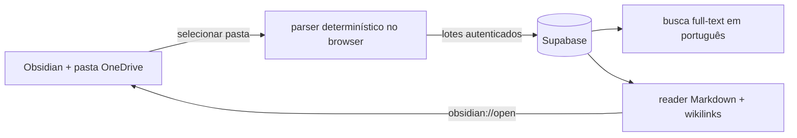
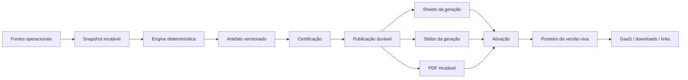

# Engenharia: código, arquitetura e Report Live (engenharia.md)

<!-- gerado por scripts/bundle_vault.py: não editar à mão -->

> Compilado do vault em 2026-11-03. 15 notas. Quando carregar: Tarefa que muda código, migration, deploy ou o Report Live.
> Arquivo derivado: a fonte canônica é a nota no vault. Mapa completo em [INDEX.md](INDEX.md).

## 📌 Notas neste arquivo

- [ADR-001](#adr-001)
- [AppsFlyer-Ingestao-Template-Arquitetura](#appsflyer-ingestao-template-arquitetura)
- [Backlog-Desenvolvimento-GaaS-Loop-2026-10](#backlog-desenvolvimento-gaas-loop-2026-10)
- [Como-Trabalhar-SDD-no-GaaS](#como-trabalhar-sdd-no-gaas)
- [Export-XLSX-Renta-Copa](#export-xlsx-renta-copa)
- [Funil-Onboarding-Arquitetura-e-Ingestao](#funil-onboarding-arquitetura-e-ingestao)
- [GaaS-Vault-Library](#gaas-vault-library)
- [Importador-Segmentacao-Aquisicao-2026-10](#importador-segmentacao-aquisicao-2026-10)
- [MOC-Engenharia](#moc-engenharia)
- [Report-Live-Enciclopedia](#report-live-enciclopedia)
- [Report-Live-Publicacao-Assincrona-Supabase](#report-live-publicacao-assincrona-supabase)
- [Report-Live-Sheets-Slides](#report-live-sheets-slides)
- [Report-Live-Versionamento-e-Publicacao](#report-live-versionamento-e-publicacao)
- [Skills-e-Disponibilidade-por-IA](#skills-e-disponibilidade-por-ia)
- [Testes-e-Tarefas-Quatro-Frentes](#testes-e-tarefas-quatro-frentes)

---

## ADR-001

> **tags:** `adr, memoria, contexto, historico` | **tipo:** `engenharia` | **camada:** `codigo` | **atualizado:** `2026-10-02` | **status:** `confirmado` | **fonte:** `codigo-gaas`

# ADR-001 — Arquitetura do Segundo Cérebro

**Definição:** entrada consultável para o registro de decisão de arquitetura de 20/06/2026, preservado em `docs/plans/ADR-001-arquitetura-segundo-cerebro.md` no repositório.

## Decisões registradas e contexto histórico

Um ADR (*Architecture Decision Record*) documenta contexto, decisão e consequências. O documento original foi marcado aceito em 20/06 e registra três decisões:

- **D-1:** separar estado de sessão, conhecimento semântico do vault e snapshots episódicos; ontologia é derivada.
- **D-2:** carga de contexto conforme tamanho: até 120k tokens, carga total; 120k–180k, subíndices; acima, avaliar recuperação seletiva. Esses limiares são a decisão histórica do projeto, não garantia geral de qualidade de um modelo.
- **D-3:** priorizar modelagem agregada de atribuição antes de MTA com identidade individual. É direção de arquitetura, não comprovação de modelo implementado nem causalidade certificada.

## Fontes e limites de aplicação

O original contém checklists de implementação; “aceito” não significa todos os itens concluídos. Números de tamanho de contexto e disponibilidade de dados citados em junho são snapshots antigos. Confirmar código, cobertura e decisões posteriores antes de executar uma mudança. O leitor do GaaS oferece esta síntese; o documento original permanece no repositório.

## Relacionado

- [Roteamento-de-Memoria](core.md#roteamento-de-memoria) · [Estrategia-de-Contexto](core.md#estrategia-de-contexto) · [Decisões-Tomadas](evolucao.md#decisões-tomadas)
- [Fontes-e-Proveniencia-Growth](core.md#fontes-e-proveniencia-growth) · [GaaS-Vault-Library](#gaas-vault-library)


---

## AppsFlyer-Ingestao-Template-Arquitetura

> **tags:** `engenharia,appsflyer,template,ingestao,pull-api,orquestracao,arquitetura` | **tipo:** `engenharia` | **camada:** `codigo-dados` | **atualizado:** `2026-07-28` | **status:** `proposto` | **fonte:** `investigacao-mcp-appsflyer + planilha-governanca + decisao-operador`

# AppsFlyer — Ingestão via template_id (Arquitetura)

**Definição:** a arquitetura que pluga a performance de app do AppsFlyer na espinha [activities](dados.md#activities) usando o **`template_id` (`af_sub3`)** como chave — não o [Activity Name](core.md#taxonomia-activity-name) — para virar **prior de conteúdo do [Orquestrador](core.md#orquestrador)**.

## Por que template_id (e não Activity Name)
- **Activity Name = one-shot.** Um disparo aconteceu uma vez; sua performance não é reaproveitável. É sinal do **passado**.
- **template_id = prior reutilizável.** O mesmo criativo ([Template](core.md#template)) atravessa disparos, safras e campanhas. Aprender *"template X converte Y% clique→install no segmento Negados, na semana S1"* é conhecimento que o [Orquestrador](core.md#orquestrador) aplica ao planejar a próxima [Régua](core.md#régua). É sinal do **futuro**.
- `af_sub3` embute a **posição de régua** (`S1D01`) → o orquestrador aprende efeito de dia/criativo por segmento, não só de campanha.

## O crux que define o pipe

**Três coisas distintas (não confundir):**
1. **Ler o valor do template_id no link** — trivial (parse da string; a planilha já tem). Nunca foi o problema.
2. **Performance agregada POR template_id** — o endpoint **agregado** (usado no MCP) só agrupa/filtra por `af_sub1`. `af_sub2`/`af_sub3` **não são dimensões no agregado**. O AppsFlyer captura o af_sub3 (fonte = link), mas o relatório agregado não deixa fatiar por ele.
3. **Performance bruta POR template_id** — só via **raw data** (Pull API ou Data Locker), onde cada linha traz as colunas `Sub Param 1..5`.

| Recorte | Fonte AppsFlyer | Pipe |
|---|---|---|
| Install/clique por **campanha · origem · segmento (af_sub1)** | API agregada | MCP/skill (fácil) |
| Install/onboarding por **template_id (af_sub3)** | Raw data | **Pull API** ou Data Locker |
| **Clique** por **template_id** | Raw data | **só Data Locker** (Pull API não tem relatório de clique) |

## Fonte do raw: Pull API vs Data Locker

Decisão inicial (2026-07-28): **Pull API via skill**. Mas se o **BI já tiver Data Locker**, esse vira o caminho melhor — bifurcação a resolver com o time de BI.

**Pull API** (raw data pull) — a skill puxa CSV sob demanda.
- Endpoint: `https://hq1.appsflyer.com/api/raw-data/export/app/{app_id}/{report}/v5` · header `Authorization: Bearer <token V2.0>` (gerado no painel, admin, vale p/ toda a conta).
- Relatórios: `installs_report`, `in_app_events_report` (+ `organic_*`). Params: `from`/`to`, `timezone`, `event_name`, `maximum_rows`, `additional_fields`.
- Cada linha traz `Sub Param 1..5` (fonte = link) → **af_sub3 = template_id por install/evento**.
- Limites: janela **90 dias**, **1M linhas/chamada**, CSV.
- ⚠️ **Não tem relatório de clique** → clique fica no grão de **campanha** (agregado).

**Data Locker** (premium) — AppsFlyer **empurra** o raw continuamente pro warehouse do BI.
- Destinos: bucket AWS do AppsFlyer, ou **seu** S3 / GCS / Azure / **BigQuery** / **Snowflake**. CSV/Parquet, multi-app, sem limite de volume, janela de 14 dias no bucket.
- Frescor: installs/eventos de hora em hora; uninstalls diário.
- ✅ Inclui **cliques** (fecha o gap da Pull API) + installs + eventos, todos com af_sub1-5.
- Dono operacional = **time de BI**. Se existe, o GaaS lê do warehouse (view/sync) em vez de puxar.

**Checklist p/ o BI (define o cenário):**
1. Data Locker ativo? Para quais apps e relatórios (installs / in-app events / **clicks**)?
2. Cai onde — S3 / BigQuery / Snowflake? Acesso de leitura ou view?
3. ⭐ **As colunas `Sub Param 1–5` (af_sub1..5) estão no schema entregue?** (Data Locker deixa escolher campos; sem sub params, o template_id não chega mesmo com Data Locker.)
4. Segregado por app ou unificado? CSV/Parquet?

**Cenários:**
- **Data Locker COM sub params** → melhor: GaaS lê do warehouse; ganha clique-por-template; a "skill Pull API" vira **sync warehouse → Supabase**.
- **Data Locker SEM sub params** → pedir inclusão de af_sub1-5 na config (mudança pequena do lado BI).
- **Sem Data Locker** → **Pull API via skill** (installs + eventos por template; clique em campanha).

## Arquitetura em camadas

```
CATÁLOGO      communication_templates (existe — skill gaas-governanca-comunicacoes)
                PK template_id (UPPER) · metadata.template_id_planilha = af_sub3 (case misto)
                + campanha, af_sub2(semana), af_sub1(segmento), canal, activity_names
                    │ template_id
LINKS         attribution_links (A CRIAR — planilha já tem LINK URL FINAL)
                template_id → OneLink URL + params (pid=crm, af_channel, c, af_sub1..3)
                    │ af_sub3 = template_id
PERFORMANCE   appsflyer_template_daily (A CRIAR — via Pull API)
                grão: date × template_id · af_clicks, af_installs, af_sessions
                (fut.) af_onboarding_started / _finished · FK → communication_templates
                    │ rollup por template_id
ESPINHA       activities (cada disparo tem template_id) → ganha o rastro de app
                    │ priors por template
ORQUESTRADOR  "qual template propor no próximo disparo, por segmento e posição de
                régua, para maximizar clique→install→cartão"
```

## Tabelas novas (schema enxuto)

### `appsflyer_template_daily`
- **Grão:** `date × template_id`. Atributos denormalizados (canal, segmento af_sub1, semana af_sub2, campanha) vêm do catálogo, não do AppsFlyer.
- **Colunas:** `af_clicks`, `af_installs`, `af_sessions`; fase 2: `af_onboarding_started`, `af_onboarding_finished`.
- **FK:** `template_id` → `communication_templates`.
- **Volume:** baixo (nº de templates ativos × dias). Zero raw por usuário.

### `appsflyer_template_map` (crosswalk)
- Resolve `campanha + af_sub1 + af_sub2 + canal + date` → `activities.id` **onde `af_sub3` falta** (links legados), com `confidence` + fila de revisão — reusa a UX do [GaaS Updater](legado.md#ingestão-de-dados) / padrão [paid_media_campaign_mappings](dados.md#paid_media_campaign_mappings).

### `appsflyer_collection_runs` (governança)
- Lifecycle `pending → complete | failed`. Ausência = `not_available` (nulo); zero explícito = `explicit_zero`. Sem soma cruzada de grãos. Espelha o coletor Meta ([Funil-Onboarding-Arquitetura-e-Ingestao](#funil-onboarding-arquitetura-e-ingestao)).

## Regras de join (quebram em silêncio se ignoradas)
1. **Caixa:** `af_sub3` do link é **case misto** (`b2c_email_copa_bsp_S1D01`); o PK de `communication_templates` é **UPPER**. Join **sempre** em `metadata.template_id_planilha` (ou `lower(af_sub3)=lower(pk)`), **nunca** no PK direto.
2. **Cobertura:** só links governados (`LINK AJUSTADO?=True`) carregam `af_sub3`. Legados (media source `WhatsApp`/`CRM`-maiúsc/`SMS`/`Cross_sale`) caem no crosswalk fuzzy. Nunca fingir template onde não há.
3. **Gate confirmado/direcional/bloqueado:** só entra no funil o que reconcilia; cobertura parcial fica direcional; sem `af_sub3` no raw = bloqueado.

## Contrato da skill (Pull API)
1. **Passo 0 — prova de cobertura (obrigatório):** puxar amostra de raw data e **confirmar `af_sub3` preenchido** antes de qualquer gravação. Sem isso, aborta (não constrói sobre vazio — lição do `af_ad=None`).
2. **Puxar** installs + in-app events (raw) na janela → **normalizar** `af_sub3` (case, dicionário) → **agregar** por `af_sub3 × dia`.
3. **Gravar** `appsflyer_template_daily` com run governada; reconciliar contra o catálogo; fuzzy só onde falta template.
4. **Reportar** cobertura (% de installs com template resolvido) — nunca truncar em silêncio.

## Duas alavancas independentes (não confundir)
| Alavanca | Liga | Dono | Dificuldade |
|---|---|---|---|
| **Governança de link** (`af_sub3` no gerador) | topo/atribuição → template → espinha | CRM ops | 🟢 baixa (já em curso) |
| **Eventos SDK nomeados + emissão** | fundo (onboarding→cartão) | time mobile | 🟡 média |

## Consumo
- **5ª aba do [Funil de Aquisição](evolucao.md#funis-de-onboarding-gaas):** performance por template (clique→install→sessão), lente de segmento e posição de régua.
- **[Orquestrador](core.md#orquestrador):** lê `appsflyer_template_daily` como prior por template × segmento × S/D.
- **Custo-por-install de CRM:** cruzar `af_installs` com a tarifa de canal do GaaS ([Custos-e-Investimento](legado.md#custos-e-investimento)) → o CRM finalmente ganha denominador de app, na mesma régua da paga ([Função-Objetivo](core.md#função-objetivo)).

## Relacionado
- [AppsFlyer-Tracking-CRM](operacao.md#appsflyer-tracking-crm) · [appsflyer_template_daily](dados.md#appsflyer_template_daily) · [Template](core.md#template) · [activities](dados.md#activities) · [Orquestrador](core.md#orquestrador) · [Ingestão-de-Dados](legado.md#ingestão-de-dados) · [paid_media_campaign_mappings](dados.md#paid_media_campaign_mappings) · [Funil-Onboarding-Arquitetura-e-Ingestao](#funil-onboarding-arquitetura-e-ingestao) · [Função-Objetivo](core.md#função-objetivo)


---

## Backlog-Desenvolvimento-GaaS-Loop-2026-10

> **title:** `SDD GaaS, temas e prioridades` | **tipo:** `planejamento` | **camada:** `engenharia` | **criado:** `2026-10-31` | **atualizado:** `2026-10-31` | **status:** `backlog-priorizado` | **fonte:** `pedido-pablo-e-cadastro-gaas-2026-10-31` | **tags:** `backlog, gaas, agentes, loop, desenvolvimento`

# SDD GaaS: temas e prioridades

Pablo autorizou cadastro de tarefas de desenvolvimento e notificações na Fila. Doze tarefas
foram persistidas em 31/10/2026, em backlog, com histórico inicial e dependências. A interface
é uma entrega própria, separada das reformas planejadas. Datas e responsáveis permanecem a definir.

Direção e histórico: [Motor-de-Agentes-Loop-de-Memoria-2026-10](ia.md#motor-de-agentes-loop-de-memoria-2026-10).

## Ordem sugerida

Começar por aqui define o ciclo e a integração Fila–Wiki; Na sequência aprofunda agentes, conhecimento, registros e
contratos de testes; Mais adiante trata reformas posteriores e reuso entre ativações. Prioridade não é prazo.
A tarefa pode ser planejada com dependências pendentes; execução e conclusão exigem dependências concluídas.

| Tema | Ordem sugerida | O que precisa vir antes |
|---|---|---|
| [Como o Loop de Memória deve funcionar](https://growthafinz.github.io/GaaS-Framework-Afinz/?view=learning&section=investigations&dev_task=eafbfdf0-f978-47e2-8336-108ed7a95fa9) | Começar por aqui | Pode começar |
| [Como os agentes trabalham com a Fila e a Wiki](https://growthafinz.github.io/GaaS-Framework-Afinz/?view=learning&section=investigations&dev_task=c0b774fa-ae30-4253-9e54-97804da96b0e) | Começar por aqui | Como o Loop de Memória deve funcionar |
| [Encontrar melhorias nas jornadas de CRM](https://growthafinz.github.io/GaaS-Framework-Afinz/?view=learning&section=investigations&dev_task=a1ec64b0-abef-4798-8cf9-1825bd3014bb) | Na sequência | Como o Loop de Memória deve funcionar, Como os agentes trabalham com a Fila e a Wiki |
| [Organizar e aprofundar os assuntos da Wiki](https://growthafinz.github.io/GaaS-Framework-Afinz/?view=learning&section=investigations&dev_task=255dcc91-30bb-4a12-969e-a8cd9e92ed4e) | Na sequência | Como o Loop de Memória deve funcionar |
| [Acompanhar a evolução de cada agente](https://growthafinz.github.io/GaaS-Framework-Afinz/?view=learning&section=investigations&dev_task=d4bfd8c1-6f0c-4435-acd8-ade085e48117) | Na sequência | Como o Loop de Memória deve funcionar, Como os agentes trabalham com a Fila e a Wiki |
| [Acompanhar testes A/B e cross-sell](https://growthafinz.github.io/GaaS-Framework-Afinz/?view=learning&section=investigations&dev_task=8f1ee7a1-197c-45a2-b6ee-6897d396c934) | Na sequência | Como o Loop de Memória deve funcionar |
| [Reunir Apostas em Testes e Tarefas](https://growthafinz.github.io/GaaS-Framework-Afinz/?view=learning&section=investigations&dev_task=d7d01450-6c33-4e24-adc5-eb3419cb6446) | Mais adiante | Acompanhar testes A/B e cross-sell |
| [Definir como avaliar resultados e aprendizados](https://growthafinz.github.io/GaaS-Framework-Afinz/?view=learning&section=investigations&dev_task=ea19e3dc-ff9d-4b38-b35a-a34ee44db4c8) | Mais adiante | Acompanhar testes A/B e cross-sell |
| [Gerar apresentações Afinz com Claude Code](https://growthafinz.github.io/GaaS-Framework-Afinz/?view=learning&section=investigations&dev_task=69417e78-c26b-44b6-829f-ce49ed8a6a3b) | Mais adiante | Como o Loop de Memória deve funcionar |
| [Usar dados do Google Sheets nas apresentações](https://growthafinz.github.io/GaaS-Framework-Afinz/?view=learning&section=investigations&dev_task=b6c88a62-3748-4c2d-8681-39b0adea8ef7) | Mais adiante | Gerar apresentações Afinz com Claude Code |
| [Manter Wiki e computador sincronizados](https://growthafinz.github.io/GaaS-Framework-Afinz/?view=learning&section=investigations&dev_task=0d22f2db-aa9f-493e-8660-a46d86d1575f) | Na sequência | Como os agentes trabalham com a Fila e a Wiki |
| [Verificar se os agentes aprendem entre ciclos](https://growthafinz.github.io/GaaS-Framework-Afinz/?view=learning&section=investigations&dev_task=12949d09-11ee-40b2-a02f-7d85c71a453d) | Mais adiante | Encontrar melhorias nas jornadas de CRM, Acompanhar a evolução de cada agente |

## Escopo e critérios

### Como o Loop de Memória deve funcionar

Planejar o motor macro: pedido explícito via skill Claude/Codex → releitura pertinente da base → interpretação de gatilhos e resultados → investigação e execução generativa → revisão → aprendizado → reutilização em nova ativação. Os agentes são uma camada de execução central ou de apoio principal, ainda em evolução. Não pressupor agendamento autônomo ou framework finalizado.

Critérios de conclusão:

- Contrato de entrada, saída e responsabilidade de cada fase revisado com Pablo
- Separar memória operacional dos agentes, hipóteses e conhecimento de negócio validado
- Definir como uma nova ativação recupera conhecimento aprovado e verifica sua aplicação

### Como os agentes trabalham com a Fila e a Wiki

Prioridade de produto: agentes trabalham sobre Fila e Wiki. Planejar seleção de trabalhos, contexto, novas leituras, interpretação de sinais, pesquisa, contribuição coordenada a várias notas e retorno ao mesmo item da Fila. Aprovação humana simples por conjunto e evidências versionadas. Não tratar conclusão de execução como aprovação ou enriquecimento comprovado.

Critérios de conclusão:

- Fluxo Fila → agentes → propostas Wiki → decisão → retorno à Fila desenhado
- Definir vínculo entre trabalho, execução, evidência, proposta e versão de nota
- Incluir descoberta, conexão, hipótese, oportunidade e lacuna acionável, com critérios próprios

### Encontrar melhorias nas jornadas de CRM

Executar a proposta exp-3: como melhorar jornadas e comunicações de aquisição CRM usando o conhecimento disponível. Cada especialista investiga uma pergunta e tenta uma contribuição fundamentada. Não forçar novidade. A primeira exp-2 validou coordenação e documentação; não demonstrou oportunidade de negócio ou reuso persistente.

Critérios de conclusão:

- Missões investigativas complementares e fontes pertinentes definidas
- Entregas mostram tentativas, evidências, alternativas, implicação e próximo teste
- Pablo avalia separadamente rigor e contribuição efetiva ao conhecimento

### Organizar e aprofundar os assuntos da Wiki

Planejar menos páginas canônicas e conteúdo mais completo, didático e conectado. Reordenar Assuntos para favorecer interpretação analítica dos relatórios. Incluir referências recentes de resultados em série de vários meses, com cobertura e comparabilidade. Preservar dados históricos, fontes, links e rastreabilidade, sem enxugar a Wiki de Resultados ou editar derivados à mão.

Critérios de conclusão:

- Inventário de páginas e proposta de agrupamento por assunto com destinos canônicos
- Modelo didático com conceitos, operação, evolução multimensal, limites e referências
- Plano de conservação, redirecionamento e revisão dos geradores antes de qualquer migração

### Acompanhar a evolução de cada agente

Criar proposta nova de Registros para acompanhar evolução do Loop e visão específica dos agentes. Cada papel terá nota e histórico completo sem limite editorial arbitrário de tamanho, com delegações, entregas, notas, revisões e lições. A leitura usa índices e sínteses referenciadas sem apagar o histórico. Ficha mostra função, versão de prompt, executor, evolução, avaliações e uso de memória. Não confundir registros dos agentes com outcomes comerciais.

Critérios de conclusão:

- Separar visão macro do Loop e ficha individual de cada agente
- Definir histórico preservado, busca, linha do tempo e sínteses de consulta
- Distinguir autoavaliação, ADM, Editor e revisão humana; rastrear o reuso das lições

### Acompanhar testes A/B e cross-sell

Especificar atributos de acompanhamento para experimentos growth em diferentes formatos, canais e frentes, incluindo cross-sell de seguros e novos dados que Pablo ainda apresentará. Modelo atual de investigações não é uma central A/B finalizada. Pode-se planejar agora; instrumentação e execução dependerão das novas fontes e definições de resultado.

Critérios de conclusão:

- Definir hipótese, grupos, unidade de alocação, público, exposição, janela, métrica e limites
- Separar tarefa de desenvolvimento, investigação, experimento e execução
- Contrato preliminar cross-sell com eventos e fontes pendentes claramente identificados

### Reunir Apostas em Testes e Tarefas

Diretriz do Pablo: descontinuar a aba Apostas e integrar partes importantes em Testes e Tarefas. Planejar preservação de hipótese, evidência, aprovação, responsável, execução, checklist, janela e vínculos históricos. Não remover a aba nem apagar registros antes de mapear capacidades, rotas e migração.

Critérios de conclusão:

- Mapear capacidades e dados atuais de Apostas para o destino
- Plano de transição preserva IDs, decisões, histórico e links
- Critérios para retirar a aba definidos e revisados antes da implementação

### Definir como avaliar resultados e aprendizados

Pablo quer alterar Outcomes, mas o papel futuro permanece aberto. Avaliar proposta de núcleo de Verificação e Aprendizados: o que foi executado, resultado observado, limites, decisão humana e o que pode ser reutilizado. A tela pode ser própria ou integrada a Testes e Tarefas; isso não está decidido. Não equiparar tarefa concluída a hipótese validada.

Critérios de conclusão:

- Comparar alternativas de tela própria e integração aos testes
- Definir estados de resultado observado, inconclusivo, não verificável e revisão
- Preservar distinção entre execução, efeito, aprendizado de negócio e lição de agente

### Gerar apresentações Afinz com Claude Code

Direção futura: Claude Code gera PPTX usando a skill afinz-pptx, substituindo geração via Google Slides API; arquivo concluído é disponibilizado no GaaS. Planejar dados, composição, marca, revisão visual, versionamento, upload, acesso, histórico e recuperação. Não mudar agora o pipeline vigente nem declarar o novo fluxo pronto.

Critérios de conclusão:

- Contrato do pedido e snapshot de dados definido
- Planejar geração pela skill Afinz e QA antes da publicação do arquivo
- Definir estados assíncronos, destino no GaaS, versões e recuperação de falhas

### Usar dados do Google Sheets nas apresentações

Testar tese: ler Google Sheets como fonte de dados, congelar o recorte e usar Claude Code para gerar o PPTX. Sheets não precisa ser o editor de slides, e a geração/upload será assíncrona. Confirmar planilha, abas, permissões de leitura, contratos de métricas e rastreabilidade antes do protótipo.

Critérios de conclusão:

- Leitura autorizada de intervalos com valores e datas preservados
- Snapshot rastreável usado na geração de um PPTX Afinz de teste
- Validação do arquivo e do upload posterior ao GaaS, sem dependência de Google Slides API

### Manter Wiki e computador sincronizados

Manter direção aceita: aprovação humana simplificada por conjunto, publicação de versão na Wiki primeiro e sincronização da mesma versão para o PC de Pablo depois. Planejar conflito, retomada, leitura durante publicação e proteção contra inventário local obsoleto. O teste de cópia e a publicação administrativa atual não equivalem a esse motor pronto.

Critérios de conclusão:

- Definir autoridade, versão aprovada e comprovantes de Wiki e PC
- Proteger contra alteração posterior à aprovação e sobrescrita por cópia antiga
- Testes de falha e retomada previstos, sem perda ou exclusão silenciosa de notas

### Verificar se os agentes aprendem entre ciclos

Planejar e depois testar um ciclo real de reutilização: lição candidata, revisão/aprovação, recuperação na próxima ativação, uso registrado e avaliação de efeito. Separar melhoria dentro de uma rodada de aprendizado persistente entre execuções. Definir como reprogramar o fluxo, prompts e contexto sem promover automaticamente reflexões a fatos ou ampliar permissões.

Critérios de conclusão:

- Definir promoção, revisão, substituição e validade das lições
- Comparar tarefa/evidência controladas quando avaliar melhoria
- Ficha e histórico mostram lição recuperada, uso/recusa, efeito e limitações

## Histórico e atualização

Esta nota preserva o planejamento de 31/10. O estado corrente das tarefas vive no GaaS, com revisão e histórico; não inferir conclusão pela existência do plano. Avisos por tarefa reutilizam as preferências pessoais de acompanhar, adiar e fechar. Mudanças relevantes reaparecem; checklist isolado não cria aviso novo. Concluir ou cancelar resolve o aviso, sem apagar histórico.

[Loop-de-Aprendizado-Growth](ia.md#loop-de-aprendizado-growth) · [MOC-Inteligencia-IA](core.md#moc-inteligencia-ia) · [Experimento-Agentes-Wiki-2026-10-31](ia.md#experimento-agentes-wiki-2026-10-31)


## Objetivo e linguagem do menu SDD GaaS

SDD significa Spec Driven Development, desenvolvimento guiado por especificações. O menu serve para priorizar melhorias e transformar análises em especificações claras para evoluir o GaaS. Os temas são exibidos por nomes compreensíveis, com ordem sugerida, contexto e entregas esperadas. Códigos técnicos permanecem internos para preservar vínculos e histórico. Isso não altera o escopo, as dependências ou o estado dos trabalhos.


## Método proposto para amadurecer os temas

[Como-Trabalhar-SDD-no-GaaS](#como-trabalhar-sdd-no-gaas) reúne pesquisa em fontes primárias, fluxo proporcional ao risco, ficha de especificação, critérios observáveis e um exemplo Fila–agentes–Wiki. A proposta distingue tema, spec e tarefas de execução. É um método para piloto; não muda automaticamente estados, dependências ou autorizações dos temas cadastrados.


## Revisão de Testes e Tarefas · 03/11/2026

[Testes-e-Tarefas-Quatro-Frentes](#testes-e-tarefas-quatro-frentes) registra a implementação da central com quatro frentes, iniciativas, tipos de trabalho e notificações. Os temas macro permanecem em evolução; a nova interface não conclui automaticamente os agentes ou a medição CRM.


---

## Como-Trabalhar-SDD-no-GaaS

> **title:** `Como trabalhar temas de Spec Driven Development no GaaS` | **tipo:** `guia-proposto` | **camada:** `engenharia` | **criado:** `2026-10-31` | **atualizado:** `2026-10-31` | **status:** `proposta-para-piloto` | **fonte:** `pesquisa-fontes-primarias-e-contexto-gaas` | **tags:** `sdd, especificacoes, desenvolvimento, agentes, qualidade, loop`

# Como trabalhar temas de Spec Driven Development no GaaS

## Propósito

Transformar a seção Spec Driven Development em uma fila de melhorias que possam ser entendidas,
priorizadas, implementadas e verificadas com menos ambiguidade. O resultado esperado é qualidade
de entrega e aprendizado reaproveitável, não volume de documentação ou quantidade de tarefas concluídas.

Esta nota propõe um método para o GaaS. Não instala ferramentas, muda estados da tela, aprova
especificações ou declara as tarefas existentes prontas para execução. Pesquisa consultada em 31/10/2026.

## O que a pesquisa oferece

| Referência primária | Contribuição pertinente | Aplicação proposta no GaaS |
|---|---|---|
| [GitHub Spec Kit](https://github.com/github/spec-kit) | Explicitar intenção e princípios e refinar especificação, plano e tarefas antes de implementar; oferece caminhos próprios para bugs e avaliação de ideias | Reutilizar AGENTS.md e regras canônicas; não transformar toda correção numa especificação extensa |
| [Kiro Specs](https://kiro.dev/docs/specs/) | Distingue requisitos, desenho e tarefas, incluindo critérios observáveis | Diferenciar o que queremos mudar, como pretendemos fazer e quais entregas comprovam a mudança |
| [OpenSpec](https://github.com/Fission-AI/OpenSpec) | Organiza cada mudança por proposta, cenários, desenho e tarefas; permite revisar artefatos durante o trabalho | Registrar a mudança no produto existente e atualizar a spec quando uma decisão legítima mudar |
| [DORA, pequenos lotes](https://dora.dev/capabilities/working-in-small-batches/) | Recomenda entregas menores para encurtar feedback e corrigir premissas mais cedo | Dividir temas grandes em incrementos verificáveis, sem fragmentar tanto que se perca o objetivo |

Essas referências não definem um único padrão obrigatório de SDD. As descrições de ferramentas
documentam seus métodos; não são prova independente de ganho no GaaS. A pesquisa DORA trata de
práticas de entrega, não de uma garantia específica sobre adotar SDD. A hipótese local é que explicitar
comportamento, contexto e verificação reduzirá retrabalho. Ela precisa ser observada no piloto.

Não recomendo instalar os três sistemas ou migrar o projeto para um deles agora. O ganho inicial
pode vir do método, usando Markdown versionado, a fila existente, as skills e os checks do projeto.

## Um tema ainda não é uma especificação

“Acompanhar a evolução de cada agente” expressa uma intenção relevante, mas não define qual
primeiro comportamento deve existir. Pode abranger histórico, avaliações, memória, busca e comparação.
Tentar desenvolver tudo num só pedido favorece interpretação livre, retrabalho e entregas difíceis de revisar.

A fila pode ter três níveis relacionados:

- **Tema:** problema ou oportunidade que vale explorar. Exemplo: acompanhar a evolução dos agentes.
- **Especificação de uma mudança:** comportamento delimitado e verificável. Exemplo: consultar as
entregas e avaliações de um agente por execução, preservando versões anteriores.
- **Tarefas de execução:** passos para realizar essa mudança, com dependências e evidência de conclusão.

Um tema pode originar várias specs ao longo do tempo. Tarefas técnicas devem manter vínculo com a
mudança e seu propósito. Não confundir esse agrupamento com uma única tarefa enorme de implementação.

## Fluxo sugerido

**Entender → especificar → escolher a solução → executar em partes → verificar → publicar → observar e reutilizar.**

1. **Entender:** quem enfrenta o problema, qual comportamento existe, qual evidência temos e o que
ainda é desconhecido. Se não soubermos o suficiente, produzir investigação delimitada antes de projetar.
2. **Especificar:** descrever resultado esperado, casos de uso, limites e exemplos que distinguem
uma entrega correta de uma apenas plausível. Separar requisito de hipótese e preferência de solução.
3. **Escolher a solução:** examinar código e dados atuais, reaproveitar o que existe, registrar alternativas
relevantes, dependências, impacto em acesso/dados e estratégia de recuperação quando necessária.
4. **Executar em partes:** decompor por entregas utilizáveis ou verificáveis. Uma camada técnica isolada
pode ser necessária, mas deve explicitar qual capacidade permite e como será testada.
5. **Verificar:** confrontar cada critério com evidência adequada. Código local, mock, banco real, versão
publicada e plataforma externa comprovam coisas diferentes. Registrar o que não foi verificado.
6. **Publicar:** registrar versão entregue, testes, recibo de deploy e eventual pendência de operação.
Não apagar a divergência entre a spec e o que de fato foi entregue.
7. **Observar e reutilizar:** verificar uso e efeito quando mensuráveis, registrar lições e recuperar as
pertinentes na próxima ativação. Entrega publicada não é, sozinha, benefício de negócio comprovado.

O fluxo admite voltar à pergunta e revisar a solução. Descoberta durante a implementação não é
motivo para congelar uma spec errada: registrar a decisão, sua razão e a versão afetada. Se alterar
materialmente o escopo autorizado ou uma decisão do produto ainda aberta, alinhar com Pablo.
Não exigir uma confirmação repetida para cada arquivo ou passo já autorizado.

## Profundidade proporcional à mudança

| Situação | Especificação suficiente |
|---|---|
| Ajuste simples e reversível, como título ou cor | Pedido claro, local afetado, comportamento esperado e conferência proporcional |
| Evolução de uma função existente | Problema, recorte, cenários, dados, impacto, plano curto e verificação |
| Mudança transversal, como memória, permissões, migração ou publicação | Requisitos e decisões explícitos, contratos entre partes, falhas, transição, recuperação e validação antes de expandir |

Não criar testes que apenas repitam uma alteração de texto. Usar checks que possam detectar uma
falha relevante. Não criar documentos separados quando seções de um único arquivo resolvem.
AGENTS.md e notas canônicas já contêm princípios: referenciá-los, sem criar uma constituição concorrente.

## A ficha de uma boa spec

Uma pessoa ou agente deve conseguir responder:

| Campo | Pergunta que precisa resolver |
|---|---|
| Problema e evidência | O que está ruim ou faltando? Onde observamos isso? |
| Pessoa e decisão | Para quem melhoramos e qual decisão ou ação fica mais fácil? |
| Estado atual | O que já existe em código, dados e documentação? Em qual versão foi conferido? |
| Mudança esperada | O que o usuário conseguirá fazer ou perceber ao final? |
| Recorte | Qual menor entrega tem valor? O que fica para depois? |
| Cenários e critérios | Quais exemplos demonstram funcionamento, limites e erros relevantes? |
| Fontes e contratos | Quais dados, identificadores, versões, regras e acessos são necessários? |
| Decisões em aberto | O que impede escolher ou executar? Que evidência ou decisão destrava? |
| Plano | Como pretendemos fazer e quais dependências são reais? |
| Verificação e entrega | Que evidência confirma cada critério e como encontraremos a versão publicada? |
| Acompanhamento | Como saberemos se ajudou? O que pode virar aprendizado reutilizável? |

Não preencher lacunas com uma resposta inventada. “A definir” deve dizer se impede investigar,
desenhar ou executar. Um dado ausente não bloqueia toda a spec: pode exigir recorte menor ou teste de viabilidade.

## Quando está pronta para desenvolver

Uma spec pode avançar quando o propósito, o recorte e os critérios estão compreensíveis; as fontes
decisivas foram inspecionadas; dependências e dúvidas impeditivas foram tratadas; e a solução pode
ser executada e verificada dentro do escopo autorizado. Isso é prontidão, não certeza absoluta.

Para concluir a entrega, registrar comportamento implementado, critérios atendidos, checks relevantes,
limites e referência à versão entregue. Marcar caixas sem evidência não demonstra atendimento.
Concluir uma spec também não conclui automaticamente seu tema maior.

## Como isso se encaixa na tela atual

A seção já tem temas, prioridades legíveis, dependências, critérios, responsável/prazo opcionais,
histórico, avisos na Fila e links diretos. Essa base organiza o trabalho, mas ainda não representa
todo o ciclo de specs. Esta leitura foi confrontada com a implementação local que originou as entregas
publicadas dos PRs 63 a 65; não foi feita nesta pesquisa uma nova auditoria de cada registro do banco.

Como primeiro passo de uso, podemos colocar a ficha na descrição do tema e os critérios no campo
existente; a spec detalhada fica em Markdown versionado quando necessária. Registrar o link sem
duplicar versões conflitantes. O campo atual de nota relacionada não deve passar a significar ao mesmo
tempo nota de negócio, spec, PR e relatório de teste: esses vínculos merecem distinção na evolução da tela.

Como evolução de produto, proponho, ainda sem implementação:

- Separar a pergunta **“em que fase estamos?”** da pergunta **“qual o estado do trabalho?”**.
Em especificação/implementação/validação são fases; bloqueada ou cancelada são condições diferentes.
- Relacionar tema, specs e tarefas, preservando IDs, histórico e dependências existentes.
- Mostrar na ficha: especificação e versão, dúvidas decisivas, próximo passo, critérios e evidências,
PR/deploy e resultado observado. A leitura principal deve permanecer simples; detalhes ficam recolhidos.
- Fazer a Fila chamar atenção para decisão necessária, impedimento, revisão solicitada ou entrega
pronta para validar. Não criar avisos repetitivos só porque mais um arquivo foi gerado.

Não é necessário reconstruir a tela para começar o piloto. Tampouco basta renomear uma lista de
tarefas para afirmar que ela já oferece uma fila completa de SDD.

## Papel dos agentes

Pablo define intenção e resolve decisões de produto que não podem ser inferidas. O ADM enquadra,
distribui investigação e acompanha dependências. Especialistas pesquisam, questionam premissas e
propõem alternativas. Na implementação, o executor segue a spec pertinente e registra decisões.
O revisor confronta o resultado com os cenários e as fontes, em vez de apenas conferir se arquivos existem.

Quando vários agentes participarem, cada um deve saber qual pergunta ou entrega assume e qual
contrato compartilha. Paralelizar tarefas realmente independentes. Um problema ou nova oportunidade
pode retornar à investigação; não restringir o especialista a responder perguntas de conformidade.

A spec orienta execução, mas não obriga a fingir que toda hipótese foi demonstrada. Reutilizar as
lições aprovadas pertinentes e registrar uso/recusa. Resultados técnicos, lições operacionais e
aprendizados de negócio mantêm validações distintas, conforme [Motor-de-Agentes-Loop-de-Memoria-2026-10](ia.md#motor-de-agentes-loop-de-memoria-2026-10).

## Exemplo aplicado: uma entrega de agente rastreável na Fila

**Tema de origem:** Como os agentes trabalham com a Fila e a Wiki.

**Primeiro recorte proposto:** ao terminar uma investigação acionada por skill, permitir encontrar
no item de origem a entrega correspondente, suas evidências e a proposta de atualização de uma nota.
Não implementar todo o motor de memória, reorganizar a Wiki ou lançar testes A/B nesse recorte.

**Problema:** nossos testes produziram arquivos rastreáveis em outputs, mas isso não demonstra que
o operador encontra e revisa a entrega no contexto da Fila. A capacidade ponta a ponta ainda precisa
ser confrontada com os contratos atuais do app, para evitar duplicar o fluxo editorial existente.

**Comportamento esperado:** Pablo abre o item, entende a contribuição, consulta a evidência e sabe
qual decisão é necessária. A proposta continua separada da aplicação aprovada.

| Cenário | Critério observável | Evidência de verificação proposta |
|---|---|---|
| Execução encerrada com contribuição | Item de origem permite recuperar a execução e sua entrega correta | Cenário integrado com IDs e revisões conferidos |
| Proposta editorial preparada | Caminho, base e texto proposto são recuperáveis, sem sobrescrever a nota | Comparação de versões antes/depois e estado editorial |
| Análise inconclusiva | Limite e próxima verificação aparecem; não se inventa recomendação | Caso com fonte insuficiente e conferência do texto |
| Fonte ou nota mudou | Entrega anterior não se apresenta como atualização válida da nova revisão | Ensaio de mudança de revisão/base, sem forçar aplicação |
| Falha ou retomada | Repetir a operação prevista não duplica a contribuição | Caso de interrupção/reexecução, com contagem e referências |

**Perguntas em aberto:** quais vínculos e RPCs existentes já atendem o recorte? O que realmente
falta? Como representar os tipos novos de contribuição sem invalidar contratos existentes?
Essas perguntas fazem parte da especificação e pesquisa técnica, não de uma aprovação já obtida.

**Tarefas de execução candidatas:** inspecionar contratos e definir o recorte; escrever a spec
da integração faltante; implementar apenas a lacuna confirmada; verificar cenários; publicar quando
autorizado; acompanhar uma revisão real. Cada entrega deve levar ao mesmo resultado de ponta a ponta.

**Medida de valor inicial:** Pablo consegue localizar e decidir sobre a contribuição sem reconstruir
a conversa ou procurar arquivos manualmente? A resposta deve ser observada, não presumida pelo deploy.

## Piloto recomendado

Selecionar um tema relevante e um recorte verificável, usando o exemplo acima ou outro escolhido
por Pablo. A definição macro do Loop continua uma dependência para decisões centrais; preparar uma
spec não autoriza executar uma tarefa cujas dependências atuais ainda estejam pendentes.

Começar com um piloto, limitar trabalhos simultâneos e observar: ambiguidades resolvidas antes
de implementar, retrabalho por requisito, defeitos/reaberturas, tempo de revisão e utilidade percebida.
Sem baseline, não prometer um percentual de ganho. Medir também o esforço de especificar: excesso
de documento que não muda decisão é custo, não evidência de qualidade.

Só depois decidir se vale adicionar campos, fases e vínculos à tela ou adotar uma ferramenta.
O piloto ainda não foi executado e este método não foi incorporado automaticamente aos prompts.

## Template reutilizável

```markdown
# [Melhoria que queremos entregar]

## Por que vale fazer
Pessoa/decisão, problema e evidência.

## O que existe hoje
Código, dados e notas consultados, com versões e limites.

## O que muda neste recorte
Comportamento esperado e o que fica para depois.

## Exemplos e critérios de conclusão
Situação → comportamento esperado → como verificar.

## O que precisamos decidir ou descobrir
Dúvida, impacto e próximo passo para resolvê-la.

## Como pretendemos fazer
Alternativas relevantes, solução proposta, dependências e impactos.

## Entregas e verificação
Passos verificáveis, evidências esperadas e referência da versão entregue.

## O que aconteceu e o que reutilizar
Resultado observado, limites, mudanças da spec e lições candidatas.
```

## Referências e relações

- [GitHub Spec Kit: conceitos](https://github.com/github/spec-kit/blob/main/docs/concepts/sdd.md)
- [GitHub Spec Kit: processo e caminhos distintos de trabalho](https://github.com/github/spec-kit/blob/main/README.md)
- [Kiro: requisitos, desenho e tarefas](https://kiro.dev/docs/specs/)
- [OpenSpec: proposta, cenários e evolução de mudanças](https://github.com/Fission-AI/OpenSpec)
- [DORA: pequenos lotes e feedback](https://dora.dev/capabilities/working-in-small-batches/)

[Backlog-Desenvolvimento-GaaS-Loop-2026-10](#backlog-desenvolvimento-gaas-loop-2026-10) · [Motor-de-Agentes-Loop-de-Memoria-2026-10](ia.md#motor-de-agentes-loop-de-memoria-2026-10)
· [Loop-de-Aprendizado-Growth](ia.md#loop-de-aprendizado-growth) · [MOC-Inteligencia-IA](core.md#moc-inteligencia-ia) · [Padrao-Editorial-Enciclopedia](core.md#padrao-editorial-enciclopedia)


---

## Export-XLSX-Renta-Copa

> **tags:** `engenharia, export, xlsx, copa, rentabilizacao` | **tipo:** `referencia` | **camada:** `engenharia` | **tipo_diataxis:** `explanation` | **atualizado:** `2026-06-19` | **status:** `implementado` | **fonte:** `gaas-codigo`

# Export XLSX Rentabilização Copa — arquitetura atual e evolução

> ✅ **v2 em produção desde 2026-06-11** — commit `6843143` na main (auto-deploy GH Pages via Actions), **testada e validada pelo operador no mesmo dia**. A seção "Evolução proposta" abaixo foi implementada; ver "Estado implementado".

## Estado implementado (v2)
- `fetchCopaFixedDaily(start, end)` busca os 3 universos em paralelo e indexa por data (`CopaFixedIndex`). Cada fonte tem try/catch próprio: indisponibilidade gera `console.warn` e colunas vazias — o export nunca quebra por falta de uma fonte.
- Bloco fixo da aba Copa: **25 colunas** — Data | Dia | LP GA4 (Trafego, Optins etapa) | BI Visa (Optins, Cartões/dia) | Mídia Total (Invt., Cliques, CPC, Impressões, CTR, CPM, **Custo/Opt-in**) | Google (6 cols) | Meta (6 cols). Grupos com cores próprias no cabeçalho (`COPA_FIXED_GROUPS`).
- Custo/Opt-in = spend total ÷ Optins **Visa** do dia (regra [Copa-2026](core.md#copa-2026): nunca chamar de CAC). CPC/CTR/CPM calculados por canal; linha 1 = totais do período (SUM); linha final = totais com mesmas fórmulas.
- Blocos CRM (parceiro × bloco × canal) inalterados — começam na coluna 26.

**Definição:** mapa do export `exportRentabilizacaoCrmXlsx` (aba Relatório do GaaS) e o desenho da evolução para juntar os 3 universos — **CRM**, **Mídia Paga** e **LP Visa** — na aba "Rentabilização Copa".

## Arquitetura atual (`src/utils/rentabilizacaoCrmExcelExport.ts`, 1.120 linhas)

```
RelatorioView.tsx (botão export)
  └─ exportRentabilizacaoCrmXlsx(start, end)
       ├─ fetchRntRows() ──────────── Supabase: rentabilizacao_activities (paginação 1000)
       ├─ buildIndexes() ──────────── classifica jornadas (JOR_RENTABILIZACAO_*, JOR_ATIVACAO_*…)
       ├─ writeCopaSheet() ────────── aba "Rentabilização Copa" (jornadas com COPA)
       ├─ buildTabSheet() ×2 ──────── abas "Seguros" e "Rentabilização"
       └─ writeAuditSheet() ───────── aba "Auditoria" (mapa de jornadas + fora do padrão)
```

### Aba "Rentabilização Copa" — anatomia
- **Cols fixas A–G:** `Data | Dia | Trafego LP | Optins LP | Invt. Midia (R$) | Cliques Midia | CPC (R$)`
  - ⚠️ **C–G têm só cabeçalho — nunca são preenchidas.** Hoje o operador copia do Looker e do dash de mídia à mão (ref.: `Acompanhamento_Renta_Copa2026_v4.xlsx`).
- **Blocos CRM:** 3 parceiros (`B2C + B2B2C`, `Plurix`, `BB`) × 3 blocos (`Ativacao`, `Reativacao`, `Novos`) × 14 cols (wpp 3 + e-mail 7 c/ bounce e taxas + sms 2 + push 2).
- Classificação por regex na jornada (`classifyCopa`): COPA + CARTONISTAS→Ativacao, NOVOS→Novos, REATIVACAO→Reativacao, ATIVACAO/VISA→Ativacao; parceiro por PLURIX/_BB_.
- Janela Copa: início fixo `COPA_ACTION_START = 13/04/2026`.

### ⚠️ Divergência com o acompanhamento manual v4
| | v4 manual | Export GaaS |
|---|---|---|
| Blocos | Ativacao, Reativacao, **Pos Emissao** | Ativacao, Reativacao, **Novos** ×3 parceiros |
| Cols/bloco | 11 (sem bounce/taxas) | 14 (com bounce, tx abertura, tx clique) |
| Total cols | 40 | 7 + 9×14 = 133 |

Decidir qual estrutura é a canônica antes de evoluir (input do operador pendente).

## Os 4 universos → colunas
| Universo | Fonte | Status da ponte | Colunas no Copa |
|---|---|---|---|
| CRM | [rentabilizacao_activities](dados.md#rentabilizacao_activities) | ✅ automática | blocos parceiro×bloco×canal |
| Mídia Paga | [paid_media_metrics](dados.md#paid_media_metrics) + [paid_media_campaign_mappings](dados.md#paid_media_campaign_mappings) (`objective='rentabilizacao'`, 6 campanhas Meta/Google) | ✅ dados prontos, falta plugar no export | `Invt. Midia`, `Cliques Midia`, `CPC` + novas: impressões, CTR, CPM **por canal Google/Meta** + consolidado |
| LP (Looker GA4) | [copa_lp_daily](dados.md#copa_lp_daily) (proposta) | 🟡 ingestão via Chrome + export CSV (~5-10 min/dia) | `Trafego LP` + funil (etapa/sucesso) + quebra por origem — proxy, não oficial |
| BI Visa (oficial) | [copa_visa_daily](dados.md#copa_visa_daily) (proposta) | 🟡 print/export de terceiros → upsert assistido | **`Optins (Visa)`** = clientes/dia, cartões/dia + custo por opt-in (`spend/optins`, nunca CAC), tx opt-in |

**Validação 2026-06-11:** spend/cliques/CPC diários do Supabase (rentabilizacao) = valores manuais do v4 (ex.: 18/04 → 110,33 / 255 / 0,43). Fonte confiável.

## Evolução proposta (v2 do export)
1. **`fetchCopaMediaDaily(start,end)`** — query agregada `paid_media_metrics × mappings` por `date × channel`; preenche E–G e novas colunas de mídia (impressões, CTR = cliques/impressões, CPM = spend/impressões×1000, por canal e consolidado). Ponderação `sum/sum` conforme [Views-Performance](dados.md#views-performance).
2. **`fetchCopaLpDaily(start,end)`** — lê [copa_lp_daily](dados.md#copa_lp_daily); preenche C–D e derivadas (`tx opt-in = optins/trafego`, `custo por opt-in = spend/optins` — **nunca CAC**, regra [Copa-2026](core.md#copa-2026)).
3. **Quebra por origem** (mídia/CRM/orgânico/outros) — quando `grupo_origem` estiver populado; candidata a aba própria "LP Visa".
4. Auditoria ganha bloco "cobertura por fonte": dias esperados × presentes por universo (princípio do [Dossie-Mestre-Operacao-CRM-Midia](ia.md#dossie-mestre-operacao-crm-midia): ausência de dado ≠ ausência de produção).

## Decisões (2026-06-11)
- [x] **Blocos CRM canônicos = export GaaS** (parceiros × Ativacao/Reativacao/Novos, com bounce/taxas). O v4 manual vira legado.
- [x] **Novas métricas de mídia no bloco fixo expandido**: por canal (Google/Meta) spend, cliques, CPC, impressões, CTR, CPM + consolidado, na mesma linha de data.
- [x] **`Optins LP` oficial = Clientes do BI Visa** ([copa_visa_daily](dados.md#copa_visa_daily)); Looker rebaixado a proxy de funil/tráfego. Gap GA4 ~39% documentado.
- [x] **Ingestão LP via Chrome + export CSV nativo do Looker** (~5-10 min/atualização, dado exato); leitura visual de gráfico descartada (lenta e imprecisa). GA4 API fica como endgame.
- [x] **Ingestão BI Visa**: print/export recebido de terceiros → upsert assistido com `raw_payload` de evidência.

## Evolucao visual e analitica v3 (2026-06-19)

- O export usa somente dias fechados; fim de periodo futuro e limitado a ontem.
- A grade diaria preserva as 25 colunas fixas e os blocos CRM, com finais de semana diferenciados e Top 3 por metrica. Volume/taxa positiva usa verde; custos altos usam vermelho; terceiro destaque usa amarelo.
- Apos a grade existem quatro linhas: total do periodo, ultimos N dias (maximo 7), N dias anteriores equivalentes e variacao percentual.
- CPC, CTR, CPM, custo por opt-in e taxas CRM sao recalculados sobre os agregados. Percentuais e medias diarias nunca sao somados.
- Oito cards executivos mostram valor do periodo, leitura de 7 dias, variacao e cobertura: acessos LP, opt-ins Visa, taxa LP para opt-in, cartoes Visa, investimento, custo por opt-in, entregas CRM e taxa de abertura de e-mail.
- Seis graficos dinamicos sao gerados no export: funil LP, investimento Google/Meta, cliques pagos por canal, eficiencia, entregas CRM e aberturas CRM por parceiro/segmento.
- A aba tecnica `_Copa Dashboard Data` e criada como `veryHidden` para preservar os dados auditaveis dos graficos sem poluir a navegacao.
- Regra semantica preservada: BI Visa e a fonte oficial de opt-in/cartao; GA4 e proxy comportamental; custo por opt-in nunca deve ser chamado de CAC.

## Relacionado
- [copa_lp_daily](dados.md#copa_lp_daily) · [Copa-2026](core.md#copa-2026) · [paid_media_metrics](dados.md#paid_media_metrics) · [paid_media_campaign_mappings](dados.md#paid_media_campaign_mappings) · [rentabilizacao_activities](dados.md#rentabilizacao_activities) · [Camada-de-Serviços](legado.md#camada-de-serviços) · [Componentes-por-Aba](legado.md#componentes-por-aba)


---

## Funil-Onboarding-Arquitetura-e-Ingestao

> **tags:** `engenharia, funil, meta, appsflyer, supabase, ingestao` | **tipo:** `engenharia` | **camada:** `codigo-dados` | **atualizado:** `2026-07-22` | **status:** `confirmado` | **fonte:** `codigo-gaas-meta-graph-e-validacao-operador`

# Funil de Onboarding — Arquitetura e Ingestão

## Implementação em produção

Componentes principais:

- `FunilAquisicaoView.tsx`: central e roteamento entre Apps, Serasa e Mídia Paga;
- `AppAfinzFunnelView.tsx`: funil do App, recortes de população, gráfico combinado e detalhe diário;
- `PaidMediaFunnelView.tsx`: funil B2C App Install, custos, taxas e qualidade de fonte;
- visão Serasa dentro de `FunilAquisicaoView.tsx`;
- `collect-meta-events`: collector governado de `actions[]`, `results` e `cost_per_result`;
- tabelas `paid_media_collection_runs`, `event_map` e `paid_media_actions`;
- views `v_paid_media_actions_latest`, `v_funnel_ad_latest` e `v_paid_media_actions_reconciliation`.

Deploys centrais de 22/07/2026: `f7bbff7`, `a75b9cb`, `689bd14`, `6c82cb1`, `0e8828e`, `db5d293` e correções posteriores de UX/copy até `270e499`.

## Contrato Meta certificado

### `actions[]`

- clique no link: `link_click`;
- instalação: `mobile_app_install` / `omni_app_install`;
- sessão: `app_custom_event.fb_mobile_activate_app` / `omni_activate_app`;
- app aberto/checkout: `app_custom_event.fb_mobile_initiated_checkout` / `omni_initiated_checkout` / `initiate_checkout`.

Janelas retornadas pela API: `1d_view`, `1d_click`, `7d_click`, `28d_click`. `7d_view` e `28d_view` voltaram vazias no teste e não entram como políticas certificadas.

### `results`

StartTrial é retornado pelo campo `results` como:

`conversions:start_trial_mobile_app`

Gabarito reconciliado para `[B2C]App_Install_Onboarding_Afinz`, 22/06–21/07/2026:

- campanha = 115;
- soma dos anúncios = 115;
- série 19/07, 20/07, 21/07 = 2, 8, 1;
- custo por resultado = R$ 51,07;
- atribuição efetiva = 7 dias após clique, sem view.

Rótulo obrigatório no BI: **StartTrial atribuído à Meta — 7d click**. Nunca apresentar como total do app.

O collector persiste o `indicator` bruto devolvido pela API. Se o objetivo mudar e surgir outro indicador, ele fica sem mapeamento canônico até certificação humana.

## Lacuna do fundo do funil

- StartTrial existe no catálogo do app e é atribuível via `results`.
- O dataset 568302508775063 está ativo, porém sem volume produtivo; serve como monitor de instrumentação, não como fonte de volume.
- SubmitApplication / `Card order completed` não apareceu no catálogo nem na API Meta.
- AppsFlyer é a fonte necessária para StartTrial total, complete_registration total, split orgânico/pago e SubmitApplication.

## Governança implementada

- lifecycle de run: `pending → complete | failed`;
- views produtivas mostram apenas runs completas;
- ausência observada vira `not_available` com valor nulo;
- zero explícito permanece `explicit_zero` com valor zero;
- aliases ficam auditáveis, mas apenas a medida primária entra no funil;
- campanha, adset e anúncio são persistidos sem soma cruzada de grãos;
- política de atribuição faz parte da identidade da observação;
- token Meta apenas em `Authorization: Bearer`, nunca em URL ou log;
- feature flag e allowlist de campanhas governam o collector;
- falha de paginação invalida o run inteiro para o BI.

## Estado do rollout

O código e a migration foram implementados no repositório e enviados à `main`. A ativação produtiva do collector depende dos secrets, allowlist, backfill controlado e gate de reconciliação. Não confundir “código em produção” com “fonte já certificada em operação contínua”.

## Colaboração Codex ↔ Claude

O desenho foi refinado por troca assíncrona via arquivo de texto: o Codex formulou perguntas e gates; o Claude executou exploração read-only no Meta/Graph, devolveu evidências e revisou os drafts. O registro consolidado está em [Handoff-Codex-Claude-Funil-Meta.txt](../09-Inteligencia-IA/Handoff-Codex-Claude-Funil-Meta.txt).

## Relacionado

- [Funis-de-Onboarding-GaaS](evolucao.md#funis-de-onboarding-gaas)
- [Módulo-Paid-Media-Afinz](legado.md#módulo-paid-media-afinz)
- [Decisões-Técnicas](legado.md#decisões-técnicas)
- [Governança-de-Dados](evolucao.md#governança-de-dados)


---

## GaaS-Vault-Library

> **tags:** `engenharia, gaas, vault, obsidian, supabase, fonte-da-verdade` | **tipo:** `engenharia` | **camada:** `codigo` | **tipo_diataxis:** `explanation` | **atualizado:** `2026-10-02` | **status:** `confirmado` | **fonte:** `codigo-gaas`

# GaaS Vault Library

## Definição

A seção **Vault**, dentro de **Aprendizado e Memória**, transforma o `Afinz-CRM-Midia-Vault` em uma biblioteca viva dentro do GaaS sem mudar sua autoridade: a pasta hospedada e aberta pelo Obsidian continua sendo a fonte canônica de edição. O Supabase mantém somente uma **projeção autenticada, pesquisável, visual e auditável**.

Essa separação evita dois erros: editar duas fontes concorrentes e publicar o conteúdo privado do vault no bundle estático do GitHub Pages.

## Fluxo



1. Um admin governado seleciona a pasta `Afinz-CRM-Midia-Vault` no botão **Sincronizar pasta**.
2. O browser ignora `.obsidian`, `.git` e `99-Templates`, lê somente Markdown e preserva o caminho relativo como identidade.
3. Frontmatter, tags, aliases, conteúdo, hash SHA-256, modificação de origem e wikilinks são enviados em lotes idempotentes.
4. O run só marca ausências como exclusão lógica depois de finalizar por inteiro. Falha parcial não apaga a publicação anterior.
5. Usuários autenticados leem e pesquisam; apenas membros `admin` ativos de `report_live_memberships` conseguem sincronizar.

## Contrato de dados

- `gaas_vault_notes`: projeção atual, caminho único, conteúdo Markdown, metadados e `tsvector` ponderado.
- `gaas_vault_links`: grafo de wikilinks, com alvo resolvido quando há correspondência determinística.
- `gaas_vault_note_revisions`: snapshot append-only antes de cada alteração real de hash.
- `gaas_vault_sync_runs`: evidência de início, conclusão/falha, notas, links, alterações e exclusões.
- `gaas_vault_backlinks_v`: leitura de backlinks com `security_invoker`.
- `gaas_search_vault_index`: busca paginada que devolve apenas metadados; o Markdown completo é buscado somente ao abrir uma nota.
- `gaas_vault_folder_facets`: contagem compacta das pastas de primeiro nível para navegação.

Todas as tabelas têm RLS. `anon` não recebe acesso; `authenticated` recebe somente leitura. As mutações passam por RPCs com checagem administrativa interna e `search_path` fixo.

## Experiência dentro de Aprendizado e Memória

A interface segue `glance → scan → drill → action`:

- **glance:** último sync e estado fresco/pendente;
- **scan:** pastas de primeiro nível com contagem, busca full-text e lista paginada;
- **drill:** reader Markdown carregado sob demanda, com tags, metadados e backlinks;
- **action:** navegar por wikilinks, abrir a nota canônica no Obsidian ou sincronizar uma nova versão.

A área **Aprendizado e Memória** funciona mesmo se as tabelas operacionais de CRM ainda não tiverem carregado. O Vault não aparece como destino primário: ele é a fonte canônica consultável que sustenta o loop, enquanto **Memória** concentra aprendizados validados e reutilizáveis.

## Fronteiras e próximos usos

- O MVP não usa embeddings nem geração aberta para recuperar conhecimento. A busca é full-text determinística em português.
- Arquivos não Markdown permanecem na pasta canônica e ainda não são publicados no reader.
- Wikilinks sem alvo único ficam não resolvidos; não há associação probabilística silenciosa.
- A camada é a base para, depois, ligar notas a aprendizados, apostas, decisões, relatórios e evidências por relações explícitas — sem misturar biblioteca canônica com memória operacional.

## Operação

- Autor: editar no Obsidian e salvar normalmente no OneDrive.
- Publicador: entrar no GaaS com a conta administrativa, abrir **Análise → Aprendizado e Memória → Vault** e selecionar a raiz do vault.
- Leitor: pesquisar e navegar no GaaS; usar **Abrir no Obsidian** quando precisar editar.
- Diagnóstico: consultar o último `gaas_vault_sync_runs`; um run `failed` preserva a versão publicada anterior.

## Relacionado

- [MOC-Engenharia](#moc-engenharia)
- [Arquitetura-Geral](legado.md#arquitetura-geral)
- [Loop-de-Aprendizado-Growth](ia.md#loop-de-aprendizado-growth)
- [Report-Live-Enciclopedia](#report-live-enciclopedia)

## Aplicação operacional — revisão editorial 02/10/2026

### Enciclopédia interna por conteúdo

[Enciclopedia-Servicos-Growth](core.md#enciclopedia-servicos-growth) adiciona uma porta de entrada por tarefas e uma trilha para pessoas novas e IAs. [Padrao-Editorial-Enciclopedia](core.md#padrao-editorial-enciclopedia) define profundidade; [Fontes-e-Proveniencia-Growth](core.md#fontes-e-proveniencia-growth) separa conhecimento, configuração e execução. Esses caminhos usam notas e wikilinks no reader existente.

### O que é conteúdo e o que ainda é proposta de interface

Trilhas, tabelas de serviço, critérios de conclusão e relações descritas em prosa são conteúdo canônico. Sumário fixo, filtros por serviço/produto, relações tipadas e atalhos de execução contextualizados exigem evolução de código; não foram implementados por esta revisão editorial. O vault permanece dentro de Aprendizado e Memória.

### Sincronização e auditoria

Revisão editorial não significa projeção atualizada. Comparar hashes locais e publicados, conservar revisões anteriores e registrar run/conclusão. Uma atualização incremental não deve remover notas ausentes de seu payload. Remoção lógica exige inventário completo e run concluído. [Auditoria-Contexto-Vault-2026-10-02](ia.md#auditoria-contexto-vault-2026-10-02) registra o corte inicial.


## Colaboração com IA e Registros — 22/10/2026

A experiência atual mantém as seis seções, com cabeçalho compacto em todas. **Registros** é o novo rótulo de Memória (`section=memory` preservado). A Wiki oferece **Trabalhar com IA** para preparar pacotes completos, consultar versões privadas e enviar contribuições. [Inteligencia-Compartilhada-GaaS](core.md#inteligencia-compartilhada-gaas) documenta a autoridade exclusiva de Pablo para revisar e incorporar no vault local, recompilar e sincronizar. Aprovação não escreve nas notas; incorporação só é confirmada por hashes e sync concluído posterior.


---

## Importador-Segmentacao-Aquisicao-2026-10

> **tags:** `engenharia, crm, importador, segmentacao` | **tipo:** `contrato` | **camada:** `operacao` | **atualizado:** `2026-10-26` | **status:** `implementado` | **fonte:** `codigo-e-supabase`

# Segmentação de aquisição no importador

## Confirmação do responsável — ANC e respostas WhatsApp, 26/10/2026

**ANC / Aprovados_nao_convertidos = Meio_de_Funil, sem subgrupo (`N/A`).**
A regra explícita vence subgrupos herdados por similaridade, como Diario ou
Abandonados D-21 A D>7. Eles não devem aparecer como sugestões de ANC.

O formato abreviado `JOR_AQS_BB_NA_ANC_*` corresponde a B2B2C / Bem Barato / ANC.
O sufixo `_resposta_optout_pontual`, em WhatsApp, identifica a mensagem de resposta
ao clique em **“Não tenho interesse agora”** nos templates. É reutilizado entre
jornadas; seu histórico compartilhado não é evidência do público da jornada atual.

Semântica, causa do erro e oportunidades de acompanhamento:
[WhatsApp-Respostas-de-Opt-out](operacao.md#whatsapp-respostas-de-opt-out). A correção do parser foi implementada no checkout
local em 26/10; publicação na aplicação deve ser verificada separadamente.

Aplicação restrita ao lote em revisão: 28 respostas dos grupos 1 e 2 foram
incluídas com Meio_de_Funil / N/A; em 20 ANC inseridos no lote anterior foi
corrigido apenas Subgrupos para N/A. Métricas e demais campos foram preservados,
com comparação integral antes/depois. Execução auditável em gaas_update_runs:
`6fd08e4a-f4ca-53a5-a9c9-0e82663feb2e`, com 48 registros em gaas_update_candidates.
O registro de comunicação principal do grupo 3 permaneceu separado dessa aplicação.

## Contrato anterior e histórico de alterações

Repescagem usa **Negados / Meio_de_Funil**; upgrade usa
**Aprovados_nao_convertidos / Meio_de_Funil**. Topo mantém **CRM** ou
**Base_Proprietaria**, conforme o público, na etapa **Aquisicao**.

Carrinho usa **Abandonados / Reativacao**, com subgrupos **Diario**,
**Abandonados D-7** e **Abandonados D-21 A D>7**. Janela do público,
cadência e posição do disparo são conceitos distintos: uma activity diária ou
com D7 pode pertencer ao público 21D. A confirmação do responsável para uma jornada exata tem prioridade. Fora dessas
confirmações, evidência explícita 21D vence o nome genérico sábado; conflitos sem
evidência suficiente ficam em revisão.

B2C e Plurix são BUs. Bem Barato pertence a B2B2C. O contrato atual mantém
Parceiro N/A para Plurix. A transição JOR_AQUISICAO → JOR_AQS conserva a identidade
da execução e não autoriza duplicar os resultados.

Em 15/10/2026 foram corrigidos 81 subgrupos e 41 etapas, preservando as métricas
dos registros existentes, e incorporados cinco disparos Plurix 21D ausentes.
O caso B2C inicialmente em revisão foi depois confirmado como 21D pelo responsável. Execução auditável:
`0ccaadca-5c9d-4047-9628-9b5960f726d5`.

Detalhes de implementação e recuperação:
[contrato técnico](https://github.com/GrowthAfinz/GaaS-Framework-Afinz/blob/main/docs/reference/intelligent-import-acquisition-audiences.md).

## Janelas confirmadas pelo responsável

- `JOR_AQS_PLURIX_CARRINHO_SABADO_PAD_26`: **7 dias**, mesmo com `21dias` no nome da activity.
- `JOR_AQS_PLURIX_NA_ABD_CARRINHO21D_SET_26`: **acima de 7 até 21 dias**, sem alteração.
- `JOR_AQUISICAO_B2C_PROPRI_ABD_MEIO_DE_FUNIL_PADRAO_NA_ABRI26`: **acima de 7 até 21 dias**.

Cinco registros da primeira jornada foram ajustados para 7D. A revisão B2C foi
encerrada mantendo 21D. Execução `caecd1b0-b2c6-462b-8b06-b1f797c3a1dc`, com
métricas e demais campos preservados, sem novas inserções em activities.

## Custos e CAC — correção em 15/10/2026

O RPC de atualização ignorava os campos financeiros enviados pelo cliente. Agora deriva
custo e CAC usando a linha existente e as métricas recebidas, inclusive em arquivos
parciais. Preserva tarifas positivas registradas e custos positivos de campanha quando
a base entregue não mudou. Quando a base muda, preserva o componente de incentivo
já observado; incentivo sem evidência permanece desconhecido. Não aplica custo de
oferta por toda a base usando uma taxa histórica por cartão.

Tarifas ausentes usam somente o contrato canônico conhecido de 2025/2026 em
frameworkFields.ts. Canal/data não cobertos não recebem preço inventado. O cliente
deixa a atualização financeira ao RPC. Inserts continuam calculando canal × entregues;
o trigger activities_derive_cac garante divisão numeric no banco para todos os escritores.
CAC é NULL quando custo ou denominador são desconhecidos, ou cartões <= 0.
Arredondamento fica na apresentação. IDs ausentes ou repetidos bloqueiam o lote inteiro.

Lote auditável activity_data_correction_audit.batch_key = finance-20261015-v1:
5.602 activities com alteração financeira; 464 custos de campanha, 4.725 totais de
canal, 463 tarifas ausentes e 1.909 CAC alterados. Os conjuntos se sobrepõem.
Foram mantidos os 8.150 registros e todos os campos não financeiros. Custos positivos
de campanha existentes e os 21 registros com incentivo positivo foram preservados.
Validação posterior: zero custos de campanha ausentes com entregues positivos;
zero divergências de CAC; zero custos totais de canal nulos.

Revisão humana separada: 49 Dia/CRM e 19 conflitos NGD/ANC; 377 grupos por
Activity Name + canal + dia de São Paulo (764 registros). Nenhuma classificação ou
exclusão automática. Há 786 divergências entre cartões e soma das emissões; exemplos
recentes de 13 e 14/10 também apresentam assistidas/independentes 0/0 no CSV fonte.
Isso não permite redistribuição artificial. Um custo unitário de oferta de -2 em
06/01/2026 continua sinalizado para apuração, sem sobrescrever o custo registrado.

Validação: testes do importador, suíte src completa, typecheck de release; no banco,
testes transacionais revertidos cobrem atualização parcial de cartões/entregues,
preservação de tarifa e incentivo, custo zero, CAC indefinido e atomicidade com ID ausente.


## Confirmações de classificação e origem — 15/10/2026

- Dia / CRM tem etapa Aquisicao; não é Reativacao. Corrigidos 49 registros.
- JOR_AQUISICAO_B2C_BP_ANC_AQUISICAO_VIBE_DOBRO_DEZ25 (nome DEZ2 informado de forma abreviada): parceiro Proprietaria, segmento Aprovados_nao_convertidos; 3 segmentos corrigidos. BP no slot do parceiro não transforma o público ANC em Base_Proprietaria.
- JOR_AQUISICAO_PLURIX_NA_NGD_MEIO_DE_FUNIL_PADRAO_NA_ABRI26: Negados / Meio_de_Funil (repescagem); 1 segmento corrigido, o outro já estava correto.
- Run auditável: 770c704f-031a-4ad4-9728-6e54b7b0f393, 53 activities, métricas/custos/demais campos preservados.
- Respostas padrão afz_car_vis_aqs_wpp_apr_resposta_optout_pontual e afz_car_bbt_aqs_wpp_apr_resposta_optout_pontual podem existir em jornadas diferentes. Isso não é duplicidade nem prova de renomeação. Preservar contexto da jornada; não propagar resultados entre essas jornadas. Repetição na mesma jornada/canal/data ainda precisa revisão.
- Serasa/ECRED é marketplace/API externo à jornada padrão: cartões podem chegar sem apontamento assistido/independente; preservar os campos recebidos (inclusive 0/0), sem redistribuição artificial. A triagem anterior tinha 703 casos com evidência no nome/parceiro que passam a exceção aceita; 83 sem essa evidência continuam para verificar origem, não como erros confirmados.
- 21 registros de oferta unitária R$76,50 em 2025 foram confirmados corretos pelo responsável; não alterar. Priorizar custos de 2026 em diante.

O importador passa a detectar mudança de segmento canônico mesmo quando a etapa já coincide e mantém a jornada explícita acima de um indício de público na activity. Campos canônicos continuam passando por confirmação no fluxo de importação. Há 15 classificações antigas restantes com sugestões por registro, ainda não aplicadas; divergência entre jornada e activity exige evidência do período.


---

## MOC-Engenharia

> **tags:** `engenharia, gaas, moc` | **tipo:** `engenharia` | **camada:** `codigo` | **atualizado:** `2026-10-31` | **status:** `confirmado` | **fonte:** `codigo-gaas`

# 🛠️ MOC — Engenharia (GaaS)

Map of Content da **camada de engenharia, código e arquitetura** do GaaS (Growth as a Service) — o dashboard React/TS de inteligência de campanhas da Afinz CRM & Mídia. A camada de **dados/negócio** é coberta por outras notas (linkadas como ganchos).

← Voltar para [🏠 HOME](core.md#-home)

## Enciclopédia e contratos de contexto

- [Evolução cronológica do GaaS](evolucao.md#evolucao-cronologica-gaas-2026-10) — reconstrução histórica de nov/2025 a out/2026, com fontes GitHub, vault/Wiki e limites de cobertura.


- [Enciclopedia-Servicos-Growth](core.md#enciclopedia-servicos-growth) · [GaaS-Vault-Library](#gaas-vault-library)
- [ADR-001](#adr-001) — síntese consultável da decisão histórica
- [Auditoria-Contexto-Vault-2026-10-02](ia.md#auditoria-contexto-vault-2026-10-02) — fontes e validação do corte editorial

### Fundamentos

### Estado & Dados

### Inteligência

### Visão de produto (código)
- [GaaS-Vault-Library](#gaas-vault-library) — projeção autenticada e pesquisável do Obsidian no GaaS, com sync auditável e fonte canônica preservada.
- [Funil-Onboarding-Arquitetura-e-Ingestao](#funil-onboarding-arquitetura-e-ingestao) — central de funis, collector Meta, contrato de atribuição e limites AppsFlyer.

### Saúde do código

### Operação
- [WhatsApp-Respostas-de-Opt-out](operacao.md#whatsapp-respostas-de-opt-out) — contrato da resposta de interesse negativo em WhatsApp e prevenção de contaminação de sugestões entre jornadas.

### Report Live
- [Report-Live-Enciclopedia](#report-live-enciclopedia) — visão central: evolução, arquitetura atual, dados, publicação, recuperação, acesso, homologação e próximos caminhos.
- [Loop-de-Aprendizado-Growth](ia.md#loop-de-aprendizado-growth) — planejamento do workspace operacional que passa a conter geração, certificação e publicação do Report Live.
- [Report-Live-Versionamento-e-Publicacao](#report-live-versionamento-e-publicacao) — desenho detalhado e diário de implementação.
- [Report-Live-Sheets-Slides](#report-live-sheets-slides) — origem operacional do fluxo Sheets + Slides.
- [Report-Live-Arquitetura-Editorial](core.md#report-live-arquitetura-editorial) — os 10 arquétipos de slide, régua de comparação, dois perfis e compactação 57→31 (set/2026).
- [Report-Live-Loop-de-Outcome](ia.md#report-live-loop-de-outcome) — o mínimo viável para fechar o ciclo de recomendação → resultado, sem tabela nova (set/2026).

## Ganchos para a camada de NEGÓCIO/DADOS
(notas mantidas por outra IA — links podem ainda não existir)
- [Pilar-Automação-por-Histórico](legado.md#pilar-automação-por-histórico) · [Orientador](legado.md#orientador) · [CAC-Ótimo](core.md#cac-ótimo) · [Metas-e-CAC](dados.md#metas-e-cac) · [Supabase-Schema](dados.md#supabase-schema) · [Jornada-Disparos](legado.md#jornada-disparos) · [Resultados](legado.md#resultados) · [Originação-B2C](legado.md#originação-b2c) · [Ontologia-v2](core.md#ontologia-v2) · [Dimensao-Canonica-de-Parceiro](dados.md#dimensao-canonica-de-parceiro)

## Alertas de drift (CLAUDE.md vs código real)
> Resumo rápido para quem chega: o CLAUDE.md tem **drift** — 9 abas (são 11), 13 services (16), 3 stores (4), Zod 3 (4), porta 5173 (3000), "no any" (211×). Detalhes em [Dívida-Técnica](legado.md#dívida-técnica).

---
> 📊 Snapshot 2026-06-08: ~60k linhas TS/TSX · 145 componentes · ~30 hooks · 16 services · 4 stores · 1 Web Worker · 1 commit no git.

## Legado (foto de jun/2026)

Notas que ficaram fora da estrutura nova da wiki em 29/10/2026. Estão em `98-Legado/`, com o conteúdo original preservado.

### Notas desta camada
- [Arquitetura-Geral](legado.md#arquitetura-geral) — camadas, fluxo de dados (Mermaid), padrões, stack real.
- [Stack-e-Dependências](legado.md#stack-e-dependências) — bibliotecas-chave e por quê; redundâncias.
- [Convenções-de-Código](legado.md#convenções-de-código) — padrões reais e desvios.
- [Modelo-de-Estado](legado.md#modelo-de-estado) — 4 stores Zustand + 4 Contexts.
- [Hooks-Catálogo](legado.md#hooks-catálogo) — ~30 hooks por função.
- [Camada-de-Serviços](legado.md#camada-de-serviços) — 16 services + acesso Supabase.
- [Pipeline-ML](legado.md#pipeline-ml) — orquestrador + engines heurísticos.
- [Modal-de-Disparo](legado.md#modal-de-disparo) — blocos, wizard, projeções por campo.
- [Componentes-por-Aba](legado.md#componentes-por-aba) — 11 abas → árvores de componentes.
- [Módulo-Paid-Media-Afinz](legado.md#módulo-paid-media-afinz) — o mini-app de Media Analytics.
- [Decisões-Técnicas](legado.md#decisões-técnicas) — trade-offs não óbvios.
- [Dívida-Técnica](legado.md#dívida-técnica) — débitos com caminho.
- [Histórico-de-Evolução](legado.md#histórico-de-evolução) — linha do tempo (MVP→Enhanced).
- [Como-Rodar-e-Deploy](legado.md#como-rodar-e-deploy) — setup, scripts, 3 alvos de deploy.


---

## Report-Live-Enciclopedia

> **tags:** `engenharia, gaas, report-live, arquitetura, operacao, versionamento, publicacao, qualidade-de-dados` | **tipo:** `engenharia` | **camada:** `codigo` | **tipo_diataxis:** `explanation` | **criado:** `2026-09-13` | **atualizado:** `2026-09-22` | **status:** `producao-v1` | **fonte:** `vault-codigo-supabase-google-homologacao` | **aliases:** `Enciclopédia do Report Live, Report Live`

# Report Live — enciclopédia de arquitetura, evolução e operação

Esta é a página central de conhecimento do **Report Live do GaaS**. Ela explica por que o produto existe, como a arquitetura evoluiu, o que está em produção, quais contratos sustentam a confiabilidade e onde procurar os detalhes técnicos. As notas especializadas continuam sendo as fontes completas; esta enciclopédia organiza o conjunto.

> [!summary] Definição em uma frase
> O Report Live transforma dados de aquisição em uma **versão imutável, certificada e publicável de relatório**; o GaaS controla essa versão, enquanto Google Sheets, Google Slides e PDF são destinos verificáveis dela.

## Estado de referência — 13/09/2026

| Item | Estado confirmado |
|---|---|
| Período homologado | Agosto de 2026 (`2026-08-01` a `2026-08-31`) |
| Run certificado | `9bb55892-4b17-4f76-825a-0ac97c92b525` |
| Publicação ativa | `54649269-7cce-460a-a87d-b4cc5f310a62`, versão 8 |
| Saída | 57 slides e PDF imutável de 57 páginas |
| PDF | SHA-256 `b32ceb5e92b0e75f0615cdacf0bb4db2cb905055698c385c7f9926cc79877fb4` |
| Qualidade editorial | B2C e séries numéricas indisponíveis da Copa aparecem como avisos vermelhos; nenhum zero foi inventado |
| Frontend | GaaS publicado no GitHub Pages; `main` atual após acesso de equipe em `22973ef` |
| Backend | `report-sync` canônico com pipeline durável; migrations aplicadas até `20260913174500_report_live_team_access.sql` |
| Automação | Worker a cada minuto e watchdog a cada cinco minutos |
| Acesso | Leitor, analista, publicador e administrador via `report_live_memberships` |
| Manutenção | Encerrada após homologação e confirmação do bundle público |

Esse estado é uma fotografia da release. IDs, hashes e versões existem para permitir auditoria; não devem ser copiados como configuração de uma nova execução.

## O problema que o produto resolve

O processo antigo terminava em arquivos XLSX e montagem manual de apresentação. Isso criava quatro problemas recorrentes:

1. O arquivo baixado não tinha um endereço permanente nem um estado operacional claro.
2. Planilha e deck podiam acumular dados de ciclos diferentes.
3. Um `done` técnico podia ser interpretado como relatório publicado, mesmo sem certificação ou QA.
4. Falhas parciais no Google podiam deixar o material vivo em estado difícil de explicar ou restaurar.

O Report Live nasceu para manter um destino permanente e foi evoluído para controlar todo o ciclo de vida do relatório. A mudança mais importante foi retirar do Google Slides a função implícita de banco de dados e coordenador da execução.

## O modelo mental atual



As responsabilidades são separadas:

- **Fontes operacionais** fornecem fatos, cobertura e cutoffs.
- **Snapshot** congela exatamente o que será calculado.
- **Engine** calcula números, confiança e bloqueios de modo determinístico.
- **Artefato** guarda tabelas, manifestos, narrativa e blueprint de uma candidata.
- **Certificação** revalida hashes, contratos e regras antes de qualquer escrita.
- **Publicação** aplica a candidata por etapas, registra recibos e consegue retomar.
- **Google** renderiza a geração identificada.
- **Ponteiro vivo** declara qual publicação o GaaS deve tratar como oficial.

### Fonte de verdade

A fonte de verdade é a versão registrada no GaaS/Supabase, composta por snapshot, artefato, manifesto, hashes, estado de certificação e publicação. Sheets, Slides e PDF representam essa versão.

Isso não elimina a planilha. Gráficos e tabelas continuam sendo escritos no Sheets e usados pelo Slides. A diferença é que a escrita agora parte de uma definição central e verificável. O sistema sabe o que deveria existir antes de escrever, confere o que foi escrito e só então ativa a publicação.

## Como evoluímos até aqui

### 1. Sincronização direta — julho de 2026

A V3 estabeleceu o fluxo `Supabase → Sheets → Slides`, com planilha e deck fixos, views, gráficos vinculados, placeholders por `alt-text` e narrativa externa via `skip_llm`. Foi o salto do XLSX descartável para uma entrega viva.

Os pilares corretos já estavam presentes: número calculado por código, prosa separada, dimensões canônicas, idempotência, anomalia determinística e observabilidade em `report_runs`.

Limite dessa fase: o Google ainda concentrava estado demais. Views quebradas, placeholders crus, gráficos herdados e slides antigos podiam coexistir com uma execução nova.

Fonte: [Report-Live-Sheets-Slides](#report-live-sheets-slides).

### 2. Versionamento e publicação controlada — 23/07/2026

O relatório passou a ter versões independentes de fonte, semântica, spec editorial, narrativa, renderer e publicação. Surgiram o blueprint persistido, a máquina de estados, o ponteiro de publicação e o protocolo `build → certify → publish → rollback`.

Essa fase consolidou o deck como destino de deploy. Também criou os primeiros testes de regressão, golden run e QA visual.

Fonte: [Report-Live-Versionamento-e-Publicacao](#report-live-versionamento-e-publicacao).

### 3. Auditoria estrutural — 09/09/2026

A revisão profunda mostrou que a existência de um run publicado não provava a integridade do Google vivo. O Sheets tinha 121 abas, 82 vazias; entre 93 abas `VIEW_`/`VP_`, 66 estavam vazias. O perfil apontava junho, o banco apontava julho e os documentos não formavam uma geração única comprovada.

Também apareceram lacunas semânticas:

- custos ausentes e CAC armazenado divergente;
- risco de somar níveis diferentes de mídia;
- B2C sem cobertura para agosto;
- janelas e eventos de atribuição incompatíveis;
- classificação de frente por nome absorvendo campanhas erradas;
- contagem de linhas tratada como contagem de campanhas;
- certificação que ainda não revalidava todo o conteúdo.

A decisão foi investigar e preservar a falta de dado, em vez de completar o relatório por hipótese.

Fonte: [Ficha-Tecnica-Growth-e-Auditoria-Report-Live-2026-09](ia.md#ficha-tecnica-growth-e-auditoria-report-live-2026-09).

### 4. Build durável e candidata isolada — 10 a 11/09/2026

O build foi dividido em etapas persistidas: atualizar fontes, capturar inputs, calcular, persistir e certificar. Cada etapa passou a ter lease, checkpoint, limite de tentativas e transições válidas.

Uma Edge Function candidata foi usada para testar a nova construção sem alcançar rotas de escrita Google. O run final de agosto preservou CRM mesmo com B2C indisponível e certificou um artefato imutável.

Essa separação resolveu um ponto essencial: falhar depois de calcular não obriga a consultar ou recalcular as fontes.

### 5. Publicação recuperável — 12/09/2026

A publicação foi quebrada em uma etapa por chamada:

`backup → sheets → verify_sheets → slides → narrative → verify_slides → pdf → activate → commit → done`

Cada fase exige pré-requisitos, posse válida do job e recibo verificado. A comparação de células preserva a diferença entre vazio, zero, `false`, texto numérico e fórmula. O backup passou a guardar valores tipados, fórmulas, estrutura necessária do Sheets e elementos do Slides.

O deck fica reservado por toda a operação, inclusive em pausa. O watchdog respeita jobs duráveis e a recuperação não depende do mesmo caminho que falhou.

### 6. Gerações isoladas e PDF antes da ativação — 13/09/2026

Uma publicação passou a escrever em namespace de planilha e IDs de slides próprios da geração. Narrativa e gráficos só podem alcançar os slides identificados para aquele run.

O PDF é produzido antes da ativação e contém somente a geração alvo. A ativação torna a geração nova visível e retira a anterior. Assim, um PDF histórico não é reexportado a partir do deck vivo e uma geração incompleta não se torna oficial.

### 7. Homologação real de agosto — 13/09/2026

A execução foi exercitada nos documentos vivos durante janela de manutenção. Houve backup, escrita, conferência, geração de PDF, ativação e teste de recuperação. As 57 páginas foram renderizadas e revisadas visualmente.

O aceite confirmou:

- CRM preservado;
- B2C ausente sinalizado explicitamente;
- CPA limitado à cobertura válida;
- nenhuma mistura de gerações;
- PDF e deck correspondentes à mesma versão;
- ponteiro atualizado apenas após os controles.

### 8. Operação automática e acesso de equipe — 13/09/2026

O worker periódico foi ativado, a autenticação interna foi estabilizada e a manutenção encerrada. Em seguida, a autorização deixou de depender de um operador único e passou a usar membros com papéis.

O GaaS passou a oferecer geração de candidata, publicação, progresso, download e gestão de equipe conforme a permissão. Runs guardam `requested_by`; publicações guardam `published_by`; alterações de papel deixam auditoria.

## Contratos de dados que não se negociam

### Ausência não é zero

Sem observação, o sistema registra indisponibilidade e o motivo conhecido ou provável. Ele não cria zero para completar gráfico, taxa ou narrativa. Uma frente pode publicar com quadro vermelho quando outra frente tem dados válidos.

### CPA não é CAC

- **CPA de plataforma** depende do evento certificado, janela de atribuição, granularidade e cobertura daquela plataforma.
- **CAC CRM** depende do custo de comunicação e do denominador de cartões atribuídos no mesmo recorte.

Um indicador não substitui o outro. Custo ou denominador parcial não gera um CAC aparentemente completo.

### Cutoff faz parte do dado

Cada fonte carrega seu próprio limite de cobertura. Uma leitura integrada usa apenas o intervalo comparável; uma leitura específica de frente pode manter o período nativo, desde que declare o limite.

### Identidade exige chave governada

Nomes parecidos não autorizam fusão de campanhas. A ligação usa IDs, aliases aprovados e regras explícitas. Jornada não é fonte de parceiro. O valor bruto é preservado ao lado da dimensão canônica e de sua confiança.

### Alcance e hierarquia de mídia não são aditivos por padrão

Linhas de anúncio, conjunto e campanha não podem ser somadas como fatos independentes. Alcance de observações diferentes não vira automaticamente alcance único.

### Narrativa não calcula

Todo número publicado deve existir no artefato certificado. A camada narrativa explica evidências, limites e ações; ela não corrige lacunas nem cria indicadores.

## Objetos e estados principais

| Objeto | Papel |
|---|---|
| `report_runs` | Identidade da execução, período, versões, status e autoria |
| `report_build_jobs` | Etapa corrente do build, lease, tentativas e checkpoint |
| `report_frozen_inputs` | Referência aos inputs capturados de forma imutável |
| Artefato no Storage | Manifesto, tabelas, narrativa, blueprint e hashes da candidata |
| `report_publications` | Publicação, versão, geração Google, PDF, estado e autoria |
| Job/recibos de publicação | Progresso verificável de cada efeito externo |
| Manifesto de recuperação | Estado anterior e instruções reproduzíveis de restauração |
| `report_live_pointer` | Referência atômica à publicação oficial |
| `report_live_memberships` | Papel e situação do usuário |
| `report_live_membership_audit` | Histórico das mudanças de acesso |

### Estados conceituais

```text
queued → building → built → certifying → certified
                                      ↓
                         publishing → published
```

Estados excepcionais incluem `failed`, `rejected`, `superseded` e `rolled_back`. Um build certificado é uma candidata pronta para publicação; não é ainda a saída viva.

## Build: como uma candidata nasce

1. **Refresh controlado:** atualiza somente as fontes previstas e registra cobertura.
2. **Captura:** consulta as fontes uma vez e grava o snapshot imutável.
3. **Cálculo:** produz métricas, qualidade, cutoffs e manifestos a partir do snapshot.
4. **Persistência:** salva o artefato e confirma o conteúdo por hash/read-back.
5. **Certificação:** reidrata o artefato salvo e recalcula hashes e contratos.

O build deve ser idempotente por identidade de conteúdo. Repetir uma solicitação após perda de resposta não pode criar uma versão diferente com o mesmo conteúdo nem sobrescrever bytes divergentes.

## Publicação: como uma candidata chega aos documentos vivos

1. **Backup:** preserva o estado anterior e valida se a restauração é suportada.
2. **Sheets:** escreve a geração em seu namespace.
3. **Verificação do Sheets:** compara todas as células esperadas e detecta resíduos.
4. **Slides:** monta apenas os slides da geração alvo.
5. **Narrativa:** preenche os elementos identificados dessa geração.
6. **Verificação do Slides:** confere IDs e elementos obrigatórios, não apenas a contagem.
7. **PDF:** exporta somente a geração alvo e salva bytes imutáveis no Storage privado.
8. **Ativação:** torna a geração nova visível e retira as anteriores.
9. **Commit:** atualiza publicação e ponteiro depois das evidências.

Uma falha mantém o job retomável na fase correta. O efeito pode ser repetido com o mesmo identificador; o checkpoint só avança depois da confirmação.

## Como Sheets, Slides e PDF funcionam agora

### Google Sheets

A planilha continua sendo o mecanismo de tabelas e gráficos vinculados, mas cada publicação tem namespace de geração. A candidata define as tabelas esperadas; o publisher escreve e relê usando valores não formatados. Linhas e células residuais são parte da verificação.

### Google Slides

O deck continua único e vivo. Slides gerenciados recebem IDs derivados da geração. O renderer procura os elementos obrigatórios e limita atualizações ao conjunto correto. Modelos, slides antigos ou elementos sem identidade não contam como publicação válida.

### PDF

O PDF é um artefato privado e imutável associado à publicação. Ele é gerado antes da ativação, verificado por contagem e hash e depois servido por URL assinada. Downloads históricos usam os bytes preservados; não exportam o estado atual do deck.

### Exportação por frente

A arquitetura modular permite selecionar frentes sem recalcular os indicadores e sem alterar o deck vivo. Viewer completo, histórico e PDF/PPTX filtrados por frente continuam como evolução de produto posterior à base de agosto.

## Falhas, concorrência e recuperação

### Leases e posse

Workers recebem um lease temporário. Antes e depois de um efeito externo, a função confirma que ainda possui o job. Dois workers podem acordar ao mesmo tempo, mas só um executa a fase.

### Checkpoints

O checkpoint registra o efeito confirmado. Uma resposta perdida pode levar à repetição da fase, por isso cada operação precisa ser segura sob repetição.

### Reserva do deck

Uma publicação reserva o deck até terminar, ser restaurada ou ser encerrada de forma controlada. Uma pausa não libera silenciosamente o destino para outra versão.

### Recuperação independente

O manifesto permite restaurar o estado anterior sem recalcular as fontes e sem depender do caminho normal de publicação. Se algum elemento afetado não tiver recuperação suportada, a publicação deve ser bloqueada antes da primeira escrita.

### Watchdog

O watchdog detecta operações abandonadas, mas respeita leases válidos, jobs duráveis e publicações pausadas que ainda reservam o deck. Ele não deve transformar uma execução lenta em falha nem disputar o mesmo efeito.

## Segurança e acesso de equipe

### Papéis

| Papel | Capacidade principal |
|---|---|
| `viewer` | Consultar estado e baixar o PDF publicado |
| `analyst` | Gerar e validar uma candidata imutável |
| `publisher` | Fazer o trabalho do analista e promover a candidata aos documentos vivos |
| `admin` | Gerenciar os membros e seus papéis |

Usuários autenticados sem associação explícita recebem a experiência mínima de leitura. Uma associação inativa bloqueia o acesso concedido anteriormente. A credencial do worker é separada da identidade humana.

### RLS e serviço

As tabelas do protocolo de build/publicação são privadas para o serviço. Em 13/09, `activities`, `paid_media_metrics` e `b2c_daily_metrics` passaram a ter RLS e perderam acesso anônimo. O CRUD autenticado amplo foi preservado temporariamente por compatibilidade e permanece dívida a reduzir por consumidor.

### Auditoria

Mudanças de membro são feitas por uma RPC atômica e entram em `report_live_membership_audit`. Autoria do pedido e da publicação permanece nas entidades correspondentes.

## Interface no GaaS

O card do Report Live diferencia claramente:

- candidata em construção;
- candidata certificada e ainda não publicada;
- publicação em andamento;
- publicação confirmada;
- falha, pausa ou manutenção;
- permissão do usuário;
- PDF e links da versão ativa.

O modo `full` permanece compatível: responde `202` com `run_id` e enfileira o fluxo durável. O frontend acompanha o banco; ele não segura uma chamada longa até o Google terminar.

Durante manutenção, novos disparos e downloads ficam bloqueados no GaaS com mensagem visível. Links diretos do Google podem ficar temporariamente inconsistentes durante a janela e exigem disciplina operacional.

## Homologação de agosto como caso de referência

### Evidência congelada

- CRM: 809 linhas, 2.849 cartões e custo registrado de `45.391,037184`.
- Mídia: 555 linhas e gasto de `13.157,740061`.
- B2C: sem cobertura de agosto.
- Rentabilização: dados até 23/08.
- Fonte governada de eventos Meta: cobertura restrita; ausência em 25/08 mantida como ausência.

Esses totais reconciliam o snapshot com as fontes usadas. Eles não corrigem automaticamente divergências de CAC nem certificam atribuição fora da cobertura.

### Resultado publicado

- 57 slides visíveis, sem geração anterior visível.
- PDF de 57 páginas, sem páginas vazias nem placeholders de gráfico.
- Quadros vermelhos nos recortes sem evidência numérica suficiente.
- Recovery exercitado durante a homologação.
- Publicação, run, job, QA, Google e ponteiro em estados coerentes.

## Qualidade e release

Na release de agosto passaram:

- 124 testes Vitest;
- 41 testes Node específicos do Report Live;
- checagens Deno do runtime, renderer e candidata;
- build Vite;
- testes SQL transacionais de armazenamento, retomada, leases, publicação por geração, PDF antes da ativação, RLS, scheduler e acesso de equipe;
- inspeção visual de todas as 57 páginas do PDF;
- verificação do bundle servido pelo GitHub Pages;
- ciclos reais do worker e prova de concorrência sem novo job ou alteração do ponteiro.

O repositório ainda tem 57 diagnósticos TypeScript preexistentes. O gate de release compara a assinatura desses erros e bloqueia qualquer diagnóstico novo. Isso significa regressão controlada, não typecheck integralmente verde.

O `npm audit` caiu de 24 para 8 alertas. Os restantes estão em ferramentas Vite/Vitest, `uuid` transitivo do ExcelJS e `xlsx`; não executam dentro do worker Deno. Devem ser tratados numa atualização própria, sem misturar troca ampla de dependências com uma publicação mensal.

## Decisões que moldaram a arquitetura

| Decisão | Motivo |
|---|---|
| Um Sheets e um Slides vivos | Preservar links oficiais já distribuídos |
| Versão no banco, não cópia do deck | Permitir reprodução, comparação e rollback sem multiplicar destinos |
| Snapshot antes do cálculo | Evitar que retomada consulte uma fonte já alterada |
| Publicação parcial com aviso | Preservar frentes válidas sem inventar dados da frente indisponível |
| PDF antes da ativação | Impedir que a saída oficial seja diferente do arquivo baixável |
| Geração isolada | Evitar mistura de slides, gráficos e narrativas de períodos diferentes |
| Worker pequeno e periódico | Respeitar limites de Edge Function e retomar por checkpoints |
| Papéis de equipe | Permitir operação por outras pessoas com responsabilidade delimitada |
| Memória de IA adiada | Entregar confiabilidade de dados/publicação antes de ampliar inteligência |

## Dívidas e limites conhecidos

1. **TypeScript:** 57 diagnósticos herdados; a meta é reduzir a referência, nunca regenerá-la para esconder regressões.
2. **RLS de negócio:** o acesso autenticado amplo das três tabelas centrais precisa ser substituído por políticas alinhadas a cada consumidor.
3. **Dependências:** oito alertas de npm exigem uma frente própria de atualização e teste.
4. **CI de backend:** Pages valida frontend e código, mas a promoção de migrations/functions e os testes SQL vivos ainda precisam de coordenação explícita.
5. **UAT mensal:** a aplicação pública deve ser exercitada por usuário real após cada release, inclusive downloads e links.
6. **Observabilidade:** o cron funciona, mas alertas persistentes e painel operacional podem reduzir dependência de inspeção manual.
7. **Produto:** viewer completo, histórico navegável e PDF/PPTX por frente ainda não fazem parte da base entregue.
8. **Refino editorial:** ajustes slide a slide serão uma frente contínua e não devem reabrir os contratos de integridade.

## Evolução futura: memória e aprendizado

### Direção de produto aprovada em 22/09/2026

O eixo de produto passa a se chamar **Loop de aprendizado Growth**, operado no submenu **Aprendizado Growth** do GaaS. O Report Live preserva o nome e se torna a visualização editorial desse ciclo.

O workspace planejado possui `Fila | Apostas | Outcomes | Memória | Report Live`. A Fila é um feed publicado somente pelo sistema. Os controles de geração, certificação e publicação do Report Live migram para a área interna `Report Live`; a aba geral `Relatórios` conserva apenas consumo e downloads.

Todo outcome resolvido materializa memória automaticamente, inclusive fracasso, inconclusão e premissa inválida. A memória exige escopo, evidência, vigência e histórico de revisão. Ver [Loop-de-Aprendizado-Growth](ia.md#loop-de-aprendizado-growth).

A V2 conceitual propõe o loop:

`contexto vigente → evidências → interpretação → revisão → aprendizado registrado → reutilização`

Ela separa três camadas:

1. contexto operacional versionado no vault;
2. evidências históricas ligadas ao run;
3. memória revisada, com escopo, vigência, fonte e substituição.

Textos da IA entram como candidatos, não como fatos. A revisão de memória não bloqueia a publicação automática. Antes de criar novas tabelas, é necessário inspecionar `campaign_context`, `report_memory` e os registros de insights/runs já existentes.

Essa evolução continua adiada para evitar excesso de arquitetura antes de demonstrar utilidade. Ver [Report-Live-V2-Loop-de-Aprendizado-e-Memoria](ia.md#report-live-v2-loop-de-aprendizado-e-memoria).

## Runbook resumido

### Para gerar uma candidata

1. Confirmar período, perfil do relatório e fontes esperadas.
2. Rodar o gate de cobertura e semântica.
3. Enfileirar o build e acompanhar suas etapas.
4. Inspecionar indisponibilidades, confiança, cutoffs e artefato.
5. Tratar o estado `certified` como candidata, ainda sem alterar o Google.

### Para publicar

1. Verificar papel de publicador e ausência de outra reserva do deck.
2. Abrir a janela de manutenção quando a operação exigir documentos vivos.
3. Iniciar a publicação da candidata certificada.
4. Acompanhar todos os recibos até `commit`.
5. Conferir deck, PDF, avisos, período, quantidade de páginas e ponteiro.
6. Encerrar manutenção somente depois do QA.

### Para investigar falha

1. Identificar run, publication e fase atual.
2. Ler receipt, lease, tentativas e evidência de erro.
3. Distinguir falha de fonte, contrato, Storage, Sheets, Slides, PDF ou autenticação.
4. Retomar a mesma fase quando o efeito for seguro.
5. Usar recuperação independente se o destino vivo ficou parcialmente alterado.
6. Não recalcular fontes para restaurar uma publicação anterior.

## Mapa de implementação

### Frontend

- `src/components/relatorio/ReportLiveCard.tsx` — estados, ações, progresso, downloads e equipe.

### Edge Functions

- `supabase/functions/report-sync/index.ts` — endpoint canônico, autorização, worker e orquestração.
- `supabase/functions/report-sync/report-live-engine.ts` — regras determinísticas de dados.
- `supabase/functions/report-sync/report-live-publication.ts` — fases, verificação e isolamento.
- `supabase/functions/report-sync/report-live-recovery.ts` — manifesto e restauração.
- `supabase/functions/report-sync/report-live-generation.ts` — identidade da geração.
- `supabase/functions/report-sync/report-live-versioning.ts` — versões, hashes e certificação.
- `supabase/functions/report-sync/report-live-immutable-file.ts` — escrita e leitura imutáveis.
- `supabase/functions/_shared/report-live-design.ts` — design system compartilhado.
- `supabase/functions/_shared/report-live-chart-policy.ts` — política de gráficos e ausências.

### Migrations decisivas

- `20260723170000_report_live_v1_foundation.sql` — fundação versionada.
- `20260724010000_report_live_versioned_publication.sql` — publicação e ponteiro.
- `20260724013000_report_live_run_state_machine.sql` — máquina de estados.
- `20260724014000_report_live_artifact_storage.sql` — artefatos.
- `20260910171740_report_live_durable_build_steps.sql` — build durável.
- `20260911230725_report_live_build_transition_guards.sql` — transições e pré-requisitos.
- `20260912031223_report_live_publication_steps.sql` — etapas e recibos de publicação.
- `20260912194845_report_live_worker_lease_guards.sql` — leases e watchdog.
- `20260913005310_report_live_generation_publication.sql` — publicação por geração.
- `20260913011656_report_live_maintenance_window.sql` — manutenção.
- `20260913013848_report_live_controlled_dispatch.sql` — acionamento controlado.
- `20260913103543_report_live_pdf_before_activation.sql` — PDF antes da ativação.
- `20260913133000_report_live_worker_schedule.sql` — agenda do worker.
- `20260913174500_report_live_team_access.sql` — papéis e auditoria de equipe.

### Testes e evidências

- `scripts/test-report-live-*.mjs` — contratos, publicação, Storage, recuperação, geração e gráficos.
- `scripts/test-report-live-*.sql` — retomada, leases, RLS, scheduler, geração e acesso.
- `docs/validation/REPORT_LIVE_RELEASE_CHECKS.md` — evidência final da release.
- `docs/plans/REPORT_LIVE_TAKEOVER_CODEX_2026-09-10.md` — diário técnico da implementação.
- `docs/plans/SPEC_REPORT_LIVE_AGOSTO_2026_CLAUDE_CODE.md` — spec que orientou a entrega.

## Glossário

| Termo | Significado |
|---|---|
| Run | Uma execução identificada para um período e conjunto de versões |
| Candidata | Run construído e certificado, ainda sem promoção aos destinos vivos |
| Snapshot | Dados consultados e congelados antes do cálculo |
| Artefato | Resultado imutável do build usado para certificar e publicar |
| Manifesto | Contrato de cobertura, conteúdo, bloqueios e instruções da versão |
| Blueprint | Definição renderizável de tabelas, slides e elementos |
| Geração | Namespace isolado de uma publicação no Sheets/Slides |
| Publication | Promoção verificável de uma candidata aos destinos |
| Receipt | Evidência persistida de que uma fase terminou e foi conferida |
| Lease | Posse temporária e exclusiva de um job por um worker |
| Ponteiro | Referência atômica à publicação oficial |
| Recovery | Restauração reproduzível do estado anterior |
| Cutoff | Última data coberta e válida de uma fonte |
| `render_com_limites` | Conteúdo publicado com limitação explícita de evidência |

## Fontes relacionadas no vault

- [Report-Live-Sheets-Slides](#report-live-sheets-slides) — origem operacional, componentes, views e aprendizados da V3.
- [Report-Live-Versionamento-e-Publicacao](#report-live-versionamento-e-publicacao) — desenho detalhado, auditoria e diário de implantação.
- [Ficha-Tecnica-Growth-e-Auditoria-Report-Live-2026-09](ia.md#ficha-tecnica-growth-e-auditoria-report-live-2026-09) — inventário de frentes, dados e lacunas.
- [Report-Live-V4-Growth-Context-Handoff-Codex](ia.md#report-live-v4-growth-context-handoff-codex) — contexto de negócio e contratos de views/slides.
- [Agente-Report-Live-Handoff](ia.md#agente-report-live-handoff) — operação do Report Live por outra IA.
- [Revisao-Claude-Report-Live-V4](ia.md#revisao-claude-report-live-v4) — revisão técnica da V4.
- [Report-Live-V2-Loop-de-Aprendizado-e-Memoria](ia.md#report-live-v2-loop-de-aprendizado-e-memoria) — direção futura de memória revisável.
- [Loop-de-Aprendizado-Growth](ia.md#loop-de-aprendizado-growth) — especificação de produto vigente para feed, apostas, outcomes, memória e relocação operacional do Report Live.
- [Arquitetura-Geral](legado.md#arquitetura-geral) · [Supabase-Schema](dados.md#supabase-schema) · [Dívida-Técnica](legado.md#dívida-técnica) · [Como-Rodar-e-Deploy](legado.md#como-rodar-e-deploy).

> [!important] Regra de atualização desta enciclopédia
> Atualizar a fotografia de estado e a linha do tempo quando houver mudança estrutural, nova publicação homologada, alteração de segurança ou novo contrato de dados. Detalhes de cada execução devem permanecer nos registros operacionais; esta página guarda o modelo consolidado e os marcos.


---

## Report-Live-Publicacao-Assincrona-Supabase

> **tags:** `engenharia, report-live, supabase, pptx, pdf, publicacao` | **tipo:** `arquitetura` | **camada:** `engenharia` | **tipo_diataxis:** `explanation` | **criado:** `2026-09-24` | **atualizado:** `2026-09-25` | **status:** `em-implementacao`

# Report Live — publicação assíncrona no Supabase

## Decisão em especificação

O nome **Report Live** permanece na visualização editorial. O modo de atualização passa a ser declarado como programado, três vezes por semana. Google Sheets e Google Slides deixam de ser dependências do novo caminho de publicação.

O Supabase funciona como control plane e fonte dos artefatos:

- agenda e fila de runs;
- snapshot imutável;
- estado, leases e checkpoints;
- certificação;
- arquivos PPTX, PDF, previews e QA no Storage;
- ponteiro da publicação vigente;
- histórico e rollback.

O Claude Cowork atua como worker editorial e executa um renderer versionado. O renderer recebe um pacote normalizado e já projetado pelo engine. Ele não consulta fontes, escolhe slides, recalcula métricas nem decide publicação.

## Contrato de completude

Cada slide renderizado deve conter o que for aplicável entre: assunto/takeaway, contexto, valor, comparação, evidência visual, leitura da decisão, limite, confiança, fonte, cutoff e run. Placeholder, JSON cru, tabela sem hierarquia e omissão silenciosa não constituem output válido.

Os 57 slides publicados em agosto permanecem como baseline de cobertura funcional. A proposta de 12 slides em `executivo_mensal` e 31 em `deep_dive` existe no vault e no código, mas nunca foi homologada como substituta equivalente.

O renderer produz exatamente uma página para cada `slide_instance_id` recebido. Antes de reduzir a cardinalidade, cada slide da baseline precisa ser classificado como preservar, fundir com equivalência demonstrada, omitir por ausência de dado ou aposentar por encerramento de escopo. `K-VISA`, ligado à Copa/LP/opt-in já encerrada, é o caso registrado de aposentadoria; o histórico permanece imutável.

## Contrato executável do renderer

O contrato normalizado `ReportRenderPackage` está formalizado em três camadas no repositório:

- JSON Schema: `docs/plans/report-live-async/report-render-package.schema.json`;
- adaptador puro e validações: `supabase/functions/report-sync/report-live-render-package.ts`;
- fixtures determinísticas: `docs/plans/report-live-async/fixtures/`.

Pacotes de produção precisam contabilizar exatamente as 57 páginas históricas. Uma página preservada, fundida ou mantida como estado de qualidade aponta para ao menos um slide de destino. Omissão por ausência legítima e aposentadoria de escopo exigem justificativa explícita. O validador bloqueia cardinalidade divergente, destino inexistente, procedência ausente, reativação de `K-VISA` e conversão de missing em zero.

O adaptador não pede ao renderer para reconstruir contratos de gráfico. Ele transporta layout, réguas, séries, eixos, cores, formatos e o range materializados nas views `VIEW_EDITORIAL_LAYOUTS`, `VIEW_EDITORIAL_RULERS`, `VIEW_EDITORIAL_CHART_REGISTRY` e respectivas famílias de dados. `expected_chart=true` sem contrato de gráfico fecha o pacote com erro.

O golden de agosto é deliberadamente estrutural e não renderizável. Ele registra ordem, código, título, arquétipo, view e procedência, mas não contém as linhas do artefato imutável. Os três pacotes menores de arquétipo usam dados explicitamente sintéticos e cobrem os doze contratos visuais sem se passar por performance real.

### Reconciliação do run de agosto

Consulta read-only do run `9bb55892-4b17-4f76-825a-0ac97c92b525` confirmou 62 `slide_runs` e 62 blueprints construídos, contra 57 páginas publicadas na publicação `54649269-7cce-460a-a87d-b4cc5f310a62`. A diferença é composta por `K-EXP` e quatro instâncias `P6`, todos marcados `omitir_bloqueado`. Não são páginas silenciosamente perdidas pelo renderer.

`K-VISA` aparece na página 47 da publicação histórica e permanece no golden com `historical_only=true` e `retired_after_publication`. Novos pacotes de render não podem incluir esse código.

## Fronteira de responsabilidade

| Frente | Responsável |
|---|---|
| Layout, tema Afinz, PPTX, PDF, previews e QA visual | Claude Cowork + renderer versionado |
| Números, comparações, vereditos, elegibilidade e lista de slides | engine do Report Live |
| Fila, Storage, certificação, ativação e rollback | Supabase/GaaS |
| Visualizador, downloads, freshness e histórico | GaaS |

## Decisão após o mapa de cobertura

O passo 0 foi aceito em 25/09/2026. `monthly_full`/`monthly_report` passa a ser o output operacional de cardinalidade dinâmica; 12 e 31 páginas continuam como derivados. As fusões e regras de retorno estão registradas em `docs/plans/report-live-async/PRODUCT_DECISIONS_2026-09-25.md`.

O artefato real de agosto foi exportado do bucket privado pelo dispatcher interno, sem alterar publicação. Ele confirmou 62 blueprints, 57 páginas elegíveis e o `content_hash` já registrado no banco. A cópia local fica fora do Git.

## Estado

A arquitetura, o contrato executável e as decisões de composição estão documentados. O engine e os gates estão em implementação em branch; o renderer visual pode avançar contra as fixtures enquanto contratos de gráfico e narrativa dos slides restantes são materializados. Ainda não houve migration, deploy de Edge Function, agendamento, render em produção nem troca do ponteiro vigente.

## Relacionado

- [Report-Live-Versionamento-e-Publicacao](#report-live-versionamento-e-publicacao)
- [Report-Live-Enciclopedia](#report-live-enciclopedia)
- [Report-Live-Arquitetura-Editorial](core.md#report-live-arquitetura-editorial)
- [Loop-de-Aprendizado-Growth](ia.md#loop-de-aprendizado-growth)


---

## Report-Live-Sheets-Slides

> **tags:** `engenharia, gaas, report-live, sheets, slides, edge-function` | **tipo:** `engenharia` | **camada:** `codigo` | **tipo_diataxis:** `explanation` | **atualizado:** `2026-07-08` | **status:** `confirmado` | **fonte:** `construcao-claude-cowork`

# Report Live — Sheets + Slides sincronizados

Definição precisa: o **Report Live** é a camada de entrega viva do GaaS — um botão no app (aba Relatório → XLSX Reports → card "Report Google Live") que sincroniza dados do Supabase para uma **planilha Google fixa** e atualiza um **deck Google Slides fixo** (gráficos linkados + narrativa via placeholders), com status em tempo real. Substitui o fluxo "gerar XLSX → montar PPT à mão" por um destino permanente que stakeholders acessam pelo mesmo link todo mês.

Por que isso importa: os 4 exports XLSX (ver [Export-XLSX-Renta-Copa](#export-xlsx-renta-copa) e `utils/*Export.ts`, ~6.100 linhas) morrem no download — sem URL, sem histórico, sem narrativa. O Report Live fecha o ciclo `Supabase → Growth Brain → Storytelling → entrega` descrito em [Agentes-e-Workflows](ia.md#agentes-e-workflows).

## Os 8 Pilares (invariantes — decisão de 08/07/2026)

1. **Quatro camadas, mão única:** `DB (append-only) → VIEWS (tidy) → NARRATIVA (LLM) → DECK (vitrine)`.
2. **Número é código, prosa é LLM** — a IA nunca calcula; todo número citado existe nos dados.
3. **Dimensões canônicas da taxonomia GaaS** (frente × plataforma; BU × Parceiro × Segmento × Canal).
4. **Idempotência total** — delta por data, placeholder por alt-text, memória por upsert de ciclo.
5. **1 view = 1 gráfico = 1 slide = 1 comentário** (padrão herdado dos reports de agência/Évora).
6. **Duas vias de aprendizado:** Briefing (tom, humano) ✕ report_memory (negócio, automático). Nunca misturar.
7. **Anomalia é regra (código), explicação é IA.**
8. **Observabilidade:** estágios em `report_runs`, contadores, `briefing_version`.

## Componentes

| Peça | Onde | Detalhe |
|---|---|---|
| Edge Function `report-sync` | Supabase projeto `mipiwxadnpwtcgfcedym`, versão 8 (v3.1) | Deno; verify_jwt on; GET = health check |
| Tabelas | `report_runs` (status/urls/erros) · `report_memory` (ciclo, narrativa, recomendações c/ valor esperado, outcomes) | RLS on; anon só lê report_runs |
| Planilha-mestre | ID `1BYLpYzDvppMC32ITfbSQdejB3RSxOcAdJZteCd54nwA` | abas `BRIEFING`, `CONFIG`, `DB_MIDIA`, `DB_CRM`, `DB_B2C` + 9 views |
| Deck-template | ID `1iGAdoxp1yC91v9_Y0zCD0XHrkjZvUrikyLXbKP-_wv0` | gráficos LINKED + 20 placeholders |
| Frontend | `components/relatorio/ReportLiveCard.tsx` no RelatorioView (modo xlsx) | polling 2,5 s em report_runs |
| Secrets (Edge) | `GOOGLE_SERVICE_ACCOUNT_JSON` (arquivo inteiro!), `REPORT_SHEET_ID`, `REPORT_SLIDES_ID`, `GEMINI_API_KEY` (opcional) | service account: `report-live-bot@positive-ivy-449023-r2.iam.gserviceaccount.com` (Editor nos 2 arquivos) |

## Data views (v3)

Mídia (frente × plataforma; canais no banco são `meta`/`google` minúsculos): `VIEW_MP_TOTAL`, `VIEW_MP_META`, `VIEW_MP_GOOGLE`, `VIEW_MP_SHARE` (mix 93% Meta em jun/26), `VIEW_MP_PACING` (budget da aba `CONFIG`, projeção por ritmo diário).
CRM (BU → Parceiro → Segmento): `VIEW_CRM_BU`, `VIEW_CRM_PARCEIRO`, `VIEW_CRM_SEGMENTO` (top 12, 30 dias), `VIEW_CRM_FUNIL` (taxas).
Todas são QUERY/fórmulas sobre as abas DB_* — recalculam sozinhas quando o delta entra.

## Contratos da Edge Function

- `GET /report-sync` → health: `{sheet_id, slides_id, gemini_key, service_account, google_auth, sheet_access, briefing_chars}`
- `POST {mode:"setup_views"}` → cria/repara abas, gráficos e slides (idempotente).
- `POST {period_start, period_end}` → run com Gemini (exige GEMINI_API_KEY).
- `POST {period_start, period_end, skip_llm:true, texts:{...20 chaves...}, recomendacoes:[...]}` → run com narrativa externa (**modo padrão: Claude é a LLM** — decisão de 08/07).

Placeholders (20): `mes_referencia, prestacao_contas, leitura_mes, leitura_spend, leitura_cpc, insight_1..3, acao_1..3, comentario_mp_total, comentario_mp_meta, comentario_mp_google, comentario_mp_share, comentario_mp_pacing, comentario_crm_bu, comentario_crm_parceiro, comentario_crm_segmento, comentario_crm_funil`. Identificação no deck por **alt-text** `ph:<nome>` (sobrevive à substituição do texto — re-execução idempotente).

## Lições/erros registrados na construção

- Web App Apps Script foi descartado (CORS text/plain + acesso "Anyone" inseguro); Apps Script usado só no setup one-shot inicial.
- Secret do service account deve ser o **JSON inteiro** (`{...}`), não só a private_key — erro clássico de colagem.
- Sheets API: gráfico BAR exige série em `BOTTOM_AXIS` (COLUMN/LINE usam LEFT_AXIS).
- `RelatorioView.tsx` sofreu truncamento de fim de arquivo (suspeita: OneDrive sync) — restaurado; commitar com frequência.
- Teste sem browser: disparar a função via `pg_net` (`select net.http_post(...)`) por SQL — padrão de teste validado.

## Estado (08/07/2026) e pendências

Feito: E1-E6 + V3 completos; run de junho/2026 publicada com 4 recomendações auditáveis (tracking Plurix, pacing Copa ≤5000, parceiro N/A <10%, teste Google B2C CPC ≤1,20); briefing v1.0 preenchido na aba BRIEFING.
Pendente: validação visual do deck v3 · RLS off em 14 tabelas (dívida de segurança, ver [Dívida-Técnica](legado.md#dívida-técnica)) · V4 futuro: metas por frente (`paid_media_targets`), scorecard Escalar/Corrigir, outcomes automáticos na memória, agendamento mensal, arquivamento de deck no Drive.

## Auditoria visual do deck (08/07/2026, PDF de 32 slides) — Backlog V4b de usabilidade

Análise crítica do deck exportado (estado pré-correções em parte; refresh run pós-fix já disparada, +210 linhas jul). **O framework de dados está redondo; o deck como PRODUTO ainda não é utilizável no dia a dia.** Problemas confirmados por inspeção visual, em ordem de prioridade:

| P | Problema | Detalhe | Correção |
|---|---|---|---|
| P0 | **17 placeholders v4 crus** (`{{v4_*}}` visíveis) | narrativa v4 nunca rodou | run mensal com os 37 textos (suportado desde report-sync v3.2) |
| P0 | **Slides 3-4 do template original mortos** ("Adicione uma série") | gráficos da aba REPORT_FRENTES (setup Apps Script v1) quebraram | deletar slides 3-4 (duplicam VIEW_MP_TOTAL, que funciona) + apagar gráficos órfãos da REPORT_FRENTES |
| P0 | **Gráficos CRM v3 enganosos**: séries fixas B:F sobre pivô ALFABÉTICO → mostra "Acordo Certo/Bom_Pra_Credito/Dia/N/A" e corta Serasa/Proprietária | chart de range fixo + pivot ordenado por nome | reordenar pivô por volume (top-N) ou usar as views V4 (já ordenadas por cartões) como fonte dos slides CRM |
| P1 | **Eixo com data-lixo "1899-12"** no funil v3 | célula vazia na aba interpretada como 0 → 1899-12-30 (Supabase sem datas inválidas — é artefato de linha em branco/TEXT sobre vazio) | filtro where na QUERY do funil + limpar linhas em branco do DB_CRM |
| P1 | **Pacing v3 com TOTAL na mesma escala** das frentes (distorce) + série de projeção não visível | range do gráfico inclui linha TOTAL | excluir TOTAL do range do chart |
| P1 | **Chart herdado do Seguros** com séries antigas (quantidade_disparos/impressoes) sobre layout novo metrica-valor | view mudou p/ chart:null mas gráfico antigo persiste no slide | deletar gráfico e slide-elemento herdado |
| P1 | **12 gráficos v4 "Add a series"** no PDF | snapshot pré-fix; views agora vivas | refresh já disparado — validar visualmente; se persistir, recriar charts |
| P2 | **32 slides sem curadoria** | executivo não lê | separador "Deep Dive V4" + deck mensal ≤12 slides; decidir perfis (executivo × operacional) |
| P2 | **Números sem formatação** (R$, %, casas) nas views e gráficos | leitura difícil | number formats via Sheets API no setup |
| P2 | Tema inconsistente (capa escura × miolo branco), títulos sem numeração/rodapé | identidade Afinz ausente | aplicar template de marca (verde D3FF00/azul 00C6CC, fundo escuro) |

**Aprendizados de plataforma adicionados nesta rodada (não repetir):** timestamptz vira TEXTO no Sheets (truncar na fonte — `isoDay()` na v3.2; modo `fix_crm_dates` normalizou 3.173 linhas) · OFFSET não aceita array (usar QUERY aninhada `offset 1`) · QUERY proíbe aritmética entre agregados (razões via ARRAYFORMULA fora) · sempre `batchClear` antes de regravar layout de view · gráfico de snapshot no Slides exige `refreshSheetsChart` após qualquer correção de fórmula · OneDrive truncou arquivos 2x durante edições (verificar tail; commitar sempre).

## Atualização de engenharia — 23/07/2026

O Report Live passou a ser tratado como produto versionado. O Google Slides permanece único e vivo; versões passam a existir nos dados, contratos, blueprints, validações e publicações. A arquitetura, estado confirmado, pendências P0 e protocolo `build → certify → publish → rollback` estão registrados em [Report-Live-Versionamento-e-Publicacao](#report-live-versionamento-e-publicacao).

Decisão visual homologada: reconstrução em **tema claro Afinz**, usando os PPTX de referência como Design DNA. O tema escuro anterior pertence ao app e não deve ser propagado ao deck.

Ver também: [Report-Live-Versionamento-e-Publicacao](#report-live-versionamento-e-publicacao) · [Agente-Report-Live-Handoff](ia.md#agente-report-live-handoff) · [Revisao-Claude-Report-Live-V4](ia.md#revisao-claude-report-live-v4) · [Arquitetura-Geral](legado.md#arquitetura-geral) · [Módulo-Paid-Media-Afinz](legado.md#módulo-paid-media-afinz) · docs no projeto Cowork "AFINZ - GROWTH MÍDIA" (PILARES_TECNICOS_REPORT_LIVE_V3.md, BLUEPRINT_DATA_VIEWS_REPORT_LIVE.md, BRIEFING_REPORT_LIVE_PREENCHIDO_v1.md).


---

## Report-Live-Versionamento-e-Publicacao

> **tags:** `engenharia, gaas, report-live, versionamento, publicacao, slides, supabase` | **tipo:** `engenharia` | **camada:** `codigo` | **tipo_diataxis:** `explanation` | **atualizado:** `2026-09-23` | **status:** `producao-v1` | **fonte:** `codex-gpt5`

# Report Live — versionamento, certificação e publicação

Definição: o Report Live continua sendo **uma planilha-mestre e um único Google Slides vivo**. Versionar não significa criar cópias do deck; significa guardar os insumos e o blueprint de cada execução para que a publicação seja reproduzível, comparável e reversível.

Fonte editorial: `MASTER_DECK_SPEC.md`. Fonte operacional: [Report-Live-Sheets-Slides](#report-live-sheets-slides). Handoff de contexto: [Report-Live-V4-Growth-Context-Handoff-Codex](ia.md#report-live-v4-growth-context-handoff-codex).

## Estado confirmado em 23/07/2026

- Pipeline: Supabase → Sheets mestre → Slides vivo → PDF privado.
- Sheet fixo: `1BYLpYzDvppMC32ITfbSQdejB3RSxOcAdJZteCd54nwA`.
- Deck fixo: `1iGAdoxp1yC91v9_Y0zCD0XHrkjZvUrikyLXbKP-_wv0`.
- Última execução verificada: run `d6d1a08b`, `publication_valid=true`.
- Resultado do run: 49 páginas; 47 `render`; 2 `render_com_limites`; 9 omitidas.
- Parceiros canônicos no run: Serasa, Plurix, Proprietária, Bem Barato e Dia. Nenhum capítulo `N/A`.
- Regra de parceiro: preservar `partner_raw`; derivar `canonical_partner`, motivo e confiança. Jornada não é fonte de parceiro.
- Regra institucional: `N/A` bruto pode representar cartão próprio B2C ou o próprio parceiro Plurix; por isso não deve ser descartado nem tratado automaticamente como parceiro externo.
- Custo CRM foi propagado pela fonte canônica de tarifas; C3, C6 e P1 voltaram a renderizar CAC sem fallback.
- Exportação de PDF já existe: Drive API → bucket privado `report-live` → URL assinada de sete dias em `report_runs.pdf_path`.

## Princípio de arquitetura

O deck é um **deployment target**, não a fonte de verdade. Uma execução publicável carrega seis versões independentes:

1. `source_version`: cutoffs, contagens, cobertura e hash dos dados.
2. `semantic_version`: taxonomia, parceiro canônico, métricas e regras.
3. `spec_version`: contrato editorial do Master Deck Spec.
4. `narrative_version`: textos, ações e limites de leitura.
5. `renderer_version`: design tokens, arquétipos e código de renderização.
6. `publication_version`: o estado efetivamente promovido ao deck vivo.

Mudanças em qualquer camada devem produzir um novo blueprint, mas só a fase `publish` altera o deck vivo.

## Máquina de estados

`queued → building → built → certifying → certified → publishing → published`

Saídas excepcionais:

- `rejected`: validação reprovada; não publica.
- `failed`: falha técnica; não publica.
- `superseded`: build válido substituído antes da publicação.
- `rolled_back`: publicação retirada e substituída por uma versão anterior certificada.

O status técnico da função e o status editorial da publicação são separados. `done` não pode significar automaticamente “publicado”.

## Contrato mínimo de persistência

| Entidade | Função |
|---|---|
| `report_runs` | identidade do build, seis versões, hashes, idempotência e estado |
| `report_run_sources` | snapshot de cada fonte, cutoff, cobertura, contagem e hash |
| `report_slide_blueprints` | representação imutável de cada slide antes do Google Slides |
| `report_validations` | testes automáticos, severidade, evidência e resultado |
| `report_publications` | histórico do que foi promovido ao único deck |
| `report_approvals` | aprovação ou rejeição humana quando exigida |
| `report_slide_runs` | elegibilidade, prontidão e confiança observadas no run |

Artefatos pesados ficam no bucket privado `report-live`:

`runs/<run_id>/source/`, `blueprints/`, `previews/`, `validation/` e `publication/`.

## Protocolo de execução

### 1. Build

- Adquirir lock por `report_profile × período`.
- Resolver uma `idempotency_key`.
- Ler fontes e gerar manifesto.
- Gerar tabs, narrativas determinísticas, ações-candidatas e blueprints.
- Calcular hashes canônicos.
- Persistir tudo sem alterar o deck vivo.

### 2. Certify

- Validar contratos CT-1 a CT-9.
- Reprovar null→0, delta contra missing, média simples de taxas e CPA sem evento.
- Validar campos obrigatórios por slide.
- Validar coerência entre prontidão, confiança e elegibilidade.
- Validar densidade, fontes mínimas e arquétipo visual.
- Comparar blueprint atual com a publicação anterior.

### 3. Publish

- Exigir build `certified`.
- Revalidar lock e hashes.
- Atualizar Sheets e o único deck vivo.
- Exportar PDF e registrar a publicação.
- Marcar a publicação anterior como `superseded`.

### 4. Rollback

- Selecionar uma publicação anterior `published` ou `superseded`.
- Reaplicar seu blueprint certificado no mesmo deck.
- Nunca recalcular dados durante rollback.
- Registrar quem, quando, motivo e publicação substituta.

## Idempotência e concorrência

- `idempotency_key = hash(profile + período + source_hash + semantic_version + spec_version + narrative_hash + renderer_version)`.
- Duas chamadas com a mesma chave retornam o mesmo build.
- Apenas uma publicação pode estar em curso por deck.
- Lock vencido pode ser recuperado; lock ativo não pode ser roubado.
- Toda escrita externa usa IDs determinísticos por `slide_instance_id`.

## Diff incremental

Cada slide possui:

- `data_hash`
- `narrative_hash`
- `visual_hash`
- `blueprint_hash`

O `blueprint_hash` classifica cada slide como adicionado, alterado, igual ou removido. O modo `diff` expõe essa comparação antes da publicação. Na primeira promoção, o renderer ainda faz reconstrução determinística de todo o conjunto gerenciado; o patch incremental por slide só deve ser habilitado depois que os canários comprovarem que ordem, links e IDs permanecem estáveis. O diff precisa ser legível: slide, campos alterados, impacto visual e severidade.

## Design system homologável

Direção aprovada: **tema claro Afinz**, derivado dos dois PPTX de referência; o tema escuro do app não é referência para a apresentação.

- Fundo: branco ou cinza muito claro.
- Texto: preto/grafite.
- Afinz ciano `#00C6CC` como cor primária.
- Lima `#D3FF00` reservado para takeaway, total ou destaque editorial; não usar como série comum.
- Séries: B2C/PF `#3B82F6` ou `#00C6CC`; B2B2C/PJ `#10B981`; Plurix `#A855F7`.
- Vermelho apenas para integridade ou direção inequivocamente ruim.
- Corpo mínimo: 11 pt; anexos: 9 pt. Nunca reduzir fonte para “fazer caber”.
- Fonte segura: Arial/Roboto. Lembra apenas após validar licença, instalação e fidelidade no PDF.

O renderer deve usar tokens e arquétipos, não coordenadas específicas por slide.

## Arquétipos iniciais

1. Capa/contrato.
2. Executive takeaway + KPIs.
3. Scorecard.
4. Série temporal/pacing.
5. Router/ranking.
6. Scatter de drivers.
7. Funil.
8. Matriz/heatmap.
9. Tabela analítica.
10. Action queue.
11. Quality gate.
12. Anexo técnico.

Cada slide declara seu arquétipo, nível de densidade, elementos obrigatórios, formato de missing e critério de aceite.

## P0 ainda aberto

1. Corrigir de forma estrutural o serializador posicional: missing deve manter sua coluna e nunca deslocar “anterior” para “atual”.
2. Fazer confiança e prontidão obedecerem ao estado real; slide bloqueado não pode carimbar `render`.
3. Corrigir C1: `run_manifest` e `core_kpis` precisam existir na fonte declarada, sem fallback silencioso.
4. Expor M3 como provisório enquanto aliases não estiverem certificados.
5. Corrigir A4: cobertura não pode mostrar 100% quando há campos sem consumidor ou exclusão justificada.
6. Formatar taxas pequenas sem arredondá-las visualmente para zero.
7. Substituir dumps monoespaçados e gráficos genéricos pelo design system claro e pelos arquétipos.

## Canários, golden run e caos

Canários iniciais: C0, C1, C3, C4, C8 e P4 Serasa. Eles cobrem contrato, narrativa, scorecard, série temporal, ação e funil.

- `golden run`: fixture estável com saída esperada por slide.
- `chaos run`: missing, zero real, cutoff divergente, parceiro não resolvido, taxa pequena, campanha sem ID e run concorrente.
- Nenhuma mudança de renderer é promovida sem passar pelos dois conjuntos.

## Critérios de aceite da primeira entrega

- Reexecutar com a mesma chave não duplica run nem slides.
- Build bloqueado não alcança `publish`.
- Rollback reaplica um blueprint anterior sem consultar fontes.
- Prontidão, confiança e elegibilidade não se contradizem.
- C1, C3 e C6 não usam fallback indevido.
- Missing permanece na sua coluna.
- Tema claro e tipografia mínima aplicados aos canários.
- PDF e manifesto da publicação ficam associados ao run.
- O único link vivo continua o mesmo.

## Atividade paralela para Claude Code

Missão: fazer um **Red Team da arquitetura de versionamento do Report Live**, em modo somente leitura.

Ler `MASTER_DECK_SPEC.md`, esta nota, o handoff atual, a auditoria 44/44, migrations e as duas Edge Functions. Entregar em chat:

1. dez principais modos de falha;
2. avaliação de idempotência, concorrência e rollback;
3. schema mínimo suficiente e pontos de overengineering;
4. máquina de estados revisada;
5. matriz de invariantes por fase;
6. testes adversariais;
7. critérios objetivos de aceite.

Não editar arquivos, não executar migrations e não tocar no deck vivo. O objetivo é confrontar a implementação do Codex antes da promoção a produção.

## Decisão de rollout

Implementar por **arquétipo**, não por capítulo de parceiro:

1. fundação de versões e certificação;
2. canários;
3. arquétipos executivos;
4. arquétipos de parceiro;
5. mídia e B2C;
6. anexos;
7. publicação completa.

Isso permite evoluir um único renderer e aplicar o aprendizado a todos os slides equivalentes.

## Implementação executada em 23/07/2026

### Código e schema

- Migration local `20260724010000_report_live_versioned_publication.sql`.
- Módulo `report-live-versioning.ts` com hashes SHA-256, artefato imutável, idempotência, blueprints e validações.
- Runtime `report-sync/index.ts` separado em `build`, `certify`, `publish` e `rollback`; o modo completo preserva o botão único, mas passa pelo gate.
- Modo `diff` compara blueprints com a publicação anterior e registra o resumo na publicação.
- Lock exclusivo por deck com TTL e liberação em `finally`.
- Histórico em `report_publications`; PDF virou requisito de uma publicação concluída.
- `resume_structure` usa o fluxo versionado quando existe artefato; recuperação legada exige `allow_legacy_resume:true`.
- Design system compartilhado em `_shared/report-live-design.ts`, tema Afinz claro e arquétipos.
- Renderer atualiza também o spec de gráficos já existentes; não conserva silenciosamente o azul genérico.

### Correções analíticas

- C1 ganhou `VIEW_EXECUTIVE_READING` com `run_manifest` e `core_kpis`.
- `bloqueado_snapshot`, `bloqueado_fonte` e `bloqueado_produtor` não recebem mais `render` fora do core.
- Confiança varia por cobertura observada, cutoff e volume.
- A4 usa `unmapped` para campo ainda sem consumidor/exclusão; remove o 100% artificial.
- M3 declara `source_id` versus `alias_pending`.
- Percentuais menores que 0,1% usam três casas.

### QA local

- Bundle das duas Edge Functions: aprovado.
- TypeScript dos módulos puros: aprovado.
- Golden run: aprovado.
- Chaos run: reprovou corretamente tabela não retangular e fallback de C1.
- Build Vite de produção: aprovado.
- Skill `report-live-release-engineer`: criada e validada.
- Playbook atualizado: `outputs/report-live-playbook/Playbook_Report_Live_Afinz_GaaS_v1.2_Release_Engineering.docx`.

### Ambiente vivo preservado

Nenhuma migration ou Edge Function foi promovida nesta rodada. Produção permanece em `report-sync` v23 e `report-sync-v4-setup` v11. O último run confirmado continua `d6d1a08b`, com `publication_valid=true`, qualidade directional, 47 render, 2 com limites e 9 omitidos.

Motivo: a própria arquitetura nova exige red team, migration rastreada, certificação sem escrita e canários antes de alterar o único deck vivo.

### Limite de QA do Word

O DOCX abre e passou na auditoria estrutural (228 parágrafos, 57 tabelas, seção 14 antes do apêndice, sem placeholders). O renderizador LibreOffice não está instalado e a exportação COM do Word travou; portanto a v1.2 ainda não recebeu o gate visual página a página.

## Parecer Red Team reconciliado — 23/07/2026

O parecer do Claude identificou riscos reais, mas avaliou majoritariamente o runtime anterior à migration `20260724010000` e ao módulo `report-live-versioning.ts`. A decisão correta foi não aceitar nem rejeitar o parecer em bloco: cada achado foi confrontado com o código atual.

| Achado | Situação após reconciliação | Resposta implementada localmente |
|---|---|---|
| F1 — concorrência | Parcialmente resolvido antes; faltava exclusão global e heartbeat | `active_run` + índice único, HTTP 409, lock por deck renovável e watchdog |
| F2 — apaga antes de criar | Procedente e crítico | renderer cria a geração nova, relê a API, e só então remove a anterior |
| F3 — falha parcial não idempotente | Procedente | IDs por release + limpeza da geração parcial + restauração do artefato anterior |
| F4 — gate depois da mutação | Já resolvido no fluxo novo | build e certify antecedem qualquer escrita externa; regressão e edição manual também entram no preflight |
| F5 — sem ponteiro do live | Procedente | singleton `report_live_pointer`, atualizado no commit transacional |
| F6 — colisão por truncamento | Procedente | IDs curtos baseados em SHA-256; prefixo humano deixa de ser identidade |
| F7 — registry lido do Sheets/A1:J500 | Procedente | `VIEW_REGISTRY` é enviado do artefato certificado; fallback do Sheet é apenas recuperação explícita |
| F8 — memória sobrescrita por ciclo | Procedente | `report_run_memory` preserva histórico por `run_id`; `report_memory` vira só projeção legada do último ciclo |
| F9 — config `do nothing` | Procedente | migration aditiva usa merge `defaults || valor_existente`, preservando override e incorporando campos novos |
| F10 — sem watchdog | Procedente | função de stale + limpeza de locks + job `pg_cron` a cada cinco minutos |
| F11 — PDF mutável/expirável | Procedente | caminho imutável por publicação, SHA-256, contagem de páginas e URL assinada apenas como acesso temporário |

### Invariantes novos

1. Existe no máximo um `report_run` ativo.
2. Um build vazio, sem CRM ou sem slide renderizável nunca chega ao Google.
3. Queda material acima de 30% em slides ou cartões CRM exige aprovação `regression_override`.
4. Divergência entre o fingerprint do deck vivo e a última publicação exige `manual_edit_override`.
5. A geração anterior permanece visível até a nova estar completa.
6. O PDF precisa ter exatamente a mesma quantidade de páginas que o artefato tem de slides renderizáveis.
7. O ponteiro `live` só avança no commit transacional final.
8. Em falha depois da primeira escrita externa, o runtime reaplica o artefato anterior.

### Exemplo de funcionamento

Publicação A está viva com 49 slides. O run B é construído sem tocar no Google, certificado e comparado com A. Se B cair para 30 slides, a publicação para e pede aprovação. Se aprovado, o Sheet recebe o snapshot B; o Slides cria todos os objetos `rlv2` da geração B enquanto A continua presente. A API é relida, as narrativas são aplicadas, o fingerprint é calculado e o PDF é exportado. Apenas com 49 slides gerenciados e 49 páginas no PDF o commit marca B como `published`, A como `superseded` e move o `report_live_pointer`. Se qualquer etapa falhar antes do commit, B é removido e A é reaplicado.

### Testes locais

- Golden/chaos do contrato analítico: aprovado.
- 21 verificações Red Team: aprovado.
- Bundle das duas Edge Functions: aprovado.
- IDs longos semelhantes: sem colisão e estáveis.
- Snapshot vazio: bloqueado.
- Regressão material: bloqueada.
- Ordem create-before-delete: verificada no código.
- Registry silencioso via Sheet: proibido.

### Bloqueio honesto de promoção

`supabase db push --dry-run --linked` não chegou a validar a migration porque o projeto remoto possui versões antigas ausentes no diretório local. Nenhum `migration repair`, `db pull`, DDL ou deploy foi executado automaticamente. Antes da promoção é obrigatório reconciliar o histórico de migrations em uma janela controlada, validar a SQL num ambiente descartável, aplicar migration, fazer deploy e executar canários.

### Artefatos desta rodada

- `calendar-estrategico/scripts/verify-report-live-red-team.ts`
- `calendar-estrategico/supabase/functions/report-sync/report-live-versioning.ts`
- `calendar-estrategico/supabase/functions/report-sync/index.ts`
- `calendar-estrategico/supabase/functions/report-sync-v4-setup/index.ts`
- `calendar-estrategico/supabase/functions/_shared/report-live-design.ts`
- `calendar-estrategico/supabase/migrations/20260724010000_report_live_versioned_publication.sql`
- `outputs/report-live-playbook/Playbook_Report_Live_Afinz_GaaS_v1.3_Red_Team_Hardening.docx`

## Promoção executada — publicação v1

Em 23/07/2026, a fundação deixou de ser apenas local e foi promovida ao ambiente vivo com gates separados. O contrato de manter **um único Sheet e um único Slides vivo** foi preservado.

### Estado vivo confirmado

- Run publicado: `e549d750-1ad1-4ac0-9852-c53aa10a7328`.
- Publicação: `c6d86570-9b50-4b53-85fc-f1acaac888cd`, versão `1`.
- Edge Functions: `report-sync` v34 e `report-sync-v4-setup` v12.
- Ponteiro `report_live_pointer`: movido apenas no commit final.
- Sheet vivo: `1BYLpYzDvppMC32ITfbSQdejB3RSxOcAdJZteCd54nwA`.
- Slides vivo: `1iGAdoxp1yC91v9_Y0zCD0XHrkjZvUrikyLXbKP-_wv0`.
- PDF imutável: `runs/e549d750-1ad1-4ac0-9852-c53aa10a7328/publications/c6d86570-9b50-4b53-85fc-f1acaac888cd.pdf`.
- PDF: 38 páginas, 1.081.278 bytes, SHA-256 `47f0534327067120b20ab4150979060178f07495d3096df5a417d82fbce616f3`.

### Resultado do build e da certificação

- 18 fontes versionadas.
- 47.178 linhas brutas preservadas em snapshots imutáveis.
- 988 linhas em views derivadas.
- 48.166 linhas efetivamente preparadas no Sheet.
- 58 instâncias avaliadas: 36 `render`, 2 `render_com_limites` e 20 `omitir_bloqueado`.
- 38 slides publicados e 38 páginas confirmadas no PDF.
- 16 gráficos vinculados atualizados.
- 8 validações de certificação aprovadas, incluindo CRM obrigatório, fontes não vazias, tabelas retangulares, narrativa presente, coerência prontidão/confiança/elegibilidade, C1 sem fallback e gate de qualidade.

### Evolução criada durante o rollout

O primeiro build monolítico gerou um JSON de 47,7 MB. A causa era a duplicação das bases brutas dentro do artefato principal, com `media_actions` sozinho ocupando cerca de 31,5 MB. O formato foi substituído por:

1. manifesto de build com aproximadamente 300 KB;
2. snapshot separado por fonte;
3. fontes grandes divididas em lotes de 500 linhas;
4. hashes e contagens no manifesto;
5. preparação do Sheet por checkpoint: core, uma fonte por vez e commit de contagem;
6. publicação do deck somente após `sheet_staged`.

Essa separação respeita o limite de 150 segundos das Edge Functions. Uma falha em uma fonte pode ser repetida sem reconstruir ou reescrever as demais.

### Fluxo operacional em produção

`build → certify → stage_sheet_core → stage_sheet_source × N → stage_sheets_commit → publish → PDF → commit`

- `build` não toca no Google.
- `certify` usa manifesto, hashes, blueprints e regras de qualidade.
- Cada `stage_sheet_source` é idempotente e escreve uma aba completa com `_snapshot_row_number`.
- `stage_sheets_commit` confere a contagem de cada aba contra o snapshot.
- `publish` cria a nova geração de slides antes de remover a anterior, atualiza narrativas e gráficos, exporta PDF e só então move o ponteiro live.

### QA visual da publicação v1

O PDF de 38 páginas foi renderizado e revisado integralmente. Não há página faltante, placeholder `Add a series`, `undefined`, `NaN`, `#REF!` ou gráfico vazio no C6. O tema claro Afinz, os chips de confiança, o roteamento, os funis, o scatter e a estrutura por arquétipo estão ativos.

Limite editorial explícito: a fundação visual é funcional, mas ainda não é o acabamento final do Master Deck Spec. C3 e parte dos slides P1/anexos ainda mostram a view como texto tabular; várias leituras laterais permanecem determinísticas e genéricas. A próxima fase é reconstrução visual por arquétipo, slide a slide, sem reabrir a arquitetura de publicação.

### Próxima frente

1. Scorecard real para C3, com cards, deltas e estados de dado.
2. Resultado/contribuição P1 com KPIs e waterfall, sem dump textual.
3. Tabelas analíticas Afinz para anexos e qualidade.
4. Narrativas `Sinal → Impacto → Causa → Evidência → Ação → Confiança` específicas por slide.
5. Golden images e critérios de aceite para 100% dos 38 slides publicados.

## Revisão de engenharia — 09/09/2026

Auditoria de código da branch `feat/report-live-v1` (HEAD `0c85473`), código obtido das Edge Functions publicadas e consultas somente de leitura ao Supabase. Não houve deploy, migration, refresh, limpeza ou publicação Google.

Parecer e reproduções locais: [Parecer de engenharia do Report Live](<../../calendar-estrategico/outputs/report-live-engineering-review-2026-09-09/PARECER_ENGENHARIA_REPORT_LIVE.md>).

- Produção confirmada em `report-sync` v37 / `report-sync-v4-setup` v15; ponteiro permanece na publicação v1 `c6d86570`, run `e549d750`. O código publicado corresponde ao snapshot `wip/report-live-local-snapshot-20260903`; `main` ainda não representa esse runtime completo.
- A publicação de julho foi iniciada com `run_mode=build`; os aproximadamente 838 segundos do ciclo não comprovam uma única invocação longa. O watchdog de 15 minutos não é o limite da Edge Function.
- Manifestos de agosto e setembro retornaram `blocked`: B2C termina em 20/07, sem cutoff nesses períodos. A otimização de leitura não elimina esse bloqueio.
- Reproduções offline confirmaram: `cleanup_sheet_tabs` cai no fluxo `full`; M3 soma níveis ad/adset/campaign; pacing converte custo ausente em zero; scorecard integrado ignora seu cutoff; certificação aceita alteração de valores sem revalidar hashes; idempotência varia com `run_id`.
- O rollback externo depende de `catch` no worker; watchdog não restaura Sheets/Slides. Os modos de staging escrevem na planilha viva fora do lock/gates de publicação. Integridade atual do Google não foi aferida nesta rodada.
- As tabelas `report_*` têm RLS; a materializada e a RPC de refresh têm acessos anon/authenticated que precisam ser restringidos. O card não trata `stale` como terminal.

Próxima sequência recomendada: reconciliar base publicável → corrigir roteamento/acesso/estados → semântica e certificação executável → etapas duráveis e recuperação independente → recuperação assistida com fontes válidas → limpeza por inventário revisado → evolução editorial. Os commits `2c623d0` e `b3427bd` não devem ser promovidos isoladamente como solução completa.

Esta revisão é evidência posterior às declarações históricas de garantia acima; não equivale a correção implementada nem a nova homologação visual.

## Spec de implementação alinhada com Pablo — 09/09/2026

Após a auditoria, Pablo definiu: escopo completo; atualização automática do Slides; publicação parcial por frente com avisos vermelhos e motivo conhecido/possível; seleção de frentes para download; liberdade de arquitetura; autorização para a IA implementadora integrar na main e fazer deploy. O refinamento individual de slides fica para outra etapa.

Essas decisões substituem a sugestão anterior de aprovação humana em cada publicação e de bloqueio global por ausência de B2C. Integridade continua obrigatória: métricas inválidas não são publicadas como números; a frente indisponível é representada por aviso certificado. Falha de escrita no Google deve ser exposta no GaaS, sem prometer que o aviso chegou ao destino.

Desenho recomendado: artefato modular imutável como referência, GaaS como viewer/catálogo, Google como destino/renderer, exportações privadas por seleção e execução durável com recuperação independente. Preservar links vivos na transição. PDF/PPTX selecionados não devem alterar o deck vivo nem recalcular indicadores.

- [Spec completa e critérios de aceite](<../../calendar-estrategico/docs/plans/SPEC_REPORT_LIVE_MODULAR_AUTOMATICO_V1.md>).
- [Prompt para a IA implementadora](<../../calendar-estrategico/docs/plans/PROMPT_IMPLEMENTAR_REPORT_LIVE_MODULAR.md>).

Status: documentação preparada e revisada; implementação, deploy e nova publicação não executados nesta rodada. A spec contém entregas D0–D7 e aceitação A01–A32, incluindo rastreabilidade dos achados F01–F14.

## Reconciliação de dados e Sheets — 09/09/2026

Ver [Ficha-Tecnica-Growth-e-Auditoria-Report-Live-2026-09](ia.md#ficha-tecnica-growth-e-auditoria-report-live-2026-09) e seus entregáveis. A leitura autenticada do Sheets resolveu uma incerteza anterior: 66 abas VIEW_/VP_ estão vazias e as fontes/perfil preenchidos não representam uma geração única compatível com o ponteiro de julho. Isso exige recuperação verificada; não basta presumir rollback porque a publicação v1 continua registrada.

A auditoria também separou aritmética legada reconciliada de erros semânticos, custos/CAC inconsistentes e dados históricos alterados. Nenhuma correção ou publicação foi executada.

## Direção futura da V2 — memória e aprendizado

Pablo aprovou guardar o planejamento em [Report-Live-V2-Loop-de-Aprendizado-e-Memoria](ia.md#report-live-v2-loop-de-aprendizado-e-memoria). A proposta separa contexto versionado do vault, evidências históricas e memória revisada, com reutilização dentro e fora do Report Live. A revisão de memória não bloqueia publicação automática. Status: planejamento futuro, sem implementação e sem ampliação automática do próximo prompt de desenvolvimento.

## Próxima implementação: agosto correto e produto completo — 09/09/2026

Pablo confirmou: escopo mais completo (viewer, histórico, PDF/PPTX por frente), prioridade inicial de investigar lacunas, recuperar dados corretamente e validar, período 01–31/08/2026 e público/tom da primeira aba BRIEFING do Sheets. A memória V2 permanece futura. A atualização automática com avisos explícitos permanece autorizada.

Documento principal para Claude Code: [SPEC_REPORT_LIVE_AGOSTO_2026_CLAUDE_CODE.md](../../calendar-estrategico/docs/plans/SPEC_REPORT_LIVE_AGOSTO_2026_CLAUDE_CODE.md). Substitui a sequência imediata do handoff modular anterior. Três marcos: dados investigados/recuperados; agosto publicado após gates técnicos; produto completo verificado. A publicação correta pode preceder o término do viewer, sem encerrar a implementação contratada.

Preparação somente de leitura em produção: BRIEFING autenticado confirma gerentes/diretores internos e consultoria, leitura executiva de cinco minutos; REPORT_PROFILE ainda aponta junho. A spec preserva síntese executiva e detalhe por frente. Valores de exemplo e budgets sem vigência no Sheets não homologam agosto.

Consulta de agosto: activities tem 809 linhas e 97 divergências de CAC armazenado versus custo/cartões; B2C sem agosto; Google até 17/08; rentabilização até 23/08. Datas de cobertura não provam dias operacionais faltantes: comparar execução esperada e origem. Novas evidências e SQL em calendar-estrategico/outputs/report-live-august-spec-2026-09-09/. Reproduções dos defeitos de engine/certificação reexecutadas; nenhuma correção de produto ou publicação feita nesta preparação.

## Execução assumida pelo Codex — 11/09/2026

Estado posterior à preparação acima: implementação em andamento na branch `codex/report-live-august-durable`. Registro operacional: [REPORT_LIVE_TAKEOVER_CODEX_2026-09-10.md](../../calendar-estrategico/docs/plans/REPORT_LIVE_TAKEOVER_CODEX_2026-09-10.md).

Migration `20260910171740_report_live_durable_build_steps.sql` aplicada: captura imutável, jobs por etapa, leases e autenticação privada do worker. A candidata isolada `report-sync-build-candidate` aceita somente build/worker; não publica no Google. Primeira execução `fe7dc078-821b-42b9-b2da-3464f6ba0a03` completou persistência e certificação técnica, sem ativação/publicação. A v2 foi implantada em 11/09, com nova execução `cf3e78c5-51ed-44f3-b0e8-f11ef4819659` ainda em validação.

Atualização da execução: candidata v2 `cf3e78c5-51ed-44f3-b0e8-f11ef4819659` concluiu todas as etapas e certificação técnica (pg_net 390–395), permanece inativa e com publicação pendente. Quatorze testes locais passaram. O ajuste mais recente de B1 (validar CRM e B2C em suas respectivas linhas, não somar B2C parcialmente preenchido como completo) foi feito após o deploy v2 e ainda precisa entrar no próximo candidato. Cobertura: ausência versus zero, CAC parcial, cutoff, identidade de artefato, adulteração após build, contratos obrigatórios, manifesto do snapshot e independência de CRM em relação à ausência de B2C. Ainda faltam recuperação independente da publicação, QA Google/PDF, testes operacionais de retomada, viewer/exportações e integração na main. Endpoint canônico, renderer vivo e documentos Google não foram promovidos nesta etapa.

Reconciliação de agosto: 809 linhas CRM, 2.849 cartões e custo registrado 45.391,037184; 555 linhas de mídia e gasto 13.157,740061. Isso valida os totais contra as fontes, não resolve automaticamente as 97 divergências de CAC armazenado nem certifica atribuição.

Consulta Meta somente leitura: campanha governada `120250049222750723` não retorna linhas em 25/08; 24 e 26/08 retornam eventos residuais com gasto observado zero. Ausência em 25/08 permanece ausência. Fonte governada de eventos cobre uma de oito campanhas Meta em agosto; nomes com prefixo Fábrica de Vendas têm anúncios distintos e não autorizam fusão por semelhança. Nenhum backfill ou ajuste de custo foi aplicado por hipótese.

### Proteções de retomada e candidata v3 — 11/09

Migration `20260911230725_report_live_build_transition_guards.sql` aplicada: transições válidas, snapshot/checkpoint/artefato obrigatórios nas etapas correspondentes, conclusão com certificação ou duplicata identificada. Teste SQL de integração passou e reverteu integralmente as simulações: rejeição de token errado, lease expirado, salto de etapa e checkpoint inválido; retomada com novo token; exclusividade de claim; limite de tentativas. Isso não equivale a teste de interrupção durante escrita Google.

Candidate v3 (`semantic=1.2.2`) implantado. Run `9bb55892-4b17-4f76-825a-0ac97c92b525` completou refresh, captura, cálculo, persistência e certificação (396–401). B1 mostra apenas as métricas B2C como ausentes, preservando CRM. Testes HTTP negaram acesso sem autenticação e rotas de publicação no candidato isolado.

Código de publicação agora revalida hashes/fontes/contratos no ponto comum anterior às escritas, inclusive para rollback, mas o endpoint canônico ainda não recebeu essa alteração. Card do GaaS foi ajustado localmente para distinguir build certificado de publicação confirmada e respeitar `active_run`; não houve deploy do frontend. Permanecem pendentes publicação durável com recuperação independente, QA Google/PDF, produto completo e main.

### Preservação e comparação do Google — 12/09

Inspeção do candidate v4 (somente leitura Google, pg_net 402) comparou 69 tabelas com agosto: nenhuma coincide integralmente; duas abas ainda não existem. Evidência detalhada no registro operacional e em `calendar-estrategico/outputs/report-live-takeover-2026-09-10/publication-audit-2026-09-12.json`. Valores/fórmulas das abas afetadas, metadados e JSON Slides foram salvos e relidos no Storage privado com hash verificado. Esta evidência preserva o estado anterior, mas não comprova restauração automática.

Protocolo de publicação por etapas implementado e testado com efeitos simulados; comparação célula a célula distingue missing/zero e detecta resíduos. Total de 20 testes Node passou. Migration `20260912031223_report_live_publication_steps.sql` aplicada para checkpoints, leases, reserva exclusiva do deck e pausa após falhas; testes SQL passaram com rollback integral das simulações. Ainda falta conectar esse protocolo ao executor Google e à retomada operacional. Canonical publisher permanece v38; nenhuma publicação Google foi executada nesta rodada.

### Release isolada e proteções operacionais — 12/09

Implementação ativa em `.codex-worktrees/report-live-production`, branch `codex/report-live-production`, sobre main `2b4d488`. Registro atualizado em [takeover da release isolada](../../.codex-worktrees/report-live-production/docs/plans/REPORT_LIVE_TAKEOVER_CODEX_2026-09-10.md). Conta identificada no GaaS autenticado e configurada somente como operador do Report Live. Node 24.11.1, Deno 2.9.6 e CLI 2.117.0 padronizados; frontend e Deno com instalações separadas. Testes: 124 Vitest e 24 Node aprovados; build e Deno aprovados. Há 57 erros TypeScript reproduzidos também na main; gate bloqueia novos erros e documenta a dívida. CI/Pages localmente configurado, ainda sem promoção.

Candidate v6 somente build/inspeção implantado. Backup inspecionado confirmou 55 slides: 38 gerenciados e 17 modelos legados `v4sld_*` ainda com placeholders. Nos 38 gerenciados: 250 formas e 16 gráficos vinculados. Publicação precisa retirar os modelos antigos de forma recuperável; contagem apenas dos slides novos é insuficiente. Backup novo inclui tipos de célula, pois valores renderizados não distinguem fórmula de texto literal iniciado em `=`. Exportação local de PDF passa a preservar/reutilizar bytes e download histórico deixa de reexportar o deck vivo; narrativa/gráficos só podem alterar a geração correspondente.

Migration `20260912194845_report_live_worker_lease_guards.sql` aplicada: posse do worker por oito minutos e watchdog sem interferência em jobs duráveis, inclusive pausados. Teste SQL com run sintético e rollback confirmou reserva, posse e limpeza após conclusão. Nenhum job de publicação real foi criado, nem documento Google alterado. Executor completo, restauração demonstrada, manutenção, RLS, agendamento, homologação e deploy na main permanecem abertos.

### Fundação de dados — contrato mensal v1.6 — 13/09

Migration `20260913233223_report_live_monthly_series_quality_contract.sql` aplicada e registrada no projeto GaaS Framework Afinz. `v_aquisicao_mensal_canonico` passou a marcar mês fechado/parcial e dias cobertos, filtrar as faixas por denominador mínimo 30 com contadores de meses válidos por métrica e separar a série Serasa no corte de regime de 01/02/2026. O corte é uma limitação de medição: antes e depois dele, "aprovado" representa patamares incompatíveis e não pode compor a mesma faixa histórica.

Evidência no banco: agosto permanece reconciliado; Bem Barato usa cinco meses válidos na finalização e não incorpora o mês de 100% com quatro aprovados; Serasa agosto usa seis meses válidos, faixa de finalização de 2,41% a 5,28% e regime pós-fevereiro; setembro soma 46 disparos e 103 cartões, está marcado como parcial e tem até 11 dias cobertos. O teste SQL transacional passou sem escrita de dados. Após assumir a baseline v44 completa, o gate oficial reconfirmou **57 diagnósticos TypeScript preexistentes**, sem nenhum novo; os 38 do checkout antigo eram efeito do descompasso, não redução de dívida.

O fechamento de deploy foi interrompido antes de commit nessa inspeção: a função publicada `report-sync` v44 divergia materialmente do checkout. O baseline publicado continha módulos de geração, arquivo imutável e recuperação ausentes localmente, e portar o checkout diretamente removeria centenas de linhas do `index.ts`. Nenhum deploy, publicação Google ou push foi feito enquanto essa divergência não estava reconciliada.

### Reconciliação da v44 como fonte soberana — 13/09

Decisão aprovada por Pablo: quando o checkout divergir da Edge Function ativa, a **v44 sobrescreve o checkout, nunca o contrário**. O inventário no sentido publicado → local mostrou aproximadamente 1.299 linhas publicadas que seriam perdidas: 830 no `index.ts`, 8 no engine, 63 na policy, 12 na publicação, 37 no versionamento, além de 191 linhas de geração, 128 de recuperação, 21 de arquivo imutável e 9 do `deno.json` ausentes localmente. Essas linhas implementam publicação recuperável, gerações isoladas, PDF antes da ativação, RBAC e autenticação resiliente do worker; não são código órfão.

Os acréscimos locais foram isolados antes da substituição. A parte legítima e nova era exclusivamente a Fundação de Dados: equivalência SQL↔TypeScript no manifesto, correção do grão de canais, alerta `UNRESOLVED` com cartões e contrato mensal v1.6. O restante era implementação antiga das mesmas capacidades — exportação do deck vivo, publicação sem `activate`, staging/resume monolíticos e autenticação `operator/admin` — já substituída pela v44. Não foi encontrada terceira categoria nem funcionalidade inédita a preservar.

A extração MCP da função ativa foi confirmada byte a byte contra `origin/main` no commit `22973ef` (`feat(report-live): support team roles (#6)`). Portanto, a dívida real era uma branch operacional antiga, não ausência total no repositório. A release foi reconstruída sobre `origin/main`, com um commit marcador próprio de baseline antes de reaplicar o patch da Fase 1. Esse procedimento é obrigatório em futuras recuperações: inventariar e preservar o delta local, provar a identidade do runtime publicado e só então aplicar mudanças novas.

Resultado da promoção: baseline explícita no commit `38845f4`; Fundação de Dados no commit `02400e4`; branch `codex/report-live-data-foundation-release` publicada no remoto; `report-sync` v45 ativa com `verify_jwt=false`, import map preservado e hash de bundle `552647f014766697909063a597349f683af35e261203ce13ec2cfca373a9b66c`. A fonte baixada após o deploy corresponde exatamente, arquivo por arquivo, ao checkout de release. O health check público respondeu 200 com fundação, Google auth, IDs de Sheet/Slides e service key presentes; nenhuma publicação Google ou novo run foi disparado por essa verificação. O job PostgreSQL 17 de equivalência está acoplado ao workflow de validação e executará em pull request; localmente, a mesma matriz de 16 fronteiras passou em PostgreSQL 17.5.

### Integração da Fase 1 e preservação do checkout antigo — 13/09

O PR [#7](https://github.com/GrowthAfinz/GaaS-Framework-Afinz/pull/7) integrou a Fundação de Dados na `main` pelo merge commit `4dbb770325c68d1849babd5552edd07647dc1773`. No pull request, o job `validate` passou em 1m15s, junto com os checks do Vercel. Depois do merge, o workflow de `main` também passou integralmente: testes de frontend e Report Live, matriz de 16 casos SQL↔TypeScript em PostgreSQL, gate dos 57 diagnósticos TypeScript preexistentes, checks das Edge Functions, build de produção e deploy do GitHub Pages. Evidências: [job do PR](https://github.com/GrowthAfinz/GaaS-Framework-Afinz/actions/runs/34793076649/job/103820869242) e [workflow pós-merge](https://github.com/GrowthAfinz/GaaS-Framework-Afinz/actions/runs/34793175708).

A working copy definitiva passou a ser o clone `ACALENDARIO APP/.codex-worktrees/report-live-foundation-main`, em `main` limpa no commit `4dbb770`. O worktree temporário usado na release não é mais a base de continuidade.

O checkout antigo `calendar-estrategico`, branch `codex/report-live-august-durable`, **não pode ser descartado ainda**. A auditoria final separou três grupos:

1. Os arquivos modificados do runtime (`report-sync`, setup, card e workflow) são versões anteriores das capacidades recuperadas da v44; não contêm patch novo da Fase 1 a resgatar.
2. `docs/plans/CODEX_PROMPT_camada_editorial_2a.md` existe somente como arquivo não rastreado nesse checkout e não entrou no PR #7. Ele precisa ser incorporado deliberadamente antes de iniciar a Fase 2a.
3. `supabase/functions/report-live-meta-preview/index.ts`, as seções correspondentes de `supabase/config.toml` e diversos artefatos/evidências em `artifacts/` e `outputs/` também existem apenas localmente. São trabalho anterior ou evidência histórica, fora do escopo da Fase 1; devem ser arquivados ou reconciliados separadamente, nunca apagados junto com o checkout.

Consequência operacional: a Fase 1 está fechada e protegida no CI, mas a Fase 2a não deve começar usando o checkout antigo nem antes de o prompt exclusivo ser preservado numa branch rastreada.

### Recuperação documental, função Meta e arquivo morto — 13/09

A limpeza anterior à Fase 2 foi executada na working copy definitiva `.codex-worktrees/report-live-foundation-main`, branch `codex/report-live-recovery-docs-meta-preview`.

O commit documental `d956a2f` recuperou cinco contratos ainda vivos: ADR-003, SDD e índice da reconciliação AppsFlyer×Activities, a spec modular do Report Live e o prompt vigente da Fase 2a. O inventário `docs/plans/RECOVERY_NONVERSIONED_DOCUMENTS_2026-09-13.md` registra, arquivo a arquivo, os sete prompts e fotografias operacionais que não foram promovidos por estarem executados ou superados.

A Edge Function `report-live-meta-preview` foi confirmada ACTIVE no Supabase, versão 1, `verify_jwt=false`, bundle `e90dd3786c0b1c2fdf0303a30ee1357ea8db46c80a57648f1ef0f960487bf807`. A fonte publicada foi baixada e prevaleceu sobre a cópia local: havia uma diferença real no campo `spend` quando a API devolvia zero linhas. O commit baseline final `a10568b` preserva exatamente a fonte publicada, após normalização de quebras de linha, e a configuração de JWT; `deno check` passou.

Os 112 arquivos de evidência bruta do Report Live não foram adicionados ao Git. Foram movidos para `ACALENDARIO APP/archives/report-live-evidence-2026-09-13`, dentro do OneDrive, preservando 14.797.324 bytes e o multiconjunto de hashes SHA-256. O destino guarda `artifacts/report-live`, as pastas `outputs/report-live-*` inventariadas e o XLSX de export do audit de growth.

O checkout antigo `calendar-estrategico` foi marcado como arquivo morto: branch local renomeada para `archive/calendar-estrategico-original-20260913` e aviso `ARQUIVO_MORTO_NAO_USAR.md` na raiz. Ele não é base de desenvolvimento, commit ou deploy; permanece apenas para consulta de histórico ainda não descartado.

### Fase 2a — inventário bloqueante do renderer v45 — 13/09

O `SlideBlueprint` atual é um envelope de integridade, não um schema executável de layout. Ele preserva identidade do slide, fonte, elegibilidade, confiança, narrativa, contagem e hash dos dados, mais um contrato visual mínimo (`archetype`, `density`, versão, tema e corpo mínimo). Título, seção, público, ordem e fonte usada pelo renderer vêm de `VIEW_REGISTRY`, montada a partir de `report_slide_contracts`; a tabela vem das abas certificadas do artefato. O renderer não consome `slide_blueprints` para decidir geometria.

A composição do slide está codificada em `report-sync-v4-setup/index.ts`: slide em branco, cabeçalho/título/chip, uma área esquerda que recebe um único gráfico vinculado ou uma prévia textual, bloco fixo de leitura à direita e rodapé. Não existe primitiva `createLine` nem tabela nativa no renderer. Os gráficos são criados no Google Sheets a partir de um mapa fixo por `slide_code` e inseridos no Slides com `createSheetsChart` em modo `LINKED`.

`_shared/report-live-chart-policy.ts` não é uma política editorial ou de escolha de gráfico. Ela contém somente `usableNumericSeries`: reconhece séries com ao menos um valor numérico utilizável, preserva zero e números formatados e impede a criação de shells vazios. Tipo, domínio, séries, cor e posição continuam no setup.

Decisão bloqueante: desenhar valor, delta, série e faixa diretamente no Slides exigiria ampliar substancialmente o modelo de elementos, os IDs/checagens de completude, a geometria por arquétipo e a recuperação. A rota compatível com a arquitetura existente é **Sheets-backed**: valor e delta como formas/texto estáveis; série e faixa como gráfico preparado em aba de geração certificada e vinculado ao Slides. Essa rota ainda exige extensão incremental do contrato de gráfico para linha/faixa, mas não reescrita do renderer. Nenhum código da Fase 2 foi iniciado antes desta decisão.

Os dois perfis também não existem como projeções hoje. `report_profile` entra no run, manifesto e identidade do artefato, porém não filtra contratos, slides ou o `VIEW_REGISTRY`; todo contrato ativo é expandido e o único registry alimenta o único deck/PDF vivo. Para a Fase 2c, será necessária uma camada estrutural de projeção de saída que selecione e ordene slides por perfil sem recalcular nem alterar o artefato certificado de origem.

### Fase 2a — contrato editorial Sheets-backed — 14/09

A implementação da Fase 2a parte da branch `codex/report-live-editorial-2a-sheets`, no worktree definitivo. O componente mensal é uma única função determinística: recebe a linha corrente de `v_aquisicao_mensal_canonico` e as demais linhas do mesmo snapshot imutável, e devolve valor, delta, faixa, veredito e séries. As sete ramificações do contrato resultam em seis rótulos de veredito porque os dois casos de amostra fina compartilham `amostra_insuficiente`; mês aberto não ganha veredito novo.

A view mensal passa a ser capturada atomicamente em `report_frozen_inputs` e preservada em Storage como a fonte `monthly_acquisition`. O renderer não reconstitui esses números a partir de `activities`. Setembro pode entrar como ponto da série, mas `mes_fechado=false` suprime delta e veredito. Quando a janela cruza `regime_serie`, somente o regime atual é desenhado, sem bordas nem delta, junto da `limitacao_medicao`.

O Sheets recebe duas famílias de ranges de geração, não uma aba por parceiro: `VIEW_EDITORIAL_MONTHLY_CHARTS` para scorecards e funis CRM e `VIEW_EDITORIAL_PACING_CHARTS` para a linha diária acumulada. `VIEW_EDITORIAL_CHART_REGISTRY` associa cada slide ao bloco exato, às séries e aos eixos. O pacing sobrepõe os mesmos dias corridos do mês anterior e só inclui meta quando existir certificação explícita.

O limite permanece um gráfico vinculado por slide. A verificação anterior à ativação agora confere os IDs dos elementos editoriais, a cardinalidade do gráfico no slide, o `chartId`/`spreadsheetId` declarado no manifesto e a existência da fonte na aba física da geração. Um gráfico sem manifesto, ausente ou cuja fonte foi apagada bloqueia a progressão; `refreshSheetsChart` continua executado no passo de narrativa.

### Fase 2a — candidato certificado e mantido fora do ar — 14/09

O primeiro build real da revisão, run `87ce550f-1045-49d3-bebb-88b0b628c729`, foi rejeitado antes de tocar o Google porque `VIEW_EDITORIAL_MONTHLY_CHARTS` continha linhas de preenchimento não retangulares. O gate `tables.rectangular` foi o único bloqueio; hashes, identidade dos 57 slides e a fonte imutável `monthly_acquisition` passaram. A correção normalizou todas as linhas das famílias técnicas para a maior largura da tabela e adicionou regressão específica no teste de integração.

A revisão corrigida está nos commits `ae61b1f` e `2a03f1a`, PR `#9`. O Actions passou com 51 testes do Report Live, 124 testes gerais, `deno check`, build Vite e gate de TypeScript sem acréscimo sobre a dívida registrada de 57 diagnósticos. No Supabase ficaram ACTIVE `report-sync` v47, bundle `9e047fe5156f138963d71a4f3cc63e41b038ec946c082d373d6de73cd780dff0`; `report-sync-v4-setup` v22, bundle `6fd0e78a065effa858a387f4b3c678e282348927b9e1b362787824b5ed643d27`; e `report-sync-build-candidate` v21, bundle `204d9251268f47f3a5222cb56d009e03119d3473fe4340a7dc57d498395fdb30`.

O run substituto `5137402b-145d-44bf-8c10-08d926a71842`, período 01–31/08/2026, foi construído e certificado com spec `2a.0` e renderer `2.1-editorial-2a`. A geração física `5137402b_a64853cc` contém todas as abas ocultas com dimensões verificadas. Os 57 slides ficaram ocultos e a checagem reconciliou 33 de 33 gráficos vinculados com seus chart IDs, spreadsheet ID e objetos de origem. O PDF isolado tem 57 páginas, 2.328.823 bytes e SHA-256 `6f828cadb67c49cda5629fbfbb3390179b26bed90e9fef2a986248a4d87a0ded`. Além do objeto imutável no Storage, uma cópia de revisão foi preservada em `ACALENDARIO APP/archives/report-live-evidence-2026-09-13/phase-2a/report-live-2a-candidate-aug-2026.pdf`.

A inspeção visual cobriu C4 e todos os P1/P4 afetados. C4 mostra realizado e os mesmos dias corridos do mês anterior, sem inventar meta; P1 mostra cartões e CAC com valor, delta, faixa e veredito; P4 mantém as três taxas no funil padrão e reduz Serasa a cartões mais finalização, com a limitação de lead pré-qualificado explícita. Não foram observados cortes, sobreposições ou glifos quebrados nas páginas afetadas.

Não houve ativação. O job `9443c1fd-f942-4f94-898d-da813a69f5fd`, versão candidata 12, foi pausado em `activate`, com `google_state=staging`. O ponteiro vivo continuou na publicação `54649269-7cce-460a-a87d-b4cc5f310a62`, run `9bb55892-4b17-4f76-825a-0ac97c92b525`. O cron `report-live-worker` foi religado depois de o candidato ser marcado `paused=true`; portanto ele não pode ativar a geração sem uma decisão explícita.

Escopo de layout desta fatia: C4 recebe pacing em linha; P1 recebe scorecard de cartões e CAC; P4 padrão recebe as três taxas com absolutos em apoio; P4 `lead_pre_qualificado` recebe cartões e finalização, sem desenho de funil. Os slides de mídia/B2C que compartilham nomes genéricos de arquétipo não foram convertidos para a régua CRM, porque não consomem a view mensal canônica.

Validação local antes do PR: 50 testes Node do Report Live, 124 Vitest, `deno check`, build Vite e gate TypeScript com 57 diagnósticos preexistentes e zero novos. Este registro ainda não afirma deploy, staging visual, publicação ou ativação; essas evidências devem ser acrescentadas somente após execução real.

## Perfis, outcome e retenção — implementação candidata de 15/09

O renderer e o blueprint agora compartilham a mesma geometria pura por arquétipo. A certificação exige cardinalidade exata de 12 slides para `monthly_report`/`executivo_mensal` e 31 para `deep_dive`, além do contrato completo de cada gráfico editorial. Isso mantém a candidata isolada e transforma divergência de eixo, formato ou range em bloqueio antes da ativação.

A retenção ganhou plano conservador na rota interna `cleanup_sheet_tabs`: mantém no mínimo a publicação viva e a geração anterior, só classifica releases conhecidas com estado `superseded` ou `rolled_back`, e opera em dry-run por padrão. A execução exige o token explícito `DELETE_SUPERSEDED_GENERATIONS`; remove apenas abas e slides gerenciados dessas releases. Banco, snapshots, blueprints e PDFs imutáveis nunca entram no plano. Objetos desconhecidos não são reivindicados.

A migration editorial publicada no banco tinha versão `20260914125155`, enquanto o checkout conservava `20260914120000`; o arquivo local foi renomeado para refletir o histórico remoto. Nenhum `migration repair` em massa foi executado.

Estado: 56 testes do Report Live, `deno check`, build e gate TypeScript local verdes; implantação, build candidato e QA do PDF ainda precisam de evidência própria.

## Prova vertical do renderer Office — 15/09

Foi implementada uma alternativa Python isolada para avaliar a saída do Report Live sem Google Sheets/Slides. Ela consome exclusivamente o artefato imutável certificado e cria um render plan comum, traduzido para PPTX por `python-pptx` e para PDF direto por ReportLab. Não recalcula métricas, não roda o engine e não altera publicação.

O recorte real usa o run certificado `ac206b6a-5f82-4188-a184-186b425b7f5f`: C0, C4 e P1 Serasa. C3 foi descartado da prova porque não existe nos perfis certificados e sua view integrada não contém dados. O PPTX foi aberto e renderizado pelo Microsoft PowerPoint: três slides, um gráfico de linha nativo/editável e nenhuma sobreposição visual. O PDF tem três páginas 16:9 e foi rasterizado e inspecionado integralmente. Conteúdo, geometria, eixos e cores coincidem; marcadores/ticks variam entre os motores. A validação estrutural confirma os mesmos títulos nos dois formatos.

A aquisição do input ganhou o modo interno `export_artifact`, que emite URL assinada curta somente para run certificado. O modo está ACTIVE no `report-sync` v51, `verify_jwt=false` com autenticação própria, bundle `bb45648f1915f413dfee18d6597f56c4c691cd12840fcad698a8476759384cbf`. A prova ainda não é um renderer de produção: o PDF usa Helvetica enquanto o PPTX usa Calibri; template e logo da skill Afinz precisam virar assets rastreados; o template completo gera um PPTX de aproximadamente 11 MB; e faltam os demais arquétipos, seleção por frente, cache, upload privado, job e UI.

Decisão atual: **viável como renderer alternativo, sem aprovar troca integral**. O próximo gate é um piloto de 12 slides com fonte/assets empacotados, QA das 12 páginas em PowerPoint e PDF e zero divergência de conteúdo/contrato. Google permanece como renderer vivo até esse aceite.

Durante a prova, o job Google `d763d844-98ff-4b24-a762-f151561b21a7` foi mantido pausado na fase `narrative`; a última falha observada é API 400 em `refreshSheetsChart`, pois o gráfico declarado não foi encontrado na planilha. Não houve ativação e o deck vivo de 57 slides foi preservado.

### Piloto mensal completo do renderer Office — 15/09

O segundo gate usou o artefato imutável certificado do run `c543aaa3-0bd9-440a-ba3d-6404cc112d97`, `content_hash` `a082adf24b3bd1d1a37aa14d3f3158e0b4b45221548435e9882a58214ec8fe9e`, período agosto/2026, perfil `monthly_report`. O renderer produziu a projeção inteira declarada pelo artefato: `c0`, `c1`, `c4`, `c7`, `c8`, `m1`, `m2`, `b1`, `p1_serasa`, `p1_proprietaria`, `p1_plurix` e `p1_bem_barato`.

O PPTX contém três gráficos nativos/editáveis. A validação confrontou seus dados internos com o render plan: 31 pontos em cada uma das duas séries do `c4` e cinco valores nos rankings `m1` e `m2`. Estados ausentes não foram convertidos em zero ou inferência: `c7` expõe ausência de janelas encerradas, `c8` expõe fila vazia, `b1` mantém B2C indisponível e `m1` registra orçamento ausente em 5/5 linhas, bloqueando o cálculo de pacing.

QA visual completo: o Microsoft PowerPoint abriu e rasterizou 12/12 slides em 1920×1080; o Poppler rasterizou 12/12 páginas do PDF; todas as 24 imagens foram inspecionadas individualmente sem corte, sobreposição ou glifo quebrado. O PPTX passou no gate estrutural com 12 slides, 44 partes de relacionamento, três gráficos e zero achados; a geometria confirmou canvas 13,3333×7,5 pol., 16:9, fólio correto e Calibri nos 163 usos observados. O PDF mantém 12 páginas de 960×540 pt.

Evidência binária: PPTX com 11.090.826 bytes e SHA-256 `c86a671185848a5f0f95c40be7a5671b7cbc414b41b971a70d3eed582c7450a8`; PDF com 27.539 bytes e SHA-256 `94e215955668e2c7836117e3c0d8672111294a8eaf6c79f758629061c210189b`. Gates locais: quatro testes do renderer Office, 57 testes Report Live, 124 Vitest, `deno check`, build Vite e gate TypeScript com 57 diagnósticos preexistentes e zero novos.

Decisão atual: a arquitetura fica aprovada para evoluir como **exportação mensal alternativa**, mas não para substituir o renderer vivo. Bloqueios restantes: versionar/empacotar template, logo e uma fonte redistribuível comum a PPTX/PDF; controlar a divergência inerente ao PDF direto; implementar worker, cache, upload privado e UI; e decidir a cobertura do perfil `deep_dive` de 31 slides. O job Google continua pausado e nenhuma ativação foi executada.

## Planejamento do Loop de aprendizado Growth — 22/09

Foi iniciado na branch `codex/growth-learning-planning`, a partir de `origin/main` em `2fd889c`, o pacote de especificação do novo workspace **Aprendizado Growth**. Nesta rodada não houve migration, mudança de código, build, deploy ou publicação.

O contrato foi consolidado no commit documental `2d11718` (`docs: specify Growth learning loop workspace`), com 13 arquivos e 1.871 linhas no pacote `docs/plans/learning-loop/`.

Decisão de arquitetura: o Report Live preserva o nome como output editorial. Seus controles operacionais de geração, certificação, publicação e recovery serão movidos para `Aprendizado Growth > Report Live`; a aba `Relatórios` manterá somente consumo e downloads. O pipeline imutável não será reescrito.

O produto opera `Fila | Apostas | Outcomes | Memória | Report Live`. A Fila é um feed sistêmico; todo outcome resolvido materializa memória versionada, com vigência. A primeira implementação deve limitar-se ao workspace e à relocação do Report Live, antes de criar schema novo.

Fonte consolidada: [Loop-de-Aprendizado-Growth](ia.md#loop-de-aprendizado-growth) e `docs/plans/learning-loop/INDEX.md`.

## Release 1 do Aprendizado Growth — 22/09

A branch `codex/growth-learning-release-1`, criada da `main` após o merge do PR #12 (`24720c2`), implementa apenas a fundação de navegação e a relocação operacional aprovadas. O corte está registrado no commit `2804c82` (`feat: add Growth learning workspace foundation`).

O componente do Report Live agora diferencia dois contextos sem alterar endpoints ou payloads:

- `Relatórios`: publicação ativa, links e PDF;
- `Aprendizado Growth > Report Live`: validação, geração, candidata, progresso, publicação e equipe.

A consulta da publicação ativa foi separada da consulta da execução mais recente. Assim, uma candidata certificada não substitui visualmente o output oficial antes do commit de publicação. Na inspeção read-only, ambos os contextos reconciliaram a publicação v8 de agosto/2026; apenas a área operacional exibiu a candidata certificada pendente.

Não houve migration, alteração de Edge Function, build de relatório, certificação, publicação ou escrita em artefato vivo. Abrir ou alternar a navegação não chama nenhum comando mutável.

Evidência visual não versionada: `ACALENDARIO APP/artifacts/learning-loop/release-1/`. Detalhes e gates: `docs/plans/learning-loop/RELEASE_1_IMPLEMENTATION.md`.

### Promoção para a main

O PR #13 foi mergeado em 22/09/2026 como `aadbae0`. O workflow `Deploy to GitHub Pages` (`35745047325`) repetiu todos os gates da `main` e concluiu o deploy em 2m24s. O Vercel também promoveu o mesmo SHA com sucesso.

Na superfície pública `https://growthafinz.github.io/GaaS-Framework-Afinz/`, a página de autenticação respondeu normalmente e carregou o bundle `index-BXG_xLnS.js` com HTTP 200. O bundle publicado contém `Aprendizado Growth`, `Report Live publicado` e o contrato de navegação `report-live`. Como a área funcional é autenticada, a inspeção visual interna em produção permanece pendente de UAT com sessão de usuário; não houve comando mutável do Report Live nesta promoção.

## Feed operacional do Report Live — Release 2 de 22/09

A Release 2 do Aprendizado Growth cria uma projeção read-only dos eventos materiais do pipeline sem alterar o renderer, os artefatos imutáveis ou a máquina de publicação. Runs certificados produzem `report_candidate_generated`; falha, rejeição, stale ou publicação falha produzem `report_blocked`; apenas uma publicação com `status=published`, `google_state=active` e `qa_status=passed` produz `report_published`.

Os produtores são triggers transacionais e idempotentes. Eles escrevem snapshots em `growth_feed_events`, que rejeita `UPDATE` e `DELETE`; a UI lê `growth_feed_v` com RLS para usuários autenticados. O backfill inicial preservou 9 transições de candidata, 24 bloqueios e a única publicação ativa. Isso não muda ponteiro, candidata, geração física, Slides, Sheet ou PDF.

Fonte rastreada: migration `20260922160601_growth_feed_release_2.sql`, alinhada ao histórico remoto, e `docs/plans/learning-loop/RELEASE_2_IMPLEMENTATION.md`. A migration foi publicada; o PR #14 passou no Actions (`35752793973`), inclusive em PostgreSQL 17 limpo, e a interface permanece na branch `codex/growth-learning-release-2` somente até o merge explícito.

### Promoção do feed para a main

O PR #14 foi mergeado como `1584d17`. O workflow da `main` (`35753479391`) passou e publicou no GitHub Pages; o deployment de produção do Vercel também concluiu. O bundle público `index-D3eybt62.js` contém os contratos da Release 2. Esta promoção não executou build, certificação, publicação ou alteração de ponteiro do Report Live; apenas expôs sua projeção operacional no feed já materializado.

## Aprendizado Growth — Release 3B publicada em 22/09/2026

O PR #17 foi mergeado na `main` como `e9db756` e o workflow `35803398333` concluiu validação e deploy. A migration `growth_bets_release_3b` foi aplicada antes da interface para evitar uma janela em que o frontend consultasse views ou RPCs ainda inexistentes.

O contrato adiciona decisão única e imutável por recomendação, checklist operacional e comandos auditáveis para rejeitar, mesclar, comentar, registrar execução e mudar estado. A crença e a evidência congeladas na Release 3A permanecem imutáveis. Apenas mudanças materiais produzem `bet_updated`; comentários ficam restritos à timeline da aposta.

A reconciliação pós-migration confirmou `security_invoker` em `growth_bets_operational_v` e `growth_signal_decisions_v`, RPCs inacessíveis ao papel `anon`, ausência de escrita direta para `authenticated` e contagens iniciais zeradas. Nenhum sinal ou aposta sintética foi persistido. O bundle público `index-DglFengp.js` respondeu HTTP 200 com as superfícies da Release 3B.

O teste SQL executado novamente durante o fechamento documental encontrou que `created_at` é estável dentro da transação e, portanto, não ordena múltiplos updates do mesmo comando. A correção `growth_bet_timeline_sequence` adicionou uma identidade monotônica à timeline; a projeção usa essa sequência para escolher o último estado de execução. O PR #18 (`4a195e4`) e o workflow `35813046109` fecharam a correção sem alterar o gate esperado.

## Aprendizado Growth — Release 4 publicada em 23/09/2026

O PR #19 foi mergeado na `main` como `a473a27`; o workflow pós-merge `35815961161` validou e publicou o GitHub Pages. O Supabase registrou `20260923034804_growth_outcomes_release_4`, alinhado ao arquivo de migration rastreado.

O avaliador quantitativo do Report Live não foi duplicado. `evaluateMaturedOutcomes()` continua responsável por ler a view contratada e comparar direção/expectativa. A camada Growth liga o outcome à aposta e aplica o gate de execução: uma ação não concluída não pode ser classificada como hipótese refutada. O veredito do sistema permanece separado da confirmação ou contestação humana.

A agenda `growth_outcomes_due_v` deriva vencimento da janela em data de São Paulo e usa `security_invoker`. A RPC `growth_review_outcome` preserva o veredito calculado, exige motivo na contestação e fecha a aposta apenas após confirmação ou resolução. O feed diferencia `execution_recorded` e `outcome_evaluated`; a materialização de `outcome_due` fica reservada para produtor agendado futuro, sem escrita escondida ao abrir a tela.

Não houve alteração, build, certificação ou publicação de Google Slides/Sheets/PDF nesta release. O Report Live atuou apenas como produtor determinístico de outcome; o output editorial vivo permaneceu intacto.

## Aprendizado Growth — Release 6 publicada em 23/09/2026

O PR #23 foi mergeado na `main` como `ec223da`; o workflow `35907261008` validou e publicou o GitHub Pages. O Supabase recebeu primeiro as migrations remotas `20260923180746_growth_learning_reuse_release_6` e `20260923180940_growth_learning_reuse_candidate_index`, evitando que o frontend chamasse contratos ainda inexistentes.

A Release 6 não altera renderer, build, certificação, publicação ou ponteiro do Report Live. Ela fecha a reutilização no workspace Aprendizado Growth: matching exato por dimensões, decisão explícita `reused`/`discarded`, snapshot append-only da revisão consultada, bloqueio de memória vencida/contestada/substituída e taxa de reuso.

Nos dez candidatos reais mais recentes o resultado foi zero matches, coerente com o contrato de não sugerir por mera coincidência de frente. Nenhum sinal, aposta ou aplicação sintética foi persistido. O bundle público `index-DBXuWFmr.js` foi verificado por HTTP 200 e contém os dois RPCs e a nova superfície de memória.

Fonte consolidada: [Loop-de-Aprendizado-Growth](ia.md#loop-de-aprendizado-growth) e `docs/plans/learning-loop/RELEASE_6_REUSE_SPEC.md`.

## Aprendizado Growth — Release 7A publicada em 23/09/2026

O PR #25 foi mergeado na `main` como `9a0786a` e o fechamento documental do PR #26 levou a `main` a `cceac11`. O workflow pós-merge `35913808430` repetiu todos os gates, incluindo o novo contrato SQL contextual em PostgreSQL 17, e publicou o GitHub Pages.

A mudança não toca o pipeline editorial do Report Live. Ela permite iniciar uma aposta em Relatórios → Overview, Diário, Mensal e Funis, congelando tela, rota, período, filtros, entidade e referência visual no mesmo agregado de aposta já governado. Hipótese, ação, baseline, expectativa e critério continuam decisões explícitas; cancelar não grava rascunho.

O Supabase registrou `20260923200039_growth_context_entry_release_7a`. Os RPCs contextuais são acessíveis por `authenticated`, negados a `anon`, e o matcher da Release 6 agora possui um núcleo comum para candidatos da Fila e contextos analíticos. Nenhuma aposta sintética foi persistida durante a reconciliação.

O bundle público `index-C4JyqINd.js` respondeu HTTP 200 e contém as duas entradas de criação e os contratos remotos. Não houve build, certificação, publicação, recovery ou alteração de ponteiro, Sheet, Slides ou PDF do Report Live. A projeção editorial do ciclo permanece reservada para a Release 7C.

Fonte consolidada: [Loop-de-Aprendizado-Growth](ia.md#loop-de-aprendizado-growth) e `docs/plans/learning-loop/RELEASE_7A_IMPLEMENTATION.md`.

## Contrato assíncrono do renderer promovido à main — 24/09/2026

A Release 7C foi promovida primeiro pelo PR #29, merge `42e0fba`. Em seguida, o PR #30 promoveu o pacote do renderer assíncrono como `e92e581`. A ordem preserva a projeção editorial de apostas, outcomes e memórias que o pacote de renderização consome.

O pacote versiona o JSON Schema de `ReportRenderPackage`, o adaptador puro `BuiltReport -> ReportRenderPackage`, três fixtures sintéticas cobrindo os doze arquétipos e o golden estrutural da publicação de agosto com 57 páginas. O golden não contém as linhas do artefato imutável e não pode ser usado como relatório operacional. A diferença histórica de 62 blueprints para 57 páginas está reconciliada: `K-EXP` e quatro instâncias `P6` eram `omitir_bloqueado`; `K-VISA` permanece apenas como histórico aposentado.

O workflow pós-merge `36008622133` concluiu todos os gates e o deploy do GitHub Pages. O Vercel também marcou o SHA `e92e58184d209a0fb7d9fbdb6e18c50cf442e4e4` como publicado. A superfície pública respondeu HTTP 200 com o bundle `index-DzP4WOf1.js`, contendo `Aprendizado Growth` e `Report Live`.

Esta promoção não aplicou migration, não publicou Edge Function, não acionou build/certificação/publicação do Report Live e não alterou ponteiro, Storage, Sheet, Slides ou PDF vivo. O próximo gate é externo ao deploy: o Claude Cowork deve entregar `SLIDE_COVERAGE_MAP.csv` e `SLIDE_COVERAGE_REVIEW.md` para aceite de produto antes da implementação completa do renderer.

## Perfil mensal completo e aceite da cobertura — 25/09/2026

O mapa das 57 páginas foi entregue e aceito. A decisão resultante não fixa 48, 31 ou 12 páginas: `monthly_full`, também acessado pelo alias histórico `monthly_report`, passa a ser o output operacional de cardinalidade dinâmica. `executivo_mensal` e `deep_dive` permanecem derivados opcionais.

As fusões mensais aprovadas são: P7 e M7 em C8, B3 em C2, P2 em P1 quando houver somente um segmento, B2 em B1 enquanto a série diária estiver indisponível e K-TPL como cobertura em C2 mais ação material em C8/Aprendizado Growth. K-VISA permanece aposentado. K-QLT só pode ler incidentes dentro da janela do relatório.

O gate de certificação deixa de comparar a contagem com números mágicos. Ele valida cobertura do core C0–C8, presença dos blocos parceiro/mídia/B2C/anexo, unicidade de `slide_instance_id`, aplicação das fusões e ausência de K-VISA. O pacote destinado ao renderer mantém o gate mais forte: as 57 páginas históricas precisam estar contabilizadas com destino e justificativa.

Pacotes de produção passam a exigir narrativa estruturada (`takeaway`, evidências e limite) e contrato explícito para os arquétipos de gráfico. O renderer não pode inventar série, eixo, cor, formato ou range.

O artefato imutável certificado de agosto foi exportado por dispatcher interno, sem expor o token do worker e sem alterar publicação. Identidade: run `9bb55892-4b17-4f76-825a-0ac97c92b525`, path `runs/9bb55892-4b17-4f76-825a-0ac97c92b525/blueprints/report-build.json`, `content_hash` `0033ccb3d907a383e47e725c2a1b8f0e263e40f4b9279a451450f29edf5f213a`. A cópia local é lastro ignorado pelo Git; o objeto no Storage continua sendo a fonte de verdade.

Fonte normativa no repo: `docs/plans/report-live-async/PRODUCT_DECISIONS_2026-09-25.md`.


---

## Skills-e-Disponibilidade-por-IA

> **tags:** `engenharia,skills,agentes,ia,governanca` | **tipo:** `engenharia` | **camada:** `engenharia` | **atualizado:** `2026-10-30` | **status:** `confirmado` | **fonte:** `inventario-repositorio`

# Skills e Disponibilidade por IA


## Catálogo vigente em 30/10/2026


A fonte canônica é o repositório público GaaS-Framework-Afinz, na pasta `.claude/skills/`. A biblioteca está em **Aprendizado e Memória → Trabalhar com IA → Skills**, depois de Contribuições.


- **35 pacotes próprios**, incluindo os PPTX completos autorizados pelo Pablo.

- **110 fichas de terceiros**, com origem oficial e sem redistribuição dos arquivos.

- Download individual, caso de uso e detalhes recolhidos, tamanho e contexto estimado por skill.

- Botões funcionais para adicionar por ZIP e excluir, com commits na main via credencial GitHub de escrita; catálogo publicado após CI/deploy.

- Sem duplicar pacotes no Supabase Storage e sem novo nível de acesso no catálogo.

- Estimativa de tokens: caracteres / 4 de SKILL.md e referências Markdown; binários e scripts excluídos.

- Compatibilidade de instruções não certifica execução em cada IA.


O inventário, as fusões e a manutenção estão em [Catalogo-de-Skills](ia.md#catalogo-de-skills). Cada capacidade tem uma ficha na pasta `09-Inteligencia-IA/Skills/`.


## Registro histórico anterior à consolidação


As seções abaixo preservam o levantamento anterior. Caminhos, contagens e bloqueios de ambiente desse registro não representam o catálogo vigente.


**Definição:** o inventário das skills da operação, onde cada uma vive e por qual assistente

ela é acessível. Existe porque skill em lugar errado é skill que não roda.


## A regra que explica tudo


| Onde a skill vive | Claude Code | Cowork | Codex e outros |

|---|---|---|---|

| `.claude/skills/` do repositório | Carrega como skill de projeto | Não carrega | Lê o `SKILL.md` como markdown |

| `~/.claude/skills/` da máquina | Carrega para todos os projetos | Não carrega | Não vê |

| Conta claude.ai | Só em sessões cloud e rotinas | Carrega no início da sessão | Não vê |


Quando o mesmo nome existe em mais de um nível, a precedência é **enterprise > pessoal >

projeto**, e qualquer um deles sobrescreve uma skill empacotada de mesmo nome.


**Consequência prática:** para uma skill estar disponível nos três, ela precisa estar **no

repositório** e **habilitada na conta**. É o caso da `afinz-pptx`.


## Skills do repositório — `.claude/skills/`


Versionadas junto com o projeto. Claude Code carrega automaticamente; Codex lê como documento.


| Skill | O que faz |

|---|---|

| `afinz-pptx` | Apresentações com a marca Afinz. Contém o guia de marca, template de 22 layouts, script determinístico de aplicação de marca e a **arquitetura completa do deck de Plano de Mídias** |

| `afinz-copy-aquisicao` | Redige e revisa copy de aquisição Afinz para e-mail, WhatsApp, SMS e push |

| `afinz-crm-diarizado` | Gera o Excel diário de aquisição CRM a partir de `activities` e `b2c_daily_metrics` |

| `copa-crm-parser` | Atualiza e analisa os resultados CRM da campanha Copa 2026 |

| `emails-dinamicos-sfmc` | Opera DE, CSV, chave composta, importação e diagnóstico do motor dinâmico no SFMC |

| `gaas-funil-aquisicao-ingest` | Ingestão dos dashes do Funil de Aquisição a partir de export cru |

| `gaas-governanca-comunicacoes` | Cruza a planilha de governança de links e templates com o Supabase |

| `gaas-insight-engine` | Coletor determinístico de evidências e geração de insights de CRM |

| `gaas-midia-report` | Leitura de gestão de report de mídia paga, Meta e Google |

| `gaas-momento-disparo` | Recomenda o melhor momento de disparo por BU × parceiro × segmento |

| `gaas-relatorio-xlsx` | Constrói e evolui os exportadores XLSX da aba Relatório do app |

| `growth-saas-marketing-cloud` | Projeta e evolui o SaaS de growth, analytics e PLG |

| `sfmc-acquisition-email-designer` | Cria, altera e audita HTML/AMPscript de aquisição, com design responsivo, compatibilidade e QA |

| `sfmc-jornadas-pacote` | Lê ZIP do Package Manager do SFMC: extrai mensagens por jornada, liga a `activities` pelo activity_name, ranqueia templates e desenha a jornada (Python puro; roda no Claude Code e no Codex) |


## Skills da conta claude.ai


Disponíveis no Cowork e em sessões cloud. **Não estão no repositório** — a máquina local do

Claude Code não as enxerga a menos que sejam copiadas para `.claude/skills/`.


**Da operação:** `afinz-pptx` (também no repo) · `afinz-pptx-campanha` ·

`growth-brain-intelligence-engine` · `storytellingfiltergaas` · `b2c-originacao-updater` ·

`diarizado-pacing`


**Genéricas da Anthropic:** `pptx` · `xlsx` · `docx` · `pdf` · `canvas-design` ·

`brand-guidelines` · `theme-factory` · `frontend-design` · `doc-coauthoring` ·

`internal-comms` · `skill-creator` · `mcp-builder` · `algorithmic-art` ·

`csv-data-summarizer` · `slack-gif-creator` · `schedule` · `morning` ·

`consolidate-memory` · `explain-usage` · `setup-cowork`


## Skills Afinz e GaaS disponíveis no Codex


O Codex tem duas camadas diferentes de disponibilidade. As skills em `.claude/skills/` são

lidas como instruções do projeto; as skills em `C:/Users/Pablo Prado/.codex/skills/` são

skills pessoais carregadas pelo ambiente Codex.


### Skills do projeto que o Codex consegue ler


As 13 skills listadas na seção **Skills do repositório** estão acessíveis ao Codex por

leitura direta do `SKILL.md`, incluindo o conjunto especializado em aquisição e e-mails:

`afinz-copy-aquisicao`, `emails-dinamicos-sfmc` e `sfmc-acquisition-email-designer`.


Disponibilidade operacional verificada em 2026-08-07:


| Situação no Codex | Skills |

|---|---|

| Executável integralmente no ambiente atual | `afinz-copy-aquisicao`, `afinz-crm-diarizado`, `emails-dinamicos-sfmc`, `gaas-relatorio-xlsx`, `growth-saas-marketing-cloud`, `sfmc-acquisition-email-designer` |

| Executável parcialmente | `afinz-pptx`, `copa-crm-parser`, `gaas-funil-aquisicao-ingest`, `gaas-governanca-comunicacoes`, `gaas-insight-engine` |

| Sem o executor exigido pela skill nesta sessão | `gaas-midia-report`, `gaas-momento-disparo` |


Os principais bloqueios são: LibreOffice ausente para QA visual de PPTX; `recalc.py` ausente

para recalcular o XLSX da Copa; e falta de um executor SQL Supabase compatível com o fluxo

documentado de `gaas-midia-report` e `gaas-momento-disparo`.


### Skills pessoais Afinz/GaaS instaladas no Codex


| Skill | Papel |

|---|---|

| `crm-communication-enricher` | Transcreve e enriquece prints de comunicações CRM com metadados revisáveis |

| `crm-dispatch-intelligence` | Diagnostica cada disparo de aquisição CRM contra históricos equivalentes |

| `gaas-communication-governance` | Governa templates, Activity Names, links AppsFlyer, journeys SFMC e cobertura de assets |

| `gaas-growth-context` | Monta o Growth Context Pack a partir de repo, vault, Supabase, planilhas e assets |

| `growth-data-quality-monitor` | Valida atualização, cobertura, completude, duplicidade e integridade das fontes de growth |

| `growth-report-operator` | Orquestra e consolida especialistas em um report final de aquisição CRM e mídia |

| `growth-saas-marketing-cloud` | Projeta e evolui o SaaS de growth, analytics e marketing cloud |

| `measurement-attribution-auditor` | Audita tracking, eventos, janelas, cobertura e atribuição |

| `meta-ads-remote` | Acessa Meta Ads pelo MCP remoto oficial para campanhas, delivery, spend e insights |

| `paid-media-campaign-analyst` | Analisa Meta e Google por campanha, ad set, anúncio e criativo |

| `report-live-release-engineer` | Opera build, certificação, publicação e rollback do Report Live |

| `segment-performance-analyst` | Diagnostica aquisição CRM por segmento, funil, custo, CAC, canal e BU |


Essas skills pessoais não estão garantidas para Claude Code, Cowork ou outro agente. Para

virarem capacidade portável do projeto, suas instruções e arquivos auxiliares precisam ser

versionados no repositório ou instalados separadamente no ambiente de destino.


## Skills usadas na construção do plano de mídias de agosto de 2026


| Skill | Papel | Onde estava |

|---|---|---|

| `afinz-pptx` | Paleta, template, script de marca, arquitetura do deck | Conta e repositório |

| `pptx` | Mecânica: `thumbnail.py`, `add_slide.py`, `office/validate.py`, `office/soffice.py` para QA visual | Conta |

| `afinz-pptx-campanha` | Avaliada e **descartada** — Vibe não é campanha sazonal nem parceria de bandeira | Conta |


A leitura das planilhas foi feita direto com `openpyxl` e a do PDF com `pdftotext`, sem acionar

as skills `xlsx` e `pdf`.


## Dependência que não é skill


A skill `afinz-pptx` depende de duas coisas que precisam existir no ambiente:


- **`python-pptx`** para montar e editar os arquivos

- **LibreOffice e Poppler** para o QA visual — converter em PDF com `soffice` e em imagem com

  `pdftoppm`


Sem o QA visual, o deck sai com texto estourando e banda colidindo com o logo. Não é opcional.


## Lacuna conhecida


As skills genéricas da Anthropic (`pptx`, `xlsx`, `docx`, `pdf`) **não estão no repositório**.

Um agente que só leia o repo — Codex, por exemplo — tem a `afinz-pptx` mas não tem os scripts de

mecânica de slides dela. Para o Codex operar sozinho num deck, ou os scripts da `pptx` entram no

repo, ou ele reimplementa a montagem com `python-pptx` puro.


## Relacionado


- [Deck-Plano-de-Midias-Arquitetura](core.md#deck-plano-de-midias-arquitetura) ·

  [Agentes-e-Workflows](ia.md#agentes-e-workflows) · [Arquitetura-Geral](legado.md#arquitetura-geral)


---

## Testes-e-Tarefas-Quatro-Frentes

> **title:** `Testes e Tarefas — quatro frentes de acompanhamento` | **tipo:** `especificacao` | **camada:** `engenharia` | **criado:** `2026-11-03` | **atualizado:** `2026-11-03` | **status:** `implementacao-em-validacao` | **fonte:** `pedido-pablo-e-implementacao-codex-2026-11-03` | **tags:** `gaas, sdd, tarefas, experimentos, crm, visa, loop`

# Testes e Tarefas — quatro frentes de acompanhamento

## Propósito e direção de produto

Pablo pediu uma revisão de Testes e Tarefas inspirada em Notion, Trello e referências
abertas, para acompanhar separadamente **Spec Driven Development, Aquisição CRM,
Rentabilização CRM e Cross-sell CRM**, com visão geral e relações com a Wiki.

Referências: [Notion, visualizações](https://www.notion.com/help/views-filters-and-sorts),
[Trello, cartões](https://support.atlassian.com/trello/docs/add-and-customize-cards-and-lists/),
[Plane](https://github.com/makeplane/plane), [Vikunja](https://vikunja.io/features/) e
[Linear, opções de apresentação](https://linear.app/docs/display-options).
Adaptação de padrões ao GaaS; nenhum desses sistemas foi instalado ou incorporado.

## Estrutura entregue nesta revisão

- Quatro espaços responsáveis e visão geral. Contextos relacionados permitem acompanhar
  o mesmo trabalho em mais de uma frente, conservando identidade e histórico únicos.
- Iniciativas agrupam trabalhos e indicam nota canônica, com cadastro e revisão.
- Tipos próprios: tarefa, investigação, experimento e especificação; formulário contextual.
- Lista e quadro por estado, busca e filtros preservados na URL; painel lateral de detalhes.
- Próxima ação, responsável, prioridade humana, prazo, dependências, critérios e evidência.
- Referências separadas por nota, execução, evidência, proposta ou trabalho; vínculo sugerido
  não equivale a vínculo confirmado nem aprovação editorial.
- Histórico conserva as versões do desenho e das decisões. Conflito de revisão exige reabrir.
- Pedido de decisão, proposta pronta e leitura disponível integram-se à Fila. Datas previstas
  não afirmam disponibilidade de dados. Checklist isolado não gera novo aviso.
- Investigações analíticas anteriores continuam acessíveis em Aquisição; links legados preservados.

O armazenamento existente de desenvolvimento foi ampliado, sem remover seus IDs ou eventos.
Iniciativas possuem registros próprios. Escrita continua administrativa via funções com
checagem de acesso; leitura depende das políticas vigentes. A migração foi aplicada no banco.

## Trabalho, experimento e resultado são coisas distintas

Estado de entrega, fase do experimento, estado dos dados e conclusão sobre hipótese são
campos independentes. Encerramento do experimento exige leitura e decisão explícita, que
pode ser inconclusiva. Concluir trabalho exige critérios e evidência de entrega.
Specs em execução exigem comportamento esperado, cenários e estratégia de verificação.
A plataforma não calcula causalidade nem confirma resultado comercial por abertura/clique.

## Cadastros iniciais

Quatro iniciativas: Motor de agentes do Loop de Memória; Evolução das jornadas de aquisição;
Pool de Ofertas — Vai de Visa; Cross-sell de seguros.

Os doze temas anteriores foram vinculados à iniciativa do Loop, conservando suas identidades.
Novos trabalhos: uma spec de rastreabilidade dos agentes; uma investigação de aquisição;
seis tarefas preparatórias e um experimento Visa; uma tarefa de contrato de dados de seguros.
Total observado após cadastro: 22 trabalhos (13 SDD, 1 aquisição, 7 rentabilização, 1 cross-sell).
Os novos cadastros são planejamento, não confirmação de implementação SFMC ou envio.

## Aplicação ao Vai de Visa

[Iniciativa-Pool-de-Ofertas-Vai-de-Visa](resultados-2.md#iniciativa-pool-de-ofertas-vai-de-visa) permanece a nota canônica da iniciativa de
rentabilização por incentivo ao uso. [Teste-Afinidade-MCC-vs-Generico](core.md#teste-afinidade-mcc-vs-generico) descreve o teste.
Desenho geral de quatro ofertas e primeira safra com três ofertas são configurações
contextuais distintas; conservar versão e safra em cada registro.

Audiência/sorteio, vitrine/validade, e-mail/LP, rastreio/congelamento, reconciliação de
atividades e contrato de medição são trabalhos próprios. Novas atividades importadas
precisam de vínculo revisado; semelhança de nome não basta e importação não cria venda.
Controle sem envio exige denominador na fonte de alocação. D+7/D+15 são acompanhamento,
D+30 é a leitura prevista; cobertura, janela e integridade precisam ser verificadas.
Cross-sell tem espaço próprio, embora parte dos dados possa estar em rentabilização.
Os novos dados de seguros ainda precisam ser apresentados e contratados.

## Relação com os agentes e o Loop de Memória

[Motor-de-Agentes-Loop-de-Memoria-2026-10](ia.md#motor-de-agentes-loop-de-memoria-2026-10) continua a direção macro. A nova central
organiza trabalho, evidência e referências a propostas; não implementa sozinha todas
as integrações dos agentes. A spec de rastreabilidade permanece trabalho planejado.
Ativação da LLM continua por pedido explícito via skill; aprovação de notas vale para
conteúdo e base exatos. Registro de entrega não comprova aprendizado persistente.

## Validação e limites

Testes sintéticos do banco cobrem permissões, revisões concorrentes, dependências,
critérios alterados, fechamento experimental, histórico e notificações sem duplicação.
Testes de navegação preservam rotas anteriores e rejeitam protocolos executáveis em links.
Links Obsidian com separador escapado em tabelas passam a ser interpretados corretamente
no parser e exportador; conteúdo das notas de negócio é preservado.

A verificação visual automatizada foi interrompida pela ferramenta de navegação por
não conseguir confirmar a URL atual no Windows. Isso não equivale a validação visual concluída.
A confirmação de publicação e o resultado final dos checks ficam no recibo da release.

Ainda dependem de fontes/implementações próprias: novas atividades de rentabilização,
medição de compra/receita, dados de seguros, ciclo ponta a ponta dos agentes, reforma de
Registros/Outcomes e integração das partes de Apostas. Não declarar essas frentes concluídas.

## Relacionado

[Como-Trabalhar-SDD-no-GaaS](#como-trabalhar-sdd-no-gaas) · [Backlog-Desenvolvimento-GaaS-Loop-2026-10](#backlog-desenvolvimento-gaas-loop-2026-10) ·
[Motor-de-Agentes-Loop-de-Memoria-2026-10](ia.md#motor-de-agentes-loop-de-memoria-2026-10) · [Iniciativa-Pool-de-Ofertas-Vai-de-Visa](resultados-2.md#iniciativa-pool-de-ofertas-vai-de-visa) ·
[Teste-Afinidade-MCC-vs-Generico](core.md#teste-afinidade-mcc-vs-generico)


---
