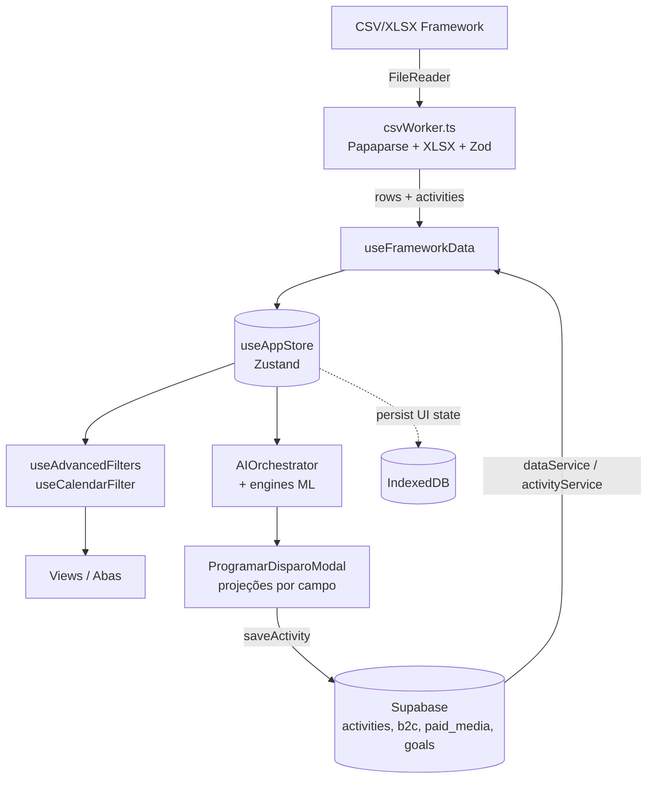

# Legado: notas fora da estrutura nova (foto de jun/2026) (legado.md)

<!-- gerado por scripts/bundle_vault.py: não editar à mão -->

> Compilado do vault em 2026-11-03. 47 notas. Quando carregar: Só para consultar histórico. Nada aqui é regra vigente: cada nota aponta para a página atual.
> Arquivo derivado: a fonte canônica é a nota no vault. Mapa completo em [INDEX.md](INDEX.md).

## 📌 Notas neste arquivo

- [MOC-Conceitos](#moc-conceitos)
- [DE_VDV_BASE_ELEGIVEL](#de_vdv_base_elegivel)
- [DE_VDV_OFERTAS](#de_vdv_ofertas)
- [BUs](#bus)
- [Canais](#canais)
- [Criativos](#criativos)
- [Objetivos-de-Campanha](#objetivos-de-campanha)
- [Ofertas](#ofertas)
- [Parceiros](#parceiros)
- [Perfis-de-Crédito](#perfis-de-crédito)
- [Plataformas-Mídia](#plataformas-mídia)
- [Produtos](#produtos)
- [Segmentos](#segmentos)
- [Subgrupos](#subgrupos)
- [Configurações](#configurações)
- [Custos-e-Investimento](#custos-e-investimento)
- [Diário-de-Bordo](#diário-de-bordo)
- [Explorador-Avançado](#explorador-avançado)
- [GaaS-9-Áreas](#gaas-9-áreas)
- [Ingestão-de-Dados](#ingestão-de-dados)
- [Integração-Mídia-Paga](#integração-mídia-paga)
- [Jornada-Disparos](#jornada-disparos)
- [Launch-Planner](#launch-planner)
- [Mídia-Analytics](#mídia-analytics)
- [O-que-é-o-GaaS](#o-que-é-o-gaas)
- [Orientador](#orientador)
- [Originação-B2C](#originação-b2c)
- [Pilar-Automação-por-Histórico](#pilar-automação-por-histórico)
- [Relatório](#relatório)
- [Resultados](#resultados)
- [Casos-de-Uso](#casos-de-uso)
- [Framework-v1-Diretor](#framework-v1-diretor)
- [Entidades-v2](#entidades-v2)
- [Arquitetura-Geral](#arquitetura-geral)
- [Camada-de-Serviços](#camada-de-serviços)
- [Como-Rodar-e-Deploy](#como-rodar-e-deploy)
- [Componentes-por-Aba](#componentes-por-aba)
- [Convenções-de-Código](#convenções-de-código)
- [Decisões-Técnicas](#decisões-técnicas)
- [Dívida-Técnica](#dívida-técnica)
- [Histórico-de-Evolução](#histórico-de-evolução)
- [Hooks-Catálogo](#hooks-catálogo)
- [Modal-de-Disparo](#modal-de-disparo)
- [Modelo-de-Estado](#modelo-de-estado)
- [Módulo-Paid-Media-Afinz](#módulo-paid-media-afinz)
- [Pipeline-ML](#pipeline-ml)
- [Stack-e-Dependências](#stack-e-dependências)

---

## MOC-Conceitos

> **tags:** `moc` | **tipo:** `moc` | **camada:** `indice` | **atualizado:** `2026-06-08` | **status:** `legado` | **fonte:** `gaas-supabase` | **status_original:** `confirmado` | **legado_desde:** `2026-10-29`

# MOC — Conceitos (dicionário vivo)

> **Legado (foto de jun/2026).** Esta nota ficou fora da estrutura nova da wiki em 29/10/2026 e é mantida como histórico, sem alteração de conteúdo. Para o estado atual, ver [HOME](core.md#-home) e [Resultados](resultados-1.md#resultados-evolucao-e-retrospectivas).

Os conceitos fundamentais da operação de aquisição. Cada um é uma nota.

## Unidades de campanha
- [Disparo](core.md#disparo) — a instância de envio
- [Campanha](core.md#campanha) — disparos agrupados por jornada+safra
- [Jornada](core.md#jornada) — a sequência lógica
- [Régua](core.md#régua) — a jornada como sequência ordenada
- [Safra](core.md#safra) — o mês de referência

## Públicos e funil
- [Lead](core.md#lead) · [Oportunidade](core.md#oportunidade)
- [Etapa-de-Aquisição](core.md#etapa-de-aquisição) · [Funil-AARRR](core.md#funil-aarrr)
- [Base-Acionável](core.md#base-acionável)

## Campanhas-tipo (os blocos de negócio)
- [Plataformas-de-Comunicação](core.md#plataformas-de-comunicação) — hub: onde a Afinz fala com o cliente
- [Topo-de-Funil](core.md#topo-de-funil) — aquisição fria (volume)
- [Repescagem](core.md#repescagem) — negados, segunda chance
- [Upgrade](core.md#upgrade) — aprovados não convertidos, fechamento
- [Carrinho-Abandonado](core.md#carrinho-abandonado) — recuperação imediata (melhor CAC)

## Conteúdo e aprendizado (v2)
- [Template](core.md#template) — o conteúdo do disparo
- [Experimento](core.md#experimento) — o teste que agrupa variações
- [Hipótese](core.md#hipótese)

## Chaves e métricas
- [Taxonomia-Activity-Name](core.md#taxonomia-activity-name)
- [CAC](core.md#cac) · [CAC-Ótimo](core.md#cac-ótimo)

## Mídia paga
- [Mídia-Paga](core.md#mídia-paga) · [Métricas-de-Mídia](core.md#métricas-de-mídia) · [Spend-to-Card](core.md#spend-to-card)

## Relacionado
- [🏠 HOME](core.md#-home) · [MOC-Midia-Paga](core.md#moc-midia-paga)


---

## DE_VDV_BASE_ELEGIVEL

> **tags:** `legado, sfmc` | **tipo:** `entidade` | **camada:** `legado` | **atualizado:** `2026-11-03` | **status:** `substituido` | **fonte:** `operador`

# DE_VDV_BASE_ELEGIVEL (planejamento, substituída)

Nome usado no planejamento de 03/11/2026. A DE foi criada no SFMC com outro nome e estrutura: ver [DE-VDV_APTOS](dados.md#de-vdv_aptos). Mapa completo em [MOC-SFMC-DEs-e-Automations](dados.md#moc-sfmc-des-e-automations).


---

## DE_VDV_OFERTAS

> **tags:** `legado, sfmc` | **tipo:** `entidade` | **camada:** `legado` | **atualizado:** `2026-11-03` | **status:** `substituido` | **fonte:** `operador`

# DE_VDV_OFERTAS (planejamento, substituída)

Nome usado no planejamento de 03/11/2026. A DE foi criada no SFMC com outro nome e estrutura: ver [DE-BRIEFING_OFERTAS_VISA](dados.md#de-briefing_ofertas_visa). Mapa completo em [MOC-SFMC-DEs-e-Automations](dados.md#moc-sfmc-des-e-automations).


---

## BUs

> **tags:** `dimensao,bu` | **tipo:** `dimensao` | **camada:** `dados` | **atualizado:** `2026-06-10` | **status:** `legado` | **fonte:** `gaas-supabase` | **status_original:** `confirmado` | **legado_desde:** `2026-10-29`

# BUs (Business Units)

> **Legado (foto de jun/2026).** Esta nota ficou fora da estrutura nova da wiki em 29/10/2026 e é mantida como histórico, sem alteração de conteúdo. Para o estado atual, ver [CRM Aquisição](resultados-2.md#dominio-crm-aquisicao) (públicos, parceiros, canais e BUs).

**Definição:** as unidades de negócio da aquisição.

## Valores reais
| BU | Disparos | Cor (marca) |
|---|---|---|
| Plurix | 2.230 | roxo |
| B2C | 2.049 | azul |
| B2B2C | 115 | verde |
| Seguros | 65 | — (fora do foco CRM) |

> 📊 Snapshot 2026-06-10.

## Contexto
Plurix e B2C concentram o volume. B2C cobre pessoa física (cartão direto); B2B2C e Plurix envolvem parceiros de varejo. Na marca Afinz, PF = azul `#00C6CC`, PJ = verde `#D3FF00`.

## Relacionado
- [Parceiros](#parceiros) · [Segmentos](#segmentos) · [goals](dados.md#goals)


---

## Canais

> **tags:** `dimensao,canal` | **tipo:** `dimensao` | **camada:** `dados` | **atualizado:** `2026-06-10` | **status:** `legado` | **fonte:** `gaas-supabase` | **status_original:** `confirmado` | **legado_desde:** `2026-10-29`

# Canais

> **Legado (foto de jun/2026).** Esta nota ficou fora da estrutura nova da wiki em 29/10/2026 e é mantida como histórico, sem alteração de conteúdo. Para o estado atual, ver [CRM Aquisição](resultados-2.md#dominio-crm-aquisicao) (públicos, parceiros, canais e BUs).

**Definição:** o meio de entrega do [Disparo](core.md#disparo). Quatro canais ativos, cada um com custo unitário fixo e perfil de performance distinto.

## Os 4 canais (com custo e performance real)
| Canal | Custo unit. | Disparos | Cartões | CAC médio | Conversão |
|---|---|---|---|---|---|
| WhatsApp | R$ 0,420 | 2.152 | 10.344 | R$ 22,95 | 7,3% |
| E-mail | R$ 0,001 | 1.275 | 5.525 | **R$ 6,56** | 3,4% |
| SMS | R$ 0,064 | 861 | 4.173 | R$ 24,61 | 6,5% |
| Push | R$ 0,001 | 103 | 3 | R$ 0,20 | 0,8% |

> 📊 Snapshot 2026-06-10 (etapas Aquisicao+Meio_de_Funil). Push é subutilizado. ⚠️ Base re-ingerida vs snapshot 06-08 (activities 4.606→4.459): taxas de conversão recuaram em todos os canais — comparar tendência só dentro da mesma base.

## Leitura estratégica
**Dispersão de CAC de ~3,7x** (E-mail R$6,56 vs SMS R$24,61) é a evidência mais concreta de otimização a capturar — base da [Função-Objetivo](core.md#função-objetivo). WhatsApp tem o maior volume e conversão, mas custo unitário 420x o do e-mail.

## Relacionado
- [CAC-por-Canal](dados.md#cac-por-canal) · [Custos-e-Investimento](#custos-e-investimento) · [CAC-Ótimo](core.md#cac-ótimo) · [activities](dados.md#activities)


---

## Criativos

> **tags:** `dimensao,midia,criativo` | **tipo:** `dimensao` | **camada:** `dados` | **atualizado:** `2026-06-08` | **status:** `legado` | **fonte:** `gaas-supabase` | **status_original:** `confirmado` | **legado_desde:** `2026-10-29`

# Criativos (Mídia Paga)

> **Legado (foto de jun/2026).** Esta nota ficou fora da estrutura nova da wiki em 29/10/2026 e é mantida como histórico, sem alteração de conteúdo. Para o estado atual, ver [MOC de mídia paga](core.md#moc-midia-paga) (até a frente de mídia ficar pronta).

**Definição:** o conteúdo do anúncio — copy, título, CTA, imagem/vídeo e suas variações. É o paralelo de mídia ao [Template](core.md#template) do CRM. Vive em [ad_creatives](dados.md#ad_creatives).

## Valores reais
| Tipo de mídia | Qtd |
|---|---|
| Imagem | 254 |
| Vídeo | 37 |

**Status:** ACTIVE 18 · PAUSED 143 · ADSET_PAUSED 89 · CAMPAIGN_PAUSED 37 · WITH_ISSUES 4.

> 📊 Snapshot 2026-06-08 — 291 criativos. Só **18 ativos** — a maioria é histórico pausado (acervo de aprendizado de criativo).

## Contexto
Cada criativo guarda `body/title/description` + suas `*_variations` (jsonb) e `asset_insights` — base da análise de criativo na [Mídia-Analytics](#mídia-analytics). Conecta a inteligência de copy de mídia à futura inteligência de [Template](core.md#template) no CRM (ver [Eficiência-de-Criativo](dados.md#eficiência-de-criativo)).

## Relacionado
- [ad_creatives](dados.md#ad_creatives) · [Template](core.md#template) · [Eficiência-de-Criativo](dados.md#eficiência-de-criativo) · [Mídia-Analytics](#mídia-analytics)


---

## Objetivos-de-Campanha

> **tags:** `dimensao,midia,objetivo` | **tipo:** `dimensao` | **camada:** `dados` | **atualizado:** `2026-06-08` | **status:** `legado` | **fonte:** `gaas-supabase` | **status_original:** `confirmado` | **legado_desde:** `2026-10-29`

# Objetivos de Campanha (Mídia)

> **Legado (foto de jun/2026).** Esta nota ficou fora da estrutura nova da wiki em 29/10/2026 e é mantida como histórico, sem alteração de conteúdo. Para o estado atual, ver [MOC de mídia paga](core.md#moc-midia-paga) (até a frente de mídia ficar pronta).

**Definição:** a classificação de negócio de cada campanha de [Mídia-Paga](core.md#mídia-paga), do catálogo [paid_media_objectives](dados.md#paid_media_objectives). É o que conecta spend ao resultado certo na [Spend-to-Card](core.md#spend-to-card).

## Os 6 objetivos (catálogo real)
| Key | Label | Cor | Campanhas mapeadas |
|---|---|---|---|
| `aquisicao` | Aquisição | blue | **16** |
| `rentabilizacao` | Rentabilização | green | 4 |
| `marca` | Branding (Marca) | violet | 3 |
| `plurix` | Plurix | purple | 2 |
| `seguros` | Seguros | orange | 1 |
| `b2c` | Performance (B2C) | blue | — |

> 📊 Snapshot 2026-06-08 — 26 campanhas mapeadas em [paid_media_campaign_mappings](dados.md#paid_media_campaign_mappings). Aquisição domina (16).

## Contexto
O objetivo determina **como ler o sucesso**: campanha de `marca` não deve ser cobrada por CAC de cartão; `aquisicao`/`b2c` sim. Espelha as [BUs](#bus) e a [Etapa-de-Aquisição](core.md#etapa-de-aquisição) no mundo de mídia. Budgets são planejados por objetivo ([paid_media_budgets](dados.md#paid_media_budgets)).

## Relacionado
- [paid_media_objectives](dados.md#paid_media_objectives) · [paid_media_campaign_mappings](dados.md#paid_media_campaign_mappings) · [paid_media_budgets](dados.md#paid_media_budgets) · [Spend-to-Card](core.md#spend-to-card) · [BUs](#bus)


---

## Ofertas

> **tags:** `dimensao,oferta` | **tipo:** `dimensao` | **camada:** `dados` | **atualizado:** `2026-06-08` | **status:** `legado` | **fonte:** `gaas-supabase` | **status_original:** `confirmado` | **legado_desde:** `2026-10-29`

# Ofertas

> **Legado (foto de jun/2026).** Esta nota ficou fora da estrutura nova da wiki em 29/10/2026 e é mantida como histórico, sem alteração de conteúdo. Para o estado atual, ver [Dicionário de produtos](dados.md#dicionario-de-produtos) e as páginas de público.

**Definição:** a proposta de valor apresentada no [Disparo](core.md#disparo). Combinada com o **Promocional** (modificador).

## Valores reais
| Oferta | Disparos |
|---|---|
| Vibe | 2.740 |
| Padrao | 1.705 |
| Seguro Cartonistas | 65 |
| Limite | 6 |

**Promocional:** Padrao (2.963), N/A (1.228), Copa (199), Em dobro (112), Upgrade (14).

> 📊 Snapshot 2026-06-08. 5 disparos sem oferta — corrigir ([Inconsistências-a-Corrigir](evolucao.md#inconsistências-a-corrigir)).

## Contexto
**Vibe** é a oferta dominante e tem case próprio de impacto em engajamento/ativação (deck de referência). A efetividade de oferta por segmento é um dos [Casos de Uso](#casos-de-uso) do [diretor](#framework-v1-diretor).

## Relacionado
- [Segmentos](#segmentos) · [Casos-de-Uso](#casos-de-uso) · [Template](core.md#template)


---

## Parceiros

> **tags:** `dimensao,parceiro` | **tipo:** `dimensao` | **camada:** `dados` | **atualizado:** `2026-06-08` | **status:** `legado` | **fonte:** `gaas-supabase` | **status_original:** `confirmado` | **legado_desde:** `2026-10-29`

# Parceiros

> **Legado (foto de jun/2026).** Esta nota ficou fora da estrutura nova da wiki em 29/10/2026 e é mantida como histórico, sem alteração de conteúdo. Para o estado atual, ver [CRM Aquisição](resultados-2.md#dominio-crm-aquisicao) (públicos, parceiros, canais e BUs).

**Definição:** o parceiro de varejo dono da base ou canal do [Disparo](core.md#disparo).

## Valores reais
N/A (2.869, Afinz direto), Proprietaria (1.064), Serasa (433), Dia (76), Bom_Pra_Credito (36), Alvorada (12), Acordo Certo (7), Bem Barato (24).

> 📊 Snapshot 2026-06-08.

## ⚠️ Inconsistências
- "Bem Barato" (13) + "Bem_Barato" (11) = duplicidade → unificar.
- "Acordo Certo" → padronizar para `Acordo_Certo`.
Ver [Inconsistências-a-Corrigir](evolucao.md#inconsistências-a-corrigir).

## Relacionado
- [BUs](#bus) · [Segmentos](#segmentos) · [Inconsistências-a-Corrigir](evolucao.md#inconsistências-a-corrigir)


---

## Perfis-de-Crédito

> **tags:** `dimensao,credito` | **tipo:** `dimensao` | **camada:** `dados` | **atualizado:** `2026-06-08` | **status:** `legado` | **fonte:** `gaas-supabase` | **status_original:** `confirmado` | **legado_desde:** `2026-10-29`

# Perfis de Crédito

> **Legado (foto de jun/2026).** Esta nota ficou fora da estrutura nova da wiki em 29/10/2026 e é mantida como histórico, sem alteração de conteúdo. Para o estado atual, ver [CRM Aquisição](resultados-2.md#dominio-crm-aquisicao) (públicos, parceiros, canais e BUs).

**Definição:** o nível de pré-qualificação de crédito do público.

## Valores reais
Mar_aberto (3.297), Pre_analisado (705), Whitelist (442), Serasa API Integrado (12), N/A (65).

> 📊 Snapshot 2026-06-08.

## Contexto
`Mar_aberto` (público sem pré-análise) domina. `Pre_analisado` e `Whitelist` são públicos qualificados, tendem a converter melhor. `Serasa API Integrado` é o canal integrado de originação (ver [b2c_daily_metrics](dados.md#b2c_daily_metrics)).

## Relacionado
- [Segmentos](#segmentos) · [Base-Acionável](core.md#base-acionável)


---

## Plataformas-Mídia

> **tags:** `dimensao,midia,plataforma` | **tipo:** `dimensao` | **camada:** `dados` | **atualizado:** `2026-06-08` | **status:** `legado` | **fonte:** `gaas-supabase` | **status_original:** `confirmado` | **legado_desde:** `2026-10-29`

# Plataformas de Mídia

> **Legado (foto de jun/2026).** Esta nota ficou fora da estrutura nova da wiki em 29/10/2026 e é mantida como histórico, sem alteração de conteúdo. Para o estado atual, ver [MOC de mídia paga](core.md#moc-midia-paga) (até a frente de mídia ficar pronta).

**Definição:** os canais de [Mídia-Paga](core.md#mídia-paga) onde a Afinz investe. Dois ativos: **Meta** (Facebook/Instagram) e **Google** (Search/Display/YouTube), cada um coletado por MCP próprio.

## Valores reais (jan/2025–jun/2026)
| Plataforma | Spend | Impressões | Cliques | CTR | CPC | Coleta |
|---|---|---|---|---|---|---|
| **Meta** | R$ 130.992 | 15,0 MM | 172.513 | 1,15% | R$ 0,76 | Meta Marketing API (MCP) |
| **Google** | R$ 111.981 | 37,3 MM | 563.290 | 1,51% | R$ 0,20 | Google Ads MCP |

> 📊 Snapshot 2026-06-08 — 5.301 registros em [paid_media_metrics](dados.md#paid_media_metrics) (Meta 4.256 / Google 1.814 linhas).

## Leitura
**Google** entrega ~2,5x mais impressões e CPC ~4x menor que **Meta** — perfil de alcance/tráfego barato. Meta tem CPC mais alto mas é o canal de criativo rico ([Criativos](#criativos)). A escolha de plataforma por objetivo é alavanca de eficiência. Coleta automatizada via [MCP](ia.md#mcp-visão-geral) — ver [Integração-Mídia-Paga](#integração-mídia-paga).

## Relacionado
- [Mídia-Paga](core.md#mídia-paga) · [paid_media_metrics](dados.md#paid_media_metrics) · [Objetivos-de-Campanha](#objetivos-de-campanha) · [CPA-por-Plataforma](dados.md#cpa-por-plataforma) · [MCP-Visão-Geral](ia.md#mcp-visão-geral)


---

## Produtos

> **tags:** `dimensao,produto` | **tipo:** `dimensao` | **camada:** `dados` | **atualizado:** `2026-06-08` | **status:** `legado` | **fonte:** `gaas-supabase` | **status_original:** `a-validar` | **legado_desde:** `2026-10-29`

# Produtos

> **Legado (foto de jun/2026).** Esta nota ficou fora da estrutura nova da wiki em 29/10/2026 e é mantida como histórico, sem alteração de conteúdo. Para o estado atual, ver [Dicionário de produtos](dados.md#dicionario-de-produtos).

**Definição:** o produto de cartão ofertado.

## Valores reais
Classic (3.717), Cartao (592), Platinum (212).

> 📊 Snapshot 2026-06-08.

## ⚠️ Inconsistência
"Cartao" é genérico — provavelmente deve mapear para Classic ou Platinum. A validar ([Inconsistências-a-Corrigir](evolucao.md#inconsistências-a-corrigir)).

## Relacionado
- [Ofertas](#ofertas) · [Inconsistências-a-Corrigir](evolucao.md#inconsistências-a-corrigir)


---

## Segmentos

> **tags:** `dimensao,publico` | **tipo:** `dimensao` | **camada:** `dados` | **atualizado:** `2026-06-10` | **status:** `legado` | **fonte:** `gaas-supabase` | **status_original:** `confirmado` | **legado_desde:** `2026-10-29`

# Segmentos

> **Legado (foto de jun/2026).** Esta nota ficou fora da estrutura nova da wiki em 29/10/2026 e é mantida como histórico, sem alteração de conteúdo. Para o estado atual, ver [CRM Aquisição](resultados-2.md#dominio-crm-aquisicao) (públicos, parceiros, canais e BUs).

**Definição:** o agrupamento de público-alvo do [Disparo](core.md#disparo). 10 segmentos, ligados às etapas do [Funil-AARRR](core.md#funil-aarrr).

## Os segmentos (com performance)
| Segmento | Etapa | Disparos | Conversão | CAC |
|---|---|---|---|---|
| Abandonados | Meio funil | 2.409 | 6,1% | **R$ 4,83** |
| Base_Proprietaria | Aquisição | 766 | 2,6% | R$ 14,29 |
| CRM | Aquisição | 717 | 3,3% | R$ 10,15 |
| Negados | Meio funil | 199 | **16,7%** | R$ 39,04 |
| Leads_Parceiros | Meio funil | 142 | 8,9% | R$ 13,55 |
| Aprovados_nao_convertidos | Meio funil | 97 | 16,4% | R$ 93,51 |

> 📊 Snapshot 2026-06-10. Também: Rentabilizacao (65), Cartonistas (30), Recencia de Compra (26), Instabilidade (8). ⚠️ Base re-ingerida vs 06-08 — taxas de conversão recuaram em bloco; a hierarquia entre segmentos se mantém.

## Leitura estratégica
**Meio de funil converte ~4x melhor** que aquisição fria — o motor de oportunidades deve pesar etapa, não só volume. [Abandonados](#segmentos) é o maior ativo: alto volume + alta conversão + CAC baixo.

## Relacionado
- [Funil-AARRR](core.md#funil-aarrr) · [Performance-por-Segmento](dados.md#performance-por-segmento) · [Etapa-de-Aquisição](core.md#etapa-de-aquisição) · [CRM](#segmentos)


---

## Subgrupos

> **tags:** `dimensao,publico` | **tipo:** `dimensao` | **camada:** `dados` | **atualizado:** `2026-06-08` | **status:** `legado` | **fonte:** `gaas-supabase` | **status_original:** `confirmado` | **legado_desde:** `2026-10-29`

# Subgrupos

> **Legado (foto de jun/2026).** Esta nota ficou fora da estrutura nova da wiki em 29/10/2026 e é mantida como histórico, sem alteração de conteúdo. Para o estado atual, ver [CRM Aquisição](resultados-2.md#dominio-crm-aquisicao) (públicos, parceiros, canais e BUs).

**Definição:** o detalhamento do [segmento](#segmentos) — a granularidade fina de público dentro de uma campanha.

## Valores reais (principais)
Diario (2.390), N/A (1.476), Leais (121), Abandonados D-7 (68), Novos (58), Churn (56), Frequentes (56), Pre_Churn (50), Ocasional (51).

> 📊 Snapshot 2026-06-08.

## ⚠️ Inconsistência
"Leais" (121) + "Leal" (1) = duplicidade → unificar. Ver [Inconsistências-a-Corrigir](evolucao.md#inconsistências-a-corrigir).

## Contexto
Subgrupo entra na chave de [Campanha](core.md#campanha) (`BU+Segmento+Parceiro+Subgrupo+Etapa+Safra`). Subgrupos comportamentais (Churn, Pre_Churn, Frequentes) refletem o [Funil-AARRR](core.md#funil-aarrr).

## Relacionado
- [Segmentos](#segmentos) · [Campanha](core.md#campanha) · [Inconsistências-a-Corrigir](evolucao.md#inconsistências-a-corrigir)


---

## Configurações

> **tags:** `gaas,aba,admin` | **tipo:** `operacao` | **camada:** `operacao` | **atualizado:** `2026-06-08` | **status:** `legado` | **fonte:** `gaas-supabase` | **status_original:** `confirmado` | **legado_desde:** `2026-10-29`

# Aba: Configurações

> **Legado (foto de jun/2026).** Esta nota ficou fora da estrutura nova da wiki em 29/10/2026 e é mantida como histórico, sem alteração de conteúdo. Para o estado atual, ver o app atual e o [MOC de operação](core.md#moc-operacao).

**Definição:** a aba de **administração** — gestão de [metas](dados.md#goals), versionamento de framework e migração de dados.

## O que entrega
- **GoalsManager**: CRUD das metas mensais ([Metas-e-CAC](dados.md#metas-e-cac)).
- **Versionamento**: histórico de CSVs de framework (`framework_versions`, `useVersionManager`).
- **DataMigration**: ferramentas de migração/ajuste de dados.
- Controle de acesso por papel (`UserRoleContext`, `profiles`).

## Relacionado
- [Metas-e-CAC](dados.md#metas-e-cac) · [goals](dados.md#goals) · [profiles](dados.md#profiles) · [GaaS-9-Áreas](#gaas-9-áreas)


---

## Custos-e-Investimento

> **tags:** `custo,metrica` | **tipo:** `operacao` | **camada:** `operacao` | **atualizado:** `2026-06-08` | **status:** `legado` | **fonte:** `gaas-supabase` | **status_original:** `confirmado` | **legado_desde:** `2026-10-29`

# Custos e Investimento

> **Legado (foto de jun/2026).** Esta nota ficou fora da estrutura nova da wiki em 29/10/2026 e é mantida como histórico, sem alteração de conteúdo. Para o estado atual, ver o app atual e o [MOC de operação](core.md#moc-operacao).

**Definição:** como o custo de cada [Disparo](core.md#disparo) e o [CAC](core.md#cac) são compostos.

## Custo unitário por canal (fixo)
| Canal | Custo unit. |
|---|---|
| E-mail | R$ 0,001 |
| Push | R$ 0,001 |
| SMS | R$ 0,064 |
| WhatsApp | R$ 0,420 |

**Custo Total Campanha** = Volume × (Custo Unit. Oferta + Custo Unit. Canal).
**CAC** = Custo Total Campanha / Cartões Gerados.

> 📊 Snapshot 2026-06-08 — investimento total rastreado ~R$ 270 mil → 18.715 cartões.

## Relacionado
- [CAC](core.md#cac) · [Canais](#canais) · [CAC-Ótimo](core.md#cac-ótimo)


---

## Diário-de-Bordo

> **tags:** `gaas,aba,experimento` | **tipo:** `operacao` | **camada:** `operacao` | **atualizado:** `2026-06-08` | **status:** `legado` | **fonte:** `gaas-supabase` | **status_original:** `confirmado` | **legado_desde:** `2026-10-29`

# Aba: Diário de Bordo

> **Legado (foto de jun/2026).** Esta nota ficou fora da estrutura nova da wiki em 29/10/2026 e é mantida como histórico, sem alteração de conteúdo. Para o estado atual, ver o app atual e o [MOC de operação](core.md#moc-operacao).

**Definição:** a aba de **tracking de experimentos e anotações** — onde a operação registra [hipóteses](core.md#hipótese), experimentos A/B e aprendizados, fechando o loop `hipótese → disparo → resultado → aprendizado`.

## O que entrega
- Anotações com tags (`useNotes`, `useNotesWithTags`), persistidas no `diaryStore`.
- **ExperimentsView**: cadastro de [experimentos](core.md#experimento) com variações, janela e métrica-alvo.
- **SignificanceCalculator**: teste de significância estatística entre variações (A/B).
- **MultiSelectChips**: marcação de dimensões do experimento.

## Por que importa
É a unidade de **aprendizado provado** da operação — sai-se do achismo para resultado comparável. Materializa a entidade [Experimento](core.md#experimento) da [v2](core.md#ontologia-v2) e a regra "sem hipótese prévia não há aprendizado válido".

## Relacionado
- [Experimento](core.md#experimento) · [Hipótese](core.md#hipótese) · [Entidades-v2](#entidades-v2) · [GaaS-9-Áreas](#gaas-9-áreas)


---

## Explorador-Avançado

> **tags:** `gaas,aba,exploracao` | **tipo:** `operacao` | **camada:** `operacao` | **atualizado:** `2026-06-08` | **status:** `legado` | **fonte:** `codigo-gaas` | **status_original:** `confirmado` | **legado_desde:** `2026-10-29`

# Aba: Explorador Avançado

> **Legado (foto de jun/2026).** Esta nota ficou fora da estrutura nova da wiki em 29/10/2026 e é mantida como histórico, sem alteração de conteúdo. Para o estado atual, ver o app atual e o [MOC de operação](core.md#moc-operacao).

**Definição:** a aba de **navegação livre por disparos** (`DisparoExplorer`) — árvore, busca, comparação e detalhe de [disparos](core.md#disparo). Nova, ausente do CLAUDE.md.

## O que entrega
- Árvore navegável (`tree/`, `useTreeData`, `useTreeNavigation`).
- Busca cross-dimensão (`search/`, `useExplorerSearch`).
- Comparação lado a lado (`comparison/`, `useComparisonData`) e painel de detalhe (`useDetailsPaneData`).
- Estado próprio em `explorerStore` (4º store Zustand — ver [Modelo-de-Estado](#modelo-de-estado)).

## Por que importa
É a ferramenta de **investigação ad-hoc** — permite ao operador "garimpar" padrões sem montar um relatório fixo. Complementa o [explorer](#explorador-avançado) ao [Orientador](#orientador) (que ranqueia automaticamente).

## Relacionado
- [Disparo](core.md#disparo) · [Modelo-de-Estado](#modelo-de-estado) · [Orientador](#orientador) · [GaaS-9-Áreas](#gaas-9-áreas)


---

## GaaS-9-Áreas

> **tags:** `gaas,plataforma` | **tipo:** `operacao` | **camada:** `operacao` | **atualizado:** `2026-06-08` | **status:** `legado` | **fonte:** `gaas-supabase` | **status_original:** `confirmado` | **legado_desde:** `2026-10-29`

# GaaS — As 9 Áreas Funcionais

> **Legado (foto de jun/2026).** Esta nota ficou fora da estrutura nova da wiki em 29/10/2026 e é mantida como histórico, sem alteração de conteúdo. Para o estado atual, ver o app atual e o [MOC de operação](core.md#moc-operacao).

**Definição:** a plataforma organizada em 4 blocos de capacidade, com 9 áreas.

## Por bloco
**Planejamento**
- Launch — calendário de agendamento com modal inteligente e projeções
- Diário de Bordo — tracking de experimentos e anotações ([Experimento](core.md#experimento))

**Análise**
- Jornada & Disparos — funil e detecção de anomalias
- Resultados — métricas vs meta ([goals](dados.md#goals))
- [Orientador](#orientador) — motor de recomendação por score

**Origem**
- Originação B2C — aquisição B2C e orquestrador de funil ([b2c_daily_metrics](dados.md#b2c_daily_metrics))
- [Mídia-Analytics](#mídia-analytics) — análise de mídia paga

**Framework**
- Campanhas — editor de dados com versionamento
- Configurações — admin, metas, versões

## Leitura estratégica
**Orientador** e **Mídia Analytics** são o sinal de que o GaaS já saiu do "acompanhar" para o "recomendar".

## Relacionado
- [O-que-é-o-GaaS](#o-que-é-o-gaas) · [Orientador](#orientador) · [Mídia-Analytics](#mídia-analytics)


---

## Ingestão-de-Dados

> **tags:** `gaas,ingestao,governanca` | **tipo:** `operacao` | **camada:** `operacao` | **atualizado:** `2026-06-08` | **status:** `legado` | **fonte:** `gaas-supabase` | **status_original:** `confirmado` | **legado_desde:** `2026-10-29`

# Ingestão de Dados (GaaS Updater)

> **Legado (foto de jun/2026).** Esta nota ficou fora da estrutura nova da wiki em 29/10/2026 e é mantida como histórico, sem alteração de conteúdo. Para o estado atual, ver o app atual e o [MOC de operação](core.md#moc-operacao).

**Definição:** o fluxo que traz resultados de campanha para o Supabase com **validação humana** — não importação cega.

## Como funciona
O usuário cola/sobe dados → o sistema detecta blocos, compara com histórico, gera **candidatos** com `confidence` e `suggestion` → humano revisa o que está abaixo do limiar → aplica. Tabelas: [gaas_update_runs](dados.md#gaas_update_runs) + gaas_update_candidates.

## Por que importa
Esse padrão (confiança + revisão) é **metade de um orquestrador já pronta**, mas apontada para trás. O [Orquestrador](core.md#orquestrador) reaproveita exatamente essa UX para propor disparos para frente. Mesma lógica do [template_id](core.md#template) (inferência <80% → fila de revisão).

## Relacionado
- [gaas_update_runs](dados.md#gaas_update_runs) · [Orquestrador](core.md#orquestrador) · [Template](core.md#template)


---

## Integração-Mídia-Paga

> **tags:** `midia,integracao,marco` | **tipo:** `operacao` | **camada:** `operacao` | **atualizado:** `2026-06-08` | **status:** `legado` | **fonte:** `gaas-supabase` | **status_original:** `confirmado` | **legado_desde:** `2026-10-29`

# Integração de Mídia Paga

> **Legado (foto de jun/2026).** Esta nota ficou fora da estrutura nova da wiki em 29/10/2026 e é mantida como histórico, sem alteração de conteúdo. Para o estado atual, ver o app atual e o [MOC de operação](core.md#moc-operacao).

**Definição:** a coleta automatizada de métricas de **Meta e Google Ads** para o Supabase, via **MCP / edge function**, em fila com cron.

## Como funciona
1. Itens entram na [collection_queue](dados.md#collection_queue) (`channel`, `since`→`until`, `status`).
2. Um cron (~5 min) consome a fila e chama o conector da plataforma:
   - **Google** → Google Ads MCP (auth via gcloud ADC).
   - **Meta** → Meta Marketing API MCP.
3. Resultado grava em [paid_media_metrics](dados.md#paid_media_metrics) (+ [ad_creatives](dados.md#ad_creatives)); execução logada em [collection_execution_logs](dados.md#collection_execution_logs).
Ver o panorama de conectores em [MCP-Visão-Geral](ia.md#mcp-visão-geral).

## Contexto
Marco dos 9 meses: trouxe mídia paga para a **mesma base do CRM**, permitindo leitura unificada de eficiência ([Spend-to-Card](core.md#spend-to-card)).

> 📊 Snapshot 2026-06-08 — 5.301 registros em [paid_media_metrics](dados.md#paid_media_metrics) (Meta 4.256 / Google 1.814), 291 criativos, 19 execuções de coleta logadas.

## Relacionado
- [Mídia-Analytics](#mídia-analytics) · [paid_media_metrics](dados.md#paid_media_metrics) · [ad_creatives](dados.md#ad_creatives) · [collection_queue](dados.md#collection_queue) · [collection_execution_logs](dados.md#collection_execution_logs) · [MCP-Visão-Geral](ia.md#mcp-visão-geral)


---

## Jornada-Disparos

> **tags:** `gaas,aba,analise,funil` | **tipo:** `operacao` | **camada:** `operacao` | **atualizado:** `2026-06-08` | **status:** `legado` | **fonte:** `gaas-supabase` | **status_original:** `confirmado` | **legado_desde:** `2026-10-29`

# Aba: Jornada & Disparos

> **Legado (foto de jun/2026).** Esta nota ficou fora da estrutura nova da wiki em 29/10/2026 e é mantida como histórico, sem alteração de conteúdo. Para o estado atual, ver o app atual e o [MOC de operação](core.md#moc-operacao).

**Definição:** a aba de **análise de funil e detecção de anomalias** — lê o fato diário ([gaas_dinamica_bi_metrics](dados.md#gaas_dinamica_bi_metrics)) e monta o funil ponta a ponta por jornada, com tendência de gargalos.

## O que entrega
- Funil entrega→abertura→clique→proposta→aprovação→conversão (ver [Funil-de-Aquisição](dados.md#funil-de-aquisição)).
- Detecção de gargalo e sua tendência ao longo do tempo (`useConversionFunnel`, `useBottleneckTrend`).
- Drill-down por dia/jornada (componente `JornadaDisparosView`, modo `diario`/`semanal`).

## Por que importa
É onde a operação enxerga **onde o funil quebra** — capacidade que planilha não dava. O gargalo da aquisição fria está no topo (abertura ~9%) e na proposta; aprovação é alta (~58%). Ver [Funil-de-Aquisição](dados.md#funil-de-aquisição).

## Relacionado
- [WhatsApp-Respostas-de-Opt-out](operacao.md#whatsapp-respostas-de-opt-out) — significado da resposta ao botão “Não tenho interesse agora” e melhorias propostas para acompanhamento.
- [gaas_dinamica_bi_metrics](dados.md#gaas_dinamica_bi_metrics) · [Funil-de-Aquisição](dados.md#funil-de-aquisição) · [Etapa-de-Aquisição](core.md#etapa-de-aquisição) · [GaaS-9-Áreas](#gaas-9-áreas) · [Resultados](#resultados)


---

## Launch-Planner

> **tags:** `gaas,aba,planejamento` | **tipo:** `operacao` | **camada:** `operacao` | **atualizado:** `2026-06-08` | **status:** `legado` | **fonte:** `gaas-supabase` | **status_original:** `confirmado` | **legado_desde:** `2026-10-29`

# Aba: Launch (Planner)

> **Legado (foto de jun/2026).** Esta nota ficou fora da estrutura nova da wiki em 29/10/2026 e é mantida como histórico, sem alteração de conteúdo. Para o estado atual, ver o app atual e o [MOC de operação](core.md#moc-operacao).

**Definição:** o **calendário de agendamento** de disparos — entry point default do GaaS. Onde se vê o mês, se programa um [Disparo](core.md#disparo) e se recebe projeções de IA.

## O que entrega
- Calendário mensal com KPIs (`CalendarSummary`, `KPIOverview`, `LaunchPlannerKPIs`, `TimelineRow`).
- Invoca o [Modal-de-Disparo](#modal-de-disparo) (`ProgramarDisparoModal`) para programar disparo com [sugestão por histórico](#pilar-automação-por-histórico) e projeções ([Pipeline-ML](#pipeline-ml)).
- `PerspectiveSwitcher`: alterna visão total / crm / b2c.

## Por que importa
É a tela onde planejamento vira ação — materializa o pilar de automação por histórico no momento da decisão.

## Relacionado
- [Modal-de-Disparo](#modal-de-disparo) · [Pilar-Automação-por-Histórico](#pilar-automação-por-histórico) · [Pipeline-ML](#pipeline-ml) · [GaaS-9-Áreas](#gaas-9-áreas)


---

## Mídia-Analytics

> **tags:** `gaas,midia,ia` | **tipo:** `operacao` | **camada:** `operacao` | **atualizado:** `2026-06-08` | **status:** `legado` | **fonte:** `gaas-supabase` | **status_original:** `confirmado` | **legado_desde:** `2026-10-29`

# Mídia Analytics

> **Legado (foto de jun/2026).** Esta nota ficou fora da estrutura nova da wiki em 29/10/2026 e é mantida como histórico, sem alteração de conteúdo. Para o estado atual, ver o app atual e o [MOC de operação](core.md#moc-operacao).

**Definição:** o módulo que correlaciona investimento de mídia paga a resultado de aquisição (spend → cartão).

## Contexto
É um marco estratégico: conecta o dinheiro de mídia ao resultado de negócio, fortalecendo a narrativa de eficiência comercial. Lê [paid_media_metrics](dados.md#paid_media_metrics) (5.301 registros Meta+Google, coleta via MCP) e gera [paid_media_insights](dados.md#paid_media_insights) no padrão Contexto→Mudança→Causa→Ação com score. Metodologia da correlação em [Spend-to-Card](core.md#spend-to-card).

Inclui análise de criativos ([ad_creatives](dados.md#ad_creatives)) — copy, imagem, variações.

## Relacionado
- [paid_media_metrics](dados.md#paid_media_metrics) · [paid_media_insights](dados.md#paid_media_insights) · [ad_creatives](dados.md#ad_creatives) · [Integração-Mídia-Paga](#integração-mídia-paga)


---

## O-que-é-o-GaaS

> **tags:** `gaas,plataforma` | **tipo:** `operacao` | **camada:** `operacao` | **atualizado:** `2026-06-08` | **status:** `legado` | **fonte:** `gaas-supabase` | **status_original:** `confirmado` | **legado_desde:** `2026-10-29`

# O que é o GaaS

> **Legado (foto de jun/2026).** Esta nota ficou fora da estrutura nova da wiki em 29/10/2026 e é mantida como histórico, sem alteração de conteúdo. Para o estado atual, ver o app atual e o [MOC de operação](core.md#moc-operacao).

**Definição:** **Growth as a Service** — o sistema de inteligência de campanhas de aquisição de cartão da Afinz. Um dashboard React/TypeScript sobre Supabase que transformou planilhas estáticas numa plataforma viva.

## Contexto
Opera campanhas de aquisição via SFMC (Salesforce Marketing Cloud) em 3 BUs ([B2C, B2B2C, Plurix](#bus)) e 4 [Canais](#canais). Evoluiu de um calendário estratégico (MVP) para uma plataforma com 9 áreas funcionais e um pipeline de ML, em ~9 meses de desenvolvimento acelerado (ver [MOC-Engenharia](engenharia.md#moc-engenharia)).

**A tese que o move:** "tínhamos inteligência de dado — faltava inteligência de jornada". A evolução [v2](core.md#ontologia-v2) e o [Orquestrador](core.md#orquestrador) fecham esse gap.

## Relacionado
- [GaaS-9-Áreas](#gaas-9-áreas) · [Supabase-Visão-Geral](dados.md#supabase-visão-geral) · [Função-Objetivo](core.md#função-objetivo) · [Framework-v1-Diretor](#framework-v1-diretor)


---

## Orientador

> **tags:** `gaas,ia,recomendacao` | **tipo:** `operacao` | **camada:** `operacao` | **atualizado:** `2026-06-08` | **status:** `legado` | **fonte:** `gaas-supabase` | **status_original:** `confirmado` | **legado_desde:** `2026-10-29`

# Orientador (Motor de Recomendação)

> **Legado (foto de jun/2026).** Esta nota ficou fora da estrutura nova da wiki em 29/10/2026 e é mantida como histórico, sem alteração de conteúdo. Para o estado atual, ver o app atual e o [MOC de operação](core.md#moc-operacao).

**Definição:** o motor que pontua e ranqueia combinações de campanha por histórico, recomendando o que tende a performar.

## Como funciona
Agrupa [activities](dados.md#activities) por **combo** (`BU+Canal+Oferta+Segmento+Promo...`) e calcula um score 0-100 = 40% CAC + 40% conversão + 20% volume (confiança). Roda no front-end, em memória (recalculado a cada render) — o score **não** é persistido hoje.

## ⚠️ Ponto crítico
A fórmula de CAC do score usa baseline antiga (faixa R$60-150), mas o [CAC](core.md#cac) real da operação é ~R$10-18 → o score quase não discrimina na faixa atual. **Recalibrar antes de persistir.** Ver [Decisões-Abertas](evolucao.md#decisões-abertas).

## Duas chaves, dois propósitos
- **Combo** (Orientador) → *qual combinação converte melhor*.
- **Campanha-safra** ([Campanha](core.md#campanha)) → *quais campanhas existem e como performaram*.
São complementares — ver [Fase 0](core.md#roadmap-framework).

## Relacionado
- [paid_media_insights](dados.md#paid_media_insights) · [Orquestrador](core.md#orquestrador) · [Roadmap-Framework](core.md#roadmap-framework) · [CAC](core.md#cac)


---

## Originação-B2C

> **tags:** `gaas,aba,b2c,origem` | **tipo:** `operacao` | **camada:** `operacao` | **atualizado:** `2026-06-08` | **status:** `legado` | **fonte:** `gaas-supabase` | **status_original:** `confirmado` | **legado_desde:** `2026-10-29`

# Aba: Originação B2C

> **Legado (foto de jun/2026).** Esta nota ficou fora da estrutura nova da wiki em 29/10/2026 e é mantida como histórico, sem alteração de conteúdo. Para o estado atual, ver [Resultados B2C](resultados-1.md#resultados-b2c) (até a frente de originação B2C ficar pronta).

**Definição:** a aba que analisa a **aquisição B2C** (originação direta de cartão pessoa física) e abriga o **orquestrador de funil** — comparando a visão CRM com a originação B2C total e o canal integrado Serasa.

## O que entrega
- Comparação CRM × B2C total × canal Serasa API (`useB2CAnalysis`, `useB2CIntelligence`), lendo [b2c_daily_metrics](dados.md#b2c_daily_metrics).
- **Orquestrador de funil** (`originacao/orchestrator/`): `FunnelLayers`, `InfluenceMatrix`, `ActionLevers`, `ResultEstimates` — simula alavancas e estima resultado.
- Dashboard de originação diária (propostas, emissões, conversão, share).

## Contexto
B2C é a maior BU em volume de pessoa física (ver [BUs](#bus)). O canal **Serasa API Integrado** é a originação integrada (perfil de crédito dedicado — ver [Perfis-de-Crédito](#perfis-de-crédito)). Alimentada pela skill `b2c-originacao-updater`.

## Relacionado
- [b2c_daily_metrics](dados.md#b2c_daily_metrics) · [BUs](#bus) · [Perfis-de-Crédito](#perfis-de-crédito) · [GaaS-9-Áreas](#gaas-9-áreas) · [Orquestrador](core.md#orquestrador)


---

## Pilar-Automação-por-Histórico

> **tags:** `gaas,pilar,automacao` | **tipo:** `operacao` | **camada:** `operacao` | **atualizado:** `2026-06-08` | **status:** `legado` | **fonte:** `gaas-supabase` | **status_original:** `confirmado` | **legado_desde:** `2026-10-29`

# Pilar — Automação por Histórico

> **Legado (foto de jun/2026).** Esta nota ficou fora da estrutura nova da wiki em 29/10/2026 e é mantida como histórico, sem alteração de conteúdo. Para o estado atual, ver o app atual e o [MOC de operação](core.md#moc-operacao).

**Definição:** o princípio fundador do GaaS — todo campo preenchível do [Modal-de-Disparo](#modal-de-disparo) deve ser **sugerido a partir do histórico** de [activities](dados.md#activities), não digitado do zero. O sistema aprende com o que já foi disparado.

## Contexto
É o pilar que o CLAUDE.md declara como "fundamental". Cada campo do modal de programação:
1. **Lê o histórico** de disparos (tabela [activities](dados.md#activities)).
2. **Oferece SELECT com opções do histórico** (padrão `SmartSelect`, **não** input+datalist).
3. **Sugere valores por contexto** (BU + Campanha + Jornada).
4. **Permite preenchimento rápido** sem digitação manual.

Campos auto-calculados: `ActivityName` ([Taxonomia-Activity-Name](core.md#taxonomia-activity-name)), `Safra` (último disparo do segmento +1 mês), `Ordem` (calculada mas editável), custo por canal ([Custos-e-Investimento](#custos-e-investimento)), Total Campanha.

## Por que importa
É o que torna o [Pipeline-ML](#pipeline-ml) e o [Orientador](#orientador) úteis na prática: a inteligência por similaridade só tem valor se o operador a recebe **no momento de decidir**, dentro do formulário. Materializa a ponte entre histórico e ação — base do [Orquestrador](core.md#orquestrador).

## Relacionado
- [Modal-de-Disparo](#modal-de-disparo) · [Pipeline-ML](#pipeline-ml) · [Orientador](#orientador) · [activities](dados.md#activities) · [Taxonomia-Activity-Name](core.md#taxonomia-activity-name)


---

## Relatório

> **tags:** `gaas,aba,analise` | **tipo:** `operacao` | **camada:** `operacao` | **atualizado:** `2026-06-08` | **status:** `legado` | **fonte:** `codigo-gaas` | **status_original:** `confirmado` | **legado_desde:** `2026-10-29`

# Aba: Relatório

> **Legado (foto de jun/2026).** Esta nota ficou fora da estrutura nova da wiki em 29/10/2026 e é mantida como histórico, sem alteração de conteúdo. Para o estado atual, ver o app atual e o [MOC de operação](core.md#moc-operacao).

**Definição:** a aba de **relatórios comparativos** (`RelatorioView`) — comparação mês a mês e exportação. Adicionada **depois** do CLAUDE.md (não documentada nele).

## O que entrega
- Comparação temporal (`useMonthComparison`) reusando os gráficos de `analise/` (`EfficiencyHeatmap`, `DualAxisTimeline`, `ScatterRegression`).
- Exportação Excel (`useExport` via exceljs) — alimenta os relatórios diarizados (ver [Skills-do-Projeto](ia.md#skills-do-projeto)).

## Relacionado
- [Jornada-Disparos](#jornada-disparos) · [Resultados](#resultados) · [Skills-do-Projeto](ia.md#skills-do-projeto) · [GaaS-9-Áreas](#gaas-9-áreas) · [Componentes-por-Aba](#componentes-por-aba)


---

## Resultados

> **tags:** `gaas,aba,analise,metas` | **tipo:** `operacao` | **camada:** `operacao` | **atualizado:** `2026-06-08` | **status:** `legado` | **fonte:** `gaas-supabase` | **status_original:** `confirmado` | **legado_desde:** `2026-10-29`

# Aba: Resultados

> **Legado (foto de jun/2026).** Esta nota ficou fora da estrutura nova da wiki em 29/10/2026 e é mantida como histórico, sem alteração de conteúdo. Para o estado atual, ver [Resultados, evolução e retrospectivas](resultados-1.md#resultados-evolucao-e-retrospectivas).

**Definição:** a aba de **métricas de performance versus meta** — agrega os KPIs do funil e compara com a [meta do mês](dados.md#goals) por BU/segmento.

## O que entrega
- KPIs do núcleo agregados (`useResultadosMetrics`): cartões, CAC, propostas, aprovados, taxas.
- Comparação realizado × meta (gap), base do score de oportunidade (ver [Metas-e-CAC](dados.md#metas-e-cac)).
- Projeções de fechamento de mês (`resultados/ProjectionsSection`).

## Por que importa
Traduz o "o que aconteceu" em "estamos batendo a meta?". É o termômetro executivo da operação — alimenta a narrativa de eficiência ([Evolução-Temporal](dados.md#evolução-temporal)) e a priorização do [Orientador](#orientador).

## Relacionado
- [Metas-e-CAC](dados.md#metas-e-cac) · [goals](dados.md#goals) · [KPIs-Núcleo](dados.md#kpis-núcleo) · [GaaS-9-Áreas](#gaas-9-áreas) · [Jornada-Disparos](#jornada-disparos)


---

## Casos-de-Uso

> **tags:** `estrategia,framework,contrato` | **tipo:** `estrategia` | **camada:** `estrategia` | **atualizado:** `2026-06-08` | **status:** `legado` | **fonte:** `gaas-supabase` | **status_original:** `confirmado` | **legado_desde:** `2026-10-29`

# Casos de Uso (Contratos de I/O)

> **Legado (foto de jun/2026).** Esta nota ficou fora da estrutura nova da wiki em 29/10/2026 e é mantida como histórico, sem alteração de conteúdo. Para o estado atual, ver [Função-objetivo](core.md#função-objetivo) e [Orquestrador](core.md#orquestrador).

**Definição:** os contratos de entrada→saída do orquestrador, já especificados pelo [diretor](#framework-v1-diretor).

## Os casos
| Caso | Entrada | Saída | Objetivo |
|---|---|---|---|
| **Definição de Canal** | Segmento, BU, Parceiro, Etapa, Tipo de Oferta | Canal + taxas + conversão + confiança | Conversão |
| **Definição de Oferta** | (idem) | Oferta + Canal + Conversão + CAC | Conversão |

## v2 (novos)
- **Sugestão de Régua:** jornada-base + safra → sequência sugerida.
- **Detecção de Oportunidade:** histórico + metas → lista priorizada.
- **Leitura de Experimento:** experimento_id → variação vencedora + aprendizado.

## Contexto
A assinatura das funções do orquestrador **já está definida** — não precisa inventar entrada/saída. Função objetivo tática = conversão; ver [Função-Objetivo](core.md#função-objetivo).

## Relacionado
- [Função-Objetivo](core.md#função-objetivo) · [Orquestrador](core.md#orquestrador) · [Canais](#canais) · [Ofertas](#ofertas)


---

## Framework-v1-Diretor

> **tags:** `estrategia,framework,v1` | **tipo:** `estrategia` | **camada:** `estrategia` | **atualizado:** `2026-06-08` | **status:** `legado` | **fonte:** `gaas-supabase` | **status_original:** `confirmado` | **legado_desde:** `2026-10-29`

# Framework v1 — Plano do Diretor

> **Legado (foto de jun/2026).** Esta nota ficou fora da estrutura nova da wiki em 29/10/2026 e é mantida como histórico, sem alteração de conteúdo. Para o estado atual, ver [Função-objetivo](core.md#função-objetivo) e [Roadmap do framework](core.md#roadmap-framework).

**Definição:** as 7 iniciativas originais do framework de aquisição, definidas pela Diretoria de Aquisição em Excel — a intenção estratégica que o GaaS materializou.

## As 7 iniciativas × estado atual
| # | Iniciativa | Estado |
|---|---|---|
| 1 | Framework de estratégia de aquisição (jornada + público) | Parcial — [Jornada](core.md#jornada) existe, requisitos de público não |
| 2 | Base de conhecimento de **canal** | A construir (view) — [Fase 1](core.md#roadmap-framework) |
| 3 | Base de conhecimento de **oferta** | A construir — Fase 1 |
| 4 | **Track record** de campanha | Adiado pelo diretor — núcleo do [Orquestrador](core.md#orquestrador) (Fase 2) |
| 5 | Playbook anti-bounce SMS/WhatsApp | Inexistente — vira restrição da [Função-Objetivo](core.md#função-objetivo) |
| 6 | Base de rentabilidade por safra (LTV/CAC) | Renta — necessária para [CAC-Ótimo](core.md#cac-ótimo) (Fase 3) |
| 7 | Estratégia Ótima de Aquisição Digital | Output final do orquestrador |

## Contexto
A leitura do problema sempre esteve certa; a limitação foi de meio (Excel não rastreia jornada nem acumula aprendizado). A v1 também trouxe o [Funil-AARRR](core.md#funil-aarrr) e os [Casos-de-Uso](#casos-de-uso).

## Relacionado
- [Ontologia-v2](core.md#ontologia-v2) · [Casos-de-Uso](#casos-de-uso) · [Funil-AARRR](core.md#funil-aarrr) · [Roadmap-Framework](core.md#roadmap-framework)


---

## Entidades-v2

> **tags:** `evolucao,v2` | **tipo:** `evolucao` | **camada:** `evolucao` | **atualizado:** `2026-06-08` | **status:** `legado` | **fonte:** `gaas-supabase` | **status_original:** `confirmado` | **legado_desde:** `2026-10-29`

# Entidades v2 (Campanha, Template, Experimento)

> **Legado (foto de jun/2026).** Esta nota ficou fora da estrutura nova da wiki em 29/10/2026 e é mantida como histórico, sem alteração de conteúdo. Para o estado atual, ver [Ontologia v2](core.md#ontologia-v2) e [Loop de aprendizado](ia.md#loop-de-aprendizado-growth).

**Definição:** as três entidades que a [v2](core.md#ontologia-v2) adiciona para transformar execução em aprendizado.

## As três + pergunta de negócio que cada uma responde
| Entidade | O que é | Pergunta |
|---|---|---|
| [Campanha](core.md#campanha) (explícita) | disparos por jornada+safra | *qual campanha performou?* |
| [Template](core.md#template) | conteúdo desacoplado do envio (atributo) | *qual criativo gerou resposta?* |
| [Experimento](core.md#experimento) | agrupa variações A/B testadas | *qual variação teve efeito comprovado?* |

## Decisão de modelagem
**Experimento agrupa disparos; Template é atributo.** O experimento é a unidade de aprendizado (contém variações); o template começa como `template_id` e pode virar tabela depois.

## Relacionado
- [Ontologia-v2](core.md#ontologia-v2) · [Campanha](core.md#campanha) · [Template](core.md#template) · [Experimento](core.md#experimento)


---

## Arquitetura-Geral

> **tags:** `engenharia, gaas, arquitetura` | **tipo:** `engenharia` | **camada:** `codigo` | **tipo_diataxis:** `explanation` | **atualizado:** `2026-06-08` | **status:** `legado` | **fonte:** `codigo-gaas` | **status_original:** `confirmado` | **legado_desde:** `2026-10-29`

# Arquitetura Geral

> **Legado (foto de jun/2026).** Esta nota ficou fora da estrutura nova da wiki em 29/10/2026 e é mantida como histórico, sem alteração de conteúdo. Para o estado atual, ver a documentação do repositório (`calendar-estrategico/docs/`) e o [MOC de engenharia](engenharia.md#moc-engenharia).

Definição precisa: o GaaS é uma **SPA React 18 + TypeScript** (sem framework de servidor) que renderiza um dashboard de inteligência de campanhas de aquisição de cartão. Não há backend próprio — o **Supabase** é o único backend (Postgres + Storage + Auth), acessado diretamente do browser via `@supabase/supabase-js`. Todo o "cérebro" analítico (ML, projeções, recomendações, correlações) roda **client-side**, no navegador do operador.

Por que isso importa: a operação de growth da Afinz precisava de uma ferramenta interna rápida de evoluir, sem time de backend. A escolha de empurrar inteligência para o cliente (ver [Pipeline-ML](#pipeline-ml)) e usar Supabase como BaaS permitiu construir ~60 mil linhas de TS/TSX em ~9 meses por uma pessoa + IA (ver [Histórico-de-Evolução](#histórico-de-evolução)).

> 📊 Snapshot 2026-06-08: ~60.021 linhas em `.ts/.tsx`, 145 componentes `.tsx`, ~29 hooks, 16 services, 4 stores Zustand, 4 React Contexts, 1 Web Worker.

## Camadas

```
┌─────────────────────────────────────────────────────────────┐
│  UI / Views (145 componentes .tsx)                           │
│  App.tsx → MainLayout → 11 abas (ver [Componentes-por-Aba](#componentes-por-aba))│
├─────────────────────────────────────────────────────────────┤
│  Estado: Zustand (4 stores) + React Context (4)              │
│  ver [Modelo-de-Estado](#modelo-de-estado)                                    │
├─────────────────────────────────────────────────────────────┤
│  Hooks de dados/análise (~29)  ver [Hooks-Catálogo](#hooks-catálogo)        │
├─────────────────────────────────────────────────────────────┤
│  Services (16)  +  Pipeline ML (11 arquivos)                 │
│  ver [Camada-de-Serviços](#camada-de-serviços) e [Pipeline-ML](#pipeline-ml)                │
├─────────────────────────────────────────────────────────────┤
│  Web Worker (csvWorker)  +  IndexedDB (idb-keyval)           │
├─────────────────────────────────────────────────────────────┤
│  Supabase (Postgres + Storage + Auth)  — único backend       │
└─────────────────────────────────────────────────────────────┘
```

## Fluxo de dados



Pontos não óbvios do fluxo:

- **CSV é parseado num Web Worker** (`src/workers/csvWorker.ts`), com timeout de 180s, para não travar a UI em arquivos grandes. O worker valida linha a linha com Zod (`frameworkSchema`).
- **O IndexedDB NÃO é o cache primário dos dados.** O `useAppStore` usa `partialize` para persistir apenas estado de UI (`journal`, `viewSettings`, `alertConfig`). `frameworkData` e `activities` **não** são persistidos — vêm do Supabase a cada mount. Ver [Decisões-Técnicas](#decisões-técnicas) e [Modelo-de-Estado](#modelo-de-estado).
- **O período e a BU selecionada vivem em React Context** (`PeriodContext`, `BUContext`), fora do Zustand — `App.tsx` combina os dois antes de aplicar filtros.

## Padrões arquiteturais usados

- **Container/Hook pattern**: views finas consomem hooks que encapsulam dados e cálculo (`useResultadosMetrics`, `useRecommendationEngine`, etc.).
- **Service layer + barrel exports**: o ML é exportado por `services/ml/index.ts`; o orquestrador é um **singleton** (`getAIOrchestrator()`).
- **Arquitetura de blocos** no modal de disparo (ver [Modal-de-Disparo](#modal-de-disparo)).
- **Error Boundary** de classe (`AppErrorBoundary` em `App.tsx`) envolve toda a árvore.
- **Roteamento por hash + estado**: não usa react-router; a aba ativa é `viewSettings.abaAtual` no Zustand, com `hashchange` para fluxos de auth (recovery/invite).

## Stack real (do `package.json`)

React 18.2 · TypeScript 5.2 · Vite 5.0 · Tailwind 3.3 · Zustand 5.0 · Recharts 3.5 · Papaparse 5.4 · Zod **4.1** (CLAUDE.md diz 3.x — desatualizado) · idb-keyval 6.2 · Supabase 2.93 · framer-motion 12 · react-beautiful-dnd 13 · date-fns 2.30 · exceljs 4.4 · xlsx 0.18 · lucide-react 0.563. Detalhe e justificativas em [Stack-e-Dependências](#stack-e-dependências).

## Relacionado
- [Stack-e-Dependências](#stack-e-dependências)
- [Modelo-de-Estado](#modelo-de-estado)
- [Hooks-Catálogo](#hooks-catálogo)
- [Camada-de-Serviços](#camada-de-serviços)
- [Pipeline-ML](#pipeline-ml)
- [Componentes-por-Aba](#componentes-por-aba)
- [Decisões-Técnicas](#decisões-técnicas)
- [Histórico-de-Evolução](#histórico-de-evolução)
- [MOC-Engenharia](engenharia.md#moc-engenharia)


---

## Camada-de-Serviços

> **tags:** `engenharia, gaas, services` | **tipo:** `engenharia` | **camada:** `codigo` | **tipo_diataxis:** `reference` | **atualizado:** `2026-06-08` | **status:** `legado` | **fonte:** `codigo-gaas` | **status_original:** `confirmado` | **legado_desde:** `2026-10-29`

# Camada de Serviços

> **Legado (foto de jun/2026).** Esta nota ficou fora da estrutura nova da wiki em 29/10/2026 e é mantida como histórico, sem alteração de conteúdo. Para o estado atual, ver a documentação do repositório (`calendar-estrategico/docs/`) e o [MOC de engenharia](engenharia.md#moc-engenharia).

O mapa completo dos services (arquivos, funções exportadas, padrões de código) vive no repo: [`calendar-estrategico/docs/reference/services.md`](../../calendar-estrategico/docs/reference/services.md). Hoje são 16 arquivos (5 de topo + 11 do pipeline ML) — CLAUDE.md ainda diz "13".

Os services são o ponto único de contato com o Supabase (todo o app é client-side, sem backend próprio) e a casa do pipeline de IA (ver [Pipeline-ML](#pipeline-ml)).

**Pontos de atenção para negócio/segurança:**
- URL e `anon key` do Supabase estão **hardcoded** em `supabaseClient.ts`, não em `.env` como o CLAUDE.md sugere. Combinado com RLS desligado (ver [Decisões-Técnicas](#decisões-técnicas) e [Dívida-Técnica](#dívida-técnica)), isso é risco real de exposição de dados — relevante para qualquer decisão de abrir o app além do time interno.
- `intelligentUpdateService` faz merge/atualização "inteligente" ao reimportar dados — a regra exata de merge (upsert por taxonomia vs. por id) ainda não está validada; cuidado ao confiar em reprocessamentos de histórico sem checar duplicidade.

## Relacionado
- [Arquitetura-Geral](#arquitetura-geral)
- [Pipeline-ML](#pipeline-ml)
- [Hooks-Catálogo](#hooks-catálogo)
- [Decisões-Técnicas](#decisões-técnicas)
- [Dívida-Técnica](#dívida-técnica)
- [Convenções-de-Código](#convenções-de-código)
- [MOC-Engenharia](engenharia.md#moc-engenharia)


---

## Como-Rodar-e-Deploy

> **tags:** `engenharia, gaas, devops` | **tipo:** `engenharia` | **camada:** `codigo` | **tipo_diataxis:** `reference` | **atualizado:** `2026-06-08` | **status:** `legado` | **fonte:** `codigo-gaas` | **status_original:** `confirmado` | **legado_desde:** `2026-10-29`

# Como Rodar e Deploy

> **Legado (foto de jun/2026).** Esta nota ficou fora da estrutura nova da wiki em 29/10/2026 e é mantida como histórico, sem alteração de conteúdo. Para o estado atual, ver a documentação do repositório (`calendar-estrategico/docs/`) e o [MOC de engenharia](engenharia.md#moc-engenharia).

Como rodar o projeto localmente e fazer deploy está documentado no repositório do código, não aqui.

- Setup local, scripts npm e variáveis de ambiente: [`calendar-estrategico/docs/tutorials/quick-start.md`](../../calendar-estrategico/docs/tutorials/quick-start.md)
- Deploy (Vercel/GitHub Pages e configuração de Git): [`calendar-estrategico/DEPLOY.md`](../../calendar-estrategico/DEPLOY.md)

## Relacionado
- [Arquitetura-Geral](#arquitetura-geral)
- [Decisões-Técnicas](#decisões-técnicas)
- [Dívida-Técnica](#dívida-técnica)
- [Stack-e-Dependências](#stack-e-dependências)
- [MOC-Engenharia](engenharia.md#moc-engenharia)


---

## Componentes-por-Aba

> **tags:** `engenharia, gaas, componentes` | **tipo:** `engenharia` | **camada:** `codigo` | **tipo_diataxis:** `reference` | **atualizado:** `2026-06-08` | **status:** `legado` | **fonte:** `codigo-gaas` | **status_original:** `confirmado` | **legado_desde:** `2026-10-29`

# Componentes por Aba

> **Legado (foto de jun/2026).** Esta nota ficou fora da estrutura nova da wiki em 29/10/2026 e é mantida como histórico, sem alteração de conteúdo. Para o estado atual, ver a documentação do repositório (`calendar-estrategico/docs/`) e o [MOC de engenharia](engenharia.md#moc-engenharia).

Definição precisa: o roteamento é por estado (`viewSettings.abaAtual` no Zustand), resolvido por um bloco de `{activeTab === '...' && <View/>}` em `src/App.tsx`. Não há react-router.

O detalhe completo — árvore de componentes por aba, mapa aba→componente raiz, tabelas de peso — vive no repo: pasta [`calendar-estrategico/docs/reference/tabs/`](../../calendar-estrategico/docs/reference/tabs/) e a visão de arquitetura em [`calendar-estrategico/docs/explanation/system-overview.md`](../../calendar-estrategico/docs/explanation/system-overview.md).

**Ponto de atenção para quem navega o produto por fora do código:** hoje são **11 abas** na navegação, não 9 como o CLAUDE.md ainda registra — faltam lá `relatorio` (Relatório) e `explorador` (Explorador Avançado). `midia-paga` (Media Analytics) é renderizada fora do layout principal, como um mini-app à parte com identidade visual própria — ver [Módulo-Paid-Media-Afinz](#módulo-paid-media-afinz).

## Relacionado
- [Arquitetura-Geral](#arquitetura-geral)
- [Modal-de-Disparo](#modal-de-disparo)
- [Modelo-de-Estado](#modelo-de-estado)
- [Originação-B2C](#originação-b2c)
- [MOC-Engenharia](engenharia.md#moc-engenharia)


---

## Convenções-de-Código

> **tags:** `engenharia, gaas, convencoes` | **tipo:** `engenharia` | **camada:** `codigo` | **tipo_diataxis:** `reference` | **atualizado:** `2026-06-08` | **status:** `legado` | **fonte:** `codigo-gaas` | **status_original:** `confirmado` | **legado_desde:** `2026-10-29`

# Convenções de Código

> **Legado (foto de jun/2026).** Esta nota ficou fora da estrutura nova da wiki em 29/10/2026 e é mantida como histórico, sem alteração de conteúdo. Para o estado atual, ver a documentação do repositório (`calendar-estrategico/docs/`) e o [MOC de engenharia](engenharia.md#moc-engenharia).

As convenções de código (nomenclatura, estrutura de pastas, padrões React, lint) e os desvios reais observados no código estão documentadas no repositório, não aqui.

- Convenções declaradas: [`calendar-estrategico/CLAUDE.md`](../../calendar-estrategico/CLAUDE.md), seção "CODING CONVENTIONS".
- Onde o código foge dessas convenções na prática: ver [Dívida-Técnica](#dívida-técnica) (débitos técnicos com caminho no repo).

## Relacionado
- [Camada-de-Serviços](#camada-de-serviços)
- [Modelo-de-Estado](#modelo-de-estado)
- [Dívida-Técnica](#dívida-técnica)
- [Como-Rodar-e-Deploy](#como-rodar-e-deploy)
- [MOC-Engenharia](engenharia.md#moc-engenharia)


---

## Decisões-Técnicas

> **tags:** `engenharia, gaas, decisoes` | **tipo:** `engenharia` | **camada:** `codigo` | **tipo_diataxis:** `explanation` | **atualizado:** `2026-06-08` | **status:** `legado` | **fonte:** `codigo-gaas` | **status_original:** `confirmado` | **legado_desde:** `2026-10-29`

# Decisões Técnicas

> **Legado (foto de jun/2026).** Esta nota ficou fora da estrutura nova da wiki em 29/10/2026 e é mantida como histórico, sem alteração de conteúdo. Para o estado atual, ver a documentação do repositório (`calendar-estrategico/docs/`) e o [MOC de engenharia](engenharia.md#moc-engenharia).

Decisões de engenharia não óbvias, com contexto, escolha e trade-off. Marcações `(inferência)` onde o código não comprova a intenção.

## 1. Supabase como único backend, sem servidor próprio
- **Contexto**: ferramenta interna de growth, sem time de backend.
- **Escolha**: BaaS (Supabase) acessado direto do browser; toda lógica no cliente.
- **Trade-off**: velocidade de desenvolvimento altíssima vs. **segurança via RLS** (que está desligado — ver #3) e ausência de camada de negócio server-side. Credenciais expostas no client (ver #2).

## 2. Credenciais Supabase hardcoded no código
- **Contexto**: CLAUDE.md instrui `.env` com `VITE_SUPABASE_URL/ANON_KEY`.
- **Realidade**: `src/services/supabaseClient.ts` tem URL + `anon key` **hardcoded** e versionados.
- **Trade-off**: a `anon key` é projetada para ser pública *desde que* RLS proteja as tabelas. Como RLS está off (#3), a exposição vira risco real. Ver [Dívida-Técnica](#dívida-técnica).

## 3. RLS desligado / "modo dev"
- **Contexto**: pasta raiz com `disable_rls.sql`, `fix_rls.sql`, `fix_rls_dev.sql`, `fix_all_rls_for_upload.sql`.
- **Escolha (inferência)**: RLS foi desabilitado para destravar uploads e escrita durante o desenvolvimento acelerado.
- **Trade-off**: qualquer um com a anon key lê/escreve as tabelas. Aceitável para protótipo interno; **bloqueador para exposição pública**. Ver [Dívida-Técnica](#dívida-técnica) e camada de dados ([Supabase-Schema](dados.md#supabase-schema)).

## 4. IndexedDB apenas para estado de UI (não para dados)
- **Contexto**: CLAUDE.md descreve "Storage: IndexedDB via idb-keyval" sugerindo cache de dados.
- **Realidade**: `useAppStore.partialize` persiste só `journal`, `viewSettings`, `alertConfig`. Activities/framework vêm do Supabase a cada mount.
- **Trade-off**: dados sempre frescos e fonte única (Supabase) vs. sem modo offline e re-fetch a cada load. Há `version`/`migrate`/`onRehydrateStorage` para evoluir o shape persistido.

## 5. Parsing de CSV em Web Worker
- **Contexto**: arquivos de framework grandes (500+ disparos × 45 colunas).
- **Escolha**: `src/workers/csvWorker.ts` (Papaparse + XLSX + validação Zod), com timeout de 180s e `FileReader` no hook `useFrameworkData`.
- **Trade-off**: UI não congela vs. complexidade de mensageria (`WorkerMessage`/`WorkerResponse`) e dificuldade de debug.

## 6. Encoding Latin-1 no CSV
- **Contexto**: dados de origem (Salesforce/BI brasileiro) frequentemente em Latin-1.
- **Escolha**: parsing tolera Latin-1/UTF-8; `dataService` tem normalizadores de número BR (`R$`, milhar `.`, decimal `,`) e de mês PT (`jan`…`dez`).
- **Trade-off**: robustez com dados sujos vs. heurísticas frágeis de coerção espalhadas.

## 7. Versionamento de framework no app
- **Escolha**: `versionService` (dentro de `activityService.ts`) + `storageService` + tabela `framework_versions` + `supabase_versions.sql` guardam versões de CSV no Storage.
- **Trade-off**: histórico/rollback de dados vs. duplicação de armazenamento.

## 8. ML client-side heurístico (sem modelos)
- **Escolha**: pipeline determinístico no browser (ver [Pipeline-ML](#pipeline-ml)).
- **Trade-off**: zero infra de ML, explicável e instantâneo vs. precisão limitada e rótulos "causais"/"Shapley" que excedem o que o código faz.

## 9. Estado dividido Zustand + Context
- **Escolha**: dados/aba no Zustand; período/BU/auth em Context.
- **Trade-off (inferência)**: separação evoluiu organicamente; hoje exige fusão manual em `App.tsx`. Ver [Modelo-de-Estado](#modelo-de-estado).

## 10. Três alvos de deploy simultâneos
- GitHub Pages (`gh-pages`, base `/GaaS-Framework-Afinz/`), Vercel (`vercel.json`) e Docker (`Dockerfile`). Ver [Como-Rodar-e-Deploy](#como-rodar-e-deploy).
- **Trade-off**: flexibilidade vs. três configs de `base`/host para manter coerentes.

## Relacionado
- [Arquitetura-Geral](#arquitetura-geral)
- [Modelo-de-Estado](#modelo-de-estado)
- [Pipeline-ML](#pipeline-ml)
- [Dívida-Técnica](#dívida-técnica)
- [Como-Rodar-e-Deploy](#como-rodar-e-deploy)
- [Supabase-Schema](dados.md#supabase-schema)
- [MOC-Engenharia](engenharia.md#moc-engenharia)


---

## Dívida-Técnica

> **tags:** `engenharia, gaas, divida-tecnica` | **tipo:** `engenharia` | **camada:** `codigo` | **tipo_diataxis:** `explanation` | **atualizado:** `2026-06-08` | **status:** `legado` | **fonte:** `codigo-gaas` | **status_original:** `confirmado` | **legado_desde:** `2026-10-29`

# Dívida Técnica

> **Legado (foto de jun/2026).** Esta nota ficou fora da estrutura nova da wiki em 29/10/2026 e é mantida como histórico, sem alteração de conteúdo. Para o estado atual, ver a documentação do repositório (`calendar-estrategico/docs/`) e o [MOC de engenharia](engenharia.md#moc-engenharia).

Débitos reais encontrados no código, com caminho. Honesto, não exaustivo. Reflete o snapshot atual.

> 📊 Snapshot 2026-06-08: **18** ocorrências de `TODO/FIXME/HACK/XXX` e **211** ocorrências de `: any` em `src/`. CLAUDE.md afirma "strict mode, no `any`" — não corresponde à realidade.

## Segurança
- **Credenciais Supabase hardcoded** em `src/services/supabaseClient.ts` (URL + anon key versionados). Ver [Decisões-Técnicas](#decisões-técnicas) #2.
- **RLS desligado**: `disable_rls.sql`, `fix_rls.sql`, `fix_rls_dev.sql`, `fix_all_rls_for_upload.sql` na raiz de `calendar-estrategico/`. Com anon key pública, leitura/escrita aberta. **Bloqueador para deploy público.**

## Tipagem
- 211× `: any` — viola a convenção declarada. Ex.: `navigation.ts` (`icon: any`), `useAppStore.migrate(persisted: any)`, normalizadores em `dataService`. Reduzir gradualmente nas bordas (parsing, persist).

## Scores e baselines hardcoded (afeta confiabilidade dos números)
Em `src/hooks/useRecommendationEngine.ts`:
- **Baseline de CAC = R$150** e fórmula `cacScore = 100 - (avgCAC / 2)`.
  - ⚠️ **Comentário diverge do código**: o comentário diz `Formula: 100 - (CAC / 1.5)`, o código usa `/ 2`. Decidir qual é correto e alinhar.
- **Meta de conversão = 5%** (`(avgConversion / 0.05) * 100`).
- **Pesos do score**: `cacScore*0.4 + conversionScore*0.4 + volumeScore*0.2` — fixos, não configuráveis.
- `successRate: 0, // TODO: Define success threshold` — métrica nunca implementada.
- Thresholds de insight chumbados: CAC `< R$60`/`> R$150`, conversão `> 3%`/`< 0.5%`, volume `< 3`/`> 10`.
- Esses números deveriam vir de [CAC-Ótimo](core.md#cac-ótimo) / [Metas-e-CAC](dados.md#metas-e-cac) (negócio), não de literais no hook.

## Custos zerados
- `src/constants/frameworkFields.ts`: `CUSTO_UNITARIO_OFERTA` com **todas as ofertas em 0.00** e `// TODO: Ajustar com custo real do Test_Drive_3_meses`. O cálculo de "Total Campanha" ignora custo de oferta hoje.

## "ML" rotulado além do que faz
- `causalAnalyzer.ts`: "Shapley Values (simplificado)" e "Do-Calculus simplificado" são, na prática, variância entre grupos. Risco de leitura como causalidade rigorosa. Ver [Pipeline-ML](#pipeline-ml).

## Arquivos soltos / organização
- **14 arquivos `.sql`** na raiz de `calendar-estrategico/` (`fix_goals_*.sql`, `add_*_constraints.sql`, `force_fix_goals_mes.sql`…) — migrações ad-hoc sem pasta de migrations versionada. Há `supabase/` e `database/` também — fragmentação.
- Scripts soltos: `check-dates.ts`, `test_presets.ts`, `tmp_test.ts`, `run_targets_migration.cjs`, `deploy_log.txt`, `dev-server.log`, `vite-dev.err.log` versionados.
- **Duas pastas de contexts**: `src/context/` e `src/contexts/`. Ver [Convenções-de-Código](#convenções-de-código).
- `vite.config.ts`, `vite.config.js` **e** `vite.config.d.ts` coexistem.

## Dependências
- `react-beautiful-dnd` 13 — **descontinuada**, problemas conhecidos com React 18.
- `xlsx` + `exceljs` — sobreposição de função (ler vs escrever planilha).
- `playwright` instalado sem suíte de testes evidente / CI.

## Docs desatualizadas (drift)
- CLAUDE.md: "9 abas" (são 11), "13 services" (16), "3 stores" (4), "Zod 3.x" (4.1), dev na porta 5173 (é **3000**), `useFieldProjection` em `src/hooks` (está em `dispatch/hooks`), `versionService.ts` separado (vive em `activityService.ts`).

## Componentes grandes (candidatos a quebra)
- `App.tsx` concentra roteamento, fusão de estado, lógica de comparação de período e UI de filtro (436 linhas).
- ⚠️ A validar com métrica de linhas: `JornadaDisparosView.tsx`, `OriginacaoB2CView.tsx`, `PaidMediaAfinzApp.tsx` são candidatos a "god components".

## Relacionado
- [Decisões-Técnicas](#decisões-técnicas)
- [Pipeline-ML](#pipeline-ml)
- [Convenções-de-Código](#convenções-de-código)
- [Orientador](#orientador)
- [CAC-Ótimo](core.md#cac-ótimo)
- [MOC-Engenharia](engenharia.md#moc-engenharia)


---

## Histórico-de-Evolução

> **tags:** `engenharia, gaas, historia` | **tipo:** `engenharia` | **camada:** `codigo` | **tipo_diataxis:** `explanation` | **atualizado:** `2026-06-08` | **status:** `legado` | **fonte:** `codigo-gaas` | **status_original:** `confirmado` | **legado_desde:** `2026-10-29`

# Histórico de Evolução

> **Legado (foto de jun/2026).** Esta nota ficou fora da estrutura nova da wiki em 29/10/2026 e é mantida como histórico, sem alteração de conteúdo. Para o estado atual, ver a documentação do repositório (`calendar-estrategico/docs/`) e o [MOC de engenharia](engenharia.md#moc-engenharia).

> ⚠️ Limitação: o repositório tem **apenas 1 commit** no git (`c5ea2cf feat: rename charts…`) — o histórico foi achatado/reiniciado. A linha do tempo abaixo é **reconstruída a partir das datas nos arquivos de RESUMO/FASE/ENTREGA** da raiz, não do git log. Datas em `(inferência)` quando deduzidas.

## Linha do tempo (do MVP ao Enhanced)

### ~Set–Out/2025 — Concepção (inferência)
"~9 meses de desenvolvimento acelerado" + MVP entregue em nov/2025 situam o início por volta de set/out 2025. Sem artefato datado anterior a nov/2025.

### 12/11/2025 — Entrega do MVP
`ENTREGA.md` / `ENTREGA_MVP_CALENDARIO.md`: "6 componentes React, 2 hooks, types full coverage, Tailwind dark mode, React 18 + Vite". Núcleo: upload CSV, calendário mensal, filtro BU, hover cards, dark mode. Este é o **marco zero versionado**.

### 24/01/2026 — Iteração de produto
Doc datado `24/01/2026` (marco de feature; provável consolidação de views de análise / Supabase). (inferência sobre escopo exato.)

### 02/02/2026 — Fase 1 + Fase 2: Motor de Inteligência
Dia de salto de capacidade (`RESUMO_FASE1_COMPLETO.md`, `RESUMO_FASE2_COMPLETO.md`, `DEPLOYMENT_SUMMARY.md`):
- **Fase 1 (Services, ~1.400 linhas)**: `performanceAnalyzer.ts` (520), `alternativeGenerator.ts` (480), `insightGenerator.ts` (400). Análise histórica de 90 dias, regressão linear, padrões por dia da semana, IC 95%.
- **Fase 2 (Charts)**: `PerformanceTimelineChart.tsx` (280), `ComparativeAnalysisChart.tsx` — série temporal com tendência, IC 95%, outliers.
- "Tempo total Fase 1+2: ~12 horas" — registro da velocidade IA-assistida.
- O pipeline ML "core" (similarity/prediction/causal/orchestrator) já existia para alimentar essas fases. Ver [Pipeline-ML](#pipeline-ml).

### 27/04/2026 — Integração de dados B2C
`B2C_SYNC_REPORT_2026-04-27.md` + skill `b2c-originacao-updater`: sincronização de produção diária B2C (Total + canal Serasa) na tabela `b2c_daily_metrics`. Nasce a aba Originação B2C e o orquestrador de funil.

### 26/05/2026 — Iteração
Doc datado `2026-05-26` (refinamento; provável Media Analytics / relatórios). (inferência sobre escopo.)

### Pós-CLAUDE.md (02/02/2026) — Funcionalidades não documentadas
Adicionadas **depois** do CLAUDE.md ser escrito (por isso ausentes dele):
- Aba **Relatório** (`RelatorioView`) e **Explorador Avançado** (`DisparoExplorer` + `explorerStore` + `hooks/explorer/`).
- Camada de **autenticação** (`AuthContext`, `LoginView`, `SetPasswordView`, `UserRoleContext`).
- **Wizard** de disparo (`dispatch/wizard/`) paralelo aos blocks.
- Migração visual **dark → tema claro** (slate-50/white em `App.tsx`, accent cyan).
- `intelligentUpdateService`.

### Estado atual
`c5ea2cf` — renomeação de gráficos ("Evolução de Performance", "Análise Temporal").

## Marcos por categoria
- **MVP**: calendário + CSV + filtros (nov/2025).
- **Enhanced — Inteligência**: pipeline ML + projeções no modal (fev/2026).
- **Enhanced — Dados**: B2C, mídia paga, metas, versionamento (fev–mai/2026).
- **Enhanced — Plataforma**: auth, explorer, relatório, tema claro (pós-fev/2026).

## Relacionado
- [Arquitetura-Geral](#arquitetura-geral)
- [Pipeline-ML](#pipeline-ml)
- [Componentes-por-Aba](#componentes-por-aba)
- [Como-Rodar-e-Deploy](#como-rodar-e-deploy)
- [MOC-Engenharia](engenharia.md#moc-engenharia)


---

## Hooks-Catálogo

> **tags:** `engenharia, gaas, hooks` | **tipo:** `engenharia` | **camada:** `codigo` | **tipo_diataxis:** `reference` | **atualizado:** `2026-06-08` | **status:** `legado` | **fonte:** `codigo-gaas` | **status_original:** `confirmado` | **legado_desde:** `2026-10-29`

# Hooks — Catálogo

> **Legado (foto de jun/2026).** Esta nota ficou fora da estrutura nova da wiki em 29/10/2026 e é mantida como histórico, sem alteração de conteúdo. Para o estado atual, ver a documentação do repositório (`calendar-estrategico/docs/`) e o [MOC de engenharia](engenharia.md#moc-engenharia).

O catálogo completo de hooks (assinatura, parâmetros, o que cada um consome/expõe) vive no repo: [`calendar-estrategico/docs/reference/hooks.md`](../../calendar-estrategico/docs/reference/hooks.md). Passam de 30 hooks hoje (CLAUDE.md ainda diz "20+" — drift documentado lá).

Para quem lê pela lente de negócio, os hooks mais relevantes são:

- **`useFrameworkData`** — porta de entrada de todo dado do Framework (CSV/Supabase). Se algo está "faltando" numa view, o problema provavelmente começa aqui.
- **`useAdvancedFilters`** — coração da filtragem multidimensional (BU/canal/jornada/segmento/parceiro/subgrupo); reusado em quase toda a aplicação.
- **`useRecommendationEngine`** e **`useFieldProjection`** — a camada de "inteligência" que o operador percebe (scores, projeções no modal de disparo). **Atenção**: `useRecommendationEngine` usa baselines de CAC/conversão **hardcoded** (não vêm de metas reais) — ver [Dívida-Técnica](#dívida-técnica) antes de confiar cegamente num score.

## Relacionado
- [Arquitetura-Geral](#arquitetura-geral)
- [Camada-de-Serviços](#camada-de-serviços)
- [Pipeline-ML](#pipeline-ml)
- [Modal-de-Disparo](#modal-de-disparo)
- [Dívida-Técnica](#dívida-técnica)
- [MOC-Engenharia](engenharia.md#moc-engenharia)


---

## Modal-de-Disparo

> **tags:** `engenharia, gaas, dispatch` | **tipo:** `engenharia` | **camada:** `codigo` | **tipo_diataxis:** `reference` | **atualizado:** `2026-06-08` | **status:** `legado` | **fonte:** `codigo-gaas` | **status_original:** `confirmado` | **legado_desde:** `2026-10-29`

# Modal de Disparo

> **Legado (foto de jun/2026).** Esta nota ficou fora da estrutura nova da wiki em 29/10/2026 e é mantida como histórico, sem alteração de conteúdo. Para o estado atual, ver a documentação do repositório (`calendar-estrategico/docs/`) e o [MOC de engenharia](engenharia.md#moc-engenharia).

O `ProgramarDisparoModal` (`src/components/dispatch/ProgramarDisparoModal.tsx`) é a peça mais densa do produto: o formulário onde o operador programa um disparo e recebe **projeções de IA por campo** em tempo real. Materializa o [Pilar-Automação-por-Histórico](#pilar-automação-por-histórico).

> 📊 Snapshot 2026-06-08: `src/components/dispatch/` tem ~30 arquivos, organizados em `blocks/`, `wizard/`, `sections/`, `ai/`, `charts/`, `form/`, `hooks/`, `context/`.

## Arquitetura em camadas

### 1. Estado — `DispatchFormContext`
`src/components/dispatch/context/DispatchFormContext.tsx`. Provider que centraliza `DispatchFormData` e a lógica de auto-preenchimento. Importa:
- Constantes/helpers de `constants/frameworkFields` (`CUSTO_UNITARIO_CANAL`, `generateSafra`, `calculateOrdemDisparo`, `suggestActivityName`, `calcularCustoTotalCampanha`, `BU_SEGMENTO_MAP`, `SEGMENTO_CONTEXT_MAP`, `OFERTA_DETALHE_MAP`).
- `suggestFieldsBasedOnHistory` (`utils/intelligentSuggestions`).
- `getAIOrchestrator` ([Pipeline-ML](#pipeline-ml)).

**Conceito-chave: `ProjectionReadiness`** (`insufficient | partial | good | excellent`). O contexto só considera projeções "cientificamente válidas" se os 4 campos críticos existirem: `bu`, `segmento`, `canal`, `baseVolume > 0`. Campos adicionais (oferta, jornada, perfil, parceiro, produto) elevam o nível de `good`→`excellent`. Os pesos comentados (`15% BU`, `15% Segmento`, `12% Canal`, `10% Jornada`…) espelham os `SimilarityWeights` do similarityEngine.

### 2. Blocos do formulário (`blocks/`)
Arquitetura de blocos conforme CLAUDE.md:
- `IdentificationBlock` — BU, Campanha/Segmento, Jornada, Canal
- `ScheduleBlock` — datas, horário, frequência
- `ProductOfferBlock` — ofertas, promocionais, produto
- `InvestmentBlock` — volume, custos, investimento
- `AIProjectionBlock` — projeções e recomendações
- `shared.tsx` — primitivos compartilhados

### 3. Wizard alternativo (`wizard/`)
**Não documentado no CLAUDE.md**: existe um fluxo **wizard** paralelo aos blocks — `Step1BU`, `Step2Campaign`, `Step3SharedData`, `Step4Dispatches`, mais `JornadaCreatorModal` e um `tsvGenerator.ts` (gera TSV de disparos, provavelmente para colar no Salesforce/planilha).
> ⚠️ A validar: blocks vs wizard — os dois fluxos coexistem ativos, ou o wizard é a evolução que substitui os blocks? Qual é o caminho oficial do usuário hoje?

### 4. Inputs inteligentes (`form/`)
- `SmartSelect` — SELECT alimentado pelo histórico (padrão exigido pelo pilar: **SELECT, não input+datalist**).
- `SmartInput` — input com sugestões.

### 5. Projeção AI (`ai/`, `hooks/`)
- `useFieldProjection` (`dispatch/hooks/`) — chama o `AIOrchestrator`.
- `FieldProjectionTooltip`, `ConfidenceBar`, `CausalFactorsList`, `SimilarCampaignsList` — UI das projeções.
- `charts/` — `PerformanceTimelineChart`, `ComparativeAnalysisChart` (Fase 2, fev/2026).

## Auto-cálculo (de `constants/frameworkFields.ts`)
- **Custo por canal**: E-mail/Push R$0,001 · SMS R$0,064 · WhatsApp R$0,420.
- **Custo por oferta** (`OFFER_UNIT_COSTS`/`CUSTO_UNITARIO_OFERTA`): **todos 0.00** (com TODO para Anuidade/Test_Drive). Ver [Dívida-Técnica](#dívida-técnica).
- `generateSafra` (último disparo do segmento + 1 mês), `calculateOrdemDisparo` (editável), `suggestActivityName` (taxonomia `BU_CAMP_JORNADA_ORD_SAFRA`).
- Mapas hierárquicos: `BU_SEGMENTO_MAP`, `SEGMENTO_CONTEXT_MAP` guiam quais opções aparecem por contexto.

## Relacionado
- [Pipeline-ML](#pipeline-ml)
- [Pilar-Automação-por-Histórico](#pilar-automação-por-histórico)
- [Hooks-Catálogo](#hooks-catálogo)
- [Componentes-por-Aba](#componentes-por-aba)
- [Dívida-Técnica](#dívida-técnica)
- [MOC-Engenharia](engenharia.md#moc-engenharia)


---

## Modelo-de-Estado

> **tags:** `engenharia, gaas, estado` | **tipo:** `engenharia` | **camada:** `codigo` | **tipo_diataxis:** `reference` | **atualizado:** `2026-06-08` | **status:** `legado` | **fonte:** `codigo-gaas` | **status_original:** `confirmado` | **legado_desde:** `2026-10-29`

# Modelo de Estado

> **Legado (foto de jun/2026).** Esta nota ficou fora da estrutura nova da wiki em 29/10/2026 e é mantida como histórico, sem alteração de conteúdo. Para o estado atual, ver a documentação do repositório (`calendar-estrategico/docs/`) e o [MOC de engenharia](engenharia.md#moc-engenharia).

O estado global é dividido entre **4 stores Zustand** e **4 React Contexts**. Não há um arquivo de referência dedicado a isso no repo ainda; a visão mais próxima é [`calendar-estrategico/docs/explanation/system-overview.md`](../../calendar-estrategico/docs/explanation/system-overview.md) — para o detalhe exato de cada store/context, ler o código em `src/store/` e `src/context(s)/`.

**O que importa saber, com lente de negócio:**
- **`useAppStore`** (Zustand) guarda os dados centrais (activities, framework, metas, diário) e a aba ativa. Ponto crítico: `activities` e `frameworkData` **não ficam em cache local** — são buscados do Supabase a cada carregamento da página. Ou seja, a fonte da verdade é sempre o Supabase, nunca o navegador do operador. Ver [Decisões-Técnicas](#decisões-técnicas).
- **Período e BU selecionada vivem fora do Zustand**, em React Context (`PeriodContext`, `BUContext`) — uma separação que evoluiu organicamente e hoje exige que `App.tsx` funda os dois antes de aplicar qualquer filtro. Isso é fonte de confusão ao debugar por que um filtro "não pegou" numa view. Ver [Dívida-Técnica](#dívida-técnica).
- **`useMetaStore`** guarda as metas mensais (Cartões, Pedidos, CAC) por mês/BU — é a ponte direta com [Metas-e-CAC](dados.md#metas-e-cac).

## Relacionado
- [Arquitetura-Geral](#arquitetura-geral)
- [Hooks-Catálogo](#hooks-catálogo)
- [Decisões-Técnicas](#decisões-técnicas)
- [Convenções-de-Código](#convenções-de-código)
- [Metas-e-CAC](dados.md#metas-e-cac)
- [MOC-Engenharia](engenharia.md#moc-engenharia)


---

## Módulo-Paid-Media-Afinz

> **tags:** `engenharia, gaas, midia` | **tipo:** `engenharia` | **camada:** `codigo` | **tipo_diataxis:** `explanation` | **atualizado:** `2026-06-08` | **status:** `legado` | **fonte:** `codigo-gaas` | **status_original:** `confirmado` | **legado_desde:** `2026-10-29`

# Módulo Paid Media Afinz

> **Legado (foto de jun/2026).** Esta nota ficou fora da estrutura nova da wiki em 29/10/2026 e é mantida como histórico, sem alteração de conteúdo. Para o estado atual, ver a documentação do repositório (`calendar-estrategico/docs/`) e o [MOC de engenharia](engenharia.md#moc-engenharia).

**Definição:** o **mini-app auto-contido** de Media Analytics (`src/modules/paid-media-afinz/`) — renderizado **fora** do `MainLayout`, em full-screen, com identidade visual própria (logo Afinz, fonte Calibri Bold).

## Por que é isolado
Diferente do resto do GaaS (que compartilha layout/estado), o módulo de mídia tem seus próprios `components/`, `context/`, `hooks/`, `utils/`, `types/` e `assets/`. É um produto dentro do produto — facilita evoluir mídia sem tocar no CRM. Ver [Componentes-por-Aba](#componentes-por-aba).

## Estrutura
- `PaidMediaAfinzApp.tsx` — entry point (aba `midia-paga`, fora do MainLayout, com botão "voltar").
- `components/` — InsightsPanel, Modals, Table, Tabs.
- `AfinzLogo.tsx` — logo com Canvas (barra teal `#00C6CC` centralizada no "z").
- Lê [paid_media_metrics](dados.md#paid_media_metrics), [ad_creatives](dados.md#ad_creatives), [paid_media_insights](dados.md#paid_media_insights); correlação em `useMediaCorrelation`.

> ⚠️ Redundância: existe também `src/components/paid-media/` (3 componentes) coexistindo com este módulo — ver [Convenções-de-Código](#convenções-de-código) e [Dívida-Técnica](#dívida-técnica).

## Relacionado
- [Mídia-Analytics](#mídia-analytics) · [Componentes-por-Aba](#componentes-por-aba) · [Integração-Mídia-Paga](#integração-mídia-paga) · [Dívida-Técnica](#dívida-técnica) · [MOC-Engenharia](engenharia.md#moc-engenharia)


---

## Pipeline-ML

> **tags:** `engenharia, gaas, ml` | **tipo:** `engenharia` | **camada:** `codigo` | **tipo_diataxis:** `reference` | **atualizado:** `2026-06-08` | **status:** `legado` | **fonte:** `codigo-gaas` | **status_original:** `confirmado` | **legado_desde:** `2026-10-29`

# Pipeline ML

> **Legado (foto de jun/2026).** Esta nota ficou fora da estrutura nova da wiki em 29/10/2026 e é mantida como histórico, sem alteração de conteúdo. Para o estado atual, ver a documentação do repositório (`calendar-estrategico/docs/`) e o [MOC de engenharia](engenharia.md#moc-engenharia).

Definição precisa: o "ML" do GaaS **não usa modelos treinados nem bibliotecas de ML**. É um pipeline de **heurísticas estatísticas determinísticas** rodando 100% no browser, sobre o histórico de `activities`. Produz projeções por campo, intervalos de confiança, fatores causais e explicações em linguagem natural para o [Modal-de-Disparo](#modal-de-disparo) e o [Orientador](#orientador).

Por que existe: dá ao operador uma estimativa "do que esperar" (conversão, CAC, cartões) antes de agendar um disparo, baseada em campanhas similares passadas — em vez de chute. É o que materializa o **pilar de automação por histórico** ([Pilar-Automação-por-Histórico](#pilar-automação-por-histórico)).

O detalhe técnico completo (arquitetura do orquestrador, algoritmo de similaridade, motor de projeção, etc.) vive no repo: [`calendar-estrategico/docs/reference/ml-services.md`](../../calendar-estrategico/docs/reference/ml-services.md).

## O que é preciso saber para confiar (ou não) numa recomendação

- **Similaridade e projeção são reais e funcionais**: o sistema compara a campanha sendo planejada com o histórico em várias dimensões (BU, segmento, canal, jornada, perfil de crédito etc.), pondera por recência, e projeta métricas com intervalo de confiança. Quanto menos dimensões coincidirem com casos históricos, menor o nível de confiança reportado — e a confiança de uma recomendação vem do **volume de execução** (nº de disparos históricos comparáveis), não do volume de conversão (conversão zero é resultado válido no mercado de cartão).
- **O rótulo "causal" é otimista**: o `causalAnalyzer` se autodescreve como "Shapley Values simplificado" / "Do-Calculus simplificado", mas na prática aproxima importância de fator por variância entre grupos — é uma heurística de correlação, não inferência causal rigorosa. Não usar como prova de causalidade em decisão de budget sem validação adicional. Ver [Dívida-Técnica](#dívida-técnica).
- **Gaps conhecidos que afetam os números**: o custo unitário de oferta está zerado no cálculo (só o custo de canal é considerado), e a métrica de "taxa de sucesso" do motor de recomendação nunca foi definida — ambos pendentes, ver [Dívida-Técnica](#dívida-técnica).

## Relacionado
- [Camada-de-Serviços](#camada-de-serviços)
- [Modal-de-Disparo](#modal-de-disparo)
- [Hooks-Catálogo](#hooks-catálogo)
- [Orientador](#orientador)
- [Pilar-Automação-por-Histórico](#pilar-automação-por-histórico)
- [Dívida-Técnica](#dívida-técnica)
- [MOC-Engenharia](engenharia.md#moc-engenharia)


---

## Stack-e-Dependências

> **tags:** `engenharia, gaas, stack` | **tipo:** `engenharia` | **camada:** `codigo` | **tipo_diataxis:** `reference` | **atualizado:** `2026-06-08` | **status:** `legado` | **fonte:** `codigo-gaas` | **status_original:** `confirmado` | **legado_desde:** `2026-10-29`

# Stack e Dependências

> **Legado (foto de jun/2026).** Esta nota ficou fora da estrutura nova da wiki em 29/10/2026 e é mantida como histórico, sem alteração de conteúdo. Para o estado atual, ver a documentação do repositório (`calendar-estrategico/docs/`) e o [MOC de engenharia](engenharia.md#moc-engenharia).

A lista completa de bibliotecas, versões e detalhe técnico vive no repo: [`calendar-estrategico/docs/reference/stack.md`](../../calendar-estrategico/docs/reference/stack.md).

Esta nota fica só com o racional de negócio por trás das escolhas centrais:

- **Supabase como único backend + tudo client-side** (incluindo o pipeline de "IA") — decisão deliberada para uma operação de growth sem time de backend, priorizando velocidade de evolução. Ver [Decisões-Técnicas](#decisões-técnicas) e [Arquitetura-Geral](#arquitetura-geral).
- **Zustand (dados/aba ativa) + React Context (período/BU selecionada) coexistem** — divisão que evoluiu organicamente e hoje exige fundir os dois em `App.tsx` antes de filtrar qualquer view. Fonte de confusão registrada em [Modelo-de-Estado](#modelo-de-estado) e [Dívida-Técnica](#dívida-técnica).
- **Dependências candidatas a revisão** (risco técnico, não de negócio, mas vale saber que existem): `react-beautiful-dnd` (descontinuada), sobreposição `xlsx`/`exceljs`, `playwright` instalado sem suíte de testes clara. Detalhe em [Dívida-Técnica](#dívida-técnica).

## Relacionado
- [Arquitetura-Geral](#arquitetura-geral)
- [Modelo-de-Estado](#modelo-de-estado)
- [Decisões-Técnicas](#decisões-técnicas)
- [Dívida-Técnica](#dívida-técnica)
- [MOC-Engenharia](engenharia.md#moc-engenharia)


---
