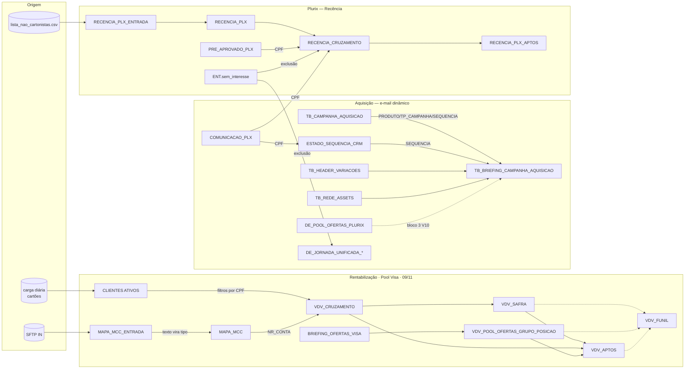
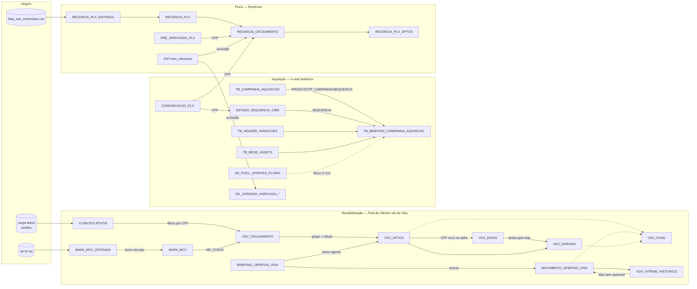

# Mapa de DEs e Automations do SFMC

**Definição e propósito:** mapa de relacionamento das Data Extensions (DEs) e Automations **úteis** do Marketing Cloud: para que serve cada uma, de onde vem, quem lê, qual a chave de ligação. Ajuda a responder "já existe uma DE com isso?" antes de criar outra, e a seguir o caminho de um dado do arquivo de origem até o envio.

> Status: DEs com nota própria = `confirmado`; demais linhas vieram de citações em outras notas e estão `a-validar` (nome, pasta, chave e cadência a conferir no MC). Este mapa **não** é um inventário completo do MC.

## Como ler

- **Papel:** origem (dado bruto) · apoio (lookup/enriquecimento) · audiência (sendable) · conteúdo (briefing/ofertas) · estado (posição na régua) · controle/medição.
- **Chave de ligação:** o campo usado para juntar com a DE vizinha. CPF é a Subscriber Key; `NR_CONTA` liga conta e transação.

## Mapa geral

## Catálogo

### Rentabilização — Pool de Ofertas Visa · revisão de 09/11

Uma PREPARAÇÃO de seis passos, sem envio automático. Montagem relatada; execução completa e motor adaptado pendentes. Nomes de arquivo antigos preservam links, mas sua instrução atual explica as entidades novas.

| Entidade | Papel / grão / carga | Nota |
|---|---|---|
| CLIENTES ATIVOS | Origem por cartão/produto, CPF repete | [[DE-CLIENTES_ATIVOS]] |
| MAPA_MCC_ENTRADA / MAPA_MCC | Texto por conta → tratado, Overwrite | [[DE-MAPA_MCC]] |
| BRIEFING_OFERTAS_VISA | Catálogo, tema e heros por ID; 41 campos | [[DE-BRIEFING_OFERTAS_VISA]] |
| VDV_CRUZAMENTO | Aptidão e contato atuais por CPF, Overwrite | [[DE-VDV_CRUZAMENTO]] |
| VDV_SAFRA | Participação por CPF+safra, inclui controles, Update | [[DE-VDV_ENVIO\|VDV_SAFRA]] |
| VDV_POOL_OFERTAS_GRUPO_POSICAO | Seleção e histórico por rodada/grupo/célula/posição, Update | [[DE-MOVIMENTO_OFERTAS_VISA\|POOL unificado]] |
| VDV_APTOS | Enviável CPF→SubscriberKey, tratamentos aptos da safra selecionada, Overwrite | [[DE-VDV_APTOS]] |
| VDV_FUNIL | Log por safra/execução/etapa/grupo/célula, Update | [[DE-VDV_FUNIL]] |

VDV_DISPARO/audiência extra e histórico separado não são necessários nesta revisão. [[DE-VDV_DISPARO]] e [[DE-VDV_VITRINE_HISTORICO]] preservam seus antecedentes e explicam a substituição, sem orientar criação.

### Aquisição — e-mail dinâmico

| DE | Papel | Grão / chave | Uso | Nota |
|---|---|---|---|---|
| `TB_CAMPANHA_AQUISICAO` | audiência | CPF (1 linha por pessoa) | quem recebe; `SEQUENCIA` avança por Update Contact | [[Emails-Dinamicos-SFMC]] |
| `TB_BRIEFING_CAMPANHA_AQUISICAO` | conteúdo | `NM_PRODUTO_INTERNO` × `TP_CAMPANHA` × `SEQUENCIA` | 36 colunas = 1 e-mail | [[Emails-Dinamicos-SFMC]] |
| `TB_BRIEFING_JORNADAS` | conteúdo | produto × banners | onboarding/desbloqueio; **não** lida pelo template de aquisição; tem `FLAG_WHITELABEL` | [[Emails-Dinamicos-SFMC]] |
| `TB_HEADER_VARIACOES` | conteúdo | código `HDR_…` | header em HTML do Plurix V10 | [[Emails-Dinamicos-Plurix]] |
| `TB_REDE_ASSETS` | conteúdo | rede | logo por bandeira Plurix | [[Emails-Dinamicos-Plurix]] |
| `DE_POOL_OFERTAS_PLURIX` | conteúdo | oferta do dia × rede | Bloco 3 do V10; lookup nunca derruba envio | [[Emails-Dinamicos-Plurix]] |
| `COMUNICACAO_PLX` | origem | CPF | público e cadastro Plurix (e-mail, nome, investida, limite) | [[Emails-Dinamicos-Plurix-V11]] |
| `ESTADO_SEQUENCIA_CRM` | estado | CPF | posição atual na régua Plurix | [[Emails-Dinamicos-Plurix-V11]] |
| `DE_JORNADA_UNIFICADA_*` | audiência | — | entrada das jornadas de WhatsApp com opt-out e SMS (Repescagem, Upgrade) | [[07-Evolucao/Auditoria-Jornadas-SFMC-2026-10\|Auditoria das jornadas]] |

### Plurix — Recência (pasta compartilhada `Plurix > 3_RECENCIA_PLX`)

| DE | Papel | Grão / chave | Nota |
|---|---|---|---|
| `RECENCIA_PLX_ENTRADA` | origem | CPF | [[Plurix-Recencia-Automation-e-Comunicacoes]] |
| `RECENCIA_CONTROLE_CARGA` | controle | `CARGA_ID` | idem |
| `RECENCIA_PLX` | origem (histórico) | CPF + `SEMANA_REFERENCIA` | idem |
| `RECENCIA_CRUZAMENTO` | apoio | CPF | idem |
| `RECENCIA_FUNIL` | medição | resultado × carga | idem |
| `RECENCIA_PLX_APTOS` | audiência | CPF | idem |
| `PRE_APROVADO_PLX`, `Plurix_publico`, `GC_Mesa_Gupshup` | apoio | CPF | idem |
| `ENT.sem_interesse` | exclusão compartilhada | CPF | grava resposta "Não tenho interesse agora" do WhatsApp; usada por recência e jornadas unificadas |

### Seguros

| DE | Papel | Uso | Estado |
|---|---|---|---|
| `LP_SEGUROS_GERAL` | captura | DE única dos formulários das LPs de seguros (CloudPages com HTML/AMPscript) | `a-validar` — citada pelo operador, sem nota no vault |
| `MAPA_SEGUROS` | origem (posse) | posse de seguros por CPF, vinda do Athena | [[DE-MAPA_SEGUROS]] |
| `MAPA_SEGUROS_ONTEM` | apoio | foto do dia anterior para o diff | `proposto` — [[Automacao-Processos-Seguros]] |
| `SEGUROS_MOVIMENTO_LOG` | medição | entradas e saídas diárias de cada seguro por CPF | `proposto` — [[Automacao-Processos-Seguros]] |
| `SEG_BASE_CPF` | audiência (não sendable) | base por CPF com clusters do Celular e grupo controle | `proposto` — [[Segmentacao-Seguros-Celular]] |

## Automations

| Automation | O que faz | Etapas | Nota |
|---|---|---|---|
| `RECENCIA_CRUZAMENTO` | carga semanal de recência Plurix → aptos por canal | 6 etapas, 7 atividades (`Q_PLX_RECENCIA_02…06`, `IMP_PLX_RECENCIA_APTOS`) | [[Plurix-Recencia-Automation-e-Comunicacoes]] |
| `POOL DE OFERTAS VISA – PREPARAÇÃO` | Preparar dados, participação, rodada, audiência e log, sem envio | MAPA → CRUZAMENTO → SAFRA → POOL → APTOS → FUNIL, seis passos separados | [[Automacao-VDV-Pool-de-Ofertas]] |
| Segunda automação de envio | Futuro, não requisito desta preparação | Depende de motor, seedlist, repetição/JobID e autorização | [[Estrategia-Pool-de-Ofertas-Visa]] |
| `processos_seguros` | adesões das LPs → S3/Athena; MAPA_SEGUROS de volta; proposta de diff e base de segmentação | 5 passos hoje + 4 propostos | [[Automacao-Processos-Seguros]] |
| *(a mapear)* carga da `CLIENTES ATIVOS` | atualização diária (~5h) | desconhecidas | [[DE-CLIENTES_ATIVOS]] |

## Como manter este mapa

- DE nova com papel de origem, audiência ou conteúdo ganha nota própria em `02-Entidades-Dados/SFMC/` e uma linha aqui.
- DE temporária (ex.: `TMP_*` de validação) não entra.
- Conferir nome externo, pasta e chave no MC antes de mudar o status de uma linha para `confirmado`.

## Relacionado

[[SFMC-Salesforce-Marketing-Cloud]] · [[SFMC-Query-Studio-e-SQL]] · [[Emails-Dinamicos-SFMC]] · [[Plurix-Recencia-Automation-e-Comunicacoes]] · [[Iniciativa-Pool-de-Ofertas-Vai-de-Visa]] · [[Supabase-Schema]]

:::details Mapa anterior do Pool · histórico de 05/11

:::

## 3. Canais e política de seleção

E-mail, WhatsApp e SMS são canais principais da estratégia. O piloto separa parcelas sem sobreposição: cada CPF recebe no máximo um canal do Pool na mesma rodada. SEG-C e GEN-C ficam sem comunicação nos três canais. A alocação de grupo/célula permanece congelada na SAFRA; GEN-A usa a vitrine genérica, mas não representa comparação causal direta com SEG-B de outra população.

| Canal | Aptidão própria | Destino | Teto por rodada de envio |
|---|---|---|---|
| E-mail | Endereço disponível, sem bloqueio de e-mail, supressões/publication list e status de assinante conferidos | Links de oferta; CTAs finais a conferir | Orçamento e capacidade a definir |
| WhatsApp | Contato móvel, bloqueios/supressões próprios liberados e uso do app nos últimos 60 dias | LP personalizada da rodada | Até 5.000 mensagens |
| SMS | Contato móvel, bloqueios/supressões próprios liberados e uso do app nos últimos 60 dias | LP personalizada da rodada | Até 100.000 SMS |

Os tetos valem por rodada, sujeitos à elegibilidade e ao orçamento. Não são metas nem limites semanais. No SMS, destinatários, tentativas, reenvios e unidades faturadas/segmentos podem divergir: registrar cada unidade separadamente.

ULTIMO_ACESSO da CLIENTES ATIVOS é a referência de uso do app para os dois canais móveis. Normalizar a data para America/Sao_Paulo e comparar de hoje menos 60 dias até hoje, inclusive. Data inválida, ausente ou futura impede apenas a seleção móvel. O participante permanece na SAFRA e pode receber e-mail se elegível. DEVICE, modelo de aparelho e data de cadastro/importação não entram nesta regra. Usar o app não comprova uso de WhatsApp.

Permissões de uso/consentimentos dos canais foram confirmadas na definição do piloto. A execução continua respeitando os bloqueios e as supressões próprios: bloqueio de e-mail não é bloqueio de celular, e a consulta _Subscribers não pode excluir toda a audiência móvel.

:::details Sorteio, perfis e parâmetros pendentes
Sortear dentro de perfis relevantes, com grupo/célula, B2C/B2B2C e recência quando a fonte permitir. Aplicar a mesma política e probabilidade a SEG-A e SEG-B. Não priorizar maiores compradores no WhatsApp e interpretar o SMS residual como efeito do canal.

Pesos, cotas por perfil, tamanho da amostra, poder estatístico e pressão por pessoa seguem em aberto. O contrato usa ID_POLITICA_CANAL e ID_RODADA para identificar a regra; sem parâmetros aprovados, a simulação retorna “parâmetros pendentes” e não produz audiência. O módulo de simulação do GaaS não executa seleção no SFMC.

Evitar redistribuir silenciosamente participantes inelegíveis para preencher teto. Guardar a política, elegibilidade e contagens de cada perfil para interpretar diferenças de cobertura. A seleção de um CPF em um canal exclui os outros naquela rodada; rodadas futuras precisam respeitar a política de pressão ainda a definir.
:::

### Delta multicanal · aplicação manual no SFMC pendente

As seis SQLs integrais nesta nota são referência da montagem orientada a e-mail. CRUZAMENTO filtra e-mail/bloqueio_email globalmente; APTOS consulta _Subscribers e não transporta ULTIMO_ACESSO. Elas não implementam a política multicanal aprovada.

Manter uma PREPARAÇÃO MAPA → CRUZAMENTO → SAFRA → POOL → APTOS → FUNIL e as mesmas entidades. APTOS continua única, com uma linha por CPF por rodada e seleção de canal identificável; sem DE extra de audiência ou histórico de rotação.

| Destino | Delta proposto | Efeito / conferência |
|---|---|---|
| CRUZAMENTO | + FL_BLOQ_EMAIL Number, ULTIMO_ACESSO Date, DT_REF_ELEGIBILIDADE Date; EMAIL passa a aceitar NULL | Aptidão comum sem veto global de e-mail. Transportar bloqueios separados e uso real do app. 32 → 35 campos de referência. |
| SAFRA | EMAIL deve aceitar NULL; preserva 18 campos e PK CPF+ID_SAFRA | Incluir participantes móveis sem e-mail e controles; manter grupo/célula/token. Canal não é re-sorteio experimental. |
| APTOS | + CANAL_ENVIO Text(20), ID_RODADA Text(60), ID_POLITICA_CANAL Text(60), ULTIMO_ACESSO Date, FL_BLOQ_EMAIL Number, FL_APTO_EMAIL/FL_APTO_WHATSAPP/FL_APTO_SMS Number, DT_REF_ELEGIBILIDADE Date; EMAIL anulável | 20 → 29 campos de referência. Uma escolha por CPF/rodada, supressão por canal, app 60 dias só nos móveis. Campos de política/rodada obrigatórios no contrato novo. |
| POOL / BRIEFING | Mantêm nove / 41 campos | Reutilizar seleção e conteúdo na LP; não criar entidades de hero/tema. |
| FUNIL | Mantém 11 campos; novas linhas de diagnóstico | Canal, sobreposição, controle excluído, data futura, app inválido, total por rodada e teto; proporções por célula continuam na SAFRA. |

Tipos/tamanhos são proposta de contrato a conferir antes de editar/recriar DE. Não sobrescrever dados existentes para trocar PK/nulidade. Conferir export/backup, impacto nos consumidores e teste em cópia. A SQL de referência e-mail fica preservada; o arquivo Q_VDV_03_CRUZAMENTO_MULTICANAL_PROPOSTA.sql prepara a aptidão comum, mas depende dos campos novos e não é a seleção final de canal.

Para a APTOS multicanal, faltam pesos/cotas/pressão aprovados e a ligação das supressões de WhatsApp/SMS à fonte real. O contrato executável de simulação está em poolChannels.ts: só aceita política explícita, exclui controles, separa bloqueios, aplica a janela de app e os tetos e atribui no máximo um canal. O sorteio da simulação não é declarado equivalente ao CHECKSUM do SFMC. Não substituir a query real por uma escolha arbitrária de pesos.
