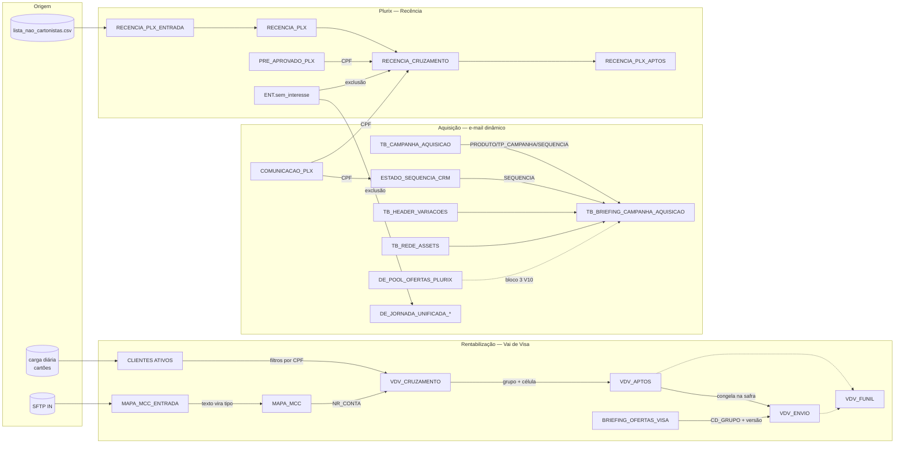

# Mapa de DEs e Automations do SFMC

**Definição e propósito:** mapa de relacionamento das Data Extensions (DEs) e Automations **úteis** do Marketing Cloud: para que serve cada uma, de onde vem, quem lê, qual a chave de ligação. Ajuda a responder "já existe uma DE com isso?" antes de criar outra, e a seguir o caminho de um dado do arquivo de origem até o envio.

> Status: DEs com nota própria = `confirmado`; demais linhas vieram de citações em outras notas e estão `a-validar` (nome, pasta, chave e cadência a conferir no MC). Este mapa **não** é um inventário completo do MC.

## Como ler

- **Papel:** origem (dado bruto) · apoio (lookup/enriquecimento) · audiência (sendable) · conteúdo (briefing/ofertas) · estado (posição na régua) · controle/medição.
- **Chave de ligação:** o campo usado para juntar com a DE vizinha. CPF é a Subscriber Key; `NR_CONTA` liga conta e transação.

## Mapa geral

## Catálogo

### Rentabilização — Pool de Ofertas - Vai de Visa (pasta `POOL DE OFERTAS VISA`)

| DE | Papel | Grão / chave | Origem → consumidor | Nota |
|---|---|---|---|---|
| `CLIENTES ATIVOS` | origem | CPF × produto × bandeira × status (CPF repete) | carga diária → toda comunicação com quem tem cartão | [[DE-CLIENTES_ATIVOS]] |
| `MAPA_MCC_ENTRADA` | origem (texto) | conta / `nr_conta` | arquivo da IN (SFTP), sem conversão | [[DE-MAPA_MCC]] |
| `MAPA_MCC` | apoio | conta / `nr_conta` | `Q_VDV_02_MAPA` → cruzamento | [[DE-MAPA_MCC]] |
| `VDV_CRUZAMENTO` | apoio | CPF | `Q_VDV_03` → aptos | [[DE-VDV_CRUZAMENTO]] |
| `VDV_APTOS` | apoio (não sendable) | CPF | `Q_VDV_04` → envio | [[DE-VDV_APTOS]] |
| `VDV_ENVIO` | **audiência (sendable)** | CPF + safra | `Q_VDV_05` → jornada, IN | [[DE-VDV_ENVIO]] |
| `VDV_FUNIL` | controle/medição | safra × execução × etapa × grupo × célula | `Q_VDV_06` → conferência | [[DE-VDV_FUNIL]] |
| `BRIEFING_OFERTAS_VISA` | conteúdo | versão × grupo × posição | upload manual → e-mail e LP | [[DE-BRIEFING_OFERTAS_VISA]] |
| `VDV_RESULTADO` *(proposta)* | medição | CPF × safra | IN via SFTP → repique, seguros | [[Teste-Afinidade-MCC-vs-Generico]] |

### Aquisição — e-mail dinâmico

| DE | Papel | Grão / chave | Uso | Nota |
|---|---|---|---|---|
| `TB_CAMPANHA_AQUISICAO` | audiência | CPF (1 linha por pessoa) | quem recebe; `SEQUENCIA` avança por Update Contact | [[Emails-Dinamicos-SFMC]] |
| `TB_BRIEFING_CAMPANHA_AQUISICAO` | conteúdo | `NM_PRODUTO_INTERNO` × `TP_CAMPANHA` × `SEQUENCIA` | 36 colunas = 1 e-mail | [[Emails-Dinamicos-SFMC]] |
| `TB_BRIEFING_JORNADAS` | conteúdo | produto × banners | onboarding/desbloqueio; **não** lida pelo template de aquisição; tem `FLAG_WHITELABEL` | [[Emails-Dinamicos-SFMC]] |
| `TB_HEADER_VARIACOES` | conteúdo | código `HDR_…` | header em HTML do Plurix V10 | [[Emails-Dinamicos-Plurix]] |
| `TB_REDE_ASSETS` | conteúdo | rede | logo por bandeira Plurix | [[Emails-Dinamicos-Plurix]] |
| `DE_POOL_OFERTAS_PLURIX` | conteúdo | oferta do dia × rede | Bloco 3 do V10; lookup nunca derruba envio | [[Emails-Dinamicos-Plurix]] |
| `COMUNICACAO_PLX` | origem | CPF | público e cadastro Plurix (e-mail, nome, investida, limite) | [[Emails-Dinamicos-Plurix-V11]] |
| `ESTADO_SEQUENCIA_CRM` | estado | CPF | posição atual na régua Plurix | [[Emails-Dinamicos-Plurix-V11]] |
| `DE_JORNADA_UNIFICADA_*` | audiência | — | entrada das jornadas de WhatsApp com opt-out e SMS (Repescagem, Upgrade) | [[07-Evolucao/Auditoria-Jornadas-SFMC-2026-10\|Auditoria das jornadas]] |

### Plurix — Recência (pasta compartilhada `Plurix > 3_RECENCIA_PLX`)

| DE | Papel | Grão / chave | Nota |
|---|---|---|---|
| `RECENCIA_PLX_ENTRADA` | origem | CPF | [[Plurix-Recencia-Automation-e-Comunicacoes]] |
| `RECENCIA_CONTROLE_CARGA` | controle | `CARGA_ID` | idem |
| `RECENCIA_PLX` | origem (histórico) | CPF + `SEMANA_REFERENCIA` | idem |
| `RECENCIA_CRUZAMENTO` | apoio | CPF | idem |
| `RECENCIA_FUNIL` | medição | resultado × carga | idem |
| `RECENCIA_PLX_APTOS` | audiência | CPF | idem |
| `PRE_APROVADO_PLX`, `Plurix_publico`, `GC_Mesa_Gupshup` | apoio | CPF | idem |
| `ENT.sem_interesse` | exclusão compartilhada | CPF | grava resposta "Não tenho interesse agora" do WhatsApp; usada por recência e jornadas unificadas |

### Seguros

| DE | Papel | Uso | Estado |
|---|---|---|---|
| `LP_SEGUROS_GERAL` | captura | DE única dos formulários das LPs de seguros (CloudPages com HTML/AMPscript) | `a-validar` — citada pelo operador, sem nota no vault |

## Automations

| Automation | O que faz | Etapas | Nota |
|---|---|---|---|
| `RECENCIA_CRUZAMENTO` | carga semanal de recência Plurix → aptos por canal | 6 etapas, 7 atividades (`Q_PLX_RECENCIA_02…06`, `IMP_PLX_RECENCIA_APTOS`) | [[Plurix-Recencia-Automation-e-Comunicacoes]] |
| `POOL DE OFERTAS VISA – PREPARAÇÃO` | MAPA tratada → cruzamento → aptos → funil (Overwrite) | 4 passos: `Q_VDV_02`, `03`, `04`, `06` | [[Automacao-VDV-Pool-de-Ofertas]] |
| `POOL DE OFERTAS VISA – CONGELAR` | congela a safra na VDV_ENVIO, 1× no dia do disparo | 2 passos: `Q_VDV_05`, `06` | [[Automacao-VDV-Pool-de-Ofertas]] |
| *(a mapear)* carga da `CLIENTES ATIVOS` | atualização diária (~5h) | desconhecidas | [[DE-CLIENTES_ATIVOS]] |

## Como manter este mapa

- DE nova com papel de origem, audiência ou conteúdo ganha nota própria em `02-Entidades-Dados/SFMC/` e uma linha aqui.
- DE temporária (ex.: `TMP_*` de validação) não entra.
- Conferir nome externo, pasta e chave no MC antes de mudar o status de uma linha para `confirmado`.

## Relacionado

[[SFMC-Salesforce-Marketing-Cloud]] · [[SFMC-Query-Studio-e-SQL]] · [[Emails-Dinamicos-SFMC]] · [[Plurix-Recencia-Automation-e-Comunicacoes]] · [[Iniciativa-Pool-de-Ofertas-Vai-de-Visa]] · [[Supabase-Schema]]
