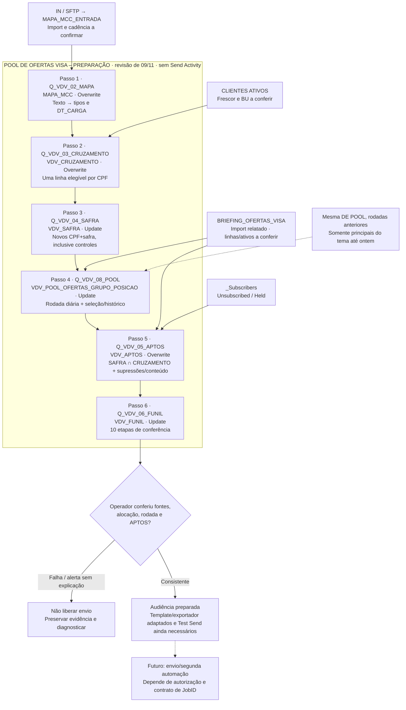
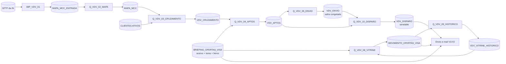

# Automação de preparação do Pool de Ofertas Visa · revisão de 09/11

O Pool de Ofertas Visa combina ofertas do programa Vai de Visa com a afinidade de compras dos clientes B2C e B2B2C. O teste compara vitrines selecionadas por grupo, vitrines genéricas e controles sem comunicação.

A VDV_SAFRA mantém os grupos e as células do teste; a VDV_APTOS reúne quem pode receber em cada rodada. As regras de seleção, automação, conteúdo e validação estão detalhadas abaixo, com contratos e SQLs nas fichas recolhíveis.

> **Estado da operação:** revisão editorial de 09/11/2026. PREPARAÇÃO com seis passos e envio manual previsto. DEs e queries montadas; execução completa, conferência do FUNIL e Test Send do motor adaptado pendentes de validação.

## 4. Operação atual e automação de seis passos

Uma Query Activity por passo sequencial. O número no nome técnico não é a posição atual na automação. Não executar CRUZAMENTO, SAFRA ou APTOS em paralelo com sua dependência. O import MAPA_MCC_ENTRADA e a carga de BRIEFING são pré-condições, não passos de envio escondidos.



| Passo | Destino | Ação | Efeito de reexecutar |
|---|---|---|---|
| MAPA | MAPA_MCC | Overwrite | Recalcula a foto da entrada; não comprova arquivo novo |
| CRUZAMENTO | VDV_CRUZAMENTO | Overwrite | Reavalia aptidão e contato |
| SAFRA | VDV_SAFRA | Update | Só inclui CPF+safra ausentes; preserva grupo/célula/token |
| POOL | VDV_POOL_OFERTAS_GRUPO_POSICAO | Update | Não seleciona se a VERSAO do dia já tiver qualquer linha |
| APTOS | VDV_APTOS | Overwrite | Atualiza saídas e retornos dos tratamentos |
| FUNIL | VDV_FUNIL | Update | Grava conferências sob chave de execução; não é prova de envio |

A automação inteira não é uma transação: uma falha no quinto passo não desfaz a SAFRA ou a rodada já gravadas. Registrar o ponto de falha e as contagens antes de repetir. FUNIL com ALERTA é dado para o operador; a SQL não contém uma atividade de interrupção automática.

## 7. Fichas técnicas das seis atividades e SQLs

Configuração, pré-condições, critérios de conferência e SQL integral de cada passo da PREPARAÇÃO. A execução completa segue pendente de validação.

:::details Passo 1 · Q_VDV_02_MAPA · SQL integral e configuração
### Q_VDV_02_MAPA

**Finalidade:** Converter texto do arquivo para valores, quantidades e datas.

| Configuração | Valor |
|---|---|
| Tipo / automação | Query Activity · PREPARAÇÃO · passo 1 |
| Fonte | MAPA_MCC_ENTRADA |
| Destino / ação | MAPA_MCC · Overwrite |
| Pré-condições | Entrada completa, nr_conta única e formato brasileiro reconfirmado. |
| Conferência | Contagem tratada igual à entrada; amostras de nove categorias, datas e valores conferidos contra o arquivo. |
| Limitação / recuperação | TRY_CONVERT pode resultar NULL. DT_CARGA prova tratamento, não frescor da IN. Não dividir todos os valores por 100 para corrigir import antigo. |
| Arquivo de referência | 01_Q_VDV_02_MAPA.sql |
| Estado | Montagem informada; execução completa pendente de validação. |

SQL integral preservado, sem regenerar a partir do pacote intermediário de duas automações:

```sql
SELECT
r.nr_conta,
r.nr_cpf,
r.ds_parceiro,
TRY_CONVERT(DECIMAL(18,2), REPLACE(REPLACE(NULLIF(LTRIM(RTRIM(r.vlr_moda)),''),'.',''),',','.')) AS
vlr_moda,
TRY_CONVERT(INT, TRY_CONVERT(DECIMAL(18,2),
REPLACE(REPLACE(NULLIF(LTRIM(RTRIM(r.qtd_moda)),''),'.',''),',','.'))) AS qtd_moda,
TRY_CONVERT(DATE, NULLIF(LEFT(LTRIM(r.dt_ultima_compra_moda),10),''), 103) AS dt_ultima_compra_moda,
TRY_CONVERT(DECIMAL(18,2), REPLACE(REPLACE(NULLIF(LTRIM(RTRIM(r.vlr_saude_beleza)),''),'.',''),',','.')) AS
vlr_saude_beleza,
TRY_CONVERT(INT, TRY_CONVERT(DECIMAL(18,2),
REPLACE(REPLACE(NULLIF(LTRIM(RTRIM(r.qtd_saude_beleza)),''),'.',''),',','.'))) AS qtd_saude_beleza,
TRY_CONVERT(DATE, NULLIF(LEFT(LTRIM(r.dt_ultima_compra_saude_beleza),10),''), 103) AS
dt_ultima_compra_saude_beleza,
TRY_CONVERT(DECIMAL(18,2), REPLACE(REPLACE(NULLIF(LTRIM(RTRIM(r.vlr_eletrodomesticos)),''),'.',''),',','.'))
AS vlr_eletrodomesticos,
TRY_CONVERT(INT, TRY_CONVERT(DECIMAL(18,2),
REPLACE(REPLACE(NULLIF(LTRIM(RTRIM(r.qtd_eletrodomesticos)),''),'.',''),',','.'))) AS qtd_eletrodomesticos,
TRY_CONVERT(DATE, NULLIF(LEFT(LTRIM(r.dt_ultima_compra_eletrodomesticos),10),''), 103) AS
dt_ultima_compra_eletrodomesticos,
TRY_CONVERT(DECIMAL(18,2), REPLACE(REPLACE(NULLIF(LTRIM(RTRIM(r.vlr_eletronicos)),''),'.',''),',','.')) AS
vlr_eletronicos,
TRY_CONVERT(INT, TRY_CONVERT(DECIMAL(18,2),
REPLACE(REPLACE(NULLIF(LTRIM(RTRIM(r.qtd_eletronicos)),''),'.',''),',','.'))) AS qtd_eletronicos,
TRY_CONVERT(DATE, NULLIF(LEFT(LTRIM(r.dt_ultima_compra_eletronicos),10),''), 103) AS
dt_ultima_compra_eletronicos,
TRY_CONVERT(DECIMAL(18,2), REPLACE(REPLACE(NULLIF(LTRIM(RTRIM(r.vlr_brinquedos)),''),'.',''),',','.')) AS
vlr_brinquedos,
TRY_CONVERT(INT, TRY_CONVERT(DECIMAL(18,2),
REPLACE(REPLACE(NULLIF(LTRIM(RTRIM(r.qtd_brinquedos)),''),'.',''),',','.'))) AS qtd_brinquedos,
TRY_CONVERT(DATE, NULLIF(LEFT(LTRIM(r.dt_ultima_compra_brinquedos),10),''), 103) AS
dt_ultima_compra_brinquedos,
TRY_CONVERT(DECIMAL(18,2), REPLACE(REPLACE(NULLIF(LTRIM(RTRIM(r.vlr_viagem)),''),'.',''),',','.')) AS
vlr_viagem,
TRY_CONVERT(INT, TRY_CONVERT(DECIMAL(18,2),
REPLACE(REPLACE(NULLIF(LTRIM(RTRIM(r.qtd_viagem)),''),'.',''),',','.'))) AS qtd_viagem,
TRY_CONVERT(DATE, NULLIF(LEFT(LTRIM(r.dt_ultima_compra_viagem),10),''), 103) AS dt_ultima_compra_viagem,
TRY_CONVERT(DECIMAL(18,2), REPLACE(REPLACE(NULLIF(LTRIM(RTRIM(r.vlr_pet)),''),'.',''),',','.')) AS vlr_pet,
TRY_CONVERT(INT, TRY_CONVERT(DECIMAL(18,2),
REPLACE(REPLACE(NULLIF(LTRIM(RTRIM(r.qtd_pet)),''),'.',''),',','.'))) AS qtd_pet,
TRY_CONVERT(DATE, NULLIF(LEFT(LTRIM(r.dt_ultima_compra_pet),10),''), 103) AS dt_ultima_compra_pet,
TRY_CONVERT(DECIMAL(18,2), REPLACE(REPLACE(NULLIF(LTRIM(RTRIM(r.vlr_fora_mvp)),''),'.',''),',','.')) AS
vlr_fora_mvp,
TRY_CONVERT(INT, TRY_CONVERT(DECIMAL(18,2),
REPLACE(REPLACE(NULLIF(LTRIM(RTRIM(r.qtd_fora_mvp)),''),'.',''),',','.'))) AS qtd_fora_mvp,
TRY_CONVERT(DATE, NULLIF(LEFT(LTRIM(r.dt_ultima_compra_fora_mvp),10),''), 103) AS dt_ultima_compra_fora_mvp,
TRY_CONVERT(DECIMAL(18,2), REPLACE(REPLACE(NULLIF(LTRIM(RTRIM(r.vlr_nao_mapeado)),''),'.',''),',','.')) AS
vlr_nao_mapeado,
TRY_CONVERT(INT, TRY_CONVERT(DECIMAL(18,2),
REPLACE(REPLACE(NULLIF(LTRIM(RTRIM(r.qtd_nao_mapeado)),''),'.',''),',','.'))) AS qtd_nao_mapeado,
TRY_CONVERT(DATE, NULLIF(LEFT(LTRIM(r.dt_ultima_compra_nao_mapeado),10),''), 103) AS
dt_ultima_compra_nao_mapeado,
DATEADD(HOUR, 3, GETDATE()) AS DT_CARGA
FROM MAPA_MCC_ENTRADA r
```
:::

:::details Passo 2 · Q_VDV_03_CRUZAMENTO · SQL integral e configuração
### Q_VDV_03_CRUZAMENTO

**Finalidade:** Reavaliar público e contato; somar contas sem multiplicar por cartão.

| Configuração | Valor |
|---|---|
| Tipo / automação | Query Activity · PREPARAÇÃO · passo 2 |
| Fonte | CLIENTES ATIVOS + MAPA_MCC |
| Destino / ação | VDV_CRUZAMENTO · Overwrite |
| Pré-condições | MAPA convertida e carteira atual; BU e fontes corretas. |
| Conferência | Uma linha por CPF, filtros por linha/CPF exercitados, MAX de parceiro e contatos auditado. |
| Limitação / recuperação | NM_CARTAO NULL. Múltiplos vínculos não resolvidos. O relógio do filtro de 30 dias deve ser confrontado com o carimbo +3 das demais queries. |
| Arquivo de referência | 02_Q_VDV_03_CRUZAMENTO.sql |
| Estado | Montagem informada; execução completa pendente de validação. |

SQL integral preservado, sem regenerar a partir do pacote intermediário de duas automações:

```sql
SELECT
    e.CPF,
    e.PRI_NOME,
    e.EMAIL,
    e.NR_CELULAR,
    e.FL_BLOQ_CELULAR,
    e.CANAL,
    e.NM_PARCEIRO,
    e.NM_CARTAO,
    e.VL_LIMITE_DISPONIVEL,
    e.DT_ULTIMA_COMPRA,
    m.QT_MODA,
    m.VL_MODA,
    m.DT_ULT_MODA,
    m.QT_SAUDE_BELEZA,
    m.VL_SAUDE_BELEZA,
    m.DT_ULT_SAUDE_BELEZA,
    m.QT_ELETRODOM,
    m.VL_ELETRODOM,
    m.DT_ULT_ELETRODOM,
    m.QT_ELETRONICOS,
    m.VL_ELETRONICOS,
    m.DT_ULT_ELETRONICOS,
    m.QT_BRINQUEDOS,
    m.VL_BRINQUEDOS,
    m.DT_ULT_BRINQUEDOS,
    m.QT_VIAGEM,
    m.VL_VIAGEM,
    m.DT_ULT_VIAGEM,
    m.QT_PET,
    m.VL_PET,
    m.DT_ULT_PET,
    m.VL_GASTO_12M
FROM (
    SELECT
        a.CPF,
        MAX(a.PRI_NOME) AS PRI_NOME,
        MAX(a.EMAIL) AS EMAIL,
        MAX(a.NR_CELULAR) AS NR_CELULAR,
        MAX(
            CASE
                WHEN a.bloqueio_celular = 1 THEN 1
                ELSE 0
            END
        ) AS FL_BLOQ_CELULAR,
        MAX(a.CANAL) AS CANAL,
        CASE
            WHEN COUNT(DISTINCT
                CASE
                    WHEN a.CANAL = 'B2B2C'
                        AND a.STATUS = 'NORMAL'
                    THEN NULLIF(
                        UPPER(LTRIM(RTRIM(a.PRODUTO))),
                        ''
                    )
                END
            ) = 1
            AND MAX(
                CASE
                    WHEN a.CANAL = 'B2C'
                        AND a.STATUS = 'NORMAL'
                    THEN 1
                    ELSE 0
                END
            ) = 0
            THEN MAX(
                CASE
                    WHEN a.CANAL = 'B2B2C'
                        AND a.STATUS = 'NORMAL'
                    THEN UPPER(LTRIM(RTRIM(a.PRODUTO)))
                END
            )
            ELSE NULL
        END AS NM_PARCEIRO,
        CONVERT(VARCHAR(150), NULL) AS NM_CARTAO,
        MAX(
            CASE
                WHEN a.STATUS = 'NORMAL'
                THEN a.LIMITE_DISPONIVEL
            END
        ) AS VL_LIMITE_DISPONIVEL,
        MAX(a.DATA_ULTIMA_COMPRA) AS DT_ULTIMA_COMPRA
    FROM [CLIENTES ATIVOS] a
    WHERE a.CANAL IN ('B2C', 'B2B2C')
    GROUP BY a.CPF
    HAVING
        MAX(
            CASE
                WHEN a.STATUS = 'NORMAL'
                    AND a.DATA_ULTIMA_COMPRA >= DATEADD(
                        DAY,
                        -30,
                        CONVERT(DATE, GETDATE())
                    )
                    AND a.LIMITE_DISPONIVEL >= 200
                THEN 1
                ELSE 0
            END
        ) = 1
        AND MAX(
            CASE
                WHEN a.bloqueio_email = 1 THEN 1
                ELSE 0
            END
        ) = 0
        AND MAX(
            CASE
                WHEN a.STATUS = 'BLOQUEADO ATRASO' THEN 1
                ELSE 0
            END
        ) = 0
        AND MAX(LEN(a.EMAIL)) > 0
) e
LEFT JOIN (
    SELECT
        c.CPF,
        SUM(mp.qtd_moda) AS QT_MODA,
        SUM(mp.vlr_moda) AS VL_MODA,
        MAX(mp.dt_ultima_compra_moda) AS DT_ULT_MODA,
        SUM(mp.qtd_saude_beleza) AS QT_SAUDE_BELEZA,
        SUM(mp.vlr_saude_beleza) AS VL_SAUDE_BELEZA,
        MAX(mp.dt_ultima_compra_saude_beleza) AS DT_ULT_SAUDE_BELEZA,
        SUM(mp.qtd_eletrodomesticos) AS QT_ELETRODOM,
        SUM(mp.vlr_eletrodomesticos) AS VL_ELETRODOM,
        MAX(mp.dt_ultima_compra_eletrodomesticos) AS DT_ULT_ELETRODOM,
        SUM(mp.qtd_eletronicos) AS QT_ELETRONICOS,
        SUM(mp.vlr_eletronicos) AS VL_ELETRONICOS,
        MAX(mp.dt_ultima_compra_eletronicos) AS DT_ULT_ELETRONICOS,
        SUM(mp.qtd_brinquedos) AS QT_BRINQUEDOS,
        SUM(mp.vlr_brinquedos) AS VL_BRINQUEDOS,
        MAX(mp.dt_ultima_compra_brinquedos) AS DT_ULT_BRINQUEDOS,
        SUM(mp.qtd_viagem) AS QT_VIAGEM,
        SUM(mp.vlr_viagem) AS VL_VIAGEM,
        MAX(mp.dt_ultima_compra_viagem) AS DT_ULT_VIAGEM,
        SUM(mp.qtd_pet) AS QT_PET,
        SUM(mp.vlr_pet) AS VL_PET,
        MAX(mp.dt_ultima_compra_pet) AS DT_ULT_PET,
        SUM(
            ISNULL(mp.vlr_moda, 0)
            + ISNULL(mp.vlr_saude_beleza, 0)
            + ISNULL(mp.vlr_eletrodomesticos, 0)
            + ISNULL(mp.vlr_eletronicos, 0)
            + ISNULL(mp.vlr_brinquedos, 0)
            + ISNULL(mp.vlr_viagem, 0)
            + ISNULL(mp.vlr_pet, 0)
            + ISNULL(mp.vlr_fora_mvp, 0)
            + ISNULL(mp.vlr_nao_mapeado, 0)
        ) AS VL_GASTO_12M
    FROM (
        SELECT DISTINCT
            CPF,
            NR_CONTA
        FROM [CLIENTES ATIVOS]
    ) c
    INNER JOIN MAPA_MCC mp
        ON c.NR_CONTA = mp.nr_conta
    GROUP BY c.CPF
) m
    ON e.CPF = m.CPF
```
:::

:::details Passo 3 · Q_VDV_04_SAFRA · SQL integral e configuração
### Q_VDV_04_SAFRA

**Finalidade:** Incluir novos participantes e controles; congelar alocação, tema de entrada e token.

| Configuração | Valor |
|---|---|
| Tipo / automação | Query Activity · PREPARAÇÃO · passo 3 |
| Fonte | VDV_CRUZAMENTO + VDV_SAFRA (NOT EXISTS) |
| Destino / ação | VDV_SAFRA · Update |
| Pré-condições | PK CPF+ID_SAFRA; 18 campos compatíveis; DT_ENVIO aceita NULL. |
| Conferência | Prioridade Família, controle fixo e A/B conferidos; nova execução não altera participante existente nem duplica chave. |
| Limitação / recuperação | ID_SAFRA e tema são literais da revisão atual. NEWID só deve gerar token de novas inclusões. Não equivale a safra fechada ou envio executado. |
| Arquivo de referência | 03_Q_VDV_04_SAFRA.sql |
| Estado | Montagem informada; execução completa pendente de validação. |

SQL integral preservado, sem regenerar a partir do pacote intermediário de duas automações:

```sql
SELECT
    b.CPF,
    'VDV_2026_11_BF' AS ID_SAFRA,
    b.PRI_NOME AS FIRST_NAME,
    b.EMAIL,
    b.NR_CELULAR,
    'BR' AS LOCALE,
    b.FL_BLOQ_CELULAR,
    b.CANAL,
    b.NM_PARCEIRO,
    b.NM_CARTAO,
    b.VL_LIMITE_DISPONIVEL,
    ISNULL(g.G1, 'GENERICO') AS CD_GRUPO,
    g.G2 AS CD_GRUPO_SECUNDARIO,
    CASE
        WHEN ABS(CHECKSUM(b.CPF + 'VDV_CONTROLE') % 100) >= 90
        THEN
            CASE
                WHEN g.G1 IS NULL THEN 'GEN-C'
                ELSE 'SEG-C'
            END
        WHEN g.G1 IS NULL THEN 'GEN-A'
        WHEN ABS(
            CHECKSUM(b.CPF + 'VDV_2026_11_BF') % 2
        ) = 0 THEN 'SEG-A'
        ELSE 'SEG-B'
    END AS DS_CELULA_TESTE,
    'BF26_V1' AS ID_VERSAO_OFERTAS,
    CONVERT(VARCHAR(36), NEWID()) AS ID_ENVIO,
    DATEADD(HOUR, 3, GETDATE()) AS DT_ENTRADA,
    CONVERT(DATETIME, NULL) AS DT_ENVIO
FROM VDV_CRUZAMENTO b
LEFT JOIN (
    SELECT
        r.CPF,
        MAX(
            CASE WHEN r.RN = 1 THEN r.GRUPO END
        ) AS G1,
        MAX(
            CASE WHEN r.RN = 2 THEN r.GRUPO END
        ) AS G2
    FROM (
        SELECT
            u.CPF,
            u.GRUPO,
            ROW_NUMBER() OVER (
                PARTITION BY u.CPF
                ORDER BY
                    CASE
                        WHEN u.GRUPO = 'FAMILIA_PRESENTES' THEN 0
                        ELSE 1
                    END,
                    u.QT DESC,
                    u.VL DESC,
                    u.PRIORIDADE ASC
            ) AS RN
        FROM (
            SELECT
                c.CPF,
                'MODA' AS GRUPO,
                c.QT_MODA AS QT,
                c.VL_MODA AS VL,
                1 AS PRIORIDADE
            FROM VDV_CRUZAMENTO c
            WHERE
                c.QT_MODA >= 2
                AND c.DT_ULT_MODA >= DATEADD(
                    MONTH,
                    -6,
                    CONVERT(
                        DATE,
                        DATEADD(HOUR, 3, GETDATE())
                    )
                )

            UNION ALL

            SELECT
                c.CPF,
                'SAUDE_BELEZA' AS GRUPO,
                c.QT_SAUDE_BELEZA AS QT,
                c.VL_SAUDE_BELEZA AS VL,
                2 AS PRIORIDADE
            FROM VDV_CRUZAMENTO c
            WHERE
                c.QT_SAUDE_BELEZA >= 2
                AND c.DT_ULT_SAUDE_BELEZA >= DATEADD(
                    MONTH,
                    -6,
                    CONVERT(
                        DATE,
                        DATEADD(HOUR, 3, GETDATE())
                    )
                )

            UNION ALL

            SELECT
                c.CPF,
                'FAMILIA_PRESENTES' AS GRUPO,
                c.QT_BRINQUEDOS AS QT,
                c.VL_BRINQUEDOS AS VL,
                3 AS PRIORIDADE
            FROM VDV_CRUZAMENTO c
            WHERE c.QT_BRINQUEDOS >= 2
        ) u
    ) r
    GROUP BY r.CPF
) g
    ON b.CPF = g.CPF
WHERE NOT EXISTS (
    SELECT 1
    FROM VDV_SAFRA s
    WHERE
        s.CPF = b.CPF
        AND s.ID_SAFRA = 'VDV_2026_11_BF'
)
```
:::

:::details Passo 4 · Q_VDV_08_POOL · SQL integral e configuração
### Q_VDV_08_POOL

**Finalidade:** Selecionar até seis marcas por grupo e acumular rodada diária.

| Configuração | Valor |
|---|---|
| Tipo / automação | Query Activity · PREPARAÇÃO · passo 4 |
| Fonte | BRIEFING + histórico na própria DE POOL |
| Destino / ação | VDV_POOL_OFERTAS_GRUPO_POSICAO · Update |
| Pré-condições | PK composta com quatro partes; nove campos; exatamente um tema ativo/vigente; imagens/links/benefícios disponíveis. |
| Conferência | Quatro grupos conferidos, marcas distintas, motivos e posições coerentes; reexecução no mesmo dia preserva seleção. |
| Limitação / recuperação | Qualquer linha da VERSAO bloqueia a rodada inteira. Parcial não é completada automaticamente. Histórico é seleção principal, não envio/uso de reserva. |
| Arquivo de referência | 04_Q_VDV_08_POOL.sql |
| Estado | Montagem informada; execução completa pendente de validação. |

SQL integral preservado, sem regenerar a partir do pacote intermediário de duas automações:

```sql
SELECT
    'BF26_V1_' + CONVERT(
        VARCHAR(8),
        CONVERT(DATE, DATEADD(HOUR, 3, GETDATE())),
        112
    ) AS VERSAO,
    p.GRUPO,
    'TODAS' AS CELULA,
    p.POSICAO,
    p.OFERTA_ID,
    1 AS ATIVA,
    CASE
        WHEN p.GRUPO = 'GENERICO' THEN 'COMPLETAR'
        WHEN p.FAIXA = 1 THEN 'GRUPO'
        WHEN p.FAIXA = 2 THEN 'DESCOBERTA'
        ELSE 'COMPLETAR'
    END AS MOTIVO,
    CONVERT(
        DATE,
        DATEADD(HOUR, 3, GETDATE())
    ) AS DT_RODADA,
    'BF26_V1' AS VERSAO_TEMA
FROM (
    SELECT
        f.GRUPO,
        f.OFERTA_ID,
        f.FAIXA,
        ROW_NUMBER() OVER (
            PARTITION BY f.GRUPO
            ORDER BY
                f.FAIXA,
                f.ULTIMA_RODADA,
                ISNULL(
                    f.FIM,
                    CONVERT(DATE, '20991231', 112)
                ),
                f.OFERTA_ID
        ) AS POSICAO
    FROM (
        SELECT
            r.GRUPO,
            r.OFERTA_ID,
            r.FIM,
            r.ULTIMA_RODADA,
            CASE
                WHEN r.GRUPO = 'GENERICO' THEN 1
                WHEN r.PROPRIA = 1
                    AND r.RN_TIPO <= 2 THEN 1
                WHEN r.PROPRIA = 0
                    AND r.RN_TIPO = 1 THEN 2
                ELSE 3
            END AS FAIXA
        FROM (
            SELECT
                d.GRUPO,
                d.OFERTA_ID,
                d.FIM,
                d.PROPRIA,
                d.ULTIMA_RODADA,
                ROW_NUMBER() OVER (
                    PARTITION BY
                        d.GRUPO,
                        d.PROPRIA
                    ORDER BY
                        d.ULTIMA_RODADA,
                        ISNULL(
                            d.FIM,
                            CONVERT(DATE, '20991231', 112)
                        ),
                        d.OFERTA_ID
                ) AS RN_TIPO
            FROM (
                SELECT
                    c.GRUPO,
                    c.OFERTA_ID,
                    c.FIM,
                    c.PROPRIA,
                    c.ULTIMA_RODADA,
                    ROW_NUMBER() OVER (
                        PARTITION BY
                            c.GRUPO,
                            UPPER(LTRIM(RTRIM(c.MARCA)))
                        ORDER BY
                            c.PROPRIA DESC,
                            c.ULTIMA_RODADA,
                            ISNULL(
                                c.FIM,
                                CONVERT(DATE, '20991231', 112)
                            ),
                            c.OFERTA_ID
                    ) AS RN_MARCA
                FROM (
                    SELECT
                        gg.GRUPO,
                        o.ID AS OFERTA_ID,
                        o.MARCA,
                        o.FIM,
                        CASE
                            WHEN gg.GRUPO = 'GENERICO' THEN 0
                            WHEN o.GRUPO = gg.GRUPO THEN 1
                            ELSE 0
                        END AS PROPRIA,
                        ISNULL(
                            h.ULTIMA_RODADA,
                            CONVERT(DATE, '19000101', 112)
                        ) AS ULTIMA_RODADA
                    FROM (
                        SELECT 'MODA' AS GRUPO

                        UNION ALL

                        SELECT 'SAUDE_BELEZA' AS GRUPO

                        UNION ALL

                        SELECT 'FAMILIA_PRESENTES' AS GRUPO

                        UNION ALL

                        SELECT 'GENERICO' AS GRUPO
                    ) gg
                    CROSS JOIN BRIEFING_OFERTAS_VISA o
                    LEFT JOIN (
                        SELECT
                            GRUPO,
                            OFERTA_ID,
                            MAX(DT_RODADA) AS ULTIMA_RODADA
                        FROM VDV_POOL_OFERTAS_GRUPO_POSICAO
                        WHERE
                            POSICAO BETWEEN 1 AND 3
                            AND ATIVA = 1
                            AND VERSAO_TEMA = 'BF26_V1'
                            AND DT_RODADA < CONVERT(
                                DATE,
                                DATEADD(HOUR, 3, GETDATE())
                            )
                        GROUP BY
                            GRUPO,
                            OFERTA_ID
                    ) h
                        ON h.GRUPO = gg.GRUPO
                        AND h.OFERTA_ID = o.ID
                    WHERE
                        o.TIPO = 'OFERTA'
                        AND o.ATIVA = 1
                        AND LEN(
                            LTRIM(RTRIM(o.MARCA))
                        ) > 0
                        AND LEN(
                            LTRIM(RTRIM(o.FOTO))
                        ) > 0
                        AND LEN(
                            LTRIM(RTRIM(o.VALOR))
                        ) > 0
                        AND LEN(
                            LTRIM(RTRIM(o.LINK))
                        ) > 0
                        AND (
                            o.INICIO IS NULL
                            OR o.INICIO <= CONVERT(
                                DATE,
                                DATEADD(HOUR, 3, GETDATE())
                            )
                        )
                        AND (
                            o.FIM IS NULL
                            OR o.FIM >= CONVERT(
                                DATE,
                                DATEADD(HOUR, 3, GETDATE())
                            )
                        )
                ) c
            ) d
            WHERE d.RN_MARCA = 1
        ) r
    ) f
) p
WHERE
    p.POSICAO <= 6
    AND NOT EXISTS (
        SELECT 1
        FROM VDV_POOL_OFERTAS_GRUPO_POSICAO z
        WHERE z.VERSAO = 'BF26_V1_' + CONVERT(
            VARCHAR(8),
            CONVERT(DATE, DATEADD(HOUR, 3, GETDATE())),
            112
        )
    )
    AND 1 = (
        SELECT COUNT(*)
        FROM BRIEFING_OFERTAS_VISA t
        WHERE
            t.TIPO = 'TEMA'
            AND t.VERSAO = 'BF26_V1'
            AND t.ATIVA = 1
            AND (
                t.INICIO IS NULL
                OR t.INICIO <= CONVERT(
                    DATE,
                    DATEADD(HOUR, 3, GETDATE())
                )
            )
            AND (
                t.FIM IS NULL
                OR t.FIM >= CONVERT(
                    DATE,
                    DATEADD(HOUR, 3, GETDATE())
                )
            )
    )
```
:::

:::details Passo 5 · Q_VDV_05_APTOS · SQL integral e configuração
### Q_VDV_05_APTOS

**Finalidade:** Preparar somente tratamentos elegíveis agora na safra selecionada.

| Configuração | Valor |
|---|---|
| Tipo / automação | Query Activity · PREPARAÇÃO · passo 5 |
| Fonte | SAFRA INNER JOIN CRUZAMENTO + _Subscribers + POOL/BRIEFING |
| Destino / ação | VDV_APTOS · Overwrite |
| Pré-condições | CRUZAMENTO recalculada nesta execução; rodada e tema corretos; PK CPF e relação enviável CPF→SubscriberKey. |
| Conferência | Controles ausentes, somente safra atual, saída/retorno sem re-sorteio, contato atual e pelo menos três marcas válidas. |
| Limitação / recuperação | Sem PREP_FIM de quatro horas. Sem deduplicação do mesmo send. Não sobrescrever enquanto envia. Não usa DT_DISPARO. |
| Arquivo de referência | 05_Q_VDV_05_APTOS.sql |
| Estado | Montagem informada; execução completa pendente de validação. |

SQL integral preservado, sem regenerar a partir do pacote intermediário de duas automações:

```sql
SELECT
    s.CPF,
    c.PRI_NOME AS FIRST_NAME,
    c.EMAIL,
    c.NR_CELULAR,
    c.FL_BLOQ_CELULAR,
    c.CANAL,
    c.VL_LIMITE_DISPONIVEL,
    c.DT_ULTIMA_COMPRA,
    c.VL_GASTO_12M,
    s.CD_GRUPO,
    s.CD_GRUPO_SECUNDARIO,
    'V1_12M_REC6M' AS CD_REGRA_GRUPO,
    s.DS_CELULA_TESTE,
    s.ID_SAFRA,
    DATEADD(HOUR, 3, GETDATE()) AS DT_ATUALIZACAO,
    c.NM_PARCEIRO,
    c.NM_CARTAO,
    'BR' AS LOCALE,
    'BF26_V1_' + CONVERT(
        VARCHAR(8),
        CONVERT(DATE, DATEADD(HOUR, 3, GETDATE())),
        112
    ) AS ID_VERSAO_OFERTAS,
    s.ID_ENVIO
FROM VDV_SAFRA s
INNER JOIN VDV_CRUZAMENTO c
    ON c.CPF = s.CPF
WHERE
    s.ID_SAFRA = 'VDV_2026_11_BF'
    AND s.DS_CELULA_TESTE IN (
        'SEG-A',
        'SEG-B',
        'GEN-A'
    )
    AND LEN(LTRIM(RTRIM(c.EMAIL))) > 0
    AND NOT EXISTS (
        SELECT 1
        FROM _Subscribers sub
        WHERE
            sub.SubscriberKey = s.CPF
            AND sub.Status IN (
                'Unsubscribed',
                'Held'
            )
    )
    AND 1 = (
        SELECT COUNT(*)
        FROM BRIEFING_OFERTAS_VISA t
        WHERE
            t.TIPO = 'TEMA'
            AND t.VERSAO = 'BF26_V1'
            AND t.ATIVA = 1
            AND (
                t.INICIO IS NULL
                OR t.INICIO <= CONVERT(
                    DATE,
                    DATEADD(HOUR, 3, GETDATE())
                )
            )
            AND (
                t.FIM IS NULL
                OR t.FIM >= CONVERT(
                    DATE,
                    DATEADD(HOUR, 3, GETDATE())
                )
            )
    )
    AND EXISTS (
        SELECT 1
        FROM VDV_POOL_OFERTAS_GRUPO_POSICAO p
        INNER JOIN BRIEFING_OFERTAS_VISA o
            ON o.ID = p.OFERTA_ID
            AND o.TIPO = 'OFERTA'
        WHERE
            p.VERSAO = 'BF26_V1_' + CONVERT(
                VARCHAR(8),
                CONVERT(
                    DATE,
                    DATEADD(HOUR, 3, GETDATE())
                ),
                112
            )
            AND p.VERSAO_TEMA = 'BF26_V1'
            AND p.CELULA = 'TODAS'
            AND p.GRUPO = CASE
                WHEN s.DS_CELULA_TESTE IN (
                    'SEG-B',
                    'GEN-A'
                ) THEN 'GENERICO'
                ELSE s.CD_GRUPO
            END
            AND p.POSICAO BETWEEN 1 AND 6
            AND p.ATIVA = 1
            AND o.ATIVA = 1
            AND LEN(LTRIM(RTRIM(o.MARCA))) > 0
            AND LEN(LTRIM(RTRIM(o.FOTO))) > 0
            AND LEN(LTRIM(RTRIM(o.LINK))) > 0
            AND LEN(LTRIM(RTRIM(o.VALOR))) > 0
            AND (
                o.INICIO IS NULL
                OR o.INICIO <= CONVERT(
                    DATE,
                    DATEADD(HOUR, 3, GETDATE())
                )
            )
            AND (
                o.FIM IS NULL
                OR o.FIM >= CONVERT(
                    DATE,
                    DATEADD(HOUR, 3, GETDATE())
                )
            )
        GROUP BY p.GRUPO
        HAVING COUNT(
            DISTINCT UPPER(LTRIM(RTRIM(o.MARCA)))
        ) >= 3
    )
```
:::

:::details Passo 6 · Q_VDV_06_FUNIL · SQL integral e configuração
### Q_VDV_06_FUNIL

**Finalidade:** Registrar conferências de preparação e pontos para liberação assistida.

| Configuração | Valor |
|---|---|
| Tipo / automação | Query Activity · PREPARAÇÃO · passo 6 |
| Fonte | ENTRADA, MAPA, CRUZAMENTO, SAFRA, POOL, BRIEFING e APTOS |
| Destino / ação | VDV_FUNIL · Update |
| Pré-condições | 11 campos e PK de cinco partes; SQL final sem ponto e vírgula, inclusive nas mensagens. |
| Conferência | Dez etapas interpretadas segundo sua regra: APTOS_INVALIDOS=0 é OK; audiência ou pool vazios são ALERTA. |
| Limitação / recuperação | Não interrompe automação; células ausentes exigem matriz externa, tolerância amostral precisa de leitura; monitor de Moda não valida todas as categorias. |
| Arquivo de referência | 06_Q_VDV_06_FUNIL.sql |
| Estado | Montagem informada; execução completa pendente de validação. |

SQL integral preservado, sem regenerar a partir do pacote intermediário de duas automações:

```sql
SELECT
    'VDV_2026_11_BF' AS ID_SAFRA,
    DATEADD(HOUR, 3, GETDATE()) AS DT_EXECUCAO,
    f.NR_ORDEM,
    f.ETAPA,
    f.CD_GRUPO,
    f.DS_CELULA_TESTE,
    f.QTD,
    f.PCT_ETAPA_ANTERIOR,
    f.VL_CONTROLE,
    f.DS_STATUS,
    f.DS_OBS
FROM (
    SELECT
        1 AS NR_ORDEM,
        'MAPA_ENTRADA' AS ETAPA,
        'TOTAL' AS CD_GRUPO,
        'TODAS' AS DS_CELULA_TESTE,
        COUNT(*) AS QTD,
        CAST(NULL AS DECIMAL(7,4)) AS PCT_ETAPA_ANTERIOR,
        CAST(NULL AS DECIMAL(18,2)) AS VL_CONTROLE,
        CASE
            WHEN COUNT(*) > 0 THEN 'OK'
            ELSE 'ALERTA'
        END AS DS_STATUS,
        CAST(
            CASE
                WHEN COUNT(*) = 0
                THEN 'Entrada vazia, conferir importacao'
            END
            AS VARCHAR(200)
        ) AS DS_OBS
    FROM MAPA_MCC_ENTRADA

    UNION ALL

    SELECT
        2,
        'MAPA_TRATADA',
        'TOTAL',
        'TODAS',
        COUNT(*),
        NULL,
        MAX(vlr_moda),
        CASE
            WHEN COUNT(*) = 0 THEN 'ALERTA'
            WHEN COUNT(*) <> (
                SELECT COUNT(*)
                FROM MAPA_MCC_ENTRADA
            ) THEN 'ALERTA'
            WHEN SUM(
                CASE
                    WHEN vlr_moda - FLOOR(vlr_moda) <> 0
                    THEN 1 ELSE 0
                END
            ) = 0 THEN 'ALERTA'
            WHEN MAX(vlr_moda) > 500000 THEN 'ALERTA'
            ELSE 'OK'
        END,
        CASE
            WHEN COUNT(*) = 0
            THEN 'Mapa tratado vazio'
            WHEN COUNT(*) <> (
                SELECT COUNT(*)
                FROM MAPA_MCC_ENTRADA
            )
            THEN 'Quantidade diferente da entrada'
            WHEN SUM(
                CASE
                    WHEN vlr_moda - FLOOR(vlr_moda) <> 0
                    THEN 1 ELSE 0
                END
            ) = 0
            THEN 'Sem centavos em Moda, conferir conversao'
            WHEN MAX(vlr_moda) > 500000
            THEN 'Valor maximo de Moda acima do esperado'
            ELSE NULL
        END
    FROM MAPA_MCC

    UNION ALL

    SELECT
        3,
        'CRUZAMENTO',
        'TOTAL',
        'TODAS',
        COUNT(*),
        NULL,
        NULL,
        CASE
            WHEN COUNT(*) > 0 THEN 'OK'
            ELSE 'ALERTA'
        END,
        CASE
            WHEN COUNT(*) = 0
            THEN 'Nenhum cliente elegivel no cruzamento'
            ELSE NULL
        END
    FROM VDV_CRUZAMENTO

    UNION ALL

    SELECT
        4,
        'SAFRA_TOTAL',
        'TOTAL',
        'TODAS',
        COUNT(*),
        NULL,
        NULL,
        CASE
            WHEN COUNT(*) > 0 THEN 'OK'
            ELSE 'ALERTA'
        END,
        'Participantes acumulados, inclusive controles'
    FROM VDV_SAFRA
    WHERE ID_SAFRA = 'VDV_2026_11_BF'

    UNION ALL

    SELECT
        5,
        'SAFRA',
        s.CD_GRUPO,
        s.DS_CELULA_TESTE,
        COUNT(*),
        CAST(
            CAST(COUNT(*) AS DECIMAL(18,4))
            / NULLIF(t.QTD_GRUPO, 0)
            AS DECIMAL(7,4)
        ),
        NULL,
        CASE
            WHEN s.CD_GRUPO IN (
                'MODA',
                'SAUDE_BELEZA',
                'FAMILIA_PRESENTES'
            )
            AND s.DS_CELULA_TESTE IN (
                'SEG-A',
                'SEG-B',
                'SEG-C'
            )
            THEN
                CASE
                    WHEN ABS(
                        CAST(COUNT(*) AS DECIMAL(18,4))
                        / NULLIF(t.QTD_GRUPO, 0)
                        - CASE
                            WHEN s.DS_CELULA_TESTE IN (
                                'SEG-A',
                                'SEG-B'
                            ) THEN 0.45
                            ELSE 0.10
                          END
                    ) > 0.03
                    THEN 'ALERTA'
                    ELSE 'OK'
                END
            WHEN s.CD_GRUPO = 'GENERICO'
                AND s.DS_CELULA_TESTE IN (
                    'GEN-A',
                    'GEN-C'
                )
            THEN
                CASE
                    WHEN ABS(
                        CAST(COUNT(*) AS DECIMAL(18,4))
                        / NULLIF(t.QTD_GRUPO, 0)
                        - CASE
                            WHEN s.DS_CELULA_TESTE = 'GEN-A'
                            THEN 0.90
                            ELSE 0.10
                          END
                    ) > 0.03
                    THEN 'ALERTA'
                    ELSE 'OK'
                END
            ELSE 'ALERTA'
        END,
        'Proporcao na safra, conferir desvios e celulas ausentes'
    FROM VDV_SAFRA s
    INNER JOIN (
        SELECT
            CD_GRUPO,
            COUNT(*) AS QTD_GRUPO
        FROM VDV_SAFRA
        WHERE ID_SAFRA = 'VDV_2026_11_BF'
        GROUP BY CD_GRUPO
    ) t
        ON t.CD_GRUPO = s.CD_GRUPO
    WHERE s.ID_SAFRA = 'VDV_2026_11_BF'
    GROUP BY
        s.CD_GRUPO,
        s.DS_CELULA_TESTE,
        t.QTD_GRUPO

    UNION ALL

    SELECT
        6,
        'POOL',
        g.GRUPO,
        'TODAS',
        COUNT(DISTINCT
            CASE
                WHEN o.ID IS NOT NULL
                THEN UPPER(LTRIM(RTRIM(o.MARCA)))
            END
        ),
        NULL,
        NULL,
        CASE
            WHEN COUNT(DISTINCT
                CASE
                    WHEN o.ID IS NOT NULL
                    THEN UPPER(LTRIM(RTRIM(o.MARCA)))
                END
            ) >= 3
            THEN 'OK'
            ELSE 'ALERTA'
        END,
        'Marcas validas nas posicoes 1 a 6, minimo 3'
    FROM (
        SELECT 'MODA' AS GRUPO

        UNION ALL

        SELECT 'SAUDE_BELEZA'

        UNION ALL

        SELECT 'FAMILIA_PRESENTES'

        UNION ALL

        SELECT 'GENERICO'
    ) g
    LEFT JOIN VDV_POOL_OFERTAS_GRUPO_POSICAO p
        ON p.GRUPO = g.GRUPO
        AND p.VERSAO = 'BF26_V1_' + CONVERT(
            VARCHAR(8),
            CONVERT(DATE, DATEADD(HOUR, 3, GETDATE())),
            112
        )
        AND p.VERSAO_TEMA = 'BF26_V1'
        AND p.CELULA = 'TODAS'
        AND p.ATIVA = 1
        AND p.POSICAO BETWEEN 1 AND 6
    LEFT JOIN BRIEFING_OFERTAS_VISA o
        ON o.ID = p.OFERTA_ID
        AND o.TIPO = 'OFERTA'
        AND o.ATIVA = 1
        AND LEN(LTRIM(RTRIM(o.MARCA))) > 0
        AND LEN(LTRIM(RTRIM(o.FOTO))) > 0
        AND LEN(LTRIM(RTRIM(o.LINK))) > 0
        AND LEN(LTRIM(RTRIM(o.VALOR))) > 0
        AND (
            o.INICIO IS NULL
            OR o.INICIO <= CONVERT(
                DATE,
                DATEADD(HOUR, 3, GETDATE())
            )
        )
        AND (
            o.FIM IS NULL
            OR o.FIM >= CONVERT(
                DATE,
                DATEADD(HOUR, 3, GETDATE())
            )
        )
    GROUP BY g.GRUPO

    UNION ALL

    SELECT
        7,
        'APTOS_TOTAL',
        'TOTAL',
        'TODAS',
        COUNT(*),
        NULL,
        NULL,
        CASE
            WHEN COUNT(*) > 0 THEN 'OK'
            ELSE 'ALERTA'
        END,
        'Audiencia preparada, nao comprova envio'
    FROM VDV_APTOS

    UNION ALL

    SELECT
        8,
        'APTOS',
        a.CD_GRUPO,
        a.DS_CELULA_TESTE,
        COUNT(*),
        NULL,
        NULL,
        CASE
            WHEN SUM(
                CASE
                    WHEN a.ID_SAFRA = 'VDV_2026_11_BF'
                        AND a.DS_CELULA_TESTE IN (
                            'SEG-A',
                            'SEG-B',
                            'GEN-A'
                        )
                    THEN 0
                    ELSE 1
                END
            ) = 0
            THEN 'OK'
            ELSE 'ALERTA'
        END,
        'Audiencia por grupo e celula'
    FROM VDV_APTOS a
    GROUP BY
        a.CD_GRUPO,
        a.DS_CELULA_TESTE

    UNION ALL

    SELECT
        9,
        'APTOS_INVALIDOS',
        'TOTAL',
        'TODAS',
        COUNT(*),
        NULL,
        NULL,
        CASE
            WHEN COUNT(*) = 0 THEN 'OK'
            ELSE 'ALERTA'
        END,
        'Esperado zero, safra, rodada, contato ou alocacao invalidos'
    FROM VDV_APTOS a
    LEFT JOIN VDV_SAFRA s
        ON s.CPF = a.CPF
        AND s.ID_SAFRA = a.ID_SAFRA
    WHERE
        a.ID_SAFRA IS NULL
        OR a.ID_SAFRA <> 'VDV_2026_11_BF'
        OR a.DS_CELULA_TESTE IS NULL
        OR a.DS_CELULA_TESTE NOT IN (
            'SEG-A',
            'SEG-B',
            'GEN-A'
        )
        OR a.ID_VERSAO_OFERTAS IS NULL
        OR a.ID_VERSAO_OFERTAS <> 'BF26_V1_' + CONVERT(
            VARCHAR(8),
            CONVERT(DATE, DATEADD(HOUR, 3, GETDATE())),
            112
        )
        OR a.EMAIL IS NULL
        OR LEN(LTRIM(RTRIM(a.EMAIL))) = 0
        OR s.CPF IS NULL
        OR s.CD_GRUPO IS NULL
        OR a.CD_GRUPO IS NULL
        OR s.CD_GRUPO <> a.CD_GRUPO
        OR s.DS_CELULA_TESTE IS NULL
        OR s.DS_CELULA_TESTE <> a.DS_CELULA_TESTE
        OR a.DT_ATUALIZACAO IS NULL
        OR CONVERT(DATE, a.DT_ATUALIZACAO) <> CONVERT(
            DATE,
            DATEADD(HOUR, 3, GETDATE())
        )

    UNION ALL

    SELECT
        10,
        'ELEGIVEL_SMS',
        'TOTAL',
        'TODAS',
        COUNT(*),
        NULL,
        NULL,
        'INFO',
        'Contato celular disponivel, nao valida consentimento SMS'
    FROM VDV_APTOS
    WHERE
        ID_SAFRA = 'VDV_2026_11_BF'
        AND FL_BLOQ_CELULAR = 0
        AND LEN(LTRIM(RTRIM(NR_CELULAR))) > 0
        AND DS_CELULA_TESTE IN (
            'SEG-A',
            'SEG-B',
            'GEN-A'
        )
) f
```
:::

## 8. Construção, testes e critérios de aceite

O bloco **Atividades: Construção do Piloto** reúne montagem, conferência de público, conteúdo, seedlist e homologação. Os registros são compartilhados com Testes e Tarefas.

Os marcos concluídos permanecem no histórico. A etapa atual exige conferir a execução dos seis passos, a audiência dinâmica e o motor adaptado antes do Test Send.

| Conferência | Resultado necessário | Evidência a guardar |
|---|---|---|
| Montagem / metadados | Nomes, PK, tipos, nulidade e relação de envio compatíveis com as seis queries; DT_ENVIO nulo; POOL com nove campos | Prints/propriedades por DE, BU/MID e versões das Query Activities |
| Primeira execução, sem envio | Seis passos na ordem e resultados persistidos; nenhum erro oculto por simples contagem | Execução por passo + tabelas FUNIL/contagens por grupo/célula |
| Conversão e fontes | Nove categorias amostradas; arquivo atual e sem contas duplicadas | Referência da IN, entrada/tratamento e amostras de valor/data |
| SAFRA | CPF+safra únicos; Família prioritária; grupos, células e token estáveis em nova execução | Comparação antes/depois, inclusive controles |
| POOL | Quatro grupos conferidos; três marcas válidas mínimas e até seis candidatas; rodada anterior preservada | VERSAO/VERSAO_TEMA, posições, marcas, motivos e datas |
| Rodada parcial | Falha detectada e recuperação controlada antes de liberar envio | Diagnóstico, chaves afetadas e decisão do operador |
| APTOS dinâmica | Só safra selecionada/tratamentos; sai por inaptidão e volta sem re-sorteio; quem recebeu rodada anterior pode continuar | Cenários de limite, atraso, bloqueio, recência, _Subscribers e retorno |
| Contrato do motor | Seleção unificada e distinção rodada/tema consumidas corretamente | Exportador/template adaptados e versão identificada |
| Seedlist | V1/V2 nos quatro grupos; parceiro com/sem arte, nome/cartão ausentes, ofertas inválidas e reservas | Destinatários autorizados e capturas de Preview/Test Send |
| Visual e navegação do e-mail | Primeiro card centralizado quando ímpar no desktop, cards empilhados no mobile, links/condições corretos | Clientes de e-mail testados e LP conferida, sem inferir entrega pelo preview |
| Medição | SAFRA completa + JobID/rodada/toque e envios reais reconciliados | Contrato IN, chaves e cobertura; sem definir exposição pelo token de LP |

Registrar o resultado e a data efetiva de cada validação na atividade correspondente.

## 9. Medição e operação assistida

A VDV_SAFRA é a base de visualização dos grupos e células. Ela mantém os participantes e controles, inclusive quem saiu de APTOS por inaptidão. Para acompanhar a exposição, essa base deve ser conciliada com os envios reais por JobID, rodada e toque. ID_ENVIO identifica a participação e o acesso à LP; cada disparo precisa de seu próprio vínculo de rastreio.

SEG-A × SEG-B, dentro do mesmo grupo alocado, é a comparação de personalização. Tratamentos × seus controles avaliam contato sob condições comparáveis e cobertura conhecida. GEN-A × GEN-C mede o contato na população genérica. Abertura/clique são diagnóstico; compra por marca/MCC e gasto vêm de fonte da IN/Visa conciliada. Gateway de pagamento pode esconder a marca; MCC não identifica o item. O contrato final de compra, tratamento de parcelas/estornos e janelas precisa da IN.

As leituras D+7/D+15/D+30 vêm do desenho anterior e continuam referências de acompanhamento, não um contrato final adaptado à audiência recorrente. É preciso definir data de referência também para controle, múltiplas exposições e safras sobrepostas. Não substituir ausência de exposição por zero ou usar apenas quem abriu como população causal.

:::details Como interpretar as dez etapas do FUNIL
| Ordem / etapa | Interpretação correta |
|---|---|
| 1 MAPA_ENTRADA | Fonte vazia gera ALERTA; contagem não prova referência nova |
| 2 MAPA_TRATADA | Confere vazio, quantidade, centavos e máximo de Moda; limites históricos são heurísticas |
| 3 CRUZAMENTO | Base elegível vazia alerta |
| 4 SAFRA_TOTAL | Participação acumulada, inclusive controles; não é público que recebe hoje |
| 5 SAFRA | Proporção por grupo/célula na população alocada; tolerância de três pontos percentuais pode alertar amostra pequena |
| 6 POOL | Conta marcas válidas nas posições 1–6 para quatro grupos, inclusive grupos sem oferta |
| 7 APTOS_TOTAL | Público preparado vazio alerta; não prova envio |
| 8 APTOS | Conferência da safra e das células tratadas presentes |
| 9 APTOS_INVALIDOS | Zero é o resultado bom desta etapa; uma ou mais linhas exigem diagnóstico |
| 10 ELEGIVEL_SMS | INFO: contato celular disponível, sem validar consentimento ou configuração SMS |

O agrupamento de SAFRA só mostra células existentes: completar a matriz de cinco células esperadas na conferência para detectar ausentes. PCT_ETAPA_ANTERIOR, apesar do nome, é a fração de uma célula no grupo nessa etapa, não uma conversão de funil. O alerta não cancela um envio e não existe gate automático novo nesta entrega.
:::

:::details Recuperação por estágio da preparação
1. Antes de repetir, guardar execução, fontes/referências, contagens, versão da rodada e mensagem de erro. Não reimportar um arquivo incompleto por cima da última fonte válida.
2. Falha em MAPA/CRUZAMENTO: corrigir entrada/tipos e repetir a sequência com fontes consistentes. Reexecutar tratamento não renova o arquivo IN.
3. SAFRA já gravada: conferir novas chaves e alocações; não apagar participantes para re-sortear. O NOT EXISTS é parte do contrato.
4. POOL já presente ou parcial: a Q08 não o completa. Diagnosticar chaves e referencial, preservar as rodadas anteriores e decidir uma correção controlada; não alterar silenciosamente conteúdo de rodada usada.
5. APTOS falhou ou ficou antiga: reparar a causa e preparar de novo antes do envio, garantindo que nenhum consumidor esteja lendo a DE durante Overwrite.
6. FUNIL falhou: não assumir sucesso dos passos anteriores nem execução completa pelo fato de haver APTOS. Conferir cada destino e corrigir o log. Um alerta conhecido precisa de justificativa explícita antes de qualquer liberação assistida.
:::


### Delta multicanal · aplicação manual no SFMC pendente

As seis SQLs integrais nesta nota são referência da montagem orientada a e-mail. CRUZAMENTO filtra e-mail/bloqueio_email globalmente; APTOS consulta _Subscribers e não transporta ULTIMO_ACESSO. Elas não implementam a política multicanal aprovada.

Manter uma PREPARAÇÃO MAPA → CRUZAMENTO → SAFRA → POOL → APTOS → FUNIL e as mesmas entidades. APTOS continua única, com uma linha por CPF por rodada e seleção de canal identificável; sem DE extra de audiência ou histórico de rotação.

| Destino | Delta proposto | Efeito / conferência |
|---|---|---|
| CRUZAMENTO | + FL_BLOQ_EMAIL Number, ULTIMO_ACESSO Date, DT_REF_ELEGIBILIDADE Date; EMAIL passa a aceitar NULL | Aptidão comum sem veto global de e-mail. Transportar bloqueios separados e uso real do app. 32 → 35 campos de referência. |
| SAFRA | EMAIL deve aceitar NULL; preserva 18 campos e PK CPF+ID_SAFRA | Incluir participantes móveis sem e-mail e controles; manter grupo/célula/token. Canal não é re-sorteio experimental. |
| APTOS | + CANAL_ENVIO Text(20), ID_RODADA Text(60), ID_POLITICA_CANAL Text(60), ULTIMO_ACESSO Date, FL_BLOQ_EMAIL Number, FL_APTO_EMAIL/FL_APTO_WHATSAPP/FL_APTO_SMS Number, DT_REF_ELEGIBILIDADE Date; EMAIL anulável | 20 → 29 campos de referência. Uma escolha por CPF/rodada, supressão por canal, app 60 dias só nos móveis. Campos de política/rodada obrigatórios no contrato novo. |
| POOL / BRIEFING | Mantêm nove / 41 campos | Reutilizar seleção e conteúdo na LP; não criar entidades de hero/tema. |
| FUNIL | Mantém 11 campos; novas linhas de diagnóstico | Canal, sobreposição, controle excluído, data futura, app inválido, total por rodada e teto; proporções por célula continuam na SAFRA. |

Tipos/tamanhos são proposta de contrato a conferir antes de editar/recriar DE. Não sobrescrever dados existentes para trocar PK/nulidade. Conferir export/backup, impacto nos consumidores e teste em cópia. A SQL de referência e-mail fica preservada; o arquivo Q_VDV_03_CRUZAMENTO_MULTICANAL_PROPOSTA.sql prepara a aptidão comum, mas depende dos campos novos e não é a seleção final de canal.

Para a APTOS multicanal, faltam pesos/cotas/pressão aprovados e a ligação das supressões de WhatsApp/SMS à fonte real. O contrato executável de simulação está em poolChannels.ts: só aceita política explícita, exclui controles, separa bloqueios, aplica a janela de app e os tetos e atribui no máximo um canal. O sorteio da simulação não é declarado equivalente ao CHECKSUM do SFMC. Não substituir a query real por uma escolha arbitrária de pesos.

### Aceites específicos de canais e LP

- Controle SEG-C/GEN-C excluído de e-mail, WhatsApp e SMS; nenhum CPF em dois canais na mesma rodada.
- App em hoje−60 e hoje elegível para móvel; hoje−61, ausente, inválido e futuro excluídos apenas dos móveis; e-mail continua independente.
- Bloqueio de e-mail não contamina móvel; bloqueio/supressão móvel não contamina e-mail; condições comuns preservadas.
- Mesma política/probabilidade em SEG-A e SEG-B; parâmetros sem aprovação deixam seleção pendente; teto por rodada não é meta.
- Prévia LP com grupo, rodada, data e viewport; acesso a rodada antiga preservado; oferta vencida/inativa usa reserva; cupom apenas aplicável; sem CPF/token em analytics.
- Aplicação manual dos deltas, primeira execução e testes de canal/LP registrados nas atividades; produção de peças confirmada não é QA final aprovado.

:::details Histórico anterior a 09/11 · não executar como instrução vigente
### Automações do Pool de Ofertas - Vai de Visa (runbook e plano)

**Definição e propósito:** tudo o que roda no Automation Studio para o [[Iniciativa-Pool-de-Ofertas-Vai-de-Visa|Vai de Visa]]: cada passo com destino, ação, regra, anotação e SQL, do arquivo da IN até o público de cada disparo. Inclui o que já roda e o que falta montar para a rotação de ofertas ([[Rotacao-de-Ofertas-Vai-de-Visa]]).

> **Status por parte:** PREPARAÇÃO (passos 02–04 e 06) = `confirmado`, rodou em 03/11/2026 (130.175 CPFs aptos 📊). Mudanças nas queries 03–05 (parceiro, nome do cartão, safra do tema) e a automação DISPARO (Q8, Q9, Q10) = `proposta`, SQL ainda **não testado** no SFMC. A antiga "CONGELAR" foi absorvida pela DISPARO.

### Onde roda no SFMC (BU)

| Item | Valor | Evidência |
|---|---|---|
| BU do SFMC | **BU pai "Banco Afinz"** (`inferência forte`) | o Content Builder dos e-mails do Pool mostra "BANCO AFINZ S.A." no seletor de conta; as queries do Pool leem `[CLIENTES ATIVOS]` e `MAPA_MCC` **sem** `ENT.` e funcionaram, como as de seguros, que rodam na BU pai ([[Automacao-Processos-Seguros]]) |
| MID | **a confirmar** | não registrado no vault; ver no seletor de BU do SFMC |
| Pasta das DEs | `POOL DE OFERTAS VISA` (DEs novas) · `Cartonistas` (`MAPA_MCC_ENTRADA`, `CLIENTES ATIVOS`) | criadas em 03/11/2026 |
| Pasta das automações | `my automations/MCC` | criada em 03/11/2026 |

**Não confundir:** a BU do SFMC (Afinz × Plurix, contas separadas) é diferente da BU de negócio (B2C, B2B2C, Plurix). A fase 1 do Pool atende B2C e B2B2C, as duas dentro da BU Afinz do SFMC. A fase 2 (Plurix / Cartonistas) exigirá DEs compartilhadas (`ENT.`), como na [[Plurix-Recencia-Automation-e-Comunicacoes|recência Plurix]].

### Visão geral



| Automação | Passos | Quando | Status |
|---|---|---|---|
| **PREPARAÇÃO** | `IMP_VDV_01` → `Q_VDV_02_MAPA` → `Q_VDV_03_CRUZAMENTO` → `Q_VDV_04_APTOS` → `Q_VDV_06_FUNIL` | quantas vezes quiser (Overwrite) | rodando; `IMP_VDV_01` a incluir |
| **DISPARO** (2×/semana) | PREPARAÇÃO → `Q_VDV_05_ENVIO` → `Q_VDV_08_VITRINE` → `Q_VDV_09_HISTORICO` → `Q_VDV_10_DISPARO` → `Q_VDV_06_FUNIL` → envio | dias a definir | proposta |
| **Carga de conteúdo** | import manual de `BRIEFING_OFERTAS_VISA` (Overwrite, PK `ID`) | quando o acervo muda | manual; depois export da Fábrica |

A numeração segue o fluxo completo, não a posição em cada automação. Um passo por etapa, porque cada query depende da anterior.

### Passos

| # | Atividade | Destino | Ação | Anotação (campo Anotações, ≤ 200 caracteres) | Status |
|---|---|---|---|---|---|
| 01 | `IMP_VDV_01_MAPA_ENTRADA` | `MAPA_MCC_ENTRADA` | Overwrite | Importa o MAPA_MCC do SFTP como texto, sem converter valores. Delimitador ;, aspas duplas marcadas. | a incluir |
| 02 | `Q_VDV_02_MAPA` | `MAPA_MCC` | Overwrite | Converte a MAPA_MCC_ENTRADA: vírgula decimal vira ponto, datas dd/mm/aaaa viram Date. Carimba DT_CARGA no horário de Brasília. | rodando |
| 03 | `Q_VDV_03_CRUZAMENTO` | [[DE-VDV_CRUZAMENTO]] | Overwrite | Base apta (1 linha por CPF): NORMAL, compra em 30 dias, limite ≥ R$ 200, e-mail ok, sem atraso; soma compras da MAPA; parceiro e cartão B2B2C. | rodando (+2 campos propostos) |
| 04 | `Q_VDV_04_APTOS` | [[DE-VDV_APTOS]] | Overwrite | Grupo de afinidade e célula do teste: controle fixo de 10% e A/B pela safra do tema vigente. Leva parceiro e nome do cartão. | rodando (mudança proposta) |
| 05 | `Q_VDV_05_ENVIO` | [[DE-VDV_ENVIO]] | Atualizar | Congela na safra os CPFs novos (inclusive controle) com grupo, célula e versão do tema vigente. Quem já entrou não muda. | proposta |
| 06 | `Q_VDV_06_FUNIL` | [[DE-VDV_FUNIL]] | Atualizar | Conta cada etapa, proporção das células, tamanho da vitrine e do disparo; status OK/ALERTA. Acumula histórico. | rodando (+2 etapas) |
| 08 | `Q_VDV_08_VITRINE` | [[DE-MOVIMENTO_OFERTAS_VISA]] | Overwrite | Gera a vitrine do disparo por grupo: 2 do grupo + 1 descoberta + reservas, girando pelo histórico. Nunca deixa grupo sem oferta. | proposta |
| 09 | `Q_VDV_09_HISTORICO` | [[DE-VDV_VITRINE_HISTORICO]] | Atualizar | Copia a vitrine do dia para o histórico com o motivo de cada oferta. Base da rotação e da medição. | proposta |
| 10 | `Q_VDV_10_DISPARO` | [[DE-VDV_DISPARO]] | Overwrite | Público do dia: safra (VDV_ENVIO) que continua apta hoje, só SEG-A, SEG-B e GEN-A. É o envio do e-mail. | proposta |

As DEs de conteúdo que o e-mail lê no envio: [[DE-BRIEFING_OFERTAS_VISA]] (acervo, tema, heros) e [[DE-MOVIMENTO_OFERTAS_VISA]] (vitrine). Regra completa do e-mail: [[Emails-Dinamicos-Vai-de-Visa]].

### SQL de cada passo

Queries que não mudaram estão completas na nota da DE de destino: `Q_VDV_02_MAPA` em [[DE-MAPA_MCC]], `Q_VDV_03_CRUZAMENTO` em [[DE-VDV_CRUZAMENTO]], `Q_VDV_06_FUNIL` em [[DE-VDV_FUNIL]]. Abaixo, as novas e as alteradas.

### 03 · o que muda no cruzamento (`proposta`)

```sql
-- Q_VDV_03_CRUZAMENTO: o que muda (resto da query igual à nota [[DE-VDV_CRUZAMENTO]])
-- a) SELECT de fora, depois de e.CANAL:
  e.NM_PARCEIRO, e.NM_CARTAO,
-- b) subquery "e", depois de MAX(a.CANAL) AS CANAL:
    MAX(CASE WHEN a.CANAL = 'B2B2C' AND a.STATUS = 'NORMAL' THEN UPPER(LTRIM(RTRIM(a.PRODUTO))) END) AS NM_PARCEIRO,
    MAX(CASE WHEN a.CANAL = 'B2B2C' AND a.STATUS = 'NORMAL' THEN LTRIM(RTRIM(a.ORIGEM)) END) AS NM_CARTAO,
-- a.ORIGEM é provisório: trocar pela coluna confirmada na query 0 (Query Studio).
```

Antes, rodar no Query Studio a **query 0** para confirmar a grafia do parceiro (tem de bater com `HERO` do acervo) e qual coluna traz o nome do cartão:

```sql
-- Query 0 (Query Studio): como parceiro e cartão aparecem na base
SELECT TOP 300
  UPPER(LTRIM(RTRIM(a.PRODUTO))) AS PRODUTO, a.ORIGEM, a.DESCRICAO_PRODUTO, a.FL_WHITELABEL,
  COUNT(*) AS QTD_LINHAS
FROM [CLIENTES ATIVOS] a
WHERE a.CANAL = 'B2B2C' AND a.STATUS = 'NORMAL'
GROUP BY UPPER(LTRIM(RTRIM(a.PRODUTO))), a.ORIGEM, a.DESCRICAO_PRODUTO, a.FL_WHITELABEL
ORDER BY QTD_LINHAS DESC
```

### 04 · aptos com parceiro e safra do tema (`proposta`)

```sql
-- Q_VDV_04_APTOS · destino VDV_APTOS · Overwrite
-- Muda em relação à versão de 03/11: NM_PARCEIRO e NM_CARTAO; safra vinda do TEMA vigente
-- (o sorteio A/B usa a safra como semente; com SAFRA = 'VDV_2026_11_BF' o resultado é o mesmo de hoje).
SELECT
  b.CPF, b.PRI_NOME AS FIRST_NAME, b.EMAIL, b.NR_CELULAR, b.FL_BLOQ_CELULAR, b.CANAL,
  b.NM_PARCEIRO, b.NM_CARTAO,
  b.VL_LIMITE_DISPONIVEL, b.DT_ULTIMA_COMPRA, b.VL_GASTO_12M,
  ISNULL(g.G1, 'GENERICO') AS CD_GRUPO,
  g.G2 AS CD_GRUPO_SECUNDARIO,
  'V1_12M_REC6M' AS CD_REGRA_GRUPO,
  CASE
    WHEN ABS(CHECKSUM(b.CPF + 'VDV_CONTROLE') % 100) >= 90
      THEN CASE WHEN g.G1 IS NULL THEN 'GEN-C' ELSE 'SEG-C' END
    WHEN g.G1 IS NULL THEN 'GEN-A'
    WHEN ABS(CHECKSUM(b.CPF + t.SAFRA) % 2) = 0 THEN 'SEG-A'
    ELSE 'SEG-B'
  END AS DS_CELULA_TESTE,
  t.SAFRA AS ID_SAFRA,
  DATEADD(HOUR, 3, GETDATE()) AS DT_ATUALIZACAO
FROM VDV_CRUZAMENTO b
CROSS JOIN (
  SELECT TOP 1 x.VERSAO, x.SAFRA
  FROM BRIEFING_OFERTAS_VISA x
  WHERE x.TIPO = 'TEMA' AND x.ATIVA = 1
    AND x.INICIO <= CAST(DATEADD(HOUR, 3, GETDATE()) AS DATE)
    AND x.FIM >= CAST(DATEADD(HOUR, 3, GETDATE()) AS DATE)
  ORDER BY x.INICIO DESC
) t
LEFT JOIN (
  SELECT r.CPF,
    MAX(CASE WHEN r.RN = 1 THEN r.GRUPO END) AS G1,
    MAX(CASE WHEN r.RN = 2 THEN r.GRUPO END) AS G2
  FROM (
    SELECT u.CPF, u.GRUPO,
      ROW_NUMBER() OVER (
        PARTITION BY u.CPF
        ORDER BY CASE WHEN u.GRUPO = 'FAMILIA_PRESENTES' THEN 0 ELSE 1 END,
                 u.QT DESC, u.VL DESC, u.PRIORIDADE ASC
      ) AS RN
    FROM (
      SELECT c.CPF, 'MODA' AS GRUPO, c.QT_MODA AS QT, c.VL_MODA AS VL, 1 AS PRIORIDADE
      FROM VDV_CRUZAMENTO c
      WHERE c.QT_MODA >= 2 AND c.DT_ULT_MODA >= DATEADD(MONTH, -6, CAST(GETDATE() AS DATE))
      UNION ALL
      SELECT c.CPF, 'SAUDE_BELEZA', c.QT_SAUDE_BELEZA, c.VL_SAUDE_BELEZA, 2
      FROM VDV_CRUZAMENTO c
      WHERE c.QT_SAUDE_BELEZA >= 2 AND c.DT_ULT_SAUDE_BELEZA >= DATEADD(MONTH, -6, CAST(GETDATE() AS DATE))
      UNION ALL
      SELECT c.CPF, 'FAMILIA_PRESENTES', c.QT_BRINQUEDOS, c.VL_BRINQUEDOS, 3
      FROM VDV_CRUZAMENTO c
      WHERE c.QT_BRINQUEDOS >= 2
    ) u
  ) r
  GROUP BY r.CPF
) g ON b.CPF = g.CPF
```

### 05 · envio congelado com versão do tema (`proposta`)

```sql
-- Q_VDV_05_ENVIO · destino VDV_ENVIO · Atualizar
-- Entra só CPF novo na safra (NOT EXISTS): grupo e célula ficam congelados; a cada disparo, novos aptos entram.
-- Versão de conteúdo e safra vêm do TEMA vigente (sem valor fixo no código).
SELECT
  a.CPF, a.ID_SAFRA, a.FIRST_NAME, a.EMAIL, a.NR_CELULAR,
  'BR' AS LOCALE,
  a.FL_BLOQ_CELULAR, a.CANAL, a.NM_PARCEIRO, a.NM_CARTAO,
  a.VL_LIMITE_DISPONIVEL, a.CD_GRUPO, a.CD_GRUPO_SECUNDARIO, a.DS_CELULA_TESTE,
  t.VERSAO AS ID_VERSAO_OFERTAS,
  CONVERT(VARCHAR(36), NEWID()) AS ID_ENVIO,
  DATEADD(HOUR, 3, GETDATE()) AS DT_ENTRADA,
  CAST(DATEADD(HOUR, 3, GETDATE()) AS DATE) AS DT_ENVIO
FROM VDV_APTOS a
INNER JOIN (
  SELECT TOP 1 x.VERSAO, x.SAFRA
  FROM BRIEFING_OFERTAS_VISA x
  WHERE x.TIPO = 'TEMA' AND x.ATIVA = 1
    AND x.INICIO <= CAST(DATEADD(HOUR, 3, GETDATE()) AS DATE)
    AND x.FIM >= CAST(DATEADD(HOUR, 3, GETDATE()) AS DATE)
  ORDER BY x.INICIO DESC
) t ON t.SAFRA = a.ID_SAFRA
WHERE NOT EXISTS (
  SELECT 1 FROM VDV_ENVIO e
  WHERE e.CPF = a.CPF AND e.ID_SAFRA = a.ID_SAFRA
)
```

### 08 · vitrine do disparo (`proposta`, não testado)

Lógica em [[Rotacao-de-Ofertas-Vai-de-Visa]].

```sql
-- Q_VDV_08_VITRINE · destino MOVIMENTO_OFERTAS_VISA · Overwrite · RASCUNHO NÃO TESTADO
-- Gera a vitrine do disparo por grupo a partir do acervo e do histórico.
-- Faixas (o template mostra 3 cards hoje; posições 4–6 são reserva):
--   1 = até 2 ofertas do grupo (GRUPO ou GRUPO_2)   -> posições 1–2
--   2 = 1 oferta de fora do grupo (descoberta)       -> posição 3
--   3 = demais do grupo, 4 = demais de fora          -> completar / reserva
-- Se o template voltar a 4 cards, trocar "r.RN <= 2" por "r.RN <= 3".
-- Ordem dentro da faixa: mais dias sem aparecer no grupo > vence antes > maior desconto.
-- Histórico lido só até ONTEM: rodar duas vezes no mesmo dia gera a mesma vitrine.
SELECT
  t.VERSAO,
  s.GRUPO,
  'TODAS' AS CELULA,
  s.POSICAO,
  s.OFERTA_ID,
  1 AS ATIVA,
  s.MOTIVO
FROM (
  SELECT f.GRUPO, f.OFERTA_ID, f.MOTIVO,
    ROW_NUMBER() OVER (PARTITION BY f.GRUPO ORDER BY f.FAIXA, f.RN) AS POSICAO
  FROM (
    SELECT r.GRUPO, r.OFERTA_ID, r.RN,
      CASE
        WHEN r.AFINIDADE <= 2 AND r.RN <= 2 THEN 1
        WHEN r.AFINIDADE = 3 AND r.RN = 1 THEN 2
        WHEN r.AFINIDADE <= 2 THEN 3
        ELSE 4
      END AS FAIXA,
      CASE
        WHEN r.AFINIDADE = 1 AND r.RN <= 2 THEN 'GRUPO'
        WHEN r.AFINIDADE = 2 AND r.RN <= 2 THEN 'GRUPO_2'
        WHEN r.AFINIDADE = 3 AND r.RN = 1 THEN 'DESCOBERTA'
        ELSE 'COMPLETAR'
      END AS MOTIVO
    FROM (
      SELECT d.*,
        ROW_NUMBER() OVER (
          PARTITION BY d.GRUPO, CASE WHEN d.AFINIDADE <= 2 THEN 1 ELSE 2 END
          ORDER BY d.AFINIDADE, d.DIAS_SEM_APARECER DESC, d.FIM ASC, d.DESCONTO DESC
        ) AS RN
      FROM (
        SELECT c.*,
          ROW_NUMBER() OVER (PARTITION BY c.GRUPO, c.MARCA ORDER BY c.AFINIDADE, c.DIAS_SEM_APARECER DESC) AS RN_MARCA
        FROM (
          SELECT
            g.GRUPO,
            o.ID AS OFERTA_ID,
            o.MARCA,
            ISNULL(o.FIM, '2099-12-31') AS FIM,
            CASE WHEN o.GRUPO = g.GRUPO THEN 1 WHEN o.GRUPO_2 = g.GRUPO THEN 2 ELSE 3 END AS AFINIDADE,
            ISNULL(DATEDIFF(DAY, h.ULTIMO, CAST(DATEADD(HOUR, 3, GETDATE()) AS DATE)), 999) AS DIAS_SEM_APARECER,
            ISNULL(TRY_CONVERT(DECIMAL(9,2), REPLACE(REPLACE(REPLACE(o.VALOR, '%', ''), 'R$', ''), ',', '.')), 0) AS DESCONTO
          FROM (
            SELECT DISTINCT a.CD_GRUPO AS GRUPO FROM VDV_APTOS a
            UNION
            SELECT 'GENERICO'
          ) g
          CROSS JOIN BRIEFING_OFERTAS_VISA o
          LEFT JOIN (
            SELECT hh.GRUPO, hh.OFERTA_ID, MAX(hh.DT_DISPARO) AS ULTIMO
            FROM VDV_VITRINE_HISTORICO hh
            WHERE hh.FL_EXIBIDA = 1 AND hh.DT_DISPARO < CAST(DATEADD(HOUR, 3, GETDATE()) AS DATE)
            GROUP BY hh.GRUPO, hh.OFERTA_ID
          ) h ON h.GRUPO = g.GRUPO AND h.OFERTA_ID = o.ID
          WHERE o.TIPO = 'OFERTA'
            AND o.ATIVA = 1
            AND LEN(o.FOTO) > 0 AND LEN(o.LINK) > 0 AND LEN(o.VALOR) > 0
            AND (o.INICIO IS NULL OR o.INICIO <= CAST(DATEADD(HOUR, 3, GETDATE()) AS DATE))
            AND (o.FIM IS NULL OR o.FIM >= CAST(DATEADD(HOUR, 3, GETDATE()) AS DATE))
        ) c
      ) d
      WHERE d.RN_MARCA = 1
    ) r
  ) f
) s
CROSS JOIN (
  SELECT TOP 1 x.VERSAO, x.SAFRA
  FROM BRIEFING_OFERTAS_VISA x
  WHERE x.TIPO = 'TEMA' AND x.ATIVA = 1
    AND x.INICIO <= CAST(DATEADD(HOUR, 3, GETDATE()) AS DATE)
    AND x.FIM >= CAST(DATEADD(HOUR, 3, GETDATE()) AS DATE)
  ORDER BY x.INICIO DESC
) t
WHERE s.POSICAO <= 6
```

### 09 · histórico da vitrine (`proposta`)

```sql
-- Q_VDV_09_HISTORICO · destino VDV_VITRINE_HISTORICO · Atualizar (acumula)
-- Copia a vitrine do dia. FL_EXIBIDA = posições que o template mostra (hoje, 1 a 3).
-- Rodar de novo no mesmo dia regrava as mesmas chaves (idempotente).
SELECT
  CAST(DATEADD(HOUR, 3, GETDATE()) AS DATE) AS DT_DISPARO,
  m.VERSAO, m.GRUPO, m.CELULA, m.POSICAO, m.OFERTA_ID, m.MOTIVO,
  CASE WHEN m.POSICAO <= 3 THEN 1 ELSE 0 END AS FL_EXIBIDA,
  DATEADD(HOUR, 3, GETDATE()) AS DT_REGISTRO
FROM MOVIMENTO_OFERTAS_VISA m
WHERE m.ATIVA = 1
```

### 10 · público do disparo (`proposta`)

```sql
-- Q_VDV_10_DISPARO · destino VDV_DISPARO (sendable) · Overwrite
-- Público do dia: quem está na safra (grupo e célula congelados na VDV_ENVIO)
-- E continua apto hoje (VDV_APTOS recém-atualizada: sem bloqueio de e-mail, sem atraso, limite ok).
-- Controle (SEG-C, GEN-C) fica fora do envio, mas segue na VDV_ENVIO para a medição.
SELECT
  e.CPF, e.ID_SAFRA, a.FIRST_NAME, a.EMAIL, a.NR_CELULAR, e.LOCALE, a.FL_BLOQ_CELULAR, e.CANAL,
  e.NM_PARCEIRO, e.NM_CARTAO, a.VL_LIMITE_DISPONIVEL,
  e.CD_GRUPO, e.CD_GRUPO_SECUNDARIO, e.DS_CELULA_TESTE, e.ID_VERSAO_OFERTAS, e.ID_ENVIO,
  CAST(DATEADD(HOUR, 3, GETDATE()) AS DATE) AS DT_DISPARO
FROM VDV_ENVIO e
INNER JOIN VDV_APTOS a ON a.CPF = e.CPF AND a.ID_SAFRA = e.ID_SAFRA
WHERE e.DS_CELULA_TESTE IN ('SEG-A', 'SEG-B', 'GEN-A')
```

### 06 · etapas novas do funil (`proposta`)

```sql
-- Q_VDV_06_FUNIL: etapas novas (acrescentar ao UNION ALL da query da nota [[DE-VDV_FUNIL]])
-- e trocar o 'VDV_2026_11_BF' fixo do SELECT de fora por: (SELECT TOP 1 x.SAFRA FROM BRIEFING_OFERTAS_VISA x WHERE x.TIPO = 'TEMA' AND x.ATIVA = 1 AND x.INICIO <= CAST(DATEADD(HOUR, 3, GETDATE()) AS DATE) AND x.FIM >= CAST(DATEADD(HOUR, 3, GETDATE()) AS DATE) ORDER BY x.INICIO DESC)
  UNION ALL
  SELECT 7, 'VITRINE', g.GRUPO, 'TODAS', ISNULL(v.QTD, 0), NULL, NULL,
    CASE WHEN ISNULL(v.QTD, 0) >= 3 THEN 'OK' ELSE 'ALERTA' END,
    CASE WHEN ISNULL(v.QTD, 0) < 3 THEN 'vitrine com menos ofertas do que o template mostra' END
  FROM (SELECT DISTINCT CD_GRUPO AS GRUPO FROM VDV_APTOS UNION SELECT 'GENERICO') g
  LEFT JOIN (
    SELECT GRUPO, COUNT(*) AS QTD FROM MOVIMENTO_OFERTAS_VISA
    WHERE ATIVA = 1 AND POSICAO <= 3 GROUP BY GRUPO
  ) v ON v.GRUPO = g.GRUPO

  UNION ALL
  SELECT 8, 'DISPARO', d.CD_GRUPO, d.DS_CELULA_TESTE, COUNT(*), NULL, NULL,
    CASE WHEN COUNT(*) > 0 THEN 'OK' ELSE 'ALERTA' END, NULL
  FROM VDV_DISPARO d
  GROUP BY d.CD_GRUPO, d.DS_CELULA_TESTE
```

### Campos e DEs que precisam existir antes

| DE | Mudança | Por quê |
|---|---|---|
| [[DE-VDV_CRUZAMENTO]], [[DE-VDV_APTOS]], [[DE-VDV_ENVIO]] | + `NM_PARCEIRO` Text 150 · + `NM_CARTAO` Text 150 | hero do parceiro e nome do cartão no texto |
| [[DE-BRIEFING_OFERTAS_VISA]] | + `GRUPO_2` Text 30 (oferta) · + `SAFRA` Text 30 (tema, ex. `VDV_2026_11_BF`) | marca em dois grupos; safra sem valor fixo no SQL |
| [[DE-MOVIMENTO_OFERTAS_VISA]] | + `MOTIVO` Text 20 | registrar por que a oferta entrou |
| [[DE-VDV_VITRINE_HISTORICO]] | DE nova | memória da rotação e medição |
| [[DE-VDV_DISPARO]] | DE nova, sendable | público de cada disparo |

### Envio e jornada

- **Público:** `VDV_DISPARO` (já sem controle e só com quem está apto no dia). O filtro de limite que o operador quer na jornada já sai do cruzamento (limite ≥ R$ 200); pode ser repetido no filtro do envio.
- **Forma do envio (`proposta`):** atividade de envio de e-mail dentro da própria automação DISPARO, sobre a `VDV_DISPARO`. Mais simples que jornada para 2 disparos por semana sem ramificação. Se o E-mail 2 for só para quem não clicou, a jornada volta a fazer sentido.
- **Qual e-mail:** E-mail 1 · persona (`@VersaoEmail = "V1"`) ou E-mail 2 · cartão (`"V2"`). Se alternarem por disparo, são duas automações agendadas (uma por dia da semana), cada uma com o seu e-mail. *(decisão aberta)*
- **Hero:** B2C vê V1 no e-mail 1 e V2 no e-mail 2; parceiro com arte vê a arte dele sempre; B2B2C sem arte vê V2 sempre.
- **Medição por disparo:** `_Sent` / `_Click` do SFMC (quem recebeu e clicou, com alias `VDV_<versão>_<V1|V2>_<grupo>_P<posição>_<ID>`) + [[DE-VDV_VITRINE_HISTORICO]] + [[DE-VDV_ENVIO]] + compra pela IN.

### Ordem de execução

1. Criar os campos e as DEs da tabela acima; importar o acervo (`BRIEFING_OFERTAS_VISA`) com a coluna `SAFRA` preenchida na linha de tema.
2. Rodar a query 0 no Query Studio e ajustar `HERO` e a coluna do nome do cartão.
3. Atualizar Q3, Q4 e Q5; montar Q8, Q9, Q10 e as etapas novas do funil.
4. Rodar a DISPARO **sem o envio**, uma vez: conferir a [[DE-VDV_FUNIL]] (sem ALERTA, células perto de 45/45/10, vitrine com 3+ ofertas por grupo) e a `MOVIMENTO`.
5. Test Send com um CPF por grupo, um de parceiro com arte e um de parceiro sem arte.
6. Ativar o agendamento (2×/semana) com o envio.

### Armadilhas já vividas no Pool

| Armadilha | Como evitar |
|---|---|
| Import com data dd/MM lida como MM/dd (404.819 erros e linhas aceitas com dia e mês trocados) | importar como texto e converter no SQL com `TRY_CONVERT(DATE, x, 103)` |
| Vírgula decimal lida como milhar (valores 100× maiores) | texto na entrada + `REPLACE` antes do `TRY_CONVERT` |
| `CROSS APPLY (VALUES …)` não é aceito no Automation Studio | `UNION ALL` |
| `GETDATE()` é o horário do servidor (UTC-6) | `DATEADD(HOUR, 3, GETDATE())` para Brasília |
| Nome de coluna da query diferente da DE de destino | o alias da query tem de ser igual ao nome do campo |
| Chave primária não muda depois de criada | recriar a DE (foi o caso do funil e da `BRIEFING_OFERTAS_VISA`) |
| Query Studio: `<`, `CAST … AS`, `ORDER BY` sem `TOP`, `COUNT(DISTINCT)` | ver [[SFMC-Query-Studio-e-SQL]]; no Automation Studio essas restrições não valem |

### Lacunas e pendências

- MID da BU não registrado → necessário para quem configura pacote/API → operação.
- SQL das queries 05, 08, 09 e 10 não testado → pode precisar de ajuste de tipo ou nome → testar no passo 4 da ordem de execução → operação + Claude.
- Import automático do arquivo da IN (`IMP_VDV_01`) fora da automação → mudança no SFTP não é capturada → operação.
- Decisões abertas da rotação e do envio → ver [[Rotacao-de-Ofertas-Vai-de-Visa]] e [[Decisões-Abertas]].

### Relacionado

[[Rotacao-de-Ofertas-Vai-de-Visa]] · [[Iniciativa-Pool-de-Ofertas-Vai-de-Visa]] · [[Plano-de-Comunicacao-Pool-Vai-de-Visa]] · [[Emails-Dinamicos-Vai-de-Visa]] · [[MOC-SFMC-DEs-e-Automations]] · [[SFMC-Query-Studio-e-SQL]] · [[Plurix-Recencia-Automation-e-Comunicacoes]] (padrão ENTRADA → CRUZAMENTO → APTOS → FUNIL)
:::

