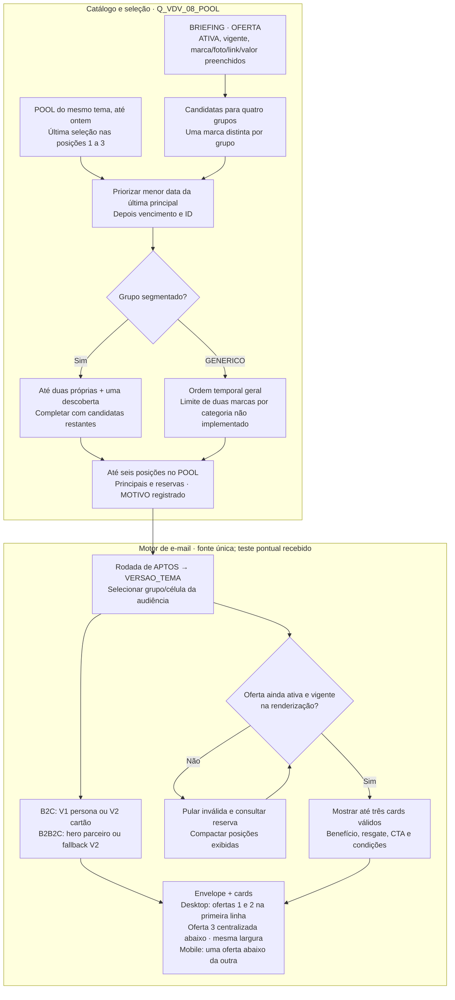

# E-mail e LP dinâmicos do Pool Vai de Visa · revisão de 09/11

## Evidência de Test Send e layout de 09/11

Em 09/11/2026, o operador confirmou que o e-mail dinâmico renderizou no SFMC e que o Test Send chegou corretamente à sua caixa. É um teste pontual relatado: não homologa todas as células, V2, clientes de e-mail/mobile, LP, WhatsApp/SMS ou envio em produção. O recebimento foi confirmado; não há incidente de entrega comprovado nesta evidência.

No desktop, ofertas 1 e 2 ficam lado a lado na primeira linha e a oferta 3 fica centralizada abaixo, com a mesma largura dos demais cards (2+1). Com duas ofertas, ambas ficam na primeira linha; com uma, ela fica centralizada. No mobile, a ordem é 1, 2, 3, uma abaixo da outra. São exibidas até três ofertas vigentes; inválidas/expiradas são descartadas e as reservas compactam as posições. Quatro cards permanecem evolução.

## 5. Conteúdo, heros, seleção e rotação

O catálogo separa OFERTA, TEMA e HERO pelo TIPO na mesma BRIEFING. Tema e hero compõem o envelope; o POOL escolhe ofertas por grupo e rodada. A seleção não pertence a um CPF: clientes de uma mesma célula/grupo usam a mesma rodada, respeitando a regra SEG-B/GEN-A → GENERICO.

VERSAO da seleção é BF26_V1_AAAAMMDD, uma rodada por data de Brasília no SQL. VERSAO_TEMA é BF26_V1. Na SAFRA, ID_VERSAO_OFERTAS guarda o tema da entrada; em APTOS, o campo guarda a rodada atual. O motor novo precisa resolver o tema pela seleção da rodada antes de buscar TEMA/HERO. Interpretar a rodada como versão do tema quebra essa consulta.



A Q08 não compara R$ com percentual para priorizar desconto. Ela favorece ofertas há mais tempo sem seleção principal naquele grupo, depois vencimento e ID. A deduplicação usa marca normalizada. Não existe GRUPO_2 vigente, e o limite de duas ofertas de uma mesma categoria no GENERICO não está implementado.

As posições 1–3 são principais na memória de seleção; 4–6 são reservas. O uso de uma reserva na renderização não vira automaticamente exposição registrada no POOL. Por isso, “última seleção principal” é a descrição correta da regra, e não “última oferta recebida pelo cliente”. O SQL bloqueia a versão inteira quando ela já existe; rodada parcial exige correção controlada.

APTOS verifica pelo menos três marcas distintas válidas nas posições 1–6 para o grupo efetivamente exibido. Depois, o template deve revalidar cada oferta e compactar as válidas. E-mail já enviado não se rearranja quando uma oferta vence. Guardar apenas OFERTA_ID não preserva a cópia de texto, imagem ou cupom se o catálogo for alterado posteriormente.

:::details Toques, fallback de hero e personalização
B2C usa V1 (persona) e V2 (cartão) nos respectivos toques. B2B2C com arte válida usa o hero do parceiro; sem arte, a regra documentada usa fallback V2. A identificação conservadora de NM_PARCEIRO e o fallback precisam de Test Send no motor novo. NM_CARTAO permanece NULL e o texto deve ter fallback sem inventar o nome do produto.

Assunto/pré-cabeçalho do V2 herdam os do V1 quando vazios na regra anterior; confirmar a preservação na adaptação. Nome ausente exige saudação sem nome. A Fábrica e o exportador ainda trabalham com movimento de seis colunas: não declarar suporte ao POOL de nove campos ou às duas versões antes da adaptação.

O intervalo 3–5 dias discutido em 06/11 era do desenho de dois toques. A revisão recorrente de 09/11 deixa dias/horários e alternância a definir; não transformar esse intervalo antigo em agendamento atual. Quatro cards, destaque comercial e aprendizagem por desempenho são evoluções.
:::

:::details Regras de apresentação e alegações
Comunicar vantagens do programa Visa e suas condições, sem afirmar exclusividade da Afinz. Não usar “até 40 dias para pagar”. Valor, cupom e validade devem corresponder à oferta. Oferta de bebida exige aviso legal aplicável, incluindo venda proibida a menores e consumo com moderação. Manter condições do parceiro, acessibilidade, links e eventual rastreio de afiliado.

O limite ≥ R$ 200 é da base; o contrato atual não contém limite mínimo por oferta, ticket × 1,10 ou garantia de que o limite disponível cobre toda compra. Conteúdo ou foto faltante não deve ser compensado por alegação inventada. Logo ausente pode usar marca textual no template anterior, a conferir no novo.
:::


## Contrato de implementação do motor

A fonte única de AMPscript recebe VERSAO_EMAIL opcional (vazio usa V1) e ID_VERSAO_OFERTAS da rodada; resolve VERSAO_TEMA em VDV_POOL_OFERTAS_GRUPO_POSICAO antes de consultar BRIEFING_OFERTAS_VISA. O fallback da Fábrica usa essa fonte. As fixtures históricas V5 e slots V1/V2 são preservados. O importador/exportador legado de MOVIMENTO com seis colunas ainda exige conferência de paridade com o POOL de nove campos: o teste recebido não certifica esse caminho. Tracking, links e condições legais são mantidos.

ID_ENVIO continua um token estável para a LP, não JobID nem identificador do send. Confirmar como a LP receberá/identificará rodada e toque para não confundir consultas posteriores à mesma participação. Não colocar CPF aberto no link. Matriz de Test Send e demais aceites: [[Estrategia-Pool-de-Ofertas-Visa]].


## 3. Canais e política de seleção

E-mail, WhatsApp e SMS são canais principais da estratégia. O piloto separa parcelas sem sobreposição: cada CPF recebe no máximo um canal do Pool na mesma rodada. SEG-C e GEN-C ficam sem comunicação nos três canais. A alocação de grupo/célula permanece congelada na SAFRA; GEN-A usa a vitrine genérica, mas não representa comparação causal direta com SEG-B de outra população.

| Canal | Aptidão própria | Destino | Teto por rodada de envio |
|---|---|---|---|
| E-mail | Endereço disponível, sem bloqueio de e-mail, supressões/publication list e status de assinante conferidos | Links de oferta; CTAs finais a conferir | Orçamento e capacidade a definir |
| WhatsApp | Contato móvel, bloqueios/supressões próprios liberados e uso do app nos últimos 60 dias | LP personalizada da rodada | Até 5.000 mensagens |
| SMS | Contato móvel, bloqueios/supressões próprios liberados e uso do app nos últimos 60 dias | LP personalizada da rodada | Até 100.000 SMS |

Os tetos valem por rodada, sujeitos à elegibilidade e ao orçamento. Não são metas nem limites semanais. No SMS, destinatários, tentativas, reenvios e unidades faturadas/segmentos podem divergir: registrar cada unidade separadamente.

ULTIMO_ACESSO da CLIENTES ATIVOS é a referência de uso do app para os dois canais móveis. Normalizar a data para America/Sao_Paulo e comparar de hoje menos 60 dias até hoje, inclusive. Data inválida, ausente ou futura impede apenas a seleção móvel. O participante permanece na SAFRA e pode receber e-mail se elegível. DEVICE, modelo de aparelho e data de cadastro/importação não entram nesta regra. Usar o app não comprova uso de WhatsApp.

Permissões de uso/consentimentos dos canais foram confirmadas na definição do piloto. A execução continua respeitando os bloqueios e as supressões próprios: bloqueio de e-mail não é bloqueio de celular, e a consulta _Subscribers não pode excluir toda a audiência móvel.

:::details Sorteio, perfis e parâmetros pendentes
Sortear dentro de perfis relevantes, com grupo/célula, B2C/B2B2C e recência quando a fonte permitir. Aplicar a mesma política e probabilidade a SEG-A e SEG-B. Não priorizar maiores compradores no WhatsApp e interpretar o SMS residual como efeito do canal.

Pesos, cotas por perfil, tamanho da amostra, poder estatístico e pressão por pessoa seguem em aberto. O contrato usa ID_POLITICA_CANAL e ID_RODADA para identificar a regra; sem parâmetros aprovados, a simulação retorna “parâmetros pendentes” e não produz audiência. O módulo de simulação do GaaS não executa seleção no SFMC.

Evitar redistribuir silenciosamente participantes inelegíveis para preencher teto. Guardar a política, elegibilidade e contagens de cada perfil para interpretar diferenças de cobertura. A seleção de um CPF em um canal exclui os outros naquela rodada; rodadas futuras precisam respeitar a política de pressão ainda a definir.
:::

## 4. Experiência da LP dinâmica

WhatsApp e SMS levam à LP personalizada da rodada, baseada no layout Black Afinz de referência: https://cloud.relacionamento.afinz.com.br/blackafinz-v2. O banner da campanha é independente do hero do e-mail. A arte fixa pode ser usada inicialmente; URLs finais de imagem ainda precisam ser fornecidas.

A LP resolve a participação por ID_ENVIO opaco, sem CPF na URL, e preserva a rodada do link. Grupo e célula vêm da SAFRA no servidor, nunca de um grupo livre enviado pela URL. APTOS é sobrescrita e não pode ser a única origem de links antigos. O token de participação não identifica sozinho cada acesso ou disparo.

POOL define seleção/ordem; BRIEFING fornece benefício, foto, vigência, resgate e condições. SEG-A usa afinidade; SEG-B e GEN-A usam GENERICO. Inicialmente são três cards, com reservas entre seis candidatas. A cada acesso, revalidar atividade/vigência, compactar válidas e usar reservas. Link antigo mantém a rodada: não trocar silenciosamente para uma seleção nova.

Exibir cupom somente quando aplicável, validade real, condições consultáveis e CTA de resgate. Visita à LP, clique de oferta e compra são eventos distintos. CPF e token não entram em GTM/GA4, dataLayer ou parâmetros de eventos. Controles não recebem os links de comunicação do Pool.

:::details Prévia integrada ao editor e pendências de CloudPages
O editor do Pool inclui prévia da LP, usando grupo/célula/data da amostra, rodada e desktop/mobile. Aceita CSV de nove colunas do POOL para conferir seleção e tema separadamente; a importação é local à prévia, sem alterar o contrato de seis colunas persistido pela Fábrica. O banner fica sinalizado como asset pendente até receber uma URL.

A prévia revalida ofertas e reservas com HTML escapado, links HTTPS e sem scripts de analytics. Ela é uma referência de conteúdo/layout, não uma CloudPage publicada. Ainda aplicar no SFMC: resolução segura de token+rodada, leitura da SAFRA/POOL/BRIEFING, supressões, assets, rastreio e testes reais. O shell HTML da página de marketing, isoladamente, não contém esse contrato dinâmico.
:::

### Medição, custos e ampliação de volume

Registrar por rodada/canal: participantes elegíveis, selecionados, destinatários previstos, mensagens previstas, destinatários efetivos, mensagens/tentativas realizadas, segmentos faturados de SMS, custo previsto e realizado. Preços unitários e orçamento ficam como parâmetros pendentes, sem estimativa inventada.

Acompanhar entrega, tráfego qualificado na LP/oferta, respostas quando cobertas, compras por fonte conciliada e custo. Clique ou volume enviado não comprovam incremento ou ROI. Comparar A/B dentro do mesmo grupo e política de canal; analisar desequilíbrio de exposição e perfis antes de atribuir efeito ao canal.

Há histórico individual de entregas/cliques/respostas de WhatsApp/SMS segundo a definição do piloto. Localização, cobertura e confiabilidade serão investigadas depois; isso não bloqueia o início do piloto e não significa integração pronta. Para a execução inicial, registrar os comprovantes disponíveis por rodada/canal e explicitar sua cobertura.

:::details Histórico anterior a 09/11 · não executar como instrução vigente
### E-mail e LP dinâmicos — Vai de Visa

**Definição e propósito:** como o e-mail e a landing page (CloudPage) do [[Iniciativa-Pool-de-Ofertas-Vai-de-Visa|Vai de Visa]] montam, **por CPF**, 4 ofertas escolhidas pela afinidade de compra, pelo limite disponível e pela célula do teste. Explica por que o motor de briefing atual não basta sozinho e qual padrão já existente reaproveitar.

> Status: desenho = `a-validar`; nada construído em 03/11/2026. Aguarda o KV de Black Friday do Marketing.

### Decisões de 03/11/2026 (vigentes)

- **Template-fonte novo** com o KV de Black Friday, usando o layout de referência com cards (logo, valor da oferta na cor da marca, descrição curta, CTA).
- **1º teste com 3 cards por e-mail**, sem reserva: o AMPscript busca as 3 linhas de [[DE-BRIEFING_OFERTAS_VISA]] por `ID_VERSAO` + `CD_GRUPO` (o grupo do cliente; células SEG-B e GEN-A usam `GENERICO`) em ordem de `NR_POSICAO`.
- O SQL **não grava ofertas por CPF**: a regra é fixa (grupo + versão + limite), então o que cada cliente viu é reconstruível pela `ID_VERSAO_OFERTAS` da [[DE-VDV_ENVIO]].
- A LP recebe o `ID_ENVIO` (aleatório) no link, nunca o CPF.

### Template dinâmico v1 (03/11/2026, fim do dia)

- Referências do Marketing: "KV E-mail Black Afinz 2026 - v1 persona" (ID 191865) e "- v2 cartão"; diferem só no hero.
- Arquivo `VDV_BF26_Template_Dinamico.html`: toda a lógica no 1º bloco `%%[ ]%%` (lookup, vigência, variáveis `@C1…@C3`); o corpo usa só `IF` e `v()`, porque a prévia da Fábrica não executa `FOR`/lookup no corpo (`ampscript/renderer.ts`).
- Nome: `FIRST_NAME` da [[DE-VDV_ENVIO]] com `ProperCase` e saudação sem nome quando vazio (o HTML de referência usava `%%PRI_NOME%%`, que não existe na DE de envio).
- Assunto e pré-cabeçalho: propriedades do e-mail com `%%=v(@Assunto)=%%` e `%%=v(@PreHeader)=%%`, lidos de [[DE-BRIEFING_OFERTAS_VISA]] → validar no Test Send.
- Cada card tem link (logo + "Aproveitar ›") com `RedirectTo` e alias `VDV_<versão>_<grupo>_P<posição>_<ID_OFERTA>` para medir clique por marca e posição. Os cards de referência não tinham link.
- Bloco "Condições das ofertas" em texto vivo com `NOTA_CONDICOES` (inclui "Beba com moderação" da Evino).
- Vitrine sem oferta vigente: o cliente é pulado (`RaiseError` com skip), nunca recebe e-mail vazio.
- Pendente: foto + logo das 12 marcas no Content Builder (só oBoticário tem, vindo do HTML de referência).

### Na Fábrica como frente nativa (05/11/2026, noite)

- O e-mail vive na [[Fabrica-de-Emails-GaaS|Fábrica]] em Rentabilização › Pool de Ofertas Visa › Black Friday, com o template `builtin-vdv-pool` (uma fonte para os dois toques) e o conteúdo da BF26 no banco do GaaS.
- Mostra **até 3 ofertas válidas**, lendo até 6 posições da vitrine (a partir da 4ª, reserva).
- Plano editorial, Ficha de Produto e regras de copy: [[Plano-de-Comunicacao-Pool-Vai-de-Visa]].

### E-mail v4 (05/11/2026, versão vigente)

- **Dois toques:** V1 (hero persona) e, dias depois, V2 (hero cartão); o cliente de parceiro com KV vê o KV do parceiro nos dois.
- **Nome do cartão** nos textos (`{CARTAO}`): correção manual no hero do parceiro, depois o `NM_CARTAO` vindo da `CLIENTES ATIVOS` (campo novo na automação, coluna a confirmar) e, por fim, "cartão Afinz Visa".
- **Uma DE de conteúdo** (`TP_REGISTRO` OFERTA/TEMA/HERO); a regra de limite (`VL_LIMITE_EXIGIDO`) entrou no template.
- **Pré-cabeçalho** = bloco de preparo + `%%=TreatAsContent(@PreHeader)=%%`, com a guarda `@VDVInicializado`, porque o SFMC processa pré-cabeçalho → HTML → assunto. **Assunto** = `%%=TreatAsContent(@Assunto)=%%`.
- **Compatível com a prévia da Fábrica:** sem `ELSEIF`, links com `RedirectTo(TreatAsContent(@x))` e o marcador `@VDVInicializado`.
- **Spec para o Codex** (entrega 1, e-mail completo na Fábrica, com a Fábrica como fonte de verdade da DE): `SPEC_CODEX_Fabrica_Vai_de_Visa.md`.

### E-mail v3, grade 2×2 (05/11/2026, substituída pela v4)

- Estrutura do Marketing: grade de 4 cards (foto no topo, logo, %, complemento, caixa de cupom com validade, botão "Aproveitar oferta"). Arquivos `VDV_Email_V1_persona.html` e `VDV_Email_V2_cartao.html`, idênticos exceto `SET @VersaoEmail`.
- Até 4 cards: busca 6 linhas (posições 5–6 viram reserva automática), pega as 4 primeiras vigentes; com 1 ou 3 cards a última linha fica centralizada.
- Vitrine BF26_V1 passou a 4 por grupo: 4º card = Movida nos grupos de categoria e Puma no Genérico (topo do pool fora do grupo).
- Hero de [[DE-BRIEFING_VDV_HERO]]: KV do parceiro B2B2C quando existir; senão, o da versão do e-mail.
- Logo vazio → nome da marca em texto. Movida (sem cupom) → "Como usar: Pague com Visa". Validade = `DT_FIM`.
- Alias inclui a versão do e-mail: `VDV_<versão>_<V1|V2>_<grupo>_P<slot>_<ID_OFERTA>`.

### Template dinâmico v2 (05/11/2026)

- Arquivo `VDV_Template_Dinamico_v2.html` substitui a v1. Duas DEs de conteúdo: cards em [[DE-BRIEFING_OFERTAS_VISA]] (versão × grupo × posição) e envelope em [[DE-BRIEFING_VDV_TEMA]] (1 linha por versão).
- Dinâmico: assunto, pré-cabeçalho, hero (+ link opcional), saudação com `{NOME}`, abertura com `{TEMA}`, 4 cores, texto do CTA, título e rodapé das condições; por card: foto, logo, valor, prefixo, sufixo, complemento, cor do valor, cupom/tipo de resgate, link, condições, arte inteira opcional, vigência.
- Fixo no HTML: logo Afinz, redes, atendimento, CNPJ.
- v1 persona e v2 cartão viram só valores de `URL_HERO`; não há dois templates.

As seções abaixo registram o desenho inicial (6 slots, reservas); a mecânica de reserva volta quando o pool crescer.

### Vitrine do e-mail com rotação (05/11/2026)

O e-mail continua lendo a vitrine em [[DE-MOVIMENTO_OFERTAS_VISA]], mas ela passa a ser gerada pela automação a cada disparo (2×/semana), girando as ofertas do acervo por grupo. Regra: [[Rotacao-de-Ofertas-Vai-de-Visa]]. Passos e SQL: [[Automacao-VDV-Pool-de-Ofertas]]. O envio usa [[DE-VDV_DISPARO]] como público.

### Por que o contrato de 36 colunas não resolve sozinho

O [[Emails-Dinamicos-SFMC|motor de e-mail dinâmico]] resolve o e-mail inteiro por `PRODUTO` × `TP_CAMPANHA` × `SEQUENCIA`: **todo mundo da campanha recebe o mesmo conteúdo**. No Vai de Visa, o conteúdo **muda por pessoa** — dois clientes da mesma campanha veem ofertas diferentes. O briefing não tem como guardar "a oferta de cada CPF".

### Padrão a reaproveitar: Bloco 3 do Plurix V10

O [[Emails-Dinamicos-Plurix|Plurix V10]] já resolveu um caso parecido: o Bloco 3 busca a oferta do dia em `DE_POOL_OFERTAS_PLURIX`, **separada do briefing**, e a regra é "sem oferta, o bloco some; o lookup nunca derruba o envio".

| Camada | De onde vem | Peça |
|---|---|---|
| Envelope (assunto, pré-cabeçalho, header com o KV, rodapé, nota legal, UTM) | briefing de 36 colunas, como hoje | `TB_BRIEFING_CAMPANHA_AQUISICAO` |
| Quem é e qual grupo/célula | audiência | [[DE-VDV_APTOS]] |
| As 4 ofertas | lookup por grupo + limite | [[DE-BRIEFING_OFERTAS_VISA]] |

### Lógica dos slots (AMPscript, esboço)

```
SET @grupo  = AttributeValue("CD_GRUPO_PRINCIPAL")
SET @celula = AttributeValue("DS_CELULA_TESTE")
SET @limite = AttributeValue("VL_LIMITE_DISPONIVEL")
IF @celula == "SEG-B" OR @celula == "GEN-A" THEN SET @grupo = "GENERICO" ENDIF
SET @rows = LookupOrderedRows("DE_VDV_OFERTAS", 0, "NR_PRIORIDADE ASC", "CD_GRUPO", @grupo)
/* percorrer @rows: manter só DT_INICIO <= hoje <= DT_FIM e VL_LIMITE_EXIGIDO <= @limite, até 4 */
/* se < 4: completar com LookupOrderedRows(..., "FL_TOP_VENDIDA", 1) aplicando o mesmo filtro */
/* nunca RaiseError por falta de oferta */
```

`LookupOrderedRows` só filtra por igualdade; vigência e limite são filtrados no loop. Células SEG-C e GEN-C ficam fora do envio pelo filtro da jornada, não pelo e-mail.

### LP dinâmica (CloudPage) para SMS e WhatsApp

- Mesma lógica dos slots, recebendo o CPF por parâmetro de URL **criptografado ou por ID opaco**, nunca CPF aberto no link.
- SMS/WhatsApp levam o link da LP; a mensagem segue a estrutura de briefing do [[Iniciativa-Pool-de-Ofertas-Parceiros|Pool de Ofertas - Parceiros]].
- Formatação de variáveis e espaçamento: [[Formatacao-WhatsApp-Variaveis-e-Espacamento]]; opt-out: [[WhatsApp-Respostas-de-Opt-out]].
- Precedente de LP com captura em DE: LPs de seguros no CloudPages (blocos HTML/AMPscript gravando em DE única).

### Checklist de QA (antes do Test Send)

- [ ] Um CPF de teste por grupo b1–b7 e um do Genérico, mais um com limite baixo (só ofertas de R$ 200).
- [ ] Cliente de Eletrônicos com limite < R$ 1.650 vê 1 oferta do grupo + 3 genéricas.
- [ ] Nenhum slot vazio, nenhum `RaiseError` por oferta.
- [ ] Oferta vencida não aparece (testar mudando a data de vigência).
- [ ] Cupom `NÃO POSSUI` não aparece como texto.
- [ ] Links `tidd.ly` abrem e mantêm o rastreio de afiliado.
- [ ] Personalização no formato `%%=v(@FirstName)=%%` (ver [[Emails-Dinamicos-SFMC]]).

### Ideia: Fábrica como fonte de verdade das ofertas

A [[Fabrica-de-Emails-GaaS|Fábrica]] já tem a aba "Header e ofertas" que alimenta o pool do Plurix V10. Usar a mesma aba para manter `DE_VDV_OFERTAS` daria versão, prévia e histórico ao catálogo, em vez de planilha solta. *Proposta, não decidida.*

### Lacunas e pendências

- Layout com KV de Black Friday não aprovado → bloqueia o HTML → Marketing.
- Limite de 4 ofertas no layout (informado pela operação, 03/11/2026) → define o número de slots → confirmado.
- Forma de passar o cliente para a LP sem expor CPF → requisito LGPD → definir na construção → operação.

### Relacionado

[[Emails-Dinamicos-SFMC]] · [[Emails-Dinamicos-Plurix]] · [[Servico-Emails-Dinamicos]] · [[DE-BRIEFING_OFERTAS_VISA]] · [[DE-VDV_APTOS]] · [[Teste-Afinidade-MCC-vs-Generico]] · [[MOC-SFMC-DEs-e-Automations]]
:::

