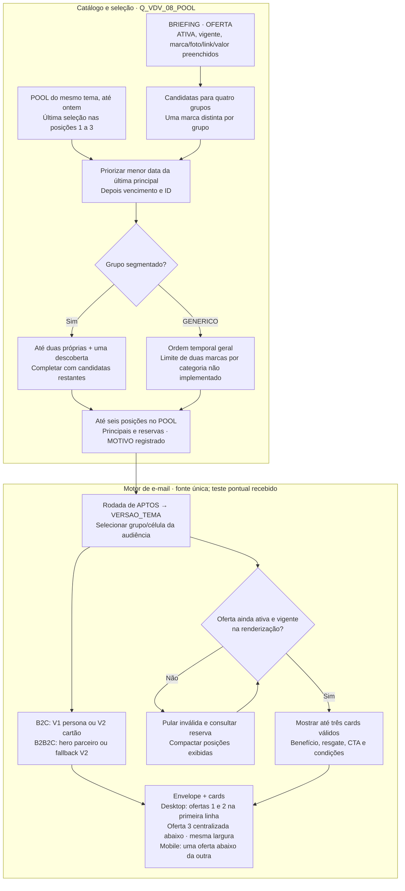
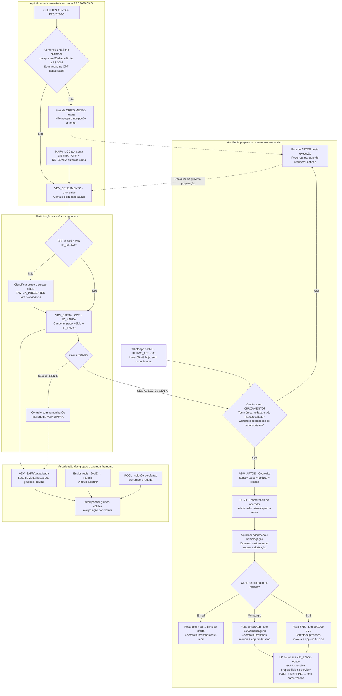
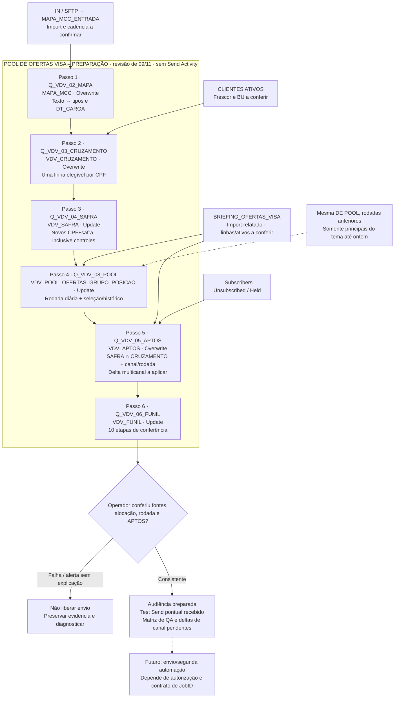

# Estratégia Pool de Ofertas Visa

O Pool de Ofertas Visa combina ofertas do programa Vai de Visa com a afinidade de compras dos clientes B2C e B2B2C. O teste compara vitrines selecionadas por grupo, vitrines genéricas e controles sem comunicação.

E-mail, WhatsApp e SMS usam parcelas distintas do público em cada rodada. A VDV_SAFRA mantém grupos/células; a VDV_APTOS reúne a seleção por canal. As regras de seleção, automação, conteúdo e validação estão detalhadas abaixo, com contratos e SQLs nas fichas recolhíveis.

> **Estado da operação:** revisão editorial de 09/11/2026. PREPARAÇÃO com seis passos e envio manual previsto. DEs e queries montadas; renderização e recebimento de um Test Send confirmados pelo operador em 09/11. Execução completa, FUNIL e matriz de homologação seguem pendentes.


## 1. Visão geral e operação

| Campo | Estratégia |
|---|---|
| O que é | Seleção de ofertas Vai de Visa por afinidade de compras, com vitrines genéricas e controles para comparação. |
| Objetivo | Avaliar compras e gasto por grupo/célula, comparando personalização e comunicação genérica. |
| Público elegível | B2C e B2B2C com situação NORMAL, compra em 30 dias e limite disponível ≥ R$ 200, respeitando condições de contato por canal. |
| Canais e destino | E-mail com links de oferta; WhatsApp e SMS com LP dinâmica da rodada. Ligação exata dos CTAs a conferir. Produção de peças dos três canais confirmada. |
| Frequência | Intenção de duas rodadas semanais. Dias, horários e pressão máxima por pessoa a definir. |
| Como funciona | Uma PREPARAÇÃO de seis passos atualiza fontes, SAFRA, seleção do POOL, APTOS por canal e FUNIL. Conferência e envio manuais nesta fase. |
| Como medir | Grupos/células na VDV_SAFRA, seleção por rodada, envios reais, tráfego qualificado, compras e custo por canal. |

O Pool Visa usa o catálogo da bandeira e a afinidade por MCC. A frente de Parceiros usa acordos da própria Afinz; suas regras on-us, calendário e métricas não definem este piloto. Plurix depende de fonte e configuração próprias para uma etapa posterior.

DEs, queries e importação do BRIEFING foram informados como montados na referência de e-mail. A execução integral e o FUNIL final seguem pendentes. Um Test Send foi recebido em 09/11, conforme relato do operador; a matriz completa de homologação permanece aberta. A revisão multicanal abaixo exige aplicar deltas no SFMC; publicar código e notas não altera a DE ou Query Activity real.


## 2. Grupos, células e unidade de comparação

Grupo descreve a classificação de afinidade feita na primeira entrada da safra; célula determina o tratamento experimental. APTOS mantém o grupo da SAFRA mesmo que o histórico de compras mude depois. CD_GRUPO_SECUNDARIO é diagnóstico, não a coluna GRUPO_2 de ofertas: ela não está vigente.

| Grupo | Critério no SQL entregue | Precedência |
|---|---|---|
| FAMILIA_PRESENTES | Pelo menos duas compras em Brinquedos nos agregados de 12 meses | Primeiro quando elegível, antes de quantidade/gasto dos outros grupos |
| MODA | Pelo menos duas compras em 12 meses e última compra em até seis meses | Depois de Família: quantidade, gasto e prioridade técnica |
| SAUDE_BELEZA | Mesmo limiar de quantidade e recência de Moda | Desempate técnico depois de Moda quando quantidade/gasto empatam |
| GENERICO | Não classificado nos três anteriores | Não significa ausência de todo consumo |

O código V1_12M_REC6M não representa “duas compras em seis meses”: a quantidade disponível é de 12 meses e a recência da última compra é de seis. Farmácia está em Saúde e Beleza; MCC não garante compra de cosmético. A definição da IN para parcelas e estornos continua pendente.

| População / célula | Proporção esperada | Seleção do e-mail | Comparação |
|---|---|---|---|
| Afinidade / SEG-A | 45% | POOL do CD_GRUPO | SEG-A × SEG-B no mesmo grupo: personalização |
| Afinidade / SEG-B | 45% | POOL GENERICO | Tratamento genérico dentro da população segmentada |
| Afinidade / SEG-C | 10% | Sem envio | Efeito de contato, respeitando cobertura e contaminação |
| Genérico / GEN-A | 90% | POOL GENERICO | GEN-A × GEN-C na população genérica |
| Genérico / GEN-C | 10% | Sem envio | Controle da população genérica |

Controle: ABS(CHECKSUM(CPF + 'VDV_CONTROLE') % 100) >= 90. Entre não controles segmentados, A/B usa CPF + ID_SAFRA com módulo 2. São proporções esperadas, não cotas exatas: verificar amostra e incerteza. Não chamar diferença entre grupos de efeito causal de personalização. O código fixo permite manter controle entre safras, mas essa política futura precisa de decisão explícita.

:::details Elegibilidade e agregação cadastral · efeito de cada regra
A SQL de referência e-mail da CRUZAMENTO exige ao menos uma linha B2C/B2B2C que reúna STATUS NORMAL, DATA_ULTIMA_COMPRA nos últimos 30 dias e LIMITE_DISPONIVEL ≥ 200. Na referência e-mail, a exclusão por bloqueio de e-mail e BLOQUEADO ATRASO olha as linhas do CPF dentro desse escopo de CANAL, não uma consulta universal a outras BUs. MAX(LEN(EMAIL)) > 0 na CRUZAMENTO não higieniza endereço; APTOS ainda exige contato não vazio após trim e exclui Unsubscribed/Held.

Nome, e-mail, celular e CANAL usam MAX. NM_PARCEIRO só é preenchido quando existe um único PRODUTO B2B2C NORMAL, normalizado, e nenhuma linha B2C NORMAL. Múltiplos vínculos ficam sem parceiro personalizado, até validar uma prioridade comercial. NM_CARTAO é explicitamente NULL. Não usar ORIGEM como nome comercial por dedução.

Compra em 30 dias usa GETDATE no SQL de CRUZAMENTO; carimbos/rodada e a recência de categoria usam DATEADD(HOUR,3,GETDATE()). Preservamos as SQLs recebidas: conferir a convenção de fuso e a fronteira de dia no tenant antes de homologar, sem trocar o offset por suposição.
:::


## 3. Canais e política de seleção

E-mail, WhatsApp e SMS são canais principais da estratégia. O piloto separa parcelas sem sobreposição: cada CPF recebe no máximo um canal do Pool na mesma rodada. SEG-C e GEN-C ficam sem comunicação nos três canais. A alocação de grupo/célula permanece congelada na SAFRA; GEN-A usa a vitrine genérica, mas não representa comparação causal direta com SEG-B de outra população.

| Canal | Aptidão própria | Destino | Teto por rodada de envio |
|---|---|---|---|
| E-mail | Endereço disponível, sem bloqueio de e-mail, supressões/publication list e status de assinante conferidos | Links de oferta; CTAs finais a conferir | Orçamento e capacidade a definir |
| WhatsApp | Contato móvel, bloqueios/supressões próprios liberados e uso do app nos últimos 60 dias | LP personalizada da rodada | Até 5.000 mensagens |
| SMS | Contato móvel, bloqueios/supressões próprios liberados e uso do app nos últimos 60 dias | LP personalizada da rodada | Até 100.000 SMS |

Os tetos valem por rodada, sujeitos à elegibilidade e ao orçamento. Não são metas nem limites semanais. No SMS, destinatários, tentativas, reenvios e unidades faturadas/segmentos podem divergir: registrar cada unidade separadamente.

ULTIMO_ACESSO da CLIENTES ATIVOS é a referência de uso do app para os dois canais móveis. Normalizar a data para America/Sao_Paulo e comparar de hoje menos 60 dias até hoje, inclusive. Data inválida, ausente ou futura impede apenas a seleção móvel. O participante permanece na SAFRA e pode receber e-mail se elegível. DEVICE, modelo de aparelho e data de cadastro/importação não entram nesta regra. Usar o app não comprova uso de WhatsApp.

Permissões de uso/consentimentos dos canais foram confirmadas na definição do piloto. A execução continua respeitando os bloqueios e as supressões próprios: bloqueio de e-mail não é bloqueio de celular, e a consulta _Subscribers não pode excluir toda a audiência móvel.

:::details Sorteio, perfis e parâmetros pendentes
Sortear dentro de perfis relevantes, com grupo/célula, B2C/B2B2C e recência quando a fonte permitir. Aplicar a mesma política e probabilidade a SEG-A e SEG-B. Não priorizar maiores compradores no WhatsApp e interpretar o SMS residual como efeito do canal.

Pesos, cotas por perfil, tamanho da amostra, poder estatístico e pressão por pessoa seguem em aberto. O contrato usa ID_POLITICA_CANAL e ID_RODADA para identificar a regra; sem parâmetros aprovados, a simulação retorna “parâmetros pendentes” e não produz audiência. O módulo de simulação do GaaS não executa seleção no SFMC.

Evitar redistribuir silenciosamente participantes inelegíveis para preencher teto. Guardar a política, elegibilidade e contagens de cada perfil para interpretar diferenças de cobertura. A seleção de um CPF em um canal exclui os outros naquela rodada; rodadas futuras precisam respeitar a política de pressão ainda a definir.
:::


## 4. Experiência da LP dinâmica

WhatsApp e SMS levam à LP personalizada da rodada, baseada no layout Black Afinz de referência: https://cloud.relacionamento.afinz.com.br/blackafinz-v2. O banner da campanha é independente do hero do e-mail. A arte fixa pode ser usada inicialmente; URLs finais de imagem ainda precisam ser fornecidas.

A LP resolve a participação por ID_ENVIO opaco, sem CPF na URL, e preserva a rodada do link. Grupo e célula vêm da SAFRA no servidor, nunca de um grupo livre enviado pela URL. APTOS é sobrescrita e não pode ser a única origem de links antigos. O token de participação não identifica sozinho cada acesso ou disparo.

POOL define seleção/ordem; BRIEFING fornece benefício, foto, vigência, resgate e condições. SEG-A usa afinidade; SEG-B e GEN-A usam GENERICO. Inicialmente são três cards, com reservas entre seis candidatas. A cada acesso, revalidar atividade/vigência, compactar válidas e usar reservas. Link antigo mantém a rodada: não trocar silenciosamente para uma seleção nova.

Exibir cupom somente quando aplicável, validade real, condições consultáveis e CTA de resgate. Visita à LP, clique de oferta e compra são eventos distintos. CPF e token não entram em GTM/GA4, dataLayer ou parâmetros de eventos. Controles não recebem os links de comunicação do Pool.

:::details Prévia integrada ao editor e pendências de CloudPages
O editor do Pool inclui prévia da LP, usando grupo/célula/data da amostra, rodada e desktop/mobile. Aceita CSV de nove colunas do POOL para conferir seleção e tema separadamente; a importação é local à prévia, sem alterar o contrato de seis colunas persistido pela Fábrica. O banner fica sinalizado como asset pendente até receber uma URL.

A prévia revalida ofertas e reservas com HTML escapado, links HTTPS e sem scripts de analytics. Ela é uma referência de conteúdo/layout, não uma CloudPage publicada. Ainda aplicar no SFMC: resolução segura de token+rodada, leitura da SAFRA/POOL/BRIEFING, supressões, assets, rastreio e testes reais. O shell HTML da página de marketing, isoladamente, não contém esse contrato dinâmico.
:::


## 5. Conteúdo, heros, seleção e rotação

No desktop, ofertas 1 e 2 ficam lado a lado na primeira linha e a oferta 3 fica centralizada abaixo, com a mesma largura dos demais cards (2+1). Com duas ofertas, ambas ficam na primeira linha; com uma, ela fica centralizada. No mobile, a ordem é 1, 2, 3, uma abaixo da outra. São exibidas até três ofertas vigentes; inválidas/expiradas são descartadas e as reservas compactam as posições. Quatro cards permanecem evolução.

O catálogo separa OFERTA, TEMA e HERO pelo TIPO na mesma BRIEFING. Tema e hero compõem o envelope; o POOL escolhe ofertas por grupo e rodada. A seleção não pertence a um CPF: clientes de uma mesma célula/grupo usam a mesma rodada, respeitando a regra SEG-B/GEN-A → GENERICO.

VERSAO da seleção é BF26_V1_AAAAMMDD, uma rodada por data de Brasília no SQL. VERSAO_TEMA é BF26_V1. Na SAFRA, ID_VERSAO_OFERTAS guarda o tema da entrada; em APTOS, o campo guarda a rodada atual. O motor novo precisa resolver o tema pela seleção da rodada antes de buscar TEMA/HERO. Interpretar a rodada como versão do tema quebra essa consulta.



A Q08 não compara R$ com percentual para priorizar desconto. Ela favorece ofertas há mais tempo sem seleção principal naquele grupo, depois vencimento e ID. A deduplicação usa marca normalizada. Não existe GRUPO_2 vigente, e o limite de duas ofertas de uma mesma categoria no GENERICO não está implementado.

As posições 1–3 são principais na memória de seleção; 4–6 são reservas. O uso de uma reserva na renderização não vira automaticamente exposição registrada no POOL. Por isso, “última seleção principal” é a descrição correta da regra, e não “última oferta recebida pelo cliente”. O SQL bloqueia a versão inteira quando ela já existe; rodada parcial exige correção controlada.

APTOS verifica pelo menos três marcas distintas válidas nas posições 1–6 para o grupo efetivamente exibido. Depois, o template deve revalidar cada oferta e compactar as válidas. E-mail já enviado não se rearranja quando uma oferta vence. Guardar apenas OFERTA_ID não preserva a cópia de texto, imagem ou cupom se o catálogo for alterado posteriormente.

:::details Toques, fallback de hero e personalização
B2C usa V1 (persona) e V2 (cartão) nos respectivos toques. B2B2C com arte válida usa o hero do parceiro; sem arte, a regra documentada usa fallback V2. A identificação conservadora de NM_PARCEIRO e o fallback precisam de Test Send no motor novo. NM_CARTAO permanece NULL e o texto deve ter fallback sem inventar o nome do produto.

Assunto/pré-cabeçalho do V2 herdam os do V1 quando vazios na regra anterior; confirmar a preservação na adaptação. Nome ausente exige saudação sem nome. A Fábrica e o exportador ainda trabalham com movimento de seis colunas: não declarar suporte ao POOL de nove campos ou às duas versões antes da adaptação.

O intervalo 3–5 dias discutido em 06/11 era do desenho de dois toques. A revisão recorrente de 09/11 deixa dias/horários e alternância a definir; não transformar esse intervalo antigo em agendamento atual. Quatro cards, destaque comercial e aprendizagem por desempenho são evoluções.
:::

:::details Regras de apresentação e alegações
Comunicar vantagens do programa Visa e suas condições, sem afirmar exclusividade da Afinz. Não usar “até 40 dias para pagar”. Valor, cupom e validade devem corresponder à oferta. Oferta de bebida exige aviso legal aplicável, incluindo venda proibida a menores e consumo com moderação. Manter condições do parceiro, acessibilidade, links e eventual rastreio de afiliado.

O limite ≥ R$ 200 é da base; o contrato atual não contém limite mínimo por oferta, ticket × 1,10 ou garantia de que o limite disponível cobre toda compra. Conteúdo ou foto faltante não deve ser compensado por alegação inventada. Logo ausente pode usar marca textual no template anterior, a conferir no novo.
:::


## 6. Percurso completo: entrada, controle, saída e retorno

Cada preparação começa pela aptidão atual. Quem ainda não participa da safra selecionada entra na SAFRA uma única vez, inclusive se cair no controle. Quem já participa preserva grupo, célula e token. O cliente pode sair de APTOS por bloqueio, atraso, recência, limite ou conteúdo indisponível sem desaparecer da população de medição; se recuperar a condição, pode voltar a APTOS na mesma alocação.



APTOS não é uma safra fechada e não elimina quem recebeu a rodada passada. A recuperação de aptidão não cria nova participação, não muda a célula e não gera um novo token naquela safra. A ausência de compra MCC não deve ser apresentada como gasto zero comprovado: o LEFT JOIN pode deixar medidas nulas e o cliente seguir como genérico se as demais regras permitirem.


## 7. Operação atual e automação de seis passos

Uma Query Activity por passo sequencial. O número no nome técnico não é a posição atual na automação. Não executar CRUZAMENTO, SAFRA ou APTOS em paralelo com sua dependência. O import MAPA_MCC_ENTRADA e a carga de BRIEFING são pré-condições, não passos de envio escondidos.



| Passo | Destino | Ação | Efeito de reexecutar |
|---|---|---|---|
| MAPA | MAPA_MCC | Overwrite | Recalcula a foto da entrada; não comprova arquivo novo |
| CRUZAMENTO | VDV_CRUZAMENTO | Overwrite | Reavalia aptidão e contato |
| SAFRA | VDV_SAFRA | Update | Só inclui CPF+safra ausentes; preserva grupo/célula/token |
| POOL | VDV_POOL_OFERTAS_GRUPO_POSICAO | Update | Não seleciona se a VERSAO do dia já tiver qualquer linha |
| APTOS | VDV_APTOS | Overwrite | Atualiza saídas e retornos dos tratamentos |
| FUNIL | VDV_FUNIL | Update | Grava conferências sob chave de execução; não é prova de envio |

A automação inteira não é uma transação: uma falha no quinto passo não desfaz a SAFRA ou a rodada já gravadas. Registrar o ponto de falha e as contagens antes de repetir. FUNIL com ALERTA é dado para o operador; a SQL não contém uma atividade de interrupção automática.


## 8. Medição e operação assistida

A VDV_SAFRA é a base de visualização dos grupos e células. Ela mantém os participantes e controles, inclusive quem saiu de APTOS por inaptidão. Para acompanhar a exposição, essa base deve ser conciliada com os envios reais por JobID, rodada e toque. ID_ENVIO identifica a participação e o acesso à LP; cada disparo precisa de seu próprio vínculo de rastreio.

SEG-A × SEG-B, dentro do mesmo grupo alocado, é a comparação de personalização. Tratamentos × seus controles avaliam contato sob condições comparáveis e cobertura conhecida. GEN-A × GEN-C mede o contato na população genérica. Abertura/clique são diagnóstico; compra por marca/MCC e gasto vêm de fonte da IN/Visa conciliada. Gateway de pagamento pode esconder a marca; MCC não identifica o item. O contrato final de compra, tratamento de parcelas/estornos e janelas precisa da IN.

As leituras D+7/D+15/D+30 vêm do desenho anterior e continuam referências de acompanhamento, não um contrato final adaptado à audiência recorrente. É preciso definir data de referência também para controle, múltiplas exposições e safras sobrepostas. Não substituir ausência de exposição por zero ou usar apenas quem abriu como população causal.

:::details Como interpretar as dez etapas do FUNIL
| Ordem / etapa | Interpretação correta |
|---|---|
| 1 MAPA_ENTRADA | Fonte vazia gera ALERTA; contagem não prova referência nova |
| 2 MAPA_TRATADA | Confere vazio, quantidade, centavos e máximo de Moda; limites históricos são heurísticas |
| 3 CRUZAMENTO | Base elegível vazia alerta |
| 4 SAFRA_TOTAL | Participação acumulada, inclusive controles; não é público que recebe hoje |
| 5 SAFRA | Proporção por grupo/célula na população alocada; tolerância de três pontos percentuais pode alertar amostra pequena |
| 6 POOL | Conta marcas válidas nas posições 1–6 para quatro grupos, inclusive grupos sem oferta |
| 7 APTOS_TOTAL | Público preparado vazio alerta; não prova envio |
| 8 APTOS | Conferência da safra e das células tratadas presentes |
| 9 APTOS_INVALIDOS | Zero é o resultado bom desta etapa; uma ou mais linhas exigem diagnóstico |
| 10 ELEGIVEL_SMS | INFO: contato celular disponível, sem validar consentimento ou configuração SMS |

O agrupamento de SAFRA só mostra células existentes: completar a matriz de cinco células esperadas na conferência para detectar ausentes. PCT_ETAPA_ANTERIOR, apesar do nome, é a fração de uma célula no grupo nessa etapa, não uma conversão de funil. O alerta não cancela um envio e não existe gate automático novo nesta entrega.
:::

:::details Recuperação por estágio da preparação
1. Antes de repetir, guardar execução, fontes/referências, contagens, versão da rodada e mensagem de erro. Não reimportar um arquivo incompleto por cima da última fonte válida.
2. Falha em MAPA/CRUZAMENTO: corrigir entrada/tipos e repetir a sequência com fontes consistentes. Reexecutar tratamento não renova o arquivo IN.
3. SAFRA já gravada: conferir novas chaves e alocações; não apagar participantes para re-sortear. O NOT EXISTS é parte do contrato.
4. POOL já presente ou parcial: a Q08 não o completa. Diagnosticar chaves e referencial, preservar as rodadas anteriores e decidir uma correção controlada; não alterar silenciosamente conteúdo de rodada usada.
5. APTOS falhou ou ficou antiga: reparar a causa e preparar de novo antes do envio, garantindo que nenhum consumidor esteja lendo a DE durante Overwrite.
6. FUNIL falhou: não assumir sucesso dos passos anteriores nem execução completa pelo fato de haver APTOS. Conferir cada destino e corrigir o log. Um alerta conhecido precisa de justificativa explícita antes de qualquer liberação assistida.
:::

### Medição, custos e ampliação de volume

Registrar por rodada/canal: participantes elegíveis, selecionados, destinatários previstos, mensagens previstas, destinatários efetivos, mensagens/tentativas realizadas, segmentos faturados de SMS, custo previsto e realizado. Preços unitários e orçamento ficam como parâmetros pendentes, sem estimativa inventada.

Acompanhar entrega, tráfego qualificado na LP/oferta, respostas quando cobertas, compras por fonte conciliada e custo. Clique ou volume enviado não comprovam incremento ou ROI. Comparar A/B dentro do mesmo grupo e política de canal; analisar desequilíbrio de exposição e perfis antes de atribuir efeito ao canal.

Há histórico individual de entregas/cliques/respostas de WhatsApp/SMS segundo a definição do piloto. Localização, cobertura e confiabilidade serão investigadas depois; isso não bloqueia o início do piloto e não significa integração pronta. Para a execução inicial, registrar os comprovantes disponíveis por rodada/canal e explicitar sua cobertura.


## 9. Fichas técnicas das Data Extensions e origens

Os contratos abaixo descrevem a referência de e-mail montada; o delta multicanal está na ficha seguinte e depende de aplicação no SFMC. São seis DEs próprias do Pool neste desenho: BRIEFING, CRUZAMENTO, SAFRA, POOL, APTOS e FUNIL. MAPA/ENTRADA, CLIENTES ATIVOS e _Subscribers são dependências de origem/seleção. Os nomes de arquivo antigos permanecem para preservar links: DE-VDV_ENVIO passa a explicar SAFRA e DE-MOVIMENTO_OFERTAS_VISA explica o POOL unificado.

As tabelas documentam nomes, tipos de referência e nulidade necessária à lógica recebida. Não substituem uma inspeção das propriedades do tenant. External Keys, retenção e defaults não apresentados permanecem a conferir, sem supor equivalência entre nome e chave externa. Não criar VDV_AUDIENCIA_DISPARO, VDV_POOL_HISTORICO_ROTACAO ou novas DEs de hero/tema.

:::details BRIEFING_OFERTAS_VISA · catálogo, tema e heros · 41 campos
### `BRIEFING_OFERTAS_VISA` · 41 campos

Catálogo de ofertas e registros de tema e hero. Uma linha por ID; PK ID; não enviável. OFERTA não usa VERSAO, enquanto TEMA e HERO usam a versão do tema. Não criar DEs separadas de hero/tema nem adicionar GRUPO_2 ou SAFRA ao contrato atual.

A carga é uma publicação manual do catálogo a partir da Fábrica/CSV. operação relatou o import; faltam recibo de linhas aceitas, checagem de imagens/links e teste do motor novo. Antes de Overwrite, guardar a exportação anterior e garantir o catálogo completo: retirar uma oferta ainda referenciada pode impedir reconstruir rodadas antigas. Retenção, External Key e defaults atuais não foram inspecionados.

Na tabela, “Obrigatório” é a exigência de uso/referência documental, não leitura da propriedade IsRequired do tenant. Colunas específicas de OFERTA, TEMA e HERO precisam aceitar vazios nos outros tipos. A nulidade de VERSAO para OFERTA e de INICIO/FIM precisa ser compatível com os registros e SQLs atuais.

| Campo | Tipo / tamanho de referência | PK | Obrigatório | Uso |
|---|---|---|---|---|
| `ID` | Text(60) | Sim | Sim | Chave única (ex.: `NOV26_PUMA`, `TEMA_BF26_V1`) |
| `TIPO` | Text(20) | — | Sim | `OFERTA`, `TEMA` ou `HERO` |
| `VERSAO` | Text(30), referência | — | Não para OFERTA; sim para TEMA/HERO | Código de versão da peça (ex.: `BF26_V1`) |
| `ATIVA` | Boolean | — | Sim | Indicador de oferta vigente (1 = Ativa; 0 = Inativa) |
| `INICIO` | Date | — | Não; SQL aceita NULL | Início do período de validade |
| `FIM` | Date | — | Não; SQL aceita NULL | Término do período de validade |
| `MARCA` | Text(100) | — | Não | Nome comercial da loja parceira |
| `GRUPO` | Text(50) | — | Não | Categoria primária (`MODA`, `SAUDE_BELEZA`, etc.) |
| `LOGO` | Text(500) | — | Não | URL HTTPS pública do logo no Content Builder |
| `FOTO` | Text(500) | — | Não | URL HTTPS pública da imagem de fundo do card |
| `ALT` | Text(200) | — | Não | Texto alternativo de acessibilidade |
| `PREFIXO` | Text(50) | — | Não | Texto de apoio ao valor (ex.: "Até") |
| `VALOR` | Text(50) | — | Não | Expressão do benefício (ex.: "15%", "R$ 100") |
| `SUFIXO` | Text(50) | — | Não | Complemento curto (ex.: "OFF") |
| `COMPLEMENTO` | Text(200) | — | Não | Escopo da promoção (ex.: "em todo o site") |
| `COR` | Text(10) | — | Não | Código HEX da cor da marca para o valor |
| `RESGATE` | Text(30) | — | Não | Mecânica: `CUPOM`, `LINK` ou `PAGAR_COM_VISA` |
| `CUPOM` | Text(50) | — | Não | Código alfanumérico do voucher promocional |
| `LINK` | Text(500) | — | Não | Link de afiliado / redirecionamento rastreado |
| `CONDICOES` | Text(500) | — | Não | Regras de uso e avisos legais obrigatórios |
| `HERO` | Text(50) | — | Não | Identificador da arte hero (para linhas de HERO) |
| `HERO_IMG` | Text(500) | — | Não | URL HTTPS da imagem de cabeçalho |
| `HERO_ALT` | Text(200) | — | Não | Texto descritivo do hero |
| `HERO_LINK` | Text(500) | — | Não | URL de destino do clique no hero |
| `NOME_CARTAO` | Text(100) | — | Não | Grafia padronizada do produto associado ao hero |
| `TEMA` | Text(100) | — | Não | Título institucional da campanha |
| `ASSUNTO` | Text(200) | — | Não | Linha de assunto do E-mail 1 (V1) |
| `PREHEADER` | Text(200) | — | Não | Pré-cabeçalho do E-mail 1 (V1) |
| `ASSUNTO_V2` | Text(200) | — | Não | Linha de assunto do E-mail 2 (V2) |
| `PREHEADER_V2` | Text(200) | — | Não | Pré-cabeçalho do E-mail 2 (V2) |
| `SAUDACAO` | Text(100) | — | Não | Texto de saudação dinâmico com tag `{NOME}` |
| `SAUDACAO_SEM_NOME` | Text(100) | — | Não | Saudação padrão para cadastros sem nome |
| `INTRO` | Text(500) | — | Não | Parágrafo introdutório do corpo da mensagem |
| `CARTAO_PADRAO` | Text(100) | — | Não | Nome padrão do cartão para fallback |
| `CTA` | Text(50) | — | Não | Rótulo dos botões dos cards (ex.: "Aproveitar oferta") |
| `TITULO_CONDICOES` | Text(100) | — | Não | Título da seção de rodapé legal |
| `RODAPE_CONDICOES` | Text(1000) | — | Não | Texto jurídico de termos e condições |
| `COR_FUNDO` | Text(10) | — | Não | Código HEX de fundo do template |
| `COR_TEXTO` | Text(10) | — | Não | Código HEX de texto principal |
| `COR_TITULO` | Text(10) | — | Não | Código HEX dos cabeçalhos |
| `COR_TEMA` | Text(10) | — | Não | Código HEX da cor de destaque da campanha |

**Regras por tipo:** OFERTA exige ID, marca, benefício e link; a Q08 também exige FOTO não vazia e elimina MARCA vazia. TEMA precisa de exatamente um registro ativo/vigente em BF26_V1. HERO identifica a arte, URL e eventual correção do nome do cartão. RESGATE=CUPOM exige cupom coerente; preservar condições legais, ALT e HTTPS. Logo ausente não é o mesmo que foto ausente: o template anterior tem fallback textual de marca, mas a seleção atual exige FOTO.

**Catálogo de referência:** 89 registros, 66 ofertas, 22 heros e um tema; 60 ofertas ativas, 52 ofertas sem foto e 62 sem logo. Conferir a carga importada combinando atividade, vigência, marca, foto, link e valor.
:::

:::details VDV_CRUZAMENTO · 32 campos · contrato e limites
### `VDV_CRUZAMENTO`

Recalcular a aptidão e os dados correntes do CPF antes de selecionar participantes e audiência.

| Configuração | Referência atual |
|---|---|
| Grão | Uma linha por CPF |
| Carga | Q_VDV_03_CRUZAMENTO · Overwrite |
| Relação de envio | Não enviável |
| Origem | CLIENTES ATIVOS + MAPA_MCC por NR_CONTA, com DISTINCT CPF, NR_CONTA. |
| Consumidor | VDV_SAFRA para novas participações e VDV_APTOS para aptidão/contato atual. |
| Pasta | POOL DE OFERTAS VISA; External Key não registrada, conferir sem inferir pelo nome |
| Retenção / defaults | Não reconfirmados no tenant; não ativar expurgo automático por omissão. DT_RODADA é preenchida por query. |

| Campo | Tipo / tamanho de referência | PK | Nulo | Regra / origem |
|---|---|---|---|---|
| `CPF` | Text(50) | Sim | Não | Identidade do participante / SubscriberKey |
| `PRI_NOME` | Text(50) | — | Sim | MAX de PRI_NOME por CPF |
| `EMAIL` | EmailAddress(254) | — | Não | Contato do cadastro; revalidar espaços e supressões |
| `NR_CELULAR` | Phone(50) | — | Sim | Contato celular; não prova consentimento |
| `FL_BLOQ_CELULAR` | Number | — | Não | MAX do bloqueio móvel na origem |
| `CANAL` | Text(50) | — | Não | B2C ou B2B2C; agregação MAX no SQL |
| `NM_PARCEIRO` | Text(150) | — | Sim | PRODUTO normalizado somente com parceiro B2B2C único e sem B2C NORMAL |
| `NM_CARTAO` | Text(150) | — | Sim | NULL no SQL de 09/11; origem comercial pendente |
| `VL_LIMITE_DISPONIVEL` | Decimal(18,2) | — | Não | Maior limite das linhas NORMAL |
| `DT_ULTIMA_COMPRA` | Date | — | Não | MAX de DATA_ULTIMA_COMPRA; regra de entrada exige compra em 30 dias |
| `QT_MODA` | Number | — | Sim | Soma das quantidades da MAPA por contas distintas do CPF |
| `VL_MODA` | Decimal(18,2) | — | Sim | Soma dos valores da MAPA; SQL preserva negativos |
| `DT_ULT_MODA` | Date | — | Sim | Maior data da categoria nas contas do CPF |
| `QT_SAUDE_BELEZA` | Number | — | Sim | Soma das quantidades da MAPA por contas distintas do CPF |
| `VL_SAUDE_BELEZA` | Decimal(18,2) | — | Sim | Soma dos valores da MAPA; SQL preserva negativos |
| `DT_ULT_SAUDE_BELEZA` | Date | — | Sim | Maior data da categoria nas contas do CPF |
| `QT_ELETRODOM` | Number | — | Sim | Soma das quantidades da MAPA por contas distintas do CPF |
| `VL_ELETRODOM` | Decimal(18,2) | — | Sim | Soma dos valores da MAPA; SQL preserva negativos |
| `DT_ULT_ELETRODOM` | Date | — | Sim | Maior data da categoria nas contas do CPF |
| `QT_ELETRONICOS` | Number | — | Sim | Soma das quantidades da MAPA por contas distintas do CPF |
| `VL_ELETRONICOS` | Decimal(18,2) | — | Sim | Soma dos valores da MAPA; SQL preserva negativos |
| `DT_ULT_ELETRONICOS` | Date | — | Sim | Maior data da categoria nas contas do CPF |
| `QT_BRINQUEDOS` | Number | — | Sim | Soma das quantidades da MAPA por contas distintas do CPF |
| `VL_BRINQUEDOS` | Decimal(18,2) | — | Sim | Soma dos valores da MAPA; SQL preserva negativos |
| `DT_ULT_BRINQUEDOS` | Date | — | Sim | Maior data da categoria nas contas do CPF |
| `QT_VIAGEM` | Number | — | Sim | Soma das quantidades da MAPA por contas distintas do CPF |
| `VL_VIAGEM` | Decimal(18,2) | — | Sim | Soma dos valores da MAPA; SQL preserva negativos |
| `DT_ULT_VIAGEM` | Date | — | Sim | Maior data da categoria nas contas do CPF |
| `QT_PET` | Number | — | Sim | Soma das quantidades da MAPA por contas distintas do CPF |
| `VL_PET` | Decimal(18,2) | — | Sim | Soma dos valores da MAPA; SQL preserva negativos |
| `DT_ULT_PET` | Date | — | Sim | Maior data da categoria nas contas do CPF |
| `VL_GASTO_12M` | Decimal(18,2) | — | Sim | Soma das nove categorias com ISNULL de cada valor; LEFT JOIN sem MAPA pode deixar NULL |

**Limites:** Sem cadastro de parceiro único confiável, NM_PARCEIRO fica NULL. NM_CARTAO permanece NULL. Nome, e-mail e CANAL por MAX não resolvem comercialmente múltiplos vínculos. Não normaliza CPF por si só.

Tipos/tamanhos e nulidade desta ficha combinam o contrato do pacote e referências anteriores. Onde não houve print/metadado atual, são referência de configuração a conferir, não certificação da DE criada.
:::

:::details VDV_SAFRA · 18 campos · contrato e limites
### `VDV_SAFRA`

Acumular participantes elegíveis na primeira entrada, congelando grupo, célula e token, inclusive para controles.

| Configuração | Referência atual |
|---|---|
| Grão | CPF × ID_SAFRA |
| Carga | Q_VDV_04_SAFRA · Update com NOT EXISTS por CPF + ID_SAFRA |
| Relação de envio | Mantém a configuração enviável relatada (CPF → SubscriberKey), mas não é a audiência operacional: contém controles |
| Origem | VDV_CRUZAMENTO da execução atual. |
| Consumidor | APTOS e IN (todos os tratamentos e controles). |
| Pasta | POOL DE OFERTAS VISA; External Key não registrada, conferir sem inferir pelo nome |
| Retenção / defaults | Não reconfirmados no tenant; não ativar expurgo automático por omissão. DT_RODADA é preenchida por query. |

| Campo | Tipo / tamanho de referência | PK | Nulo | Regra / origem |
|---|---|---|---|---|
| `CPF` | Text(50) | Sim | Não | Identidade do participante / SubscriberKey |
| `ID_SAFRA` | Text(50) | Sim | Não | VDV_2026_11_BF no SQL atual |
| `FIRST_NAME` | Text(50) | — | Sim | Nome do cadastro |
| `EMAIL` | EmailAddress(254) | — | Não | Contato do cadastro; revalidar espaços e supressões |
| `NR_CELULAR` | Phone(50) | — | Sim | Contato celular; não prova consentimento |
| `LOCALE` | Locale(5) | — | Não | Literal BR; verificar tipo Locale no tenant |
| `FL_BLOQ_CELULAR` | Number | — | Não | MAX do bloqueio móvel na origem |
| `CANAL` | Text(50) | — | Não | B2C ou B2B2C; agregação MAX no SQL |
| `NM_PARCEIRO` | Text(150) | — | Sim | PRODUTO normalizado somente com parceiro B2B2C único e sem B2C NORMAL |
| `NM_CARTAO` | Text(150) | — | Sim | NULL no SQL de 09/11; origem comercial pendente |
| `VL_LIMITE_DISPONIVEL` | Decimal(18,2) | — | Não | Maior limite das linhas NORMAL |
| `CD_GRUPO` | Text(50) | — | Não | Grupo escolhido na primeira entrada; permanece congelado |
| `CD_GRUPO_SECUNDARIO` | Text(50) | — | Sim | Segundo grupo da classificação inicial; diagnóstico |
| `DS_CELULA_TESTE` | Text(20) | — | Não | SEG-A/B/C ou GEN-A/C; não re-sortear |
| `ID_VERSAO_OFERTAS` | Text(60), referência a validar | — | Não | Tema de entrada BF26_V1; semântica diferente de APTOS |
| `ID_ENVIO` | Text(36) | — | Não | NEWID na primeira inclusão; token da participação/LP |
| `DT_ENTRADA` | Date | — | Não | Carimbo da primeira inclusão com DATEADD(HOUR,3,GETDATE()) |
| `DT_ENVIO` | Date | — | Sim | CONVERT(DATETIME,NULL); não preencher como se tivesse havido envio |

**Limites:** Não sobrescrever nem atualizar a alocação existente. Saída da audiência não apaga participação. DT_ENVIO deve aceitar NULL. O nome antigo VDV_ENVIO permanece como alias documental, não ordem para criar outra DE.

Tipos/tamanhos e nulidade desta ficha combinam o contrato do pacote e referências anteriores. Onde não houve print/metadado atual, são referência de configuração a conferir, não certificação da DE criada.
:::

:::details VDV_POOL_OFERTAS_GRUPO_POSICAO · 9 campos · contrato e limites
### `VDV_POOL_OFERTAS_GRUPO_POSICAO`

Guardar a seleção e o histórico de rodadas na mesma DE, sem uma segunda tabela de rotação.

| Configuração | Referência atual |
|---|---|
| Grão | VERSAO × GRUPO × CELULA × POSICAO |
| Carga | Q_VDV_08_POOL · Update com bloqueio de rodada existente |
| Relação de envio | Não enviável |
| Origem | BRIEFING_OFERTAS_VISA + seleções principais anteriores desta própria DE, no mesmo tema. |
| Consumidor | APTOS confere disponibilidade; motor adaptado deve ler seleção + catálogo e resolver VERSAO_TEMA. |
| Pasta | POOL DE OFERTAS VISA; External Key não registrada, conferir sem inferir pelo nome |
| Retenção / defaults | Não reconfirmados no tenant; não ativar expurgo automático por omissão. DT_RODADA é preenchida por query. |

| Campo | Tipo / tamanho de referência | PK | Nulo | Regra / origem |
|---|---|---|---|---|
| `VERSAO` | Text(60) | Sim | Não | Rodada BF26_V1_AAAAMMDD |
| `GRUPO` | Text(50) | Sim | Não | MODA, SAUDE_BELEZA, FAMILIA_PRESENTES, GENERICO |
| `CELULA` | Text(50) | Sim | Não | TODAS na query atual |
| `POSICAO` | Number | Sim | Não | 1 a 6; primeiras três principais e demais reservas |
| `OFERTA_ID` | Text(60) | — | Não | Referência a BRIEFING_OFERTAS_VISA.ID |
| `ATIVA` | Boolean | — | Não | 1 na seleção atual; catálogo ainda precisa de revalidação |
| `MOTIVO` | Text(50) | — | Sim | GRUPO, DESCOBERTA ou COMPLETAR |
| `DT_RODADA` | Date | — | Não | Data preenchida pela query, sem default necessário |
| `VERSAO_TEMA` | Text(60) | — | Não | BF26_V1, chave do tema e dos heros |

**Limites:** Retenção desativada inicialmente é a recomendação do pacote, a conferir no tenant. NOT EXISTS bloqueia a versão inteira se qualquer linha já existir: parcial exige diagnóstico, não nova execução cega. Não congela texto/foto/cupom e não comprova envio.

Tipos/tamanhos e nulidade desta ficha combinam o contrato do pacote e referências anteriores. Onde não houve print/metadado atual, são referência de configuração a conferir, não certificação da DE criada.
:::

:::details VDV_APTOS · 20 campos · contrato e limites
### `VDV_APTOS`

Preparar somente tratamentos aptos agora, com contato atual e alocação estável.

| Configuração | Referência atual |
|---|---|
| Grão | Uma linha por CPF da safra selecionada |
| Carga | Q_VDV_05_APTOS · Overwrite a cada preparação |
| Relação de envio | Enviável: CPF → SubscriberKey, com EMAIL EmailAddress; conferir no tenant |
| Origem | SAFRA INNER JOIN CRUZAMENTO recém-recalculada, _Subscribers e disponibilidade de tema/pool/catálogo. |
| Consumidor | Eventual envio manual após conferência e adaptação do template; não há envio automático nesta preparação. |
| Pasta | POOL DE OFERTAS VISA; External Key não registrada, conferir sem inferir pelo nome |
| Retenção / defaults | Não reconfirmados no tenant; não ativar expurgo automático por omissão. DT_RODADA é preenchida por query. |

| Campo | Tipo / tamanho de referência | PK | Nulo | Regra / origem |
|---|---|---|---|---|
| `CPF` | Text(50) | Sim | Não | Identidade do participante / SubscriberKey |
| `FIRST_NAME` | Text(50) | — | Sim | Nome do cadastro |
| `EMAIL` | EmailAddress(254) | — | Não | Contato do cadastro; revalidar espaços e supressões |
| `NR_CELULAR` | Phone(50) | — | Sim | Contato celular; não prova consentimento |
| `FL_BLOQ_CELULAR` | Number | — | Não | MAX do bloqueio móvel na origem |
| `CANAL` | Text(50) | — | Não | B2C ou B2B2C; agregação MAX no SQL |
| `VL_LIMITE_DISPONIVEL` | Decimal(18,2) | — | Não | Maior limite das linhas NORMAL |
| `DT_ULTIMA_COMPRA` | Date | — | Não | Atual de CRUZAMENTO |
| `VL_GASTO_12M` | Decimal(18,2) | — | Sim | Atual de CRUZAMENTO |
| `CD_GRUPO` | Text(50) | — | Não | Congelado na SAFRA |
| `CD_GRUPO_SECUNDARIO` | Text(50) | — | Sim | Congelado na SAFRA |
| `CD_REGRA_GRUPO` | Text(50) | — | Não | Literal V1_12M_REC6M; prioridade Família no SQL atual |
| `DS_CELULA_TESTE` | Text(20) | — | Não | Apenas SEG-A, SEG-B, GEN-A |
| `ID_SAFRA` | Text(50) | — | Não | Safra selecionada na query |
| `DT_ATUALIZACAO` | Date | — | Não | Preparação atual; não é DT_DISPARO nem DT_ENVIO |
| `NM_PARCEIRO` | Text(150) | — | Sim | PRODUTO normalizado somente com parceiro B2B2C único e sem B2C NORMAL |
| `NM_CARTAO` | Text(150) | — | Sim | NULL no SQL de 09/11; origem comercial pendente |
| `LOCALE` | Locale(5) | — | Não | Literal BR; conferir tipo |
| `ID_VERSAO_OFERTAS` | Text(60), referência a validar | — | Não | Rodada diária BF26_V1_AAAAMMDD |
| `ID_ENVIO` | Text(36) | — | Não | Token estável da SAFRA, não ID do send |

**Limites:** Sem SEG-C/GEN-C. Não há filtro de já recebeu a rodada anterior. Não contém DT_DISPARO nem cópia de DT_ENTRADA/DT_ENVIO. Repreparar se demorar a enviar, sem sobrescrever enquanto a audiência é consumida.

Tipos/tamanhos e nulidade desta ficha combinam o contrato do pacote e referências anteriores. Onde não houve print/metadado atual, são referência de configuração a conferir, não certificação da DE criada.
:::

:::details VDV_FUNIL · 11 campos · contrato e limites
### `VDV_FUNIL`

Registrar conferências de fonte, conversão, alocação, pool e audiência em cada execução.

| Configuração | Referência atual |
|---|---|
| Grão | ID_SAFRA × DT_EXECUCAO × ETAPA × CD_GRUPO × DS_CELULA_TESTE |
| Carga | Q_VDV_06_FUNIL · Update, preservando execuções |
| Relação de envio | Não enviável |
| Origem | MAPA_MCC_ENTRADA, MAPA_MCC, CRUZAMENTO, SAFRA, POOL, BRIEFING e APTOS. |
| Consumidor | Operador decide a liberação assistida; alertas não interrompem a automação. |
| Pasta | POOL DE OFERTAS VISA; External Key não registrada, conferir sem inferir pelo nome |
| Retenção / defaults | Não reconfirmados no tenant; não ativar expurgo automático por omissão. DT_RODADA é preenchida por query. |

| Campo | Tipo / tamanho de referência | PK | Nulo | Regra / origem |
|---|---|---|---|---|
| `ID_SAFRA` | Text(50) | Sim | Não | VDV_2026_11_BF |
| `DT_EXECUCAO` | Date | Sim | Não | Carimbo de execução, não data de envio |
| `NR_ORDEM` | Number | — | Não | Etapas 1 a 10 |
| `ETAPA` | Text(50) | Sim | Não | Nome da etapa |
| `CD_GRUPO` | Text(50) | Sim | Não | Grupo ou TOTAL |
| `DS_CELULA_TESTE` | Text(20) | Sim | Não | Célula ou TODAS |
| `QTD` | Number | — | Não | Contagem com significado específico por etapa |
| `PCT_ETAPA_ANTERIOR` | Decimal(7,4) | — | Sim | Na etapa SAFRA é proporção da célula no grupo; não conversão entre degraus |
| `VL_CONTROLE` | Decimal(18,2) | — | Sim | Máximo de Moda no monitor atual |
| `DS_STATUS` | Text(20), referência a validar | — | Não | OK, ALERTA ou INFO |
| `DS_OBS` | Text(200), mínimo usado no CAST do SQL | — | Sim | Explicação da conferência; sem ponto e vírgula na versão entregue |

**Limites:** São 11 campos e cinco partes na PK. Não usar o antigo esquema resumido de seis campos. Células ausentes não são materializadas no agrupamento SAFRA. INFO de celular não prova consentimento SMS.

Tipos/tamanhos e nulidade desta ficha combinam o contrato do pacote e referências anteriores. Onde não houve print/metadado atual, são referência de configuração a conferir, não certificação da DE criada.
:::

:::details Origens · MAPA_MCC_ENTRADA e MAPA_MCC
### `MAPA_MCC` e `MAPA_MCC_ENTRADA` · origem por conta

MAPA_MCC_ENTRADA guarda os 30 campos do arquivo como Text, PK nr_conta, não enviável. A importação por SFTP e sua cadência não foram comprovadas como automáticas. MAPA_MCC tem os 30 campos tratados mais DT_CARGA (31 campos), PK nr_conta, não enviável e carga Overwrite pela Q_VDV_02_MAPA. Não usar o CPF como PK da MAPA.

| Família / campo | Tipo de referência | Nulo | Uso |
|---|---|---|---|
| nr_conta | Text(20), PK | Não | Conta; join com NR_CONTA da CLIENTES ATIVOS |
| nr_cpf | Text(11) | Não | CPF informativo; preservar zeros |
| ds_parceiro | Text(50) | Sim | Parceiro da conta na origem; não substitui a regra NM_PARCEIRO |
| vlr_categoria (nove) | Decimal(18,2) | Sim | Valor em 12 meses, inclusive estornos negativos |
| qtd_categoria (nove) | Number | Sim | Quantidade conforme definição da IN ainda a confirmar |
| dt_ultima_compra_categoria (nove) | Date | Sim | Última compra da categoria |
| DT_CARGA | Date | Sim, conforme ficha anterior | Carimbo da conversão atual; não é referência do arquivo IN |

As nove categorias são moda, saude_beleza, eletrodomesticos, eletronicos, brinquedos, viagem, pet, fora_mvp e nao_mapeado. A SQL fornecida foi preservada integralmente. TRY_CONVERT inválido gera NULL e não deve ser interpretado como zero. Arquivo em vírgula decimal recebe remoção do ponto de milhar; mudar o padrão da origem exige revisar a conversão, não reaplicar cegamente. Duplicidade de nr_conta impede uma carga válida na PK.

Pasta de entrada documentada: Cartonistas; pasta/External Key de MAPA e retenção a conferir. Não sobrescrever a origem válida para testar um arquivo incompleto. O monitor de centavos/máximo em Moda é auxiliar e não certifica as nove categorias.
:::

:::details Origens · CLIENTES ATIVOS e _Subscribers
### `CLIENTES ATIVOS` e `_Subscribers` · dependências de seleção e supressão

CLIENTES ATIVOS é a carteira por cartão/produto, não uma linha por CPF. PK documentada: DESCRICAO_PRODUTO + BANDEIRA + STATUS_CARTAO + CPF; SubscriberKey CPF. Pasta Cartonistas, atualização diária relatada na nota de 03/11; execução, responsável e frescor atuais a confirmar. Não alterar a DE de origem para este piloto.

| Campo | Tipo (MC) | Tam. | PK | Nulo | Padrão | Uso / valores observados |
|---|---|---:|:-:|:-:|---|---|
| `DESCRICAO_PRODUTO` | Text | 100 | ✓ | Não | | variante: `PLATINUM`, `CLASSIC` |
| `BANDEIRA` | Text | 100 | ✓ | Não | | `VISA` |
| `STATUS_CARTAO` | Text | 50 | ✓ | Não | | código de 1 letra: `0`, `F`, `S`, `E`, `R`, `C`, `B`, `H`, `G` — *a-validar* |
| `CPF` | Text | 50 | ✓ | Não | | 11 dígitos com zero à esquerda; Subscriber Key |
| `PRI_NOME` | Text | 50 | | Sim | | primeiro nome para personalização |
| `EMAIL` | EmailAddress | 254 | | Sim | | pode vir vazio |
| `NR_CELULAR` | Phone | 50 | | Sim | | com DDI 55 + DDD |
| `UF` | Text | 50 | | Sim | | sigla |
| `LIMITE_CREDITO` | Text | 50 | | Sim | | limite total **como texto** — não usar em comparação numérica |
| `LOCALE` | Locale | 5 | | Sim | | `br` |
| `DATA_ABERTURA_CONTA` | Date | | | Sim | | abertura da conta |
| `TIPO_CARTAO` | Text | 50 | | Sim | | vazio nas amostras |
| `PARCEIRO_ORIGEM` | Text | 50 | | Sim | | código do ponto de venda (ex.: formato `Q67901`, `Z-TW17`) |
| `DT_CARGA` | Date | | | Sim | data atual | data/hora da carga |
| `STATUS` | Text | 250 | | Sim | | **campo legível de situação**: `NORMAL`, `BLOQUEADO ATRASO`, `CANCELAMENTO INVOLUNTARIO` |
| `LOJA` | Text | 150 | | Sim | | loja de origem (razão comercial + unidade) |
| `PRODUTO` | Text | 150 | | Sim | | produto comercial: `PLATINUM`, `INSTITUCIONAL`, nome do parceiro B2B2C, `OUTROS` |
| `QTD_TITULAR` | Number | | | Sim | 1 | cartões titulares |
| `QTD_ADICIONAL` | Number | | | Sim | 0 | cartões adicionais |
| `QTD_VIRTUAL` | Number | | | Sim | 0 | cartões virtuais |
| `FL_WHITELABEL` | Text | 500 | | Sim | `N` | cartão de marca própria do parceiro |
| `DATA_NASCIMENTO` | Date | | | Sim | | |
| `flg_upsell` | Text | 50 | | Sim | | `0`/`1` — elegível a upgrade? *a-validar* |
| `STATUS_CONTA` | Text | 100 | | Sim | | código de 1 letra: `0`, `W`, `A`, `J`, `Z`, `Y` — *a-validar* |
| `COD_PRODUTO` | Text | 50 | | Sim | | vazio nas amostras |
| `ORIGEM` | Text | 250 | | Sim | | emissor/parceiro de origem (ex.: `EMISSOR LEGADO NAO IDENTIFICADO`, nome do parceiro + VISA) |
| `flg_desbloqueio` | Text | 50 | | Sim | | `0` nas amostras — *a-validar* |
| `LIMITE_DISPONIVEL` | Decimal | | | Sim | | **limite livre na data da carga**; pode ser **negativo** |
| `DATA_PRIMEIRA_COMPRA` | Date | | | Sim | | vazio = nunca comprou |
| `DATA_ULTIMA_COMPRA` | Date | | | Sim | | base do filtro "ativo 30 dias" |
| `STATUS_ENTREGA` | Text | 50 | | Sim | | `Entregue`, `Comprovante registrado`, vazio |
| `FL_TOMBAMENTO` | Text | 50 | | Sim | `0` | marca de migração/tombamento |
| `bloqueio_email` | Boolean | | | Sim | False | **True = não enviar e-mail** |
| `bloqueio_celular` | Boolean | | | Sim | false | **True = não enviar SMS/WhatsApp** |
| `RAMO` | Text | 20 | | Sim | | `PLATINUM`, `RAMO DURO`, `ODONTO`, `OUTROS` |
| `CANAL` | Text | 50 | | Sim | | **BU**: `B2C`, `B2B2C` (Plurix ausente em 03/11/2026) |
| `FRANQUIA` | Text | 20 | | Sim | | `AFINZ` |
| `ID_ORGANIZACAO` | Text | 10 | | Sim | | id numérico do parceiro; `-99999` = sem organização |
| `NR_CONTA` | Text | 20 | | Sim | | 19 dígitos; **chave de join com [[DE-MAPA_MCC]]** |
| `GENERO` | Text | 1 | | Sim | | `F`, `M`, `O` |
| `ULTIMO_ACESSO` | Date | | | Sim | | último acesso ao app |

O SQL usa os campos legíveis STATUS e CANAL, o decimal LIMITE_DISPONIVEL, contato e bloqueios, PRODUTO e NR_CONTA. MAX de campos cadastrais não é uma regra de vinculação comercial validada. O DISTINCT CPF, NR_CONTA antecede o join à MAPA para evitar multiplicação por cartão.

_Subscribers é consultada pelo SubscriberKey=CPF e elimina Status Unsubscribed/Held. Escopo da BU, cobertura da Data View, publication list e outras supressões reais do envio precisam de validação própria; ausência nessa consulta não equivale a consentimento universal. Não é uma DE nova a criar. Retenção e relação técnica de envio das fontes seguem a governança de origem.
:::

:::details Contrato multicanal · deltas de DE e aplicação pendente
### Delta multicanal · aplicação manual no SFMC pendente

As seis SQLs integrais nesta nota são referência da montagem orientada a e-mail. CRUZAMENTO filtra e-mail/bloqueio_email globalmente; APTOS consulta _Subscribers e não transporta ULTIMO_ACESSO. Elas não implementam a política multicanal aprovada.

Manter uma PREPARAÇÃO MAPA → CRUZAMENTO → SAFRA → POOL → APTOS → FUNIL e as mesmas entidades. APTOS continua única, com uma linha por CPF por rodada e seleção de canal identificável; sem DE extra de audiência ou histórico de rotação.

| Destino | Delta proposto | Efeito / conferência |
|---|---|---|
| CRUZAMENTO | + FL_BLOQ_EMAIL Number, ULTIMO_ACESSO Date, DT_REF_ELEGIBILIDADE Date; EMAIL passa a aceitar NULL | Aptidão comum sem veto global de e-mail. Transportar bloqueios separados e uso real do app. 32 → 35 campos de referência. |
| SAFRA | EMAIL deve aceitar NULL; preserva 18 campos e PK CPF+ID_SAFRA | Incluir participantes móveis sem e-mail e controles; manter grupo/célula/token. Canal não é re-sorteio experimental. |
| APTOS | + CANAL_ENVIO Text(20), ID_RODADA Text(60), ID_POLITICA_CANAL Text(60), ULTIMO_ACESSO Date, FL_BLOQ_EMAIL Number, FL_APTO_EMAIL/FL_APTO_WHATSAPP/FL_APTO_SMS Number, DT_REF_ELEGIBILIDADE Date; EMAIL anulável | 20 → 29 campos de referência. Uma escolha por CPF/rodada, supressão por canal, app 60 dias só nos móveis. Campos de política/rodada obrigatórios no contrato novo. |
| POOL / BRIEFING | Mantêm nove / 41 campos | Reutilizar seleção e conteúdo na LP; não criar entidades de hero/tema. |
| FUNIL | Mantém 11 campos; novas linhas de diagnóstico | Canal, sobreposição, controle excluído, data futura, app inválido, total por rodada e teto; proporções por célula continuam na SAFRA. |

Tipos/tamanhos são proposta de contrato a conferir antes de editar/recriar DE. Não sobrescrever dados existentes para trocar PK/nulidade. Conferir export/backup, impacto nos consumidores e teste em cópia. A SQL de referência e-mail fica preservada; o arquivo Q_VDV_03_CRUZAMENTO_MULTICANAL_PROPOSTA.sql prepara a aptidão comum, mas depende dos campos novos e não é a seleção final de canal.

Para a APTOS multicanal, faltam pesos/cotas/pressão aprovados e a ligação das supressões de WhatsApp/SMS à fonte real. O contrato executável de simulação está em poolChannels.ts: só aceita política explícita, exclui controles, separa bloqueios, aplica a janela de app e os tetos e atribui no máximo um canal. O sorteio da simulação não é declarado equivalente ao CHECKSUM do SFMC. Não substituir a query real por uma escolha arbitrária de pesos.

:::

## 10. SQLs de referência e deltas de implementação

Configuração, pré-condições, critérios de conferência e SQL integral de cada passo da PREPARAÇÃO. Referência de e-mail montada; os deltas multicanal acima ainda precisam ser aplicados no SFMC.

:::details Passo 1 · Q_VDV_02_MAPA · SQL integral e configuração
### Q_VDV_02_MAPA

**Finalidade:** Converter texto do arquivo para valores, quantidades e datas.

| Configuração | Valor |
|---|---|
| Tipo / automação | Query Activity · PREPARAÇÃO · passo 1 |
| Fonte | MAPA_MCC_ENTRADA |
| Destino / ação | MAPA_MCC · Overwrite |
| Pré-condições | Entrada completa, nr_conta única e formato brasileiro reconfirmado. |
| Conferência | Contagem tratada igual à entrada; amostras de nove categorias, datas e valores conferidos contra o arquivo. |
| Limitação / recuperação | TRY_CONVERT pode resultar NULL. DT_CARGA prova tratamento, não frescor da IN. Não dividir todos os valores por 100 para corrigir import antigo. |
| Arquivo de referência | 01_Q_VDV_02_MAPA.sql |
| Estado | Montagem informada; execução completa pendente de validação. |

SQL integral preservado, sem regenerar a partir do pacote intermediário de duas automações:

```sql
SELECT
r.nr_conta,
r.nr_cpf,
r.ds_parceiro,
TRY_CONVERT(DECIMAL(18,2), REPLACE(REPLACE(NULLIF(LTRIM(RTRIM(r.vlr_moda)),''),'.',''),',','.')) AS
vlr_moda,
TRY_CONVERT(INT, TRY_CONVERT(DECIMAL(18,2),
REPLACE(REPLACE(NULLIF(LTRIM(RTRIM(r.qtd_moda)),''),'.',''),',','.'))) AS qtd_moda,
TRY_CONVERT(DATE, NULLIF(LEFT(LTRIM(r.dt_ultima_compra_moda),10),''), 103) AS dt_ultima_compra_moda,
TRY_CONVERT(DECIMAL(18,2), REPLACE(REPLACE(NULLIF(LTRIM(RTRIM(r.vlr_saude_beleza)),''),'.',''),',','.')) AS
vlr_saude_beleza,
TRY_CONVERT(INT, TRY_CONVERT(DECIMAL(18,2),
REPLACE(REPLACE(NULLIF(LTRIM(RTRIM(r.qtd_saude_beleza)),''),'.',''),',','.'))) AS qtd_saude_beleza,
TRY_CONVERT(DATE, NULLIF(LEFT(LTRIM(r.dt_ultima_compra_saude_beleza),10),''), 103) AS
dt_ultima_compra_saude_beleza,
TRY_CONVERT(DECIMAL(18,2), REPLACE(REPLACE(NULLIF(LTRIM(RTRIM(r.vlr_eletrodomesticos)),''),'.',''),',','.'))
AS vlr_eletrodomesticos,
TRY_CONVERT(INT, TRY_CONVERT(DECIMAL(18,2),
REPLACE(REPLACE(NULLIF(LTRIM(RTRIM(r.qtd_eletrodomesticos)),''),'.',''),',','.'))) AS qtd_eletrodomesticos,
TRY_CONVERT(DATE, NULLIF(LEFT(LTRIM(r.dt_ultima_compra_eletrodomesticos),10),''), 103) AS
dt_ultima_compra_eletrodomesticos,
TRY_CONVERT(DECIMAL(18,2), REPLACE(REPLACE(NULLIF(LTRIM(RTRIM(r.vlr_eletronicos)),''),'.',''),',','.')) AS
vlr_eletronicos,
TRY_CONVERT(INT, TRY_CONVERT(DECIMAL(18,2),
REPLACE(REPLACE(NULLIF(LTRIM(RTRIM(r.qtd_eletronicos)),''),'.',''),',','.'))) AS qtd_eletronicos,
TRY_CONVERT(DATE, NULLIF(LEFT(LTRIM(r.dt_ultima_compra_eletronicos),10),''), 103) AS
dt_ultima_compra_eletronicos,
TRY_CONVERT(DECIMAL(18,2), REPLACE(REPLACE(NULLIF(LTRIM(RTRIM(r.vlr_brinquedos)),''),'.',''),',','.')) AS
vlr_brinquedos,
TRY_CONVERT(INT, TRY_CONVERT(DECIMAL(18,2),
REPLACE(REPLACE(NULLIF(LTRIM(RTRIM(r.qtd_brinquedos)),''),'.',''),',','.'))) AS qtd_brinquedos,
TRY_CONVERT(DATE, NULLIF(LEFT(LTRIM(r.dt_ultima_compra_brinquedos),10),''), 103) AS
dt_ultima_compra_brinquedos,
TRY_CONVERT(DECIMAL(18,2), REPLACE(REPLACE(NULLIF(LTRIM(RTRIM(r.vlr_viagem)),''),'.',''),',','.')) AS
vlr_viagem,
TRY_CONVERT(INT, TRY_CONVERT(DECIMAL(18,2),
REPLACE(REPLACE(NULLIF(LTRIM(RTRIM(r.qtd_viagem)),''),'.',''),',','.'))) AS qtd_viagem,
TRY_CONVERT(DATE, NULLIF(LEFT(LTRIM(r.dt_ultima_compra_viagem),10),''), 103) AS dt_ultima_compra_viagem,
TRY_CONVERT(DECIMAL(18,2), REPLACE(REPLACE(NULLIF(LTRIM(RTRIM(r.vlr_pet)),''),'.',''),',','.')) AS vlr_pet,
TRY_CONVERT(INT, TRY_CONVERT(DECIMAL(18,2),
REPLACE(REPLACE(NULLIF(LTRIM(RTRIM(r.qtd_pet)),''),'.',''),',','.'))) AS qtd_pet,
TRY_CONVERT(DATE, NULLIF(LEFT(LTRIM(r.dt_ultima_compra_pet),10),''), 103) AS dt_ultima_compra_pet,
TRY_CONVERT(DECIMAL(18,2), REPLACE(REPLACE(NULLIF(LTRIM(RTRIM(r.vlr_fora_mvp)),''),'.',''),',','.')) AS
vlr_fora_mvp,
TRY_CONVERT(INT, TRY_CONVERT(DECIMAL(18,2),
REPLACE(REPLACE(NULLIF(LTRIM(RTRIM(r.qtd_fora_mvp)),''),'.',''),',','.'))) AS qtd_fora_mvp,
TRY_CONVERT(DATE, NULLIF(LEFT(LTRIM(r.dt_ultima_compra_fora_mvp),10),''), 103) AS dt_ultima_compra_fora_mvp,
TRY_CONVERT(DECIMAL(18,2), REPLACE(REPLACE(NULLIF(LTRIM(RTRIM(r.vlr_nao_mapeado)),''),'.',''),',','.')) AS
vlr_nao_mapeado,
TRY_CONVERT(INT, TRY_CONVERT(DECIMAL(18,2),
REPLACE(REPLACE(NULLIF(LTRIM(RTRIM(r.qtd_nao_mapeado)),''),'.',''),',','.'))) AS qtd_nao_mapeado,
TRY_CONVERT(DATE, NULLIF(LEFT(LTRIM(r.dt_ultima_compra_nao_mapeado),10),''), 103) AS
dt_ultima_compra_nao_mapeado,
DATEADD(HOUR, 3, GETDATE()) AS DT_CARGA
FROM MAPA_MCC_ENTRADA r
```
:::

:::details Passo 2 · Q_VDV_03_CRUZAMENTO · SQL integral e configuração
### Q_VDV_03_CRUZAMENTO

**Finalidade:** Reavaliar público e contato; somar contas sem multiplicar por cartão.

| Configuração | Valor |
|---|---|
| Tipo / automação | Query Activity · PREPARAÇÃO · passo 2 |
| Fonte | CLIENTES ATIVOS + MAPA_MCC |
| Destino / ação | VDV_CRUZAMENTO · Overwrite |
| Pré-condições | MAPA convertida e carteira atual; BU e fontes corretas. |
| Conferência | Uma linha por CPF, filtros por linha/CPF exercitados, MAX de parceiro e contatos auditado. |
| Limitação / recuperação | NM_CARTAO NULL. Múltiplos vínculos não resolvidos. O relógio do filtro de 30 dias deve ser confrontado com o carimbo +3 das demais queries. |
| Arquivo de referência | 02_Q_VDV_03_CRUZAMENTO.sql |
| Estado | Montagem informada; execução completa pendente de validação. |

SQL integral preservado, sem regenerar a partir do pacote intermediário de duas automações:

```sql
SELECT
    e.CPF,
    e.PRI_NOME,
    e.EMAIL,
    e.NR_CELULAR,
    e.FL_BLOQ_CELULAR,
    e.CANAL,
    e.NM_PARCEIRO,
    e.NM_CARTAO,
    e.VL_LIMITE_DISPONIVEL,
    e.DT_ULTIMA_COMPRA,
    m.QT_MODA,
    m.VL_MODA,
    m.DT_ULT_MODA,
    m.QT_SAUDE_BELEZA,
    m.VL_SAUDE_BELEZA,
    m.DT_ULT_SAUDE_BELEZA,
    m.QT_ELETRODOM,
    m.VL_ELETRODOM,
    m.DT_ULT_ELETRODOM,
    m.QT_ELETRONICOS,
    m.VL_ELETRONICOS,
    m.DT_ULT_ELETRONICOS,
    m.QT_BRINQUEDOS,
    m.VL_BRINQUEDOS,
    m.DT_ULT_BRINQUEDOS,
    m.QT_VIAGEM,
    m.VL_VIAGEM,
    m.DT_ULT_VIAGEM,
    m.QT_PET,
    m.VL_PET,
    m.DT_ULT_PET,
    m.VL_GASTO_12M
FROM (
    SELECT
        a.CPF,
        MAX(a.PRI_NOME) AS PRI_NOME,
        MAX(a.EMAIL) AS EMAIL,
        MAX(a.NR_CELULAR) AS NR_CELULAR,
        MAX(
            CASE
                WHEN a.bloqueio_celular = 1 THEN 1
                ELSE 0
            END
        ) AS FL_BLOQ_CELULAR,
        MAX(a.CANAL) AS CANAL,
        CASE
            WHEN COUNT(DISTINCT
                CASE
                    WHEN a.CANAL = 'B2B2C'
                        AND a.STATUS = 'NORMAL'
                    THEN NULLIF(
                        UPPER(LTRIM(RTRIM(a.PRODUTO))),
                        ''
                    )
                END
            ) = 1
            AND MAX(
                CASE
                    WHEN a.CANAL = 'B2C'
                        AND a.STATUS = 'NORMAL'
                    THEN 1
                    ELSE 0
                END
            ) = 0
            THEN MAX(
                CASE
                    WHEN a.CANAL = 'B2B2C'
                        AND a.STATUS = 'NORMAL'
                    THEN UPPER(LTRIM(RTRIM(a.PRODUTO)))
                END
            )
            ELSE NULL
        END AS NM_PARCEIRO,
        CONVERT(VARCHAR(150), NULL) AS NM_CARTAO,
        MAX(
            CASE
                WHEN a.STATUS = 'NORMAL'
                THEN a.LIMITE_DISPONIVEL
            END
        ) AS VL_LIMITE_DISPONIVEL,
        MAX(a.DATA_ULTIMA_COMPRA) AS DT_ULTIMA_COMPRA
    FROM [CLIENTES ATIVOS] a
    WHERE a.CANAL IN ('B2C', 'B2B2C')
    GROUP BY a.CPF
    HAVING
        MAX(
            CASE
                WHEN a.STATUS = 'NORMAL'
                    AND a.DATA_ULTIMA_COMPRA >= DATEADD(
                        DAY,
                        -30,
                        CONVERT(DATE, GETDATE())
                    )
                    AND a.LIMITE_DISPONIVEL >= 200
                THEN 1
                ELSE 0
            END
        ) = 1
        AND MAX(
            CASE
                WHEN a.bloqueio_email = 1 THEN 1
                ELSE 0
            END
        ) = 0
        AND MAX(
            CASE
                WHEN a.STATUS = 'BLOQUEADO ATRASO' THEN 1
                ELSE 0
            END
        ) = 0
        AND MAX(LEN(a.EMAIL)) > 0
) e
LEFT JOIN (
    SELECT
        c.CPF,
        SUM(mp.qtd_moda) AS QT_MODA,
        SUM(mp.vlr_moda) AS VL_MODA,
        MAX(mp.dt_ultima_compra_moda) AS DT_ULT_MODA,
        SUM(mp.qtd_saude_beleza) AS QT_SAUDE_BELEZA,
        SUM(mp.vlr_saude_beleza) AS VL_SAUDE_BELEZA,
        MAX(mp.dt_ultima_compra_saude_beleza) AS DT_ULT_SAUDE_BELEZA,
        SUM(mp.qtd_eletrodomesticos) AS QT_ELETRODOM,
        SUM(mp.vlr_eletrodomesticos) AS VL_ELETRODOM,
        MAX(mp.dt_ultima_compra_eletrodomesticos) AS DT_ULT_ELETRODOM,
        SUM(mp.qtd_eletronicos) AS QT_ELETRONICOS,
        SUM(mp.vlr_eletronicos) AS VL_ELETRONICOS,
        MAX(mp.dt_ultima_compra_eletronicos) AS DT_ULT_ELETRONICOS,
        SUM(mp.qtd_brinquedos) AS QT_BRINQUEDOS,
        SUM(mp.vlr_brinquedos) AS VL_BRINQUEDOS,
        MAX(mp.dt_ultima_compra_brinquedos) AS DT_ULT_BRINQUEDOS,
        SUM(mp.qtd_viagem) AS QT_VIAGEM,
        SUM(mp.vlr_viagem) AS VL_VIAGEM,
        MAX(mp.dt_ultima_compra_viagem) AS DT_ULT_VIAGEM,
        SUM(mp.qtd_pet) AS QT_PET,
        SUM(mp.vlr_pet) AS VL_PET,
        MAX(mp.dt_ultima_compra_pet) AS DT_ULT_PET,
        SUM(
            ISNULL(mp.vlr_moda, 0)
            + ISNULL(mp.vlr_saude_beleza, 0)
            + ISNULL(mp.vlr_eletrodomesticos, 0)
            + ISNULL(mp.vlr_eletronicos, 0)
            + ISNULL(mp.vlr_brinquedos, 0)
            + ISNULL(mp.vlr_viagem, 0)
            + ISNULL(mp.vlr_pet, 0)
            + ISNULL(mp.vlr_fora_mvp, 0)
            + ISNULL(mp.vlr_nao_mapeado, 0)
        ) AS VL_GASTO_12M
    FROM (
        SELECT DISTINCT
            CPF,
            NR_CONTA
        FROM [CLIENTES ATIVOS]
    ) c
    INNER JOIN MAPA_MCC mp
        ON c.NR_CONTA = mp.nr_conta
    GROUP BY c.CPF
) m
    ON e.CPF = m.CPF
```
:::

:::details Passo 3 · Q_VDV_04_SAFRA · SQL integral e configuração
### Q_VDV_04_SAFRA

**Finalidade:** Incluir novos participantes e controles; congelar alocação, tema de entrada e token.

| Configuração | Valor |
|---|---|
| Tipo / automação | Query Activity · PREPARAÇÃO · passo 3 |
| Fonte | VDV_CRUZAMENTO + VDV_SAFRA (NOT EXISTS) |
| Destino / ação | VDV_SAFRA · Update |
| Pré-condições | PK CPF+ID_SAFRA; 18 campos compatíveis; DT_ENVIO aceita NULL. |
| Conferência | Prioridade Família, controle fixo e A/B conferidos; nova execução não altera participante existente nem duplica chave. |
| Limitação / recuperação | ID_SAFRA e tema são literais da revisão atual. NEWID só deve gerar token de novas inclusões. Não equivale a safra fechada ou envio executado. |
| Arquivo de referência | 03_Q_VDV_04_SAFRA.sql |
| Estado | Montagem informada; execução completa pendente de validação. |

SQL integral preservado, sem regenerar a partir do pacote intermediário de duas automações:

```sql
SELECT
    b.CPF,
    'VDV_2026_11_BF' AS ID_SAFRA,
    b.PRI_NOME AS FIRST_NAME,
    b.EMAIL,
    b.NR_CELULAR,
    'BR' AS LOCALE,
    b.FL_BLOQ_CELULAR,
    b.CANAL,
    b.NM_PARCEIRO,
    b.NM_CARTAO,
    b.VL_LIMITE_DISPONIVEL,
    ISNULL(g.G1, 'GENERICO') AS CD_GRUPO,
    g.G2 AS CD_GRUPO_SECUNDARIO,
    CASE
        WHEN ABS(CHECKSUM(b.CPF + 'VDV_CONTROLE') % 100) >= 90
        THEN
            CASE
                WHEN g.G1 IS NULL THEN 'GEN-C'
                ELSE 'SEG-C'
            END
        WHEN g.G1 IS NULL THEN 'GEN-A'
        WHEN ABS(
            CHECKSUM(b.CPF + 'VDV_2026_11_BF') % 2
        ) = 0 THEN 'SEG-A'
        ELSE 'SEG-B'
    END AS DS_CELULA_TESTE,
    'BF26_V1' AS ID_VERSAO_OFERTAS,
    CONVERT(VARCHAR(36), NEWID()) AS ID_ENVIO,
    DATEADD(HOUR, 3, GETDATE()) AS DT_ENTRADA,
    CONVERT(DATETIME, NULL) AS DT_ENVIO
FROM VDV_CRUZAMENTO b
LEFT JOIN (
    SELECT
        r.CPF,
        MAX(
            CASE WHEN r.RN = 1 THEN r.GRUPO END
        ) AS G1,
        MAX(
            CASE WHEN r.RN = 2 THEN r.GRUPO END
        ) AS G2
    FROM (
        SELECT
            u.CPF,
            u.GRUPO,
            ROW_NUMBER() OVER (
                PARTITION BY u.CPF
                ORDER BY
                    CASE
                        WHEN u.GRUPO = 'FAMILIA_PRESENTES' THEN 0
                        ELSE 1
                    END,
                    u.QT DESC,
                    u.VL DESC,
                    u.PRIORIDADE ASC
            ) AS RN
        FROM (
            SELECT
                c.CPF,
                'MODA' AS GRUPO,
                c.QT_MODA AS QT,
                c.VL_MODA AS VL,
                1 AS PRIORIDADE
            FROM VDV_CRUZAMENTO c
            WHERE
                c.QT_MODA >= 2
                AND c.DT_ULT_MODA >= DATEADD(
                    MONTH,
                    -6,
                    CONVERT(
                        DATE,
                        DATEADD(HOUR, 3, GETDATE())
                    )
                )

            UNION ALL

            SELECT
                c.CPF,
                'SAUDE_BELEZA' AS GRUPO,
                c.QT_SAUDE_BELEZA AS QT,
                c.VL_SAUDE_BELEZA AS VL,
                2 AS PRIORIDADE
            FROM VDV_CRUZAMENTO c
            WHERE
                c.QT_SAUDE_BELEZA >= 2
                AND c.DT_ULT_SAUDE_BELEZA >= DATEADD(
                    MONTH,
                    -6,
                    CONVERT(
                        DATE,
                        DATEADD(HOUR, 3, GETDATE())
                    )
                )

            UNION ALL

            SELECT
                c.CPF,
                'FAMILIA_PRESENTES' AS GRUPO,
                c.QT_BRINQUEDOS AS QT,
                c.VL_BRINQUEDOS AS VL,
                3 AS PRIORIDADE
            FROM VDV_CRUZAMENTO c
            WHERE c.QT_BRINQUEDOS >= 2
        ) u
    ) r
    GROUP BY r.CPF
) g
    ON b.CPF = g.CPF
WHERE NOT EXISTS (
    SELECT 1
    FROM VDV_SAFRA s
    WHERE
        s.CPF = b.CPF
        AND s.ID_SAFRA = 'VDV_2026_11_BF'
)
```
:::

:::details Passo 4 · Q_VDV_08_POOL · SQL integral e configuração
### Q_VDV_08_POOL

**Finalidade:** Selecionar até seis marcas por grupo e acumular rodada diária.

| Configuração | Valor |
|---|---|
| Tipo / automação | Query Activity · PREPARAÇÃO · passo 4 |
| Fonte | BRIEFING + histórico na própria DE POOL |
| Destino / ação | VDV_POOL_OFERTAS_GRUPO_POSICAO · Update |
| Pré-condições | PK composta com quatro partes; nove campos; exatamente um tema ativo/vigente; imagens/links/benefícios disponíveis. |
| Conferência | Quatro grupos conferidos, marcas distintas, motivos e posições coerentes; reexecução no mesmo dia preserva seleção. |
| Limitação / recuperação | Qualquer linha da VERSAO bloqueia a rodada inteira. Parcial não é completada automaticamente. Histórico é seleção principal, não envio/uso de reserva. |
| Arquivo de referência | 04_Q_VDV_08_POOL.sql |
| Estado | Montagem informada; execução completa pendente de validação. |

SQL integral preservado, sem regenerar a partir do pacote intermediário de duas automações:

```sql
SELECT
    'BF26_V1_' + CONVERT(
        VARCHAR(8),
        CONVERT(DATE, DATEADD(HOUR, 3, GETDATE())),
        112
    ) AS VERSAO,
    p.GRUPO,
    'TODAS' AS CELULA,
    p.POSICAO,
    p.OFERTA_ID,
    1 AS ATIVA,
    CASE
        WHEN p.GRUPO = 'GENERICO' THEN 'COMPLETAR'
        WHEN p.FAIXA = 1 THEN 'GRUPO'
        WHEN p.FAIXA = 2 THEN 'DESCOBERTA'
        ELSE 'COMPLETAR'
    END AS MOTIVO,
    CONVERT(
        DATE,
        DATEADD(HOUR, 3, GETDATE())
    ) AS DT_RODADA,
    'BF26_V1' AS VERSAO_TEMA
FROM (
    SELECT
        f.GRUPO,
        f.OFERTA_ID,
        f.FAIXA,
        ROW_NUMBER() OVER (
            PARTITION BY f.GRUPO
            ORDER BY
                f.FAIXA,
                f.ULTIMA_RODADA,
                ISNULL(
                    f.FIM,
                    CONVERT(DATE, '20991231', 112)
                ),
                f.OFERTA_ID
        ) AS POSICAO
    FROM (
        SELECT
            r.GRUPO,
            r.OFERTA_ID,
            r.FIM,
            r.ULTIMA_RODADA,
            CASE
                WHEN r.GRUPO = 'GENERICO' THEN 1
                WHEN r.PROPRIA = 1
                    AND r.RN_TIPO <= 2 THEN 1
                WHEN r.PROPRIA = 0
                    AND r.RN_TIPO = 1 THEN 2
                ELSE 3
            END AS FAIXA
        FROM (
            SELECT
                d.GRUPO,
                d.OFERTA_ID,
                d.FIM,
                d.PROPRIA,
                d.ULTIMA_RODADA,
                ROW_NUMBER() OVER (
                    PARTITION BY
                        d.GRUPO,
                        d.PROPRIA
                    ORDER BY
                        d.ULTIMA_RODADA,
                        ISNULL(
                            d.FIM,
                            CONVERT(DATE, '20991231', 112)
                        ),
                        d.OFERTA_ID
                ) AS RN_TIPO
            FROM (
                SELECT
                    c.GRUPO,
                    c.OFERTA_ID,
                    c.FIM,
                    c.PROPRIA,
                    c.ULTIMA_RODADA,
                    ROW_NUMBER() OVER (
                        PARTITION BY
                            c.GRUPO,
                            UPPER(LTRIM(RTRIM(c.MARCA)))
                        ORDER BY
                            c.PROPRIA DESC,
                            c.ULTIMA_RODADA,
                            ISNULL(
                                c.FIM,
                                CONVERT(DATE, '20991231', 112)
                            ),
                            c.OFERTA_ID
                    ) AS RN_MARCA
                FROM (
                    SELECT
                        gg.GRUPO,
                        o.ID AS OFERTA_ID,
                        o.MARCA,
                        o.FIM,
                        CASE
                            WHEN gg.GRUPO = 'GENERICO' THEN 0
                            WHEN o.GRUPO = gg.GRUPO THEN 1
                            ELSE 0
                        END AS PROPRIA,
                        ISNULL(
                            h.ULTIMA_RODADA,
                            CONVERT(DATE, '19000101', 112)
                        ) AS ULTIMA_RODADA
                    FROM (
                        SELECT 'MODA' AS GRUPO

                        UNION ALL

                        SELECT 'SAUDE_BELEZA' AS GRUPO

                        UNION ALL

                        SELECT 'FAMILIA_PRESENTES' AS GRUPO

                        UNION ALL

                        SELECT 'GENERICO' AS GRUPO
                    ) gg
                    CROSS JOIN BRIEFING_OFERTAS_VISA o
                    LEFT JOIN (
                        SELECT
                            GRUPO,
                            OFERTA_ID,
                            MAX(DT_RODADA) AS ULTIMA_RODADA
                        FROM VDV_POOL_OFERTAS_GRUPO_POSICAO
                        WHERE
                            POSICAO BETWEEN 1 AND 3
                            AND ATIVA = 1
                            AND VERSAO_TEMA = 'BF26_V1'
                            AND DT_RODADA < CONVERT(
                                DATE,
                                DATEADD(HOUR, 3, GETDATE())
                            )
                        GROUP BY
                            GRUPO,
                            OFERTA_ID
                    ) h
                        ON h.GRUPO = gg.GRUPO
                        AND h.OFERTA_ID = o.ID
                    WHERE
                        o.TIPO = 'OFERTA'
                        AND o.ATIVA = 1
                        AND LEN(
                            LTRIM(RTRIM(o.MARCA))
                        ) > 0
                        AND LEN(
                            LTRIM(RTRIM(o.FOTO))
                        ) > 0
                        AND LEN(
                            LTRIM(RTRIM(o.VALOR))
                        ) > 0
                        AND LEN(
                            LTRIM(RTRIM(o.LINK))
                        ) > 0
                        AND (
                            o.INICIO IS NULL
                            OR o.INICIO <= CONVERT(
                                DATE,
                                DATEADD(HOUR, 3, GETDATE())
                            )
                        )
                        AND (
                            o.FIM IS NULL
                            OR o.FIM >= CONVERT(
                                DATE,
                                DATEADD(HOUR, 3, GETDATE())
                            )
                        )
                ) c
            ) d
            WHERE d.RN_MARCA = 1
        ) r
    ) f
) p
WHERE
    p.POSICAO <= 6
    AND NOT EXISTS (
        SELECT 1
        FROM VDV_POOL_OFERTAS_GRUPO_POSICAO z
        WHERE z.VERSAO = 'BF26_V1_' + CONVERT(
            VARCHAR(8),
            CONVERT(DATE, DATEADD(HOUR, 3, GETDATE())),
            112
        )
    )
    AND 1 = (
        SELECT COUNT(*)
        FROM BRIEFING_OFERTAS_VISA t
        WHERE
            t.TIPO = 'TEMA'
            AND t.VERSAO = 'BF26_V1'
            AND t.ATIVA = 1
            AND (
                t.INICIO IS NULL
                OR t.INICIO <= CONVERT(
                    DATE,
                    DATEADD(HOUR, 3, GETDATE())
                )
            )
            AND (
                t.FIM IS NULL
                OR t.FIM >= CONVERT(
                    DATE,
                    DATEADD(HOUR, 3, GETDATE())
                )
            )
    )
```
:::

:::details Passo 5 · Q_VDV_05_APTOS · SQL integral e configuração
### Q_VDV_05_APTOS

**Finalidade:** Preparar somente tratamentos elegíveis agora na safra selecionada.

| Configuração | Valor |
|---|---|
| Tipo / automação | Query Activity · PREPARAÇÃO · passo 5 |
| Fonte | SAFRA INNER JOIN CRUZAMENTO + _Subscribers + POOL/BRIEFING |
| Destino / ação | VDV_APTOS · Overwrite |
| Pré-condições | CRUZAMENTO recalculada nesta execução; rodada e tema corretos; PK CPF e relação enviável CPF→SubscriberKey. |
| Conferência | Controles ausentes, somente safra atual, saída/retorno sem re-sorteio, contato atual e pelo menos três marcas válidas. |
| Limitação / recuperação | Sem PREP_FIM de quatro horas. Sem deduplicação do mesmo send. Não sobrescrever enquanto envia. Não usa DT_DISPARO. |
| Arquivo de referência | 05_Q_VDV_05_APTOS.sql |
| Estado | Montagem informada; execução completa pendente de validação. |

SQL integral preservado, sem regenerar a partir do pacote intermediário de duas automações:

```sql
SELECT
    s.CPF,
    c.PRI_NOME AS FIRST_NAME,
    c.EMAIL,
    c.NR_CELULAR,
    c.FL_BLOQ_CELULAR,
    c.CANAL,
    c.VL_LIMITE_DISPONIVEL,
    c.DT_ULTIMA_COMPRA,
    c.VL_GASTO_12M,
    s.CD_GRUPO,
    s.CD_GRUPO_SECUNDARIO,
    'V1_12M_REC6M' AS CD_REGRA_GRUPO,
    s.DS_CELULA_TESTE,
    s.ID_SAFRA,
    DATEADD(HOUR, 3, GETDATE()) AS DT_ATUALIZACAO,
    c.NM_PARCEIRO,
    c.NM_CARTAO,
    'BR' AS LOCALE,
    'BF26_V1_' + CONVERT(
        VARCHAR(8),
        CONVERT(DATE, DATEADD(HOUR, 3, GETDATE())),
        112
    ) AS ID_VERSAO_OFERTAS,
    s.ID_ENVIO
FROM VDV_SAFRA s
INNER JOIN VDV_CRUZAMENTO c
    ON c.CPF = s.CPF
WHERE
    s.ID_SAFRA = 'VDV_2026_11_BF'
    AND s.DS_CELULA_TESTE IN (
        'SEG-A',
        'SEG-B',
        'GEN-A'
    )
    AND LEN(LTRIM(RTRIM(c.EMAIL))) > 0
    AND NOT EXISTS (
        SELECT 1
        FROM _Subscribers sub
        WHERE
            sub.SubscriberKey = s.CPF
            AND sub.Status IN (
                'Unsubscribed',
                'Held'
            )
    )
    AND 1 = (
        SELECT COUNT(*)
        FROM BRIEFING_OFERTAS_VISA t
        WHERE
            t.TIPO = 'TEMA'
            AND t.VERSAO = 'BF26_V1'
            AND t.ATIVA = 1
            AND (
                t.INICIO IS NULL
                OR t.INICIO <= CONVERT(
                    DATE,
                    DATEADD(HOUR, 3, GETDATE())
                )
            )
            AND (
                t.FIM IS NULL
                OR t.FIM >= CONVERT(
                    DATE,
                    DATEADD(HOUR, 3, GETDATE())
                )
            )
    )
    AND EXISTS (
        SELECT 1
        FROM VDV_POOL_OFERTAS_GRUPO_POSICAO p
        INNER JOIN BRIEFING_OFERTAS_VISA o
            ON o.ID = p.OFERTA_ID
            AND o.TIPO = 'OFERTA'
        WHERE
            p.VERSAO = 'BF26_V1_' + CONVERT(
                VARCHAR(8),
                CONVERT(
                    DATE,
                    DATEADD(HOUR, 3, GETDATE())
                ),
                112
            )
            AND p.VERSAO_TEMA = 'BF26_V1'
            AND p.CELULA = 'TODAS'
            AND p.GRUPO = CASE
                WHEN s.DS_CELULA_TESTE IN (
                    'SEG-B',
                    'GEN-A'
                ) THEN 'GENERICO'
                ELSE s.CD_GRUPO
            END
            AND p.POSICAO BETWEEN 1 AND 6
            AND p.ATIVA = 1
            AND o.ATIVA = 1
            AND LEN(LTRIM(RTRIM(o.MARCA))) > 0
            AND LEN(LTRIM(RTRIM(o.FOTO))) > 0
            AND LEN(LTRIM(RTRIM(o.LINK))) > 0
            AND LEN(LTRIM(RTRIM(o.VALOR))) > 0
            AND (
                o.INICIO IS NULL
                OR o.INICIO <= CONVERT(
                    DATE,
                    DATEADD(HOUR, 3, GETDATE())
                )
            )
            AND (
                o.FIM IS NULL
                OR o.FIM >= CONVERT(
                    DATE,
                    DATEADD(HOUR, 3, GETDATE())
                )
            )
        GROUP BY p.GRUPO
        HAVING COUNT(
            DISTINCT UPPER(LTRIM(RTRIM(o.MARCA)))
        ) >= 3
    )
```
:::

:::details Passo 6 · Q_VDV_06_FUNIL · SQL integral e configuração
### Q_VDV_06_FUNIL

**Finalidade:** Registrar conferências de preparação e pontos para liberação assistida.

| Configuração | Valor |
|---|---|
| Tipo / automação | Query Activity · PREPARAÇÃO · passo 6 |
| Fonte | ENTRADA, MAPA, CRUZAMENTO, SAFRA, POOL, BRIEFING e APTOS |
| Destino / ação | VDV_FUNIL · Update |
| Pré-condições | 11 campos e PK de cinco partes; SQL final sem ponto e vírgula, inclusive nas mensagens. |
| Conferência | Dez etapas interpretadas segundo sua regra: APTOS_INVALIDOS=0 é OK; audiência ou pool vazios são ALERTA. |
| Limitação / recuperação | Não interrompe automação; células ausentes exigem matriz externa, tolerância amostral precisa de leitura; monitor de Moda não valida todas as categorias. |
| Arquivo de referência | 06_Q_VDV_06_FUNIL.sql |
| Estado | Montagem informada; execução completa pendente de validação. |

SQL integral preservado, sem regenerar a partir do pacote intermediário de duas automações:

```sql
SELECT
    'VDV_2026_11_BF' AS ID_SAFRA,
    DATEADD(HOUR, 3, GETDATE()) AS DT_EXECUCAO,
    f.NR_ORDEM,
    f.ETAPA,
    f.CD_GRUPO,
    f.DS_CELULA_TESTE,
    f.QTD,
    f.PCT_ETAPA_ANTERIOR,
    f.VL_CONTROLE,
    f.DS_STATUS,
    f.DS_OBS
FROM (
    SELECT
        1 AS NR_ORDEM,
        'MAPA_ENTRADA' AS ETAPA,
        'TOTAL' AS CD_GRUPO,
        'TODAS' AS DS_CELULA_TESTE,
        COUNT(*) AS QTD,
        CAST(NULL AS DECIMAL(7,4)) AS PCT_ETAPA_ANTERIOR,
        CAST(NULL AS DECIMAL(18,2)) AS VL_CONTROLE,
        CASE
            WHEN COUNT(*) > 0 THEN 'OK'
            ELSE 'ALERTA'
        END AS DS_STATUS,
        CAST(
            CASE
                WHEN COUNT(*) = 0
                THEN 'Entrada vazia, conferir importacao'
            END
            AS VARCHAR(200)
        ) AS DS_OBS
    FROM MAPA_MCC_ENTRADA

    UNION ALL

    SELECT
        2,
        'MAPA_TRATADA',
        'TOTAL',
        'TODAS',
        COUNT(*),
        NULL,
        MAX(vlr_moda),
        CASE
            WHEN COUNT(*) = 0 THEN 'ALERTA'
            WHEN COUNT(*) <> (
                SELECT COUNT(*)
                FROM MAPA_MCC_ENTRADA
            ) THEN 'ALERTA'
            WHEN SUM(
                CASE
                    WHEN vlr_moda - FLOOR(vlr_moda) <> 0
                    THEN 1 ELSE 0
                END
            ) = 0 THEN 'ALERTA'
            WHEN MAX(vlr_moda) > 500000 THEN 'ALERTA'
            ELSE 'OK'
        END,
        CASE
            WHEN COUNT(*) = 0
            THEN 'Mapa tratado vazio'
            WHEN COUNT(*) <> (
                SELECT COUNT(*)
                FROM MAPA_MCC_ENTRADA
            )
            THEN 'Quantidade diferente da entrada'
            WHEN SUM(
                CASE
                    WHEN vlr_moda - FLOOR(vlr_moda) <> 0
                    THEN 1 ELSE 0
                END
            ) = 0
            THEN 'Sem centavos em Moda, conferir conversao'
            WHEN MAX(vlr_moda) > 500000
            THEN 'Valor maximo de Moda acima do esperado'
            ELSE NULL
        END
    FROM MAPA_MCC

    UNION ALL

    SELECT
        3,
        'CRUZAMENTO',
        'TOTAL',
        'TODAS',
        COUNT(*),
        NULL,
        NULL,
        CASE
            WHEN COUNT(*) > 0 THEN 'OK'
            ELSE 'ALERTA'
        END,
        CASE
            WHEN COUNT(*) = 0
            THEN 'Nenhum cliente elegivel no cruzamento'
            ELSE NULL
        END
    FROM VDV_CRUZAMENTO

    UNION ALL

    SELECT
        4,
        'SAFRA_TOTAL',
        'TOTAL',
        'TODAS',
        COUNT(*),
        NULL,
        NULL,
        CASE
            WHEN COUNT(*) > 0 THEN 'OK'
            ELSE 'ALERTA'
        END,
        'Participantes acumulados, inclusive controles'
    FROM VDV_SAFRA
    WHERE ID_SAFRA = 'VDV_2026_11_BF'

    UNION ALL

    SELECT
        5,
        'SAFRA',
        s.CD_GRUPO,
        s.DS_CELULA_TESTE,
        COUNT(*),
        CAST(
            CAST(COUNT(*) AS DECIMAL(18,4))
            / NULLIF(t.QTD_GRUPO, 0)
            AS DECIMAL(7,4)
        ),
        NULL,
        CASE
            WHEN s.CD_GRUPO IN (
                'MODA',
                'SAUDE_BELEZA',
                'FAMILIA_PRESENTES'
            )
            AND s.DS_CELULA_TESTE IN (
                'SEG-A',
                'SEG-B',
                'SEG-C'
            )
            THEN
                CASE
                    WHEN ABS(
                        CAST(COUNT(*) AS DECIMAL(18,4))
                        / NULLIF(t.QTD_GRUPO, 0)
                        - CASE
                            WHEN s.DS_CELULA_TESTE IN (
                                'SEG-A',
                                'SEG-B'
                            ) THEN 0.45
                            ELSE 0.10
                          END
                    ) > 0.03
                    THEN 'ALERTA'
                    ELSE 'OK'
                END
            WHEN s.CD_GRUPO = 'GENERICO'
                AND s.DS_CELULA_TESTE IN (
                    'GEN-A',
                    'GEN-C'
                )
            THEN
                CASE
                    WHEN ABS(
                        CAST(COUNT(*) AS DECIMAL(18,4))
                        / NULLIF(t.QTD_GRUPO, 0)
                        - CASE
                            WHEN s.DS_CELULA_TESTE = 'GEN-A'
                            THEN 0.90
                            ELSE 0.10
                          END
                    ) > 0.03
                    THEN 'ALERTA'
                    ELSE 'OK'
                END
            ELSE 'ALERTA'
        END,
        'Proporcao na safra, conferir desvios e celulas ausentes'
    FROM VDV_SAFRA s
    INNER JOIN (
        SELECT
            CD_GRUPO,
            COUNT(*) AS QTD_GRUPO
        FROM VDV_SAFRA
        WHERE ID_SAFRA = 'VDV_2026_11_BF'
        GROUP BY CD_GRUPO
    ) t
        ON t.CD_GRUPO = s.CD_GRUPO
    WHERE s.ID_SAFRA = 'VDV_2026_11_BF'
    GROUP BY
        s.CD_GRUPO,
        s.DS_CELULA_TESTE,
        t.QTD_GRUPO

    UNION ALL

    SELECT
        6,
        'POOL',
        g.GRUPO,
        'TODAS',
        COUNT(DISTINCT
            CASE
                WHEN o.ID IS NOT NULL
                THEN UPPER(LTRIM(RTRIM(o.MARCA)))
            END
        ),
        NULL,
        NULL,
        CASE
            WHEN COUNT(DISTINCT
                CASE
                    WHEN o.ID IS NOT NULL
                    THEN UPPER(LTRIM(RTRIM(o.MARCA)))
                END
            ) >= 3
            THEN 'OK'
            ELSE 'ALERTA'
        END,
        'Marcas validas nas posicoes 1 a 6, minimo 3'
    FROM (
        SELECT 'MODA' AS GRUPO

        UNION ALL

        SELECT 'SAUDE_BELEZA'

        UNION ALL

        SELECT 'FAMILIA_PRESENTES'

        UNION ALL

        SELECT 'GENERICO'
    ) g
    LEFT JOIN VDV_POOL_OFERTAS_GRUPO_POSICAO p
        ON p.GRUPO = g.GRUPO
        AND p.VERSAO = 'BF26_V1_' + CONVERT(
            VARCHAR(8),
            CONVERT(DATE, DATEADD(HOUR, 3, GETDATE())),
            112
        )
        AND p.VERSAO_TEMA = 'BF26_V1'
        AND p.CELULA = 'TODAS'
        AND p.ATIVA = 1
        AND p.POSICAO BETWEEN 1 AND 6
    LEFT JOIN BRIEFING_OFERTAS_VISA o
        ON o.ID = p.OFERTA_ID
        AND o.TIPO = 'OFERTA'
        AND o.ATIVA = 1
        AND LEN(LTRIM(RTRIM(o.MARCA))) > 0
        AND LEN(LTRIM(RTRIM(o.FOTO))) > 0
        AND LEN(LTRIM(RTRIM(o.LINK))) > 0
        AND LEN(LTRIM(RTRIM(o.VALOR))) > 0
        AND (
            o.INICIO IS NULL
            OR o.INICIO <= CONVERT(
                DATE,
                DATEADD(HOUR, 3, GETDATE())
            )
        )
        AND (
            o.FIM IS NULL
            OR o.FIM >= CONVERT(
                DATE,
                DATEADD(HOUR, 3, GETDATE())
            )
        )
    GROUP BY g.GRUPO

    UNION ALL

    SELECT
        7,
        'APTOS_TOTAL',
        'TOTAL',
        'TODAS',
        COUNT(*),
        NULL,
        NULL,
        CASE
            WHEN COUNT(*) > 0 THEN 'OK'
            ELSE 'ALERTA'
        END,
        'Audiencia preparada, nao comprova envio'
    FROM VDV_APTOS

    UNION ALL

    SELECT
        8,
        'APTOS',
        a.CD_GRUPO,
        a.DS_CELULA_TESTE,
        COUNT(*),
        NULL,
        NULL,
        CASE
            WHEN SUM(
                CASE
                    WHEN a.ID_SAFRA = 'VDV_2026_11_BF'
                        AND a.DS_CELULA_TESTE IN (
                            'SEG-A',
                            'SEG-B',
                            'GEN-A'
                        )
                    THEN 0
                    ELSE 1
                END
            ) = 0
            THEN 'OK'
            ELSE 'ALERTA'
        END,
        'Audiencia por grupo e celula'
    FROM VDV_APTOS a
    GROUP BY
        a.CD_GRUPO,
        a.DS_CELULA_TESTE

    UNION ALL

    SELECT
        9,
        'APTOS_INVALIDOS',
        'TOTAL',
        'TODAS',
        COUNT(*),
        NULL,
        NULL,
        CASE
            WHEN COUNT(*) = 0 THEN 'OK'
            ELSE 'ALERTA'
        END,
        'Esperado zero, safra, rodada, contato ou alocacao invalidos'
    FROM VDV_APTOS a
    LEFT JOIN VDV_SAFRA s
        ON s.CPF = a.CPF
        AND s.ID_SAFRA = a.ID_SAFRA
    WHERE
        a.ID_SAFRA IS NULL
        OR a.ID_SAFRA <> 'VDV_2026_11_BF'
        OR a.DS_CELULA_TESTE IS NULL
        OR a.DS_CELULA_TESTE NOT IN (
            'SEG-A',
            'SEG-B',
            'GEN-A'
        )
        OR a.ID_VERSAO_OFERTAS IS NULL
        OR a.ID_VERSAO_OFERTAS <> 'BF26_V1_' + CONVERT(
            VARCHAR(8),
            CONVERT(DATE, DATEADD(HOUR, 3, GETDATE())),
            112
        )
        OR a.EMAIL IS NULL
        OR LEN(LTRIM(RTRIM(a.EMAIL))) = 0
        OR s.CPF IS NULL
        OR s.CD_GRUPO IS NULL
        OR a.CD_GRUPO IS NULL
        OR s.CD_GRUPO <> a.CD_GRUPO
        OR s.DS_CELULA_TESTE IS NULL
        OR s.DS_CELULA_TESTE <> a.DS_CELULA_TESTE
        OR a.DT_ATUALIZACAO IS NULL
        OR CONVERT(DATE, a.DT_ATUALIZACAO) <> CONVERT(
            DATE,
            DATEADD(HOUR, 3, GETDATE())
        )

    UNION ALL

    SELECT
        10,
        'ELEGIVEL_SMS',
        'TOTAL',
        'TODAS',
        COUNT(*),
        NULL,
        NULL,
        'INFO',
        'Contato celular disponivel, nao valida consentimento SMS'
    FROM VDV_APTOS
    WHERE
        ID_SAFRA = 'VDV_2026_11_BF'
        AND FL_BLOQ_CELULAR = 0
        AND LEN(LTRIM(RTRIM(NR_CELULAR))) > 0
        AND DS_CELULA_TESTE IN (
            'SEG-A',
            'SEG-B',
            'GEN-A'
        )
) f
```
:::


## 11. Construção, testes e critérios de aceite

:::details Test Send pontual recebido · 09/11/2026
Em 09/11/2026, o operador confirmou que o e-mail dinâmico renderizou no SFMC e que o Test Send chegou corretamente à sua caixa. É um teste pontual relatado: não homologa todas as células, V2, clientes de e-mail/mobile, LP, WhatsApp/SMS ou envio em produção. O recebimento foi confirmado; não há incidente de entrega comprovado nesta evidência.

A fonte final também recebeu correção local de largura/responsividade após o teste relatado. A conferência local de 1/2/3 ofertas em V1/V2 não equivale a um novo Test Send dessa correção.
:::

O bloco **Atividades: Construção do Piloto** reúne montagem, conferência de público, conteúdo, seedlist e homologação. Os registros são compartilhados com Testes e Tarefas.

Os marcos concluídos permanecem no histórico. O Test Send pontual recebido em 09/11 é registrado na atividade de QA; ela permanece aberta para a matriz restante. Conferência dos seis passos, audiência dinâmica e demais aceites não são concluídos por esse teste.

| Conferência | Resultado necessário | Evidência a guardar |
|---|---|---|
| Montagem / metadados | Nomes, PK, tipos, nulidade e relação de envio compatíveis com as seis queries; DT_ENVIO nulo; POOL com nove campos | Prints/propriedades por DE, BU/MID e versões das Query Activities |
| Primeira execução, sem envio | Seis passos na ordem e resultados persistidos; nenhum erro oculto por simples contagem | Execução por passo + tabelas FUNIL/contagens por grupo/célula |
| Conversão e fontes | Nove categorias amostradas; arquivo atual e sem contas duplicadas | Referência da IN, entrada/tratamento e amostras de valor/data |
| SAFRA | CPF+safra únicos; Família prioritária; grupos, células e token estáveis em nova execução | Comparação antes/depois, inclusive controles |
| POOL | Quatro grupos conferidos; três marcas válidas mínimas e até seis candidatas; rodada anterior preservada | VERSAO/VERSAO_TEMA, posições, marcas, motivos e datas |
| Rodada parcial | Falha detectada e recuperação controlada antes de liberar envio | Diagnóstico, chaves afetadas e decisão do operador |
| APTOS dinâmica | Só safra selecionada/tratamentos; sai por inaptidão e volta sem re-sorteio; quem recebeu rodada anterior pode continuar | Cenários de limite, atraso, bloqueio, recência, _Subscribers e retorno |
| Contrato do motor | Seleção unificada e distinção rodada/tema consumidas corretamente | Exportador/template adaptados e versão identificada |
| Seedlist | V1/V2 nos quatro grupos; parceiro com/sem arte, nome/cartão ausentes, ofertas inválidas e reservas | Destinatários autorizados e capturas de Preview/Test Send |
| Visual e navegação do e-mail | Desktop 2+1, terceira oferta com a mesma largura; mobile 1, 2, 3 empilhados, links/condições corretos | Clientes de e-mail testados e LP conferida, sem inferir entrega pelo preview |
| Medição | SAFRA completa + JobID/rodada/toque e envios reais reconciliados | Contrato IN, chaves e cobertura; sem definir exposição pelo token de LP |

Registrar o resultado e a data efetiva de cada validação na atividade correspondente.

### Aceites específicos de canais e LP

- Controle SEG-C/GEN-C excluído de e-mail, WhatsApp e SMS; nenhum CPF em dois canais na mesma rodada.
- App em hoje−60 e hoje elegível para móvel; hoje−61, ausente, inválido e futuro excluídos apenas dos móveis; e-mail continua independente.
- Bloqueio de e-mail não contamina móvel; bloqueio/supressão móvel não contamina e-mail; condições comuns preservadas.
- Mesma política/probabilidade em SEG-A e SEG-B; parâmetros sem aprovação deixam seleção pendente; teto por rodada não é meta.
- Prévia LP com grupo, rodada, data e viewport; acesso a rodada antiga preservado; oferta vencida/inativa usa reserva; cupom apenas aplicável; sem CPF/token em analytics.
- Aplicação manual dos deltas, primeira execução e testes de canal/LP registrados nas atividades; produção de peças confirmada não é QA final aprovado.


## 12. Decisões, histórico temporal e referências

| Decisão consolidada em 09/11 | Consequência |
|---|---|
| Uma PREPARAÇÃO de seis passos, sem envio | Segunda automação e agendamento ficam para o futuro |
| SAFRA acumulada, público atual separado | Novos elegíveis entram; inaptos saem de APTOS sem apagar medição e podem retornar |
| Grupo/célula/token congelados por CPF+safra | Não re-sortear nem trocar ID_ENVIO em cada contato |
| POOL único por rodada | Seleção e histórico juntos, sem DE adicional de histórico/audiência |
| Tema e rodada distintos | Adaptar lookup de tema/hero e exportador/template |
| Três cards, até seis candidatas | Revalidar e compactar reservas; quatro cards é futuro |
| Família e Presentes tem prioridade | A SQL antiga sem essa precedência está superada |
| Sem GRUPO_2 vigente | Grupo secundário do cliente não altera circulação de ofertas |

:::details Pendências que ainda mudam a implementação
| Questão | Impacto | Evidência / próxima ação | Dono a confirmar |
|---|---|---|---|
| Primeira execução completa e FUNIL final | Impede declarar revisão homologada | Rodar seis passos sem envio e registrar resultados | Operador SFMC |
| Importador/exportador e matriz do motor unificado | Test Send pontual não certifica todos os caminhos | Conferir paridade POOL + VERSAO_TEMA e demais cenários | Desenvolvimento + operador |
| Nome comercial do cartão e múltiplos parceiros | Personalização incompleta/ambígua | Confirmar fonte e regra comercial, exercitar fallbacks | Produto/CRM/IN |
| Imagens, links e vigência | Pode faltar o mínimo de três marcas | Conferir catálogo aceito no tenant e prioridades de criação | Ofertas/Criação/operador |
| SFTP, frescor e conversão de todas as categorias | Reprocessar arquivo antigo pode parecer fonte atual | Cadência, responsável e referência de extração reais | IN |
| Fuso dos filtros e fronteira de dia | Pode mudar recência e nome de rodada perto da virada | Conferir relógio do tenant e convenção do SQL | Operador |
| Supressões e publicação | APTOS não garante todo bloqueio de envio | Conferir publication list e configuração da BU | CRM |
| Proteção do mesmo send e JobID ↔ rodada/toque | Risco de repetição e exposição não reconciliável | Definir identidade e deduplicação do envio futuro | CRM + Desenvolvimento |
| Cadência, dias e V1/V2 | Não existe rotina recorrente aprovada | Decidir após primeira execução e seedlist | Time de CRM |
| Medição recorrente e controle | Janela por safra pode misturar exposições | Contrato IN com denominador, janelas e cobertura | IN + CRM |
:::

:::details O que mudou em relação a 03–06/11
03/11: preparação anterior documentou 130.175 CPFs aptos. Esse é um snapshot histórico, não volume desta revisão. Os marcos de construção preservam a data e o alcance daquela evidência.

05–06/11: foram propostas automações PREPARAÇÃO + DISPARO, uma memória separada de vitrine e VDV_DISPARO. Também circularam GRUPO_2, SAFRA no tema, ranking de descontos e layouts de quatro cards. São antecedentes históricos; o desenho atual acima prevalece.

09/11: a decisão consolidada define MAPA → CRUZAMENTO → SAFRA → POOL → APTOS → FUNIL numa PREPARAÇÃO, com público dinâmico e sem envio automático. Saem a exigência imediata de segunda automação, safra fechada, APTOS com controles, trava PREP_FIM de quatro horas, DE de audiência extra e histórico separado. A seleção atual não compara percentual e valor absoluto de desconto.

Os SQLs foram extraídos das últimas mensagens correspondentes no chat de origem. O pacote Downloads/VDV_Automacoes_V2_20261108 e o texto VDV_Fluxo_Recorrente_Aprovado_20261108.md são versões intermediárias, não fonte operacional desta revisão. O histórico anterior está preservado no pacote local de revisão e será mantido identificado nas notas relacionadas, sem orientar a execução corrente.
:::

Referências: [[Automacao-VDV-Pool-de-Ofertas]] · [[Rotacao-de-Ofertas-Vai-de-Visa]] · [[Plano-de-Comunicacao-Pool-Vai-de-Visa]] · [[Emails-Dinamicos-Vai-de-Visa]] · [[DE-BRIEFING_OFERTAS_VISA]] · [[DE-VDV_CRUZAMENTO]] · [[DE-VDV_ENVIO|VDV_SAFRA]] · [[DE-MOVIMENTO_OFERTAS_VISA|POOL unificado]] · [[DE-VDV_APTOS]] · [[DE-VDV_FUNIL]] · [[DE-MAPA_MCC]] · [[DE-CLIENTES_ATIVOS]] · [[MOC-SFMC-DEs-e-Automations]] · [[Teste-Afinidade-MCC-vs-Generico]] · [[Iniciativa-Pool-de-Ofertas-Vai-de-Visa]] · [[Decisões-Tomadas]] · [[Decisões-Abertas]].

### Decisões multicanal de 09/11

Produção de peças de e-mail, WhatsApp e SMS confirmada. Canais sem sobreposição por rodada, controles sem contato nos três canais, app em 60 dias apenas para móveis e tetos por rodada de 5.000 WhatsApp/100.000 SMS. As seções de canais e LP detalham a aplicação.

Permanecem em definição: pesos/cotas de canal, pressão por pessoa, orçamento e preço unitário, fonte das supressões móveis, assets da LP, vínculo JobID/rodada, execução completa e matriz de Test Send da revisão. Histórico individual móvel existe, com investigação de localização/cobertura posterior; não é bloqueio do piloto.
