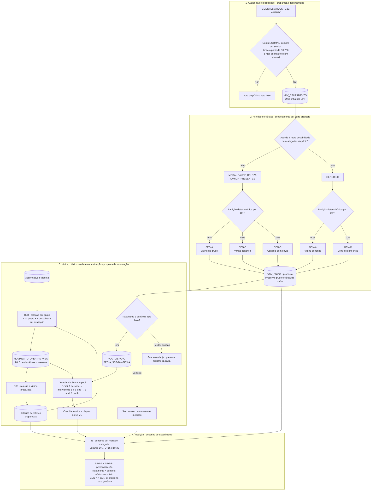
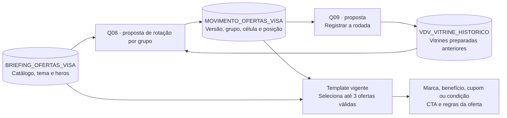
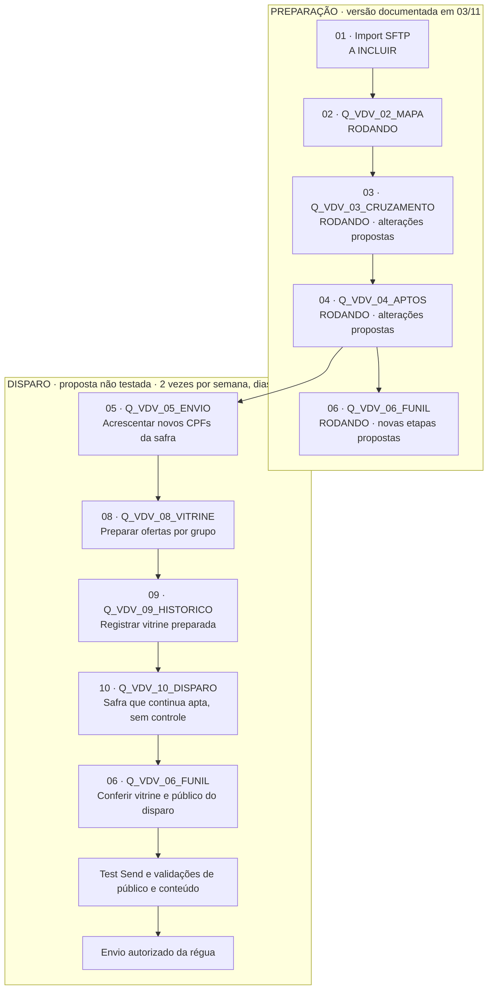

# Estratégia Pool de Ofertas Visa

O Pool aproxima o uso do cartão Afinz Visa das marcas e categorias em que o cliente já compra. A estratégia combina uma vitrine de benefícios do programa **Vai de Visa**, afinidade de compras e um teste com comunicação genérica e controle sem envio.

Esta página reúne a visão estratégica e a ficha técnica para preparar, criar e validar a operação. Os fluxos mostram a lógica completa; abra as fichas de DEs e atividades para consultar campos, ações e SQLs.

> **Estado da operação:** PREPARAÇÃO 02, 03, 04 e 06 rodou em 03/11. Alterações dessas queries e os passos 05, 08, 09 e 10 seguem **propostos, com SQL não testado**. Import automático 01 a incluir. Publicar esta documentação não ativa a operação no SFMC.

## 1. Intenção estratégica

**Frente:** Rentabilização → Incentivo ao uso. Queremos avaliar se a relevância da vitrine aumenta a compra com o cartão existente. O teste compara personalização e comunicação genérica dentro do público com afinidade; controles permitem avaliar o efeito do contato.

**Experiência desejada:** reconhecer uma vantagem relevante, entender como aproveitá-la e comprar na marca parceira com o cartão Visa. O catálogo pertence à Visa; a Afinz seleciona e comunica as ofertas.

**Escopo inicial:** B2C e B2B2C. Plurix/Cartonistas é evolução, com desenho de compartilhamento entre BUs ainda necessário. Este Pool não deve ser confundido com o Pool de Ofertas de Parceiros proprietários da Afinz.

## 2. O percurso completo: da base à medição

O mapa mantém a visão de conjunto. **Grupo** descreve afinidade; **célula** define o tratamento experimental. Estar apto ou ter uma vitrine preparada não comprova recebimento do e-mail.



Fonte: [[Automacao-VDV-Pool-de-Ofertas]] · [[Teste-Afinidade-MCC-vs-Generico]] · [[Rotacao-de-Ofertas-Vai-de-Visa]]. A regra 2 + 1 é a proposta escrita no SQL; a divisão final das posições continua aberta.

## 3. Quem entra e como o teste compara os públicos

O piso de limite pertence à seleção da audiência. O contrato vigente do catálogo não possui limite mínimo por oferta; não se deve aplicar ao card a antiga fórmula de ticket acrescido de 10%.

| Público | Célula | Parcela | Experiência |
|---|---|---|---|
| Com afinidade no piloto | SEG-A | 45% | Vitrine do grupo |
| Com afinidade no piloto | SEG-B | 45% | Vitrine genérica |
| Com afinidade no piloto | SEG-C | 10% | Sem comunicação do experimento |
| Genérico | GEN-A | 90% | Vitrine genérica |
| Genérico | GEN-C | 10% | Sem comunicação do experimento |

O piloto usa MODA, SAUDE_BELEZA, FAMILIA_PRESENTES e GENERICO. As etiquetas b1 a b7 são uma classificação mais ampla; não significam sete vitrines implantadas. A regra de classificação e os desempates ficam na ficha Q04 e em [[DE-VDV_APTOS]].

:::details Snapshot e leitura dos volumes · 03/11/2026
### Volumes históricos, não contagem em tempo real

130.175 CPFs aptos foi o resultado documentado da PREPARAÇÃO em 03/11. Os cortes intermediários registrados em [[Iniciativa-Pool-de-Ofertas-Vai-de-Visa]] incluem grãos por conta/cartão e CPF. Não devem ser apresentados como um funil sequencial reconciliado sem conferir esses grãos.

O arquivo de origem tem 66 linhas e 62 ofertas únicas segundo a nota do catálogo. A carga da Fábrica em 05/11 registrava 66 linhas de oferta, das quais 60 ativas, além de tema e heros. São recortes distintos e datados, não três contagens atuais equivalentes. Fonte: [[DE-BRIEFING_OFERTAS_VISA]] e [[Plano-de-Comunicacao-Pool-Vai-de-Visa]].
:::

## 4. A experiência editorial e a vitrine

**E-mail 1 · persona:** apresenta a campanha e a seleção de vantagens. **E-mail 2 · cartão:** reforça a oportunidade com o cartão em destaque, após **3 a 5 dias** (intervalo aprovado por Pablo em 06/11). A decisão de alternar V1/V2 na cadência perene de dois disparos semanais permanece distinta desse intervalo.

B2B2C com arte cadastrada usa o hero do parceiro nos dois toques. Sem arte do parceiro, usa o V2. Assunto e pré-cabeçalho V2 herdam os do V1 quando vazios. Diretrizes, mensagens e regras completas: [[Plano-de-Comunicacao-Pool-Vai-de-Visa]] e [[Emails-Dinamicos-Vai-de-Visa]].

O template mostra **até 3 ofertas válidas** e consulta até 6 posições. As demais servem de reserva; oferta inválida é pulada sem invalidar as outras. No desktop, o primeiro card fica centralizado quando o total é ímpar; no mobile, os cards ficam empilhados. **4 cards estão em avaliação, sem alteração do motor nesta entrega.**



A rotação é por grupo, não individual por CPF. A proposta prioriza tempo sem aparecer, vencimento e desconto; comparar descontos em reais e percentuais ainda exige ajuste. `GRUPO_2` não está vigente. O histórico proposto registra a vitrine preparada: envio efetivo deve ser conciliado com `_Sent`, e clique não comprova compra.

**Regras editoriais:** não apresentar benefícios como exclusivos da Afinz; não prometer até 40 dias para pagar; manter condições e vigência; oferta de bebida exige aviso legal. A ficha do Pool detalha a severidade de cada regra.

## 5. Mapa técnico das automações

BU pai **Banco Afinz: inferência forte nas evidências**, MID a confirmar. B2C e B2B2C são públicos de negócio, não nomes de BUs técnicas. DEs novas na pasta `POOL DE OFERTAS VISA`; `MAPA_MCC_ENTRADA` e `CLIENTES ATIVOS` em `Cartonistas`; automações em `my automations/MCC`.



Cada atividade dependente ocupa seu próprio passo. Q09 precede Q10 na ordem documentada; não tratar os dois como execução paralela. A antiga CONGELAR foi absorvida pelo desenho DISPARO. Fonte: [[Automacao-VDV-Pool-de-Ofertas]].

## 6. Ficha técnica das Data Extensions

Abra cada ficha para consultar o contrato de referência. **Tipos e tamanhos abaixo são documentação de configuração, não uma inspeção atual do tenant.** Confira a DE real antes de criar/importar. Campos propostos estão separados do contrato vigente; o catálogo da Fábrica permanece com 41 colunas.

:::details MAPA_MCC · conferir configuração e alterações propostas
### DE 1: `MAPA_MCC`

* **Finalidade:** Tabela tratada de transações agregadas nos últimos 12 meses por categoria de estabelecimento.
* **Sendable:** Não. **Chave Primária (PK):** `nr_conta`. **Atualização:** Overwrite (via query `Q_VDV_02_MAPA`).

| Campo | Tipo / Tamanho | PK | Obrigatório | Descrição / Regra de Negócio |
| :--- | :--- | :---: | :---: | :--- |
| `nr_conta` | Text(50) | Sim | Sim | Identificador numérico da conta cartão |
| `nr_cpf` | Text(50) | — | Sim | CPF vinculado à conta (para cruzamento) |
| `qtd_moda` | Number | — | Não | Quantidade de transações em Moda em 12 meses |
| `vlr_moda` | Decimal(18,2) | — | Não | Valor total transacionado em Moda em 12 meses |
| `dt_ultima_compra_moda` | Date | — | Não | Data da transação mais recente em Moda |
| `qtd_saude_beleza` | Number | — | Não | Quantidade de transações em Saúde/Beleza/Farmácia |
| `vlr_saude_beleza` | Decimal(18,2) | — | Não | Valor total transacionado em Saúde/Beleza |
| `dt_ultima_compra_saude_beleza` | Date | — | Não | Data da transação mais recente em Saúde/Beleza |
| `qtd_eletrodomesticos` | Number | — | Não | Quantidade de transações em Eletrodomésticos |
| `vlr_eletrodomesticos` | Decimal(18,2) | — | Não | Valor total transacionado em Eletrodomésticos |
| `dt_ultima_compra_eletrodomesticos`| Date | — | Não | Data da transação mais recente em Eletrodomésticos |
| `qtd_eletronicos` | Number | — | Não | Quantidade de transações em Eletrônicos |
| `vlr_eletronicos` | Decimal(18,2) | — | Não | Valor total transacionado em Eletrônicos |
| `dt_ultima_compra_eletronicos` | Date | — | Não | Data da transação mais recente em Eletrônicos |
| `qtd_brinquedos` | Number | — | Não | Quantidade de transações no segmento Infantil |
| `vlr_brinquedos` | Decimal(18,2) | — | Não | Valor total transacionado em Brinquedos |
| `dt_ultima_compra_brinquedos` | Date | — | Não | Data da transação mais recente em Brinquedos |
| `qtd_viagem` | Number | — | Não | Quantidade de transações em Turismo/Passagens |
| `vlr_viagem` | Decimal(18,2) | — | Não | Valor total transacionado em Viagem |
| `dt_ultima_compra_viagem` | Date | — | Não | Data da transação mais recente em Viagem |
| `qtd_pet` | Number | — | Não | Quantidade de transações em Pet Shops/Veterinários |
| `vlr_pet` | Decimal(18,2) | — | Não | Valor total transacionado em Pet |
| `dt_ultima_compra_pet` | Date | — | Não | Data da transação mais recente em Pet |
| `vlr_fora_mvp` | Decimal(18,2) | — | Não | Gastos em categorias fora dos grupos do piloto |
| `vlr_nao_mapeado` | Decimal(18,2) | — | Não | Gastos em estabelecimentos sem classificação de MCC |
| `DT_CARGA` | Date | — | Sim | Carimbo de data/hora do processamento (Brasília) |

Fonte canônica: [[DE-MAPA_MCC]].
:::

:::details VDV_CRUZAMENTO · conferir configuração e alterações propostas
### DE 2: `VDV_CRUZAMENTO`

* **Finalidade:** Base desduplicada por CPF com dados de contato, limite elegível e histórico transacional consolidado.
* **Sendable:** Não. **Chave Primária (PK):** `CPF`. **Atualização:** Overwrite (via query `Q_VDV_03_CRUZAMENTO`).

| Campo | Tipo / Tamanho | PK | Obrigatório | Descrição / Regra de Negócio |
| :--- | :--- | :---: | :---: | :--- |
| `CPF` | Text(50) | Sim | Sim | CPF limpo (apenas dígitos) |
| `PRI_NOME` | Text(50) | — | Não | Primeiro nome extraído do cadastro |
| `EMAIL` | EmailAddress | — | Sim | E-mail transacional higienizado |
| `NR_CELULAR` | Phone | — | Não | Telefone celular cadastrado com DDD |
| `FL_BLOQ_CELULAR` | Number | — | Sim | 1 se possui bloqueio para SMS/WhatsApp; 0 se liberado |
| `CANAL` | Text(50) | — | Sim | Canal de origem (`B2C` ou `B2B2C`) |
| `VL_LIMITE_DISPONIVEL` | Decimal(18,2) | — | Sim | Limite de crédito disponível na conta ativa |
| `DT_ULTIMA_COMPRA` | Date | — | Sim | Data da transação mais recente do cliente |
| `QT_MODA` | Number | — | Não | Soma de compras em Moda no CPF |
| `VL_MODA` | Decimal(18,2) | — | Não | Valor consolidado em Moda |
| `DT_ULT_MODA` | Date | — | Não | Data da última transação em Moda |
| `QT_SAUDE_BELEZA` | Number | — | Não | Soma de compras em Saúde/Beleza |
| `VL_SAUDE_BELEZA` | Decimal(18,2) | — | Não | Valor consolidado em Saúde/Beleza |
| `DT_ULT_SAUDE_BELEZA` | Date | — | Não | Data da última transação em Saúde/Beleza |
| `QT_ELETRODOM` | Number | — | Não | Soma de compras em Eletrodomésticos |
| `VL_ELETRODOM` | Decimal(18,2) | — | Não | Valor consolidado em Eletrodomésticos |
| `DT_ULT_ELETRODOM` | Date | — | Não | Data da última transação em Eletrodomésticos |
| `QT_ELETRONICOS` | Number | — | Não | Soma de compras em Eletrônicos |
| `VL_ELETRONICOS` | Decimal(18,2) | — | Não | Valor consolidado em Eletrônicos |
| `DT_ULT_ELETRONICOS` | Date | — | Não | Data da última transação em Eletrônicos |
| `QT_BRINQUEDOS` | Number | — | Não | Soma de compras em Brinquedos |
| `VL_BRINQUEDOS` | Decimal(18,2) | — | Não | Valor consolidado em Brinquedos |
| `DT_ULT_BRINQUEDOS` | Date | — | Não | Data da última transação em Brinquedos |
| `QT_VIAGEM` | Number | — | Não | Soma de compras em Viagem |
| `VL_VIAGEM` | Decimal(18,2) | — | Não | Valor consolidado em Viagem |
| `DT_ULT_VIAGEM` | Date | — | Não | Data da última transação em Viagem |
| `QT_PET` | Number | — | Não | Soma de compras em Pet |
| `VL_PET` | Decimal(18,2) | — | Não | Valor consolidado em Pet |
| `DT_ULT_PET` | Date | — | Não | Data da última transação em Pet |
| `VL_GASTO_12M` | Decimal(18,2) | — | Não | Volume financeiro total transacionado nos últimos 12m |

**Alteração proposta:** `NM_PARCEIRO` e `NM_CARTAO` ainda dependem da validação do campo de origem e dos SQLs alterados. Não confundir a estrutura proposta com a DE já criada.

Fonte canônica: [[DE-VDV_CRUZAMENTO]].
:::

:::details VDV_APTOS · conferir configuração e alterações propostas
### DE 3: `VDV_APTOS`

* **Finalidade:** Base de clientes aptos no dia com a classificação de grupo de afinidade e atribuição da célula de teste.
* **Sendable:** Não (contém registros de controle). **Chave Primária (PK):** `CPF`. **Atualização:** Overwrite (via query `Q_VDV_04_APTOS`).

| Campo | Tipo / Tamanho | PK | Obrigatório | Descrição / Regra de Negócio |
| :--- | :--- | :---: | :---: | :--- |
| `CPF` | Text(50) | Sim | Sim | CPF do cliente apto |
| `FIRST_NAME` | Text(50) | — | Não | Nome próprio tratado para personalização |
| `EMAIL` | EmailAddress | — | Sim | Endereço de e-mail |
| `NR_CELULAR` | Phone | — | Não | Telefone com DDD |
| `FL_BLOQ_CELULAR` | Number | — | Sim | Indicador de bloqueio em canais móveis |
| `CANAL` | Text(50) | — | Sim | `B2C` ou `B2B2C` |
| `VL_LIMITE_DISPONIVEL` | Decimal(18,2) | — | Sim | Limite no dia da execução |
| `DT_ULTIMA_COMPRA` | Date | — | Sim | Recência da última transação geral |
| `VL_GASTO_12M` | Decimal(18,2) | — | Não | Volume transacionado anual |
| `CD_GRUPO` | Text(50) | — | Sim | `MODA`, `SAUDE_BELEZA`, `FAMILIA_PRESENTES` ou `GENERICO` |
| `CD_GRUPO_SECUNDARIO`| Text(50) | — | Não | Segundo grupo com maior volume transacionado |
| `CD_REGRA_GRUPO` | Text(50) | — | Sim | Código da regra aplicada (`V1_12M_REC6M`) |
| `DS_CELULA_TESTE` | Text(20) | — | Sim | Célula atribuída: `SEG-A`, `SEG-B`, `SEG-C`, `GEN-A` ou `GEN-C` |
| `ID_SAFRA` | Text(50) | — | Sim | Identificador da safra ativa (ex.: `VDV_2026_11_BF`) |
| `DT_ATUALIZACAO` | Date | — | Sim | Data e hora do processamento da regra |

**Alteração proposta:** `NM_PARCEIRO` e `NM_CARTAO` ainda dependem da validação do campo de origem e dos SQLs alterados. Não confundir a estrutura proposta com a DE já criada.

Fonte canônica: [[DE-VDV_APTOS]].
:::

:::details VDV_ENVIO · conferir configuração e alterações propostas
### DE 4: `VDV_ENVIO`

* **Finalidade:** Repositório congelado de todos os clientes que ingressaram na safra, incluindo os grupos de controle (*holdout*). Serve de insumo para auditoria e cálculo de ROI pela IN.
* **Sendable:** Sim (`CPF` $\to$ Chave de Assinante). **Chave Primária (PK):** `CPF` + `ID_SAFRA`. **Atualização:** Update/Insert sem overwrite (via query `Q_VDV_05_ENVIO`).

| Campo | Tipo / Tamanho | PK | Obrigatório | Descrição / Regra de Negócio |
| :--- | :--- | :---: | :---: | :--- |
| `CPF` | Text(50) | Sim | Sim | CPF do assinante |
| `ID_SAFRA` | Text(50) | Sim | Sim | Código imutável da safra |
| `FIRST_NAME` | Text(50) | — | Não | Nome no momento do congelamento |
| `EMAIL` | EmailAddress | — | Sim | Endereço de e-mail |
| `NR_CELULAR` | Phone | — | Não | Telefone celular |
| `LOCALE` | Locale | — | Sim | Fixado em `BR` |
| `FL_BLOQ_CELULAR` | Number | — | Sim | Bloqueio celular na data de entrada |
| `CANAL` | Text(50) | — | Sim | Canal de origem do cliente |
| `VL_LIMITE_DISPONIVEL` | Decimal(18,2) | — | Sim | Limite capturado no dia do ingresso |
| `CD_GRUPO` | Text(50) | — | Sim | Grupo de afinidade congelado |
| `CD_GRUPO_SECUNDARIO`| Text(50) | — | Não | Grupo secundário congelado |
| `DS_CELULA_TESTE` | Text(20) | — | Sim | Célula experimental congelada |
| `ID_VERSAO_OFERTAS` | Text(50) | — | Sim | Versão da vitrine de conteúdo (ex.: `BF26_V1`) |
| `ID_ENVIO` | Text(36) | — | Sim | UUID aleatório gerado para tokenização de links/LPs |
| `DT_ENTRADA` | Date | — | Sim | Data e hora de inclusão na safra |
| `DT_ENVIO` | Date | — | Sim | Data calendário de autorização do envio |

**Alteração proposta:** `NM_PARCEIRO` e `NM_CARTAO` ainda dependem da validação do campo de origem e dos SQLs alterados. Não confundir a estrutura proposta com a DE já criada.

Fonte canônica: [[DE-VDV_ENVIO]].
:::

:::details VDV_DISPARO · proposta; validar antes de criar
### DE 5: `VDV_DISPARO`

* **Finalidade:** Tabela de audiência efetiva consumida pelo disparo do e-mail no SFMC. Contém apenas os clientes da safra que permanecem aptos na data do envio e exclui o grupo de controle.
* **Sendable:** Sim (`CPF` $\to$ Chave de Assinante). **Chave Primária (PK):** `CPF`. **Atualização:** Overwrite a cada disparo (via query `Q_VDV_10_DISPARO`).

| Campo | Tipo / Tamanho | PK | Obrigatório | Descrição / Regra de Negócio |
| :--- | :--- | :---: | :---: | :--- |
| `CPF` | Text(50) | Sim | Sim | CPF do assinante |
| `ID_SAFRA` | Text(50) | — | Sim | Safra da qual o cliente faz parte |
| `FIRST_NAME` | Text(50) | — | Não | Primeiro nome atualizado |
| `EMAIL` | EmailAddress | — | Sim | E-mail válido e ativo no dia |
| `NR_CELULAR` | Phone | — | Não | Celular |
| `LOCALE` | Locale | — | Sim | `BR` |
| `FL_BLOQ_CELULAR` | Number | — | Sim | Indicador de bloqueio celular |
| `CANAL` | Text(50) | — | Sim | Canal |
| `NM_PARCEIRO` | Text(100) | — | Não | Nome do parceiro para hero dinâmico |
| `NM_CARTAO` | Text(100) | — | Não | Nome do cartão para textos dinâmicos |
| `VL_LIMITE_DISPONIVEL` | Decimal(18,2) | — | Sim | Limite recalculado no dia |
| `CD_GRUPO` | Text(50) | — | Sim | Grupo herdado da `VDV_ENVIO` (imutável) |
| `CD_GRUPO_SECUNDARIO`| Text(50) | — | Não | Grupo secundário herdado da `VDV_ENVIO` |
| `DS_CELULA_TESTE` | Text(20) | — | Sim | Célula herdada (`SEG-A`, `SEG-B` ou `GEN-A`) |
| `ID_VERSAO_OFERTAS` | Text(50) | — | Sim | Versão da vitrine ativa |
| `ID_ENVIO` | Text(36) | — | Sim | Identificador opaco de tracking |
| `DT_DISPARO` | Date | — | Sim | Data do envio do lote |

Fonte canônica: [[DE-VDV_DISPARO]].
:::

:::details BRIEFING_OFERTAS_VISA · conferir configuração e alterações propostas
### BRIEFING_OFERTAS_VISA · contrato vigente de 41 colunas

PK `ID`; não sendable. Uma linha OFERTA, TEMA ou HERO.

| Campo | Tipo / tamanho de referência | PK | Obrigatório | Uso |
|---|---|---|---|---|
| `ID` | Text(60) | Sim | Sim | Chave única (ex.: `NOV26_PUMA`, `TEMA_BF26_V1`) |
| `TIPO` | Text(20) | — | Sim | `OFERTA`, `TEMA` ou `HERO` |
| `VERSAO` | Text(30) | — | Sim | Código de versão da peça (ex.: `BF26_V1`) |
| `ATIVA` | Boolean | — | Sim | Indicador de oferta vigente (1 = Ativa; 0 = Inativa) |
| `INICIO` | Date | — | Sim | Início do período de validade |
| `FIM` | Date | — | Sim | Término do período de validade |
| `MARCA` | Text(100) | — | Não | Nome comercial da loja parceira |
| `GRUPO` | Text(50) | — | Não | Categoria primária (`MODA`, `SAUDE_BELEZA`, etc.) |
| `LOGO` | Text(500) | — | Não | URL HTTPS pública do logo no Content Builder |
| `FOTO` | Text(500) | — | Não | URL HTTPS pública da imagem de fundo do card |
| `ALT` | Text(200) | — | Não | Texto alternativo de acessibilidade |
| `PREFIXO` | Text(50) | — | Não | Texto de apoio ao valor (ex.: "Até") |
| `VALOR` | Text(50) | — | Não | Expressão do benefício (ex.: "15%", "R$ 100") |
| `SUFIXO` | Text(50) | — | Não | Complemento curto (ex.: "OFF") |
| `COMPLEMENTO` | Text(200) | — | Não | Escopo da promoção (ex.: "em todo o site") |
| `COR` | Text(10) | — | Não | Código HEX da cor da marca para o valor |
| `RESGATE` | Text(30) | — | Não | Mecânica: `CUPOM`, `LINK` ou `PAGAR_COM_VISA` |
| `CUPOM` | Text(50) | — | Não | Código alfanumérico do voucher promocional |
| `LINK` | Text(500) | — | Não | Link de afiliado / redirecionamento rastreado |
| `CONDICOES` | Text(500) | — | Não | Regras de uso e avisos legais obrigatórios |
| `HERO` | Text(50) | — | Não | Identificador da arte hero (para linhas de HERO) |
| `HERO_IMG` | Text(500) | — | Não | URL HTTPS da imagem de cabeçalho |
| `HERO_ALT` | Text(200) | — | Não | Texto descritivo do hero |
| `HERO_LINK` | Text(500) | — | Não | URL de destino do clique no hero |
| `NOME_CARTAO` | Text(100) | — | Não | Grafia padronizada do produto associado ao hero |
| `TEMA` | Text(100) | — | Não | Título institucional da campanha |
| `ASSUNTO` | Text(200) | — | Não | Linha de assunto do E-mail 1 (V1) |
| `PREHEADER` | Text(200) | — | Não | Pré-cabeçalho do E-mail 1 (V1) |
| `ASSUNTO_V2` | Text(200) | — | Não | Linha de assunto do E-mail 2 (V2) |
| `PREHEADER_V2` | Text(200) | — | Não | Pré-cabeçalho do E-mail 2 (V2) |
| `SAUDACAO` | Text(100) | — | Não | Texto de saudação dinâmico com tag `{NOME}` |
| `SAUDACAO_SEM_NOME` | Text(100) | — | Não | Saudação padrão para cadastros sem nome |
| `INTRO` | Text(500) | — | Não | Parágrafo introdutório do corpo da mensagem |
| `CARTAO_PADRAO` | Text(100) | — | Não | Nome padrão do cartão para fallback |
| `CTA` | Text(50) | — | Não | Rótulo dos botões dos cards (ex.: "Aproveitar oferta") |
| `TITULO_CONDICOES` | Text(100) | — | Não | Título da seção de rodapé legal |
| `RODAPE_CONDICOES` | Text(1000) | — | Não | Texto jurídico de termos e condições |
| `COR_FUNDO` | Text(10) | — | Não | Código HEX de fundo do template |
| `COR_TEXTO` | Text(10) | — | Não | Código HEX de texto principal |
| `COR_TITULO` | Text(10) | — | Não | Código HEX dos cabeçalhos |
| `COR_TEMA` | Text(10) | — | Não | Código HEX da cor de destaque da campanha |

**Extensões propostas, fora das 41 colunas:** `GRUPO_2`, `SAFRA` e eventual `DESTAQUE`. Limite mínimo por oferta saiu do contrato; não criar `VL_LIMITE_EXIGIDO` a partir da versão anterior desta página.

Fonte canônica: [[DE-BRIEFING_OFERTAS_VISA]].
:::

:::details MOVIMENTO_OFERTAS_VISA · conferir configuração e alterações propostas
### DE 7: `MOVIMENTO_OFERTAS_VISA`

* **Finalidade:** Vitrine resolvida para o disparo corrente. Determina qual oferta de `BRIEFING_OFERTAS_VISA` ocupa cada posição em cada grupo e célula.
* **Sendable:** Não. **Chave Primária (PK):** `VERSAO` + `GRUPO` + `CELULA` + `POSICAO`. **Atualização:** Overwrite a cada disparo (via query `Q_VDV_08_VITRINE`).

| Campo | Tipo / Tamanho | PK | Obrigatório | Descrição / Regra de Negócio |
| :--- | :--- | :---: | :---: | :--- |
| `VERSAO` | Text(30) | Sim | Sim | Versão da campanha (ex.: `BF26_V1`) |
| `GRUPO` | Text(50) | Sim | Sim | Grupo de afinidade (`MODA`, `GENERICO`, etc.) |
| `CELULA` | Text(20) | Sim | Sim | `TODAS` ou célula específica em caso de teste A/B de vitrine |
| `POSICAO` | Number | Sim | Sim | Slot ocupado no template (1 a 6) |
| `OFERTA_ID` | Text(60) | — | Sim | Código de referência da oferta no acervo mestre |
| `ATIVA` | Boolean | — | Sim | Indicador de disponibilidade da vitrine |

Contrato vigente da Fábrica: `VERSAO, GRUPO, CELULA, POSICAO, OFERTA_ID, ATIVA`. `MOTIVO` é extensão proposta; não incluir silenciosamente no CSV de seis colunas.

Fonte canônica: [[DE-MOVIMENTO_OFERTAS_VISA]].
:::

:::details VDV_VITRINE_HISTORICO · proposta; validar antes de criar
### VDV_VITRINE_HISTORICO · estrutura proposta


PK `DT_DISPARO + VERSAO + GRUPO + CELULA + POSICAO`.

| Campo | Tipo | Uso |
|---|---|---|
| `DT_DISPARO` | Date, PK | dia do disparo (Brasília) |
| `VERSAO` | Text 20, PK | versão de conteúdo (tema), ex. `BF26_V1` |
| `GRUPO` | Text 30, PK | grupo da vitrine (`MODA`, `GENERICO`…) |
| `CELULA` | Text 10, PK | `TODAS` ou célula de teste |
| `POSICAO` | Number, PK | 1 a 6 |
| `OFERTA_ID` | Text 60 | `ID` da oferta no acervo |
| `MOTIVO` | Text 20 | `GRUPO` · `GRUPO_2` · `DESCOBERTA` · `COMPLETAR` |
| `FL_EXIBIDA` | Number | 1 se a posição é mostrada pelo template (hoje, 1 a 3); 0 se é reserva |
| `DT_REGISTRO` | Date | data e hora da gravação |

Ação da query (`Q_VDV_09_HISTORICO`): **Atualizar** (acumula; rodar duas vezes no mesmo dia regrava as mesmas chaves).


Registra a vitrine preparada, não recebimento individual comprovado. A homologação precisa avaliar reservas efetivamente usadas pelo template.

Fonte canônica: [[DE-VDV_VITRINE_HISTORICO]].
:::

:::details VDV_FUNIL · conferir configuração e alterações propostas
### DE 9: `VDV_FUNIL`

* **Finalidade:** Monitoramento da volumetria, balanceamento das células de teste e alertas de saúde das execuções.
* **Sendable:** Não. **Chave Primária (PK):** `DT_EXECUCAO` + `ETAPA`. **Atualização:** Insert/Update cumulativo (via query `Q_VDV_06_FUNIL`).

| Campo | Tipo / Tamanho | PK | Obrigatório | Descrição / Regra de Negócio |
| :--- | :--- | :---: | :---: | :--- |
| `DT_EXECUCAO` | Date | Sim | Sim | Data da rodada de cálculo |
| `ETAPA` | Text(50) | Sim | Sim | Nome da etapa auditada (`TOTAL_BASE`, `NORMAL`, `APTOS`, etc.) |
| `QUANTIDADE` | Number | — | Sim | Contagem de registros |
| `PCT_ETAPA_ANTERIOR` | Decimal(5,2) | — | Não | Percentual de retenção em relação ao degrau anterior |
| `DETALHE` | Text(500) | — | Não | Distribuição por canal ou segmento |
| `STATUS_ALERTA` | Text(20) | — | Sim | `OK`, `AVISO` ou `CRITICO` |

Fonte canônica: [[DE-VDV_FUNIL]].
:::

## 7. Ficha técnica das atividades e SQLs

As queries são referências documentais, sem execução pelo GaaS. Versões vigentes e propostas aparecem separadas. As consultas de conferência ficam junto do SQL do passo.

:::details 01 · IMP_VDV_01_MAPA_ENTRADA · a incluir
### IMP_VDV_01_MAPA_ENTRADA

**Destino:** `MAPA_MCC_ENTRADA` · **Ação:** Overwrite · **Estado:** a incluir.

Importa texto do SFTP. O import automático ainda está fora da automação; mudança no SFTP não garante atualização.

Fonte: [[04-Operacao/Automacao-VDV-Pool-de-Ofertas]].

Configurar import do SFTP IN como texto, delimitador `;`, aspas duplas. Destino `MAPA_MCC_ENTRADA`. Confirmar nome/padrão do arquivo, agendamento e configuração da transferência antes de incluir. O schema bruto e o SQL de conversão estão em [[DE-MAPA_MCC]].

:::

:::details 02 · Q_VDV_02_MAPA · rodando
### Q_VDV_02_MAPA

**Destino:** `MAPA_MCC` · **Ação:** Overwrite · **Estado:** rodando.

Converte decimais, quantidades e datas brasileiras. TRY_CONVERT evita interromper a query por campo sujo; conferir nulos e valores após a carga.

Fonte: [[02-Entidades-Dados/SFMC/DE-MAPA_MCC]].

#### Versão documentada e consultas de conferência

```sql
-- Fonte: VDV_Automacao_Preparacao.pdf, página 5, 03/11/2026.
-- Referência documental, não executada pelo GaaS.
SELECT
  r.nr_conta,
  r.nr_cpf,
  r.ds_parceiro,
  TRY_CONVERT(DECIMAL(18,2), REPLACE(REPLACE(NULLIF(LTRIM(RTRIM(r.vlr_moda)),''),'.',''),',','.')) AS
vlr_moda,
  TRY_CONVERT(INT, TRY_CONVERT(DECIMAL(18,2),
REPLACE(REPLACE(NULLIF(LTRIM(RTRIM(r.qtd_moda)),''),'.',''),',','.'))) AS qtd_moda,
  TRY_CONVERT(DATE, NULLIF(LEFT(LTRIM(r.dt_ultima_compra_moda),10),''), 103) AS dt_ultima_compra_moda,
  TRY_CONVERT(DECIMAL(18,2), REPLACE(REPLACE(NULLIF(LTRIM(RTRIM(r.vlr_saude_beleza)),''),'.',''),',','.')) AS
vlr_saude_beleza,
  TRY_CONVERT(INT, TRY_CONVERT(DECIMAL(18,2),
REPLACE(REPLACE(NULLIF(LTRIM(RTRIM(r.qtd_saude_beleza)),''),'.',''),',','.'))) AS qtd_saude_beleza,
  TRY_CONVERT(DATE, NULLIF(LEFT(LTRIM(r.dt_ultima_compra_saude_beleza),10),''), 103) AS
dt_ultima_compra_saude_beleza,
  TRY_CONVERT(DECIMAL(18,2), REPLACE(REPLACE(NULLIF(LTRIM(RTRIM(r.vlr_eletrodomesticos)),''),'.',''),',','.'))
AS vlr_eletrodomesticos,
  TRY_CONVERT(INT, TRY_CONVERT(DECIMAL(18,2),
REPLACE(REPLACE(NULLIF(LTRIM(RTRIM(r.qtd_eletrodomesticos)),''),'.',''),',','.'))) AS qtd_eletrodomesticos,
  TRY_CONVERT(DATE, NULLIF(LEFT(LTRIM(r.dt_ultima_compra_eletrodomesticos),10),''), 103) AS
dt_ultima_compra_eletrodomesticos,
  TRY_CONVERT(DECIMAL(18,2), REPLACE(REPLACE(NULLIF(LTRIM(RTRIM(r.vlr_eletronicos)),''),'.',''),',','.')) AS
vlr_eletronicos,
  TRY_CONVERT(INT, TRY_CONVERT(DECIMAL(18,2),
REPLACE(REPLACE(NULLIF(LTRIM(RTRIM(r.qtd_eletronicos)),''),'.',''),',','.'))) AS qtd_eletronicos,
  TRY_CONVERT(DATE, NULLIF(LEFT(LTRIM(r.dt_ultima_compra_eletronicos),10),''), 103) AS
dt_ultima_compra_eletronicos,
  TRY_CONVERT(DECIMAL(18,2), REPLACE(REPLACE(NULLIF(LTRIM(RTRIM(r.vlr_brinquedos)),''),'.',''),',','.')) AS
vlr_brinquedos,
  TRY_CONVERT(INT, TRY_CONVERT(DECIMAL(18,2),
REPLACE(REPLACE(NULLIF(LTRIM(RTRIM(r.qtd_brinquedos)),''),'.',''),',','.'))) AS qtd_brinquedos,
  TRY_CONVERT(DATE, NULLIF(LEFT(LTRIM(r.dt_ultima_compra_brinquedos),10),''), 103) AS
dt_ultima_compra_brinquedos,
  TRY_CONVERT(DECIMAL(18,2), REPLACE(REPLACE(NULLIF(LTRIM(RTRIM(r.vlr_viagem)),''),'.',''),',','.')) AS
vlr_viagem,
  TRY_CONVERT(INT, TRY_CONVERT(DECIMAL(18,2),
REPLACE(REPLACE(NULLIF(LTRIM(RTRIM(r.qtd_viagem)),''),'.',''),',','.'))) AS qtd_viagem,
  TRY_CONVERT(DATE, NULLIF(LEFT(LTRIM(r.dt_ultima_compra_viagem),10),''), 103) AS dt_ultima_compra_viagem,
  TRY_CONVERT(DECIMAL(18,2), REPLACE(REPLACE(NULLIF(LTRIM(RTRIM(r.vlr_pet)),''),'.',''),',','.')) AS vlr_pet,
  TRY_CONVERT(INT, TRY_CONVERT(DECIMAL(18,2),
REPLACE(REPLACE(NULLIF(LTRIM(RTRIM(r.qtd_pet)),''),'.',''),',','.'))) AS qtd_pet,
  TRY_CONVERT(DATE, NULLIF(LEFT(LTRIM(r.dt_ultima_compra_pet),10),''), 103) AS dt_ultima_compra_pet,
  TRY_CONVERT(DECIMAL(18,2), REPLACE(REPLACE(NULLIF(LTRIM(RTRIM(r.vlr_fora_mvp)),''),'.',''),',','.')) AS
vlr_fora_mvp,
  TRY_CONVERT(INT, TRY_CONVERT(DECIMAL(18,2),
REPLACE(REPLACE(NULLIF(LTRIM(RTRIM(r.qtd_fora_mvp)),''),'.',''),',','.'))) AS qtd_fora_mvp,
  TRY_CONVERT(DATE, NULLIF(LEFT(LTRIM(r.dt_ultima_compra_fora_mvp),10),''), 103) AS dt_ultima_compra_fora_mvp,
  TRY_CONVERT(DECIMAL(18,2), REPLACE(REPLACE(NULLIF(LTRIM(RTRIM(r.vlr_nao_mapeado)),''),'.',''),',','.')) AS
vlr_nao_mapeado,
  TRY_CONVERT(INT, TRY_CONVERT(DECIMAL(18,2),
REPLACE(REPLACE(NULLIF(LTRIM(RTRIM(r.qtd_nao_mapeado)),''),'.',''),',','.'))) AS qtd_nao_mapeado,
  TRY_CONVERT(DATE, NULLIF(LEFT(LTRIM(r.dt_ultima_compra_nao_mapeado),10),''), 103) AS
dt_ultima_compra_nao_mapeado,
  DATEADD(HOUR, 3, GETDATE()) AS DT_CARGA
FROM MAPA_MCC_ENTRADA r
```

```sql
SELECT
  COUNT(*) AS linhas,
  MIN(dt_ultima_compra_moda) AS dt_min_moda,
  MAX(dt_ultima_compra_moda) AS dt_max_moda,
  SUM(CASE WHEN vlr_moda > 0 THEN 1 ELSE 0 END) AS compradores_moda,
  SUM(CASE WHEN vlr_saude_beleza > 0 THEN 1 ELSE 0 END) AS compradores_saude,
  SUM(CASE WHEN LEN(nr_cpf) = 11 THEN 1 ELSE 0 END) AS cpf_11dig
FROM MAPA_MCC
```

```sql
SELECT MAX(vlr_moda) AS max_moda,
  SUM(CASE WHEN vlr_moda - FLOOR(vlr_moda) > 0 THEN 1 ELSE 0 END) AS com_centavos
FROM MAPA_MCC
```

:::

:::details 03 · Q_VDV_03_CRUZAMENTO · rodando
### Q_VDV_03_CRUZAMENTO

**Destino:** `VDV_CRUZAMENTO` · **Ação:** Overwrite · **Estado:** rodando.

Reduz a base a um CPF e aplica status, compra em 30 dias, limite de R$ 200 e bloqueios. Parceiro e nome do cartão são acréscimos propostos.

Fonte: [[02-Entidades-Dados/SFMC/DE-VDV_CRUZAMENTO]].

#### Versão documentada e consultas de conferência

```sql
SELECT
  e.CPF, e.PRI_NOME, e.EMAIL, e.NR_CELULAR, e.FL_BLOQ_CELULAR, e.CANAL,
  e.VL_LIMITE_DISPONIVEL, e.DT_ULTIMA_COMPRA,
  m.QT_MODA, m.VL_MODA, m.DT_ULT_MODA,
  m.QT_SAUDE_BELEZA, m.VL_SAUDE_BELEZA, m.DT_ULT_SAUDE_BELEZA,
  m.QT_ELETRODOM, m.VL_ELETRODOM, m.DT_ULT_ELETRODOM,
  m.QT_ELETRONICOS, m.VL_ELETRONICOS, m.DT_ULT_ELETRONICOS,
  m.QT_BRINQUEDOS, m.VL_BRINQUEDOS, m.DT_ULT_BRINQUEDOS,
  m.QT_VIAGEM, m.VL_VIAGEM, m.DT_ULT_VIAGEM,
  m.QT_PET, m.VL_PET, m.DT_ULT_PET,
  m.VL_GASTO_12M
FROM (
  SELECT a.CPF,
    MAX(a.PRI_NOME) AS PRI_NOME,
    MAX(a.EMAIL) AS EMAIL,
    MAX(a.NR_CELULAR) AS NR_CELULAR,
    MAX(CASE WHEN a.bloqueio_celular = 1 THEN 1 ELSE 0 END) AS FL_BLOQ_CELULAR,
    MAX(a.CANAL) AS CANAL,
    MAX(CASE WHEN a.STATUS = 'NORMAL' THEN a.LIMITE_DISPONIVEL END) AS VL_LIMITE_DISPONIVEL,
    MAX(a.DATA_ULTIMA_COMPRA) AS DT_ULTIMA_COMPRA
  FROM [CLIENTES ATIVOS] a
  WHERE a.CANAL IN ('B2C','B2B2C')
  GROUP BY a.CPF
  HAVING
    MAX(CASE WHEN a.STATUS = 'NORMAL' AND a.DATA_ULTIMA_COMPRA >= DATEADD(DAY,-30,CONVERT(DATE,GETDATE())) AND a.LIMITE_DISPONIVEL >= 200 THEN 1 ELSE 0 END) = 1
    AND MAX(CASE WHEN a.bloqueio_email = 1 THEN 1 ELSE 0 END) = 0
    AND MAX(CASE WHEN a.STATUS IN ('BLOQUEADO ATRASO') THEN 1 ELSE 0 END) = 0
    AND MAX(LEN(a.EMAIL)) > 0
) e
LEFT JOIN (
  SELECT c.CPF,
    SUM(mp.qtd_moda) AS QT_MODA, SUM(mp.vlr_moda) AS VL_MODA, MAX(mp.dt_ultima_compra_moda) AS DT_ULT_MODA,
    SUM(mp.qtd_saude_beleza) AS QT_SAUDE_BELEZA, SUM(mp.vlr_saude_beleza) AS VL_SAUDE_BELEZA, MAX(mp.dt_ultima_compra_saude_beleza) AS DT_ULT_SAUDE_BELEZA,
    SUM(mp.qtd_eletrodomesticos) AS QT_ELETRODOM, SUM(mp.vlr_eletrodomesticos) AS VL_ELETRODOM, MAX(mp.dt_ultima_compra_eletrodomesticos) AS DT_ULT_ELETRODOM,
    SUM(mp.qtd_eletronicos) AS QT_ELETRONICOS, SUM(mp.vlr_eletronicos) AS VL_ELETRONICOS, MAX(mp.dt_ultima_compra_eletronicos) AS DT_ULT_ELETRONICOS,
    SUM(mp.qtd_brinquedos) AS QT_BRINQUEDOS, SUM(mp.vlr_brinquedos) AS VL_BRINQUEDOS, MAX(mp.dt_ultima_compra_brinquedos) AS DT_ULT_BRINQUEDOS,
    SUM(mp.qtd_viagem) AS QT_VIAGEM, SUM(mp.vlr_viagem) AS VL_VIAGEM, MAX(mp.dt_ultima_compra_viagem) AS DT_ULT_VIAGEM,
    SUM(mp.qtd_pet) AS QT_PET, SUM(mp.vlr_pet) AS VL_PET, MAX(mp.dt_ultima_compra_pet) AS DT_ULT_PET,
    SUM(ISNULL(mp.vlr_moda,0) + ISNULL(mp.vlr_saude_beleza,0) + ISNULL(mp.vlr_eletrodomesticos,0) + ISNULL(mp.vlr_eletronicos,0) + ISNULL(mp.vlr_brinquedos,0) + ISNULL(mp.vlr_viagem,0) + ISNULL(mp.vlr_pet,0) + ISNULL(mp.vlr_fora_mvp,0) + ISNULL(mp.vlr_nao_mapeado,0)) AS VL_GASTO_12M
  FROM (SELECT DISTINCT CPF, NR_CONTA FROM [CLIENTES ATIVOS]) c
  INNER JOIN MAPA_MCC mp ON c.NR_CONTA = mp.nr_conta
  GROUP BY c.CPF
) m ON e.CPF = m.CPF
```

#### Proposta · SQL não testado

```sql
-- Q_VDV_03_CRUZAMENTO: o que muda (resto da query igual à nota [[DE-VDV_CRUZAMENTO]])
-- a) SELECT de fora, depois de e.CANAL:
  e.NM_PARCEIRO, e.NM_CARTAO,
-- b) subquery "e", depois de MAX(a.CANAL) AS CANAL:
    MAX(CASE WHEN a.CANAL = 'B2B2C' AND a.STATUS = 'NORMAL' THEN UPPER(LTRIM(RTRIM(a.PRODUTO))) END) AS NM_PARCEIRO,
    MAX(CASE WHEN a.CANAL = 'B2B2C' AND a.STATUS = 'NORMAL' THEN LTRIM(RTRIM(a.ORIGEM)) END) AS NM_CARTAO,
-- a.ORIGEM é provisório: trocar pela coluna confirmada na query 0 (Query Studio).
```

```sql
-- Query 0 (Query Studio): como parceiro e cartão aparecem na base
SELECT TOP 300
  UPPER(LTRIM(RTRIM(a.PRODUTO))) AS PRODUTO, a.ORIGEM, a.DESCRICAO_PRODUTO, a.FL_WHITELABEL,
  COUNT(*) AS QTD_LINHAS
FROM [CLIENTES ATIVOS] a
WHERE a.CANAL = 'B2B2C' AND a.STATUS = 'NORMAL'
GROUP BY UPPER(LTRIM(RTRIM(a.PRODUTO))), a.ORIGEM, a.DESCRICAO_PRODUTO, a.FL_WHITELABEL
ORDER BY QTD_LINHAS DESC
```

:::

:::details 04 · Q_VDV_04_APTOS · rodando
### Q_VDV_04_APTOS

**Destino:** `VDV_APTOS` · **Ação:** Overwrite · **Estado:** rodando.

Versão de 03/11 em operação. Safra vinda do tema, parceiro e nome do cartão são mudanças propostas. O SQL novo também dá prioridade a FAMILIA_PRESENTES; conferir antes de substituir.

Fonte: [[02-Entidades-Dados/SFMC/DE-VDV_APTOS]].

#### Versão documentada e consultas de conferência

```sql
SELECT
  b.CPF, b.PRI_NOME AS FIRST_NAME, b.EMAIL, b.NR_CELULAR, b.FL_BLOQ_CELULAR, b.CANAL,
  b.VL_LIMITE_DISPONIVEL, b.DT_ULTIMA_COMPRA, b.VL_GASTO_12M,
  ISNULL(g.G1, 'GENERICO') AS CD_GRUPO,
  g.G2 AS CD_GRUPO_SECUNDARIO,
  'V1_12M_REC6M' AS CD_REGRA_GRUPO,
  CASE
    WHEN ABS(CHECKSUM(b.CPF + 'VDV_CONTROLE') % 100) >= 90
      THEN CASE WHEN g.G1 IS NULL THEN 'GEN-C' ELSE 'SEG-C' END
    WHEN g.G1 IS NULL THEN 'GEN-A'
    WHEN ABS(CHECKSUM(b.CPF + 'VDV_2026_11_BF') % 2) = 0 THEN 'SEG-A'
    ELSE 'SEG-B'
  END AS DS_CELULA_TESTE,
  'VDV_2026_11_BF' AS ID_SAFRA,
  DATEADD(HOUR, 3, GETDATE()) AS DT_ATUALIZACAO
FROM VDV_CRUZAMENTO b
LEFT JOIN (
  SELECT r.CPF,
    MAX(CASE WHEN r.RN = 1 THEN r.GRUPO END) AS G1,
    MAX(CASE WHEN r.RN = 2 THEN r.GRUPO END) AS G2
  FROM (
    SELECT u.CPF, u.GRUPO,
      ROW_NUMBER() OVER (PARTITION BY u.CPF ORDER BY u.QT DESC, u.VL DESC, u.PRIORIDADE ASC) AS RN
    FROM (
      SELECT c.CPF, 'MODA' AS GRUPO, c.QT_MODA AS QT, c.VL_MODA AS VL, 1 AS PRIORIDADE
      FROM VDV_CRUZAMENTO c
      WHERE c.QT_MODA >= 2 AND c.DT_ULT_MODA >= DATEADD(MONTH, -6, CAST(GETDATE() AS DATE))
      UNION ALL
      SELECT c.CPF, 'SAUDE_BELEZA', c.QT_SAUDE_BELEZA, c.VL_SAUDE_BELEZA, 2
      FROM VDV_CRUZAMENTO c
      WHERE c.QT_SAUDE_BELEZA >= 2 AND c.DT_ULT_SAUDE_BELEZA >= DATEADD(MONTH, -6, CAST(GETDATE() AS DATE))
      UNION ALL
      SELECT c.CPF, 'FAMILIA_PRESENTES', c.QT_BRINQUEDOS, c.VL_BRINQUEDOS, 3
      FROM VDV_CRUZAMENTO c
      WHERE c.QT_BRINQUEDOS >= 2
    ) u
  ) r
  GROUP BY r.CPF
) g ON b.CPF = g.CPF
```

#### Proposta · SQL não testado

```sql
-- Q_VDV_04_APTOS · destino VDV_APTOS · Overwrite
-- Muda em relação à versão de 03/11: NM_PARCEIRO e NM_CARTAO; safra vinda do TEMA vigente
-- (o sorteio A/B usa a safra como semente; com SAFRA = 'VDV_2026_11_BF' o resultado é o mesmo de hoje).
SELECT
  b.CPF, b.PRI_NOME AS FIRST_NAME, b.EMAIL, b.NR_CELULAR, b.FL_BLOQ_CELULAR, b.CANAL,
  b.NM_PARCEIRO, b.NM_CARTAO,
  b.VL_LIMITE_DISPONIVEL, b.DT_ULTIMA_COMPRA, b.VL_GASTO_12M,
  ISNULL(g.G1, 'GENERICO') AS CD_GRUPO,
  g.G2 AS CD_GRUPO_SECUNDARIO,
  'V1_12M_REC6M' AS CD_REGRA_GRUPO,
  CASE
    WHEN ABS(CHECKSUM(b.CPF + 'VDV_CONTROLE') % 100) >= 90
      THEN CASE WHEN g.G1 IS NULL THEN 'GEN-C' ELSE 'SEG-C' END
    WHEN g.G1 IS NULL THEN 'GEN-A'
    WHEN ABS(CHECKSUM(b.CPF + t.SAFRA) % 2) = 0 THEN 'SEG-A'
    ELSE 'SEG-B'
  END AS DS_CELULA_TESTE,
  t.SAFRA AS ID_SAFRA,
  DATEADD(HOUR, 3, GETDATE()) AS DT_ATUALIZACAO
FROM VDV_CRUZAMENTO b
CROSS JOIN (
  SELECT TOP 1 x.VERSAO, x.SAFRA
  FROM BRIEFING_OFERTAS_VISA x
  WHERE x.TIPO = 'TEMA' AND x.ATIVA = 1
    AND x.INICIO <= CAST(DATEADD(HOUR, 3, GETDATE()) AS DATE)
    AND x.FIM >= CAST(DATEADD(HOUR, 3, GETDATE()) AS DATE)
  ORDER BY x.INICIO DESC
) t
LEFT JOIN (
  SELECT r.CPF,
    MAX(CASE WHEN r.RN = 1 THEN r.GRUPO END) AS G1,
    MAX(CASE WHEN r.RN = 2 THEN r.GRUPO END) AS G2
  FROM (
    SELECT u.CPF, u.GRUPO,
      ROW_NUMBER() OVER (
        PARTITION BY u.CPF
        ORDER BY CASE WHEN u.GRUPO = 'FAMILIA_PRESENTES' THEN 0 ELSE 1 END,
                 u.QT DESC, u.VL DESC, u.PRIORIDADE ASC
      ) AS RN
    FROM (
      SELECT c.CPF, 'MODA' AS GRUPO, c.QT_MODA AS QT, c.VL_MODA AS VL, 1 AS PRIORIDADE
      FROM VDV_CRUZAMENTO c
      WHERE c.QT_MODA >= 2 AND c.DT_ULT_MODA >= DATEADD(MONTH, -6, CAST(GETDATE() AS DATE))
      UNION ALL
      SELECT c.CPF, 'SAUDE_BELEZA', c.QT_SAUDE_BELEZA, c.VL_SAUDE_BELEZA, 2
      FROM VDV_CRUZAMENTO c
      WHERE c.QT_SAUDE_BELEZA >= 2 AND c.DT_ULT_SAUDE_BELEZA >= DATEADD(MONTH, -6, CAST(GETDATE() AS DATE))
      UNION ALL
      SELECT c.CPF, 'FAMILIA_PRESENTES', c.QT_BRINQUEDOS, c.VL_BRINQUEDOS, 3
      FROM VDV_CRUZAMENTO c
      WHERE c.QT_BRINQUEDOS >= 2
    ) u
  ) r
  GROUP BY r.CPF
) g ON b.CPF = g.CPF
```

:::

:::details 05 · Q_VDV_05_ENVIO · proposta
### Q_VDV_05_ENVIO

**Destino:** `VDV_ENVIO` · **Ação:** Atualizar · **Estado:** proposta.

Inclui CPFs novos e preserva grupo e célula de quem entrou. Versão e safra vêm do tema vigente. Entrada de novos aptos a cada disparo ainda é decisão aberta.

Fonte: [[04-Operacao/Automacao-VDV-Pool-de-Ofertas]].

#### Proposta · SQL não testado

```sql
-- Q_VDV_05_ENVIO · destino VDV_ENVIO · Atualizar
-- Entra só CPF novo na safra (NOT EXISTS): grupo e célula ficam congelados; a cada disparo, novos aptos entram.
-- Versão de conteúdo e safra vêm do TEMA vigente (sem valor fixo no código).
SELECT
  a.CPF, a.ID_SAFRA, a.FIRST_NAME, a.EMAIL, a.NR_CELULAR,
  'BR' AS LOCALE,
  a.FL_BLOQ_CELULAR, a.CANAL, a.NM_PARCEIRO, a.NM_CARTAO,
  a.VL_LIMITE_DISPONIVEL, a.CD_GRUPO, a.CD_GRUPO_SECUNDARIO, a.DS_CELULA_TESTE,
  t.VERSAO AS ID_VERSAO_OFERTAS,
  CONVERT(VARCHAR(36), NEWID()) AS ID_ENVIO,
  DATEADD(HOUR, 3, GETDATE()) AS DT_ENTRADA,
  CAST(DATEADD(HOUR, 3, GETDATE()) AS DATE) AS DT_ENVIO
FROM VDV_APTOS a
INNER JOIN (
  SELECT TOP 1 x.VERSAO, x.SAFRA
  FROM BRIEFING_OFERTAS_VISA x
  WHERE x.TIPO = 'TEMA' AND x.ATIVA = 1
    AND x.INICIO <= CAST(DATEADD(HOUR, 3, GETDATE()) AS DATE)
    AND x.FIM >= CAST(DATEADD(HOUR, 3, GETDATE()) AS DATE)
  ORDER BY x.INICIO DESC
) t ON t.SAFRA = a.ID_SAFRA
WHERE NOT EXISTS (
  SELECT 1 FROM VDV_ENVIO e
  WHERE e.CPF = a.CPF AND e.ID_SAFRA = a.ID_SAFRA
)
```

:::

:::details 06 · Q_VDV_06_FUNIL · rodando
### Q_VDV_06_FUNIL

**Destino:** `VDV_FUNIL` · **Ação:** Atualizar · **Estado:** rodando.

Funil atual em operação. Etapas VITRINE e DISPARO e safra dinâmica são propostas ainda não testadas. Acumula histórico.

Fonte: [[02-Entidades-Dados/SFMC/DE-VDV_FUNIL]].

#### Versão documentada e consultas de conferência

```sql
SELECT
  'VDV_2026_11_BF' AS ID_SAFRA,
  DATEADD(HOUR, 3, GETDATE()) AS DT_EXECUCAO,
  f.NR_ORDEM, f.ETAPA, f.CD_GRUPO, f.DS_CELULA_TESTE, f.QTD,
  f.PCT_ETAPA_ANTERIOR, f.VL_CONTROLE, f.DS_STATUS, f.DS_OBS
FROM (
  SELECT 1 AS NR_ORDEM, 'MAPA_ENTRADA' AS ETAPA, 'TOTAL' AS CD_GRUPO, 'TODAS' AS DS_CELULA_TESTE,
    COUNT(*) AS QTD, CAST(NULL AS DECIMAL(7,4)) AS PCT_ETAPA_ANTERIOR, CAST(NULL AS DECIMAL(18,2)) AS VL_CONTROLE,
    CASE WHEN COUNT(*) > 0 THEN 'OK' ELSE 'ALERTA' END AS DS_STATUS,
    CAST(CASE WHEN COUNT(*) = 0 THEN 'arquivo vazio ou import falhou' END AS VARCHAR(200)) AS DS_OBS
  FROM MAPA_MCC_ENTRADA

  UNION ALL
  SELECT 2, 'MAPA_TRATADA', 'TOTAL', 'TODAS', COUNT(*), NULL, MAX(vlr_moda),
    CASE WHEN SUM(CASE WHEN vlr_moda - FLOOR(vlr_moda) > 0 THEN 1 ELSE 0 END) = 0 OR MAX(vlr_moda) > 500000 THEN 'ALERTA' ELSE 'OK' END,
    CASE WHEN SUM(CASE WHEN vlr_moda - FLOOR(vlr_moda) > 0 THEN 1 ELSE 0 END) = 0 THEN 'valores sem centavos: conferir separador decimal'
         WHEN MAX(vlr_moda) > 500000 THEN 'valor maximo acima do esperado' END
  FROM MAPA_MCC

  UNION ALL
  SELECT 3, 'CRUZAMENTO', 'TOTAL', 'TODAS', COUNT(*), NULL, NULL,
    CASE WHEN COUNT(*) > 0 THEN 'OK' ELSE 'ALERTA' END, NULL
  FROM VDV_CRUZAMENTO

  UNION ALL
  SELECT 4, 'APTOS', a.CD_GRUPO, a.DS_CELULA_TESTE, COUNT(*),
    CAST(COUNT(*) AS DECIMAL(18,4)) / t.QTD_GRUPO, NULL,
    CASE WHEN ABS(CAST(COUNT(*) AS DECIMAL(18,4)) / t.QTD_GRUPO
         - CASE a.DS_CELULA_TESTE WHEN 'SEG-A' THEN 0.45 WHEN 'SEG-B' THEN 0.45 WHEN 'GEN-A' THEN 0.90 ELSE 0.10 END) > 0.03
         THEN 'ALERTA' ELSE 'OK' END,
    'proporcao da celula dentro do grupo'
  FROM VDV_APTOS a
  INNER JOIN (SELECT CD_GRUPO, COUNT(*) AS QTD_GRUPO FROM VDV_APTOS GROUP BY CD_GRUPO) t ON a.CD_GRUPO = t.CD_GRUPO
  GROUP BY a.CD_GRUPO, a.DS_CELULA_TESTE, t.QTD_GRUPO

  UNION ALL
  SELECT 5, 'ENVIO', CD_GRUPO, DS_CELULA_TESTE, COUNT(*), NULL, NULL, 'OK', NULL
  FROM VDV_ENVIO
  WHERE ID_SAFRA = 'VDV_2026_11_BF'
  GROUP BY CD_GRUPO, DS_CELULA_TESTE

  UNION ALL
  SELECT 6, 'ELEGIVEL_SMS', 'TOTAL', 'TODAS', COUNT(*), NULL, NULL, 'OK', NULL
  FROM VDV_ENVIO
  WHERE ID_SAFRA = 'VDV_2026_11_BF' AND FL_BLOQ_CELULAR = 0 AND NR_CELULAR IS NOT NULL
    AND DS_CELULA_TESTE IN ('SEG-A', 'SEG-B', 'GEN-A')
) f
```

#### Proposta · SQL não testado

```sql
-- Q_VDV_06_FUNIL: etapas novas (acrescentar ao UNION ALL da query da nota [[DE-VDV_FUNIL]])
-- e trocar o 'VDV_2026_11_BF' fixo do SELECT de fora por: (SELECT TOP 1 x.SAFRA FROM BRIEFING_OFERTAS_VISA x WHERE x.TIPO = 'TEMA' AND x.ATIVA = 1 AND x.INICIO <= CAST(DATEADD(HOUR, 3, GETDATE()) AS DATE) AND x.FIM >= CAST(DATEADD(HOUR, 3, GETDATE()) AS DATE) ORDER BY x.INICIO DESC)
  UNION ALL
  SELECT 7, 'VITRINE', g.GRUPO, 'TODAS', ISNULL(v.QTD, 0), NULL, NULL,
    CASE WHEN ISNULL(v.QTD, 0) >= 3 THEN 'OK' ELSE 'ALERTA' END,
    CASE WHEN ISNULL(v.QTD, 0) < 3 THEN 'vitrine com menos ofertas do que o template mostra' END
  FROM (SELECT DISTINCT CD_GRUPO AS GRUPO FROM VDV_APTOS UNION SELECT 'GENERICO') g
  LEFT JOIN (
    SELECT GRUPO, COUNT(*) AS QTD FROM MOVIMENTO_OFERTAS_VISA
    WHERE ATIVA = 1 AND POSICAO <= 3 GROUP BY GRUPO
  ) v ON v.GRUPO = g.GRUPO

  UNION ALL
  SELECT 8, 'DISPARO', d.CD_GRUPO, d.DS_CELULA_TESTE, COUNT(*), NULL, NULL,
    CASE WHEN COUNT(*) > 0 THEN 'OK' ELSE 'ALERTA' END, NULL
  FROM VDV_DISPARO d
  GROUP BY d.CD_GRUPO, d.DS_CELULA_TESTE
```

:::

:::details 08 · Q_VDV_08_VITRINE · proposta
### Q_VDV_08_VITRINE

**Destino:** `MOVIMENTO_OFERTAS_VISA` · **Ação:** Overwrite · **Estado:** proposta.

Seleciona 2 do grupo e 1 descoberta, com reservas, usando tempo sem aparecer, vigência e desconto. Divisão de posições ainda aberta. Exige FOTO, LINK e VALOR; uma oferta por marca.

Fonte: [[04-Operacao/Automacao-VDV-Pool-de-Ofertas]].

#### Proposta · SQL não testado

```sql
-- Q_VDV_08_VITRINE · destino MOVIMENTO_OFERTAS_VISA · Overwrite · RASCUNHO NÃO TESTADO
-- Gera a vitrine do disparo por grupo a partir do acervo e do histórico.
-- Faixas (o template mostra 3 cards hoje; posições 4–6 são reserva):
--   1 = até 2 ofertas do grupo (GRUPO ou GRUPO_2)   -> posições 1–2
--   2 = 1 oferta de fora do grupo (descoberta)       -> posição 3
--   3 = demais do grupo, 4 = demais de fora          -> completar / reserva
-- Se o template voltar a 4 cards, trocar "r.RN <= 2" por "r.RN <= 3".
-- Ordem dentro da faixa: mais dias sem aparecer no grupo > vence antes > maior desconto.
-- Histórico lido só até ONTEM: rodar duas vezes no mesmo dia gera a mesma vitrine.
SELECT
  t.VERSAO,
  s.GRUPO,
  'TODAS' AS CELULA,
  s.POSICAO,
  s.OFERTA_ID,
  1 AS ATIVA,
  s.MOTIVO
FROM (
  SELECT f.GRUPO, f.OFERTA_ID, f.MOTIVO,
    ROW_NUMBER() OVER (PARTITION BY f.GRUPO ORDER BY f.FAIXA, f.RN) AS POSICAO
  FROM (
    SELECT r.GRUPO, r.OFERTA_ID, r.RN,
      CASE
        WHEN r.AFINIDADE <= 2 AND r.RN <= 2 THEN 1
        WHEN r.AFINIDADE = 3 AND r.RN = 1 THEN 2
        WHEN r.AFINIDADE <= 2 THEN 3
        ELSE 4
      END AS FAIXA,
      CASE
        WHEN r.AFINIDADE = 1 AND r.RN <= 2 THEN 'GRUPO'
        WHEN r.AFINIDADE = 2 AND r.RN <= 2 THEN 'GRUPO_2'
        WHEN r.AFINIDADE = 3 AND r.RN = 1 THEN 'DESCOBERTA'
        ELSE 'COMPLETAR'
      END AS MOTIVO
    FROM (
      SELECT d.*,
        ROW_NUMBER() OVER (
          PARTITION BY d.GRUPO, CASE WHEN d.AFINIDADE <= 2 THEN 1 ELSE 2 END
          ORDER BY d.AFINIDADE, d.DIAS_SEM_APARECER DESC, d.FIM ASC, d.DESCONTO DESC
        ) AS RN
      FROM (
        SELECT c.*,
          ROW_NUMBER() OVER (PARTITION BY c.GRUPO, c.MARCA ORDER BY c.AFINIDADE, c.DIAS_SEM_APARECER DESC) AS RN_MARCA
        FROM (
          SELECT
            g.GRUPO,
            o.ID AS OFERTA_ID,
            o.MARCA,
            ISNULL(o.FIM, '2099-12-31') AS FIM,
            CASE WHEN o.GRUPO = g.GRUPO THEN 1 WHEN o.GRUPO_2 = g.GRUPO THEN 2 ELSE 3 END AS AFINIDADE,
            ISNULL(DATEDIFF(DAY, h.ULTIMO, CAST(DATEADD(HOUR, 3, GETDATE()) AS DATE)), 999) AS DIAS_SEM_APARECER,
            ISNULL(TRY_CONVERT(DECIMAL(9,2), REPLACE(REPLACE(REPLACE(o.VALOR, '%', ''), 'R$', ''), ',', '.')), 0) AS DESCONTO
          FROM (
            SELECT DISTINCT a.CD_GRUPO AS GRUPO FROM VDV_APTOS a
            UNION
            SELECT 'GENERICO'
          ) g
          CROSS JOIN BRIEFING_OFERTAS_VISA o
          LEFT JOIN (
            SELECT hh.GRUPO, hh.OFERTA_ID, MAX(hh.DT_DISPARO) AS ULTIMO
            FROM VDV_VITRINE_HISTORICO hh
            WHERE hh.FL_EXIBIDA = 1 AND hh.DT_DISPARO < CAST(DATEADD(HOUR, 3, GETDATE()) AS DATE)
            GROUP BY hh.GRUPO, hh.OFERTA_ID
          ) h ON h.GRUPO = g.GRUPO AND h.OFERTA_ID = o.ID
          WHERE o.TIPO = 'OFERTA'
            AND o.ATIVA = 1
            AND LEN(o.FOTO) > 0 AND LEN(o.LINK) > 0 AND LEN(o.VALOR) > 0
            AND (o.INICIO IS NULL OR o.INICIO <= CAST(DATEADD(HOUR, 3, GETDATE()) AS DATE))
            AND (o.FIM IS NULL OR o.FIM >= CAST(DATEADD(HOUR, 3, GETDATE()) AS DATE))
        ) c
      ) d
      WHERE d.RN_MARCA = 1
    ) r
  ) f
) s
CROSS JOIN (
  SELECT TOP 1 x.VERSAO, x.SAFRA
  FROM BRIEFING_OFERTAS_VISA x
  WHERE x.TIPO = 'TEMA' AND x.ATIVA = 1
    AND x.INICIO <= CAST(DATEADD(HOUR, 3, GETDATE()) AS DATE)
    AND x.FIM >= CAST(DATEADD(HOUR, 3, GETDATE()) AS DATE)
  ORDER BY x.INICIO DESC
) t
WHERE s.POSICAO <= 6
```

:::

:::details 09 · Q_VDV_09_HISTORICO · proposta
### Q_VDV_09_HISTORICO

**Destino:** `VDV_VITRINE_HISTORICO` · **Ação:** Atualizar · **Estado:** proposta.

Acumula a vitrine por dia, versão, grupo, célula e posição. MOTIVO explica a escolha; FL_EXIBIDA usa hoje as posições 1 a 3.

Fonte: [[04-Operacao/Automacao-VDV-Pool-de-Ofertas]].

#### Proposta · SQL não testado

```sql
-- Q_VDV_09_HISTORICO · destino VDV_VITRINE_HISTORICO · Atualizar (acumula)
-- Copia a vitrine do dia. FL_EXIBIDA = posições que o template mostra (hoje, 1 a 3).
-- Rodar de novo no mesmo dia regrava as mesmas chaves (idempotente).
SELECT
  CAST(DATEADD(HOUR, 3, GETDATE()) AS DATE) AS DT_DISPARO,
  m.VERSAO, m.GRUPO, m.CELULA, m.POSICAO, m.OFERTA_ID, m.MOTIVO,
  CASE WHEN m.POSICAO <= 3 THEN 1 ELSE 0 END AS FL_EXIBIDA,
  DATEADD(HOUR, 3, GETDATE()) AS DT_REGISTRO
FROM MOVIMENTO_OFERTAS_VISA m
WHERE m.ATIVA = 1
```

:::

:::details 10 · Q_VDV_10_DISPARO · proposta
### Q_VDV_10_DISPARO

**Destino:** `VDV_DISPARO` · **Ação:** Overwrite · **Estado:** proposta.

Cruza safra congelada com aptidão atual. Grupo e célula ficam congelados; contato e limite vêm da base do dia. Exclui controles SEG-C e GEN-C.

Fonte: [[04-Operacao/Automacao-VDV-Pool-de-Ofertas]].

#### Proposta · SQL não testado

```sql
-- Q_VDV_10_DISPARO · destino VDV_DISPARO (sendable) · Overwrite
-- Público do dia: quem está na safra (grupo e célula congelados na VDV_ENVIO)
-- E continua apto hoje (VDV_APTOS recém-atualizada: sem bloqueio de e-mail, sem atraso, limite ok).
-- Controle (SEG-C, GEN-C) fica fora do envio, mas segue na VDV_ENVIO para a medição.
SELECT
  e.CPF, e.ID_SAFRA, a.FIRST_NAME, a.EMAIL, a.NR_CELULAR, e.LOCALE, a.FL_BLOQ_CELULAR, e.CANAL,
  e.NM_PARCEIRO, e.NM_CARTAO, a.VL_LIMITE_DISPONIVEL,
  e.CD_GRUPO, e.CD_GRUPO_SECUNDARIO, e.DS_CELULA_TESTE, e.ID_VERSAO_OFERTAS, e.ID_ENVIO,
  CAST(DATEADD(HOUR, 3, GETDATE()) AS DATE) AS DT_DISPARO
FROM VDV_ENVIO e
INNER JOIN VDV_APTOS a ON a.CPF = e.CPF AND a.ID_SAFRA = e.ID_SAFRA
WHERE e.DS_CELULA_TESTE IN ('SEG-A', 'SEG-B', 'GEN-A')
```

:::

## 8. Como medir e o que falta validar

A base da comparação é a célula atribuída na safra, inclusive quem não recebeu comunicação. Conciliar `VDV_ENVIO`, vitrine preparada, envios/cliques do SFMC e compras pela IN. Leituras D+7 e D+15 acompanham o percurso; D+30 é a janela principal documentada.

Conversão na marca e na categoria precisam de denominadores e janelas iguais entre os braços. SEG-A × SEG-B avalia personalização; tratamento × controle avalia o efeito do contato. Valores médios por cliente podem apoiar a leitura financeira; diferenças de volume bruto entre braços de tamanhos distintos não são lift incremental. Abertura/clique são diagnóstico, não contratação nem compra.

:::details Validações antes da execução no SFMC
### Conferência da operação

- Confirmar BU/MID, permissões, pastas e configuração real de todas as DEs.
- Conferir atualidade do arquivo da IN, tipos e nulos após Q02; reconciliar contas e CPFs.
- Validar Q03/Q04 alteradas, origem de parceiro/cartão e safra do tema.
- Homologar Q05/Q08/Q09/Q10 e novas etapas de Q06 separadamente, antes de agendar a DISPARO.
- Conferir que controle não recebe envio, que perdas de aptidão bloqueiam o contato e que a safra preserva os controles para medir.
- Testar cada grupo/célula, V1/V2 e parceiro com/sem hero; oferta inválida não pode derrubar as outras.
- Fazer Test Send e conferir imagem, cupom, link, validade, condições e aliases antes do envio autorizado.
- Reconciliar histórico preparado com envios reais e reservas usadas; preservar a versão de conteúdo da rodada.
:::

**Decisões abertas:** subir de 3 para 4 cards; `GRUPO_2` e outras extensões de contrato; divisão final grupo/descoberta; dias da cadência perene e alternância V1/V2; destaque comercial; entrada de novos aptos; ajuste de comparação de descontos. MID e nome técnico definitivo da jornada a confirmar. Fonte: [[Rotacao-de-Ofertas-Vai-de-Visa]] e [[Decisões-Abertas]].

## 9. Evolução e fontes

**06/11/2026 · alinhamento com Pablo:** manter ficha técnica completa e expansível; usar o mapa amplo como explicação principal; intervalo de 3 a 5 dias aprovado; 3 cards vigentes e 4 em avaliação; `GRUPO_2` ainda não vigente. Esta revisão organiza o documento e corrige o estado das propostas; não executa queries nem certifica a implantação.

[[Iniciativa-Pool-de-Ofertas-Vai-de-Visa]] · [[Plano-de-Comunicacao-Pool-Vai-de-Visa]] · [[Automacao-VDV-Pool-de-Ofertas]] · [[Rotacao-de-Ofertas-Vai-de-Visa]] · [[Teste-Afinidade-MCC-vs-Generico]] · [[Emails-Dinamicos-Vai-de-Visa]] · [[MOC-SFMC-DEs-e-Automations]]
