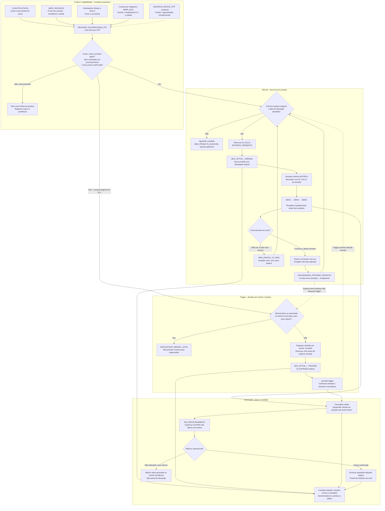
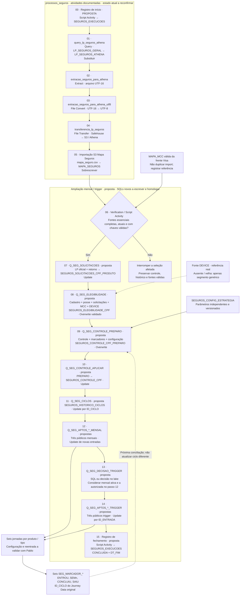
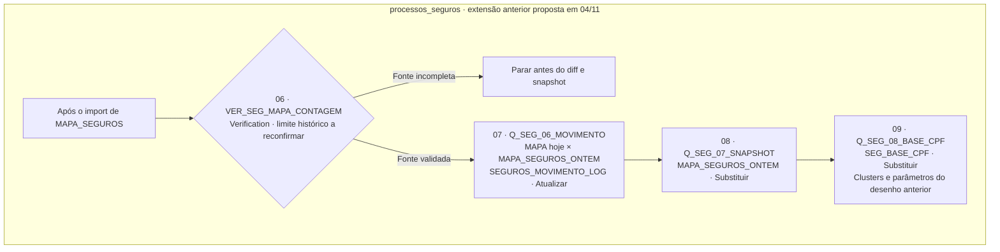

# Estratégia de Segmentação de Seguros

A estratégia organiza a oferta dos seguros Mulher, Residencial e Celular conforme a elegibilidade e o momento de relacionamento de cada cliente. Queremos descobrir quais públicos geram contratações adicionais com uma pressão de contato adequada.

Existem duas formas de entrada: uma sequência recorrente de ofertas por produto, chamada **mensal**, e um **acionamento por compra** em categoria relacionada ao seguro, chamado trigger. Na sequência, o cliente percorre um produto por vez; no trigger, a entrada está prevista para o dia seguinte à compra, quando a fonte permitir.

Antes de cada contato, verificamos permissões do canal, situação do cliente, solicitações em andamento e seguros já contratados. Para Residencial e Celular, o piloto proposto acrescenta o último acesso ao app. Para Celular, acrescenta uma lista de modelos e clusters de aparelhos a validar.

> **Estado da operação:** estratégia e contratos propostos. Diagnóstico e desenho documentados não comprovam execução no SFMC. A integração existente precisa ser reconfirmada. Esta publicação organiza o trabalho; não cria DEs nem ativa automações ou disparos.

## Como ler e decidir

| Pergunta | Onde encontrar a resposta |
|---|---|
| Quem recebe cada seguro? | Público, recência do app e clusters de aparelho |
| Quando recebe? | Sequência mensal ou compra em categoria MCC |
| Quando espera, sai ou retorna? | Percurso e regras de convivência |
| Como saber se funcionou? | Piloto, controle e medição |
| O que falta para ativar? | Atividades compartilhadas com Testes e Tarefas, por frente |
| Como implementar? | Mapas técnicos, fichas de DEs, atividades, SQLs e validações recolhíveis |

**Mensal** é o nome da modalidade, não a promessa de um contato por mês. A duração da régua, seus contatos semanais e o intervalo entre produtos são parâmetros diferentes. **Sem avanço há mais de 15 dias** descreve um ciclo parado; não significa ausência de acesso ao app. **Aparelho identificado** não comprova cobertura comercial nem interesse em contratar.

### Regras que precisam ficar à vista

| Situação | Decisão do desenho |
|---|---|
| Mensal ativa ou autorizada para o mesmo seguro | Descartar trigger; não guardar o evento para depois |
| Trigger ativo | Permite seleção mensal, respeitando pressão e revalidação |
| Conclusão normal | Aguardar 15 dias configuráveis antes do próximo produto |
| Mais de 15 dias sem avanço na semana | Invalidar ciclo e liberar próxima seleção sem acrescentar outra espera |
| Formulário válido | Suspender ofertas daquele seguro nas duas frentes |
| Posse confirmada | Encerrar aquisição daquele seguro |
| Terminou a sequência | Retornar ao primeiro produto elegível; sem elegíveis, aguardar atualização |
| Compra em Eletrônicos | Contexto de teste; não comprova compra de celular |

Os detalhes de autorização, entrada efetiva, identidade do ciclo e exceções permanecem nas seções seguintes.

## 1. Intenção estratégica e escopo

A frente de Seguros pretende organizar a oferta ao longo do relacionamento com o cliente e aproveitar contextos de compra relevantes, respeitando a elegibilidade de cada produto, as permissões de contato e o processamento das solicitações. A seleção de público deve ser reprodutível: cada autorização precisa indicar qual produto, tipo de régua, ciclo e versão de regra produziram a decisão.

A **régua mensal** percorre uma sequência de produtos elegíveis, um por vez. A sequência de produtos, as semanas da comunicação e a espera entre produtos são decisões distintas. O **trigger** corresponde à seleção motivada por uma compra na categoria definida para o seguro, com entrada prevista em D+1 quando a fonte permitir identificar e processar o evento nesse prazo.

**Elegibilidade** significa atender às condições de seleção; não comprova entrada na jornada ou recebimento de uma mensagem. **Autorização** reserva uma participação válida para a entrada. **Entrada confirmada** depende do processamento pela jornada e do marcador correspondente. **Ciclo** identifica uma participação específica; uma linha antiga não pode atualizar o estado de um ciclo novo.

O formulário suspende novas ofertas daquele seguro enquanto a solicitação é processada. A confirmação de posse encerra sua aquisição. Envio, clique, formulário, solicitação em processamento e contratação/posse confirmada são eventos diferentes e precisam permanecer distintos na leitura de resultado.

O escopo inicial abrange Mulher, Residencial e Celular nas frentes mensal e trigger. A ordem dos produtos, controle experimental, intervalos entre triggers, cadência e tratamento de não efetivação continuam como decisões abertas. A presença de um parâmetro ou filtro em um SQL antigo não o torna regra aprovada para este desenho.

## 2. O percurso completo: da elegibilidade à confirmação de posse

O fluxo preserva os caminhos de exclusão, espera, descarte e retorno. Os nomes de DEs representam os contratos propostos detalhados na seção de fichas. A disponibilidade de compra em D+1, a identidade do evento e a cobertura de posse precisam ser comprovadas antes da seleção real.



**Convivência das frentes:** mensal ativa ou autorizada impede trigger do mesmo produto; trigger ativo permite mensal. A espera entre produtos mantém os triggers abertos. Essa assimetria precisa aparecer tanto na seleção como na revalidação antes do contato.

## 3. Público, elegibilidade e segmentação DEVICE

Nas duas frentes, a seleção exige situação de conta apta, canal permitido e ausência de solicitação em processamento ou posse do seguro. Na mensal, o produto precisa ser o próximo da sequência e estar liberado após o intervalo. No trigger, a pessoa não pode estar na mensal daquele mesmo seguro.

| Seguro | Critério mensal | Critério trigger |
|---|---|---|
| Mulher | Público feminino e idade abaixo de 65 anos. | Mesma elegibilidade do produto + compra em **Saúde e Beleza**, com entrada em **D+1**. |
| Residencial | Limite disponível de pelo menos **R$ 100**. | Mesma elegibilidade do produto + compra em **Eletrodomésticos**, com entrada em **D+1**. |
| Celular | Limite disponível de pelo menos **R$ 100**. | Mesma elegibilidade do produto + compra em **Eletrônicos**, com entrada em **D+1**. |

A confirmação comercial dos critérios de Mulher, sua fonte de identificação e os demais requisitos de Celular continuam pendentes. Os campos de posse e a disponibilidade do D+1 também precisam da validação técnica descrita ao final.

Não exigimos valor mínimo da compra nesta versão. O valor acumulado de 12 meses da MAPA_MCC não representa o valor da transação. Eletrônicos não comprova compra de celular, e Saúde e Beleza inclui farmácia: são contextos de oferta cujo resultado vamos avaliar.

A ordem inicial ainda precisa de aprovação. A recomendação é **Mulher → Residencial → Celular** para elegíveis a Mulher; **Residencial → Celular** para os demais. Produtos inelegíveis são pulados. Ao terminar a sequência, volta ao primeiro elegível; se nenhum estiver disponível, aguarda mudança de condição.

### Último acesso ao app para Residencial e Celular

Usar `ULTIMO_ACESSO` da CLIENTES ATIVOS como sinal de relacionamento com o app. Não substituir pela data de carga, cadastro ou último uso do DEVICE. Normalizar as datas para America/Sao_Paulo, conferir referência e qualidade da fonte e produzir uma linha por CPF, sem multiplicar clientes com várias contas. A regra de agregação entre contas deve ser homologada.

| Faixa proposta | Uso inicial na mensal dos dois seguros |
|---|---|
| Até 30 dias | Público principal do piloto |
| De 31 a 60 dias | Grupo de teste de ampliação |
| De 61 a 90 dias | Expansão posterior, conforme volume e resultado |
| Mais de 90 dias | Fora da oferta ativa inicial do piloto |
| Ausente, inválido ou futuro | Dado desconhecido; separar dos inativos e investigar cobertura |

As faixas são hipóteses de piloto, não condições da seguradora nem cortes homologados no tenant. Para datas de negócio, comparar hoje−30 até hoje, inclusive; depois hoje−60 até antes de hoje−30; depois hoje−90 até antes de hoje−60. Fixar fuso e data de referência da seleção para não sobrepor faixas. Uma carga recente com eventos antigos não renova o engajamento.

O diagnóstico de 04/11 encontrou associação entre acesso recente e posse de Residencial. Isso motiva o teste, sem provar que filtrar por recência aumenta contratação. Não transferir automaticamente a mesma intensidade de associação para Celular.

**Na entrada por compra:** registrar a faixa de app para análise; não impor silenciosamente o mesmo corte da mensal. A compra recente é outro sinal. O piloto do trigger precisa definir e registrar se haverá corte, teste ou apenas leitura por recência antes da liberação. Uso do app não comprova permissão ou uso de WhatsApp.

### Segmentação por modelos para Seguro Celular

No piloto mensal proposto, concentrar a oferta ativa em clientes com acesso recente ao app e smartphone identificado em uma lista de modelos selecionados. Os demais públicos podem participar de células menores de comparação, com regra, volume e autorização próprios. Não ampliar automaticamente para todo elegível.

Essa proposta sucede a orientação anterior de oferta genérica ampla. Dado desconhecido não significa inelegibilidade comercial: significa que não há evidência para incluir a pessoa no núcleo deste piloto. Sem DEVICE atual e confiável, o piloto segmentado aguarda a fonte; eventual piloto genérico exige desenho e liberação próprios.

| Verificação | Decisão necessária |
|---|---|
| Identificação | Converter código em marca/modelo padronizados e conferir atualidade da observação |
| Condição comercial | Confirmar com Seguros restrições aplicáveis; não presumir aceitação pelo nome do modelo |
| Seleção experimental | Aprovar lista de modelos exatos, versão, cluster e volume disponível |

| Cluster ilustrativo | Composição a validar na base |
|---|---|
| Apple | Modelos de iPhone identificados individualmente |
| Android intermediário | Modelos selecionados de Galaxy A e Moto G |
| Android superior | Modelos selecionados de Galaxy S e Motorola Edge |
| Demais modelos ou desconhecidos | Comparação limitada, sem expansão automática |

Famílias são exemplos, não uma lista liberada. A lista final deve conter modelos exatos, códigos normalizados, regra de correspondência, condição comercial validada e versão. Se o volume não sustentar as células, reunir Androids antes de subdividir. Modelo não estima renda, preço ou plano; o cliente escolhe o plano na LP.

O trigger permanece motivado por compra em **Eletrônicos**, com política de aplicação dos modelos e recência explicitamente definida no piloto. Detectar troca de aparelho é evolução separada, não requisito desse trigger. Primeira aparição de um registro pode ser reinstalação, não troca.

### Dados e contrato complementar

Pedir à IN dados atuais com CPF como texto de 11 dígitos, tipo, marca, modelo, sistema, último uso e referência real da extração. Abrir JSON e normalizar modelos na origem. Se houver vários aparelhos, selecionar o smartphone de uso mais recente com desempate estável. Confirmar finalidade de uso com o responsável pela fonte.

A amostra de 100 linhas recebida em 04/11 tem referência de agosto/2025 e lacunas: explica a estrutura, mas não sustenta seleção atual. A data de carga não corrige isso.

:::details Delta proposto dos contratos de seleção · ainda não implantado
Transportar para elegibilidade e snapshot de entrada `ULTIMO_ACESSO_APP` (Date, anulável), `DT_REFERENCIA_SELECAO` (Date), `FAIXA_RECENCIA_APP` (Text; ATE_30D / DE_31_A_60D / DE_61_A_90D / MAIS_90D / DESCONHECIDO), `CLUSTER_MODELO` (Text), `VERSAO_LISTA_MODELOS` (Text) e identificação da célula experimental. Tamanhos finais, PK da lista de modelos, carga, retenção, nulos e versão da alocação ficam a homologar antes de criar DEs.

Não reutilizar `SEGMENTO_DEVICE` como faixa de uso do app. Os três segmentos documentados abaixo descrevem qualidade/recência da observação do aparelho; o cluster de modelo e a recência do app são dimensões distintas. Campos de snapshots preservam a decisão original; bloqueios operacionais são revalidados antes de cada contato. DEVICE não necessário a Mulher ou Residencial não pode parar essas frentes.
:::

:::details Referência anterior de DEVICE · preservada para rastreabilidade, sucedida no piloto de 09/11
### Segmentação DEVICE para Seguro Celular

Usar o aparelho para **priorizar e diferenciar o público**, mantendo o trigger por compra em Eletrônicos. Não precisamos começar com preço estimado, indicação automática de plano ou histórico de troca de aparelho.

#### Segmentação inicial proposta

| Segmento | Regra simples | Como trabalhar |
|---|---|---|
| RECENTE_IDENTIFICADO | Smartphone com marca e modelo identificados, fonte atual e último uso real nos últimos 90 dias | Público prioritário para testar Celular. Comparar contratação com os demais segmentos; personalização por modelo só depois de validar a identificação. |
| IDENTIFICADO_SEM_RECENCIA | Smartphone identificado, mas último uso ausente ou fora da janela de 90 dias, com fonte atual | Oferta genérica e leitura separada. Não afirmar que esse ainda é o aparelho usado pelo cliente. |
| SEM_DADO_CONFIAVEL | Sem DEVICE, modelo não identificado, tipo incerto ou fonte desatualizada | Não excluir automaticamente do Seguro Celular. Manter oferta genérica se as demais regras permitirem. |

Os 90 dias são uma recomendação configurável para o teste. Não são uma regra da seguradora. A mudança de prioridade na sequência mensal também precisa de aprovação; o segmento não altera a ordem sozinho. Dispositivo confirmado como tablet ou outro tipo não recebe personalização de celular e fica no público genérico, sem presumir ausência de smartphone.

#### Dados mínimos e tratamento

Pedir à IN uma linha por CPF com tipo do dispositivo, marca, modelo, sistema, último uso e referência real da extração. Quando houver vários aparelhos, selecionar o smartphone com último uso mais recente e desempate estável; não repetir o CPF. O contrato completo está em SEGUROS_DEVICE_CPF no bloco de DEs abaixo. Se a fonte já entregar esse contrato, reaproveitá-la em vez de criar uma cópia desnecessária.

O SFMC recebe colunas prontas. O JSON deve ser aberto e os códigos de modelo normalizados no lake/IN, evitando um parser de aparelhos dentro de cada query de público. Para a primeira versão não é necessário um de-para de preços ou planos.

**O que temos hoje:** uma amostra de 100 linhas recebida em 04/11, com referência de agosto/2025 e lacunas de data. Ela explica a estrutura, mas não sustenta seleção atual. Importar essa amostra hoje não torna os aparelhos recentes. Até receber uma fonte válida, classificar como SEM_DADO_CONFIAVEL e manter comunicação genérica. A finalidade de uso dessa fonte também precisa ser confirmada com seu responsável.

Não inferir troca de aparelho apenas pela primeira aparição do registro: reinstalação do app pode gerar um novo registro. Não estimar renda, preço ou plano por marca. O cliente continua escolhendo o plano na LP. O resultado deve ser lido por segmento até contratação e, quando disponível, permanência.

:::

## 4. Regras de convivência, cadência e controle de ciclo

### Avanço da mensal e intervalo entre produtos

A jornada atualiza o status a cada semana: `SEM1`, `SEM2`, `SEM3`… Ao concluir a última semana, registra `AGUARDANDO_PROXIMO_PRODUTO`, a data de conclusão e a liberação após 15 dias. Chegar à última semana ainda não inicia essa contagem.

O controle guarda seguro atual, próximo seguro, status, datas e identificador do ciclo. A data da última mudança só é renovada quando o status realmente muda. A liberação é calculada uma vez por conclusão, com o intervalo configurado; execuções seguintes não empurram a data para a frente. Mudanças no parâmetro valem para novas conclusões. Cada ciclo identifica uma participação, impedindo que um marcador antigo altere a nova.

**Mais de 15 dias na mesma semana:** a automação encerra o ciclo com motivo `SEM_AVANCO_15_DIAS` e libera o próximo seguro, sem acrescentar outra espera. Registra encerramento por inatividade, não conclusão normal. O ciclo anterior precisa ser invalidado antes dos próximos contatos.

Uma data de liberação autoriza a seleção; `SEM1` só é registrada quando houver entrada efetiva no novo ciclo. Bounce não comprova saída da jornada. Bloqueios, desinteresse e contratação continuam sendo respeitados. O desbloqueio recupera o percurso; não libera um canal impedido.

### Solicitação em processamento e confirmação de posse

**Oferta → formulário válido → solicitação em processamento → confirmação de posse.**

O formulário suspende novas ofertas daquele seguro nas duas frentes. A MAPA confirma posse quando o produto estiver corretamente representado. Ausência na MAPA durante o processamento não libera nova oferta automaticamente. Recusa ou não efetivação precisam de retorno e regra próprios.

Os resultados ficam em [[10-Resultados/Mecanicas/Seguros|Seguros]] e no BI. Aqui mantemos as regras, sem repetir tabelas de performance.

## 5. Mapa técnico das automações

O mapa distingue atividades documentadas de troca de arquivos e a ampliação proposta para o desenho mensal/trigger. Ele usa os nomes já registrados nas fontes; os nomes novos continuam como propostas de configuração. Cada atividade dependente ocupa um passo próprio no Automation Studio. A ficha de cada atividade identifica entrada, destino, ação e conferências.

### Fluxo técnico A · processos_seguros e seleção proposta



Os passos acima seguem a ordem proposta no contrato local. O fechamento não cria atomicidade: se uma query intermediária falhar, suas predecessoras podem ter gravado dados. A recuperação precisa conferir ID_EXECUCAO, decisões e ciclos antes de repetir a seleção.

### Compatibilidade com a extensão de medição documentada em 04/11

O desenho anterior de movimento/snapshot não deve substituir a seleção mensal/trigger atual. As atividades abaixo permanecem referências para medição de mudanças de posse; não são confirmação de contratação ou pré-requisito de DEVICE.

:::details Fluxo técnico B · extensão anterior de movimento e snapshot · proposta de 04/11


Na primeira ativação desse diff, executar o snapshot inicial antes de ligar a comparação. Em rotina, movimento precede snapshot em passos separados. O limiar de contagem registrado em 04/11 não é um limiar atual homologado; atualizar uma foto não prova que sua referência é recente.

`SEG_BASE_CPF` e `SEG_REGUA_CONTROLE` pertencem ao desenho anterior. Os contratos novos desta página detalham `SEGUROS_ELEGIBILIDADE_CPF` e `SEGUROS_CONTROLE_CPF`; não criar duas fontes de estado concorrentes. Regras de clusters, ticket, recência ou grupo controle do SQL antigo não são incorporadas por omissão.
:::

## 6. Fichas técnicas das Data Extensions

O bloco **Referência técnica: Data Extensions** traz todos os campos, tipos, tamanhos, PK, obrigatoriedade, defaults, pastas, External Keys, sendability e responsáveis por gravação. Os públicos e marcadores são modelos para clonar; o dicionário aparece uma vez por modelo.

| Função | DEs |
|---|---|
| Fontes tratadas | SEGUROS_DEVICE_CPF e SEGUROS_SOLICITACOES_CPF_PRODUTO; reaproveitar contratos equivalentes da origem quando possível |
| Seleção | SEGUROS_ELEGIBILIDADE_CPF |
| Percurso mensal | SEGUROS_CONTROLE_CPF e sua área de preparo |
| Parâmetros | SEGUROS_CONFIG_ESTRATEGIA |
| Entrada nas jornadas | Seis SEG_APTOS: Mulher, Residencial e Celular, cada um com MENSAL e TRIGGER |
| Retorno das jornadas | Seis SEG_MARCADOR, um por produto e tipo de régua, para separar escritores simultâneos |
| Acompanhamento | SEGUROS_HISTORICO_CICLOS e SEGUROS_EXECUCOES |
| Decisões de trigger | Lake ou, se necessário, SEGUROS_TRIGGER_CONTROLE |

Esse é um contrato proposto para criação, não um inventário de DEs já implantadas. O pacote de referência cobre 21 nomes físicos, incluindo a alternativa condicional de trigger. Antes de criar, conferir o que pode ser atendido por fontes e controles existentes. Não vamos recriar CLIENTES ATIVOS, MAPA_SEGUROS, MAPA_MCC ou LPs.

Mensal e trigger podem coexistir. Por isso, o marcador de uma jornada não pode sobrescrever o estado de outra. A automação concilia os retornos e é a única responsável pelo percurso mensal.

Contrato proposto para criação. As seis DEs de público compartilham um modelo; as seis de marcador compartilham outro. Cada tabela abaixo lista todos os campos do respectivo modelo, sem repetir o mesmo dicionário seis vezes. Não são objetos já implantados.

**Pasta e BU:** pastas sugeridas abaixo de `Shared Data Extensions/Seguro`. Confirmar a BU de execução e o acesso às DEs compartilhadas; usar `ENT.` apenas onde o contexto exigir. CustomerKey igual ao nome técnico é proposta, não chave existente. Não recriar as fontes atuais.

**Identidade e datas:** CPF em Text(11), validado e com zeros preservados. CONTACT_KEY deve reproduzir a identidade já usada no envio. Date não guarda fuso: fontes devem declarar referência e fuso; normalizar os marcadores do relógio SFMC antes de comparar com fontes externas. Os 15 dias são tempo decorrido; D+1 usa a data de compra no calendário de negócio validado.

**Retenção:** não ligar expurgo automático durante o piloto. Antes de produção, aprovar retenção por finalidade, exportação do histórico e limpeza das entradas já encerradas. Não definir “sem retenção para sempre” por omissão.

:::details SEGUROS_ELEGIBILIDADE_CPF · contrato proposto
### SEGUROS_ELEGIBILIDADE_CPF

**DEs físicas:** `SEGUROS_ELEGIBILIDADE_CPF`.

**Pasta:** `Shared Data Extensions/Seguro/00_Dados`. **External Key:** mesmo nome técnico, após conferir unicidade. **Sendable:** não. **Gravação:** Overwrite, somente com fontes válidas. **Responsável:** Queries de elegibilidade.

| Campo | Tipo / tamanho | PK | Obrigatório | Padrão | Uso |
|---|---|:---:|:---:|---|---|
| `CPF` | Text(11) | Sim | Sim | — | CPF normalizado; nunca número. |
| `CONTACT_KEY` | Text(254) | — | Sim | — | Identidade de envio existente; pacote atual usa CPF. Validar o vínculo antes de criar. |
| `EMAIL` | EmailAddress(254) | — | Não | — | Endereço de e-mail. |
| `PHONE` | Phone(50) | — | Não | — | Telefone com DDI e DDD; não presumir opt-in. |
| `LOCALE` | Locale(5) | — | Não | — | Localidade validada; não preencher se desconhecida. |
| `FIRST_NAME` | Text(100) | — | Não | — | Primeiro nome para personalização. |
| `FL_EMAIL_PERMITIDO` | Boolean | — | Sim | false | Permissão e entregabilidade do canal, reavaliadas antes do envio. |
| `FL_SMS_PERMITIDO` | Boolean | — | Sim | false | Permissão e disponibilidade do canal SMS. |
| `FL_WPP_PERMITIDO` | Boolean | — | Sim | false | Permissão e disponibilidade do canal WhatsApp. |
| `STATUS_CONTA` | Text(50) | — | Sim | — | Situação normalizada da conta selecionada. |
| `LIMITE_DISPONIVEL` | Decimal(18,2) | — | Não | — | Limite da conta apta selecionada; não somar cartões duplicados. |
| `IDADE` | Number | — | Não | — | Idade informada pela fonte. |
| `GENERO` | Text(20) | — | Não | — | Valor e semântica da fonte, sem inferir gênero por compra. |
| `FL_SUPRESSAO_GERAL` | Boolean | — | Sim | true | Desinteresse ou outro impedimento geral. Desconhecido exige conferência. |
| `POSSE_MULHER` | Text(15) | — | Sim | DESCONHECIDA | SIM / NAO / DESCONHECIDA; NAO exige fonte válida. |
| `SOLICITACAO_MULHER` | Text(25) | — | Sim | DESCONHECIDA | NENHUMA / EM_PROCESSAMENTO / CONFIRMADA / NAO_EFETIVADA / DESCONHECIDA. |
| `APTO_MULHER` | Boolean | — | Sim | false | Elegibilidade de produto; não é confirmação de entrada em jornada. |
| `MOTIVO_MULHER` | Text(200) | — | Sim | PENDENTE_VALIDACAO | Motivo principal da aptidão ou impedimento. |
| `POSSE_RESIDENCIAL` | Text(15) | — | Sim | DESCONHECIDA | SIM / NAO / DESCONHECIDA; NAO exige fonte válida. |
| `SOLICITACAO_RESIDENCIAL` | Text(25) | — | Sim | DESCONHECIDA | NENHUMA / EM_PROCESSAMENTO / CONFIRMADA / NAO_EFETIVADA / DESCONHECIDA. |
| `APTO_RESIDENCIAL` | Boolean | — | Sim | false | Elegibilidade de produto; não é confirmação de entrada em jornada. |
| `MOTIVO_RESIDENCIAL` | Text(200) | — | Sim | PENDENTE_VALIDACAO | Motivo principal da aptidão ou impedimento. |
| `POSSE_CELULAR` | Text(15) | — | Sim | DESCONHECIDA | SIM / NAO / DESCONHECIDA; NAO exige fonte válida. |
| `SOLICITACAO_CELULAR` | Text(25) | — | Sim | DESCONHECIDA | NENHUMA / EM_PROCESSAMENTO / CONFIRMADA / NAO_EFETIVADA / DESCONHECIDA. |
| `APTO_CELULAR` | Boolean | — | Sim | false | Elegibilidade de produto; não é confirmação de entrada em jornada. |
| `MOTIVO_CELULAR` | Text(200) | — | Sim | PENDENTE_VALIDACAO | Motivo principal da aptidão ou impedimento. |
| `SEGMENTO_DEVICE` | Text(40) | — | Sim | SEM_DADO_CONFIAVEL | RECENTE_IDENTIFICADO / IDENTIFICADO_SEM_RECENCIA / SEM_DADO_CONFIAVEL. |
| `DEVICE_MARCA` | Text(50) | — | Não | — | Marca normalizada, quando confiável. |
| `DEVICE_MODELO` | Text(100) | — | Não | — | Modelo normalizado, quando confiável. |
| `DEVICE_ULTIMO_USO` | Date | — | Não | — | Último uso real observado na origem. |
| `DEVICE_DT_REFERENCIA` | Date | — | Não | — | Referência da extração na origem. |
| `DT_ULT_COMPRA_ELETRONICOS` | Date | — | Não | — | Última data por categoria, se a fonte for a MAPA_MCC. |
| `DT_ULT_COMPRA_SAUDE_BELEZA` | Date | — | Não | — | Última data por categoria. |
| `DT_ULT_COMPRA_ELETRODOMESTICOS` | Date | — | Não | — | Última data por categoria. |
| `VERSAO_REGRA` | Text(20) | — | Sim | — | Versão aplicada, por exemplo SEG_V2. |
| `ID_EXECUCAO` | Text(64) | — | Sim | — | Execução que gerou a decisão. |
| `DT_ATUALIZACAO` | Date | — | Sim | — | Instante da atualização pela automação. |
:::

:::details Controle mensal e área de preparo · contrato proposto
### Controle mensal e área de preparo

**DEs físicas:** `SEGUROS_CONTROLE_CPF`, `SEGUROS_CONTROLE_CPF_PREPARO`.

**Pasta:** `Shared Data Extensions/Seguro/01_Controle`. **External Key:** mesmo nome técnico, após conferir unicidade. **Sendable:** não. **Gravação:** CONTROLE: Update a partir de PREPARO; PREPARO: Overwrite após ler estado e marcadores. **Responsável:** Somente automação de conciliação.

Dois objetos com o mesmo schema. A área PREPARO permite calcular o próximo estado sem sobrescrever a fonte que está sendo lida. A jornada não escreve diretamente nessas DEs.

| Campo | Tipo / tamanho | PK | Obrigatório | Padrão | Uso |
|---|---|:---:|:---:|---|---|
| `CPF` | Text(11) | Sim | Sim | — | Um percurso mensal por CPF. |
| `ID_CICLO` | Text(64) | — | Não | — | Identificador imutável da participação mensal atual; vazio antes da inicialização. |
| `SEGURO_ATUAL` | Text(20) | — | Não | — | MULHER / RESIDENCIAL / CELULAR. |
| `STATUS` | Text(40) | — | Sim | AGUARDANDO_INICIALIZACAO | AGUARDANDO_INICIALIZACAO / ENTRADA_PENDENTE / SEM1… / AGUARDANDO_PROXIMO_PRODUTO / SEM_PRODUTO_ELEGIVEL. |
| `PROXIMO_SEGURO` | Text(20) | — | Não | — | Próximo produto previsto; revalidar na liberação. |
| `FL_CICLO_ATIVO` | Boolean | — | Sim | false | Indica ciclo mensal válido para contato. |
| `DT_ENTRADA` | Date | — | Não | — | Entrada efetiva, não apenas inclusão no público. |
| `DT_MUDANCA_STATUS` | Date | — | Não | — | Muda somente quando a etapa avança. |
| `DT_CONCLUSAO_REGUA` | Date | — | Não | — | Somente conclusão normal da última semana. |
| `DT_ENCERRAMENTO_CICLO` | Date | — | Não | — | Encerramento normal ou por exceção. |
| `DT_LIBERACAO_PROXIMO_PRODUTO` | Date | — | Não | — | Conclusão + intervalo; inatividade libera sem nova espera. |
| `DIAS_INTERVALO_APLICADO` | Number | — | Não | — | Valor congelado ao concluir a régua. |
| `MOTIVO_SAIDA` | Text(200) | — | Não | — | CONCLUSAO / SEM_AVANCO_15_DIAS / SOLICITACAO / CONTRATACAO / SUPRESSAO. |
| `VERSAO_REGRA` | Text(20) | — | Sim | — | Versão aplicada, por exemplo SEG_V2. |
| `ID_EXECUCAO` | Text(64) | — | Sim | — | Execução que gerou a decisão. |
| `DT_ATUALIZACAO` | Date | — | Sim | — | Instante da atualização pela automação. |
:::

:::details SEGUROS_CONFIG_ESTRATEGIA · contrato proposto
### SEGUROS_CONFIG_ESTRATEGIA

**DEs físicas:** `SEGUROS_CONFIG_ESTRATEGIA`.

**Pasta:** `Shared Data Extensions/Seguro/01_Controle`. **External Key:** mesmo nome técnico, após conferir unicidade. **Sendable:** não. **Gravação:** Update manual governado. **Responsável:** Responsável CRM/Growth.

| Campo | Tipo / tamanho | PK | Obrigatório | Padrão | Uso |
|---|---|:---:|:---:|---|---|
| `CHAVE` | Text(80) | Sim | Sim | — | Identificador do parâmetro. |
| `VALOR` | Text(200) | — | Sim | — | Valor em texto, convertido e validado pela query. |
| `TIPO` | Text(10) | — | Sim | — | NUMERO / TEXTO / BOOLEANO. |
| `DESCRICAO` | Text(300) | — | Sim | — | O que altera e quando passa a valer. |
| `VERSAO_REGRA` | Text(20) | — | Sim | — | Versão da configuração. |
| `DT_ATUALIZACAO` | Date | — | Sim | — | Última alteração do parâmetro. |
:::

:::details SEGUROS_DEVICE_CPF · contrato proposto
### SEGUROS_DEVICE_CPF

**DEs físicas:** `SEGUROS_DEVICE_CPF`.

**Pasta:** `Shared Data Extensions/Seguro/00_Dados`. **External Key:** mesmo nome técnico, após conferir unicidade. **Sendable:** não. **Gravação:** Overwrite, arquivo completo validado. **Responsável:** Import da IN/lake; proposta de contrato de origem.

| Campo | Tipo / tamanho | PK | Obrigatório | Padrão | Uso |
|---|---|:---:|:---:|---|---|
| `CPF` | Text(11) | Sim | Sim | — | Uma linha por CPF; IN seleciona o smartphone de uso mais recente. |
| `DEVICE_ID_ORIGEM` | Text(100) | — | Não | — | Identificador estável, se disponível; não usar como prova de compra. |
| `TIPO_DISPOSITIVO` | Text(20) | — | Sim | DESCONHECIDO | SMARTPHONE / TABLET / OUTRO / DESCONHECIDO. |
| `MARCA` | Text(50) | — | Não | — | Marca padronizada. |
| `MODELO` | Text(100) | — | Não | — | Modelo padronizado; manter código de origem para rastreio. |
| `SISTEMA` | Text(20) | — | Não | — | ANDROID / IOS / OUTRO / DESCONHECIDO. |
| `VERSAO_SISTEMA` | Text(30) | — | Não | — | Versão observada; não é condição comercial aprovada. |
| `DT_PRIMEIRO_USO` | Date | — | Não | — | Opcional; não demonstra troca de aparelho. |
| `DT_ULTIMO_USO` | Date | — | Não | — | Último evento real de uso do aparelho na origem. |
| `DT_REFERENCIA_FONTE` | Date | — | Sim | — | Referência do arquivo, obrigatória. |
| `DT_CARGA` | Date | — | Sim | — | Momento em que o SFMC recebeu a foto. |
:::

:::details SEGUROS_SOLICITACOES_CPF_PRODUTO · contrato proposto
### SEGUROS_SOLICITACOES_CPF_PRODUTO

**DEs físicas:** `SEGUROS_SOLICITACOES_CPF_PRODUTO`.

**Pasta:** `Shared Data Extensions/Seguro/00_Dados`. **External Key:** mesmo nome técnico, após conferir unicidade. **Sendable:** não. **Gravação:** Update; preservar processamento sem retorno. **Responsável:** Conciliação das LPs e retorno de contratação.

| Campo | Tipo / tamanho | PK | Obrigatório | Padrão | Uso |
|---|---|:---:|:---:|---|---|
| `CPF` | Text(11) | Sim | Sim | — | Chave parcial da solicitação atual. |
| `PRODUTO` | Text(20) | Sim | Sim | — | Chave parcial; produto normalizado. |
| `ID_SOLICITACAO` | Text(100) | — | Não | — | Identificador na fonte; não fabricar se ausente. |
| `STATUS` | Text(25) | — | Sim | — | EM_PROCESSAMENTO / CONFIRMADA / NAO_EFETIVADA / DESCONHECIDA. |
| `DT_FORMULARIO` | Date | — | Não | — | Instante do aceite válido. |
| `DT_RETORNO` | Date | — | Não | — | Instante do retorno operacional, se recebido. |
| `ACEITE_VALIDO` | Boolean | — | Não | — | Aceite de contratação validado; nulo exige revisão. |
| `FONTE` | Text(100) | — | Sim | — | LP e/ou retorno que sustenta o estado. |
| `DT_REFERENCIA_FONTE` | Date | — | Sim | — | Referência da fonte consultada. |
| `DT_ATUALIZACAO` | Date | — | Sim | — | Atualização da projeção operacional. |
:::

:::details Modelo dos seis públicos SEG_APTOS · contrato proposto
### Modelo dos seis públicos SEG_APTOS

**DEs físicas:** `SEG_APTOS_MULHER_MENSAL`, `SEG_APTOS_MULHER_TRIGGER`, `SEG_APTOS_RESIDENCIAL_MENSAL`, `SEG_APTOS_RESIDENCIAL_TRIGGER`, `SEG_APTOS_CELULAR_MENSAL`, `SEG_APTOS_CELULAR_TRIGGER`.

**Pasta:** `Shared Data Extensions/Seguro/02_Publicos`. **External Key:** mesmo nome técnico, após conferir unicidade. **Sendable:** sim, CONTACT_KEY → Subscribers.Subscriber Key. **Gravação:** Update somente para novas entradas; não alterar payload de entrada já confirmada. **Responsável:** Queries de seleção.

Uma DE física para cada produto/tipo. ID_ENTRADA é PK; CONTACT_KEY é identidade de envio. Não confundir as duas chaves. O feed deve reter entradas pendentes até confirmação; não usar Overwrite diário.

| Campo | Tipo / tamanho | PK | Obrigatório | Padrão | Uso |
|---|---|:---:|:---:|---|---|
| `ID_ENTRADA` | Text(80) | Sim | Sim | — | Chave estável por participação; não regenerar em toda execução. |
| `CPF` | Text(11) | — | Sim | — | Cliente selecionado. |
| `CONTACT_KEY` | Text(254) | — | Sim | — | Mesmo Contact Key existente no SFMC. |
| `ID_CICLO` | Text(64) | — | Sim | — | Participação imutável usada nos marcadores. |
| `PRODUTO` | Text(20) | — | Sim | — | Produto fixo correspondente à DE. |
| `TIPO_REGUA` | Text(10) | — | Sim | — | MENSAL ou TRIGGER, fixo conforme a DE. |
| `EMAIL` | EmailAddress(254) | — | Não | — | Endereço de e-mail. |
| `PHONE` | Phone(50) | — | Não | — | Telefone com DDI e DDD; não presumir opt-in. |
| `LOCALE` | Locale(5) | — | Não | — | Localidade validada; não preencher se desconhecida. |
| `FIRST_NAME` | Text(100) | — | Não | — | Primeiro nome para personalização. |
| `FL_EMAIL_PERMITIDO` | Boolean | — | Sim | false | Permissão e entregabilidade do canal, reavaliadas antes do envio. |
| `FL_SMS_PERMITIDO` | Boolean | — | Sim | false | Permissão e disponibilidade do canal SMS. |
| `FL_WPP_PERMITIDO` | Boolean | — | Sim | false | Permissão e disponibilidade do canal WhatsApp. |
| `DT_ENTRADA_PREVISTA` | Date | — | Sim | — | Janela autorizada de entrada. |
| `DT_GERACAO` | Date | — | Sim | — | Criação da entrada; não renovar em reexecuções. |
| `ID_EVENTO_COMPRA` | Text(100) | — | Não | — | Obrigatório para trigger; nulo na mensal. |
| `CATEGORIA_MCC` | Text(30) | — | Não | — | Obrigatória no trigger; categoria normalizada. |
| `DT_COMPRA` | Date | — | Não | — | Data/hora da compra quando disponível, ou data agregada identificada como tal. |
| `SEGMENTO_DEVICE` | Text(40) | — | Sim | SEM_DADO_CONFIAVEL | Segmento de aparelho no instante da seleção. |
| `DEVICE_MARCA` | Text(50) | — | Não | — | Somente se confiável. |
| `DEVICE_MODELO` | Text(100) | — | Não | — | Somente se confiável. |
| `VERSAO_REGRA` | Text(20) | — | Sim | — | Versão aplicada, por exemplo SEG_V2. |
| `ID_EXECUCAO` | Text(64) | — | Sim | — | Execução que gerou a decisão. |
| `DT_ATUALIZACAO` | Date | — | Sim | — | Instante da atualização pela automação. |
:::

:::details Modelo dos seis marcadores de jornada · contrato proposto
### Modelo dos seis marcadores de jornada

**DEs físicas:** `SEG_MARCADOR_MULHER_MENSAL`, `SEG_MARCADOR_MULHER_TRIGGER`, `SEG_MARCADOR_RESIDENCIAL_MENSAL`, `SEG_MARCADOR_RESIDENCIAL_TRIGGER`, `SEG_MARCADOR_CELULAR_MENSAL`, `SEG_MARCADOR_CELULAR_TRIGGER`.

**Pasta:** `Shared Data Extensions/Seguro/03_Marcadores`. **External Key:** mesmo nome técnico, após conferir unicidade. **Sendable:** não. **Gravação:** Update Contact, sem Overwrite da automação. **Responsável:** Somente a jornada correspondente.

Proposta para separar escritores simultâneos. PK CPF por DE, evitando atualização ambígua de chaves compostas por Update Contact. Validar cópia dinâmica do ID_CICLO no tenant. Só aceitar marcador cujo ciclo ainda seja o ciclo válido.

| Campo | Tipo / tamanho | PK | Obrigatório | Padrão | Uso |
|---|---|:---:|:---:|---|---|
| `CPF` | Text(11) | Sim | Sim | — | Uma linha por cliente em cada DE física de marcador. |
| `ID_CICLO` | Text(64) | — | Sim | — | Copiado do Journey Data da entrada; nunca do ciclo atual de Contact Data. |
| `PRODUTO` | Text(20) | — | Sim | — | Valor fixo da DE. |
| `TIPO_REGUA` | Text(10) | — | Sim | — | Valor fixo da DE. |
| `STATUS` | Text(40) | — | Sim | — | ENTROU / SEM1… / CONCLUIU / SAIU. |
| `DT_MARCADOR_SFMC` | Date | — | Sim | — | Use current time da atividade; relógio SFMC do tenant. |
| `MOTIVO_SAIDA` | Text(200) | — | Não | — | Somente quando houver encerramento. |
| `VERSAO_REGRA` | Text(20) | — | Sim | — | Versão trazida pela entrada. |
:::

:::details SEGUROS_HISTORICO_CICLOS · contrato proposto
### SEGUROS_HISTORICO_CICLOS

**DEs físicas:** `SEGUROS_HISTORICO_CICLOS`.

**Pasta:** `Shared Data Extensions/Seguro/01_Controle`. **External Key:** mesmo nome técnico, após conferir unicidade. **Sendable:** não. **Gravação:** Update por ID_CICLO, preservando ciclos encerrados. **Responsável:** Conciliação; não é uma linha por contato ou por semana.

| Campo | Tipo / tamanho | PK | Obrigatório | Padrão | Uso |
|---|---|:---:|:---:|---|---|
| `ID_CICLO` | Text(64) | Sim | Sim | — | Uma linha por participação mensal ou trigger. |
| `CPF` | Text(11) | — | Sim | — | Cliente. |
| `PRODUTO` | Text(20) | — | Sim | — | Seguro. |
| `TIPO_REGUA` | Text(10) | — | Sim | — | MENSAL / TRIGGER. |
| `STATUS` | Text(40) | — | Sim | — | Situação reconciliada da participação. |
| `FL_CICLO_ATIVO` | Boolean | — | Sim | false | Validade atual do ciclo para contatos. |
| `DT_AUTORIZACAO` | Date | — | Sim | — | Seleção para a entrada. |
| `DT_ENTRADA` | Date | — | Não | — | Confirmação de entrada. |
| `DT_ULTIMO_AVANCO` | Date | — | Não | — | Último marcador aceito do mesmo ciclo. |
| `DT_ENCERRAMENTO` | Date | — | Não | — | Encerramento da participação. |
| `MOTIVO_SAIDA` | Text(200) | — | Não | — | Razão do encerramento. |
| `ID_EVENTO_COMPRA` | Text(100) | — | Não | — | Preenchido nos triggers; permite rastrear sua origem. |
| `VERSAO_REGRA` | Text(20) | — | Sim | — | Versão aplicada, por exemplo SEG_V2. |
| `ID_EXECUCAO` | Text(64) | — | Sim | — | Execução que gerou a decisão. |
| `DT_ATUALIZACAO` | Date | — | Sim | — | Instante da atualização pela automação. |
:::

:::details SEGUROS_TRIGGER_CONTROLE · contrato proposto
### SEGUROS_TRIGGER_CONTROLE

**DEs físicas:** `SEGUROS_TRIGGER_CONTROLE`.

**Pasta:** `Shared Data Extensions/Seguro/01_Controle`. **External Key:** mesmo nome técnico, após conferir unicidade. **Sendable:** não. **Gravação:** Update idempotente por evento/produto. **Responsável:** Somente se decisões não forem persistidas e retornadas pelo lake.

DE condicional, não obrigatória se o lake oferecer esse contrato. Não contém uma cópia de todas as compras.

| Campo | Tipo / tamanho | PK | Obrigatório | Padrão | Uso |
|---|---|:---:|:---:|---|---|
| `ID_EVENTO_COMPRA` | Text(100) | Sim | Sim | — | Chave parcial; identidade estável do evento na fonte. |
| `PRODUTO` | Text(20) | Sim | Sim | — | Chave parcial; decisão é por evento e seguro. |
| `CPF` | Text(11) | — | Sim | — | Cliente. |
| `CATEGORIA_MCC` | Text(30) | — | Sim | — | Categoria que acionou a seleção. |
| `DT_COMPRA` | Date | — | Sim | — | Instante ou data da compra, com granularidade declarada. |
| `GRANULARIDADE_EVENTO` | Text(20) | — | Sim | — | TRANSACAO ou CPF_CATEGORIA_DIA. |
| `DECISAO` | Text(25) | — | Sim | — | DESCARTADO / AUTORIZADO / ENTRADA_CONFIRMADA / ENCERRADO. |
| `MOTIVO` | Text(200) | — | Sim | — | Por exemplo MENSAL_ATIVA, SOLICITACAO, POSSE, SEM_CANAL. |
| `DT_DECISAO` | Date | — | Sim | — | Primeira decisão; preservar em reexecuções. |
| `ID_CICLO` | Text(64) | — | Não | — | Ciclo de trigger, se autorizado. |
| `VERSAO_REGRA` | Text(20) | — | Sim | — | Versão aplicada, por exemplo SEG_V2. |
| `ID_EXECUCAO` | Text(64) | — | Sim | — | Execução que gerou a decisão. |
| `DT_ATUALIZACAO` | Date | — | Sim | — | Instante da atualização pela automação. |
:::

:::details SEGUROS_EXECUCOES · contrato proposto
### SEGUROS_EXECUCOES

**DEs físicas:** `SEGUROS_EXECUCOES`.

**Pasta:** `Shared Data Extensions/Seguro/01_Controle`. **External Key:** mesmo nome técnico, após conferir unicidade. **Sendable:** não. **Gravação:** Update por ID_EXECUCAO. **Responsável:** Orquestração/Script Activity de acompanhamento.

| Campo | Tipo / tamanho | PK | Obrigatório | Padrão | Uso |
|---|---|:---:|:---:|---|---|
| `ID_EXECUCAO` | Text(64) | Sim | Sim | — | Execução da automação. |
| `DT_INICIO` | Date | — | Sim | — | Início. |
| `DT_FIM` | Date | — | Não | — | Fim, inclusive de falha. |
| `STATUS` | Text(20) | — | Sim | — | INICIADA / FONTES_INVALIDAS / FALHOU / CONCLUIDA. |
| `DT_REFERENCIA_MAPA` | Date | — | Não | — | Referência real da MAPA. |
| `DT_REFERENCIA_MCC` | Date | — | Não | — | Referência real de compras. |
| `DT_REFERENCIA_DEVICE` | Date | — | Não | — | Referência real de DEVICE; ausência não invalida toda a estratégia. |
| `QT_ELEGIVEIS` | Number | — | Não | — | Contagem observada após a seleção. |
| `QT_ENTRADAS_MENSAL` | Number | — | Não | — | Entradas mensais autorizadas. |
| `QT_ENTRADAS_TRIGGER` | Number | — | Não | — | Triggers autorizados. |
| `QT_TRIGGERS_DESCARTADOS` | Number | — | Não | — | Eventos descartados nesta execução. |
| `ERRO` | Text(500) | — | Não | — | Etapa e causa da falha; sem CPF ou contato em texto livre. |
| `VERSAO_REGRA` | Text(20) | — | Sim | — | Versão em execução. |
:::

:::details Valores iniciais da configuração · contrato proposto
### Valores iniciais da configuração

| CHAVE | VALOR | TIPO | Situação |
|---|---|---|---|
| DIAS_ENTRE_PRODUTOS | 15 | NUMERO | Definido; congelar o valor aplicado ao concluir cada ciclo. |
| DIAS_MAX_SEM_AVANCO_SEMANA | 15 | NUMERO | Definido; comparação estritamente maior que 15 dias. |
| DELAY_TRIGGER_DIAS | 1 | NUMERO | D+1 definido; depende da atualização de compras. |
| DEVICE_JANELA_USO_DIAS | 90 | NUMERO | Recomendação de segmentação, a validar. |
| DEVICE_MAX_DEFASAGEM_DIAS | A definir | NUMERO | Não aceitar arquivo velho apenas porque foi importado hoje. |
| ORDEM_PRODUTOS | A aprovar | TEXTO | Não ativar a rotação sem ordem definida. |
| INTERVALO_MIN_TRIGGER_DIAS | A aprovar | NUMERO | A sugestão anterior de 30 dias ainda não é decisão. |
| PERCENTUAL_CONTROLE | A aprovar | NUMERO | A sugestão anterior de 10% ainda não é decisão. |

Parâmetro obrigatório ausente ou inválido bloqueia a etapa que depende dele. Não converter vazio em zero. Um parâmetro de DEVICE pendente não bloqueia Mulher ou Residencial; impede apenas a seleção de Celular que dependa dele. Oferta genérica de Celular exige desenho próprio liberado.
:::

:::details Fontes existentes: campos consumidos, sem recriação · contrato proposto
### Fontes existentes: campos consumidos, sem recriação

| Fonte | Campos usados / verificação |
|---|---|
| CLIENTES ATIVOS | CPF, NR_CONTA, EMAIL, PRI_NOME, NR_CELULAR, LOCALE, STATUS, bloqueio_email, bloqueio_celular, LIMITE_DISPONIVEL; recência se usada para desempate. Grão não é CPF: deduplicar contas/cartões antes da seleção. |
| MAPA_SEGUROS | CPF e flags de produto validadas. São campos de posse atual, não data de venda; manter DESCONHECIDA quando a cobertura do produto não estiver confirmada. Ver [[DE-MAPA_SEGUROS]]. |
| MAPA_MCC | nr_conta, nr_cpf, dt_ultima_compra_saude_beleza, dt_ultima_compra_eletrodomesticos, dt_ultima_compra_eletronicos e referência real da fonte. Os demais campos estão em [[DE-MAPA_MCC]]; acumulados não identificam valor ou ID da transação. |
| LP_Seguros, schema do pacote recebido | CPF Text(50) PK; data_preenchimento Date; produto Text(50); aceita_contratacao Boolean; parceiro Text(50); ORIGEM Text(150); COMUNICACAO Text(150); GENERO Text(50). Apenas CPF é não nulo no export. Normalizar para o contrato, sem alterar a DE original. |
| LP_SEGUROS_GERAL | Schema completo não veio neste pacote. Confirmar relação com LP_Seguros e fonte oficial; não declarar nomes ou chaves de origem que não foram verificados. |
| ENT.sem_interesse e DE_EXCLUSAO_MULHER | Verificar campos de identificação, escopo, motivo e alimentação antes de incorporá-las. Não assumir que são contratação. |
:::

:::details Fontes técnicas · contrato proposto
### Fontes técnicas

- [Salesforce: DataExtensionField](https://developer.salesforce.com/docs/marketing/marketing-cloud/guide/dataextensionfield.html), para PK, obrigatoriedade, tamanho e precisão.
- [Salesforce: Update a Contact](https://help.salesforce.com/s/articleView?id=mktg.mc_jb_update_a_contact.htm&type=5&language=en_US), para marcador, data atual e separação da DE de entrada. A configuração dinâmica precisa de teste no tenant.
:::

## 7. Fichas técnicas das atividades e SQLs

O quadro preserva a ordem do contrato proposto. Cada ficha abaixo detalha a atividade e seu vínculo com o mapa. Os nomes `Q_SEG_*` do desenho novo são propostas; não são evidência de Query Activities criadas. Os SQLs completos do desenho anterior estão disponíveis em fichas próprias, com suas limitações e sem selo de homologação para a estratégia nova.

Manter o processamento diário ligado à `processos_seguros`. A fonte de MCC e a DEVICE precisam estar disponíveis antes da seleção. Não duplicar o import da MAPA_MCC que já pertence à frente Vai de Visa: consumir a versão válida e registrar sua referência. Se os horários não permitirem dependência segura, separar uma automação de seleção que só inicie após o marcador de sucesso das fontes.

Cada etapa dependente ocupa um passo próprio no Automation Studio. Atividades no mesmo passo podem executar em paralelo; a validação precisa de uma condição que realmente interrompa a execução, não apenas uma linha escrita em uma DE. Falha de fonte não deve zerar públicos nem liberar ofertas com posse desconhecida.

| Ordem | Atividade / tipo proposto | Entrada → destino | Ação / condição |
|---|---|---|---|
| 0 | Registro de início / Script Activity | Referências das fontes → SEGUROS_EXECUCOES | Criar ID_EXECUCAO; STATUS=INICIADA. |
| 1–5 existentes | Query, Extract, conversão, File Transfer e Import | LP → LP_SEGUROS_ATHENA → S3/Athena → MAPA_SEGUROS | Preservar as atividades existentes; confirmar nomes, horário e estado ativo com Pablo. |
| 6 | Verificação de fontes / Verification e/ou Script Activity | Contagem, referência e chaves de MAPA, cadastro e compras | Parar seleção se fonte essencial inválida. O limite histórico de 600 mil da MAPA é parâmetro a revisar; não prova atualidade. DEVICE ausente ou velha permite apenas segmento genérico. |
| 7 | Q_SEG_SOLICITACOES / SQL | LP oficial + retorno de contratação → SEGUROS_SOLICITACOES_CPF_PRODUTO | Update. Aceite válido inicia processamento; não apagar solicitação só porque saiu de uma foto da LP. |
| 8 | Q_SEG_ELEGIBILIDADE / SQL | Cadastro deduplicado + posse + solicitações + DEVICE + MCC → SEGUROS_ELEGIBILIDADE_CPF | Overwrite somente após aprovação das fontes. Um CPF por linha; ausência de dado não vira posse=NAO. |
| 9 | Q_SEG_CONTROLE_PREPARO / SQL | Controle atual + seis marcadores + elegibilidade + configuração → SEGUROS_CONTROLE_CPF_PREPARO | Overwrite da área de preparo. Aplicar primeiro supressões e solicitações, depois conclusão e inatividade. |
| 10 | Q_SEG_CONTROLE_APLICAR / SQL | PREPARO → SEGUROS_CONTROLE_CPF | Update. Só a automação escreve o estado reconciliado. |
| 11 | Q_SEG_CICLOS / SQL | Decisões mensais e marcadores → SEGUROS_HISTORICO_CICLOS | Update por ID_CICLO; preservar ciclos encerrados. |
| 12 | Q_SEG_APTOS_*_MENSAL / três queries | Próximo produto liberado + ciclo autorizado → três públicos mensais | Update apenas de novas entradas; manter entradas pendentes. As três queries são mutuamente exclusivas por CPF na mensal e podem compartilhar um passo somente após a decisão central. |
| 13 | Q_SEG_DECISAO_TRIGGER / SQL ou decisão no lake | Compras D+1 + elegibilidade + mensal ativa ou autorizada → registro de decisões | Registrar também descarte. Se o lake já guarda e retorna a decisão, não criar cópia dessa função no SFMC. |
| 14 | Q_SEG_APTOS_*_TRIGGER / três queries | Eventos autorizados ainda não confirmados → três públicos trigger | Update por ID_ENTRADA estável. Não colocar novamente compra descartada em execução posterior. |
| 15 | Registro de fechamento / Script Activity | Contagens e referências → SEGUROS_EXECUCOES | STATUS=CONCLUIDA e DT_FIM. Alertar se execução ficou INICIADA além do SLA combinado. |

O cabeçalho e o fechamento não tornam a automação uma transação. Se uma query intermediária falhar, as escritas anteriores podem ter persistido. Antes de reexecutar, conferir ID_EXECUCAO, ciclos e decisões já gravadas. Os identificadores estáveis tornam a repetição segura; não gerar outro ID_CICLO para o mesmo ciclo pendente.

:::details Passo 0 · Registro de início / Script Activity · proposta
### Registro de início / Script Activity

**Estado:** configuração proposta no desenho mensal/trigger; validar nome, passo, BU, chave e dependências no tenant antes de criar. **Ordem de referência:** 0.

| Configuração | Contrato proposto |
|---|---|
| Entrada e destino | Referências das fontes → SEGUROS_EXECUCOES |
| Ação e condição | Criar ID_EXECUCAO; STATUS=INICIADA. |
| Identidade da execução | ID_EXECUCAO deve acompanhar a decisão; ID_CICLO e ID_ENTRADA permanecem estáveis nas reexecuções aplicáveis. |
| Dependência | Respeitar a sequência do mapa; somente as seleções por produto mutuamente exclusivas podem compartilhar passo após a decisão central. |
| SQL / código | Implementação específica deste desenho ainda a escrever e homologar. Não reutilizar SQL de 04/11 sem compatibilizar campos e regras. |
| Conferência | Conferir chaves únicas, referências das fontes, contagens por produto/tipo e ação de gravação. A etapa não pode apagar estado ou liberar oferta por dado desconhecido. |

Fonte de definição: contrato de Automation Studio desta página. Os testes por cenário e a configuração das jornadas estão na seção Construção e validação.
:::

:::details Passo 6 · Verificação de fontes / Verification e/ou Script Activity · proposta
### Verificação de fontes / Verification e/ou Script Activity

**Estado:** configuração proposta no desenho mensal/trigger; validar nome, passo, BU, chave e dependências no tenant antes de criar. **Ordem de referência:** 6.

| Configuração | Contrato proposto |
|---|---|
| Entrada e destino | Contagem, referência e chaves de MAPA, cadastro e compras |
| Ação e condição | Parar seleção se fonte essencial inválida. O limite histórico de 600 mil da MAPA é parâmetro a revisar; não prova atualidade. DEVICE ausente ou velha permite apenas segmento genérico. |
| Identidade da execução | ID_EXECUCAO deve acompanhar a decisão; ID_CICLO e ID_ENTRADA permanecem estáveis nas reexecuções aplicáveis. |
| Dependência | Respeitar a sequência do mapa; somente as seleções por produto mutuamente exclusivas podem compartilhar passo após a decisão central. |
| SQL / código | Implementação específica deste desenho ainda a escrever e homologar. Não reutilizar SQL de 04/11 sem compatibilizar campos e regras. |
| Conferência | Conferir chaves únicas, referências das fontes, contagens por produto/tipo e ação de gravação. A etapa não pode apagar estado ou liberar oferta por dado desconhecido. |

Fonte de definição: contrato de Automation Studio desta página. Os testes por cenário e a configuração das jornadas estão na seção Construção e validação.
:::

:::details Passo 7 · Q_SEG_SOLICITACOES / SQL · proposta
### Q_SEG_SOLICITACOES / SQL

**Estado:** configuração proposta no desenho mensal/trigger; validar nome, passo, BU, chave e dependências no tenant antes de criar. **Ordem de referência:** 7.

| Configuração | Contrato proposto |
|---|---|
| Entrada e destino | LP oficial + retorno de contratação → SEGUROS_SOLICITACOES_CPF_PRODUTO |
| Ação e condição | Update. Aceite válido inicia processamento; não apagar solicitação só porque saiu de uma foto da LP. |
| Identidade da execução | ID_EXECUCAO deve acompanhar a decisão; ID_CICLO e ID_ENTRADA permanecem estáveis nas reexecuções aplicáveis. |
| Dependência | Respeitar a sequência do mapa; somente as seleções por produto mutuamente exclusivas podem compartilhar passo após a decisão central. |
| SQL / código | Implementação específica deste desenho ainda a escrever e homologar. Não reutilizar SQL de 04/11 sem compatibilizar campos e regras. |
| Conferência | Conferir chaves únicas, referências das fontes, contagens por produto/tipo e ação de gravação. A etapa não pode apagar estado ou liberar oferta por dado desconhecido. |

Fonte de definição: contrato de Automation Studio desta página. Os testes por cenário e a configuração das jornadas estão na seção Construção e validação.
:::

:::details Passo 8 · Q_SEG_ELEGIBILIDADE / SQL · proposta
### Q_SEG_ELEGIBILIDADE / SQL

**Estado:** configuração proposta no desenho mensal/trigger; validar nome, passo, BU, chave e dependências no tenant antes de criar. **Ordem de referência:** 8.

| Configuração | Contrato proposto |
|---|---|
| Entrada e destino | Cadastro deduplicado + posse + solicitações + DEVICE + MCC → SEGUROS_ELEGIBILIDADE_CPF |
| Ação e condição | Overwrite somente após aprovação das fontes. Um CPF por linha; ausência de dado não vira posse=NAO. |
| Identidade da execução | ID_EXECUCAO deve acompanhar a decisão; ID_CICLO e ID_ENTRADA permanecem estáveis nas reexecuções aplicáveis. |
| Dependência | Respeitar a sequência do mapa; somente as seleções por produto mutuamente exclusivas podem compartilhar passo após a decisão central. |
| SQL / código | Implementação específica deste desenho ainda a escrever e homologar. Não reutilizar SQL de 04/11 sem compatibilizar campos e regras. |
| Conferência | Conferir chaves únicas, referências das fontes, contagens por produto/tipo e ação de gravação. A etapa não pode apagar estado ou liberar oferta por dado desconhecido. |

Fonte de definição: contrato de Automation Studio desta página. Os testes por cenário e a configuração das jornadas estão na seção Construção e validação.
:::

:::details Passo 9 · Q_SEG_CONTROLE_PREPARO / SQL · proposta
### Q_SEG_CONTROLE_PREPARO / SQL

**Estado:** configuração proposta no desenho mensal/trigger; validar nome, passo, BU, chave e dependências no tenant antes de criar. **Ordem de referência:** 9.

| Configuração | Contrato proposto |
|---|---|
| Entrada e destino | Controle atual + seis marcadores + elegibilidade + configuração → SEGUROS_CONTROLE_CPF_PREPARO |
| Ação e condição | Overwrite da área de preparo. Aplicar primeiro supressões e solicitações, depois conclusão e inatividade. |
| Identidade da execução | ID_EXECUCAO deve acompanhar a decisão; ID_CICLO e ID_ENTRADA permanecem estáveis nas reexecuções aplicáveis. |
| Dependência | Respeitar a sequência do mapa; somente as seleções por produto mutuamente exclusivas podem compartilhar passo após a decisão central. |
| SQL / código | Implementação específica deste desenho ainda a escrever e homologar. Não reutilizar SQL de 04/11 sem compatibilizar campos e regras. |
| Conferência | Conferir chaves únicas, referências das fontes, contagens por produto/tipo e ação de gravação. A etapa não pode apagar estado ou liberar oferta por dado desconhecido. |

Fonte de definição: contrato de Automation Studio desta página. Os testes por cenário e a configuração das jornadas estão na seção Construção e validação.
:::

:::details Passo 10 · Q_SEG_CONTROLE_APLICAR / SQL · proposta
### Q_SEG_CONTROLE_APLICAR / SQL

**Estado:** configuração proposta no desenho mensal/trigger; validar nome, passo, BU, chave e dependências no tenant antes de criar. **Ordem de referência:** 10.

| Configuração | Contrato proposto |
|---|---|
| Entrada e destino | PREPARO → SEGUROS_CONTROLE_CPF |
| Ação e condição | Update. Só a automação escreve o estado reconciliado. |
| Identidade da execução | ID_EXECUCAO deve acompanhar a decisão; ID_CICLO e ID_ENTRADA permanecem estáveis nas reexecuções aplicáveis. |
| Dependência | Respeitar a sequência do mapa; somente as seleções por produto mutuamente exclusivas podem compartilhar passo após a decisão central. |
| SQL / código | Implementação específica deste desenho ainda a escrever e homologar. Não reutilizar SQL de 04/11 sem compatibilizar campos e regras. |
| Conferência | Conferir chaves únicas, referências das fontes, contagens por produto/tipo e ação de gravação. A etapa não pode apagar estado ou liberar oferta por dado desconhecido. |

Fonte de definição: contrato de Automation Studio desta página. Os testes por cenário e a configuração das jornadas estão na seção Construção e validação.
:::

:::details Passo 11 · Q_SEG_CICLOS / SQL · proposta
### Q_SEG_CICLOS / SQL

**Estado:** configuração proposta no desenho mensal/trigger; validar nome, passo, BU, chave e dependências no tenant antes de criar. **Ordem de referência:** 11.

| Configuração | Contrato proposto |
|---|---|
| Entrada e destino | Decisões mensais e marcadores → SEGUROS_HISTORICO_CICLOS |
| Ação e condição | Update por ID_CICLO; preservar ciclos encerrados. |
| Identidade da execução | ID_EXECUCAO deve acompanhar a decisão; ID_CICLO e ID_ENTRADA permanecem estáveis nas reexecuções aplicáveis. |
| Dependência | Respeitar a sequência do mapa; somente as seleções por produto mutuamente exclusivas podem compartilhar passo após a decisão central. |
| SQL / código | Implementação específica deste desenho ainda a escrever e homologar. Não reutilizar SQL de 04/11 sem compatibilizar campos e regras. |
| Conferência | Conferir chaves únicas, referências das fontes, contagens por produto/tipo e ação de gravação. A etapa não pode apagar estado ou liberar oferta por dado desconhecido. |

Fonte de definição: contrato de Automation Studio desta página. Os testes por cenário e a configuração das jornadas estão na seção Construção e validação.
:::

:::details Passo 12 · Q_SEG_APTOS_*_MENSAL / três queries · proposta
### Q_SEG_APTOS_*_MENSAL / três queries

**Estado:** configuração proposta no desenho mensal/trigger; validar nome, passo, BU, chave e dependências no tenant antes de criar. **Ordem de referência:** 12.

| Configuração | Contrato proposto |
|---|---|
| Entrada e destino | Próximo produto liberado + ciclo autorizado → três públicos mensais |
| Ação e condição | Update apenas de novas entradas; manter entradas pendentes. As três queries são mutuamente exclusivas por CPF na mensal e podem compartilhar um passo somente após a decisão central. |
| Identidade da execução | ID_EXECUCAO deve acompanhar a decisão; ID_CICLO e ID_ENTRADA permanecem estáveis nas reexecuções aplicáveis. |
| Dependência | Respeitar a sequência do mapa; somente as seleções por produto mutuamente exclusivas podem compartilhar passo após a decisão central. |
| SQL / código | Implementação específica deste desenho ainda a escrever e homologar. Não reutilizar SQL de 04/11 sem compatibilizar campos e regras. |
| Conferência | Conferir chaves únicas, referências das fontes, contagens por produto/tipo e ação de gravação. A etapa não pode apagar estado ou liberar oferta por dado desconhecido. |

Fonte de definição: contrato de Automation Studio desta página. Os testes por cenário e a configuração das jornadas estão na seção Construção e validação.
:::

:::details Passo 13 · Q_SEG_DECISAO_TRIGGER / SQL ou decisão no lake · proposta
### Q_SEG_DECISAO_TRIGGER / SQL ou decisão no lake

**Estado:** configuração proposta no desenho mensal/trigger; validar nome, passo, BU, chave e dependências no tenant antes de criar. **Ordem de referência:** 13.

| Configuração | Contrato proposto |
|---|---|
| Entrada e destino | Compras D+1 + elegibilidade + mensal ativa ou autorizada → registro de decisões |
| Ação e condição | Registrar também descarte. Se o lake já guarda e retorna a decisão, não criar cópia dessa função no SFMC. |
| Identidade da execução | ID_EXECUCAO deve acompanhar a decisão; ID_CICLO e ID_ENTRADA permanecem estáveis nas reexecuções aplicáveis. |
| Dependência | Respeitar a sequência do mapa; somente as seleções por produto mutuamente exclusivas podem compartilhar passo após a decisão central. |
| SQL / código | Implementação específica deste desenho ainda a escrever e homologar. Não reutilizar SQL de 04/11 sem compatibilizar campos e regras. |
| Conferência | Conferir chaves únicas, referências das fontes, contagens por produto/tipo e ação de gravação. A etapa não pode apagar estado ou liberar oferta por dado desconhecido. |

Fonte de definição: contrato de Automation Studio desta página. Os testes por cenário e a configuração das jornadas estão na seção Construção e validação.
:::

:::details Passo 14 · Q_SEG_APTOS_*_TRIGGER / três queries · proposta
### Q_SEG_APTOS_*_TRIGGER / três queries

**Estado:** configuração proposta no desenho mensal/trigger; validar nome, passo, BU, chave e dependências no tenant antes de criar. **Ordem de referência:** 14.

| Configuração | Contrato proposto |
|---|---|
| Entrada e destino | Eventos autorizados ainda não confirmados → três públicos trigger |
| Ação e condição | Update por ID_ENTRADA estável. Não colocar novamente compra descartada em execução posterior. |
| Identidade da execução | ID_EXECUCAO deve acompanhar a decisão; ID_CICLO e ID_ENTRADA permanecem estáveis nas reexecuções aplicáveis. |
| Dependência | Respeitar a sequência do mapa; somente as seleções por produto mutuamente exclusivas podem compartilhar passo após a decisão central. |
| SQL / código | Implementação específica deste desenho ainda a escrever e homologar. Não reutilizar SQL de 04/11 sem compatibilizar campos e regras. |
| Conferência | Conferir chaves únicas, referências das fontes, contagens por produto/tipo e ação de gravação. A etapa não pode apagar estado ou liberar oferta por dado desconhecido. |

Fonte de definição: contrato de Automation Studio desta página. Os testes por cenário e a configuração das jornadas estão na seção Construção e validação.
:::

:::details Passo 15 · Registro de fechamento / Script Activity · proposta
### Registro de fechamento / Script Activity

**Estado:** configuração proposta no desenho mensal/trigger; validar nome, passo, BU, chave e dependências no tenant antes de criar. **Ordem de referência:** 15.

| Configuração | Contrato proposto |
|---|---|
| Entrada e destino | Contagens e referências → SEGUROS_EXECUCOES |
| Ação e condição | STATUS=CONCLUIDA e DT_FIM. Alertar se execução ficou INICIADA além do SLA combinado. |
| Identidade da execução | ID_EXECUCAO deve acompanhar a decisão; ID_CICLO e ID_ENTRADA permanecem estáveis nas reexecuções aplicáveis. |
| Dependência | Respeitar a sequência do mapa; somente as seleções por produto mutuamente exclusivas podem compartilhar passo após a decisão central. |
| SQL / código | Implementação específica deste desenho ainda a escrever e homologar. Não reutilizar SQL de 04/11 sem compatibilizar campos e regras. |
| Conferência | Conferir chaves únicas, referências das fontes, contagens por produto/tipo e ação de gravação. A etapa não pode apagar estado ou liberar oferta por dado desconhecido. |

Fonte de definição: contrato de Automation Studio desta página. Os testes por cenário e a configuração das jornadas estão na seção Construção e validação.
:::

:::details Atividades documentadas da troca de arquivos e extensão de 04/11
### Inventário documental da processos_seguros

O estado abaixo é o registrado na referência, sem reconfirmação atual no tenant. Os passos 6–10 desta tabela pertencem à extensão anterior; não são os passos 6–15 do desenho novo.

| Passo | Atividade | Tipo | O que faz | Estado |
|---|---|---|---|---|
| 1 | `query_lp_seguros_athena` | Query | `LP_SEGUROS_GERAL` → `LP_SEGUROS_ATHENA` (Substituir), formato fixo para o Athena | 23/10 |
| 2 | `extracao_seguros_para_athena` | Extract | extrai a `LP_SEGUROS_ATHENA` (`\|`, cabeçalho, UTF-16) | 23/10 |
| 3 | `extracao_seguros_para_athena_utf8` | File Convert | UTF-16 → UTF-8 | existente |
| 4 | `transferencia_lp_seguros` | File Transfer | Safehouse → S3 `tbl_formulario_seguros_AAAA-MM-DD.csv` | existente |
| 5 | `Importação S3 Mapa Seguros` | Import | S3 `mapa_seguro.csv` → `MAPA_SEGUROS` (Sobrescrever) | existente |
| **6** | `VER_SEG_MAPA_CONTAGEM` | **Verification** | para a automação se a `MAPA_SEGUROS` tiver **menos de 600.000** linhas | proposto |
| **7** | `Q_SEG_06_MOVIMENTO` | Query | diff MAPA hoje × ontem → `SEGUROS_MOVIMENTO_LOG` (**Atualizar**) | proposto |
| **8** | `Q_SEG_07_SNAPSHOT` | Query | MAPA de hoje → `MAPA_SEGUROS_ONTEM` (Substituir) | proposto |
| **9** | `Q_SEG_08_BASE_CPF` | Query | base por CPF com clusters → `SEG_BASE_CPF` (Substituir) | proposto |
| **10** | *(a escrever)* | Query | régua rotativa: de-para CPF × seguro → `SEG_REGUA_CONTROLE` (Atualizar) | proposto 04/11 tarde |

**A ordem importa, e cada um precisa estar em um passo próprio.** Atividades do mesmo passo rodam em paralelo: se o snapshot (8) rodasse junto com o diff (7), o diff poderia comparar hoje com hoje.

**Por que a verificação (6) é obrigatória:** se o `mapa_seguro.csv` vier vazio ou truncado, o diff registraria centenas de milhares de saídas falsas, o snapshot gravaria a base vazia e o dia seguinte registraria tudo de novo como entrada. O log ficaria inutilizável. Com 644.666 linhas hoje, o limite de 600.000 dá margem para variação normal; revisar se a base crescer ou encolher.
:::

:::details Referência anterior · Q_SEG_06_MOVIMENTO → SEGUROS_MOVIMENTO_LOG (Atualizar) · SQL não homologado para o desenho novo
### `Q_SEG_06_MOVIMENTO` → `SEGUROS_MOVIMENTO_LOG` (Atualizar)

**Origem:** [[Automacao-Processos-Seguros]], desenho de 04/11. Este SQL é reproduzido para consulta; seus parâmetros, produtos e tratamento de ausências precisam ser revisados antes de reaproveitamento. A detecção de mudança na foto não comprova a data real da contratação.

```sql
/* Q_SEG_06_MOVIMENTO
   Passo 7 da processos_seguros (depois do import da MAPA e da verificação).
   Compara a MAPA_SEGUROS de hoje com a MAPA_SEGUROS_ONTEM e grava cada mudança de posse.
   Destino: SEGUROS_MOVIMENTO_LOG   Ação: ATUALIZAR (PK CPF + PRODUTO + DT_DETECCAO; reexecução no mesmo dia não duplica)
   Ausência do CPF em um dos lados conta como 0.
   Para incluir um produto novo (ex.: Seguro Mulher), acrescentar uma linha no CROSS JOIN e um WHEN em cada CASE. */
SELECT
  x.CPF                                                         AS CPF,
  x.PRODUTO                                                     AS PRODUTO,
  CASE WHEN x.HOJE = 1 THEN 'ENTRADA' ELSE 'SAIDA' END          AS MOVIMENTO,
  CAST(GETDATE() AS DATE)                                       AS DT_DETECCAO
FROM (
  SELECT
    COALESCE(t.CPF, y.CPF) AS CPF,
    p.PRODUTO              AS PRODUTO,
    CASE p.PRODUTO
      WHEN 'RESIDENCIAL_24H' THEN CASE WHEN ISNULL(t.afinz_assit_residencial_24h,0) > 0 THEN 1 ELSE 0 END
      WHEN 'SOS_DENTAL'      THEN CASE WHEN ISNULL(t.afinz_sos_dental_dia_e_noite,0) > 0 THEN 1 ELSE 0 END
      WHEN 'AP_COMPLETO'     THEN CASE WHEN ISNULL(t.acidente_pessoal_completo,0) > 0 THEN 1 ELSE 0 END
      WHEN 'AP_ASSISTENCIAS' THEN CASE WHEN ISNULL(t.acidentes_pessoais_assistencias,0) > 0 THEN 1 ELSE 0 END
      WHEN 'PROTECAO_COMPLETA' THEN CASE WHEN ISNULL(t.seguro_combo_protecao_completa,0) > 0 THEN 1 ELSE 0 END
      WHEN 'VB_SUPER'        THEN CASE WHEN ISNULL(t.voce_bem_saude_super,0) > 0 THEN 1 ELSE 0 END
      WHEN 'VB_GRATIS_6M'    THEN CASE WHEN ISNULL(t.vbs_ate_6meses,0) > 0 THEN 1 ELSE 0 END
      WHEN 'DIH'             THEN CASE WHEN ISNULL(t.seguro_diaria_internacao_hospitalar,0) > 0 THEN 1 ELSE 0 END
    END AS HOJE,
    CASE p.PRODUTO
      WHEN 'RESIDENCIAL_24H' THEN CASE WHEN ISNULL(y.afinz_assit_residencial_24h,0) > 0 THEN 1 ELSE 0 END
      WHEN 'SOS_DENTAL'      THEN CASE WHEN ISNULL(y.afinz_sos_dental_dia_e_noite,0) > 0 THEN 1 ELSE 0 END
      WHEN 'AP_COMPLETO'     THEN CASE WHEN ISNULL(y.acidente_pessoal_completo,0) > 0 THEN 1 ELSE 0 END
      WHEN 'AP_ASSISTENCIAS' THEN CASE WHEN ISNULL(y.acidentes_pessoais_assistencias,0) > 0 THEN 1 ELSE 0 END
      WHEN 'PROTECAO_COMPLETA' THEN CASE WHEN ISNULL(y.seguro_combo_protecao_completa,0) > 0 THEN 1 ELSE 0 END
      WHEN 'VB_SUPER'        THEN CASE WHEN ISNULL(y.voce_bem_saude_super,0) > 0 THEN 1 ELSE 0 END
      WHEN 'VB_GRATIS_6M'    THEN CASE WHEN ISNULL(y.vbs_ate_6meses,0) > 0 THEN 1 ELSE 0 END
      WHEN 'DIH'             THEN CASE WHEN ISNULL(y.seguro_diaria_internacao_hospitalar,0) > 0 THEN 1 ELSE 0 END
    END AS ONTEM
  FROM (
    SELECT RIGHT('00000000000' + CPF, 11) AS CPF,
           afinz_assit_residencial_24h, afinz_sos_dental_dia_e_noite, acidente_pessoal_completo,
           acidentes_pessoais_assistencias, seguro_combo_protecao_completa, voce_bem_saude_super,
           vbs_ate_6meses, seguro_diaria_internacao_hospitalar
    FROM MAPA_SEGUROS
  ) t
  FULL OUTER JOIN MAPA_SEGUROS_ONTEM y ON y.CPF = t.CPF
  CROSS JOIN (
              SELECT 'RESIDENCIAL_24H' AS PRODUTO
    UNION ALL SELECT 'SOS_DENTAL' AS PRODUTO
    UNION ALL SELECT 'AP_COMPLETO' AS PRODUTO
    UNION ALL SELECT 'AP_ASSISTENCIAS' AS PRODUTO
    UNION ALL SELECT 'PROTECAO_COMPLETA' AS PRODUTO
    UNION ALL SELECT 'VB_SUPER' AS PRODUTO
    UNION ALL SELECT 'VB_GRATIS_6M' AS PRODUTO
    UNION ALL SELECT 'DIH' AS PRODUTO
  ) p
) x
WHERE x.HOJE <> x.ONTEM
```
:::

:::details Referência anterior · Q_SEG_07_SNAPSHOT → MAPA_SEGUROS_ONTEM (Substituir) · SQL não homologado para o desenho novo
### `Q_SEG_07_SNAPSHOT` → `MAPA_SEGUROS_ONTEM` (Substituir)

**Origem:** [[Automacao-Processos-Seguros]], desenho de 04/11. Este SQL é reproduzido para consulta; seus parâmetros, produtos e tratamento de ausências precisam ser revisados antes de reaproveitamento. A detecção de mudança na foto não comprova a data real da contratação.

```sql
/* Q_SEG_07_SNAPSHOT
   Passo 8 da processos_seguros, SEMPRE em passo separado e DEPOIS do Q_SEG_06_MOVIMENTO.
   Guarda a foto de hoje para o diff de amanhã.
   Destino: MAPA_SEGUROS_ONTEM   Ação: SUBSTITUIR
   Primeira vez: rodar SOZINHA (Executar uma vez) antes de ligar o passo 7. Sem isso, o primeiro diff
   registra todos os detentores atuais como ENTRADA. */
SELECT
  RIGHT('00000000000' + CPF, 11)          AS CPF,
  afinz_assit_residencial_24h             AS afinz_assit_residencial_24h,
  afinz_sos_dental_dia_e_noite            AS afinz_sos_dental_dia_e_noite,
  acidente_pessoal_completo               AS acidente_pessoal_completo,
  acidentes_pessoais_assistencias         AS acidentes_pessoais_assistencias,
  seguro_combo_protecao_completa          AS seguro_combo_protecao_completa,
  voce_bem_saude_super                    AS voce_bem_saude_super,
  vbs_ate_6meses                          AS vbs_ate_6meses,
  seguro_diaria_internacao_hospitalar     AS seguro_diaria_internacao_hospitalar,
  CAST(GETDATE() AS DATE)                 AS DT_FOTO
FROM MAPA_SEGUROS
```
:::

:::details Referência anterior · Q_SEG_08_BASE_CPF → SEG_BASE_CPF (Substituir) · SQL não homologado para o desenho novo
### `Q_SEG_08_BASE_CPF` → `SEG_BASE_CPF` (Substituir)

**Origem:** [[Automacao-Processos-Seguros]], desenho de 04/11. Este SQL é reproduzido para consulta; seus parâmetros, produtos e tratamento de ausências precisam ser revisados antes de reaproveitamento. A detecção de mudança na foto não comprova a data real da contratação.

```sql
/* Q_SEG_08_BASE_CPF
   Passo 9 da processos_seguros. Uma linha por CPF com ao menos um cartão NORMAL na CLIENTES ATIVOS.
   Junta posse de seguros (MAPA_SEGUROS), engajamento (CLIENTES ATIVOS), eletrônicos (MAPA_MCC) e leads de Celular (LP_SEGUROS_GERAL).
   Destino: SEG_BASE_CPF   Ação: SUBSTITUIR   Não sendable.
   Testar primeiro no Query Studio (sem WITH, todos os campos com alias).

   CD_CLUSTER_CELULAR (ordem de precedência):
     Y_ATRASO           alguma conta do CPF em BLOQUEADO ATRASO
     X_LEAD_RECENTE     preencheu a LP de Seguro Celular nos últimos 90 dias (vai para régua de carrinho, não de oferta)
     D_BOAS_VINDAS      primeira conta aberta há até 60 dias
     B_MOMENTO          engajado + última compra em eletrônicos há até 60 dias com ticket médio 12m >= R$ 500
     A_ENGAJADO         compra nos últimos 30 dias e acesso ao app nos últimos 30 dias
     Z_DEMAIS           o resto
   DS_GRUPO: CONTROLE (10%, semente própria de seguros, diferente da do Vai de Visa) ou TRATAMENTO. */
SELECT
  a.CPF                                                         AS CPF,
  a.CANAL                                                       AS CANAL,
  a.DT_ABERTURA                                                 AS DT_ABERTURA,
  DATEDIFF(DAY, a.DT_ABERTURA, GETDATE())                       AS DIAS_CONTA,
  a.DT_ULT_COMPRA                                               AS DT_ULT_COMPRA,
  a.DT_ULT_ACESSO                                               AS DT_ULT_ACESSO,
  a.LIMITE_DISP                                                 AS LIMITE_DISP,
  a.FL_BLOQ_EMAIL                                               AS FL_BLOQ_EMAIL,
  a.FL_BLOQ_CEL                                                 AS FL_BLOQ_CEL,
  a.FL_ATRASO                                                   AS FL_ATRASO,
  s.IDADE                                                       AS IDADE,
  ISNULL(s.SUPOSTO_GENERO, 'sem')                               AS GENERO,
  CASE WHEN ISNULL(s.afinz_assit_residencial_24h,0) > 0 THEN 1 ELSE 0 END      AS FL_RESID,
  CASE WHEN ISNULL(s.afinz_sos_dental_dia_e_noite,0) > 0 THEN 1 ELSE 0 END     AS FL_DENTAL,
  CASE WHEN ISNULL(s.acidente_pessoal_completo,0) + ISNULL(s.acidentes_pessoais_assistencias,0) > 0 THEN 1 ELSE 0 END AS FL_AP,
  CASE WHEN ISNULL(s.seguro_combo_protecao_completa,0) > 0 THEN 1 ELSE 0 END   AS FL_PROTECAO,
  CASE WHEN ISNULL(s.voce_bem_saude_super,0) > 0 THEN 1 ELSE 0 END             AS FL_VB_SUPER,
  CASE WHEN ISNULL(s.vbs_ate_6meses,0) > 0 THEN 1 ELSE 0 END                   AS FL_VB_GRATIS,
  CASE WHEN ISNULL(s.vbs_ate_6meses,0) > 0
        AND DATEDIFF(DAY, a.DT_ABERTURA, GETDATE()) BETWEEN 150 AND 240 THEN 1 ELSE 0 END AS FL_JANELA_COBRANCA_VB,
  ISNULL(c.QT_ELETRON, 0)                                       AS QT_ELETRON_12M,
  ISNULL(c.VL_ELETRON, 0)                                       AS VL_ELETRON_12M,
  c.DT_ULT_ELETRON                                              AS DT_ULT_ELETRON,
  CASE WHEN l.CPF IS NOT NULL THEN 1 ELSE 0 END                 AS FL_LEAD_CELULAR_90D,
  CASE
    WHEN a.FL_ATRASO = 1 THEN 'Y_ATRASO'
    WHEN l.CPF IS NOT NULL THEN 'X_LEAD_RECENTE'
    WHEN DATEDIFF(DAY, a.DT_ABERTURA, GETDATE()) <= 60 THEN 'D_BOAS_VINDAS'
    WHEN a.DT_ULT_COMPRA >= DATEADD(DAY,-30,GETDATE()) AND a.DT_ULT_ACESSO >= DATEADD(DAY,-30,GETDATE())
         AND c.DT_ULT_ELETRON >= DATEADD(DAY,-60,GETDATE())
         AND c.QT_ELETRON > 0 AND c.VL_ELETRON / c.QT_ELETRON >= 500 THEN 'B_MOMENTO'
    WHEN a.DT_ULT_COMPRA >= DATEADD(DAY,-30,GETDATE()) AND a.DT_ULT_ACESSO >= DATEADD(DAY,-30,GETDATE()) THEN 'A_ENGAJADO'
    ELSE 'Z_DEMAIS'
  END                                                           AS CD_CLUSTER_CELULAR,
  CASE WHEN ABS(CHECKSUM(a.CPF + 'SEG_CEL_CONTROLE') % 100) >= 90 THEN 'CONTROLE' ELSE 'TRATAMENTO' END AS DS_GRUPO,
  CAST(GETDATE() AS DATE)                                       AS DT_ATUALIZACAO
FROM (
  SELECT
    CPF                                                                  AS CPF,
    MAX(CASE WHEN STATUS = 'NORMAL' THEN 1 ELSE 0 END)                   AS FL_NORMAL,
    MAX(CASE WHEN STATUS = 'BLOQUEADO ATRASO' THEN 1 ELSE 0 END)         AS FL_ATRASO,
    MAX(CANAL)                                                           AS CANAL,
    MIN(DATA_ABERTURA_CONTA)                                             AS DT_ABERTURA,
    MAX(DATA_ULTIMA_COMPRA)                                              AS DT_ULT_COMPRA,
    MAX(ULTIMO_ACESSO)                                                   AS DT_ULT_ACESSO,
    MAX(CASE WHEN STATUS = 'NORMAL' THEN LIMITE_DISPONIVEL END)          AS LIMITE_DISP,
    MAX(CASE WHEN bloqueio_email = 1 THEN 1 ELSE 0 END)                  AS FL_BLOQ_EMAIL,
    MAX(CASE WHEN bloqueio_celular = 1 THEN 1 ELSE 0 END)                AS FL_BLOQ_CEL
  FROM [CLIENTES ATIVOS]
  GROUP BY CPF
) a
LEFT JOIN MAPA_SEGUROS s
  ON RIGHT('00000000000' + s.CPF, 11) = a.CPF
LEFT JOIN (
  SELECT k.CPF                                 AS CPF,
         SUM(ISNULL(m.qtd_eletronicos,0))      AS QT_ELETRON,
         SUM(ISNULL(m.vlr_eletronicos,0))      AS VL_ELETRON,
         MAX(m.dt_ultima_compra_eletronicos)   AS DT_ULT_ELETRON
  FROM (SELECT DISTINCT CPF, NR_CONTA FROM [CLIENTES ATIVOS]) k
  JOIN MAPA_MCC m ON m.nr_conta = k.NR_CONTA
  GROUP BY k.CPF
) c ON c.CPF = a.CPF
LEFT JOIN (
  SELECT DISTINCT RIGHT('00000000000' + CPF, 11) AS CPF
  FROM LP_SEGUROS_GERAL
  WHERE produto LIKE 'Seguro Celular%'
    AND data_preenchimento >= DATEADD(DAY, -90, GETDATE())
) l ON l.CPF = a.CPF
WHERE a.FL_NORMAL = 1
```
:::

## 8. Construção, configuração das jornadas e validação

A construção separa preparação de fontes/contratos, configuração, teste e liberação. Estas orientações não são tarefas concluídas nem autorização para ativar no SFMC. As atividades de acompanhamento devem usar registros próprios de Seguros, com critérios, dependências e evidências; não copiar o checklist Visa.

:::details O que Pablo configura em cada jornada
### O que Pablo configura em cada jornada

| Posição | Configuração |
|---|---|
| Entrada | Usar a SEG_APTOS do produto e tipo corretos; CONTACT_KEY como identidade existente. Confirmar processamento de novas linhas e reentrada após saída na jornada correspondente. Mensal e trigger são jornadas separadas. |
| Primeiro passo | Confirmar que o ciclo ainda está válido e que não houve formulário, posse ou supressão desde a seleção. Depois escrever ENTROU e ID_CICLO da entrada na DE de marcador daquela jornada. |
| Início de cada semana mensal | Escrever SEM1, SEM2… e Use current time em DT_MARCADOR_SFMC. ID_CICLO deve vir do Journey Data original. Não copiar o ID do controle atual. |
| Antes de cada contato | Consultar Contact Data atual para permissão de canal, solicitação, posse e validade do ciclo. Journey Data preserva a entrada e não serve para descobrir uma contratação posterior. |
| Depois da última semana | Escrever CONCLUIU e data atual. A automação transforma isso em AGUARDANDO_PROXIMO_PRODUTO, grava conclusão e congela a liberação. |
| Saída por exceção | Registrar SAIU e motivo quando a configuração permitir. A ausência de marcador é coberta pela conferência de inatividade. |

Use current time é uma opção documentada pela Salesforce para atributos Date na atividade Update Contact. O piloto precisa confirmar a gravação dinâmica do ID_CICLO, o relacionamento com Contact Builder e a seleção correta da linha. O desenho usa marcador separado por produto/tipo, com PK CPF, para não depender de Update Contact localizar uma linha por chave composta.

**Limite importante:** um marcador atrasado não pode reabrir um ciclo. A conciliação só aceita ID_CICLO igual à participação válida e timestamp mais recente. Se um ciclo antigo sobrescrever uma linha de marcador, ele é ignorado e sinalizado; não muda o controle atual. Antes de permitir nova entrada no mesmo produto/tipo, validar que a jornada anterior saiu. Se a cópia dinâmica do ciclo ou esse bloqueio não forem viáveis no tenant, substituir o marcador por escrita condicionada via integração; não retirar a proteção para facilitar a montagem.
:::

:::details Conclusão, inatividade e mudança de produto
### Conclusão, inatividade e mudança de produto

- Conclusão normal: aceitar o marcador do ciclo ativo; gravar DT_CONCLUSAO_REGUA, DT_ENCERRAMENTO_CICLO, DIAS_INTERVALO_APLICADO e DT_LIBERACAO_PROXIMO_PRODUTO uma única vez. Aguardar 15 dias, conforme configuração vigente naquela conclusão.
- Inatividade: apenas status SEMn com ciclo ativo, sem solicitação/posse/supressão prioritária, e **mais de** 15 dias sem avanço. Encerrar com SEM_AVANCO_15_DIAS; liberar próximo produto imediatamente na próxima seleção, sem outra espera.
- O teste de tempo usa timestamps no mesmo relógio. Não usar apenas diferença de datas de calendário: exatamente 15 dias ainda não atende a “mais de 15”.
- Liberação não é entrada. Manter ENTRADA_PENDENTE até confirmação ENTROU; não inventar SEM1 só porque a linha foi gravada na SEG_APTOS.
- Terminou a sequência: voltar ao primeiro produto elegível. Sem produto elegível: SEM_PRODUTO_ELEGIVEL, reavaliado com a próxima atualização de fontes.
:::

:::details Compras D+1 e descarte
### Compras D+1 e descarte

Preferir evento da compra com ID estável e data de negócio. Se só houver a MAPA_MCC agregada, a unidade possível é CPF + categoria + dia; não chamar isso de transação individual nem detectar múltiplas compras no mesmo dia. Um arquivo que chega hoje com referência antiga não cumpre D+1.

Cada autorização de trigger deve reservar um ID_CICLO no SEGUROS_HISTORICO_CICLOS antes de publicar a entrada. Se o registro da decisão e o histórico forem gravados em passos distintos, conferir ambos na recuperação de falha; AUTORIZADO não equivale a ENTRADA_CONFIRMADA.

Definir horário de corte e SLA com a IN. Eventos atrasados não devem entrar silenciosamente em D+3 como se fossem D+1: registrar atraso e aplicar uma política de recuperação aprovada. Mensal ativa ou autorizada na mesma execução descarta o evento do mesmo produto. Trigger ativo permite mensal. A espera de 15 dias entre produtos não bloqueia triggers.
:::

:::details Validação antes de ativar
### Validação antes de ativar

1. Criar DEs e relacionamentos em ambiente de teste, sem publicar jornadas de produção. Conferir PK, tamanho, obrigatoriedade, sendability e chaves externas.
2. Conferir cobertura real de posse, formulários e DEVICE. Carregar configuração aprovada. Não transformar clientes já em jornada em novas entradas no primeiro dia; inicializar o controle a partir do estado operacional conhecido.
3. Testar: mensal bloqueia trigger do mesmo seguro; trigger permite mensal; formulário interrompe contatos; posse exclui aquisição; exatamente 15 dias não dispara inatividade e mais de 15 dispara; ciclo antigo não atualiza o novo; reexecução não duplica entrada.
4. Testar reentrada no mesmo seguro após uma volta completa e ausência de canal válido. Bounce não equivale a saída nem autoriza insistência no endereço impedido.
5. Comparar seleção de Celular com e sem DEVICE: cobertura, recência, duplicidade por CPF e quantidade de SEM_DADO_CONFIAVEL. Só então aprovar o uso da segmentação.
6. Rodar um piloto observável, conferir marcadores e retorno de formulário/contratação e só depois ampliar a base. Ativação no SFMC continua sendo uma etapa própria com Pablo.
:::

:::details Monitoramento e recuperação
### Monitoramento e recuperação

Alertas mínimos: fonte atrasada, mudança abrupta de volume, duplicidade de chave, ciclo parado, entrada pendente sem confirmação, marcador de ciclo antigo e falha de query. Pausar a etapa de seleção afetada em falha de fonte; não usar Overwrite vazio como rollback. Preservar controle e históricos e retomar a execução pelo último estado conferido.

As propostas antigas MAPA_SEGUROS_ONTEM e SEGUROS_MOVIMENTO_LOG continuam descritas em [[Automacao-Processos-Seguros]] para medição de mudanças de posse. Não são substitutas da confirmação de contratação nem pré-requisito para segmentar DEVICE nesta versão.

Fonte técnica: [Salesforce — Update a Contact](https://help.salesforce.com/s/articleView?id=mktg.mc_jb_update_a_contact.htm&type=5&language=en_US).
:::

### Critérios de aceite por cenário

| Cenário | Resultado esperado para homologação |
|---|---|
| Mensal ativa ou autorizada e compra do mesmo seguro | Trigger descartado com motivo registrado; evento não reaparece ao terminar a mensal. |
| Trigger ativo e cliente elegível para mensal | Seleção mensal permitida conforme regras e liberação. |
| Espera entre produtos | Mensal aguarda a data; triggers seguem sujeitos a sua própria elegibilidade. |
| Conclusão da última semana | Congelar intervalo e data de liberação uma vez; reexecução não renova a espera. |
| Exatamente 15 dias sem avanço | Não encerrar por uma regra que exige mais de 15 dias. |
| Mais de 15 dias sem avanço | Invalidar ciclo por inatividade, sem outra espera entre produtos. |
| Formulário válido antes do próximo contato | Suspender novas ofertas do produto nas duas frentes; não contar como posse confirmada. |
| Posse desconhecida ou fonte incompleta | Não transformar ausência em NAO; interromper a seleção afetada e registrar motivo. |
| Marcador atrasado de outro ciclo | Ignorar e sinalizar; não reabrir participação antiga nem alterar a nova. |
| Reexecução após falha parcial | Conferir escrita anterior; preservar os IDs e não duplicar autorização, ciclo ou entrada. |
| DEVICE ausente, incerta ou desatualizada | Não incluir automaticamente no núcleo do piloto de modelos; registrar desconhecido. Oferta genérica somente em célula ou desenho próprios liberados; não inferir preço, renda ou posse. |
| Compra agregada sem ID de transação | Identificar a limitação de grão; não contabilizar várias transações inexistentes nem prometer D+1 sem referência válida. |

## 9. Medição e limites de interpretação

A medição precisa acompanhar seleção, autorização, entrada efetiva, contato, formulário e confirmação de posse por produto, tipo de régua e ciclo. Usar o denominador correspondente ao evento analisado; inclusão na DE de público não comprova envio, clique não comprova formulário e formulário não comprova contratação.

As fontes devem permitir reconciliar o CPF e o produto sem duplicar contas/cartões, preservando a referência da carga e a identidade da participação. A data em que uma diferença de posse foi detectada não é necessariamente a data da contratação; atrasos da MAPA e produtos sem cobertura precisam ser reportados na interpretação.

Hipótese, janela de observação, grupo controle, alocação, critérios de sucesso e regra de decisão ainda precisam ser aprovados para o desenho atual. O controle de 10% e os filtros presentes no SQL anterior não são herdados automaticamente. Comparar recortes com denominadores e janelas equivalentes; volume bruto de públicos distintos não demonstra efeito incremental.

Os resultados operacionais continuam em [[10-Resultados/Mecanicas/Seguros|Seguros]] e no BI. Esta nota define regras e limitações e referencia as fontes; não cria uma tabela de performance paralela.

### Sequência dos testes do piloto

Primeiro avaliar ampliação de recência (até 30 versus 31–60 dias), depois o desempenho por modelos dentro de faixas equivalentes e, em etapa posterior, a mensagem genérica versus personalizada pelo aparelho. Não alterar seleção, canal e copy simultaneamente e atribuir o resultado a um só fator.

Reservar controle aleatório sem comunicação daquele seguro dentro de cada público testado. Proporção, tamanho, janela, orçamento e critério de decisão dependem do volume e precisam ser aprovados; 10% do desenho antigo não é regra herdada. Grupos de recência e marcas diferentes não foram sorteados entre si: a diferença bruta entre eles não prova causalidade. Avaliar tratamento contra controle dentro do público, com incerteza e exposição a outras réguas registradas.

Resultado principal: contratação confirmada por cliente elegível no público/célula alocado, com leitura por produto e frente. Acompanhar custo, formulários, opt-out e permanência quando houver fonte. Sem retorno confiável, relatar geração de solicitações, não vendas. Registrar janelas equivalentes e não escalar por volume bruto ou clique isolado.

## Atividades e liberação por frente

O bloco interativo **Atividades: Construção e ativação de Seguros** usa os mesmos registros de Testes e Tarefas. Separa histórico documental, preparação comum, seis frentes e evoluções. Cada registro mantém responsável, próxima ação, dependências, critérios de aceite, evidências e histórico. Conclusão documental não certifica execução no SFMC.

| Frente | O que precisa ser resolvido especificamente |
|---|---|
| Mulher · Mensal | Critérios comerciais, posse, posição na sequência e adaptação da régua existente |
| Mulher · Trigger | Saúde e Beleza, fonte D+1, identidade de evento e descarte por mensal ativa/autorizada |
| Residencial · Mensal | Flags de posse, faixas de acesso ao app, volumes, controle e régua |
| Residencial · Trigger | Eletrodomésticos, D+1, política de recência e convivência |
| Celular · Mensal | DEVICE atual, lista de modelos, clusters, recência, amostras e seleção |
| Celular · Trigger | Eletrônicos, D+1, política de modelos/recência e compras sem aparelho identificado |

Em cada frente: conferir público → revisar peças, canais, links, LP e tracking → configurar jornada e saídas → homologar seedlist/Preview/Test Send → validar retorno → registrar liberação do piloto → conferir primeira execução → decidir continuidade. Liberação da automação e liberação de disparo são marcos separados. Cada canal requer seu próprio aceite; um canal pendente não fica homologado pela validação de outro.

As seis frentes têm prontidão própria. Dependências comuns são verificadas em cada liberação, sem exigir DEVICE para os outros produtos nem novos sinais de CEP/MCC para lançar os triggers já desenhados. Automação sem envio deve comprovar reexecução sem duplicação, recuperação de falha e inicialização do estado de quem já participa das réguas existentes.

## 10. Decisões pendentes, evolução e fontes

| Pendência | Definição necessária |
|---|---|
| MAPA_SEGUROS | Campo de cada produto, significado de posse vigente e atraso de atualização. Mulher estava com flag zerada no diagnóstico; Celular não tinha coluna; flags residenciais precisam ser reconciliadas. Ver [[DE-MAPA_SEGUROS]]. |
| D+1 e identidade do evento | Atualização compatível com D+1 e identificação de compra já processada. A MAPA_MCC agregada não possui ID de transação; última data não distingue várias compras no mesmo dia. Ver [[DE-MAPA_MCC]]. |
| DEs e jornadas | Validar os contratos propostos, BU, identidade de envio, cópia dinâmica do ciclo, reentrada e interrupção do ciclo antigo com Pablo. |
| DEVICE | Receber fonte atual, confirmar finalidade e cobertura, validar modelo e último uso. Aprovar janela e uso do segmento antes de personalizar a seleção. |
| Decisões ainda abertas | Ordem dos produtos, eventual controle de 10%, intervalo entre triggers, duração/cadência e tratamento de não efetivação. Recomendações anteriores não se tornam regras por omissão. |

### Referências e compatibilidade

As notas de 04/11 preservam o diagnóstico e o desenho anterior. Para a nova implementação, usar os contratos desta página; o script antigo Q_SEG_DEVICE_PLANO, com faixas estimadas de plano, precisa ser substituído pela segmentação DEVICE aqui proposta.

[[Automacao-Processos-Seguros]] · [[DE-MAPA_SEGUROS]] · [[DE-MAPA_MCC]] · [[MCC]] · [[Segmentacao-Seguros-Celular]] · [[MOC-SFMC-DEs-e-Automations]]

### Revisão editorial de 07/11/2026

Estrutura e fluxos reorganizados no modelo da [[Estrategia-Pool-de-Ofertas-Visa|estratégia Visa]], com narrativa, fichas expansíveis e referência aos SQLs disponíveis. Preservados os contratos locais de DEs, DEVICE e Automation Studio como propostas. O mapa principal usa o desenho mensal/trigger atual; a extensão anterior de movimento/snapshot permanece separada e identificada. A revisão não homologa configurações nem ativa automações.

### Revisão integrada de 09/11/2026

Revisão autorizada por Pablo nesta conversa: abertura didática e regras visíveis; piloto por recência de app para Residencial/Celular; lista de modelos e clusters de Celular; atividades compartilhadas e liberação independente das seis frentes. Fichas, SQLs e diagramas preservados. Referências anteriores de DEVICE mantidas como histórico, sem vigência automática. Publicação da documentação e do plano de trabalho não ativa campanhas nem homologa as novas hipóteses.
