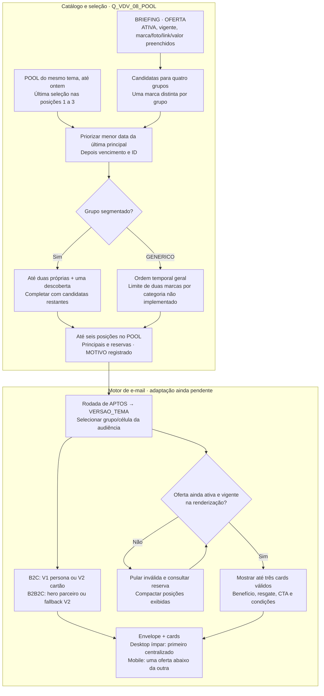
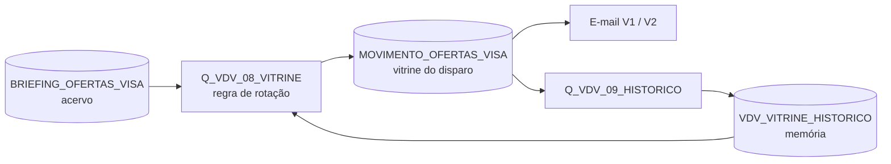

# Seleção e rotação de ofertas Vai de Visa

## 5. Conteúdo, heros, seleção e rotação

O catálogo separa OFERTA, TEMA e HERO pelo TIPO na mesma BRIEFING. Tema e hero compõem o envelope; o POOL escolhe ofertas por grupo e rodada. A seleção não pertence a um CPF: clientes de uma mesma célula/grupo usam a mesma rodada, respeitando a regra SEG-B/GEN-A → GENERICO.

VERSAO da seleção é BF26_V1_AAAAMMDD, uma rodada por data de Brasília no SQL. VERSAO_TEMA é BF26_V1. Na SAFRA, ID_VERSAO_OFERTAS guarda o tema da entrada; em APTOS, o campo guarda a rodada atual. O motor novo precisa resolver o tema pela seleção da rodada antes de buscar TEMA/HERO. Interpretar a rodada como versão do tema quebra essa consulta.



A Q08 não compara R$ com percentual para priorizar desconto. Ela favorece ofertas há mais tempo sem seleção principal naquele grupo, depois vencimento e ID. A deduplicação usa marca normalizada. Não existe GRUPO_2 vigente, e o limite de duas ofertas de uma mesma categoria no GENERICO não está implementado.

As posições 1–3 são principais na memória de seleção; 4–6 são reservas. O uso de uma reserva na renderização não vira automaticamente exposição registrada no POOL. Por isso, “última seleção principal” é a descrição correta da regra, e não “última oferta recebida pelo cliente”. O SQL bloqueia a versão inteira quando ela já existe; rodada parcial exige correção controlada.

APTOS verifica pelo menos três marcas distintas válidas nas posições 1–6 para o grupo efetivamente exibido. Depois, o template deve revalidar cada oferta e compactar as válidas. E-mail já enviado não se rearranja quando uma oferta vence. Guardar apenas OFERTA_ID não preserva a cópia de texto, imagem ou cupom se o catálogo for alterado posteriormente.

:::details Toques, fallback de hero e personalização
B2C usa V1 (persona) e V2 (cartão) nos respectivos toques. B2B2C com arte válida usa o hero do parceiro; sem arte, a regra documentada usa fallback V2. A identificação conservadora de NM_PARCEIRO e o fallback precisam de Test Send no motor novo. NM_CARTAO permanece NULL e o texto deve ter fallback sem inventar o nome do produto.

Assunto/pré-cabeçalho do V2 herdam os do V1 quando vazios na regra anterior; confirmar a preservação na adaptação. Nome ausente exige saudação sem nome. A Fábrica e o exportador ainda trabalham com movimento de seis colunas: não declarar suporte ao POOL de nove campos ou às duas versões antes da adaptação.

O intervalo 3–5 dias discutido em 06/11 era do desenho de dois toques. A revisão recorrente de 09/11 deixa dias/horários e alternância a definir; não transformar esse intervalo antigo em agendamento atual. Quatro cards, destaque comercial e aprendizagem por desempenho são evoluções.
:::

:::details Regras de apresentação e alegações
Comunicar vantagens do programa Visa e suas condições, sem afirmar exclusividade da Afinz. Não usar “até 40 dias para pagar”. Valor, cupom e validade devem corresponder à oferta. Oferta de bebida exige aviso legal aplicável, incluindo venda proibida a menores e consumo com moderação. Manter condições do parceiro, acessibilidade, links e eventual rastreio de afiliado.

O limite ≥ R$ 200 é da base; o contrato atual não contém limite mínimo por oferta, ticket × 1,10 ou garantia de que o limite disponível cobre toda compra. Conteúdo ou foto faltante não deve ser compensado por alegação inventada. Logo ausente pode usar marca textual no template anterior, a conferir no novo.
:::


:::details Contrato do POOL unificado
### `VDV_POOL_OFERTAS_GRUPO_POSICAO`

Guardar a seleção e o histórico de rodadas na mesma DE, sem uma segunda tabela de rotação.

| Configuração | Referência atual |
|---|---|
| Grão | VERSAO × GRUPO × CELULA × POSICAO |
| Carga | Q_VDV_08_POOL · Update com bloqueio de rodada existente |
| Relação de envio | Não enviável |
| Origem | BRIEFING_OFERTAS_VISA + seleções principais anteriores desta própria DE, no mesmo tema. |
| Consumidor | APTOS confere disponibilidade; motor adaptado deve ler seleção + catálogo e resolver VERSAO_TEMA. |
| Pasta | POOL DE OFERTAS VISA; External Key não registrada, conferir sem inferir pelo nome |
| Retenção / defaults | Não reconfirmados no tenant; não ativar expurgo automático por omissão. DT_RODADA é preenchida por query. |

| Campo | Tipo / tamanho de referência | PK | Nulo | Regra / origem |
|---|---|---|---|---|
| `VERSAO` | Text(60) | Sim | Não | Rodada BF26_V1_AAAAMMDD |
| `GRUPO` | Text(50) | Sim | Não | MODA, SAUDE_BELEZA, FAMILIA_PRESENTES, GENERICO |
| `CELULA` | Text(50) | Sim | Não | TODAS na query atual |
| `POSICAO` | Number | Sim | Não | 1 a 6; primeiras três principais e demais reservas |
| `OFERTA_ID` | Text(60) | — | Não | Referência a BRIEFING_OFERTAS_VISA.ID |
| `ATIVA` | Boolean | — | Não | 1 na seleção atual; catálogo ainda precisa de revalidação |
| `MOTIVO` | Text(50) | — | Sim | GRUPO, DESCOBERTA ou COMPLETAR |
| `DT_RODADA` | Date | — | Não | Data preenchida pela query, sem default necessário |
| `VERSAO_TEMA` | Text(60) | — | Não | BF26_V1, chave do tema e dos heros |

**Limites:** Retenção desativada inicialmente é a recomendação do pacote, a conferir no tenant. NOT EXISTS bloqueia a versão inteira se qualquer linha já existir: parcial exige diagnóstico, não nova execução cega. Não congela texto/foto/cupom e não comprova envio.

Tipos/tamanhos e nulidade desta ficha combinam o contrato do pacote e referências anteriores. Onde não houve print/metadado atual, são referência de configuração a conferir, não certificação da DE criada.
:::


:::details Q_VDV_08_POOL · SQL integral atual
### Q_VDV_08_POOL

**Finalidade:** Selecionar até seis marcas por grupo e acumular rodada diária.

| Configuração | Valor |
|---|---|
| Tipo / automação | Query Activity · PREPARAÇÃO · passo 4 |
| Fonte | BRIEFING + histórico na própria DE POOL |
| Destino / ação | VDV_POOL_OFERTAS_GRUPO_POSICAO · Update |
| Pré-condições | PK composta com quatro partes; nove campos; exatamente um tema ativo/vigente; imagens/links/benefícios disponíveis. |
| Conferência | Quatro grupos conferidos, marcas distintas, motivos e posições coerentes; reexecução no mesmo dia preserva seleção. |
| Limitação / recuperação | Qualquer linha da VERSAO bloqueia a rodada inteira. Parcial não é completada automaticamente. Histórico é seleção principal, não envio/uso de reserva. |
| Arquivo de referência | 04_Q_VDV_08_POOL.sql |
| Estado | Montagem informada; execução completa pendente de validação. |

SQL integral preservado, sem regenerar a partir do pacote intermediário de duas automações:

```sql
SELECT
    'BF26_V1_' + CONVERT(
        VARCHAR(8),
        CONVERT(DATE, DATEADD(HOUR, 3, GETDATE())),
        112
    ) AS VERSAO,
    p.GRUPO,
    'TODAS' AS CELULA,
    p.POSICAO,
    p.OFERTA_ID,
    1 AS ATIVA,
    CASE
        WHEN p.GRUPO = 'GENERICO' THEN 'COMPLETAR'
        WHEN p.FAIXA = 1 THEN 'GRUPO'
        WHEN p.FAIXA = 2 THEN 'DESCOBERTA'
        ELSE 'COMPLETAR'
    END AS MOTIVO,
    CONVERT(
        DATE,
        DATEADD(HOUR, 3, GETDATE())
    ) AS DT_RODADA,
    'BF26_V1' AS VERSAO_TEMA
FROM (
    SELECT
        f.GRUPO,
        f.OFERTA_ID,
        f.FAIXA,
        ROW_NUMBER() OVER (
            PARTITION BY f.GRUPO
            ORDER BY
                f.FAIXA,
                f.ULTIMA_RODADA,
                ISNULL(
                    f.FIM,
                    CONVERT(DATE, '20991231', 112)
                ),
                f.OFERTA_ID
        ) AS POSICAO
    FROM (
        SELECT
            r.GRUPO,
            r.OFERTA_ID,
            r.FIM,
            r.ULTIMA_RODADA,
            CASE
                WHEN r.GRUPO = 'GENERICO' THEN 1
                WHEN r.PROPRIA = 1
                    AND r.RN_TIPO <= 2 THEN 1
                WHEN r.PROPRIA = 0
                    AND r.RN_TIPO = 1 THEN 2
                ELSE 3
            END AS FAIXA
        FROM (
            SELECT
                d.GRUPO,
                d.OFERTA_ID,
                d.FIM,
                d.PROPRIA,
                d.ULTIMA_RODADA,
                ROW_NUMBER() OVER (
                    PARTITION BY
                        d.GRUPO,
                        d.PROPRIA
                    ORDER BY
                        d.ULTIMA_RODADA,
                        ISNULL(
                            d.FIM,
                            CONVERT(DATE, '20991231', 112)
                        ),
                        d.OFERTA_ID
                ) AS RN_TIPO
            FROM (
                SELECT
                    c.GRUPO,
                    c.OFERTA_ID,
                    c.FIM,
                    c.PROPRIA,
                    c.ULTIMA_RODADA,
                    ROW_NUMBER() OVER (
                        PARTITION BY
                            c.GRUPO,
                            UPPER(LTRIM(RTRIM(c.MARCA)))
                        ORDER BY
                            c.PROPRIA DESC,
                            c.ULTIMA_RODADA,
                            ISNULL(
                                c.FIM,
                                CONVERT(DATE, '20991231', 112)
                            ),
                            c.OFERTA_ID
                    ) AS RN_MARCA
                FROM (
                    SELECT
                        gg.GRUPO,
                        o.ID AS OFERTA_ID,
                        o.MARCA,
                        o.FIM,
                        CASE
                            WHEN gg.GRUPO = 'GENERICO' THEN 0
                            WHEN o.GRUPO = gg.GRUPO THEN 1
                            ELSE 0
                        END AS PROPRIA,
                        ISNULL(
                            h.ULTIMA_RODADA,
                            CONVERT(DATE, '19000101', 112)
                        ) AS ULTIMA_RODADA
                    FROM (
                        SELECT 'MODA' AS GRUPO

                        UNION ALL

                        SELECT 'SAUDE_BELEZA' AS GRUPO

                        UNION ALL

                        SELECT 'FAMILIA_PRESENTES' AS GRUPO

                        UNION ALL

                        SELECT 'GENERICO' AS GRUPO
                    ) gg
                    CROSS JOIN BRIEFING_OFERTAS_VISA o
                    LEFT JOIN (
                        SELECT
                            GRUPO,
                            OFERTA_ID,
                            MAX(DT_RODADA) AS ULTIMA_RODADA
                        FROM VDV_POOL_OFERTAS_GRUPO_POSICAO
                        WHERE
                            POSICAO BETWEEN 1 AND 3
                            AND ATIVA = 1
                            AND VERSAO_TEMA = 'BF26_V1'
                            AND DT_RODADA < CONVERT(
                                DATE,
                                DATEADD(HOUR, 3, GETDATE())
                            )
                        GROUP BY
                            GRUPO,
                            OFERTA_ID
                    ) h
                        ON h.GRUPO = gg.GRUPO
                        AND h.OFERTA_ID = o.ID
                    WHERE
                        o.TIPO = 'OFERTA'
                        AND o.ATIVA = 1
                        AND LEN(
                            LTRIM(RTRIM(o.MARCA))
                        ) > 0
                        AND LEN(
                            LTRIM(RTRIM(o.FOTO))
                        ) > 0
                        AND LEN(
                            LTRIM(RTRIM(o.VALOR))
                        ) > 0
                        AND LEN(
                            LTRIM(RTRIM(o.LINK))
                        ) > 0
                        AND (
                            o.INICIO IS NULL
                            OR o.INICIO <= CONVERT(
                                DATE,
                                DATEADD(HOUR, 3, GETDATE())
                            )
                        )
                        AND (
                            o.FIM IS NULL
                            OR o.FIM >= CONVERT(
                                DATE,
                                DATEADD(HOUR, 3, GETDATE())
                            )
                        )
                ) c
            ) d
            WHERE d.RN_MARCA = 1
        ) r
    ) f
) p
WHERE
    p.POSICAO <= 6
    AND NOT EXISTS (
        SELECT 1
        FROM VDV_POOL_OFERTAS_GRUPO_POSICAO z
        WHERE z.VERSAO = 'BF26_V1_' + CONVERT(
            VARCHAR(8),
            CONVERT(DATE, DATEADD(HOUR, 3, GETDATE())),
            112
        )
    )
    AND 1 = (
        SELECT COUNT(*)
        FROM BRIEFING_OFERTAS_VISA t
        WHERE
            t.TIPO = 'TEMA'
            AND t.VERSAO = 'BF26_V1'
            AND t.ATIVA = 1
            AND (
                t.INICIO IS NULL
                OR t.INICIO <= CONVERT(
                    DATE,
                    DATEADD(HOUR, 3, GETDATE())
                )
            )
            AND (
                t.FIM IS NULL
                OR t.FIM >= CONVERT(
                    DATE,
                    DATEADD(HOUR, 3, GETDATE())
                )
            )
    )
```
:::

## 10. Decisões, histórico temporal e referências

| Decisão consolidada em 09/11 | Consequência |
|---|---|
| Uma PREPARAÇÃO de seis passos, sem envio | Segunda automação e agendamento ficam para o futuro |
| SAFRA acumulada, público atual separado | Novos elegíveis entram; inaptos saem de APTOS sem apagar medição e podem retornar |
| Grupo/célula/token congelados por CPF+safra | Não re-sortear nem trocar ID_ENVIO em cada contato |
| POOL único por rodada | Seleção e histórico juntos, sem DE adicional de histórico/audiência |
| Tema e rodada distintos | Adaptar lookup de tema/hero e exportador/template |
| Três cards, até seis candidatas | Revalidar e compactar reservas; quatro cards é futuro |
| Família e Presentes tem prioridade | A SQL antiga sem essa precedência está superada |
| Sem GRUPO_2 vigente | Grupo secundário do cliente não altera circulação de ofertas |

:::details Pendências que ainda mudam a implementação
| Questão | Impacto | Evidência / próxima ação | Dono a confirmar |
|---|---|---|---|
| Primeira execução completa e FUNIL final | Impede declarar revisão homologada | Rodar seis passos sem envio e registrar resultados | Operador SFMC |
| Fábrica/exportador/template no modelo unificado | Prévia antiga pode divergir do envio novo | Adaptar leitura POOL + VERSAO_TEMA e testar | Desenvolvimento + operador |
| Nome comercial do cartão e múltiplos parceiros | Personalização incompleta/ambígua | Confirmar fonte e regra comercial, exercitar fallbacks | Produto/CRM/IN |
| Imagens, links e vigência | Pode faltar o mínimo de três marcas | Conferir catálogo aceito no tenant e prioridades de criação | Ofertas/Criação/operador |
| SFTP, frescor e conversão de todas as categorias | Reprocessar arquivo antigo pode parecer fonte atual | Cadência, responsável e referência de extração reais | IN |
| Fuso dos filtros e fronteira de dia | Pode mudar recência e nome de rodada perto da virada | Conferir relógio do tenant e convenção do SQL | Operador |
| Supressões e publicação | APTOS não garante todo bloqueio de envio | Conferir publication list e configuração da BU | CRM |
| Proteção do mesmo send e JobID ↔ rodada/toque | Risco de repetição e exposição não reconciliável | Definir identidade e deduplicação do envio futuro | CRM + Desenvolvimento |
| Cadência, dias e V1/V2 | Não existe rotina recorrente aprovada | Decidir após primeira execução e seedlist | Time de CRM |
| Medição recorrente e controle | Janela por safra pode misturar exposições | Contrato IN com denominador, janelas e cobertura | IN + CRM |
:::

:::details O que mudou em relação a 03–06/11
03/11: preparação anterior documentou 130.175 CPFs aptos. Esse é um snapshot histórico, não volume desta revisão. Os marcos de construção preservam a data e o alcance daquela evidência.

05–06/11: foram propostas automações PREPARAÇÃO + DISPARO, uma memória separada de vitrine e VDV_DISPARO. Também circularam GRUPO_2, SAFRA no tema, ranking de descontos e layouts de quatro cards. São antecedentes históricos; o desenho atual acima prevalece.

09/11: a decisão consolidada define MAPA → CRUZAMENTO → SAFRA → POOL → APTOS → FUNIL numa PREPARAÇÃO, com público dinâmico e sem envio automático. Saem a exigência imediata de segunda automação, safra fechada, APTOS com controles, trava PREP_FIM de quatro horas, DE de audiência extra e histórico separado. A seleção atual não compara percentual e valor absoluto de desconto.

Os SQLs foram extraídos das últimas mensagens correspondentes no chat de origem. O pacote Downloads/VDV_Automacoes_V2_20261108 e o texto VDV_Fluxo_Recorrente_Aprovado_20261108.md são versões intermediárias, não fonte operacional desta revisão. O histórico anterior está preservado no pacote local de revisão e será mantido identificado nas notas relacionadas, sem orientar a execução corrente.
:::

Referências: [[Automacao-VDV-Pool-de-Ofertas]] · [[Rotacao-de-Ofertas-Vai-de-Visa]] · [[Plano-de-Comunicacao-Pool-Vai-de-Visa]] · [[Emails-Dinamicos-Vai-de-Visa]] · [[DE-BRIEFING_OFERTAS_VISA]] · [[DE-VDV_CRUZAMENTO]] · [[DE-VDV_ENVIO|VDV_SAFRA]] · [[DE-MOVIMENTO_OFERTAS_VISA|POOL unificado]] · [[DE-VDV_APTOS]] · [[DE-VDV_FUNIL]] · [[DE-MAPA_MCC]] · [[DE-CLIENTES_ATIVOS]] · [[MOC-SFMC-DEs-e-Automations]] · [[Teste-Afinidade-MCC-vs-Generico]] · [[Iniciativa-Pool-de-Ofertas-Vai-de-Visa]] · [[Decisões-Tomadas]] · [[Decisões-Abertas]].


:::details Histórico anterior a 09/11 · não executar como instrução vigente
### Rotação de ofertas · Pool de Ofertas - Vai de Visa

**Definição e propósito:** como as ofertas do acervo circulam entre os grupos a cada disparo do [[Iniciativa-Pool-de-Ofertas-Vai-de-Visa|Vai de Visa]], sem montar vitrine à mão e sem nunca deixar um cliente sem oferta. É a estratégia por trás das queries `Q_VDV_08_VITRINE` e `Q_VDV_09_HISTORICO`.

> Status: decisões de 05/11/2026 = `confirmado` (operador). Regra de priorização e SQL = `proposta`, ainda não testados no SFMC.

### Decisões tomadas (05/11/2026)

1. **Rotação por grupo**, não por cliente: todo mundo do mesmo grupo vê a mesma vitrine no mesmo disparo. Mais simples de operar e de medir (cada disparo funciona como uma rodada).
2. **A Black Friday já usa a mesma rotação da campanha perene.** Não existe vitrine "especial" manual.
3. **Dois disparos por semana** como cadência habitual; a vitrine é recalculada **a cada disparo**.
4. **Marca que serve dois grupos circula nos dois** (coluna `GRUPO_2` no acervo). O histórico é por grupo, então ela gira de forma independente em cada um.
5. **Nunca sair sem oferta.** Se o grupo não tiver ofertas suficientes, a vitrine completa com qualquer oferta ativa do acervo, numa ordem de prioridade.

### Modelo em três camadas



| Camada | Peça | Papel | Quem alimenta |
|---|---|---|---|
| Acervo | [[DE-BRIEFING_OFERTAS_VISA]] | o que **pode** aparecer | Ofertas/operação (CSV; depois a Fábrica) |
| Regra | `Q_VDV_08_VITRINE` | escolhe a vitrine de cada grupo | automação, a cada disparo |
| Vitrine | [[DE-MOVIMENTO_OFERTAS_VISA]] | o que o e-mail lê | Overwrite pela Q8 |
| Memória | [[DE-VDV_VITRINE_HISTORICO]] | o que cada grupo viu, quando e por quê | `Q_VDV_09_HISTORICO`, acumula |

O e-mail **não muda**: continua lendo o `MOVIMENTO`. Só muda quem escreve nele (antes manual, agora a Q8).

### Regra de priorização (por grupo, a cada disparo)

O template da Fábrica mostra **até 3 cards** (`builtin-vdv-pool`) e lê até 6 posições; da 4ª em diante é reserva.

| Faixa | Posições | O que entra | `MOTIVO` gravado |
|---|---|---|---|
| 1 | 1–2 | ofertas do grupo (`GRUPO` ou `GRUPO_2`) | `GRUPO` / `GRUPO_2` |
| 2 | 3 | 1 oferta de **fora** do grupo: vaga de descoberta | `DESCOBERTA` |
| 3 | 4+ | demais ofertas do grupo | `COMPLETAR` |
| 4 | depois | demais ofertas de fora | `COMPLETAR` |

Se o grupo não tiver 2 ofertas próprias, a faixa 3 está vazia e as faixas 2 e 4 completam. Por isso nunca falta oferta enquanto houver pelo menos 3 ofertas válidas no acervo.

**Ordem dentro de cada faixa:**
1. **mais tempo sem aparecer naquele grupo** (lido do histórico; nunca mostrada = primeiro). É isso que faz girar;
2. **vence antes** (aproveita a oferta antes de expirar);
3. **maior desconto** (número do `VALOR`; R$ e % ainda misturados, ver lacunas);
4. *(futuro)* **desempenho**: clique por oferta × grupo (alias dos links) e compra por marca (IN).

**Travas:**
- só oferta `ATIVA`, vigente no dia (`INICIO`/`FIM`), com `FOTO`, `LINK` e `VALOR`;
- 1 oferta por marca em cada vitrine;
- histórico lido só até ontem, então rodar a automação duas vezes no mesmo dia gera a mesma vitrine;
- *(a implementar)* no `GENERICO`, no máximo 2 ofertas do mesmo grupo de origem.

**Por que a regra roda no SFMC e não na Fábrica:** com 2 trocas por semana, aprovar cada vitrine à mão não se sustenta. A transparência vem do histórico, que grava o `MOTIVO` de cada oferta: "por que a Puma apareceu para Saúde e Beleza?" tem resposta registrada. A Fábrica continua sendo onde se edita o acervo e se vê a prévia.

### Efeito no teste (SEG-A × SEG-B)

As duas células giram, cada uma com sua vitrine (SEG-A: vitrine do grupo; SEG-B e GEN-A: vitrine `GENERICO`). A comparação continua válida porque a regra é a mesma para todos; o que muda é a lista de candidatas. A medição lê por disparo: [[DE-VDV_ENVIO]] (quem, grupo, célula) + [[DE-VDV_VITRINE_HISTORICO]] (o que o grupo viu no dia) + `_Sent`/cliques do SFMC + compra pela IN.

### Limitação atual 📊 (05/11/2026)

Só 12 ofertas do acervo têm foto. Em Moda, as ofertas próprias com foto são Puma, Riachuelo e Decathlon: as posições 1–2 alternam entre elas e a rotação aparece de verdade na posição 3 (descoberta). Cada foto nova que a criação entregar aumenta a rotação sem mexer em código.

### Fases

| Fase | O que roda |
|---|---|
| Black Friday | rotação automática com o acervo atual (12 com foto); hero V1/V2; 2 disparos por semana |
| Perene v1 | acervo maior (fotos e logos das 48 ofertas restantes); Fábrica como fonte do acervo; destaque comercial se aprovado |
| Perene v2 | desempenho (clique e compra) entra na ordem; rotação por cliente só se os dados mostrarem cansaço (clique caindo entre disparos para quem recebe muitos) |

### Decisões abertas

- **Divisão das posições:** 2 do grupo + 1 descoberta com 3 cards (como está no SQL)? Ou 3 do grupo quando houver oferta suficiente e descoberta só para completar? → muda a faixa 1 da Q8 → operação.
- **Hero com 2 disparos por semana:** V1 (persona) e V2 (cartão) se alternam por disparo? Parceiro com arte continua sempre com a arte dele → define qual e-mail cada automação envia → operação.
- **Destaque comercial:** coluna `DESTAQUE` no acervo que põe a oferta na posição 1 de todos os grupos quando a Visa pedir? → operação/Ofertas.
- **Entrada de novos aptos a cada disparo:** proposta já no SQL (Q5 só acrescenta CPF novo) → confirmar → operação.
- **Dias da semana dos dois disparos** → cadência da automação → operação.

### Lacunas

- Desconto em R$ e em % comparados como número → oferta de R$ 100 passa na frente de 15% → separar tipo de desconto ou usar só como último critério → Claude/operação.
- Regra de no máximo 2 por grupo no `GENERICO` ainda não está no SQL → vitrine genérica pode concentrar uma categoria → Claude.
- Clique por oferta ainda não volta para a regra → a ordem não aprende → extrair tracking por alias para uma DE de desempenho (perene v2) → operação.

### Relacionado

[[Automacao-VDV-Pool-de-Ofertas]] · [[DE-MOVIMENTO_OFERTAS_VISA]] · [[DE-VDV_VITRINE_HISTORICO]] · [[DE-BRIEFING_OFERTAS_VISA]] · [[Teste-Afinidade-MCC-vs-Generico]] · [[Plano-de-Comunicacao-Pool-Vai-de-Visa]] · [[Emails-Dinamicos-Vai-de-Visa]]
:::

