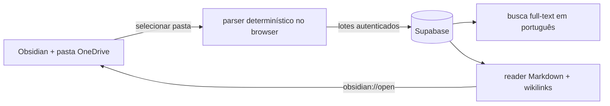

# GaaS Vault Library

## Definição

A seção **Vault**, dentro de **Aprendizado e Memória**, transforma o `Afinz-CRM-Midia-Vault` em uma biblioteca viva dentro do GaaS sem mudar sua autoridade: a pasta hospedada e aberta pelo Obsidian continua sendo a fonte canônica de edição. O Supabase mantém somente uma **projeção autenticada, pesquisável, visual e auditável**.

Essa separação evita dois erros: editar duas fontes concorrentes e publicar o conteúdo privado do vault no bundle estático do GitHub Pages.

## Fluxo

1. Um admin governado seleciona a pasta `Afinz-CRM-Midia-Vault` no botão **Sincronizar pasta**.
2. O browser ignora `.obsidian`, `.git` e `99-Templates`, lê somente Markdown e preserva o caminho relativo como identidade.
3. Frontmatter, tags, aliases, conteúdo, hash SHA-256, modificação de origem e wikilinks são enviados em lotes idempotentes.
4. O run só marca ausências como exclusão lógica depois de finalizar por inteiro. Falha parcial não apaga a publicação anterior.
5. Usuários autenticados leem e pesquisam; apenas membros `admin` ativos de `report_live_memberships` conseguem sincronizar.

## Contrato de dados

- `gaas_vault_notes`: projeção atual, caminho único, conteúdo Markdown, metadados e `tsvector` ponderado.
- `gaas_vault_links`: grafo de wikilinks, com alvo resolvido quando há correspondência determinística.
- `gaas_vault_note_revisions`: snapshot append-only antes de cada alteração real de hash.
- `gaas_vault_sync_runs`: evidência de início, conclusão/falha, notas, links, alterações e exclusões.
- `gaas_vault_backlinks_v`: leitura de backlinks com `security_invoker`.
- `gaas_search_vault_index`: busca paginada que devolve apenas metadados; o Markdown completo é buscado somente ao abrir uma nota.
- `gaas_vault_folder_facets`: contagem compacta das pastas de primeiro nível para navegação.

Todas as tabelas têm RLS. `anon` não recebe acesso; `authenticated` recebe somente leitura. As mutações passam por RPCs com checagem administrativa interna e `search_path` fixo.

## Experiência dentro de Aprendizado e Memória

A interface segue `glance → scan → drill → action`:

- **glance:** último sync e estado fresco/pendente;
- **scan:** pastas de primeiro nível com contagem, busca full-text e lista paginada;
- **drill:** reader Markdown carregado sob demanda, com tags, metadados e backlinks;
- **action:** navegar por wikilinks, abrir a nota canônica no Obsidian ou sincronizar uma nova versão.

A área **Aprendizado e Memória** funciona mesmo se as tabelas operacionais de CRM ainda não tiverem carregado. O Vault não aparece como destino primário: ele é a fonte canônica consultável que sustenta o loop, enquanto **Memória** concentra aprendizados validados e reutilizáveis.

## Fronteiras e próximos usos

- O MVP não usa embeddings nem geração aberta para recuperar conhecimento. A busca é full-text determinística em português.
- Arquivos não Markdown permanecem na pasta canônica e ainda não são publicados no reader.
- Wikilinks sem alvo único ficam não resolvidos; não há associação probabilística silenciosa.
- A camada é a base para, depois, ligar notas a aprendizados, apostas, decisões, relatórios e evidências por relações explícitas — sem misturar biblioteca canônica com memória operacional.

## Operação

- Autor: editar no Obsidian e salvar normalmente no OneDrive.
- Publicador: entrar no GaaS com a conta administrativa, abrir **Análise → Aprendizado e Memória → Vault** e selecionar a raiz do vault.
- Leitor: pesquisar e navegar no GaaS; usar **Abrir no Obsidian** quando precisar editar.
- Diagnóstico: consultar o último `gaas_vault_sync_runs`; um run `failed` preserva a versão publicada anterior.

## Relacionado

- [[MOC-Engenharia]]
- [[Arquitetura-Geral]]
- [[Loop-de-Aprendizado-Growth]]
- [[Report-Live-Enciclopedia]]

## Aplicação operacional — revisão editorial 02/10/2026

### Enciclopédia interna por conteúdo

[[Enciclopedia-Servicos-Growth]] adiciona uma porta de entrada por tarefas e uma trilha para pessoas novas e IAs. [[Padrao-Editorial-Enciclopedia]] define profundidade; [[Fontes-e-Proveniencia-Growth]] separa conhecimento, configuração e execução. Esses caminhos usam notas e wikilinks no reader existente.

### O que é conteúdo e o que ainda é proposta de interface

Trilhas, tabelas de serviço, critérios de conclusão e relações descritas em prosa são conteúdo canônico. Sumário fixo, filtros por serviço/produto, relações tipadas e atalhos de execução contextualizados exigem evolução de código; não foram implementados por esta revisão editorial. O vault permanece dentro de Aprendizado e Memória.

### Sincronização e auditoria

Revisão editorial não significa projeção atualizada. Comparar hashes locais e publicados, conservar revisões anteriores e registrar run/conclusão. Uma atualização incremental não deve remover notas ausentes de seu payload. Remoção lógica exige inventário completo e run concluído. [[Auditoria-Contexto-Vault-2026-10-02]] registra o corte inicial.

## Colaboração com IA e Registros — 22/10/2026

A experiência atual mantém as seis seções, com cabeçalho compacto em todas. **Registros** é o novo rótulo de Memória (`section=memory` preservado). A Wiki oferece **Trabalhar com IA** para preparar pacotes completos, consultar versões privadas e enviar contribuições. [[Inteligencia-Compartilhada-GaaS]] documenta a autoridade exclusiva de Pablo para revisar e incorporar no vault local, recompilar e sincronizar. Aprovação não escreve nas notas; incorporação só é confirmada por hashes e sync concluído posterior.
