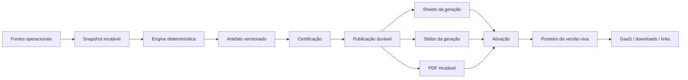

# Report Live — enciclopédia de arquitetura, evolução e operação

Esta é a página central de conhecimento do **Report Live do GaaS**. Ela explica por que o produto existe, como a arquitetura evoluiu, o que está em produção, quais contratos sustentam a confiabilidade e onde procurar os detalhes técnicos. As notas especializadas continuam sendo as fontes completas; esta enciclopédia organiza o conjunto.

> [!summary] Definição em uma frase
> O Report Live transforma dados de aquisição em uma **versão imutável, certificada e publicável de relatório**; o GaaS controla essa versão, enquanto Google Sheets, Google Slides e PDF são destinos verificáveis dela.

## Estado de referência — 13/09/2026

| Item | Estado confirmado |
|---|---|
| Período homologado | Agosto de 2026 (`2026-08-01` a `2026-08-31`) |
| Run certificado | `9bb55892-4b17-4f76-825a-0ac97c92b525` |
| Publicação ativa | `54649269-7cce-460a-a87d-b4cc5f310a62`, versão 8 |
| Saída | 57 slides e PDF imutável de 57 páginas |
| PDF | SHA-256 `b32ceb5e92b0e75f0615cdacf0bb4db2cb905055698c385c7f9926cc79877fb4` |
| Qualidade editorial | B2C e séries numéricas indisponíveis da Copa aparecem como avisos vermelhos; nenhum zero foi inventado |
| Frontend | GaaS publicado no GitHub Pages; `main` atual após acesso de equipe em `22973ef` |
| Backend | `report-sync` canônico com pipeline durável; migrations aplicadas até `20260913174500_report_live_team_access.sql` |
| Automação | Worker a cada minuto e watchdog a cada cinco minutos |
| Acesso | Leitor, analista, publicador e administrador via `report_live_memberships` |
| Manutenção | Encerrada após homologação e confirmação do bundle público |

Esse estado é uma fotografia da release. IDs, hashes e versões existem para permitir auditoria; não devem ser copiados como configuração de uma nova execução.

## O problema que o produto resolve

O processo antigo terminava em arquivos XLSX e montagem manual de apresentação. Isso criava quatro problemas recorrentes:

1. O arquivo baixado não tinha um endereço permanente nem um estado operacional claro.
2. Planilha e deck podiam acumular dados de ciclos diferentes.
3. Um `done` técnico podia ser interpretado como relatório publicado, mesmo sem certificação ou QA.
4. Falhas parciais no Google podiam deixar o material vivo em estado difícil de explicar ou restaurar.

O Report Live nasceu para manter um destino permanente e foi evoluído para controlar todo o ciclo de vida do relatório. A mudança mais importante foi retirar do Google Slides a função implícita de banco de dados e coordenador da execução.

## O modelo mental atual



As responsabilidades são separadas:

- **Fontes operacionais** fornecem fatos, cobertura e cutoffs.
- **Snapshot** congela exatamente o que será calculado.
- **Engine** calcula números, confiança e bloqueios de modo determinístico.
- **Artefato** guarda tabelas, manifestos, narrativa e blueprint de uma candidata.
- **Certificação** revalida hashes, contratos e regras antes de qualquer escrita.
- **Publicação** aplica a candidata por etapas, registra recibos e consegue retomar.
- **Google** renderiza a geração identificada.
- **Ponteiro vivo** declara qual publicação o GaaS deve tratar como oficial.

### Fonte de verdade

A fonte de verdade é a versão registrada no GaaS/Supabase, composta por snapshot, artefato, manifesto, hashes, estado de certificação e publicação. Sheets, Slides e PDF representam essa versão.

Isso não elimina a planilha. Gráficos e tabelas continuam sendo escritos no Sheets e usados pelo Slides. A diferença é que a escrita agora parte de uma definição central e verificável. O sistema sabe o que deveria existir antes de escrever, confere o que foi escrito e só então ativa a publicação.

## Como evoluímos até aqui

### 1. Sincronização direta — julho de 2026

A V3 estabeleceu o fluxo `Supabase → Sheets → Slides`, com planilha e deck fixos, views, gráficos vinculados, placeholders por `alt-text` e narrativa externa via `skip_llm`. Foi o salto do XLSX descartável para uma entrega viva.

Os pilares corretos já estavam presentes: número calculado por código, prosa separada, dimensões canônicas, idempotência, anomalia determinística e observabilidade em `report_runs`.

Limite dessa fase: o Google ainda concentrava estado demais. Views quebradas, placeholders crus, gráficos herdados e slides antigos podiam coexistir com uma execução nova.

Fonte: [[Report-Live-Sheets-Slides]].

### 2. Versionamento e publicação controlada — 23/07/2026

O relatório passou a ter versões independentes de fonte, semântica, spec editorial, narrativa, renderer e publicação. Surgiram o blueprint persistido, a máquina de estados, o ponteiro de publicação e o protocolo `build → certify → publish → rollback`.

Essa fase consolidou o deck como destino de deploy. Também criou os primeiros testes de regressão, golden run e QA visual.

Fonte: [[Report-Live-Versionamento-e-Publicacao]].

### 3. Auditoria estrutural — 09/09/2026

A revisão profunda mostrou que a existência de um run publicado não provava a integridade do Google vivo. O Sheets tinha 121 abas, 82 vazias; entre 93 abas `VIEW_`/`VP_`, 66 estavam vazias. O perfil apontava junho, o banco apontava julho e os documentos não formavam uma geração única comprovada.

Também apareceram lacunas semânticas:

- custos ausentes e CAC armazenado divergente;
- risco de somar níveis diferentes de mídia;
- B2C sem cobertura para agosto;
- janelas e eventos de atribuição incompatíveis;
- classificação de frente por nome absorvendo campanhas erradas;
- contagem de linhas tratada como contagem de campanhas;
- certificação que ainda não revalidava todo o conteúdo.

A decisão foi investigar e preservar a falta de dado, em vez de completar o relatório por hipótese.

Fonte: [[Ficha-Tecnica-Growth-e-Auditoria-Report-Live-2026-09]].

### 4. Build durável e candidata isolada — 10 a 11/09/2026

O build foi dividido em etapas persistidas: atualizar fontes, capturar inputs, calcular, persistir e certificar. Cada etapa passou a ter lease, checkpoint, limite de tentativas e transições válidas.

Uma Edge Function candidata foi usada para testar a nova construção sem alcançar rotas de escrita Google. O run final de agosto preservou CRM mesmo com B2C indisponível e certificou um artefato imutável.

Essa separação resolveu um ponto essencial: falhar depois de calcular não obriga a consultar ou recalcular as fontes.

### 5. Publicação recuperável — 12/09/2026

A publicação foi quebrada em uma etapa por chamada:

`backup → sheets → verify_sheets → slides → narrative → verify_slides → pdf → activate → commit → done`

Cada fase exige pré-requisitos, posse válida do job e recibo verificado. A comparação de células preserva a diferença entre vazio, zero, `false`, texto numérico e fórmula. O backup passou a guardar valores tipados, fórmulas, estrutura necessária do Sheets e elementos do Slides.

O deck fica reservado por toda a operação, inclusive em pausa. O watchdog respeita jobs duráveis e a recuperação não depende do mesmo caminho que falhou.

### 6. Gerações isoladas e PDF antes da ativação — 13/09/2026

Uma publicação passou a escrever em namespace de planilha e IDs de slides próprios da geração. Narrativa e gráficos só podem alcançar os slides identificados para aquele run.

O PDF é produzido antes da ativação e contém somente a geração alvo. A ativação torna a geração nova visível e retira a anterior. Assim, um PDF histórico não é reexportado a partir do deck vivo e uma geração incompleta não se torna oficial.

### 7. Homologação real de agosto — 13/09/2026

A execução foi exercitada nos documentos vivos durante janela de manutenção. Houve backup, escrita, conferência, geração de PDF, ativação e teste de recuperação. As 57 páginas foram renderizadas e revisadas visualmente.

O aceite confirmou:

- CRM preservado;
- B2C ausente sinalizado explicitamente;
- CPA limitado à cobertura válida;
- nenhuma mistura de gerações;
- PDF e deck correspondentes à mesma versão;
- ponteiro atualizado apenas após os controles.

### 8. Operação automática e acesso de equipe — 13/09/2026

O worker periódico foi ativado, a autenticação interna foi estabilizada e a manutenção encerrada. Em seguida, a autorização deixou de depender de um operador único e passou a usar membros com papéis.

O GaaS passou a oferecer geração de candidata, publicação, progresso, download e gestão de equipe conforme a permissão. Runs guardam `requested_by`; publicações guardam `published_by`; alterações de papel deixam auditoria.

## Contratos de dados que não se negociam

### Ausência não é zero

Sem observação, o sistema registra indisponibilidade e o motivo conhecido ou provável. Ele não cria zero para completar gráfico, taxa ou narrativa. Uma frente pode publicar com quadro vermelho quando outra frente tem dados válidos.

### CPA não é CAC

- **CPA de plataforma** depende do evento certificado, janela de atribuição, granularidade e cobertura daquela plataforma.
- **CAC CRM** depende do custo de comunicação e do denominador de cartões atribuídos no mesmo recorte.

Um indicador não substitui o outro. Custo ou denominador parcial não gera um CAC aparentemente completo.

### Cutoff faz parte do dado

Cada fonte carrega seu próprio limite de cobertura. Uma leitura integrada usa apenas o intervalo comparável; uma leitura específica de frente pode manter o período nativo, desde que declare o limite.

### Identidade exige chave governada

Nomes parecidos não autorizam fusão de campanhas. A ligação usa IDs, aliases aprovados e regras explícitas. Jornada não é fonte de parceiro. O valor bruto é preservado ao lado da dimensão canônica e de sua confiança.

### Alcance e hierarquia de mídia não são aditivos por padrão

Linhas de anúncio, conjunto e campanha não podem ser somadas como fatos independentes. Alcance de observações diferentes não vira automaticamente alcance único.

### Narrativa não calcula

Todo número publicado deve existir no artefato certificado. A camada narrativa explica evidências, limites e ações; ela não corrige lacunas nem cria indicadores.

## Objetos e estados principais

| Objeto | Papel |
|---|---|
| `report_runs` | Identidade da execução, período, versões, status e autoria |
| `report_build_jobs` | Etapa corrente do build, lease, tentativas e checkpoint |
| `report_frozen_inputs` | Referência aos inputs capturados de forma imutável |
| Artefato no Storage | Manifesto, tabelas, narrativa, blueprint e hashes da candidata |
| `report_publications` | Publicação, versão, geração Google, PDF, estado e autoria |
| Job/recibos de publicação | Progresso verificável de cada efeito externo |
| Manifesto de recuperação | Estado anterior e instruções reproduzíveis de restauração |
| `report_live_pointer` | Referência atômica à publicação oficial |
| `report_live_memberships` | Papel e situação do usuário |
| `report_live_membership_audit` | Histórico das mudanças de acesso |

### Estados conceituais

```text
queued → building → built → certifying → certified
                                      ↓
                         publishing → published
```

Estados excepcionais incluem `failed`, `rejected`, `superseded` e `rolled_back`. Um build certificado é uma candidata pronta para publicação; não é ainda a saída viva.

## Build: como uma candidata nasce

1. **Refresh controlado:** atualiza somente as fontes previstas e registra cobertura.
2. **Captura:** consulta as fontes uma vez e grava o snapshot imutável.
3. **Cálculo:** produz métricas, qualidade, cutoffs e manifestos a partir do snapshot.
4. **Persistência:** salva o artefato e confirma o conteúdo por hash/read-back.
5. **Certificação:** reidrata o artefato salvo e recalcula hashes e contratos.

O build deve ser idempotente por identidade de conteúdo. Repetir uma solicitação após perda de resposta não pode criar uma versão diferente com o mesmo conteúdo nem sobrescrever bytes divergentes.

## Publicação: como uma candidata chega aos documentos vivos

1. **Backup:** preserva o estado anterior e valida se a restauração é suportada.
2. **Sheets:** escreve a geração em seu namespace.
3. **Verificação do Sheets:** compara todas as células esperadas e detecta resíduos.
4. **Slides:** monta apenas os slides da geração alvo.
5. **Narrativa:** preenche os elementos identificados dessa geração.
6. **Verificação do Slides:** confere IDs e elementos obrigatórios, não apenas a contagem.
7. **PDF:** exporta somente a geração alvo e salva bytes imutáveis no Storage privado.
8. **Ativação:** torna a geração nova visível e retira as anteriores.
9. **Commit:** atualiza publicação e ponteiro depois das evidências.

Uma falha mantém o job retomável na fase correta. O efeito pode ser repetido com o mesmo identificador; o checkpoint só avança depois da confirmação.

## Como Sheets, Slides e PDF funcionam agora

### Google Sheets

A planilha continua sendo o mecanismo de tabelas e gráficos vinculados, mas cada publicação tem namespace de geração. A candidata define as tabelas esperadas; o publisher escreve e relê usando valores não formatados. Linhas e células residuais são parte da verificação.

### Google Slides

O deck continua único e vivo. Slides gerenciados recebem IDs derivados da geração. O renderer procura os elementos obrigatórios e limita atualizações ao conjunto correto. Modelos, slides antigos ou elementos sem identidade não contam como publicação válida.

### PDF

O PDF é um artefato privado e imutável associado à publicação. Ele é gerado antes da ativação, verificado por contagem e hash e depois servido por URL assinada. Downloads históricos usam os bytes preservados; não exportam o estado atual do deck.

### Exportação por frente

A arquitetura modular permite selecionar frentes sem recalcular os indicadores e sem alterar o deck vivo. Viewer completo, histórico e PDF/PPTX filtrados por frente continuam como evolução de produto posterior à base de agosto.

## Falhas, concorrência e recuperação

### Leases e posse

Workers recebem um lease temporário. Antes e depois de um efeito externo, a função confirma que ainda possui o job. Dois workers podem acordar ao mesmo tempo, mas só um executa a fase.

### Checkpoints

O checkpoint registra o efeito confirmado. Uma resposta perdida pode levar à repetição da fase, por isso cada operação precisa ser segura sob repetição.

### Reserva do deck

Uma publicação reserva o deck até terminar, ser restaurada ou ser encerrada de forma controlada. Uma pausa não libera silenciosamente o destino para outra versão.

### Recuperação independente

O manifesto permite restaurar o estado anterior sem recalcular as fontes e sem depender do caminho normal de publicação. Se algum elemento afetado não tiver recuperação suportada, a publicação deve ser bloqueada antes da primeira escrita.

### Watchdog

O watchdog detecta operações abandonadas, mas respeita leases válidos, jobs duráveis e publicações pausadas que ainda reservam o deck. Ele não deve transformar uma execução lenta em falha nem disputar o mesmo efeito.

## Segurança e acesso de equipe

### Papéis

| Papel | Capacidade principal |
|---|---|
| `viewer` | Consultar estado e baixar o PDF publicado |
| `analyst` | Gerar e validar uma candidata imutável |
| `publisher` | Fazer o trabalho do analista e promover a candidata aos documentos vivos |
| `admin` | Gerenciar os membros e seus papéis |

Usuários autenticados sem associação explícita recebem a experiência mínima de leitura. Uma associação inativa bloqueia o acesso concedido anteriormente. A credencial do worker é separada da identidade humana.

### RLS e serviço

As tabelas do protocolo de build/publicação são privadas para o serviço. Em 13/09, `activities`, `paid_media_metrics` e `b2c_daily_metrics` passaram a ter RLS e perderam acesso anônimo. O CRUD autenticado amplo foi preservado temporariamente por compatibilidade e permanece dívida a reduzir por consumidor.

### Auditoria

Mudanças de membro são feitas por uma RPC atômica e entram em `report_live_membership_audit`. Autoria do pedido e da publicação permanece nas entidades correspondentes.

## Interface no GaaS

O card do Report Live diferencia claramente:

- candidata em construção;
- candidata certificada e ainda não publicada;
- publicação em andamento;
- publicação confirmada;
- falha, pausa ou manutenção;
- permissão do usuário;
- PDF e links da versão ativa.

O modo `full` permanece compatível: responde `202` com `run_id` e enfileira o fluxo durável. O frontend acompanha o banco; ele não segura uma chamada longa até o Google terminar.

Durante manutenção, novos disparos e downloads ficam bloqueados no GaaS com mensagem visível. Links diretos do Google podem ficar temporariamente inconsistentes durante a janela e exigem disciplina operacional.

## Homologação de agosto como caso de referência

### Evidência congelada

- CRM: 809 linhas, 2.849 cartões e custo registrado de `45.391,037184`.
- Mídia: 555 linhas e gasto de `13.157,740061`.
- B2C: sem cobertura de agosto.
- Rentabilização: dados até 23/08.
- Fonte governada de eventos Meta: cobertura restrita; ausência em 25/08 mantida como ausência.

Esses totais reconciliam o snapshot com as fontes usadas. Eles não corrigem automaticamente divergências de CAC nem certificam atribuição fora da cobertura.

### Resultado publicado

- 57 slides visíveis, sem geração anterior visível.
- PDF de 57 páginas, sem páginas vazias nem placeholders de gráfico.
- Quadros vermelhos nos recortes sem evidência numérica suficiente.
- Recovery exercitado durante a homologação.
- Publicação, run, job, QA, Google e ponteiro em estados coerentes.

## Qualidade e release

Na release de agosto passaram:

- 124 testes Vitest;
- 41 testes Node específicos do Report Live;
- checagens Deno do runtime, renderer e candidata;
- build Vite;
- testes SQL transacionais de armazenamento, retomada, leases, publicação por geração, PDF antes da ativação, RLS, scheduler e acesso de equipe;
- inspeção visual de todas as 57 páginas do PDF;
- verificação do bundle servido pelo GitHub Pages;
- ciclos reais do worker e prova de concorrência sem novo job ou alteração do ponteiro.

O repositório ainda tem 57 diagnósticos TypeScript preexistentes. O gate de release compara a assinatura desses erros e bloqueia qualquer diagnóstico novo. Isso significa regressão controlada, não typecheck integralmente verde.

O `npm audit` caiu de 24 para 8 alertas. Os restantes estão em ferramentas Vite/Vitest, `uuid` transitivo do ExcelJS e `xlsx`; não executam dentro do worker Deno. Devem ser tratados numa atualização própria, sem misturar troca ampla de dependências com uma publicação mensal.

## Decisões que moldaram a arquitetura

| Decisão | Motivo |
|---|---|
| Um Sheets e um Slides vivos | Preservar links oficiais já distribuídos |
| Versão no banco, não cópia do deck | Permitir reprodução, comparação e rollback sem multiplicar destinos |
| Snapshot antes do cálculo | Evitar que retomada consulte uma fonte já alterada |
| Publicação parcial com aviso | Preservar frentes válidas sem inventar dados da frente indisponível |
| PDF antes da ativação | Impedir que a saída oficial seja diferente do arquivo baixável |
| Geração isolada | Evitar mistura de slides, gráficos e narrativas de períodos diferentes |
| Worker pequeno e periódico | Respeitar limites de Edge Function e retomar por checkpoints |
| Papéis de equipe | Permitir operação por outras pessoas com responsabilidade delimitada |
| Memória de IA adiada | Entregar confiabilidade de dados/publicação antes de ampliar inteligência |

## Dívidas e limites conhecidos

1. **TypeScript:** 57 diagnósticos herdados; a meta é reduzir a referência, nunca regenerá-la para esconder regressões.
2. **RLS de negócio:** o acesso autenticado amplo das três tabelas centrais precisa ser substituído por políticas alinhadas a cada consumidor.
3. **Dependências:** oito alertas de npm exigem uma frente própria de atualização e teste.
4. **CI de backend:** Pages valida frontend e código, mas a promoção de migrations/functions e os testes SQL vivos ainda precisam de coordenação explícita.
5. **UAT mensal:** a aplicação pública deve ser exercitada por usuário real após cada release, inclusive downloads e links.
6. **Observabilidade:** o cron funciona, mas alertas persistentes e painel operacional podem reduzir dependência de inspeção manual.
7. **Produto:** viewer completo, histórico navegável e PDF/PPTX por frente ainda não fazem parte da base entregue.
8. **Refino editorial:** ajustes slide a slide serão uma frente contínua e não devem reabrir os contratos de integridade.

## Evolução futura: memória e aprendizado

### Direção de produto aprovada em 22/09/2026

O eixo de produto passa a se chamar **Loop de aprendizado Growth**, operado no submenu **Aprendizado Growth** do GaaS. O Report Live preserva o nome e se torna a visualização editorial desse ciclo.

O workspace planejado possui `Fila | Apostas | Outcomes | Memória | Report Live`. A Fila é um feed publicado somente pelo sistema. Os controles de geração, certificação e publicação do Report Live migram para a área interna `Report Live`; a aba geral `Relatórios` conserva apenas consumo e downloads.

Todo outcome resolvido materializa memória automaticamente, inclusive fracasso, inconclusão e premissa inválida. A memória exige escopo, evidência, vigência e histórico de revisão. Ver [[Loop-de-Aprendizado-Growth]].

A V2 conceitual propõe o loop:

`contexto vigente → evidências → interpretação → revisão → aprendizado registrado → reutilização`

Ela separa três camadas:

1. contexto operacional versionado no vault;
2. evidências históricas ligadas ao run;
3. memória revisada, com escopo, vigência, fonte e substituição.

Textos da IA entram como candidatos, não como fatos. A revisão de memória não bloqueia a publicação automática. Antes de criar novas tabelas, é necessário inspecionar `campaign_context`, `report_memory` e os registros de insights/runs já existentes.

Essa evolução continua adiada para evitar excesso de arquitetura antes de demonstrar utilidade. Ver [[Report-Live-V2-Loop-de-Aprendizado-e-Memoria]].

## Runbook resumido

### Para gerar uma candidata

1. Confirmar período, perfil do relatório e fontes esperadas.
2. Rodar o gate de cobertura e semântica.
3. Enfileirar o build e acompanhar suas etapas.
4. Inspecionar indisponibilidades, confiança, cutoffs e artefato.
5. Tratar o estado `certified` como candidata, ainda sem alterar o Google.

### Para publicar

1. Verificar papel de publicador e ausência de outra reserva do deck.
2. Abrir a janela de manutenção quando a operação exigir documentos vivos.
3. Iniciar a publicação da candidata certificada.
4. Acompanhar todos os recibos até `commit`.
5. Conferir deck, PDF, avisos, período, quantidade de páginas e ponteiro.
6. Encerrar manutenção somente depois do QA.

### Para investigar falha

1. Identificar run, publication e fase atual.
2. Ler receipt, lease, tentativas e evidência de erro.
3. Distinguir falha de fonte, contrato, Storage, Sheets, Slides, PDF ou autenticação.
4. Retomar a mesma fase quando o efeito for seguro.
5. Usar recuperação independente se o destino vivo ficou parcialmente alterado.
6. Não recalcular fontes para restaurar uma publicação anterior.

## Mapa de implementação

### Frontend

- `src/components/relatorio/ReportLiveCard.tsx` — estados, ações, progresso, downloads e equipe.

### Edge Functions

- `supabase/functions/report-sync/index.ts` — endpoint canônico, autorização, worker e orquestração.
- `supabase/functions/report-sync/report-live-engine.ts` — regras determinísticas de dados.
- `supabase/functions/report-sync/report-live-publication.ts` — fases, verificação e isolamento.
- `supabase/functions/report-sync/report-live-recovery.ts` — manifesto e restauração.
- `supabase/functions/report-sync/report-live-generation.ts` — identidade da geração.
- `supabase/functions/report-sync/report-live-versioning.ts` — versões, hashes e certificação.
- `supabase/functions/report-sync/report-live-immutable-file.ts` — escrita e leitura imutáveis.
- `supabase/functions/_shared/report-live-design.ts` — design system compartilhado.
- `supabase/functions/_shared/report-live-chart-policy.ts` — política de gráficos e ausências.

### Migrations decisivas

- `20260723170000_report_live_v1_foundation.sql` — fundação versionada.
- `20260724010000_report_live_versioned_publication.sql` — publicação e ponteiro.
- `20260724013000_report_live_run_state_machine.sql` — máquina de estados.
- `20260724014000_report_live_artifact_storage.sql` — artefatos.
- `20260910171740_report_live_durable_build_steps.sql` — build durável.
- `20260911230725_report_live_build_transition_guards.sql` — transições e pré-requisitos.
- `20260912031223_report_live_publication_steps.sql` — etapas e recibos de publicação.
- `20260912194845_report_live_worker_lease_guards.sql` — leases e watchdog.
- `20260913005310_report_live_generation_publication.sql` — publicação por geração.
- `20260913011656_report_live_maintenance_window.sql` — manutenção.
- `20260913013848_report_live_controlled_dispatch.sql` — acionamento controlado.
- `20260913103543_report_live_pdf_before_activation.sql` — PDF antes da ativação.
- `20260913133000_report_live_worker_schedule.sql` — agenda do worker.
- `20260913174500_report_live_team_access.sql` — papéis e auditoria de equipe.

### Testes e evidências

- `scripts/test-report-live-*.mjs` — contratos, publicação, Storage, recuperação, geração e gráficos.
- `scripts/test-report-live-*.sql` — retomada, leases, RLS, scheduler, geração e acesso.
- `docs/validation/REPORT_LIVE_RELEASE_CHECKS.md` — evidência final da release.
- `docs/plans/REPORT_LIVE_TAKEOVER_CODEX_2026-09-10.md` — diário técnico da implementação.
- `docs/plans/SPEC_REPORT_LIVE_AGOSTO_2026_CLAUDE_CODE.md` — spec que orientou a entrega.

## Glossário

| Termo | Significado |
|---|---|
| Run | Uma execução identificada para um período e conjunto de versões |
| Candidata | Run construído e certificado, ainda sem promoção aos destinos vivos |
| Snapshot | Dados consultados e congelados antes do cálculo |
| Artefato | Resultado imutável do build usado para certificar e publicar |
| Manifesto | Contrato de cobertura, conteúdo, bloqueios e instruções da versão |
| Blueprint | Definição renderizável de tabelas, slides e elementos |
| Geração | Namespace isolado de uma publicação no Sheets/Slides |
| Publication | Promoção verificável de uma candidata aos destinos |
| Receipt | Evidência persistida de que uma fase terminou e foi conferida |
| Lease | Posse temporária e exclusiva de um job por um worker |
| Ponteiro | Referência atômica à publicação oficial |
| Recovery | Restauração reproduzível do estado anterior |
| Cutoff | Última data coberta e válida de uma fonte |
| `render_com_limites` | Conteúdo publicado com limitação explícita de evidência |

## Fontes relacionadas no vault

- [[Report-Live-Sheets-Slides]] — origem operacional, componentes, views e aprendizados da V3.
- [[Report-Live-Versionamento-e-Publicacao]] — desenho detalhado, auditoria e diário de implantação.
- [[Ficha-Tecnica-Growth-e-Auditoria-Report-Live-2026-09]] — inventário de frentes, dados e lacunas.
- [[Report-Live-V4-Growth-Context-Handoff-Codex]] — contexto de negócio e contratos de views/slides.
- [[Agente-Report-Live-Handoff]] — operação do Report Live por outra IA.
- [[Revisao-Claude-Report-Live-V4]] — revisão técnica da V4.
- [[Report-Live-V2-Loop-de-Aprendizado-e-Memoria]] — direção futura de memória revisável.
- [[Loop-de-Aprendizado-Growth]] — especificação de produto vigente para feed, apostas, outcomes, memória e relocação operacional do Report Live.
- [[Arquitetura-Geral]] · [[Supabase-Schema]] · [[Dívida-Técnica]] · [[Como-Rodar-e-Deploy]].

> [!important] Regra de atualização desta enciclopédia
> Atualizar a fotografia de estado e a linha do tempo quando houver mudança estrutural, nova publicação homologada, alteração de segurança ou novo contrato de dados. Detalhes de cada execução devem permanecer nos registros operacionais; esta página guarda o modelo consolidado e os marcos.
