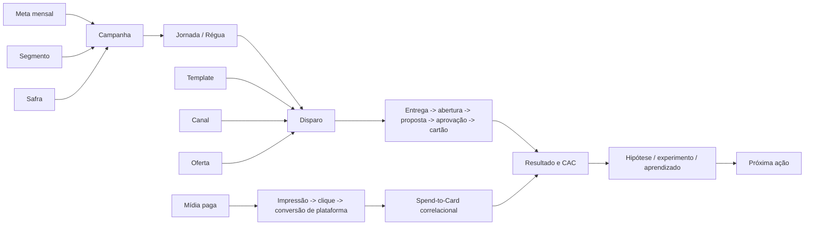

# Dossiê Mestre - Operação CRM e Mídia

**Definição:** contrato de contexto, métricas, diagnóstico e ação para o monitor diário da operação de aquisição da Afinz, com rentabilização acompanhada até clique e a exceção exclusiva do Opt-in da LP da campanha Copa Visa.

## 1. Decisão que o relatório precisa destravar

Em até dois minutos, o operator owner deve conseguir responder:

1. A produção está saudável, em risco ou comprometida?
2. O desvio vem de dados, volume, funil, custo, mix ou execução?
3. Qual campanha, segmento, canal ou etapa explica a maior mudança?
4. A operação está no ritmo necessário para atingir a meta do mês?
5. O que precisa ser feito hoje, acompanhado ou investigado?

Narrativa obrigatória:

`Sinal -> impacto -> causa provável -> evidência -> ação -> confiança`

## 2. Escopo operacional

| Frente | Unidade principal | Resultado | Fonte central |
|---|---|---|---|
| CRM Aquisição | campanha, jornada, disparo, segmento | propostas, aprovados, cartões, CAC | [[activities]] |
| CRM Rentabilização | campanha, jornada, disparo, segmento | execução, entrega, abertura e clique | [[rentabilizacao_activities]] |
| Originação B2C | dia e tipo | propostas e emissões totais | [[b2c_daily_metrics]] |
| Mídia paga | plataforma, campanha, adset, anúncio | tráfego e conversão de plataforma | [[paid_media_metrics]] |
| Metas | mês e BU | realizado, gap e ritmo esperado | [[goals]] |
| Qualidade da coleta | fonte e execução | completude e atualização | [[collection_queue]] e [[collection_execution_logs]] |

### Separações obrigatórias

- Aquisição é o centro da análise e da tomada de decisão.
- Rentabilização aparece em bloco separado, limitada a execução e engajamento até clique.
- Exceção exclusiva: na campanha Copa em parceria com a Visa, o Opt-in realizado na LP é uma conversão válida da própria campanha.
- O Opt-in Copa Visa não equivale a proposta, aprovação, cartão emitido, receita, CAC ou rentabilidade.
- Fora do caso Copa Visa, não calcular ou inferir conversão, receita, retorno, CAC ou rentabilidade para rentabilização.
- CPA de plataforma não é CAC de cartão.
- Resultado B2C total preserva a semântica vigente, incluindo Serasa quando aplicável.
- Ausência de dado não significa ausência de produção.
- Snapshot do vault é referência histórica; dado diário vem da fonte viva.

### Exceção semântica — Opt-in LP Copa Visa

Decisão confirmada em 2026-06-11:

- **Campanha:** Meu Afinz Visa Bate Um Bolão, realizada em parceria com a Visa.
- **Evento de conversão:** conclusão do Opt-in na landing page da campanha.
- **Unidade:** Opt-ins válidos registrados na LP.
- **Taxa principal:** `Opt-ins LP / usuários que acessaram a LP`.
- **Uso:** medir a capacidade conjunta de mídia paga e CRM de levar usuários à LP e concluir a adesão à campanha.
- **Limite:** esta conversão representa adesão promocional à Copa Visa, não aquisição de cartão nem resultado financeiro.
- **Não generalizar:** a regra é exclusiva desta campanha e não redefine a semântica das demais campanhas de rentabilização.

## 3. Ontologia operacional

- **Campanha:** unidade de planejamento e leitura agregada.
- **Jornada/Régua:** sequência lógica de contatos; a régua ainda não está plenamente materializada.
- **Disparo:** unidade executada e registrada em `activities`.
- **Template:** conteúdo reutilizável, separado da identidade do disparo.
- **Experimento:** variações comparáveis; não presumir significância sem desenho e volume.
- **Segmento:** dimensão central para expectativa de conversão, custo e ação.
- **Safra:** coorte temporal para recorrência, eficiência e futura rentabilidade.

## 4. Árvore de métricas

### Métricas norte

| Horizonte | Métrica | Uso | Restrição |
|---|---|---|---|
| Diário | produção válida | detectar quebra ou aceleração | exige dia fechado |
| Mensal | realizado versus meta | orientar prioridade | comparar com ritmo esperado |
| Tático | CAC por campanha/segmento | eficiência | interpretar com volume e conversão |
| Estratégico | evolução de CAC com escala | sustentar produção com eficiência | comparar campanhas, segmentos e safras equivalentes |

### Drivers de CRM

| Camada | Métricas | Leitura |
|---|---|---|
| Execução | base total, base acionável, disparos | capacidade e volume |
| Entrega | enviados, entregues, taxa de entrega | qualidade de contato |
| Engajamento | abertura, clique, resposta | canal, oferta e template |
| Intenção | propostas | intenção comercial |
| Qualidade | aprovados, taxa de aprovação | aderência do público |
| Resultado | cartões, conversão | produção final |
| Eficiência | custo total, CAC | custo por cartão |

Os drivers de intenção, qualidade, resultado e eficiência se aplicam à aquisição. Para rentabilização, usar somente base, disparos, entrega, abertura e clique.

Na campanha Copa Visa, acrescentar ao funil:

`acesso à LP -> Opt-in concluído`

| Métrica exclusiva | Fórmula | Leitura |
|---|---|---|
| Opt-ins LP | contagem de Opt-ins válidos | conversões promocionais da campanha |
| Taxa de Opt-in LP | Opt-ins LP / usuários da LP | capacidade da LP de concluir a adesão |
| Custo por Opt-in | spend de mídia Copa Visa / Opt-ins LP | eficiência de mídia para gerar adesão promocional |

O custo por Opt-in é uma métrica exclusiva da campanha e não deve ser nomeado como CPA de cartão ou CAC.

### Drivers de mídia paga

| Métrica | Fórmula | Diagnóstico |
|---|---|---|
| CTR | cliques / impressões | atratividade |
| CPC | spend / cliques | eficiência de tráfego |
| CPM | spend / impressões x 1.000 | custo de distribuição |
| Frequência | impressões / alcance | pressão e saturação |
| CPA | spend / conversões de plataforma | eficiência do evento |
| Spend | soma do investimento | ritmo de orçamento |

### Integridade

- Data máxima por fonte.
- Dias esperados versus presentes.
- Meta e Google presentes separadamente.
- Spend sem conversão.
- Campanhas não mapeadas.
- Duplicidades por chave operacional.
- Nulos em dimensões canônicas.
- Mudança brusca no volume de linhas.

## 5. Baselines e comparações

| Comparação | Pergunta | Uso |
|---|---|---|
| Último dia fechado vs. média dos 7 anteriores | houve quebra recente? | reação diária |
| Últimos 7 dias vs. 7 anteriores | há tendência consistente? | direção |
| Mês acumulado vs. meta e ritmo | chegaremos à meta? | gestão mensal |
| Campanha/segmento vs. 28 dias | saiu do padrão próprio? | diagnóstico |
| Safra atual vs. safras comparáveis | a operação aprende? | leitura estrutural |

Regras:

- Não comparar dia corrente incompleto com dias fechados.
- Usar intervalos semiabertos nas consultas.
- Separar atraso de maturação de atraso de coleta.
- Para baixo volume, ampliar janela e reduzir confiança.
- Comparar objetivos, etapas e públicos compatíveis.

## 6. Baselines históricos do vault

Referências datadas de 2026-06-08; não substituem consulta viva.

### Segmentos

| Segmento | Conversão | CAC | Papel |
|---|---:|---:|---|
| Abandonados | 23,7% | R$ 3,93 | principal alavanca documentada |
| Aprovados_nao_convertidos | 31,2% | R$ 96,39 | alta conversão, custo alto |
| Negados | 23,6% | R$ 40,74 | resultado relevante, eficiência crítica |
| Leads_Parceiros | 15,7% | R$ 15,99 | equilíbrio |
| CRM | 5,7% | R$ 10,73 | aquisição fria e volume |
| Base_Proprietaria | 8,6% | R$ 26,85 | escala intermediária |

### Canais

| Canal | Conversão | CAC | Leitura |
|---|---:|---:|---|
| E-mail | 5,9% | R$ 8,37 | baixo custo e escala |
| WhatsApp | 26,6% | R$ 20,86 | maior resposta, custo superior |
| SMS | 15,0% | R$ 26,97 | resposta intermediária, CAC alto |
| Push | baixa evidência | não conclusivo | requer teste controlado |

### Funil de aquisição

| Etapa | Referência |
|---|---:|
| Entrega | 90,0% |
| Abertura | 9,2% |
| Proposta | 11,8% |
| Aprovação | 58,0% |
| Conversão | 6,7% |

### Mídia

O histórico documenta Google com CPA e CPC de plataforma menores que Meta. Isso não autoriza realocação automática: objetivos, eventos, cobertura temporal e coleta precisam ser equivalentes.

## 7. Motor de diagnóstico

1. Validar atualização e completude.
2. Localizar o desvio na árvore de métricas.
3. Identificar a dimensão que mais contribuiu.
4. Comparar com baseline compatível.
5. Estimar impacto em produção, custo ou meta.
6. Formular causa provável sem declarar causalidade indevida.
7. Recomendar ação reversível e mensurável.

| Sinal | Diagnóstico inicial | Ação |
|---|---|---|
| Fonte atrasada | falha de coleta/ingestão | corrigir fonte antes da conclusão |
| Disparos caem e taxas ficam estáveis | volume/execução | revisar calendário e base |
| Entrega cai | base, canal ou fornecedor | conferir rejeições e operação |
| Abertura/CTR cai | criativo, oferta ou saturação | revisar e testar variação |
| Propostas caem com engajamento estável | fricção pós-clique | investigar jornada |
| Aprovação cai | mix ou qualidade do público | decompor por segmento e perfil |
| Conversão cai com aprovação estável | finalização | revisar fluxo e follow-up |
| CAC sobe por custo | mix mais caro | ajustar canal e orçamento |
| CAC sobe por queda de cartões | deterioração do funil | localizar etapa |
| Spend sem conversão | tracking, campanha ou público | validar evento e limitar gasto |
| Frequência sobe e CTR cai | saturação provável | renovar criativo/reduzir pressão |
| Meta abaixo do ritmo | produção insuficiente | priorizar impacto esperado |
| Segmento eficiente perde volume | oportunidade não explorada | recuperar cobertura |

## 8. Severidade e confiança

| Severidade | Critério |
|---|---|
| Crítico | fonte principal indisponível, produção zerada ou risco material de meta |
| Alto | deterioração consistente com impacto elevado |
| Médio | mudança material localizada ou reversível |
| Baixo | oscilação pequena ou baixa amostra |

| Confiança | Condição |
|---|---|
| Alta | fonte completa, baseline compatível e sinal em mais de uma janela |
| Média | fonte completa, mas volume ou comparação limitados |
| Baixa | fonte incompleta, pouca amostra ou conclusão correlacional |

Variação de 15% abre investigação, mas não define severidade. Considerar impacto absoluto, meta, amostra, recorrência, baseline e fonte.

## 9. Priorização

`Prioridade = impacto esperado x urgência x confiança / esforço`

- **Agir hoje:** bloqueio, perda material ou ação de baixo arrependimento.
- **Acompanhar:** sinal relevante que precisa de nova janela.
- **Investigar:** baixa confiança, problema de dados ou hipótese.

Cada ação deve ter: motivo, evidência, impacto, prazo, dono, confiança e critério de sucesso.

## 10. Contrato do relatório diário

1. **Resumo executivo:** saúde, três mudanças, meta, risco, oportunidade e ação do dia.
2. **Qualidade dos dados:** última data, cobertura, atraso e confiança por fonte.
3. **Produção e meta:** realizado, ritmo, projeção e gap.
4. **CRM Aquisição:** execução, funil, resultado, eficiência e decomposição.
5. **CRM Rentabilização:** base, disparos, entrega, abertura e clique; para Copa Visa, incluir acesso à LP, Opt-ins, taxa de Opt-in e custo por Opt-in como conversão promocional exclusiva; sem inferir proposta, aprovação, cartão, receita, CAC ou rentabilidade.
6. **Originação B2C:** propostas, emissões, participação do CRM e Serasa.
7. **Mídia paga:** Meta, Google, consolidado, saturação e coleta.
8. **Campanhas prioritárias:** sinal, impacto, ação, prioridade e confiança.
9. **Segmentos:** volume, conversão, CAC/CPA e tendência.
10. **Plano:** Agir hoje, Acompanhar e Investigar.

### Visualizações

1. Barras de produção por segmento com delta.
2. Dispersão volume x conversão, com CAC em cor ou tamanho.
3. Tendência dos principais segmentos, máximo de quatro séries.
4. Tabela ordenável para ação linha a linha.

## 11. Guardrails

- Não afirmar causalidade baseada somente em correlação.
- Não comparar CPA de plataforma com CAC de cartão.
- Não inferir resultado financeiro ou conversão de rentabilização a partir de clique.
- Tratar Opt-in da LP como conversão somente na campanha Copa Visa.
- Não converter Opt-in Copa Visa semanticamente em proposta, aprovação, cartão emitido ou receita.
- Não aplicar a taxa ou o custo por Opt-in da Copa Visa como benchmark automático para outras campanhas.
- Não recomendar escala com coleta incompleta.
- Não otimizar só CAC sacrificando volume de aquisição.
- Não misturar aquisição fria e meio de funil no benchmark.
- Não tratar conversão zero como dado ausente.
- Não usar média geral sem decompor o mix.
- Não recomendar sem fonte, confiança e critério de sucesso.
- Não automatizar escrita no banco sem governança e RLS adequadas.

## 12. Limitações conhecidas

1. Spend-to-Card é correlacional sem atribuição anúncio -> CPF.
2. Anti-overlap depende de dado individual do SFMC.
3. A régua não está plenamente materializada.
4. `paid_media_targets` precisa ser validada e preenchida.
5. Há domínios inconsistentes em dimensões.
6. Custos unitários de oferta estão zerados no código documentado.
7. O baseline antigo do Orientador não representa o CAC recente.
8. Lacunas de Google podem ser falha de coleta.
9. O ML atual é heurístico, não inferência causal rigorosa.

## 13. Decisões pendentes

- Metas e tolerâncias oficiais por frente, BU e objetivo.
- Dono humano de cada tipo de alerta.
- Regra de maturação de CRM e mídia.
- Semântica final das decomposições B2C.
- Canal de entrega após integração Google.
- Baseline específico para fins de semana.

## 14. Critério de aceite

O relatório só está completo quando:

- usa dias fechados;
- declara atualização das fontes;
- mostra número, delta e baseline;
- conecta mudança a dimensão e etapa;
- distingue fato, inferência e item a validar;
- informa impacto na meta ou eficiência;
- oferece ação com dono, prazo, confiança e critério de sucesso;
- bloqueia conclusões sem sustentação.

## 15. Contrato de extração diária - Looker Studio Copa

Decisão operacional registrada em 2026-06-11 para ampliar a aba `COPA` do XLSX de Rentabilização.

### Grão da tabela

Uma linha por `data fechada x grupo de mídia`.

| Grupo | Valores de mídia no Looker |
|---|---|
| Mídia Paga | `cpc` |
| CRM | `email`, `sms`, `whatsapp`, `wpp` |
| Orgânico | `organic` |
| Outros | `(none)`, `(not set)`, `referral`, `(data not available)` |

Os valores devem permanecer auditáveis na coluna `midias_incluidas`. A classificação poderá evoluir quando origem, campanha e UTMs forem incorporadas.

### Colunas mínimas

| Coluna | Semântica |
|---|---|
| `data` | dia fechado do acesso |
| `grupo_midia` | agrupamento canônico |
| `midias_incluidas` | valores efetivamente selecionados no filtro |
| `lp_users` | usuários no caminho `/site/afinz/afinz-copa-26/` |
| `optin_step_users` | usuários no caminho `/site/afinz/afinz-copa-26/cadastro/optins` |
| `success_users` | usuários no caminho `/site/afinz/afinz-copa-26/cadastro/sucesso` |
| `taxa_lp_optin_step` | `optin_step_users / lp_users` |
| `taxa_lp_success` | `success_users / lp_users` |
| `taxa_conclusao_etapa` | `success_users / optin_step_users` |
| `fonte` | relatório e página do Looker Studio |
| `extraido_em` | data e hora da coleta |
| `status_qualidade` | validado, parcial ou bloqueado |

### Regra semântica de conversão

- O **Opt-in confirmado na LP** é conversão oficial e exclusiva da campanha Copa Visa.
- A visita ao caminho `/cadastro/optins` representa chegada à etapa de Opt-in; isoladamente, não comprova submissão.
- O caminho `/cadastro/sucesso` é um proxy mais forte de conclusão, mas deverá ser reconciliado com o evento ou registro oficial de Opt-in antes de ser tratado como verdade transacional.
- Até essa reconciliação, usar `optin_step_users` e `success_users`, evitando renomeá-los automaticamente como `optins_confirmados`.

### Controles de qualidade

- Usar somente dias fechados.
- Registrar a data da última atualização exibida no Looker.
- Não somar usuários únicos entre grupos como se fossem pessoas distintas; um usuário pode aparecer em mais de uma mídia.
- Manter uma linha total do dia, sem filtro de mídia, para reconciliação.
- Sinalizar `success_users > optin_step_users` ou qualquer taxa acima de 100%.
- Não preencher ausência de dado como zero sem confirmar que o filtro retornou resultado válido.
- Preservar o recorte original por mídia e, em uma segunda camada, aprofundar por origem, campanha e UTM.

### Expansão para mídia paga

Quando a tabela for cruzada com a fonte de investimento, acrescentar por canal:

`spend`, `impressions`, `reach`, `clicks`, `ctr`, `cpc`, `cpm`, `frequency`, `cost_per_optin`

`cost_per_optin` somente pode usar Opt-ins confirmados. Não nomear essa métrica como CAC.

### Processo de automação

1. Abrir o relatório autenticado no Chrome.
2. Fixar início e término no mesmo dia fechado.
3. Aplicar cada grupo de mídia.
4. Capturar LP, etapa de Opt-in e sucesso.
5. Repetir sem filtro para obter o total de controle.
6. Validar taxas, cobertura e atualização.
7. Gravar tabela intermediária auditável.
8. Atualizar a aba `COPA` do XLSX sem alterar o padrão das linhas existentes.
9. Reconciliar Opt-ins com a fonte oficial da campanha antes de publicar conversão definitiva.

## Relacionado

- [[Vault-como-Contexto]]
- [[Runbook-Vault-Vivo]]
- [[Agentes-e-Workflows]]
- [[Skills-do-Projeto]]
- [[MOC-Inteligencia-IA]]
- [[Função-Objetivo]]
- [[Ontologia-v2]]
- [[KPIs-Núcleo]]
- [[Performance-por-Segmento]]
- [[Governança-de-Dados]]
- [[Copa-2026]]
