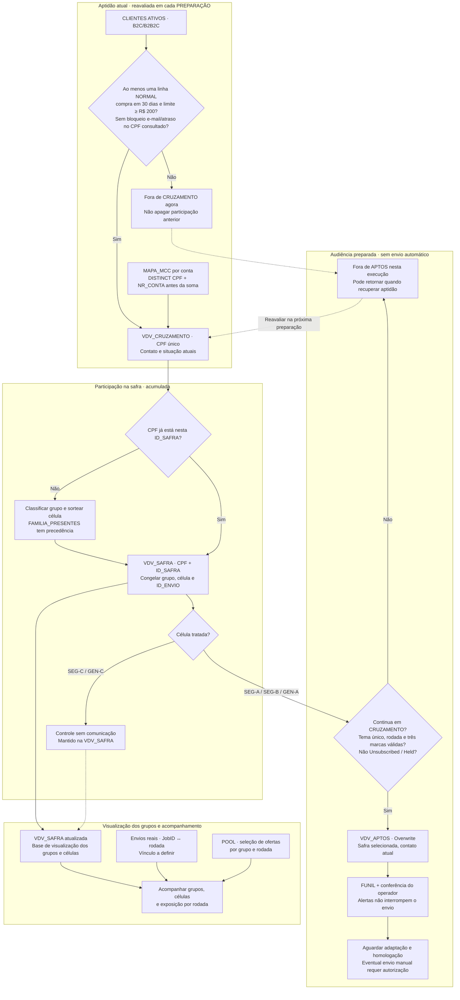

# Pool de Ofertas - Vai de Visa

O Pool de Ofertas Visa combina ofertas do programa Vai de Visa com a afinidade de compras dos clientes B2C e B2B2C. O teste compara vitrines selecionadas por grupo, vitrines genéricas e controles sem comunicação.

A VDV_SAFRA mantém os grupos e as células do teste; a VDV_APTOS reúne quem pode receber em cada rodada. As regras de seleção, automação, conteúdo e validação estão detalhadas abaixo, com contratos e SQLs nas fichas recolhíveis.

> **Estado da operação:** revisão editorial de 09/11/2026. PREPARAÇÃO com seis passos e envio manual previsto. DEs e queries montadas; execução completa, conferência do FUNIL e Test Send do motor adaptado pendentes de validação.

## 1. Intenção, escopo e estado da operação

O teste avalia se a seleção por afinidade gera mais compras do que a vitrine genérica. Os grupos são definidos pelo histórico de compras por categoria de estabelecimento (MCC), e os controles permitem comparar o efeito da comunicação.

O piloto abrange B2C e B2B2C. A entrada de Plurix depende da definição da fonte e da configuração de compartilhamento.

A PREPARAÇÃO atualiza as fontes, inclui novos participantes, seleciona as ofertas e prepara a audiência. A cadência prevista é de dois contatos semanais; dias, horários e alternância V1/V2 seguem em definição. Nesta fase, a conferência e o envio são manuais; uma automação de DISPARO fica para a próxima etapa.

| Componente | Estado | Próxima conferência |
|---|---|---|
| DEs e queries | Montagem informada; CRUZAMENTO e SAFRA reconferidas | Executar os seis passos e conferir os resultados |
| BRIEFING | Importação informada | Conferir registros aceitos, imagens e links |
| FUNIL | SQL corrigido disponível | Executar e analisar contagens e alertas |
| Fábrica | Catálogo e V1/V2 disponíveis | Adaptar ao POOL unificado e à versão de tema |
| Homologação | Pendente | Realizar Test Send e registrar o aceite |

Configuração e localização no SFMC estão nas fichas técnicas da automação e das DEs.

## 2. Percurso completo: entrada, controle, saída e retorno

Cada preparação começa pela aptidão atual. Quem ainda não participa da safra selecionada entra na SAFRA uma única vez, inclusive se cair no controle. Quem já participa preserva grupo, célula e token. O cliente pode sair de APTOS por bloqueio, atraso, recência, limite ou conteúdo indisponível sem desaparecer da população de medição; se recuperar a condição, pode voltar a APTOS na mesma alocação.



APTOS não é uma safra fechada e não elimina quem recebeu a rodada passada. A recuperação de aptidão não cria nova participação, não muda a célula e não gera um novo token naquela safra. A ausência de compra MCC não deve ser apresentada como gasto zero comprovado: o LEFT JOIN pode deixar medidas nulas e o cliente seguir como genérico se as demais regras permitirem.

## 8. Construção, testes e critérios de aceite

O bloco **Atividades: Construção do Piloto** reúne montagem, conferência de público, conteúdo, seedlist e homologação. Os registros são compartilhados com Testes e Tarefas.

Os marcos concluídos permanecem no histórico. A etapa atual exige conferir a execução dos seis passos, a audiência dinâmica e o motor adaptado antes do Test Send.

| Conferência | Resultado necessário | Evidência a guardar |
|---|---|---|
| Montagem / metadados | Nomes, PK, tipos, nulidade e relação de envio compatíveis com as seis queries; DT_ENVIO nulo; POOL com nove campos | Prints/propriedades por DE, BU/MID e versões das Query Activities |
| Primeira execução, sem envio | Seis passos na ordem e resultados persistidos; nenhum erro oculto por simples contagem | Execução por passo + tabelas FUNIL/contagens por grupo/célula |
| Conversão e fontes | Nove categorias amostradas; arquivo atual e sem contas duplicadas | Referência da IN, entrada/tratamento e amostras de valor/data |
| SAFRA | CPF+safra únicos; Família prioritária; grupos, células e token estáveis em nova execução | Comparação antes/depois, inclusive controles |
| POOL | Quatro grupos conferidos; três marcas válidas mínimas e até seis candidatas; rodada anterior preservada | VERSAO/VERSAO_TEMA, posições, marcas, motivos e datas |
| Rodada parcial | Falha detectada e recuperação controlada antes de liberar envio | Diagnóstico, chaves afetadas e decisão do operador |
| APTOS dinâmica | Só safra selecionada/tratamentos; sai por inaptidão e volta sem re-sorteio; quem recebeu rodada anterior pode continuar | Cenários de limite, atraso, bloqueio, recência, _Subscribers e retorno |
| Contrato do motor | Seleção unificada e distinção rodada/tema consumidas corretamente | Exportador/template adaptados e versão identificada |
| Seedlist | V1/V2 nos quatro grupos; parceiro com/sem arte, nome/cartão ausentes, ofertas inválidas e reservas | Destinatários autorizados e capturas de Preview/Test Send |
| Visual e navegação do e-mail | Primeiro card centralizado quando ímpar no desktop, cards empilhados no mobile, links/condições corretos | Clientes de e-mail testados e LP conferida, sem inferir entrega pelo preview |
| Medição | SAFRA completa + JobID/rodada/toque e envios reais reconciliados | Contrato IN, chaves e cobertura; sem definir exposição pelo token de LP |

Registrar o resultado e a data efetiva de cada validação na atividade correspondente.


## Histórico de resultado preservado

Nenhuma métrica histórica foi recalculada e nenhum resultado de envio/compra foi acrescentado nesta proposta. Os volumes abaixo permanecem snapshots com seus grãos e datas. A proposta editorial será submetida ao fluxo de revisão aplicável antes de incorporação.


## 3. Canais e política de seleção

E-mail, WhatsApp e SMS são canais principais da estratégia. O piloto separa parcelas sem sobreposição: cada CPF recebe no máximo um canal do Pool na mesma rodada. SEG-C e GEN-C ficam sem comunicação nos três canais. A alocação de grupo/célula permanece congelada na SAFRA; GEN-A usa a vitrine genérica, mas não representa comparação causal direta com SEG-B de outra população.

| Canal | Aptidão própria | Destino | Teto por rodada de envio |
|---|---|---|---|
| E-mail | Endereço disponível, sem bloqueio de e-mail, supressões/publication list e status de assinante conferidos | Links de oferta; CTAs finais a conferir | Orçamento e capacidade a definir |
| WhatsApp | Contato móvel, bloqueios/supressões próprios liberados e uso do app nos últimos 60 dias | LP personalizada da rodada | Até 5.000 mensagens |
| SMS | Contato móvel, bloqueios/supressões próprios liberados e uso do app nos últimos 60 dias | LP personalizada da rodada | Até 100.000 SMS |

Os tetos valem por rodada, sujeitos à elegibilidade e ao orçamento. Não são metas nem limites semanais. No SMS, destinatários, tentativas, reenvios e unidades faturadas/segmentos podem divergir: registrar cada unidade separadamente.

ULTIMO_ACESSO da CLIENTES ATIVOS é a referência de uso do app para os dois canais móveis. Normalizar a data para America/Sao_Paulo e comparar de hoje menos 60 dias até hoje, inclusive. Data inválida, ausente ou futura impede apenas a seleção móvel. O participante permanece na SAFRA e pode receber e-mail se elegível. DEVICE, modelo de aparelho e data de cadastro/importação não entram nesta regra. Usar o app não comprova uso de WhatsApp.

Permissões de uso/consentimentos dos canais foram confirmadas na definição do piloto. A execução continua respeitando os bloqueios e as supressões próprios: bloqueio de e-mail não é bloqueio de celular, e a consulta _Subscribers não pode excluir toda a audiência móvel.

:::details Sorteio, perfis e parâmetros pendentes
Sortear dentro de perfis relevantes, com grupo/célula, B2C/B2B2C e recência quando a fonte permitir. Aplicar a mesma política e probabilidade a SEG-A e SEG-B. Não priorizar maiores compradores no WhatsApp e interpretar o SMS residual como efeito do canal.

Pesos, cotas por perfil, tamanho da amostra, poder estatístico e pressão por pessoa seguem em aberto. O contrato usa ID_POLITICA_CANAL e ID_RODADA para identificar a regra; sem parâmetros aprovados, a simulação retorna “parâmetros pendentes” e não produz audiência. O módulo de simulação do GaaS não executa seleção no SFMC.

Evitar redistribuir silenciosamente participantes inelegíveis para preencher teto. Guardar a política, elegibilidade e contagens de cada perfil para interpretar diferenças de cobertura. A seleção de um CPF em um canal exclui os outros naquela rodada; rodadas futuras precisam respeitar a política de pressão ainda a definir.
:::

## 4. Experiência da LP dinâmica

WhatsApp e SMS levam à LP personalizada da rodada, baseada no layout Black Afinz de referência: https://cloud.relacionamento.afinz.com.br/blackafinz-v2. O banner da campanha é independente do hero do e-mail. A arte fixa pode ser usada inicialmente; URLs finais de imagem ainda precisam ser fornecidas.

A LP resolve a participação por ID_ENVIO opaco, sem CPF na URL, e preserva a rodada do link. Grupo e célula vêm da SAFRA no servidor, nunca de um grupo livre enviado pela URL. APTOS é sobrescrita e não pode ser a única origem de links antigos. O token de participação não identifica sozinho cada acesso ou disparo.

POOL define seleção/ordem; BRIEFING fornece benefício, foto, vigência, resgate e condições. SEG-A usa afinidade; SEG-B e GEN-A usam GENERICO. Inicialmente são três cards, com reservas entre seis candidatas. A cada acesso, revalidar atividade/vigência, compactar válidas e usar reservas. Link antigo mantém a rodada: não trocar silenciosamente para uma seleção nova.

Exibir cupom somente quando aplicável, validade real, condições consultáveis e CTA de resgate. Visita à LP, clique de oferta e compra são eventos distintos. CPF e token não entram em GTM/GA4, dataLayer ou parâmetros de eventos. Controles não recebem os links de comunicação do Pool.

:::details Prévia integrada ao editor e pendências de CloudPages
O editor do Pool inclui prévia da LP, usando grupo/célula/data da amostra, rodada e desktop/mobile. Aceita CSV de nove colunas do POOL para conferir seleção e tema separadamente; a importação é local à prévia, sem alterar o contrato de seis colunas persistido pela Fábrica. O banner fica sinalizado como asset pendente até receber uma URL.

A prévia revalida ofertas e reservas com HTML escapado, links HTTPS e sem scripts de analytics. Ela é uma referência de conteúdo/layout, não uma CloudPage publicada. Ainda aplicar no SFMC: resolução segura de token+rodada, leitura da SAFRA/POOL/BRIEFING, supressões, assets, rastreio e testes reais. O shell HTML da página de marketing, isoladamente, não contém esse contrato dinâmico.
:::

### Medição, custos e ampliação de volume

Registrar por rodada/canal: participantes elegíveis, selecionados, destinatários previstos, mensagens previstas, destinatários efetivos, mensagens/tentativas realizadas, segmentos faturados de SMS, custo previsto e realizado. Preços unitários e orçamento ficam como parâmetros pendentes, sem estimativa inventada.

Acompanhar entrega, tráfego qualificado na LP/oferta, respostas quando cobertas, compras por fonte conciliada e custo. Clique ou volume enviado não comprovam incremento ou ROI. Comparar A/B dentro do mesmo grupo e política de canal; analisar desequilíbrio de exposição e perfis antes de atribuir efeito ao canal.

Há histórico individual de entregas/cliques/respostas de WhatsApp/SMS segundo a definição do piloto. Localização, cobertura e confiabilidade serão investigadas depois; isso não bloqueia o início do piloto e não significa integração pronta. Para a execução inicial, registrar os comprovantes disponíveis por rodada/canal e explicitar sua cobertura.

:::details Histórico anterior a 09/11 · não executar como instrução vigente
### Pool de Ofertas - Vai de Visa

### Em uma frase

Vitrine de ofertas da bandeira Visa (catálogo "Vai de Visa") enviada a quem já tem o cartão Afinz Visa, **personalizada pela afinidade de compra por categoria ([[MCC]])**, começando pelo tema Black Friday (que a Visa chama de *Best November*).

**Definição e propósito:** iniciativa de rentabilização (incentivo ao uso) que testa se escolher as ofertas pelo histórico de compras do cliente gera mais uso do cartão do que mandar as mesmas ofertas para todos. É também a primeira operação da Afinz que usa transação por MCC para segmentar CRM.

> Status por seção: desenho e base elegível = `confirmado` (consultas reais de 03/11/2026); e-mail, LP, SMS/WhatsApp, medição = `a-validar` (ainda não construídos).

### Não confundir com o Pool de Ofertas - Parceiros

| | **Pool de Ofertas - Vai de Visa** (esta nota) | **[[Iniciativa-Pool-de-Ofertas-Parceiros\|Pool de Ofertas - Parceiros]]** |
|---|---|---|
| Fonte das ofertas | Catálogo da Visa (nov/26: 62 ofertas únicas, cupom e link de afiliado) | Parceiros comerciais da própria Afinz (ex.: repique Emagrecentro) |
| Quem escolhe a oferta | Regra por grupo de afinidade MCC + limite disponível | Campanha escolhe, igual para toda a base |
| Personalização | Por CPF (4 slots dinâmicos) | Por campanha |
| Desenho | Teste com controle (holdout de 10%) | Disparo sem controle |
| Jornadas | `JOR_RENT_POOL_OFERTAS_VAIDEVISA` (*a-validar*) | `JOR_RENT_POOL_OFERTAS`, `JOR_RENT_POOL_OFERTAS_REPIQUE_EMAGRECENTRO` |
| Medição | Compra no estabelecimento/categoria da oferta (ver [[Teste-Afinidade-MCC-vs-Generico]]) | Abertura e clique (regra de [[Incentivo-ao-Uso]]) |

As duas são variantes da mecânica [[Incentivo-ao-Uso]]. Somar resultados das duas sem separar a jornada mistura mecânicas diferentes.

### Contexto e conceitos

- **Vai de Visa:** programa de vantagens da bandeira Visa; já aparece como benefício em [[Cartao-Afinz-Visa]]. O catálogo de out/2026 tem três abas: orientações, "Ofertas VDV - Geral" (resgate no site do parceiro, com ou sem cupom) e "Ofertas | Só com Visa" (exclusivas para pagamento Visa).
- **Precedente com a Visa:** [[Iniciativa-Copa-2026]] usou o BI da Visa (`copa_visa_daily`) como fonte da verdade. Isso abre um caminho de medição para esta iniciativa (ver Lacunas).
- **Afinidade por MCC:** categoria de compra definida pelo código do estabelecimento ([[MCC]]), não pelo produto comprado.
- **Grupos:** b1 Moda · b2 Saúde e Beleza · b3 Eletrodomésticos · b4 Eletrônicos · b5 Brinquedos · b6 Viagem · b7 Pet · Genérico.

### Frentes e responsáveis

| Frente | Responsável | Status (03/11/2026, fim do dia) | Observação |
|---|---|---|---|
| Base de audiência | operação | em andamento | MAPA corrigida; DEs criadas; automação de preparação em 1ª execução ([[Automacao-VDV-Pool-de-Ofertas]]) |
| Ofertas | Tassia / operação | em andamento | Pool de 62 ofertas classificado e priorizado; vitrine do 1º teste definida ([[DE-BRIEFING_OFERTAS_VISA]]) |
| E-mail dinâmico | operação / Pietra | a iniciar | Template-fonte novo com KV e 3 cards ([[Emails-Dinamicos-Vai-de-Visa]]) |
| LP dinâmica | operação | a iniciar | CloudPage com a mesma lógica, `ID_ENVIO` no link |
| SMS e WhatsApp | Tassia / operação | a iniciar | Briefing no padrão do Pool de Ofertas - Parceiros |
| Medição | IN | a combinar | Relatório agregado D+7/15/30 a partir da `VDV_ENVIO` |

> **Atualização 05/11/2026 (noite):** o e-mail dinâmico está construído na [[Fabrica-de-Emails-GaaS|Fábrica]] como frente de Rentabilização (Rentabilização › Pool de Ofertas Visa › Black Friday › E-mail 1 e E-mail 2), com o conteúdo da BF26 no banco do GaaS. O plano editorial dos dois e-mails e a Ficha de Produto estão propostos em [[Plano-de-Comunicacao-Pool-Vai-de-Visa]], aguardando validação.

### Primeiro teste (safra `VDV_2026_11_BF`)

- **Grupos:** MODA, SAUDE_BELEZA e FAMILIA_PRESENTES (3 marcas cada) + GENERICO. Detalhe em [[DE-VDV_APTOS]] e [[DE-BRIEFING_OFERTAS_VISA]].
- **Sorteio:** controle de 10% com código fixo + A × B por safra ([[Teste-Afinidade-MCC-vs-Generico]]).
- **Disparo:** antes de 30/11 (Giuliana Flores e Evino vencem nessa data).

### Fases

1. **Fase 1 — B2C + B2B2C** (sem Plurix). Fonte: `CLIENTES ATIVOS`, que hoje só tem `CANAL` B2C e B2B2C.
2. **Fase 2 — Plurix / Cartonistas.** Entrada prevista do público [[Publico-Cartonistas]]; filtro `CANAL IN ('B2C','B2B2C')` existe justamente para isolar a fase 1.

### Funcionamento

```
SFTP (IN) → MAPA_MCC_ENTRADA (texto) → MAPA_MCC
CLIENTES ATIVOS (diária) ─┐
                          ├─► VDV_CRUZAMENTO → VDV_APTOS (grupo + célula) → VDV_FUNIL
MAPA_MCC (NR_CONTA) ──────┘                         │
                                    (dia do disparo) ▼
BRIEFING_OFERTAS_VISA ──► e-mail / LP ◄── VDV_ENVIO (congelado, sendable) ──► IN (30 dias)
```

Peças em [[MOC-SFMC-DEs-e-Automations]] e automações em [[Automacao-VDV-Pool-de-Ofertas]].

### Regras de elegibilidade (vigentes na fase 1)

| Regra | Implementação | Origem |
|---|---|---|
| Ativo | `DATA_ULTIMA_COMPRA` nos últimos 30 dias | spec da gestora |
| Limite | `LIMITE_DISPONIVEL ≥ 200` no cartão NORMAL | spec da gestora |
| Conta sem bloqueio/atraso | `STATUS = 'NORMAL'` | decisão 03/11 (campo legível substitui `CD_STATUS_CONTA`/`QT_DIAS_ATRASO`) |
| Atraso em **qualquer** conta do CPF | CPF sai | decisão 03/11 (a confirmar com a gestora) |
| Bloqueio de e-mail | `bloqueio_email = True` em qualquer linha do CPF → sai da base de e-mail | pedido da operação |
| Bloqueio de celular | gravado como flag; exclui só de SMS/WhatsApp | pedido da operação |
| Oferta × limite | oferta só aparece se `limite ≥ ticket mínimo × 1,10` | spec da gestora |

### Principais números

> 📊 Snapshot 2026-11-03 — Query Studio (SFMC), `CLIENTES ATIVOS` com DT_CARGA 03/11 05:16 e `MAPA_MCC` importada no mesmo dia. Contagens por CPF feitas com `GROUP BY` (ver [[SFMC-Query-Studio-e-SQL]]).

| Etapa | Valor | Leitura |
|---|---:|---|
| Linhas da `CLIENTES ATIVOS` | 517.025 | uma linha por cartão/produto, não por cliente |
| Linhas com `STATUS = 'NORMAL'` | 434.575 | B2B2C 308.389 · B2C 126.186 |
| … com compra nos últimos 30 dias | 212.820 | metade da base NORMAL está parada |
| … com limite disponível ≥ R$ 200 | 134.030 | **maior corte: −37%** dos ativos |
| … com e-mail liberado | 130.228 | bloqueio pesa ~3% |
| … com conta na MAPA_MCC | 129.955 | cruzamento por conta bate 99,8% |
| **CPFs elegíveis (regras por CPF)** | **130.175** | número oficial da base elegível |

As quatro primeiras linhas do funil foram calculadas com `COUNT(DISTINCT)` no Query Studio e podem estar infladas; o número oficial é o da última linha.

### Medição

Ver [[Teste-Afinidade-MCC-vs-Generico]] para células, KPIs e janela. Resumo: conversão = compra no estabelecimento ou na categoria da oferta até 30 dias após o envio, comparada ao grupo de controle. Abertura e clique entram como diagnóstico, não como resultado.

### Fontes e evidências

- Spec da gestora: abas "Estratégia de Ativação", "Ofertas x Segmento" e "Spec DE - IN" (arquivo local da operação; não versionado no vault).
- Catálogo Visa (out/2026) e e-mail da Visa com temas e parceiros de destaque da Best November (Viagem e Turismo, Esporte e Lazer, Beleza e Saúde, Eletrônicos; parceiros de maior venda: Decolar, Movida, GOL, CVC, Extra, iPlace).
- Consultas no Query Studio de 03/11/2026 (resultados acima).

### Lacunas e pendências

- Top vendidas Visa por categoria não veio na coluna da spec → define o conteúdo genérico (SEG-B, GEN-A) → e-mail da Visa cobre só parte (Adidas, Venancio, GOL, CVC, Extra, iPlace não estão no catálogo) → Tassia / Visa.
- Medição por nome de estabelecimento é frágil em compra online → subestima conversão → pedir à Visa dado de resgate por oferta/cupom, como `copa_visa_daily` → operação / gestora.
- Quantidade de compras em 6 meses ausente na MAPA → regra de grupo aproximada (`V1_12M_REC6M`) → coluna nova no arquivo da IN → IN.
- 79 mil clientes ativos sem limite ≥ R$ 200 ficam fora → público relevante sem comunicação → decidir mensagem sem oferta → gestora.
- Nome da jornada não definido → impede reconciliação com `rentabilizacao_activities` → definir na criação da jornada → operação.

Pendências registradas também em [[Decisões-Abertas]]; problemas do catálogo em [[Inconsistências-a-Corrigir]].

### Situação em 05/11/2026 (noite)

| Frente | Estado |
|---|---|
| Base de audiência | PREPARAÇÃO rodando (130.175 aptos 📊 03/11); parceiro e nome do cartão a incluir nas queries 3–5 |
| Ofertas (acervo) | 66 linhas, 60 ativas, 12 com foto, 4 com logo 📊; carga BF26 no GaaS e em CSV |
| Rotação | decidida (por grupo, 2×/semana, marca em dois grupos circula, nunca sem oferta); SQL proposto — [[Rotacao-de-Ofertas-Vai-de-Visa]] |
| E-mail | template `builtin-vdv-pool` na Fábrica (até 3 ofertas); V1 persona e V2 cartão — [[Emails-Dinamicos-Vai-de-Visa]] |
| Plano editorial | proposta a validar — [[Plano-de-Comunicacao-Pool-Vai-de-Visa]] |
| Automação de disparo | desenhada, a montar — [[Automacao-VDV-Pool-de-Ofertas]] |
| LP, SMS, WhatsApp | depois do e-mail |

Próximos passos até o 1º disparo: criar campos e DEs novas → query 0 → atualizar Q3–Q5 e montar Q8–Q10 → rodar DISPARO sem envio e conferir funil → Test Send → agendar.

### Relacionado

[[Plano-de-Comunicacao-Pool-Vai-de-Visa]] · [[Incentivo-ao-Uso]] · [[Iniciativa-Pool-de-Ofertas-Parceiros]] · [[Iniciativa-Copa-2026]] · [[Cartao-Afinz-Visa]] · [[MCC]] · [[Teste-Afinidade-MCC-vs-Generico]] · [[Emails-Dinamicos-Vai-de-Visa]] · [[MOC-SFMC-DEs-e-Automations]] · [[10-Resultados/Dominios/Dominio-Rentabilizacao|Rentabilização]]
:::

