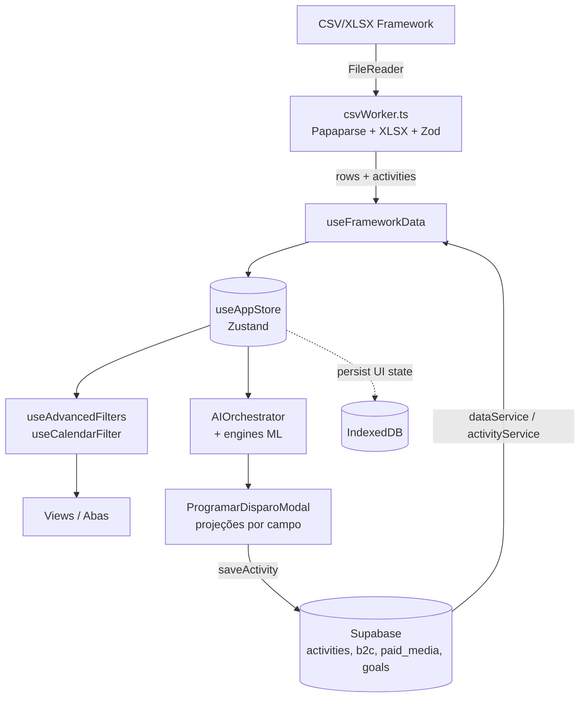

# Arquitetura Geral

> **Legado (foto de jun/2026).** Esta nota ficou fora da estrutura nova da wiki em 29/10/2026 e é mantida como histórico, sem alteração de conteúdo. Para o estado atual, ver a documentação do repositório (`calendar-estrategico/docs/`) e o [[08-Engenharia/MOC-Engenharia|MOC de engenharia]].

Definição precisa: o GaaS é uma **SPA React 18 + TypeScript** (sem framework de servidor) que renderiza um dashboard de inteligência de campanhas de aquisição de cartão. Não há backend próprio — o **Supabase** é o único backend (Postgres + Storage + Auth), acessado diretamente do browser via `@supabase/supabase-js`. Todo o "cérebro" analítico (ML, projeções, recomendações, correlações) roda **client-side**, no navegador do operador.

Por que isso importa: a operação de growth da Afinz precisava de uma ferramenta interna rápida de evoluir, sem time de backend. A escolha de empurrar inteligência para o cliente (ver [[Pipeline-ML]]) e usar Supabase como BaaS permitiu construir ~60 mil linhas de TS/TSX em ~9 meses por uma pessoa + IA (ver [[Histórico-de-Evolução]]).

> 📊 Snapshot 2026-06-08: ~60.021 linhas em `.ts/.tsx`, 145 componentes `.tsx`, ~29 hooks, 16 services, 4 stores Zustand, 4 React Contexts, 1 Web Worker.

## Camadas

```
┌─────────────────────────────────────────────────────────────┐
│  UI / Views (145 componentes .tsx)                           │
│  App.tsx → MainLayout → 11 abas (ver [[Componentes-por-Aba]])│
├─────────────────────────────────────────────────────────────┤
│  Estado: Zustand (4 stores) + React Context (4)              │
│  ver [[Modelo-de-Estado]]                                    │
├─────────────────────────────────────────────────────────────┤
│  Hooks de dados/análise (~29)  ver [[Hooks-Catálogo]]        │
├─────────────────────────────────────────────────────────────┤
│  Services (16)  +  Pipeline ML (11 arquivos)                 │
│  ver [[Camada-de-Serviços]] e [[Pipeline-ML]]                │
├─────────────────────────────────────────────────────────────┤
│  Web Worker (csvWorker)  +  IndexedDB (idb-keyval)           │
├─────────────────────────────────────────────────────────────┤
│  Supabase (Postgres + Storage + Auth)  — único backend       │
└─────────────────────────────────────────────────────────────┘
```

## Fluxo de dados



Pontos não óbvios do fluxo:

- **CSV é parseado num Web Worker** (`src/workers/csvWorker.ts`), com timeout de 180s, para não travar a UI em arquivos grandes. O worker valida linha a linha com Zod (`frameworkSchema`).
- **O IndexedDB NÃO é o cache primário dos dados.** O `useAppStore` usa `partialize` para persistir apenas estado de UI (`journal`, `viewSettings`, `alertConfig`). `frameworkData` e `activities` **não** são persistidos — vêm do Supabase a cada mount. Ver [[Decisões-Técnicas]] e [[Modelo-de-Estado]].
- **O período e a BU selecionada vivem em React Context** (`PeriodContext`, `BUContext`), fora do Zustand — `App.tsx` combina os dois antes de aplicar filtros.

## Padrões arquiteturais usados

- **Container/Hook pattern**: views finas consomem hooks que encapsulam dados e cálculo (`useResultadosMetrics`, `useRecommendationEngine`, etc.).
- **Service layer + barrel exports**: o ML é exportado por `services/ml/index.ts`; o orquestrador é um **singleton** (`getAIOrchestrator()`).
- **Arquitetura de blocos** no modal de disparo (ver [[Modal-de-Disparo]]).
- **Error Boundary** de classe (`AppErrorBoundary` em `App.tsx`) envolve toda a árvore.
- **Roteamento por hash + estado**: não usa react-router; a aba ativa é `viewSettings.abaAtual` no Zustand, com `hashchange` para fluxos de auth (recovery/invite).

## Stack real (do `package.json`)

React 18.2 · TypeScript 5.2 · Vite 5.0 · Tailwind 3.3 · Zustand 5.0 · Recharts 3.5 · Papaparse 5.4 · Zod **4.1** (CLAUDE.md diz 3.x — desatualizado) · idb-keyval 6.2 · Supabase 2.93 · framer-motion 12 · react-beautiful-dnd 13 · date-fns 2.30 · exceljs 4.4 · xlsx 0.18 · lucide-react 0.563. Detalhe e justificativas em [[Stack-e-Dependências]].

## Relacionado
- [[Stack-e-Dependências]]
- [[Modelo-de-Estado]]
- [[Hooks-Catálogo]]
- [[Camada-de-Serviços]]
- [[Pipeline-ML]]
- [[Componentes-por-Aba]]
- [[Decisões-Técnicas]]
- [[Histórico-de-Evolução]]
- [[MOC-Engenharia]]
